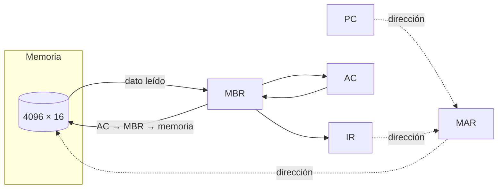

# Flujo de información en BLUE (datos y direcciones)

> [!important] Qué necesitás para responder esta pregunta
> **En otra tanda o unidad:** [[Máquina BLUE — arquitectura y conjunto de instrucciones]] (Tanda 3 · 3.9 El RI y 3 ejemplos de instrucciones) · [[Registros de la CPU]] (Materia · Unidad 5) · [[Estructura básica de un computador]] (Tanda 1 · 1.5 Estructura básica del computador) · [[Ciclo de máquina]] (Tanda 1 · 1.8 Ciclo de máquina y ciclo de instrucción) El detalle de **para qué sirve cada apoyo** está en [[00 Apoyos — 1.1 Flujo de información]].

> [!abstract] En una frase
> En la BLUE **toda la información circula por un único bus**: en cada pulso **un** registro pone su contenido en el bus ("Envíe…") y **otro** lo copia ("Cargue…"). Hay dos flujos que hay que saber separar: el de **direcciones** (12 bits, unidireccional: PC/IR → MAR → memoria) y el de **datos** (16 bits, bidireccional: memoria ↔ MBR ↔ AC/IR).

> [!note] Si es la primera vez que ves esto
> Imaginá una sola autopista de **un carril** que conecta todos los registros de la CPU, la memoria y la ALU. Por ese carril sólo puede circular **un vehículo por vez**: o va una dirección, o va un dato, pero nunca los dos. Entonces todo el funcionamiento de la máquina se reduce a decidir, pulso por pulso, **quién sube al bus** y **quién lo copia**. Esta nota es el mapa de esos viajes. Si entendés el mapa, entendés por qué cada instrucción tarda los pulsos que tarda.

---

## 1. Las palabras que hay que manejar antes de empezar

| Palabra | Qué es | En la BLUE |
|---|---|---|
| **Registro** | cajita de bits dentro de la CPU; guarda un valor | PC, MAR, MBR, IR, AC, SR, Y, Z |
| **Bus** | conjunto de cables que conecta varios dispositivos; **todos reciben lo que uno transmite** | bus de datos (16), de direcciones (12), de control |
| **Bus único (common bus)** | un solo camino compartido para todas las transferencias internas | el de la BLUE |
| **Salida de tres estados** | la salida de un registro puede estar en 0, en 1 o **desconectada** (alta impedancia) | permite que varios registros cuelguen del mismo bus |
| **Envíe (Send)** | microorden que conecta la salida de un registro al bus | `Send PC`, `Send MBR`, `Send A`… |
| **Cargue (Load / Strobe)** | microorden que hace que un registro copie lo que hay en el bus | `Load MAR`, `Load IR`, `Load A`… |
| **Microoperación** | una transferencia elemental entre dos registros, en un pulso | `MAR ← PC` |
| **Dirección efectiva (EA)** | dirección final que se envía a la memoria | `EA = campo + índice` |

> [!important] La regla que explica todo
> **En un bus único, en cada pulso habla uno y escuchan todos.** Si dos registros activaran su `Send` a la vez, dos salidas se pelearían por el mismo cable: se produciría un **cortocircuito lógico** (un 1 contra un 0). Por eso las salidas son de **tres estados**: el que no habla queda *desconectado*, no en 0.

---

## 2. Qué información circula: los cuatro tipos

En una computadora no circula una sola cosa. Circulan **cuatro** tipos de información, y la pregunta del final lo que evalúa es que sepas **distinguirlos**:

| Tipo | Para qué | Ancho en BLUE | Dirección del flujo |
|---|---|---|---|
| **Instrucciones** | decirle a la CPU qué hacer | 16 bits | memoria → MBR → IR |
| **Direcciones** | decir **dónde** está el dato | 12 bits | PC/IR → MAR → memoria |
| **Datos** | la información en sí | 16 bits | memoria ↔ MBR ↔ AC (y AC → MBR → memoria) |
| **Señales de control** | decir **cuándo** y **qué operación** | 1 bit cada una | UC → todos |

> [!tip] El detalle fino que sube nota
> Las **instrucciones** viajan como *datos* (por el bus de 16 bits) hasta el IR; recién cuando se decodifican se separan en **opcode** (4 bits, va a la UC) y **campo de dirección** (12 bits, va al MAR en la ejecución). Es decir: **la misma información cambia de papel** según en qué parte del ciclo esté.

---

## 3. Los registros y qué papel juega cada uno

| Registro | Bits | Qué guarda | Quién lo lee / lo escribe |
|---|---|---|---|
| **PC** (Program Counter) | 12 | la dirección de la **próxima** instrucción | se incrementa en cada búsqueda (CP4) |
| **MAR** (Memory Address Register) | 12 | la dirección que va a la memoria | lo carga el PC (búsqueda) o el IR (ejecución) |
| **MBR** (Memory Buffer Register) | 16 | lo que sale o entra de la memoria | memoria ↔ MBR ↔ IR o AC |
| **IR** (Instruction Register) | 16 | la instrucción en curso | la UC decodifica sus 4 bits altos |
| **AC** (Acumulador) | 16 | el dato con el que se opera | es la entrada/salida de casi todo |
| **SR** (Registro de llaves) | 16 | lo que carga el operador en la consola | `CSA` lo copia al AC |
| **Y, Z** | 16 | entradas de la ALU | `A→Z` y `MBR→Y` antes de operar |
| (indexada) **RIF, RID, RB, W, X** | 16 | índices, base y entradas del sumador de direcciones | ver [[Registros base e índice]] |

**¿Por qué el PC y el MAR son de 12 bits y el MBR de 16?** Porque la memoria tiene **4096 celdas** (2¹² = 4096) y cada celda guarda **16 bits**. La dirección necesita 12 bits; el contenido, 16. Esa asimetría es una de las cosas que más se pregunta.

---

## 4. El flujo de DIRECCIONES (12 bits, unidireccional)

Las direcciones van **siempre en un solo sentido**: desde la CPU hacia la memoria. Nunca al revés. Son **cinco caminos** posibles (así los enumera el apunte de Foster):

| # | Camino | Cuándo ocurre | Instrucción |
|---|---|---|---|
| 1 | **PC → MAR** | al empezar cada búsqueda | todas |
| 2 | **IR(campo dirección) → MAR** | al ir a buscar el operando | LDA, STA, ADD, XOR, AND, IOR |
| 3 | **PC → AC** | para guardar el retorno de una subrutina | SRJ |
| 4 | **IR(campo dirección) → PC** | en un salto | JMP, JMA, SRJ |
| 5 | **SR(llaves) → PC** | cuando el operador carga el PC desde la consola | botón LOAD PC |

> [!warning] La confusión clásica
> En un **salto** (`JMP 600`) el campo de dirección **no va al MAR**: va al **PC**. ¿Por qué? Porque en un salto esa dirección **no es "dónde está un dato", es el dato mismo**: el número que hay que cargar en el contador de programa. **El mismo campo, dos destinos distintos según la instrucción.** Esa es la respuesta que distingue a alguien que entendió el modelo de alguien que memorizó el dibujo.

---

## 5. El flujo de DATOS (16 bits, bidireccional)

Los datos van y vienen. Son **ocho caminos** posibles:

| # | Camino | Cuándo | Sentido |
|---|---|---|---|
| 1 | **memoria → MBR** | lectura | entra |
| 2 | **MBR → IR** | la instrucción llega al IR | interno |
| 3 | **MBR → AC** | el operando llega al acumulador (LDA, ADD…) | interno |
| 4 | **AC → MBR → memoria** | escritura (STA) | sale |
| 5 | **AC → Z / MBR → Y** | antes de operar en la ALU | interno |
| 6 | **ALU → AC** | resultado de la operación | interno |
| 7 | **SR → AC** | `CSA` | interno |
| 8 | **AC → MBR** (para la consola: EXAMINE/DEPOSIT) | operaciones del panel | interno |

Más **3 caminos de entrada/salida** (datos del periférico → AC, AC → periférico, y las líneas de selección de dispositivo). Total: **5 + 8 + 3 = 16 pasajes** distintos. Ese número (16) es el que aparece en el apunte y es una buena carta para el oral: **"la máquina completa tiene 16 transferencias posibles, y el ciclo de cualquier instrucción es una secuencia de ellas"**.



---

## 6. El bus, visto por dentro (por qué funciona)

```
  PC ──┐        ┌──► IR ──► (decodificador)
  MAR ─┤        │
  MBR ─┤        │
  AC ──┼── BUS ─┤   cada registro tiene:
  SR ──┤        │     · una salida "Send" (3 estados)  → pone su contenido en el bus
  Y ───┤        │     · una entrada "Load"             → copia el contenido del bus
  Z ───┘        │
  ALU ──────────┘   (entrega: SUM, XOR, AND, OR, Z', 2·Z)
```


Cada `Send` es una compuerta de **tres estados** controlada por la UC; cada `Load` es la señal de **reloj del registro** (con un pequeño retardo para que el dato esté estable antes de copiarlo). El **bus de 16 bits** es interno a la CPU; hacia la memoria salen los **12 bits del MAR** por el bus de direcciones y los 16 del MBR por el de datos.

> [!example] Preguntas del propio apunte (buenas para practicar)
> - *"Si una máquina tiene n registros que pueden ser origen o destino, ¿cuántos ramales necesita un esquema
>   punto a punto? ¿Y un bus común?"* → Punto a punto: `n·(n−1)` ramales; bus común: `n` salidas + `n`   entradas compartidas sobre el mismo bus. **Por eso se usa el bus.**
> - *"¿Qué pasa si activamos dos líneas Send a la vez?"* → Dos salidas peleándose por el bus: dato indefinido
>   (y, sin tres estados, cortocircuito).
> - *"¿Qué se carga si activamos Load sin ningún Send?"* → Lo que quede flotando: dato indefinido.

---

## 7. Todo junto: un programa trazado pulso por pulso

Programa: `LDA 500` · `ADD 501` · `STA 502` (cargar el valor de la celda 500, sumarle el de 501, guardar en 502). Mirá cómo se alternan los dos flujos:

| Instrucción | Fase | Quién habla → quién escucha | Flujo |
|---|---|---|---|
| LDA | búsqueda CP1 | `PC → MAR` | **dirección** |
| LDA | búsqueda CP5-CP6 | memoria → `MBR`, `MBR → IR` | **dato** (la instrucción) |
| LDA | ejecución CP1 | `IR(dir) → MAR` | **dirección** |
| LDA | ejecución CP5 | `MBR → AC` | **dato** |
| ADD | ejecución CP2 / CP6 | `AC → Z`, `MBR → Y` | **dato** (internos) |
| ADD | ejecución CP8 | `ALU(SUM) → AC` | **dato** (interno) |
| STA | ejecución CP4 | `AC → MBR`, orden de escritura | **dato** (sale) |

Se ve el patrón: **primero la dirección, después el dato**. Siempre. En toda instrucción que va a memoria.

---

## 8. Cómo responderlo en el final (3–4 minutos)

**Movimiento 1 — la definición (20 s).** "En la BLUE toda la información circula por un **bus único**. En cada pulso, un registro habilita su salida de tres estados y otro activa su carga: una transferencia por pulso."

**Movimiento 2 — el dibujo (60 s).** Los cinco registros colgando del bus, la memoria arriba, la ALU abajo, y **dos colores**: uno para el camino de direcciones (PC/IR → MAR → memoria) y otro para el de datos (memoria → MBR → IR/AC, y AC → MBR → memoria).

**Movimiento 3 — el desarrollo (90 s).** Los cuatro puntos que marcan la diferencia:

1. **Direcciones (12 bits, unidireccional)**: cinco caminos, siempre CPU → memoria.

2. **Datos (16 bits, bidireccional)**: ocho caminos, incluidos los internos (Z, Y, ALU).

3. **E/S**: tres caminos más, con las líneas de selección de dispositivo.

4. **Total: 16 pasajes posibles**; cualquier instrucción es una secuencia de esos pasajes.

**Movimiento 4 — el cierre con la consecuencia (20 s).** "Lo que define si lo que viaja es una dirección o un dato **no es el cable, es el uso**: en `JMP`, el campo de dirección va al PC y no al MAR, porque ahí la dirección **es** el dato."

### Repreguntas típicas y cómo responderlas

| Repregunta | Respuesta corta |
|---|---|
| ¿Por qué el bus es único y no uno por par de registros? | Costo: `n·(n−1)` contra `n` conexiones; y la UC sólo debe habilitar dos registros por pulso |
| ¿Qué pasa si dos registros envían a la vez? | Se pelean por el bus; el dato es indefinido. Por eso la salida es de **tres estados** |
| ¿Cómo sé quién escribe en memoria y quién lee? | Por las **líneas de control** (orden de lectura / escritura), que genera la UC |
| ¿Por qué el MBR es de 16 y el MAR de 12? | 16 bits es el **tamaño de palabra** (dato/instrucción); 12 bits alcanza para **4096 celdas** |
| ¿Dónde está el registro de estado / los flags? | En la BLUE mínima, el bit de signo del AC hace de condición (`A15` dispara `JMA`); en máquinas reales hay un registro de flags aparte |
| ¿Qué cambia en la BLUE indexada? | Se agrega un **sumador de direcciones** con sus registros W y X: el campo de dirección y el índice se suman **antes** de cargar el MAR ([[Ciclo de LDA indexada (los 24 pulsos)]]) |

---

## 9. Errores típicos

- Decir que por el bus viajan "datos y direcciones al mismo tiempo". No: **un pulso, una transferencia**.

- Mandar el campo de dirección de un `JMP` al MAR (va al **PC**).

- Confundir **MAR** (dirección) con **MBR** (contenido): "el MAR **no** guarda el dato, guarda dónde está".

- Olvidar los caminos **internos** (AC → Z → ALU → AC): no todo pasa por memoria.

- Decir que el bus de direcciones es bidireccional: es **unidireccional** (CPU → memoria).

---

## 10. Para ampliar: qué leer y qué buscar

| Fuente | Dónde | Qué buscar | Para qué te sirve |
|---|---|---|---|
| **`blue.pdf`** (Foster, *Computer Architecture*, cap. "Una máquina elemental") — es el apunte de la cátedra | secciones **"El flujo de la información"** (figs. 3, 4 y 5), **"Implementación de un esquema de bus común"** (figs. 8 y 9) y **"Elementos del circuito de la BLUE"** | los 16 pasajes contados, el bus de 3 estados con flip-flops D, las preguntas 1 a 5 del apunte | Es **la** fuente de esta pregunta: la respuesta oral sale de ahí casi palabra por palabra |
| **Apuntes de cátedra**, *Unidad 4 — Estructura básica de una computadora* y *Unidad 5* | sección de estructura y de BLUE indexada | el esquema de la máquina con el bus y los registros; en la U5, el agregado del sumador de direcciones | Ver la misma idea en la versión "de la cátedra" y con la indexada |
| **Hamacher, Vranesic, Zaky, *Organización de computadoras*** | capítulo de **transferencia entre registros y microoperaciones** | microoperaciones `R1 ← R2`, señales de control, reloj de un solo paso | Es el tratamiento formal (con notación `RTL`) de lo mismo que acá ves como "Envíe/Cargue" |
| **Stallings, *Organización y arquitectura de computadores*** | capítulo de **buses** (estructura, jerarquía, arbitraje) | bus único vs múltiple, anchos de bus, sincronización | Para ampliar hacia buses reales (por qué hoy hay buses jerárquicos) |
| **Patterson & Hennessy, *Estructura y diseño de computadores*** | capítulo 1 (abstracción y modelo de von Neumann) y el de la **ruta de datos** | cómo se conecta un datapath real; el camino de datos de una instrucción `lw` | Para comparar la BLUE con una CPU real y entender "single-cycle datapath" |
| **[[TP16 Ciclo de instrucción básico]]** y **[[TP14 Buses]]** | los TPs completos | el uso de los registros en un programa concreto; la definición de bus de la cátedra | Ejercitación: son los TPs que hablan de esto |
| **[[TP15 Arquitectura de Von Neumann (IAS)]]** | el TP | la máquina IAS, que es el "antepasado" de este esquema | Contexto histórico: el flujo de información nació con IAS |

---

## Relacionado
[[Estructura básica de un computador]] · [[Ciclo de máquina]] · [[Ciclo de búsqueda (7 y 8 pulsos)]] · [[Las 16 instrucciones de BLUE — ciclo completo pulso por pulso]] · [[Registros de la CPU]] · [[BLUE vs BLUE indexada — qué cambia y por qué]] · [[Máquina BLUE — arquitectura y conjunto de instrucciones]]
