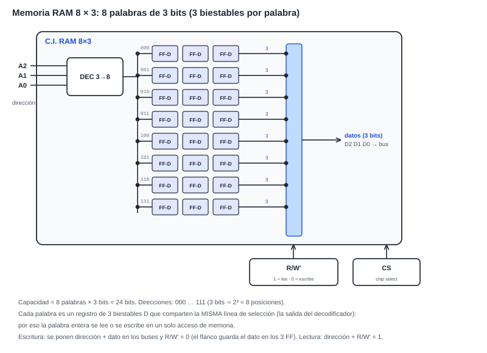

# Memoria RAM 8x3

> [!abstract] En una frase
> Una RAM de **8 × 3** es una memoria con **8 posiciones (direcciones) de 3 bits cada una**: capacidad
> **24 bits**, **3 bits de dirección** (000 a 111) y **3 bits de dato**; internamente tiene una **matriz de
> 8 celdas de 3 bits**, un **decodificador 3→8** que elige la fila, y las señales de control **CS** (selección
> del chip) y **L/E** o `R/W'` (lectura o escritura).

> [!note] Si es la primera vez que ves esto
> Una memoria es **un mueble con cajones numerados**. Cada cajón (celda o palabra) tiene un número (la
> dirección) y guarda algo de tamaño fijo (el dato). La RAM 8×3 es el mueble más chico que sirve para explicar
> todo: **8 cajones de 3 bits**. Para usarla hacen falta tres cosas: **decir qué cajón** (3 bits de dirección →
> decodificador), **decir qué hacer** (leer o escribir) y **llevar o traer el dato** (3 bits por el bus de
> datos). Todo lo grande —una RAM de 8 GB, una caché, una ROM— es **este mismo esquema repetido y ensanchado**.

> [!tip] "8×3" o "3×8": las dos formas
> En la **matriz del final** aparece como **"RAM 3×8"** y en los apuntes como **8×3**. Es el mismo circuito con
> dos convenciones: **8 palabras de 3 bits** (8 filas × 3 columnas) o **3 bits × 8 posiciones**. En el oral
> decilo así: *"8 posiciones, cada una de 3 bits; capacidad total 8 × 3 = 24 bits"*, y seguí el orden que use
> el profesor sin corregirlo.

---

## 1. Los cuatro parámetros de toda memoria

| Parámetro | Qué es | En la 8×3 |
|---|---|---|
| **Unidad de almacenamiento** | la mínima cantidad que se guarda | **1 bit** (cada celda elemental) |
| **Capacidad** | cuántos bits entran en total | **8 × 3 = 24 bits** |
| **Tiempo de acceso** | lo que tarda leer o escribir una palabra desde que se la direcciona | (dato de la tecnología; en la BLUE, 1 µs) |
| **Tipo de acceso** | si todas las posiciones tardan lo mismo | **aleatorio** (RAM): da igual si es la celda 0 o la 7 |

Y dos palabras más que hay que manejar: **palabra** = el conjunto de bits que se leen juntos (3 bits acá) y
**dirección** = el número de la palabra (de 000 a 111 acá).

---

## 2. Los números (lo primero que se pregunta)

```
   Posiciones (palabras):  8   →  necesito 2³ = 8  ⇒  3 bits de dirección
   Bits por palabra:       3   →  3 bits de dato (entrada y salida)
   Capacidad total:        8 × 3 = 24 bits = 3 bytes
   Rango de direcciones:   000, 001, 010, 011, 100, 101, 110, 111   (0 a 7)
```

**La regla general** (sirva para 8×3 o para 8 GB):
```
   nº de direcciones = 2^(bits de dirección)
   capacidad total   = nº de direcciones × bits por palabra
```

---

## 3. Estructura interna

```
                      ┌──────── decodificador 3 → 8 ────────┐
   A2 A1 A0 ────────►│  000  001  010 ... 111             │
   (dirección)       └───┬────┬────┬────────┬─────────────┘
                         │    │    │        │   (una sola línea activa)
              ┌──────────▼─┐ ┌▼─────────┐ ┌▼──────────┐
              │  fila 0    │ │ fila 1   │ │  fila 7   │   ← 8 palabras de 3 celdas
              │ [c][c][c]  │ │[c][c][c] │ │[c][c][c]  │
              └─────┬──────┘ └────┬─────┘ └─────┬─────┘
                    └─────────────┼─────────────┘
                                  │  (3 bits)
                        ┌─────────▼──────────┐
   D2 D1 D0 ◄──────────►│ buffers 3 estados  │◄──── L/E  (lectura / escritura)
   (bus de datos)       └────────────────────┘◄──── CS   (chip select)
```

| Bloque | Función | Por qué existe |
|---|---|---|
| **Matriz de celdas** | guarda los bits | 8 palabras × 3 bits = **24 celdas elementales** |
| **Decodificador 3→8** | convierte la dirección en **una** línea de selección | para activar **una sola** fila por vez |
| **Buffers de 3 estados** | conectan la salida al bus de datos **o la desconectan** | el bus es compartido: si no hablo, debo soltarlo |
| **CS (chip select)** | habilita el chip completo | imprescindible al **expandir** (varios chips en el mismo bus) |
| **L/E** (o `R/W'`) | dice si es lectura o escritura | la memoria no adivina qué querés hacer |

---



## 4. Lectura, paso a paso
1. La CPU pone la **dirección** en el bus de direcciones (ej. `101`).
2. El **decodificador** activa la línea 5; las demás quedan en 0.
3. La CPU pone **CS = 1** (este chip es el elegido) y **L/E = 1** (lectura).
4. Las celdas de la fila 5 entregan sus 3 bits a los **buffers**.
5. Los buffers, habilitados en modo salida, ponen el dato en el **bus de datos**.
6. La CPU lo lee (en la BLUE: pasa al **MBR**, y de ahí al AC o al IR).

## 5. Escritura, paso a paso
1. Dirección en el bus de direcciones ⇒ el decodificador selecciona la fila.
2. La CPU pone el **dato** en el bus de datos y **CS = 1**, con **L/E = 0** (escritura).
3. Los buffers se ponen en modo **entrada** y el dato entra a las celdas de la fila elegida.
4. **Se pierde el contenido anterior** de esa palabra (la escritura es destructiva *en esa celda*).

> [!important] Las lecturas no destruyen, las escrituras sí
> Leer una celda **no la cambia** (en semiconductores). Escribir **reemplaza** el contenido. Ese es el
> argumento para explicar por qué la memoria de **ferrita** de la BLUE original necesitaba un pulso extra: en
> esa tecnología **leer borraba** y había que reescribir ([[Ciclo de búsqueda (7 y 8 pulsos)]]).

---

## 6. Mapa de direcciones (la tabla que se dibuja)

| Dirección | Contenido (3 bits) |
|---|---|
| `000` | `0 1 0` |
| `001` | `1 1 0` |
| `010` | `0 0 1` |
| `011` | `1 0 0` |
| `100` | `1 1 1` |
| `101` | `0 1 1` |
| `110` | `0 0 0` |
| `111` | `1 0 1` |

Los contenidos son **inventados**: sirven para mostrar que la memoria **no interpreta** lo que guarda (puede
ser un dato o una instrucción).

---

## 7. Organización 2D y 3D (detalle que sube nota)

| | **2D** (la de la 8×3) | **3D** |
|---|---|---|
| Cómo se selecciona una celda | **una** línea de selección por palabra | **dos** líneas (fila y columna) que deben coincidir |
| Decodificador | uno de `n` líneas de salida | dos más chicos (filas y columnas) |
| Ventaja | simple y rápida | **decodificadores más chicos** ⇒ menos hardware en memorias grandes |
| Se usa en | memorias chicas / didácticas | memorias grandes reales |

Con 8 palabras, un decodificador de 8 líneas es trivial. Con **65 536** palabras, un decodificador de 65 536
líneas sería imposible: por eso las memorias reales usan **2D/3D con decodificadores partidos**.

---

## 8. Conectar la 8×3 a la CPU

```
   CPU ── A2..A0 (3) ──────────────►  RAM 8×3
       ── D2..D0 (3) ◄─────────────►
       ── MEMR / MEMW (control) ───►
       ── CS (selección) ──────────►
```
- El **ancho del bus de direcciones de la memoria** es 3: la CPU sólo usa esos 3 bits (los demás, si tiene más,
  sirven para **seleccionar el chip** — ver abajo).
- **MEMR** (lectura) y **MEMW** (escritura) son las líneas de control.
- **CS** se activa con un decodificador de direcciones de la CPU: cuando la dirección cae en el rango de este
  chip, se lo habilita.

**Expansión (pregunta clásica): "¿cómo hago una RAM 16×6 con chips 8×3?"**
- Necesito **16 palabras** ⇒ 4 bits de dirección ⇒ **dos bancos** de 8 palabras: se eligen con un bit
  (A3) y un decodificador 1→2 que activa el **CS** de cada banco.
- Necesito **6 bits por palabra** ⇒ **dos chips en paralelo** por banco, cada uno aportando 3 bits; juntos
  cubren D0…D5.
- Total: **4 chips 8×3** = 2 (palabras) × 2 (bits). El de la izquierda aporta los bits 0-2 y el de la derecha
  los bits 3-5; los dos comparten dirección, CS y control.

---

## 9. Cómo dibujarla en el pizarrón (orden de trazo, 90 segundos)
1. **Las 8 filas** (rectángulos alargados) a la derecha, rotuladas `000`…`111`, con 3 casilleros cada una.
2. **El decodificador 3→8** a la izquierda, con A2 A1 A0 entrando y 8 líneas saliendo (una por fila).
3. **Las 3 líneas de dato** saliendo a la derecha (D2 D1 D0), unidas a un bus vertical.
4. **Los buffers de 3 estados** entre las celdas y el bus de datos.
5. **CS** arriba y **L/E** abajo del bloque.
6. Rotular los números: `8 palabras`, `3 bits`, `24 bits`, `2³ = 8`.

---

## 10. Cómo responderlo en el final (3–4 minutos)

**Movimiento 1 — los números (20 s).** "8 posiciones de 3 bits: 24 bits de capacidad, 3 bits de dirección y 3
de dato."

**Movimiento 2 — el dibujo (60 s).** Matriz + decodificador + buffers + señales CS y L/E.

**Movimiento 3 — el funcionamiento (80 s).** Leer una dirección concreta (`101`) paso a paso; después la
escritura, marcando que **escribe sobre la fila seleccionada y borra lo anterior**.

**Movimiento 4 — el cierre con la generalización (20 s).** "Con 12 bits de dirección y 16 de dato es la misma
memoria de la BLUE: 4096 × 16. Cambian los anchos, no el esquema."

### Repreguntas típicas
| Repregunta | Respuesta corta |
|---|---|
| ¿Para qué sirve el decodificador si yo ya mando la dirección? | Porque la memoria necesita **activar una sola fila**; el decodificador convierte el número en "una línea encendida" |
| ¿Qué pasa si se activan dos CS a la vez? | Dos chips ponen datos en el mismo bus ⇒ **conflicto** (salvo que estén en tres estados y sólo uno hable) |
| ¿Por qué el buffer es de tres estados? | Para no pelear por el bus de datos cuando el chip no está seleccionado |
| ¿La RAM 8×3 es SRAM o DRAM? | Con celdas de **biestable** es **SRAM** (estática); la DRAM usa un capacitor y necesita **refresco** |
| ¿Cuántas celdas elementales tiene? | **24** (8 × 3) |
| ¿Y si necesito guardar un byte por palabra? | 8×8: 8 posiciones de 8 bits = 64 bits; 3 bits de dirección, 8 de dato |
| ¿Qué diferencia hay con una ROM? | La ROM **no se escribe** en operación normal y **no pierde** el contenido al apagar ([[Memoria ROM y sus tipos]]) |

---

## 11. Errores típicos
- Decir "8×3 = 24 palabras" (son **24 bits**, y **8 palabras**).
- Confundir bits de **dirección** (3) con bits de **dato** (3): acá coinciden, y eso confunde; en una 4096×16 son
  12 y 16.
- Olvidar el **CS**: sin selección del chip, al expandir no se sabe quién responde.
- Decir que la memoria "decide" si lee o escribe: eso lo dice la **línea de control**.
- Dibujar el decodificador **sin** numerar las líneas de salida: en el pizarrón, sin los números, no se entiende.

---

## 12. Para ampliar: qué leer y qué buscar

| Fuente | Dónde | Qué buscar | Para qué te sirve |
|---|---|---|---|
| **Apuntes de cátedra**, *Unidad 3 — Memorias electrónicas* | toda la unidad (parámetros, celda elemental, RAM 8×3, organización 2D/3D, caché) | la RAM 8×3 tal como la dibuja la cátedra y el cuadro RAM vs ROM | **Es la fuente exacta** de esta pregunta |
| **`memorias.pdf`** — *Material Auxiliar de Dispositivos Electrónicos, Tema 7: Memorias semiconductoras* | **7.3 RAM**: arquitectura básica, RAM estática (celda y accesos de lectura/escritura), RAM dinámica (celda y **refresco**); **7.1** tipología | tiempos de acceso, celda SRAM con 6 transistores, celda DRAM de 1 transistor + capacitor, ciclos de refresco | Es el material más técnico que tenés: sirve para responder "¿cómo es la celda por dentro?" |
| **[[TP12 Memoria principal]]** | el TP | características de RAM/ROM y el **cuadro comparativo** | Lo que pide la cátedra por escrito |
| **[[TP18 Direccionamiento de memoria]]** | el TP | pasar de "8×3" a "1 GB con celdas de 4 B": celdas, bits de dirección, CodOp | El salto de escala que se pregunta en el final ([[Espacio de direccionamiento y cálculo de CodOp-Dirección]]) |
| **Floyd, *Fundamentos de sistemas digitales*** (Prentice Hall) | el **tema de memorias** (la edición de 1996, tema 12, págs. 594-644 — es la referencia que cita el propio material de la cátedra) | arquitectura de memorias semiconductoras, expansión de capacidad y de palabra | El mejor lugar para practicar **expansión** con figuras |
| **Mano, *Lógica digital y diseño de computadoras*** | capítulos de **memoria** (RAM/ROM, decodificación, organización) | diseño de la matriz, decodificadores, memoria asociativa | Rigor de diseño y ejercicios de expansión |
| **Fernández Ramos et al., *Dispositivos Electrónicos para Estudiantes de Informática*** (U. de Málaga, 2002, tema 7, págs. 177-192) | citado por `memorias.pdf` | tecnología de celdas | Profundizar la parte electrónica si te interesa |
| **Patterson & Hennessy, *Estructura y diseño de computadores*** | capítulo de **jerarquía de memoria** | SRAM vs DRAM, tiempos, y cómo se arma una memoria grande | Conectar esta nota con caché y jerarquía |
| **[[Tablas de verdad de memoria]]** | la nota de práctica | las tablas de la 8×3 y de la celda elemental listas para el pizarrón | Repaso rápido antes del oral |

---

## Relacionado
[[Celda elemental de memoria]] · [[Memoria ROM y sus tipos]] · [[Jerarquía de memorias]] ·
[[Memoria caché]] · [[Decodificador]] · [[Espacio de direccionamiento y cálculo de CodOp-Dirección]] ·
[[Estructura básica de un computador]]
