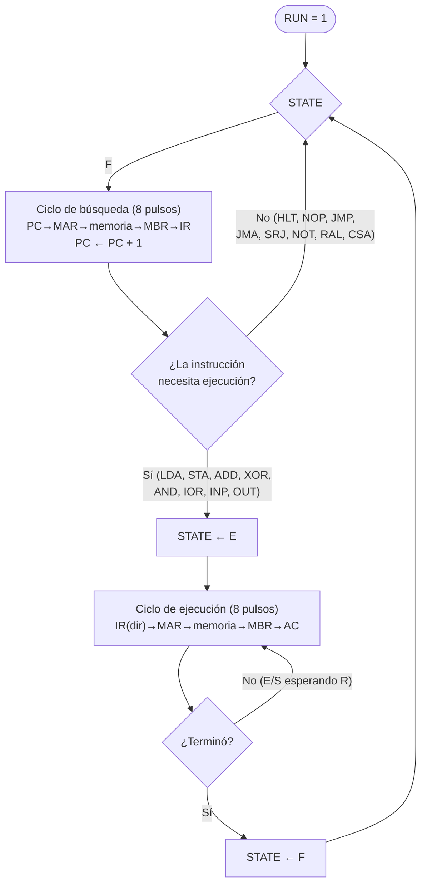

# Ciclo de máquina

> [!important] Qué necesitás para responder esta pregunta
> **En `Apoyo a la pregunta/`:** [[Ciclo de búsqueda (7 y 8 pulsos)]] · [[Ciclo de ejecución — todas las operaciones]] · [[Proceso de manejo de una instrucción]] **En otra tanda o unidad:** [[Unidad de Control]] (Tanda 1 · 1.6 Implementación de la Unidad de Control) · [[Las 16 instrucciones de BLUE — ciclo completo pulso por pulso]] (Tanda 2 · 2.5 Las 16 instrucciones, pulso por pulso) · [[Interrupciones y entrada-salida]] (Tanda 2 · 2.8 Interrupciones) · [[Pipeline]] (Tanda 2 · 2.7 Pipeline) El detalle de **para qué sirve cada apoyo** está en [[00 Apoyos — 1.8 Ciclo de máquina]].

> [!abstract] En una frase
> El **ciclo de máquina** es la unidad de trabajo de la CPU: **8 pulsos de reloj** en los que la máquina hace **una** cosa —**buscar** una instrucción o **ejecutar** una— y que se repite mientras el biestable **RUN** esté en 1, alternando entre los estados **F** (fetch/búsqueda) y **E** (execute/ejecución) según lo indique el biestable **STATE**.

> [!note] Si es la primera vez que ves esto
> Una CPU no "piensa": **repite un bucle** millones de veces por segundo. El bucle tiene dos mitades: **buscar** la próxima instrucción (ir a memoria y traerla) y **ejecutarla** (hacer lo que dice). Nada más. Todo lo demás son detalles de cada mitad. Si entendés ese bucle, y sabés qué tres biestables lo controlan, ya podés explicar cómo funciona una computadora.

---

## 1. Tres ciclos que no son lo mismo (el error nº 1 del tema)

| Nombre | Qué es | Duración en BLUE |
|---|---|---|
| **Ciclo de reloj** (pulso, ciclo menor) | el "tic" del reloj: en cada uno se hace **una** microoperación | **125 ns** |
| **Ciclo de máquina** | 8 pulsos consecutivos: una búsqueda **o** una ejecución | **8 × 125 ns = 1 µs** |
| **Ciclo de instrucción** | lo que tarda **una instrucción completa**: una búsqueda (+ una o más vueltas de ejecución) | de 8 a 24+ pulsos |

> [!tip] Regla para no confundirse
> **"Un ciclo de máquina = 8 pulsos. Un ciclo de instrucción = la búsqueda + todas las ejecuciones que esa instrucción necesite."** Por eso la LDA de la BLUE base tarda 2 ciclos de máquina (16 pulsos) y la de la indexada 3 (24 pulsos), pero en los dos casos el **ciclo de máquina sigue siendo de 8**.

---

## 2. Los tres biestables que gobiernan todo

| Biestable | Qué significa | Se pone en 1 | Se pone en 0 |
|---|---|---|---|
| **RUN** (corrida) | "la máquina está andando" | botón **START** | **STOP**, la instrucción **HLT** o un **overflow** |
| **STATE** (estado) | **F** = búsqueda · **E** = ejecución | al terminar una ejecución (vuelve a F) / al final de una búsqueda que necesita ejecutar (pasa a E) | — |
| **TRA** (transferencia) | hay una operación de **E/S** en curso | CP7 de la búsqueda de INP/OUT | cuando el periférico terminó |
| (en la indexada) **SI** e **I** | habilitación y atención de **interrupciones** | `ION` / detección de IRQ | `IOF` / `RTI` |

**Cómo funciona el conjunto**:
```
        ┌──────────────────────────────┐
        │  RUN = 1  ──►  habilita el reloj ──►  CP1…CP8 ──► ciclo de máquina
        └──────────────────────────────┘
                    │
        ┌───────────▼───────────┐        ┌────────────────────────────┐
        │ STATE = F (búsqueda)  │──CP8──►│ ¿la instrucción necesita   │
        │  trae la instrucción  │        │ ejecución? (REF, INP, OUT) │
        └───────────────────────┘        └────────────┬───────────────┘
                    ▲                                  │ sí
                    │ CP8 (fin de ejecución)           ▼
                    └──────────────────── STATE = E (ejecución)
```

- Si RUN = 0, el reloj **no avanza**: la máquina queda congelada en el estado en que estaba (por eso se puede reanudar con START).

- Si la instrucción se resuelve en la búsqueda (HLT, NOP, JMP, JMA, SRJ, NOT, RAL, CSA), **STATE no cambia** y el ciclo siguiente es otra búsqueda: **8 pulsos** y listo.

---

## 3. El reloj maestro: cómo se generan 8 pulsos

El reloj de la BLUE es una **cadena de retardos**: un pulso inicial entra a la cadena y va saliendo por cada derivación, con 125 ns de atraso entre una y la siguiente.

```
  pulso ──►[D 125ns]──►[D]──►[D]──►[D]──►[D]──►[D]──►[D]──►[D]──┐
              │         │     │     │     │     │     │     │    │
             CP1       CP2   CP3   CP4   CP5   CP6   CP7   CP8   │
              └──────────────────────── realimentación ◄──────────┘
                          (si RUN = 1 vuelve a empezar)
```
Detalles que valen puntos:

- Cada registro tiene su línea de **carga (Load) con un pequeño retardo (10–15 ns)**: ese retardo existe para que el dato esté **estable en el bus antes** de que el registro lo copie.

- Al final de la cadena el pulso **realimenta** y arranca un nuevo ciclo de máquina, **siempre que RUN = 1** (o que STATE = E, para seguir ejecutando).

- Hay muchas formas de generar estos pulsos (contador + decodificador, registro de anillo, cadena de retardos): el apunte usa la cadena de retardos porque se entiende de un vistazo.

---


## 4. El ciclo de búsqueda: los 8 pulsos, con su por qué

| Pulso | Microoperación | Por qué en ese pulso |
|---|---|---|
| **CP1** | Envíe PC, Cargue MAR, Cargue Z · **orden de lectura** | hay que direccionar la memoria **cuanto antes** (tarda) |
| **CP2** | Envíe +1, Cargue Y | se prepara el incremento del PC en la ALU, **aprovechando la espera** |
| **CP3** | — | la memoria y la ALU trabajan |
| **CP4** | Envíe SUMA, Cargue PC | `PC ← PC + 1` (la ALU estaba libre: se usa para no desperdiciarla) |
| **CP5** | Strobe MBR | el dato ya está estable en el bus de datos |
| **CP6** | Envíe MBR, Cargue IR | la instrucción entra al IR y **empieza la decodificación** |
| **CP7** | (decodificación / primer paso de ejecución) | — |
| **CP8** | `E → STATE` o la ejecución de las instrucciones de un ciclo | — |

> [!important] ¿Por qué 8 y no 7? (la pregunta que siempre cae)
> La búsqueda se completa en **CP7**. El octavo pulso **no es necesario** con memorias de semiconductores: existía porque la **memoria de núcleos de ferrita** es **destructiva** (al leer, borra el dato) y había que **reescribirlo**. Hoy ese pulso se conserva y se **aprovecha para ejecutar**: por eso las 8 instrucciones "de un ciclo" terminan ahí. Ver [[Ciclo de búsqueda (7 y 8 pulsos)]].

---

## 5. El ciclo de ejecución: cuántas vueltas y por qué

| Familia | Instrucciones | Ciclos de máquina | Pulsos |
|---|---|---|---|
| Se resuelven en la búsqueda | HLT, NOP, JMP, JMA, SRJ, CSA, NOT, RAL | 1 | **8** |
| Van a memoria por el operando | LDA, STA, ADD, XOR, AND, IOR | 2 | **16** |
| Esperan al periférico | INP, OUT | 2 + n | **16+** |
| (indexada) con referencia a memoria | LDA, STA, ADD… directo o indexado | 3 | **24** |

**El ciclo de ejecución estándar (para LDA)**: `CP1: IR→MAR, lectura` · `CP2-CP4: espera` · `CP5: MBR strobe` · `CP6: MBR→AC` · `CP8: F→STATE`.

**Qué lo hace durar más vueltas**: en INP/OUT, si el periférico **no está listo** (`R = 0`), la máquina **repite el ciclo de ejecución** entero. Ahí se ve por qué la E/S por consulta es ineficiente y por qué existen las **interrupciones** ([[Interrupciones y entrada-salida]]).

---

## 6. De la búsqueda a la ejecución: el esquema completo



---

## 7. Ejemplo resuelto de punta a punta

**Programa**: en la celda 100 hay `LDA 500`; en la 500 hay el valor `7`.

| # | Ciclo de máquina | Estado | Qué pasa | Pulso clave |
|---|---|---|---|---|
| 1 | búsqueda de `LDA 500` | F | `PC(100) → MAR`; memoria devuelve `LDA 500`; `IR ← ...`; `PC ← 101` | CP6: `MBR→IR` |
| 2 | ejecución de LDA | E | `IR(dir)=500 → MAR`; memoria devuelve `7`; `AC ← 7` | CP6: `MBR→AC` |
| 3 | búsqueda de la siguiente | F | `PC(101) → MAR` … | CP6 |
| 4 | … | … | … | … |

**Total de la instrucción**: 2 ciclos de máquina = **16 pulsos** = **2 µs** (con pulsos de 125 ns).

---

## 8. Cómo responderlo en el final (3 minutos)

**Movimiento 1 — definición (20 s).** "El ciclo de máquina es la unidad de trabajo de la CPU: 8 pulsos en los que se hace una búsqueda o una ejecución; se repite mientras RUN = 1 y STATE indica cuál de las dos."

**Movimiento 2 — dibujo (60 s).** El bucle: búsqueda → decisión → ejecución → búsqueda. Al costado, los tres biestables (RUN, STATE, TRA) y el reloj con CP1…CP8.

**Movimiento 3 — desarrollo (90 s).**

1. Los **tres ciclos** (reloj, máquina, instrucción) y no confundirlos.

2. Los **8 pulsos de la búsqueda** con las 6 microoperaciones clave.

3. **Por qué 8 y no 7** (ferrita).

4. **Quién decide** pasar a ejecución: si la instrucción referencia memoria, `E→STATE` en CP8; si no, se queda en F.

**Movimiento 4 — cierre (20 s).** "El ciclo de máquina no cambia entre instrucciones: lo que cambia es **cuántas veces se repite**. Por eso 8, 16 o 24 pulsos."

### Repreguntas típicas

| Repregunta | Respuesta corta |
|---|---|
| ¿Qué pasa si aprieto STOP en medio de un ciclo? | RUN = 0 ⇒ el reloj **deja de avanzar**; la máquina se congela y con START sigue (por eso no se corrompe nada) |
| ¿Quién apaga RUN? | STOP, la instrucción **HLT** (CP8) y el **overflow** de la ALU |
| ¿Cuándo se incrementa el PC? | En la **búsqueda, CP4**, usando la ALU (`Z = PC`, `Y = +1`) |
| ¿STATE puede quedar en E para siempre? | Sí, en INP/OUT si el periférico nunca está listo: por eso se necesitan timeouts/interrupciones |
| ¿Qué diferencia hay con "ciclo Fetch-Decode-Execute" de los libros? | Es lo mismo con otro nombre: **búsqueda = fetch**, la decodificación ocurre en CP6-CP7, la ejecución es el ciclo E |
| ¿Cuántos ciclos de máquina tiene un programa de 3 instrucciones? | Depende de las instrucciones: LDA+ADD+STA = 2+2+2 = **6 ciclos = 48 pulsos** |

---

## 9. Errores típicos

- Decir "ciclo de máquina" cuando se habla de "ciclo de instrucción" (o al revés).

- Contar 8 pulsos para la LDA completa (son 16 en la base y 24 en la indexada).

- Olvidar que **8 instrucciones** (HLT, NOP, JMP, JMA, SRJ, CSA, NOT, RAL) **no cambian STATE**: se quedan en búsqueda y por eso duran 8 pulsos.

- Decir que el reloj "se apaga" con HLT: se apaga **RUN**, el oscilador sigue.

- Pensar que la decodificación es un pulso aparte: ocurre en **CP6-CP7** (empieza al cargarse el IR).

---

## 10. Para ampliar: qué leer y qué buscar

| Fuente | Dónde | Qué buscar | Para qué te sirve |
|---|---|---|---|
| **`blue.pdf`** (Foster) | secciones **"El ciclo de máquina básico"**, **"Unidad de control"** (figs. 10 y 11) y **"El ciclo de búsqueda"** (Tabla 2) | los tres biestables RUN/STATE/TRA, el reloj de 8 pulsos con cadena de retardos, la tabla CP1-CP8 | **Es la fuente exacta**: la nota del apunte se llama igual que esta |
| **Apuntes de cátedra**, *Unidad 4* | sección del ciclo de instrucción y de la unidad de control | cómo lo enuncia la cátedra: máquina **síncrona** vs **asíncrona** | La justificación de por qué la BLUE es sincrónica (ventajas/desventajas) |
| **[[TP16 Ciclo de instrucción básico]]** | el TP | el ciclo aplicado a un programa de 3 instrucciones en 6 pasos | Practicar el relato del ciclo sobre un caso concreto |
| **Hamacher, Vranesic, Zaky, *Organización de computadoras*** | capítulo de **ciclo de instrucción y control** | la separación **fetch / decode / execute** y el concepto de *step* | Vocabulario formal para ampliar la respuesta |
| **Stallings, *Organización y arquitectura de computadores*** | capítulo de **ciclo de instrucción** | el diagrama de estados del ciclo de instrucción y las interrupciones al final de cada instrucción | Conecta este tema con [[Interrupciones y entrada-salida]] |
| **Patterson & Hennessy, *Estructura y diseño de computadores*** | capítulo del **procesador de ciclo único** | cómo se ve la misma idea en una CPU real: camino de datos + control | Para decir "en una RISC, el equivalente es el datapath de ciclo único" |
| **Tanenbaum, *Estructura de computadores*** | capítulo del **ciclo de ejecución** y microprogramación | el ciclo como secuencia de microinstrucciones | Puente con [[Unidad de control cableada y microprogramada]] |
| **[[Banco de preguntas del final]]** | la pregunta 3 de principales | la respuesta mínima esperada | Autoevaluación rápida |

---

## Relacionado
[[Ciclo de búsqueda (7 y 8 pulsos)]] · [[Ciclo de ejecución — todas las operaciones]] · [[Las 16 instrucciones de BLUE — ciclo completo pulso por pulso]] · [[Unidad de Control]] · [[Flujo de información en BLUE (datos y direcciones)]] · [[Estructura básica de un computador]]
