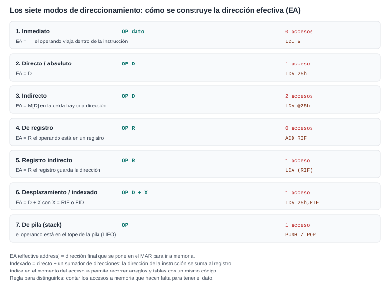

# Modos de direccionamiento

> [!important] Qué necesitás para responder esta pregunta
> **En otra tanda o unidad:** [[BLUE indexada (RIF, RID, nuevo formato)]] (Tanda 1 · 1.2 BLUE vs BLUE indexada) · [[Formato de la instrucción (4 formatos)]] (Tanda 1 · 1.7 Formato de la instrucción (4 formatos)) · [[Registros de la CPU]] (Materia · Unidad 5) · [[El 8086 como CPU convencional (TP21)]] (Materia · Unidad 5) · [[Ciclo de la instrucción LDA (24 pulsos)]] (Tanda 1 · 1.3 Ciclo de LDA indexada (24 pulsos))
> El detalle de **para qué sirve cada apoyo** está en [[00 Apoyos — 2.10 Modos de direccionamiento]].


> [!abstract] En una frase
> El **modo de direccionamiento** es la **forma en que la instrucción dice dónde está el operando**: cómo se
> calcula la **dirección efectiva (EA)**, la que finalmente se pone en el MAR. La cátedra trabaja con **siete
> modos**: **inmediato, directo, indirecto, de registro, registro indirecto, de desplazamiento (indexado) y de
> pila**. Y la BLUE indexada agrega un **campo modificador de 2 bits** con cuatro de ellos.

> [!note] Si es la primera vez que ves esto
> Una instrucción es como una **orden escrita**: "sumá algo al acumulador". Pero esa orden tiene que decir
> **dónde está ese algo**. Y hay muchas maneras de decir dónde:
> - "el número **7**" ⇒ el dato está escrito **en la misma orden** (inmediato);
> - "lo que está en la **casa de la calle Rivadavia 30**" ⇒ una dirección concreta (directo);
> - "en la casa de la calle Rivadavia 30 hay un **papel con otra dirección**; andá a esa otra casa" (indirecto);
> - "lo que tengo **en el bolsillo**" ⇒ está en un registro (de registro);
> - "en el bolsillo tengo un papel con una dirección" ⇒ registro indirecto (puntero);
> - "andá a la dirección que tengo en el bolsillo **más 3 casas**" ⇒ indexado/desplazamiento.
>
> Cambia **cuánto tarda** (cuántas veces hay que ir a memoria) y **para qué sirve** (un lazo sobre un vector sólo
> es posible con el indexado). Por eso es una pregunta de final: obliga a entender qué hace una instrucción por
> dentro.

---

## 1. La dirección efectiva (EA)

```
   instrucción:  ┌──────────┬────────────┬──────────────────┐
                 │  opcode  │ modo (mod) │  campo dirección │
                 └──────────┴────────────┴──────────────────┘
                                   │
                                   ▼
                        ┌─────────────────────┐
                        │  ¿cómo se calcula?  │  ← ESTO es el modo
                        └─────────┬───────────┘
                                  ▼
                             EA (dirección efectiva) ──► MAR ──► memoria
```

- **EA** (*effective address*) = la dirección que se envía a la memoria para acceder al operando.
- **Modo** = la regla con la que se calcula la EA (o la decisión de **no ir a memoria**).
- El modo no es una curiosidad teórica: **está codificado en la instrucción**, en un campo de bits. En la BLUE
  indexada son **2 bits** ⇒ 4 modos.

> [!important] La pregunta que ordena todo
> **¿Cuántas veces hay que ir a memoria para tener el dato?**
> **0** (inmediato, registro) · **1** (directo, registro indirecto, desplazamiento, pila) · **2** (indirecto).
> Si sabés responder esto, ya aprobaste el tema.

---

## 2. Los siete modos de la cátedra (TP19)

| # | Modo | Cómo se calcula la EA | Accesos a memoria | Ventaja | Desventaja |
|---|---|---|---|---|---|
| 1 | **Inmediato** | no hay EA: el operando **es** el campo de la instrucción | **0** | el más rápido, no toca memoria | el dato queda limitado a los bits del campo |
| 2 | **Directo (absoluto)** | `EA = campo` | 1 | simple y claro | direcciona sólo lo que entra en el campo |
| 3 | **Indirecto** | `EA = M[campo]` (en el campo está la dirección *de la dirección*) | **2** | direcciona **toda** la memoria con un campo chico | el más lento |
| 4 | **De registro** | el operando está **dentro de un registro** | **0** | rapidísimo, sin tráfico de bus | hay pocos registros |
| 5 | **Registro indirecto** | `EA = R` (el registro contiene la dirección) | 1 | el registro es un **puntero** (listas, vectores) | igual hay un acceso a memoria |
| 6 | **De desplazamiento / indexado** | `EA = registro + desplazamiento` | 1 | **arrays, tablas, estructuras**; código reutilizable | cálculo extra y desplazamiento limitado |
| 7 | **De pila (stack)** | el operando está en el **tope de la pila** (LIFO, apuntado por SP) | 1 | automatiza subrutinas y contextos | riesgo de desbordamiento |



---

## 3. Un ejemplo numérico de cada modo (con la misma memoria)

Memoria volcada (direcciones y contenidos en decimal, palabras de 4 dígitos):

| Dirección | Contenido |
|---|---|
| 20 | 0100 |
| **30** | **0050** |
| 50 | **0012** |
| 100 | **0042** |
| 101 | 0043 |
| 102 | **0044** |
| 200 | 0077 |

Registros: `AC = 0000` · `R1 = 0043` · `R2 = 0100` · `SP = 200` · `RIF = 100` · `RID = 2`

Supongamos una instrucción `LDA` (cargar en AC) cuyo **campo de dirección vale 30**:

| Modo | Cuenta | EA | Resultado en AC | Accesos |
|---|---|---|---|---|
| **Inmediato** | el operando es el campo | — | **AC = 0030** | 0 |
| **Directo** | `EA = 30` | 30 | AC = M[30] = **0050** | 1 |
| **Indirecto** | `EA = M[30] = 50` | 50 | AC = M[50] = **0012** | **2** |
| **De registro** | el operando es `R1` | — | **AC = 0043** | 0 |
| **Registro indirecto** | `EA = R2 = 100` | 100 | AC = M[100] = **0042** | 1 |
| **Desplazamiento** | `EA = RIF + 2 = 102` | 102 | AC = M[102] = **0044** | 1 |
| **De pila** | `EA = SP = 200` (pop) | 200 | AC = M[200] = **0077** | 1 |

> [!tip] Mirá el detalle del indirecto
> Con el **mismo campo 30**, el directo trae `0050` y el indirecto trae `0012`. La **palabra M[30] no es el
> dato: es la dirección del dato**. Eso es lo que hace que el indirecto necesite **dos** accesos y que, con un
> campo de 12 bits, se pueda alcanzar **toda** la memoria.

---

## 4. Los dos que se confunden siempre

| | **Indirecto** | **Registro indirecto** |
|---|---|---|
| Dónde está la dirección | en una **celda de memoria** | en un **registro** |
| Cuántos accesos | **2** (leer el puntero, leer el dato) | **1** |
| Analogía | el papel con la dirección está guardado en un cajón | el papel con la dirección lo tengo **en la mano** |
| Para qué se usa | punteros dobles, tablas de punteros | recorrer vectores y listas |

Y los otros dos que se mezclan: **indirecto** (`EA = M[campo]`) contra **indexado** (`EA = campo + registro`).
El indirecto **lee** una dirección; el indexado **suma** un registro.

---

## 5. Los modos en la BLUE indexada (lo que pide la matriz)

La BLUE base sólo tiene **directo**. La **indexada** agrega un **campo modificador de 2 bits** ⇒ **4 modos**:

| Modificador | Modo | EA | Ejemplo | Pulsos |
|---|---|---|---|---|
| `0` | **directo** | `EA = campo` | `LDA 0, 1000` | 24 |
| `1` | **indirecto** | `EA = M[campo]` | `LDA 1, 1000` | **32** |
| `2` | **indexado por RIF** | `EA = campo + RIF` | `LDA 2, 1000` | 24 |
| `3` | **indexado por RID** | `EA = campo + RID` | `LDA 3, 1000` | 24 |

Y **en toda referencia a memoria se suma además el registro base**:

```
   EA = RB + (campo [+ RIF o RID si corresponde])
```

- **RIF** = Registro Índice **Fuente** (el arreglo de donde leo).
- **RID** = Registro Índice **Destino** (el arreglo donde escribo).
- Con **RIF y RID a la vez** se pueden copiar vectores: `LDA 2, 100` seguido de `STA 3, 200` mueve elemento a
  elemento.
- Se implementa con un **sumador de direcciones** y un **multiplexor** que elige entre 0, RIF y RID, mandado por
  el **decodificador del modificador**.

Desarrollo completo (formato 5+2+9+16, instrucciones `ENI`/`INI`/`LIX`/`SIX`/`RXT`/`IJP` y los 24/32 pulsos):
[[BLUE indexada (RIF, RID, nuevo formato)]] y [[Ciclo de la instrucción LDA (24 pulsos)]].

---

## 6. Ejemplo con un vector: por qué el indexado cambia todo

Supongamos que `V` empieza en la dirección 100 y hay que sumar `V[0] + V[1] + V[2]` (contenidos 0042, 0043,
0044 en el volcado de arriba).

**Sin indexado (directo puro):** una instrucción por elemento, y el código **depende de las posiciones**
```asm
LDA 100      ; V[0]
ADD 101      ; V[1]
ADD 102      ; V[2]
```
Para 50 elementos hay que escribir **50 instrucciones** (y si el vector cambia de lugar, se reescribe todo).

**Con indexado:** **una** instrucción dentro de un lazo, y el registro hace de puntero
```asm
        ENI  RIF, 100     ; RIF ← 100  (puntero al arreglo)
        LDA  cero         ; suma ← 0
        STA  suma
        ENI  RID, 3       ; contador ← 3 elementos
lazo:   LDA  2, RIF       ; EA = 100 + RIF ⇒ V[i]
        ADD  suma
        STA  suma
        INI  RIF, 1       ; siguiente elemento
        INI  RID, -1      ; contador--
        IJP  RID, lazo    ; si el registro no es cero, repetir
        LDA  suma
        HLT
```
**El mismo código sirve para cualquier posición y cualquier tamaño.** Eso es, en una frase, la ventaja del
indexado.

---

## 7. Ventajas del modo de desplazamiento/indexado (la pregunta del final)

1. **Recorrer arreglos y tablas sin reescribir el código**: un lazo en lugar de `n` instrucciones.
2. **Ahorro de bits**: el campo de la instrucción es un desplazamiento chico y el resto lo aporta el registro.
3. **Reubicación**: el mismo programa funciona en otra zona de memoria cambiando el contenido del registro.
4. **Implementación barata**: un **sumador de direcciones** y dos registros índice.
5. **Estructuras de datos**: vectores, matrices (base + índice), campos de un registro.
6. **Menos tráfico de instrucciones**: el programa ocupa menos memoria.

**Desventajas (decirlas sube nota)**: hay que calcular la suma (un ciclo más), el desplazamiento tiene pocos
bits, y hay que administrar los registros índice (cargarlos, incrementarlos).

---

## 8. Cómo se implementa en hardware

```
  campo dirección (IR) ──→ ┌──────────────────┐
                          │    SUMADOR DE    │──→ EA ──→ MAR
      RIF / RID ─────────→│   DIRECCIONES    │
                          └──────────────────┘
             ▲
             │
   decodificador del modificador (2 bits) ──→ multiplexor: 0 · RIF · RID
```

En la **BLUE indexada** esto cuesta **un ciclo de máquina extra**: por eso `LDA` pasa de **16 pulsos (2 ciclos)
en la BLUE base a 24 pulsos (3 ciclos)**, y el indirecto a **32**.

---

## 9. Otros modos que conviene nombrar (suben nota)

- **Relativo al PC**: `EA = PC + desplazamiento` ⇒ saltos relativos y código **reubicable**.
- **Base + índice**: `EA = base + índice + desplazamiento` ⇒ el clásico de x86 para matrices (`[BX+SI+4]`).
- **Autoincremento / autodecremento**: el registro se actualiza **antes o después** del acceso (pilas y
  recorridos); en el 8086 son `[SI+]` y `[-SI]`.
- **Página/segmento**: la dirección se arma con un **segmento + desplazamiento** (el `seg × 10h + offset` del
  8088: [[El 8086 como CPU convencional (TP21)]]).

---

## 10. Cómo responderlo en el final (3–4 minutos)

**Movimiento 1 — definición (20 s).** "El modo de direccionamiento es cómo se calcula la dirección efectiva a
partir de lo que dice la instrucción."

**Movimiento 2 — los siete modos (80 s).** Recorrerlos con la **EA** y los **accesos a memoria** de cada uno; una
ventaja y una desventaja. Usar la regla "0 / 1 / 2 accesos".

**Movimiento 3 — el ejemplo numérico (40 s).** Con un campo `30`: inmediato da `0030`; directo, `M[30]`;
indirecto, `M[M[30]]` (dos accesos). Marcar que el indirecto **lee una dirección**.

**Movimiento 4 — el vector (40 s).** Directo: una instrucción por elemento; indexado: un lazo con RIF.

**Movimiento 5 — el cierre con BLUE (20 s).** "En la BLUE indexada el modo está en un campo de 2 bits: directo,
indirecto, RIF y RID; con sumador de direcciones, y eso explica los 24 y 32 pulsos."

### Repreguntas típicas
| Repregunta | Respuesta corta |
|---|---|
| ¿Qué es la dirección efectiva? | La que se pone en el MAR: la dirección **física** del operando |
| ¿Cuál es el más rápido? | **Inmediato y de registro** (0 accesos a memoria) |
| ¿Y el más lento? | **Indirecto**, con 2 accesos |
| ¿Cuánto direcciona el directo? | Lo que entra en el campo (12 bits ⇒ 4 096 posiciones en la BLUE) |
| ¿Y el indirecto? | **Todo**: con un campo chico llega a cualquier celda (porque la dirección se lee de memoria) |
| ¿Para qué sirve el indexado? | Para recorrer **arreglos** sin reescribir el código |
| ¿Diferencia entre RIF y RID? | RIF = índice fuente (leo), RID = índice destino (escribo) |
| ¿Modificador 1 cuesta más? | Sí: **32 pulsos** contra 24, porque agrega un acceso a memoria |
| ¿Se suman RB e índices? | Sí: `EA = RB + campo + índice`; el RB desplaza todo el programa |
| ¿Qué instrucción arma un lazo? | `IJP Reg, dir` (salta si el registro no es cero) |

---

## 11. Errores típicos
- Confundir **indirecto** (la dirección está en **memoria**) con **indexado** (se **suma un registro**).
- Decir que el **inmediato** tiene dirección efectiva (no tiene: el dato está en la instrucción).
- Olvidar que el indirecto hace **dos** accesos a memoria.
- Confundir **registro índice** (guarda el desplazamiento / la posición) con **registro base** (guarda el origen
  del bloque): se usan parecido, pero conceptualmente son distintos ([[Registros base e índice]]).
- Decir "de registro" cuando el registro contiene una **dirección**: eso es **registro indirecto**.
- Creer que el indexado **lee** la dirección de memoria: no, la **calcula** sumando.

---

## 12. Para ampliar: qué leer y qué buscar

| Fuente | Dónde | Qué buscar | Para qué te sirve |
|---|---|---|---|
| **[[TP19 Modos de direccionamiento]]** | el TP completo | los **siete modos** con su tabla de EA, ventajas y desventajas | **Es la fuente exacta** de esta pregunta |
| **Apuntes de cátedra**, *Unidad 5* | sección de **modos de direccionamiento** | la clasificación de la cátedra y el ejemplo del vector | Alineación con lo que se dicta |
| **`blue.pdf`** (Foster) | "Instrucciones de dos ciclos" y el formato de la instrucción | el único modo de la BLUE base: **directo** | Para el contraste base vs indexada |
| **[[BLUE indexada (RIF, RID, nuevo formato)]]** · **[[Ciclo de la instrucción LDA (24 pulsos)]]** | notas de la bóveda | el campo modificador de 2 bits, `ENI`/`INI`/`RXT`/`IJP`, los 24 y 32 pulsos | La parte de la matriz que dice "modos en indexada" |
| **Stallings, *Organización y arquitectura de computadores*** | capítulo de **modos de direccionamiento** | la tabla completa (inmediato, directo, indirecto, registro, desplazamiento, pila) y su cálculo de EA | **La mejor ampliación**: es el tema con nombre propio |
| **Hamacher, Vranesic, Zaky, *Organización de computadoras*** | capítulo de **modos de direccionamiento** | EA, indexado, autoincremento, relativo al PC | Notación formal y ejercicios |
| **Patterson & Hennessy, *Estructura y diseño de computadores*** | capítulo de **ISA** | por qué RISC deja **pocos** modos (registro + desplazamiento) | Conecta con [[CISC y RISC]] |
| **Tanenbaum, *Estructura de computadores*** | capítulo de **formatos de instrucción** | el problema de los bits: opcode vs campo de dirección | Contexto de diseño |
| **Brey, *Los microprocesadores Intel 8086/8088*** | capítulo de **modos de direccionamiento del 8086** | base + índice + desplazamiento, segmentos | El caso real CISC |
| **Floyd** / **Mano** | no aplica | — | El tema es de arquitectura, no de lógica |

---

## Relacionado
[[TP19 Modos de direccionamiento]] · [[BLUE indexada (RIF, RID, nuevo formato)]] ·
[[Ciclo de la instrucción LDA (24 pulsos)]] · [[Formato de la instrucción (4 formatos)]] ·
[[Registros base e índice]] · [[Registros de la CPU]] · [[Espacio de direccionamiento y cálculo de CodOp-Dirección]] ·
[[CISC y RISC]]
