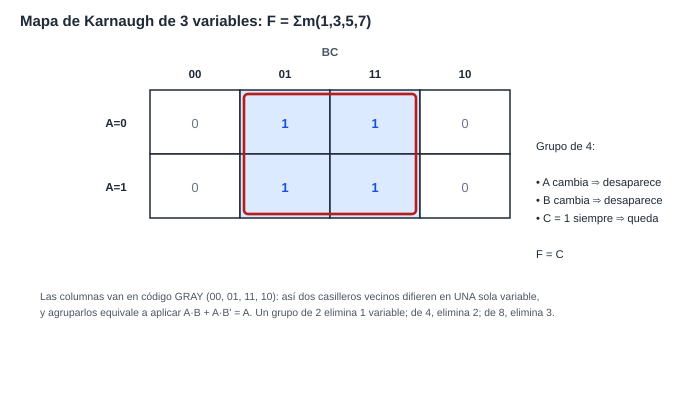

# Mintérminos, maxtérminos y mapas de Karnaugh

> [!abstract] En una frase
> Dada una **tabla de verdad**, hay dos maneras de escribir la función sin adivinar nada: como **suma de
> mintérminos** (los renglones donde la salida vale **1**) o como **producto de maxtérminos** (los renglones
> donde vale **0**). Y para **simplificarla** sin pelearse con el álgebra está el **mapa de Karnaugh**: la misma
> tabla, ordenada en código Gray, donde "agrupar unos vecinos" equivale a aplicar la ley `A·B + A·B' = A`.

> [!note] Si es la primera vez que ves esto
> Tenés tres compuertas: AND, OR, NOT. Y tenés una tabla de verdad que dice qué querés que pase. El problema
> práctico es: **¿cómo paso de la tabla al circuito?**
>
> El camino directo es simple: **cada renglón donde la salida es 1 se convierte en un producto (un AND) que da 1
> justo en ese renglón**, y después **sumo (OR) todos esos productos**. Eso es la forma canónica, y siempre
> funciona… pero gasta muchísimas compuertas. Por ejemplo, una función de 4 variables con 6 unos necesita 6
> compuertas AND de 4 entradas + 1 OR de 6 entradas.
>
> El **mapa de Karnaugh** resuelve lo mismo con la mitad de compuertas, sin hacer cuentas: es un dibujo donde los
> unos que se pueden juntar quedan **pegados**, y juntarlos es exactamente "cancelar la variable que cambia". Si
> en un par de casilleros vecinos la única diferencia es que `B` vale 0 en uno y 1 en el otro, entonces el
> resultado **no depende de B**: desaparece. Eso es todo el truco.

---

## 1. Mintérminos: la definición

Un **mintérmino** `m_i` es un **producto en el que aparecen todas las variables**, cada una negada o no, y que
vale **1 en una única fila** de la tabla de verdad (la fila número `i`).

**Regla para escribirlo:** la variable que vale **0** se pone **negada**; la que vale **1**, **sin negar**.

Para 3 variables `A B C`, la fila `i = 5` es `A=1, B=0, C=1` ⇒ `m5 = A·B'·C`.

| i | A B C | mintérmino | maxtérmino |
|---|---|---|---|
| 0 | 0 0 0 | `A'B'C'` | `A + B + C` |
| 1 | 0 0 1 | `A'B'C` | `A + B + C'` |
| 2 | 0 1 0 | `A'BC'` | `A + B' + C` |
| 3 | 0 1 1 | `A'BC` | `A + B' + C'` |
| 4 | 1 0 0 | `AB'C'` | `A' + B + C` |
| 5 | 1 0 1 | `AB'C` | `A' + B + C'` |
| 6 | 1 1 0 | `ABC'` | `A' + B' + C` |
| 7 | 1 1 1 | `ABC` | `A' + B' + C'` |

El **maxtérmino** `M_i` es lo **dual**: una **suma** con todas las variables, que vale **0 en esa única fila**;
se escribe con la regla invertida (la variable que vale **1** va **negada**).

> [!important] Las dos formas canónicas (y por qué son iguales)
> - **Suma de productos (SOP):** `F = Σm(los renglones con 1)`.
> - **Producto de sumas (POS):** `F = ΠM(los renglones con 0)`.
>
> Son la misma función escrita de dos maneras. Por **DeMorgan**, `F' = Σm(los que faltan)` y los índices del
> complemento son justamente los maxtérminos de `F`. Ejemplo: `F(A,B) = Σm(0,2)` ⇒ `F' = Σm(1,3)` ⇒
> `F = ΠM(0,2)` = `(A + B)(A' + B)`.

**Ejemplo de paso de tabla a función** (una función cualquiera de 3 variables):

| A | B | C | F |
|---|---|---|---|
| 0 | 0 | 0 | 1 | ← m0
| 0 | 0 | 1 | 0 |
| 0 | 1 | 0 | 1 | ← m2
| 0 | 1 | 1 | 0 |
| 1 | 0 | 0 | 1 | ← m4
| 1 | 0 | 1 | 0 |
| 1 | 1 | 0 | 0 |
| 1 | 1 | 1 | 1 | ← m7

`F = Σm(0,2,4,7) = A'B'C' + A'BC' + AB'C' + ABC`

Ésa es la **forma canónica**: correcta, fea y cara (4 AND de 3 entradas + 1 OR de 4). Ahora la simplificamos.

---

## 2. El mapa de Karnaugh: cómo se arma

El mapa es la tabla de verdad **ordenada en código Gray** (00, 01, **11**, 10), de modo que **casilleros vecinos
difieren en una sola variable**. Se dibuja así:

**3 variables** (filas: A; columnas: BC en Gray)
```
            BC
          00   01   11   10
     A=0 │ m0 │ m1 │ m3 │ m2 │
     A=1 │ m4 │ m5 │ m7 │ m6 │
```

**4 variables** (filas: AB; columnas: CD)
```
              CD
            00   01   11   10
      AB=00│ m0 │ m1 │ m3 │ m2 │
      AB=01│ m4 │ m5 │ m7 │ m6 │
      AB=11│ m12│ m13│ m15│ m14│
      AB=10│ m8 │ m9 │ m11│ m10│
```

> [!warning] El error nº 1 del mapa
> Las filas y columnas **no van en orden binario** (00, 01, 10, 11): van en **Gray** (00, 01, **11, 10**). Si te
> equivocás en el orden, los vecinos no son vecinos y el mapa da mal. Y los **bordes también son vecinos**: la
> última columna toca a la primera, y la última fila toca a la primera (el mapa es un "cilindro").

---

## 3. Las reglas de agrupación (esto es todo el método)

1. Se agrupan **unos**, en bloques de **1, 2, 4, 8, 16** casilleros (potencias de 2), **rectangulares**.
2. Los grupos deben ser **lo más grandes posible** (un grupo de 4 ahorra más que dos de 2).
3. Pueden **solaparse** entre sí y pueden **dar la vuelta** por los bordes.
4. Todos los unos tienen que quedar cubiertos (**al menos una vez**).
5. De cada grupo se escribe **el producto de las variables que NO cambian** dentro del grupo:
   - si la variable vale 1 en todo el grupo ⇒ se pone tal cual;
   - si vale 0 en todo el grupo ⇒ negada;
   - si **cambia** (0 en unos casilleros, 1 en otros) ⇒ **desaparece**.
6. La función es la **OR** de los productos de todos los grupos.

> [!tip] La cuenta que explica todo
> Un grupo de **2** casilleros elimina **1** variable · de **4** elimina **2** · de **8** elimina **3** ·
> de **16** elimina **4**. Por eso "grupo más grande" = "función más simple". Es la ley `A·B + A·B' = A` aplicada
> de a pares.

---

## 4. Ejemplos resueltos (de menor a mayor)

### Ejemplo 1 — `F(A,B) = Σm(1,3)`
Mapa:
```
        B=0   B=1
  A=0 │  0  │  1  │   ← m1
  A=1 │  0  │  1  │   ← m3
```
Grupo vertical de 2 ⇒ `A` cambia, `B` no cambia (vale 1) ⇒ **`F = B`**. (Y por álgebra:
`A'B + AB = B(A' + A) = B`. ✔)

### Ejemplo 2 — `F(A,B,C) = Σm(1,3,5,7)` (el de la cátedra)


```
            BC
          00   01   11   10
     A=0 │ 0 │ 1 │ 1 │ 0 │
     A=1 │ 0 │ 1 │ 1 │ 0 │
```
Un único grupo de **4** (la columna 01 y la 11, en las dos filas): `A` cambia, `B` cambia, `C` **vale 1 siempre**
⇒ **`F = C`**. De 4 AND de 3 entradas a **un cable**.

### Ejemplo 3 — `F(A,B,C) = Σm(0,1,2,3,6,7)`
```
            BC
          00   01   11   10
     A=0 │ 1 │ 1 │ 1 │ 1 │   ← los cuatro de arriba
     A=1 │ 0 │ 0 │ 1 │ 1 │   ← los dos de la derecha (m7, m6)
```
- Grupo de **4** (toda la fila `A=0`) ⇒ `A` vale 0 siempre ⇒ **`A'`**
- Grupo de **2** (m6 y m7) ⇒ cambian C, no cambian: `A=1`, `B=1` ⇒ **`AB`**

`F = A' + A·B` ⇒ por absorción (variante) ⇒ **`F = A' + B`**. Dos compuertas.

### Ejemplo 4 — `F(A,B,C,D) = Σm(0,2,8,10)` (el de las esquinas)
```
              CD
            00   01   11   10
      AB=00│ 1 │ 0 │ 0 │ 1 │
      AB=01│ 0 │ 0 │ 0 │ 0 │
      AB=11│ 0 │ 0 │ 0 │ 0 │
      AB=10│ 1 │ 0 │ 0 │ 1 │
```
Los cuatro unos están en las **esquinas**: se juntan en **un solo grupo de 4** (porque los bordes dan la vuelta).
Dentro del grupo: `A` cambia, `C` cambia, `B = 0` siempre, `D = 0` siempre ⇒ **`F = B'·D'`**.
¡Cuatro mintérminos en **una** compuerta AND! Este ejemplo es el que convence de que el mapa sirve.

### Ejemplo 5 — `F(A,B,C,D) = Σm(5,7,13,15)`
`m5=(01,01)`, `m7=(01,11)`, `m13=(11,01)`, `m15=(11,11)` ⇒ rectángulo de 4 ⇒ `B = 1` y `D = 1` siempre ⇒
**`F = B·D`**.

### Ejemplo 6 — con **condiciones irrelevantes** (don't care)
Si hay combinaciones que **no pueden ocurrir** (por ejemplo, un código BCD donde 1010 a 1111 no existen), se
marcan con **X** y se usan como comodín: **se toman como 1 si agrandan un grupo, y se ignoran si no sirven**.
```
F(A,B,C,D) = Σm(0,1,2,3) + d(8,9,10,11)      →  F = A'
```
Sin los don't care habría que escribir `A'B'`; con ellos, el grupo de 8 cubre todo `A = 0` y **`F = A'`**.

---

## 5. El método completo para el final (5 pasos, siempre igual)

1. **Tabla de verdad** con todas las combinaciones (2ⁿ filas).
2. **Forma canónica**: `Σm(...)` con los renglones que dan 1.
3. **Mapa de Karnaugh**: ubicar los unos (y las X si hay).
4. **Agrupar** (los más grandes posible, potencias de 2, con solapamiento y con bordes).
5. **Función simplificada** = OR de los productos de cada grupo ⇒ **dibujar el circuito**.

> [!example] Verificación doble (lo que da seguridad en el oral)
> Después de simplificar, **probalo con un renglón de la tabla**: en `F = A' + B`, si `A=0,B=0,C=1` ⇒ `F = 1 + 0 = 1`,
> y la tabla decía 1 (m1 ✔). Con dos renglones alcanza para detectar el 90 % de los errores.

---

## 6. Cuándo usar Karnaugh y cuándo usar álgebra

| Situación | Herramienta |
|---|---|
| Función de **2 a 4 variables**, con tabla | **Karnaugh** (rápido y a prueba de errores) |
| Función de **5 variables** | Karnaugh de 32 casilleros (dos mapas de 4) o álgebra |
| Más de 5 variables | **Quine-McCluskey** (tabular, programable) |
| La expresión ya viene factorizada | **Álgebra** (DeMorgan y absorción) |
| Querés **NAND** | Karnaugh ⇒ SOP ⇒ NAND-NAND con [[Leyes de DeMorgan]] |

---

## 7. Cómo responderlo en el final (3–4 minutos)

**Movimiento 1 — definición (20 s).** "Mintérmino: producto con todas las variables que vale 1 en una sola fila;
el maxtérmino es su dual."

**Movimiento 2 — de la tabla a la función (40 s).** Con una tabla de 3 variables, escribir `Σm(...)` y la suma de
productos.

**Movimiento 3 — el mapa (60 s).** Dibujarlo **en Gray**, explicar por qué (vecinos difieren en una variable),
y agrupar: bloques de 1, 2, 4, 8; bordes que dan la vuelta; variable que cambia, desaparece.

**Movimiento 4 — un ejemplo resuelto (60 s).** `Σm(1,3,5,7) = C`, o el de las esquinas `Σm(0,2,8,10) = B'D'`.

**Movimiento 5 — cierre (20 s).** "Karnaugh es la ley `A·B + A·B' = A` hecha dibujo: cada grupo elimina variables,
o sea compuertas. Con la función simplificada se dibuja el circuito."

### Repreguntas típicas
| Repregunta | Respuesta corta |
|---|---|
| ¿Qué es un mintérmino? | Un producto con **todas** las variables que vale 1 en **una sola** fila |
| ¿Cuántos mintérminos tiene una función de 4 variables? | Hasta **16** (2⁴) |
| ¿Por qué el orden Gray? | Para que los **vecinos difieran en una sola variable** y se pueda cancelar |
| ¿Se pueden usar grupos de 3? | **No**: sólo potencias de 2 (1, 2, 4, 8…) |
| ¿Se pueden solapar los grupos? | **Sí**, y conviene si con eso se agrandan |
| ¿Un grupo de 4 qué hace? | Elimina **2** variables |
| ¿Y las X (don't care)? | Son comodines: se usan si agrandan un grupo, se ignoran si no |
| ¿Cuándo no conviene Karnaugh? | Con más de 5 variables (se usa Quine-McCluskey) |
| ¿La forma POS de dónde sale? | De agrupar **ceros** (o de los maxtérminos: `F = ΠM(0,2)`) |

---

## 8. Errores típicos
- Armar el mapa en orden binario en vez de **Gray**.
- Olvidar que los **bordes son vecinos** (se pierden grupos de 4 y las funciones salen larguísimas).
- Agrupar **diagonal** o en bloques de 3/5 casilleros.
- Dejar un 1 sin cubrir (o cubrirlo "dos veces" pensando que es un error: **no lo es**, el solapamiento está
  permitido y a veces es necesario).
- Escribir en el término una variable que **cambia** dentro del grupo.
- Confundir `Σm` (unos) con `ΠM` (ceros) al pasar a la forma canónica.

---

## 9. Para ampliar: qué leer y qué buscar

| Fuente | Dónde | Qué buscar | Para qué te sirve |
|---|---|---|---|
| **Apuntes de cátedra**, *Unidad 2* | sección de **mintérminos, maxtérminos y mapas de Karnaugh** | la notación `Σm`/`ΠM` que usa la cátedra y el mapa con su orden Gray | **Es la fuente exacta** de esta pregunta |
| **[[TP4 Mintérminos, maxtérminos y Karnaugh]]** | el TP | los ejercicios y el formato de respuesta | Lo que se entrega por escrito |
| **Floyd, *Fundamentos de sistemas digitales*** | capítulo de **simplificación con mapa de Karnaugh** | método paso a paso, don't care, POS desde ceros | **La mejor ampliación**: decenas de ejercicios resueltos |
| **Mano, *Lógica digital y diseño de computadoras*** | capítulo de **mapa de Karnaugh** | 3, 4 y 5 variables; Quine-McCluskey | Formalización y casos difíciles |
| **Tocci / Widmer, *Sistemas digitales*** | capítulo de **simplificación de funciones** | Karnaugh con ejemplos de 4 variables y don't care | Muy didáctico |
| **[[Álgebra de Boole — postulados y teoremas]]** | nota de la bóveda | la ley que justifica cada grupo (`A·B + A·B' = A`) | Para explicar **por qué** funciona el mapa |
| **[[Decodificador]]** · **[[Multiplexor]]** | notas de la bóveda | los dos circuitos que se construyen con mintérminos | Aplicación directa |

---

## Relacionado
[[Álgebra de Boole — postulados y teoremas]] · [[Leyes de DeMorgan]] · [[Compuertas lógicas]] ·
[[Decodificador]] · [[Multiplexor]] · [[Semisumador]] · [[Sumador completo]]
