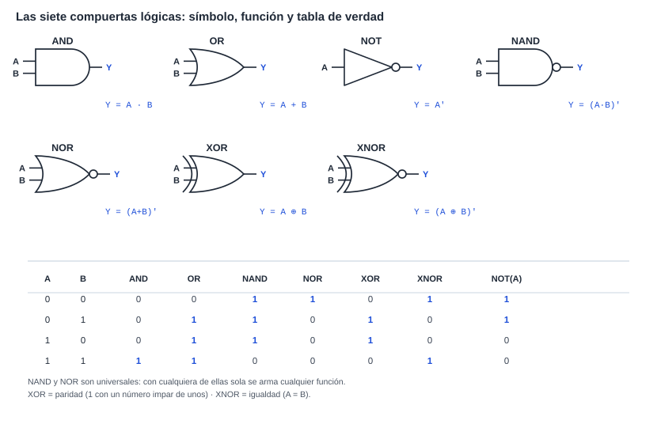

# Compuertas lógicas

> [!important] Qué necesitás para responder esta pregunta
> **En `Apoyo a la pregunta/`:** [[Mintérminos y maxtérminos]] **En otra tanda o unidad:** [[Álgebra de Boole — postulados y teoremas]] (Tanda 3 · 3.7 Álgebra de Boole y DeMorgan) · [[Leyes de DeMorgan]] (Tanda 3 · 3.7 Álgebra de Boole y DeMorgan) · [[Flip-Flops SR, D, JK y T]] (Tanda 3 · 3.6 Flip-flops D, T y RS) El detalle de **para qué sirve cada apoyo** está en [[00 Apoyos — 3.0 Herramientas]].

> [!abstract] En una frase
> Las **compuertas** son los componentes físicos que realizan las operaciones del álgebra de Boole: **AND, OR, NOT** (las tres básicas), más **NAND, NOR, XOR y XNOR** (derivadas). Cada una tiene su **símbolo**, su **tabla de verdad** y su **función booleana**, y con ellas se dibuja cualquier circuito combinacional de la materia.

> [!note] Si es la primera vez que ves esto
> Una compuerta es un **ladrillo**. Tiene una forma (el símbolo, que hay que saber dibujar), una **tabla de verdad** (qué sale según lo que entra) y una **fórmula**. Igual que con ladrillos, con pocos tipos distintos se construye cualquier casa: con **AND + OR + NOT** podés hacer *cualquier* función lógica, y con **NAND sola** también.
>
> Lo único que hay que tener claro es esto: **la tabla de verdad manda**. Si el profesor te da una tabla y te pide el circuito, la tabla es la especificación; las compuertas son la implementación. Y si te da el circuito, podés leer la función y escribir la tabla. Todo el final de la 3.ª tanda es ese ida y vuelta.

---

## 1. Las siete compuertas, con su tabla

| Compuerta | Símbolo (forma) | Función | Tabla (A,B → Y) | Se lee |
|---|---|---|---|---|
| **AND** | semicírculo (D) | `Y = A·B` | 00→0 · 01→0 · 10→0 · **11→1** | "A **y** B" |
| **OR** | escudo curvo | `Y = A + B` | 00→0 · **01→1 · 10→1 · 11→1** | "A **o** B" |
| **NOT** (inversor) | triángulo con burbuja | `Y = A'` | 0→1 · 1→0 | "**no** A" |
| **NAND** | AND con burbuja | `Y = (A·B)'` | 00→**1** · 01→**1** · 10→**1** · 11→**0** | "no (A y B)" |
| **NOR** | OR con burbuja | `Y = (A + B)'` | 00→**1** · 01→**0** · 10→**0** · 11→**0** | "no (A o B)" |
| **XOR** (exclusiva) | OR con doble curva | `Y = A ⊕ B = A·B' + A'·B` | 00→0 · **01→1 · 10→1** · 11→0 | "A **o** B, pero no las dos" |
| **XNOR** | XOR con burbuja | `Y = (A ⊕ B)' = A·B + A'·B'` | 00→**1** · 01→0 · 10→0 · 11→**1** | "iguales" |



> [!important] Las dos que hay que saber de memoria
> - **XOR = detector de paridad**: da 1 cuando hay un **número impar de unos**. Es el corazón del
>   [[Sumador completo]] (`S = A ⊕ B ⊕ Cin`).
> - **XNOR = comparador de igualdad**: da 1 cuando **las dos entradas son iguales**.
>
> Y la burbuja en la salida **niega**: NAND es AND negada, NOR es OR negada.

---

## 2. De la función al circuito (el procedimiento del final)

Cualquier función en **suma de productos** se dibuja en **dos niveles**:

```
   F = A·B + A'·C
        └──┬──┘  └──┬──┘
        AND 1     AND 2      ← nivel 1: un AND por producto
            └───┬───┘
               OR             ← nivel 2: un OR que los suma
```

**Receta (5 pasos, sirve para cualquier ejercicio):**

1. Escribir la función (de la tabla o del mapa de Karnaugh).

2. Identificar los **productos** (términos separados por `+`).

3. Un **AND** por producto, con las entradas que correspondan; los negados salen de un **inversor**.

4. Un **OR** que recibe todas las salidas de los AND.

5. Contar compuertas y, si se puede, **simplificar** (menos compuertas, menos retardo).

> [!tip] Convenciones de dibujo (para que el dibujo "se entienda")
> Entradas **a la izquierda**, salidas **a la derecha**; el flujo va de arriba-izquierda a abajo-derecha; un punto grande donde hay conexión, ninguna marca donde los cables se cruzan sin tocarse; **nombrar los cables intermedios** (S1, C1, X…) — eso es lo que hace que el circuito se pueda explicar en voz alta.

---

## 3. NAND y NOR: las compuertas universales

Con **sólo NAND** (o **sólo NOR**) se construye cualquier función:

```
   NOT(A)  = NAND(A, A)                        NOT(A)  = NOR(A, A)
   A·B     = NAND(NAND(A,B) , NAND(A,B))       A+B     = NOR(NOR(A,B) , NOR(A,B))
   A+B     = NAND(A', B')                      A·B     = NOR(A', B')
```
**Y toda función AND-OR pasa a NAND-NAND** con DeMorgan: `A·B + C·D = NAND(NAND(A,B), NAND(C,D))`. Es la razón por la que en los chips reales casi todo se hace con NAND: **un solo tipo de compuerta** en la línea de fabricación ⇒ más barato ([[Leyes de DeMorgan]]).

---

## 4. Detalles de hardware que suman (nombrarlos, no desarrollar)

| Concepto | Qué es | Por qué importa |
|---|---|---|
| **Retardo de propagación** | tiempo que tarda la salida en responder | define la **velocidad** del circuito; por eso importa la **cantidad de niveles**, no sólo de compuertas |
| **Fan-out** | cuántas entradas puede alimentar una salida | limitación física de la familia lógica |
| **Fan-in** | cuántas entradas tiene una compuerta | con muchas variables se hacen **árboles** de compuertas |
| **Buffer** | compuerta que sólo repite la señal | para **reforzar** la señal o aislar etapas |
| **Salida de 3 estados** (*tri-state*) | 0, 1 y **alta impedancia (Z)** | es lo que permite que **varios chips compartan un bus** ([[Flujo de información en BLUE (datos y direcciones)]], [[Memoria RAM 8x3]]) |
| **Familia lógica** (TTL/CMOS) | tecnología de fabricación | niveles de tensión, velocidad y consumo |

> [!example] El dato que conecta con la materia
> La **BLUE** tiene un **bus común**: todos los registros y la memoria comparten las mismas líneas. Eso sólo funciona porque cada registro tiene **buffers de 3 estados** en su salida: cuando no está seleccionado, queda en **alta impedancia** y "suelta" el cable.

---

## 5. Cómo responderlo en el final (2–3 minutos)

**Movimiento 1 — definición (20 s).** "Las compuertas son la implementación física de AND, OR y NOT; de ellas se derivan NAND, NOR, XOR y XNOR."

**Movimiento 2 — dibujar y tabular (60 s).** Dibujar AND, OR, NOT y **NAND** con su tabla de verdad (es lo mismo que preguntan siempre).

**Movimiento 3 — XOR (30 s).** "Da 1 con un número impar de unos; es el detector de paridad y está en el sumador (`S = A ⊕ B ⊕ Cin`)."

**Movimiento 4 — universalidad (30 s).** "Con NAND sola se hace todo: `A' = NAND(A,A)`, y `AB` con dos NAND; por eso los chips se fabrican con un solo tipo."

**Movimiento 5 — cierre (20 s).** "La tabla de verdad manda: de la tabla saco la función, de la función el circuito. Y con salidas de **3 estados** los chips comparten el bus común de la BLUE."

### Repreguntas típicas

| Repregunta | Respuesta corta |
|---|---|
| ¿Cuántas compuertas hay? | **3 básicas** (AND, OR, NOT) y **4 derivadas** (NAND, NOR, XOR, XNOR) |
| ¿Por qué NAND es universal? | Porque con ella se hacen NOT, AND y OR ⇒ cualquier función |
| ¿XOR con 3 entradas? | `A⊕B⊕C` = 1 con **impar** cantidad de unos; se arma con dos XOR en cascada |
| ¿Qué significa la burbuja? | **Niega** la salida (o la entrada, si está del lado de la entrada) |
| ¿Cuál es más rápida, AND u OR? | En la práctica equivalentes; lo que define la velocidad es la **cantidad de niveles** |
| ¿Qué es tri-state? | Tercer estado de **alta impedancia**: la salida "se desconecta" ⇒ varios dispositivos comparten un bus |
| ¿La compuerta es combinacional o secuencial? | **Combinacional**: la salida depende sólo de las entradas actuales |

---

## 6. Errores típicos

- Dibujar el **XOR** como un OR común (le falta la doble curva o la diferencia en la tabla).

- Confundir la burbuja de la **entrada** (niega la entrada) con la de la **salida** (niega el resultado).

- Decir que NAND y AND "son lo mismo con otro nombre": la tabla es **complementaria**.

- Escribir `Y = A + B` cuando la tabla es de XOR (con `11` la XOR da **0**, el OR da 1).

- Dibujar el circuito y **no simplificar**: se paga en compuertas y en retardo.

---

## 7. Para ampliar: qué leer y qué buscar

| Fuente | Dónde | Qué buscar | Para qué te sirve |
|---|---|---|---|
| **Apuntes de cátedra**, *Unidad 2* | comienzo de la unidad: **compuertas lógicas, símbolos y tablas** | los símbolos **que usa la cátedra** (importante: hay dos normas de dibujo) | **Es la fuente exacta**: dibujá como dibuja el apunte |
| **[[TP1 Compuertas lógicas]]** | el TP | las tablas de verdad y las compuertas a identificar | Lo que se entrega |
| **Floyd, *Fundamentos de sistemas digitales*** | capítulos iniciales de **compuertas** y **familias lógicas** | símbolos, tablas, retardos, fan-out, tri-state | **La mejor ampliación** |
| **Mano, *Lógica digital y diseño de computadoras*** | capítulo de **compuertas lógicas** | compuertas, universalidad, niveles de integración | Formalización |
| **[[Álgebra de Boole — postulados y teoremas]]** · **[[Leyes de DeMorgan]]** | notas de la bóveda | la matemática detrás de las compuertas | Para justificar cada paso |
| **[[Cómo dibujar los circuitos (checklist de pizarrón)]]** | nota de la bóveda | convenciones y orden de dibujo | Para no perder puntos en la forma |
| **[[Semisumador]]** · **[[Sumador completo]]** · **[[Multiplexor]]** | notas de la bóveda | los circuitos armados con estas compuertas | Aplicación inmediata |

---

## Relacionado
[[Álgebra de Boole — postulados y teoremas]] · [[Leyes de DeMorgan]] · [[Mintérminos y maxtérminos]] · [[Decodificador]] · [[Codificador]] · [[Multiplexor]] · [[Demultiplexor]] · [[Semisumador]] · [[Sumador completo]]
