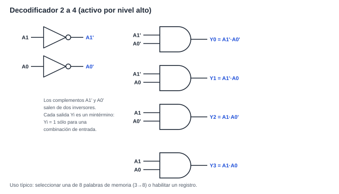

# Decodificador

> [!note] Si es la primera vez que ves esto
> Un decodificador es **el portero de un edificio con 8 departamentos**: entra un número (la dirección) y se
> enciende **una sola** luz, la del departamento que corresponde. Es el circuito que, dentro de una memoria,
> convierte "quiero la celda 5" en "activo la línea 5". Sin él, la memoria no sabría qué celda leer. Y es
> además el mismo circuito que usa la Unidad de Control para saber qué instrucción llegó (4 bits → 16
> líneas). Un solo circuito, dos usos centrales: por eso cae siempre en el final.

> [!abstract] En una frase
> Un decodificador de n a 2ⁿ entradas tiene n entradas y **2ⁿ salidas**, y activa **una sola salida**
> (la que corresponde al número binario de entrada). Cada salida es un **mintérmino** de las entradas.

## Contexto: el problema que resuelve
Un bus de direcciones lleva un número binario y el sistema tiene que **elegir uno entre muchos**
dispositivos: una palabra dentro de la memoria, un registro que debe cargarse, un periférico que debe
responder. El decodificador es el "puntero hardware": convierte el código binario de la dirección en
**una única señal activa**. Es el corazón del direccionamiento de memoria ([[Memoria RAM 8x3]]) y de la
selección de registros en la [[Unidad de Control]].

## Decodificador 2 a 4
| A1 | A0 | Y0 | Y1 | Y2 | Y3 |
|---|---|---|---|---|---|
| 0 | 0 | **1** | 0 | 0 | 0 |
| 0 | 1 | 0 | **1** | 0 | 0 |
| 1 | 0 | 0 | 0 | **1** | 0 |
| 1 | 1 | 0 | 0 | 0 | **1** |

Funciones (cada salida es un mintérmino):
`Y0 = A1'·A0'`  `Y1 = A1'·A0`  `Y2 = A1·A0'`  `Y3 = A1·A0`

Circuito: **2 inversores** (para generar A1' y A0') + **4 AND de 2 entradas**.

## Decodificador 3 a 8 (el de las memorias)
8 salidas, una por cada combinación de A2 A1 A0; 3 bits ⇒ 2³ = 8 palabras.
Se consigue comercialmente como bloque (74LS138) e incluye una entrada de habilitación **EN**.

> [!tip] Fórmula general
> Un decodificador de n entradas necesita **2ⁿ compuertas AND de n entradas** y **n inversores**
> (en la práctica se usan árboles o compuertas NAND). Con 4 bits de dirección: 16 salidas ⇒ 16 palabras;
> con 12 bits (BLUE): 4096 salidas ⇒ 4096 palabras. **El decodificador es lo que fija el tamaño de la memoria.**

## Habilitación y expansión en cascada
- Con **EN** (enable / chip select) el decodificador se puede deshabilitar: todas las salidas quedan en 0.
- Para un decodificador **4 a 16** se usan dos 3→8: el **bit más significativo** va directo a EN de uno
  (y negado a EN del otro); los tres bits restantes a las entradas de ambos.
- Es la misma idea con la que se **expande la memoria**: varios chips RAM comparten buses y cada uno se
  habilita con una salida distinta del decodificador de banco (ver [[Memoria RAM 8x3]]).

## Aplicaciones (nombrarlas en el final)
1. **Selección de palabra en memoria** (direccionamiento).
2. **Selección de registro**: la UC pone un código y el decodificador genera la señal `LOAD` de un solo registro.
3. **Decodificación de instrucciones**: el opcode del IR entra a un decodificador y activa la línea de
   control de esa instrucción (ver [[Unidad de Control]]).
4. **Decodificador de direcciones de E/S** (selección de periférico/puerto).

> [!example] Del TP6
> El [[TP6 Decodificadores y demultiplexores|TP6]] pide construir el **2→4** y el **3→8** con tabla de verdad
> y circuito: es exactamente esta nota llevada al pizarrón. Recordá que en el bloque comercial (74LS138) las
> salidas suelen ser **activas por nivel bajo**.

## Cómo responderlo en el final (práctica)
1. Definición + relación con los mintérminos.
2. Tabla de verdad del 2→4 (o 3→8).
3. Funciones de cada salida (`Yi = mintérmino i`).
4. Gráfico: inversores + matriz de AND (o el bloque con EN y sus 8 salidas).
5. Uso en memoria / en la UC.

## Errores típicos
- Activar más de una salida: **siempre hay exactamente una** activa (por eso es "decodificador").
- Confundirlo con el [[Codificador]] (ese hace lo inverso: 2ⁿ entradas → n salidas).
- Olvidar que las salidas del 74LS138 son **activas por nivel bajo** (las letras con barra: Ȳ0). Si el
  apunte las usa negadas, aclaralo.

## Relacionado
[[Codificador]] · [[Multiplexor]] · [[Demultiplexor]] · [[Memoria RAM 8x3]] · [[Mintérminos y maxtérminos]]
