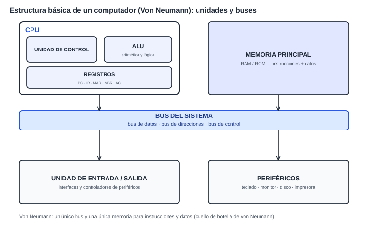

# TP16 — Ciclo de instrucción básico

> [!abstract] Consigna (cátedra)
> **Ej. 1:** describir las principales unidades de la computadora de Von Neumann y **graficarlas en una
> vista de dos niveles**.
> **Ej. 2:** describir los ciclos que componen el ciclo básico de una instrucción: **ciclo de captación** y
> **ciclo de ejecución**, y graficarlos.
> **Ej. 3:** ejemplificar el ciclo de ejecución de un programa, describiendo **los 6 pasos del video de
> estudio**, con los datos dados.
> **Ej. 4:** repetir el ejercicio en el **simulador de la máquina elemental (Blue)**, con capturas.

> [!important] Este es el TP que más se parece a la pregunta principal #3 del final
> "Ciclo de máquina" es exactamente esto. Y el Ej. 3 es el ejercicio que conviene tener resuelto y
> memorizado, porque muestra el ciclo **funcionando con un programa real**.

## Ej. 1 — Vista de dos niveles
**Nivel 1 (unidades):** CPU · Memoria principal · E/S · (buses que las unen).
**Nivel 2 (dentro de la CPU):** UC · ALU · registros (PC, IR, MAR, MBR, AC).
Ese "zoom" es lo que pide: el dibujo grande y, adentro de la CPU, el detalle.

## Ej. 2 — Los dos ciclos
| | **Ciclo de captación (búsqueda / fetch)** | **Ciclo de ejecución (execute)** |
|---|---|---|
| Qué hace | trae la instrucción desde la memoria al **IR** | hace lo que la instrucción ordena |
| Secuencia | `MAR ← PC` → `MEMR` → `MBR ← M[MAR]` → `PC ← PC+1` → `IR ← MBR` → decodificar | según el opcode: leer operando, operar en la ALU, escribir resultado, actualizar PC |
| ¿Es igual para todas? | **sí** (fija) | **no** (depende del opcode) |

## Ej. 3 — Los 6 pasos con el programa del TP
**Datos del enunciado**

| Palabra instrucción | CodOp | Dirección |
|---|---|---|
| 1 | 1 | 650 |
| 2 | 5 | 651 |
| 3 | 2 | 652 |

| Memoria | Contenido |
|---|---|
| 190 | 1650 |
| 191 | 5651 |
| 192 | 2652 |
| 650 | 0001 |
| 651 | 0003 |

Lectura: en 190 está la instrucción de opcode **1** con dirección **650**; en 650 hay un **1**. La segunda
es opcode **5** (sumar) con dirección 651 (donde hay un **3**); la tercera es opcode **2** (almacenar) con
dirección 652. O sea: **cargar 1, sumarle 3, guardar el resultado en 652**.

**Traza paso a paso (los 6 pasos del video)**
| # | Paso | Con el programa del TP |
|---|---|---|
| **1** | **Búsqueda de la instrucción**: `PC → MAR → memoria → MBR → IR`, y `PC ← PC+1` | `PC = 190` ⇒ `IR ← 1650`, `PC = 191` |
| **2** | **Decodificación**: la UC lee el opcode del IR y determina la operación | opcode **1** ⇒ "cargar en el AC el contenido de la dirección 650" |
| **3** | **Búsqueda del operando**: la dirección del IR va al MAR y se lee la memoria | `MAR ← 650`, `MEMR`, `MBR ← 0001` |
| **4** | **Ejecución**: la ALU o el registro destino hace la operación | `AC ← MBR` ⇒ **AC = 1** |
| **5** | **Escritura del resultado** (si corresponde) | en esta instrucción no hay escritura en memoria |
| **6** | **Preparación de la próxima instrucción**: el PC ya apunta al siguiente y se vuelve al paso 1 | `PC = 191` ⇒ próxima instrucción `5651` |

**Las tres instrucciones completas:**

| Instrucción | Búsqueda | Ejecución | Estado final |
|---|---|---|---|
| `1 650` | `IR ← 1650`, PC → 191 | `AC ← M[650]` | **AC = 1** |
| `5 651` | `IR ← 5651`, PC → 192 | `AC ← AC + M[651]` = 1 + 3 | **AC = 4** |
| `2 652` | `IR ← 2652`, PC → 193 | `M[652] ← AC` | **M[652] = 4** |

**Cierre de la respuesta:** "el programa termina cuando no hay más instrucciones (o con una instrucción de
parada). El resultado quedó en la celda 652, y en todo el proceso intervinieron: PC, MAR, MBR, IR, AC, la
UC (que dio las señales) y la ALU (en la suma)."

> [!warning] Sobre los códigos de operación
> Este TP usa la tabla del **simulador Blue**, donde `1` = cargar, `2` = almacenar y `5` = sumar. Si en tu
> apunte la tabla es otra, copiala: lo que se evalúa es la **secuencia del ciclo**, no el número.

## Ej. 4 — En el simulador
1. Cargar las instrucciones en 190/191/192 y los datos en 650/651 (el simulador suele tener un editor de
   memoria o un ensamblador).
2. Ejecutar en **modo paso a paso** y capturar, en cada paso, el valor de **PC, IR, MAR, MBR y AC**.
3. Guardar las capturas: una por paso del ciclo (búsqueda y ejecución de cada instrucción).

## Enlaces
Desarrollo: [[Ciclo de máquina]] · [[Ciclo de búsqueda (7 y 8 pulsos)]] · [[Ciclo de ejecución — todas las operaciones]]
Siguiente: [[TP17 Formato básico de instrucciones]]
