# Materia completa — Arquitectura del Computador (UCASAL)

> [!abstract] Qué es este archivo
> **Las 10 unidades en un solo archivo**, con los **107 subtemas** pegados en orden: es la materia entera para
> **leer de corrido** o imprimir. Cada subtema trae su definición, sus tablas, su diagrama propio, un ejemplo
> resuelto, el error típico y la figura del libro.
>
> - **Si estás repasando**: no leas todo, usá el índice de abajo o el [[Banco de preguntas del final]].
> - **Si es la primera lectura**: leé unidad por unidad; cada una termina con su cierre.
> - **Si querés una unidad sola**: [[00 Índice de la materia (las 10 unidades)]] tiene el archivo «Unidad N completa».
> - Los números (`3.2.1`, `5.5.2`…) son los mismos del índice y del modelo de final.
>
> *Archivo generado con `tools/unir_unidades.py`: no editarlo a mano, editar el subtema y regenerar.*

## Contenido

**Unidad 1 — Circuitos de lógica digital** · 17 subtemas
- 1.1 Compuertas lógicas: [[#1.1.1 Compuerta AND, OR y NOT]] · [[#1.1.2 NAND, NOR, XOR y XNOR]] · [[#1.1.3 Compuertas universales]]
- 1.2 Álgebra de Boole: [[#1.2.1 Postulados, dualidad y teoremas]] · [[#1.2.2 Leyes de DeMorgan]] · [[#1.2.3 Simplificación analítica]]
- 1.3 Formas canónicas y Karnaugh: [[#1.3.1 Mintérminos y maxtérminos]] · [[#1.3.2 Mapa de Karnaugh de 2, 3 y 4 variables]] · [[#1.3.3 Don't care y criterios de agrupación]]
- 1.4 Bloques combinacionales: [[#1.4.1 Decodificador]] · [[#1.4.2 Codificador]] · [[#1.4.3 Multiplexor]] · [[#1.4.4 Demultiplexor]]
- 1.5 Aritmética combinacional: [[#1.5.1 Semisumador y sumador completo]] · [[#1.5.2 Sumador de n bits y resta en complemento a 2]]
- 1.6 Códigos binarios: [[#1.6.1 Códigos ponderados y no ponderados]] · [[#1.6.2 Códigos continuos y cíclicos]]

**Unidad 2 — Memorias y circuitos secuenciales** · 20 subtemas
- 2.1 Biestables y flip-flops: [[#2.1.1 Biestable RS (NOR y NAND)]] · [[#2.1.2 Flip-flops D y T]] · [[#2.1.3 Flip-flop JK y ecuaciones características]] · [[#2.1.4 Conversión entre biestables]]
- 2.2 Registros y contadores: [[#2.2.1 Registros PIPO y SISO]] · [[#2.2.2 Registros SIPO y PISO]] · [[#2.2.3 Contadores binarios y módulo N]]
- 2.3 La celda y el chip de memoria: [[#2.3.1 Celda elemental de memoria]] · [[#2.3.2 SRAM y DRAM]] · [[#2.3.3 Matriz, expansión y RAM 8x3]] · [[#2.3.4 Detección y corrección de errores (paridad, LRC, CRC y Hamming)]]
- 2.4 ROM y memorias no volátiles: [[#2.4.1 ROM = decodificador + OR]] · [[#2.4.2 PROM, EPROM, EEPROM y Flash]]
- 2.5 Jerarquía y caché: [[#2.5.1 Jerarquía y localidad]] · [[#2.5.2 Caché: mapeos y políticas]] · [[#2.5.3 AMAT y cálculo de mejora]]
- 2.6 Memorias complementarias: [[#2.6.1 Memoria virtual y paginación]] · [[#2.6.2 Memoria auxiliar y memoria asociativa]]
- 2.7 Dimensionar memorias: [[#2.7.1 Bits de dirección igual a log2 de celdas]] · [[#2.7.2 CodOp vs campo de dirección]]

**Unidad 3 — Transferencia de registros y microoperaciones** · 7 subtemas
- 3.1 Microoperaciones y bus: [[#3.1.1 Notación de transferencia entre registros]] · [[#3.1.2 Bus único y buffers de 3 estados]] · [[#3.1.3 Buses de datos, de direcciones y de control]]
- 3.2 La ALU: [[#3.2.1 Estructura, G-P y señales de selección]] · [[#3.2.2 Operaciones aritméticas, lógicas y flags]]
- 3.3 Registros de la CPU: [[#3.3.1 AC, PC, IR, MAR y MBR]] · [[#3.3.2 Base, índice, puntero de pila y estado]]

**Unidad 4 — Organización y diseño básico** · 10 subtemas
- 4.1 Estructura y modelo von Neumann: [[#4.1.1 Unidades funcionales de una computadora]] · [[#4.1.2 IAS y el programa almacenado]]
- 4.2 La máquina BLUE: [[#4.2.1 Especificación, registros y 4096x16]] · [[#4.2.2 Los 16 opcodes octales]] · [[#4.2.3 Programar en BLUE]]
- 4.3 El ciclo de instrucción: [[#4.3.1 Ciclo de reloj, de máquina y de instrucción]] · [[#4.3.2 Búsqueda, los 8 pulsos]] · [[#4.3.3 Ejecución instrucción por instrucción]]
- 4.4 Unidad de Control: [[#4.4.1 Funciones y señales de control]] · [[#4.4.2 estado·pulso·instrucción y el decodificador 1-16]]

**Unidad 5 — Programación básica y CPU convencional** · 13 subtemas
- 5.1 Lenguaje máquina: [[#5.1.1 Instrucción, opcode y operandos]] · [[#5.1.2 Clasificación de las instrucciones]] · [[#5.1.3 Registros de la CPU]]
- 5.2 Formato de la instrucción: [[#5.2.1 Los 4 formatos y el campo único de dirección]] · [[#5.2.2 Cálculo de CodOp según el tamaño de memoria]]
- 5.3 Modos de direccionamiento: [[#5.3.1 Los 7 modos]] · [[#5.3.2 Dirección efectiva y costo en accesos]]
- 5.4 La BLUE indexada: [[#5.4.1 RIF, RID y RB]] · [[#5.4.2 Modificador de 2 bits y los 24 pulsos]]
- 5.5 Interrupciones: [[#5.5.1 IRQ, SI y CP8]] · [[#5.5.2 Máscara, pila y RTI]]
- 5.6 El 8086: [[#5.6.1 BIU, EU y segmentación]] · [[#5.6.2 La pila y el registro SP]]

**Unidad 6 — Control microprogramado** · 5 subtemas
- 6.1 Control cableado: [[#6.1.1 Circuito, compuertas y señales]]
- 6.2 Control microprogramado: [[#6.2.1 Memoria de control y microinstrucción]] · [[#6.2.2 Secuenciamiento y microPC]]
- 6.3 Comparación y caso real: [[#6.3.1 Cableada vs microprogramada]] · [[#6.3.2 El 8088, ROM de control 504x21]]

**Unidad 7 — CPU y arquitecturas** · 9 subtemas
- 7.1 Pipeline: [[#7.1.1 Etapas y diagrama en escalera]] · [[#7.1.2 Hazards y sus soluciones]] · [[#7.1.3 Cálculo de speedup y límites]]
- 7.2 Técnicas para aumentar la velocidad: [[#7.2.1 Superscalar, superpipeline, SMT y multicore]] · [[#7.2.2 Caché y predicción de saltos]]
- 7.3 CISC y RISC: [[#7.3.1 Tabla comparativa y ejemplos]] · [[#7.3.2 UC cableada vs microprogramada y load-store]]
- 7.4 Arquitecturas y buses: [[#7.4.1 von Neumann vs Harvard]] · [[#7.4.2 Buses internos y externos]]

**Unidad 8 — Paralelismo** · 9 subtemas
- 8.1 Pipeline aritmético: [[#8.1.1 Etapas segmentadas y suma de vectores]] · [[#8.1.2 Encadenamiento y speedup]]
- 8.2 Procesamiento vectorial y SIMD: [[#8.2.1 SIMD, registros vectoriales y GPU]] · [[#8.2.2 Flynn, arreglos SIMD y conectados]] · [[#8.2.3 Multiplicación de matrices]]
- 8.3 Memoria entrelazada: [[#8.3.1 Bancos de memoria y ancho de banda]] · [[#8.3.2 Patrón de entrelazado y conflictos de banco]]
- 8.4 Multiprocesadores: [[#8.4.1 Multicore, coherencia de caché y ley de Amdahl]] · [[#8.4.2 Monousuario vs multiusuario]]

**Unidad 9 — Hardware aritmético** · 10 subtemas
- 9.1 Suma y resta: [[#9.1.1 Complemento a 2 y desbordamiento]] · [[#9.1.2 Acarreo anticipado (G y P)]]
- 9.2 Multiplicación: [[#9.2.1 Sumas y desplazamientos]] · [[#9.2.2 Algoritmo de Booth]] · [[#9.2.3 Arreglo multiplicador]]
- 9.3 División: [[#9.3.1 Restauración y no restauración]] · [[#9.3.2 Sobreflujo y división con signo]]
- 9.4 Punto flotante: [[#9.4.1 Formato, normalización y operaciones]] · [[#9.4.2 IEEE 754]]
- 9.5 Aritmética BCD: [[#9.5.1 Suma decimal corregida]]

**Unidad 10 — Entrada y Salida** · 7 subtemas
- 10.1 Entrada y salida programada: [[#10.1.1 Polling y sus límites]] · [[#10.1.2 Puertos, interfaces y handshake]]
- 10.2 Interrupciones: [[#10.2.1 Mecanismo completo]] · [[#10.2.2 Interrupciones vectorizadas y prioridad]]
- 10.3 DMA: [[#10.3.1 Controlador, robo de ciclo y transferencia de bloques]]
- 10.4 Dispositivos y almacenamiento: [[#10.4.1 Discos, SSD y latencias]] · [[#10.4.2 Interfaces serie y paralelo]]

---

## Unidad 1 — Circuitos de lógica digital

> [!info] Unidad 1
> 17 subtemas · 11.444 palabras ·
> síntesis de una página: [[00 Síntesis — Unidad 1]] · archivo de la unidad: [[00 Unidad 1 completa (lectura de corrido)]]

### 1.1 Compuertas lógicas

#### 1.1.1 Compuerta AND, OR y NOT

> [!abstract] En una frase
> **AND** da 1 sólo si **todas** sus entradas son 1 · **OR** da 1 si **alguna** entrada es 1 · **NOT** da lo
> **contrario** de su única entrada.

> [!note] Si es la primera vez que ves esto
> Pensá en **dos llaves de agua en serie** (para que salga agua tienen que estar las dos abiertas: eso es AND) y en
> **dos llaves en paralelo** (basta con que una esté abierta: eso es OR). El **NOT** es una llave que está cerrada
> cuando la otra está abierta: es el interruptor del tipo "conmutador". Una compuerta no es más que eso: un
> dispositivo de dos estados que **decide** en función de sus entradas.

##### Tabla de verdad

| A | B | A·B (AND) | A+B (OR) | A' (NOT) |
|---|---|---|---|---|
| 0 | 0 | 0 | 0 | 1 |
| 0 | 1 | 0 | 1 | 0 |
| 1 | 0 | 0 | 1 | — |
| 1 | 1 | **1** | **1** | — |

**Convenciones que hay que respetar siempre:** el producto lógico se escribe `A·B`, `AB` o `A AND B`; la suma
`A+B`; la negación `A'`, `Ā` o `¬A`. En la cátedra se usa la barra o el apóstrofo; **elegí uno y no los mezcles**
en el mismo renglón.

##### Símbolo, expresión y circuito

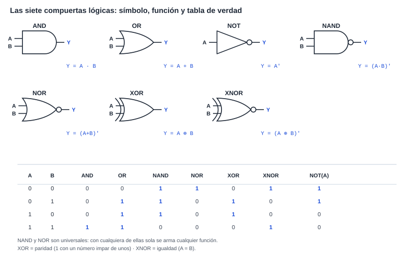

| Compuerta | Expresión | Forma |
|---|---|---|
| AND | `Y = A·B` | D de lados rectos |
| OR | `Y = A+B` | D de atrás curvo |
| NOT | `Y = A'` | triángulo con burbuja |

##### Para qué se usa en la materia
Son la base de **todo**: el decodificador es un AND por cada combinación, el codificador son OR, el MUX son
AND + OR, y la ALU empieza por acá. En la máquina BLUE, la señal de control que habilita una escritura
(`LDA·CP8·E`) es literalmente un **AND de tres entradas** con los estados y los pulsos.

##### Ejemplo (estilo TP1)
Con `A = 1`, `B = 0`:

- `A·B = 0` (falta una)
- `A+B = 1` (alcanza con A)
- `A' = 0`, `B' = 1`

Y con `A = B = 1`: `A·B = 1`, `A+B = 1`, `A' = 0`.

> [!warning] Errores típicos
> - **Confundir OR con XOR.** Con `A = B = 1`, OR da **1** y XOR da **0**.
> - Escribir `A + A = 2A`: en Boole `A + A = A` (idempotencia).
> - Olvidar la barra: `A+B'` no es `(A+B)'`. La negación de una suma **necesita paréntesis**.

##### Figura del libro

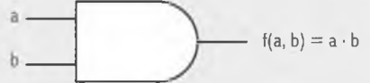

*Fig. 5.2 — Compuerta AND.* · Quiroga, *Arquitectura de computadoras*, p. 119.

##### Relacionado
[[1.1.2 NAND, NOR, XOR y XNOR]] · [[1.1.3 Compuertas universales]] · [[00 Tema 1.1 — índice]] ·
[[Compuertas lógicas]] · [[Tablas de verdad de memoria]] · [[Glosario — Unidad 1]]

#### 1.1.2 NAND, NOR, XOR y XNOR

> [!abstract] En una frase
> **NAND** = AND negada (da 0 sólo con dos 1) · **NOR** = OR negada (da 1 sólo con dos 0) · **XOR** = "son
> distintas" · **XNOR** = "son iguales".

> [!note] Si es la primera vez que ves esto
> Las tres compuertas anteriores (AND, OR, NOT) son las "letras". Estas cuatro son las que **aparecen en el
> taller**: NAND y NOR porque son las únicas que se fabrican barato y con ellas se arma todo; XOR porque es la
> compuerta que **compara** dos bits, y de ahí sale el sumador.

##### Los cuatro símbolos, con su tabla

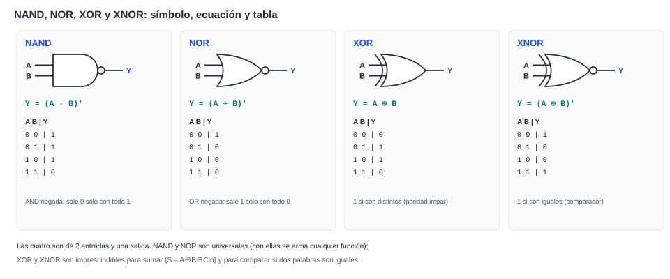

##### Tabla de verdad

| A | B | NAND `(A·B)'` | NOR `(A+B)'` | XOR `A⊕B` | XNOR `(A⊕B)'` |
|---|---|---|---|---|---|
| 0 | 0 | 1 | **1** | 0 | 1 |
| 0 | 1 | 1 | 0 | **1** | 0 |
| 1 | 0 | 1 | 0 | **1** | 0 |
| 1 | 1 | **0** | 0 | 0 | **1** |

**Cómo leerla sin memorizar:** NAND es la **única** que da 0 en la última fila; NOR es la **única** que da 1 en
la primera; XOR tiene 1 donde las entradas **difieren**.

##### Expresiones equivalentes
- `A ⊕ B = A'B + AB'` (suma de mintérminos 1 y 2)
- `A ⊕ B = (A + B) · (A·B)'` (forma útil para dibujar con NAND)
- `(A ⊕ B)' = A'B' + AB` (XNOR, detector de igualdad)

##### Para qué sirve cada una en la materia

| Compuerta | Dónde aparece |
|---|---|
| **NAND / NOR** | son **universales**: con una sola de ellas se arma cualquier circuito ([[1.1.3 Compuertas universales]]) |
| **XOR** | el **semisumador** (`S = A⊕B`), la suma binaria sin acarreo, la paridad |
| **XNOR** | comparadores de igualdad (¿A = B?) y el detector de "cero" |

##### Ejemplo (estilo TP1)
Con `A = 1`, `B = 1`: `NAND = 0`, `NOR = 0`, `XOR = 0`, `XNOR = 1`.
Con `A = 1`, `B = 0`: `NAND = 1`, `NOR = 0`, `XOR = 1`, `XNOR = 0`.

> [!warning] Errores típicos
> - Decir que "NAND es lo mismo que NOR negada". No: la negación de NOR es **OR** (`(A+B)'' = A+B`).
> - Usar XOR como OR en una simplificación: `A + A'B` **no** es `A ⊕ B`.
> - Dibujar la burbuja de NAND **antes** de la compuerta en vez de en la salida.

##### Figura del libro

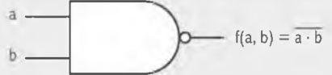

*Fig. 5.6 — Compuerta NAND.* · Quiroga, *Arquitectura de computadoras*, p. 121.

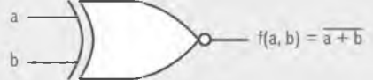

*Fig. 5.7 — Compuerta ÑOR.* · Quiroga, *Arquitectura de computadoras*, p. 121.

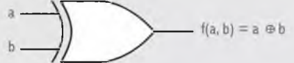

*Fig. 5.4 — Compuerta XOR.* · Quiroga, *Arquitectura de computadoras*, p. 120.

##### Relacionado
[[1.1.1 Compuerta AND, OR y NOT]] · [[1.1.3 Compuertas universales]] · [[Semisumador]] ·
[[Compuertas lógicas]] · [[Tablas de verdad de memoria]] · [[Glosario — Unidad 1]]

#### 1.1.3 Compuertas universales

> [!abstract] En una frase
> **NAND y NOR son universales**: con cualquiera de las dos, repetida las veces que haga falta, se puede construir
> **cualquier** función lógica (incluidas NOT, AND, OR y un sumador completo).

> [!note] Si es la primera vez que ves esto
> En una fábrica de chips conviene **producir un solo tipo de ladrillo** y armar todo con él: sale más barato y más
> rápido. La NAND (y la NOR) tienen esa propiedad: son el "ladrillo único" de la electrónica digital. Por eso los
> circuitos reales de la materia se dibujan a veces sólo con NAND.

##### Todo con NAND

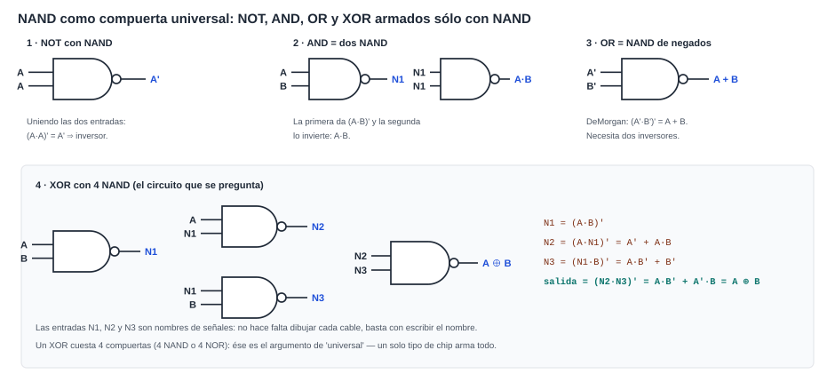

##### Las tres equivalencias que hay que saber

| Función | Con NAND | Con NOR |
|---|---|---|
| **NOT** `A'` | `(A·A)' = A'` → unir las dos entradas | `(A+A)' = A'` |
| **AND** `A·B` | `((A·B)')' = A·B` → NAND + NOT | `(A' + B')' = A·B` → NOR con entradas negadas |
| **OR** `A+B` | `(A'·B')' = A+B` → NAND con entradas negadas | `((A+B)')' = A+B` → NOR + NOT |

> [!important] La cuenta que se pregunta
> Una **OR de 2 entradas con NAND** cuesta **3 compuertas** (dos NAND como inversores + una NAND final).
> Una **AND con NAND** cuesta **2** (la NAND y un inversor). De ahí sale el "costo en compuertas" que pide el TP.

##### Por qué funciona (la razón algebraica)
Todo se apoya en **DeMorgan**: `(A·B)' = A' + B'` y `(A+B)' = A'·B'`. Como la NAND ya entrega la negación del
producto, negando otra vez (con otra NAND usada como inversor) se recupera el producto, y negando las entradas se
convierte el producto en suma.

##### Ejemplo: `Y = A·B + C` sólo con NAND

La clave es reescribir la suma como producto de negaciones (**DeMorgan**):
`A·B + C = ((A·B)' · C')'`.

1. `N1 = (A·B)'` → una NAND con A y B.
2. `N2 = (C·C)' = C'` → una NAND con C en las dos entradas (sirve de inversor).
3. `Y = (N1 · N2)'` → una NAND final.

**Total: 3 compuertas NAND.** El circuito se dibuja de izquierda a derecha en el orden N1, N2 y la final.

> [!warning] Errores típicos
> - Poner una sola burbuja y creer que ya negó "todo".
> - Contar mal el costo: el inversor hecho con NAND **es** una compuerta.
> - Olvidar que NOR también es universal (se pregunta "¿cuáles son universales?" → **las dos**, NAND y NOR).

##### Figura del libro

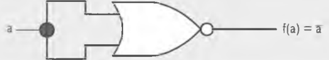

*Fig. 5.10 — I mplementación de la negación con compuertas negadas.* · Quiroga, *Arquitectura de computadoras*, p. 123.

##### Escalas de integración: SSI, MSI, LSI y VLSI

Las compuertas no se compran sueltas: vienen dentro de un **circuito integrado (chip)**. Según **cuántas compuertas
entran en un chip** se habla de escalas de integración — es la clasificación que usa la cátedra y aparece en el
parcial como definición corta.

| Escala | Nombre | Compuertas por chip | Ejemplo típico |
|---|---|---|---|
| **SSI** | *Small Scale Integration* | hasta **10** | una 7400 (4 compuertas NAND de 2 entradas) |
| **MSI** | *Medium Scale Integration* | de **10 a 100** | decodificador 74138, multiplexor 74151, sumador 7483 |
| **LSI** | *Large Scale Integration* | de **100 a 1000** | una memoria pequeña, un contador completo |
| **VLSI** | *Very Large Scale Integration* | **más de 1000** | un microprocesador, una FPGA, un chip de RAM |

> [!important] Cómo se usa esto en la materia
> Cuando el enunciado dice *"implemente con MSI"*, está pidiendo **usar un bloque ya hecho** (decodificador, MUX,
> sumador) en vez de dibujar la función con compuertas SSI. Es la diferencia entre la solución "larga" y la solución
> "de una línea" que se espera en el final. Los bloques MSI se estudian en el tema 1.4.


##### Relacionado
[[1.1.2 NAND, NOR, XOR y XNOR]] · [[1.2.2 Leyes de DeMorgan]] · [[00 Tema 1.1 — índice]] ·
[[TP1 Compuertas lógicas]] · [[Compuertas lógicas]] · [[Glosario — Unidad 1]]

### 1.2 Álgebra de Boole

#### 1.2.1 Postulados, dualidad y teoremas

> [!abstract] En una frase
> El álgebra de Boole es un sistema con **dos valores (0 y 1)** y **tres operaciones (·, +, ')**, donde todo vale
> por **dualidad**: si una igualdad es cierta, también lo es la que se obtiene cambiando 0↔1 y ·↔+.

> [!note] Si es la primera vez que ves esto
> Es el "álgebra de las llaves": en vez de números, trabajamos con interruptores abiertos (0) y cerrados (1). Las
> reglas parecen raras porque la suma no es la suma (`1+1 = 1`: si hay dos llaves en paralelo y una ya está
> abierta, el agua pasa igual). Una vez que aceptás eso, el resto es aplicar reglas como en álgebra común.

##### Dualidad, identidad por identidad

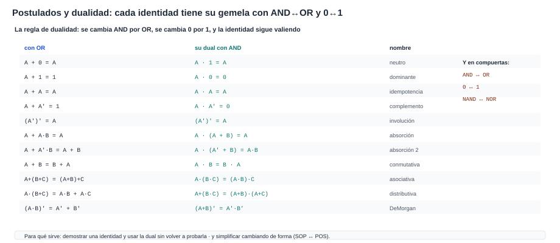

##### Los postulados (los que siempre se pueden usar)

| # | Postulado | Dual |
|---|---|---|
| 1 | `A + 0 = A` | `A · 1 = A` |
| 2 | `A + 1 = 1` | `A · 0 = 0` |
| 3 | `A + A = A` | `A · A = A` |
| 4 | `A + A' = 1` | `A · A' = 0` |
| 5 | Conmutativa: `A+B = B+A` | `A·B = B·A` |
| 6 | Asociativa: `A+(B+C) = (A+B)+C` | `A·(B·C) = (A·B)·C` |
| 7 | Distributiva: `A+(B·C) = (A+B)·(A+C)` | `A·(B+C) = A·B + A·C` |

> [!important] La distributiva "rara"
> En Boole **suma distribuye sobre producto** (`A + B·C = (A+B)(A+C)`), cosa que en álgebra común no pasa. Es la
> que más se olvida y la que más se necesita.

##### Teoremas útiles (se deducen de los postulados)

| Teorema | Forma | Dual |
|---|---|---|
| Absorción | `A + A·B = A` | `A · (A+B) = A` |
| Absorción 2 | `A + A'·B = A + B` | `A · (A'+B) = A·B` |
| Consenso | `A·B + A'·C + B·C = A·B + A'·C` | `(A+B)(A'+C)(B+C) = (A+B)(A'+C)` |
| Involución | `(A')' = A` | — |
| Idempotencia | `A + A = A` | `A · A = A` |

##### Dualidad: cómo se usa
Se toma una igualdad **válida** y se la "da vuelta": `0→1`, `1→0`, `·→+`, `+→·`. Por ejemplo, de
`A + A·B = A` sale `A·(A+B) = A`. **Las variables no se tocan** (no se niegan) y la igualdad se mantiene.

##### Ejemplo resuelto
Simplificar `Y = A·B + A·B'`.

1. Saco **factor común** A (distributiva al revés): `Y = A·(B + B')`.
2. Postulado 4: `B + B' = 1`.
3. Postulado 1: `Y = A·1 = A`.

Otro: `Y = A + A'·B` → por absorción 2, `Y = A + B`. (Sin el teorema, se hace `(A+A')(A+B) = 1·(A+B) = A+B`.)

> [!warning] Errores típicos
> - Aplicar la distributiva como en álgebra común y escribir `A·(B+C) = A·B + C` (falta `A·C`).
> - "Pasar términos al otro lado" restando: en Boole **no hay resta**; sólo se factoriza y se usan postulados.
> - Negar en la dualidad: la dual de `A+A'=1` es `A·A'=0`, **sin** cambiar las variables.

##### Figura del libro

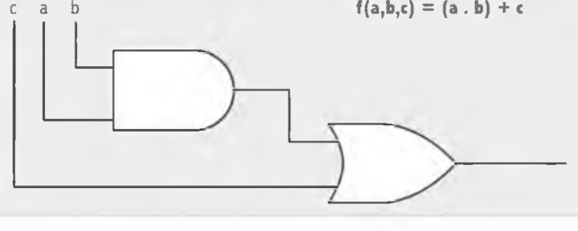

*Fig. 5.12 — Diagrama de lógica.* · Quiroga, *Arquitectura de computadoras*, p. 123.

> [!tip] Qué mirar
> Con un AND y un OR ya se escribe cualquier función como suma de productos. Los postulados son las reglas que permiten pasar de la expresión `f = (a·b) + c` al dibujo, y la dualidad dice que cada una vale igual cambiando AND por OR.

##### Relacionado
[[1.2.2 Leyes de DeMorgan]] · [[1.2.3 Simplificación analítica]] · [[00 Tema 1.2 — índice]] ·
[[TP2 Álgebra de Boole]] · [[Álgebra de Boole — postulados y teoremas]] · [[Glosario — Unidad 1]]

#### 1.2.2 Leyes de DeMorgan

> [!abstract] En una frase
> `(A + B)' = A' · B'` y `(A · B)' = A' + B'`: al negar **se invierte la operación y se niega cada término**.

> [!note] Si es la primera vez que ves esto
> Necesitás "meter la barra para adentro". La regla es la de una puerta de dos hojas: si **no** entra por ninguna
> (NOR), es lo mismo que decir que **las dos** están cerradas (AND de negaciones). DeMorgan es la herramienta para
> convertir un circuito a **NAND/NOR** y para negar una función entera sin equivocarse.

##### DeMorgan, dibujado

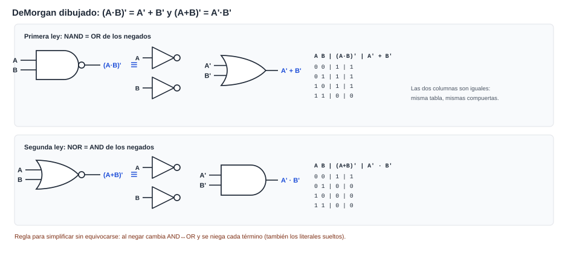

##### Las dos leyes y su generalización

| Forma | Ley |
|---|---|
| **NOR** | `(A + B)' = A' · B'` |
| **NAND** | `(A · B)' = A' + B'` |
| General | `(A + B + C + …)' = A'·B'·C'·…` · `(A·B·C·…)' = A' + B' + C' + …` |

##### Demostración por tabla de verdad (la que se pide)

| A | B | A+B | **(A+B)'** | A' | B' | **A'·B'** |
|---|---|---|---|---|---|---|
| 0 | 0 | 0 | **1** | 1 | 1 | **1** |
| 0 | 1 | 1 | **0** | 1 | 0 | **0** |
| 1 | 0 | 1 | **0** | 0 | 1 | **0** |
| 1 | 1 | 1 | **0** | 0 | 0 | **0** |

Las dos columnas en negrita son idénticas ⇒ la igualdad vale para las 4 combinaciones.

##### Cómo se aplica (receta de 3 pasos)
1. **Invertir la operación** principal (`+` ↔ `·`).
2. **Negar cada término** (si ya estaba negado, se desniega: `(A')' = A`).
3. Repetir si quedan barras que abarcan más de una variable.

**Ejemplo 1:** `Y = ((A + B) · C)'` → `Y = (A + B)' + C' = A'B' + C'`.
**Ejemplo 2:** `Y = (A·B' + C)'` → `Y = (A·B')' · C' = (A' + B) · C'`.
**Ejemplo 3 (todo a NAND):** `Y = A·B + C·D` → `Y = ((A·B)' · (C·D)')'`: dos NAND y una NAND final.

##### Dónde aparece en la materia
- **Compuertas universales:** es la justificación de que NAND y NOR alcancen para todo.
- **Karnaugh con ceros:** cuando conviene simplificar los **0** de la tabla, se aplica DeMorgan al resultado para
  volver a la función positiva.
- **Unidad de control:** las señales activas por nivel bajo (con burbuja) se describen con DeMorgan.

> [!warning] Errores típicos
> - Negar sólo la primera variable: `(A+B)' = A' + B'` ✗ (es `A'·B'`).
> - Olvidar cambiar `·` por `+`.
> - Sacar la barra sin negar nada: `(A+B)' = A+B` ✗.

> [!example] DeMorgan, con números
> `Y = (A·B)'`: si `A = 1, B = 0` ⇒ `(1·0)' = 1`. Por el otro lado `A' + B' = 0 + 1 = 1` ✓. Y con `A = B = 1`:
> `(1·1)' = 0` y `A' + B' = 0 + 0 = 0` ✓. Las dos expresiones dan **lo mismo en las 4 filas**: son equivalentes.

##### Figura del libro

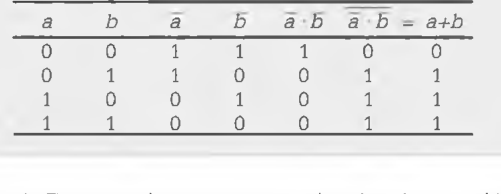

*Fig. 5.8 — Teorema de De Morgan aplicado a la suma lógica.* · Quiroga, *Arquitectura de computadoras*, p. 122.

> [!tip] Qué mirar
> Comparar las columnas: `a + b` y `ā · b̄` dan lo mismo en las cuatro filas. NAND es un OR negado: por eso `a NAND b = ā + b̄`.

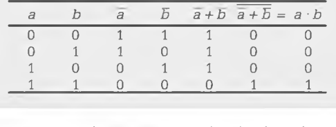

*Fig. 5.9 — Teorema de De Morgan aplicado al producto lógico.* · Quiroga, *Arquitectura de computadoras*, p. 122.

> [!tip] Qué mirar
> La otra mitad: `a · b` y `ā + b̄` son iguales. Con las dos tablas se pasa de AND-OR a NAND-NAND sin cambiar la función.

##### Relacionado
[[1.2.1 Postulados, dualidad y teoremas]] · [[1.2.3 Simplificación analítica]] ·
[[1.1.3 Compuertas universales]] · [[TP2 Álgebra de Boole]] · [[Leyes de DeMorgan]] · [[Glosario — Unidad 1]]

#### 1.2.3 Simplificación analítica

> [!abstract] En una frase
> Simplificar a mano es **aplicar postulados en un orden fijo**: factor común → absorción → complemento →
> DeMorgan, hasta que no quede nada que sacar. El objetivo es **menos términos y menos literales**.

> [!note] Si es la primera vez que ves esto
> Es como reducir una fracción: no hay una única forma de hacerlo, pero hay **movimientos** que siempre acercan
> al resultado. Acá hay cuatro. Si te trabás con uno, probá el siguiente; nunca "adivines" el resultado.

##### Simplificar es sacar compuertas

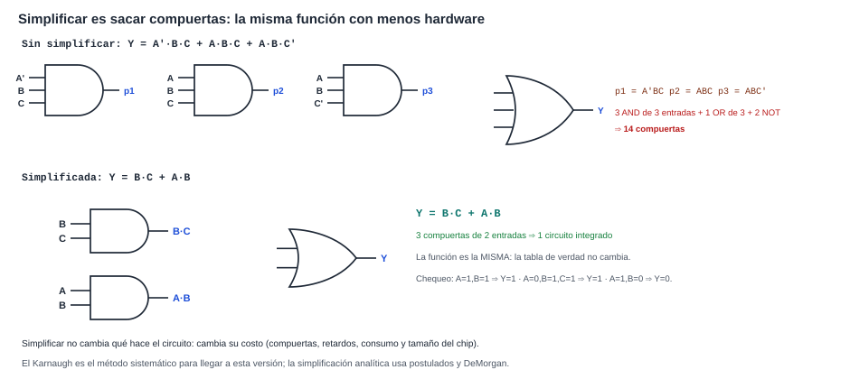

##### Los cuatro movimientos (en este orden)

| Paso | Qué hago | Herramienta |
|---|---|---|
| 1 | **Factor común** | `A·B + A·B' = A·(B+B')` |
| 2 | **Complemento** | `B + B' = 1`, `A·A' = 0` |
| 3 | **Absorción** | `A + A·B = A` · `A + A'B = A + B` |
| 4 | **DeMorgan** | para entrar o salir de una barra grande |

> [!tip] Regla de oro
> Antes de empezar, **contá** términos y literales. Si después de un paso no bajó ninguno, ese paso no sirvió:
> volvé atrás y probá otro movimiento.

##### Ejemplo 1 (típico del TP3)
`Y = A'BC' + A'BC + AB'C + ABC`

1. Factor común en los dos primeros y en los dos últimos:
   `A'B(C' + C) + AC(B' + B)`.
2. Complemento: `C' + C = 1` y `B' + B = 1` ⇒ `A'B·1 + AC·1`.
3. Postulado 1: **`Y = A'B + AC`**.

Pasó de 4 términos de 3 literales (12 literales) a 2 términos de 2 (4 literales).

##### Ejemplo 2 (con absorción)
`Y = A + A'B + AB`

1. `A + AB = A` (absorción) ⇒ queda `A + A'B`.
2. Absorción 2: `A + A'B = A + B`.

**`Y = A + B`**, de 3 términos a 2 literales.

##### Ejemplo 3 (con DeMorgan primero)
`Y = ((A + B)·(A + C))'`

1. DeMorgan: `(A+B)' + (A+C)'`.
2. DeMorgan otra vez: `A'B' + A'C'`.
3. Factor común: `A'(B' + C')`.
4. DeMorgan al revés (opcional): **`A'·(B·C)'`**.

##### Cómo se controla el resultado
Dos formas, ambas válidas para entregar:
1. **Tabla de verdad** de la función original y de la simplificada: deben coincidir en las 8 (o 16) filas.
2. **Karnaugh**: el mapa tiene que dar el mismo grupo (ver [[1.3.2 Mapa de Karnaugh de 2, 3 y 4 variables]]).

> [!warning] Errores típicos
> - Cancelar términos que no son complementarios: `A·B + A·C ≠ A·(B+C)` **sí** es válido, pero
>   `A·B + A'·C ≠ B + C` (ésta sólo se reduce con consenso).
> - Perder un término al factorizar: si sacás `A` de tres términos, los tres tienen que quedar adentro del paréntesis.
> - Entregar sin verificar: un solo error de barra invierte media tabla.

##### Figura del libro

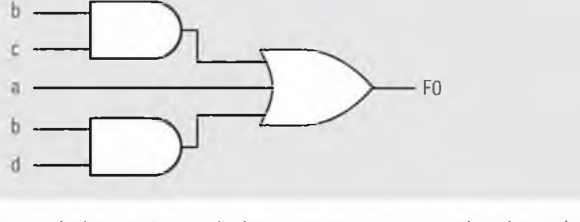

*Fig. 6.8 — Diagrama de lógica (parcial) de un circuito convertidor de código.* · Quiroga, *Arquitectura de computadoras*, p. 142.

> [!tip] Qué mirar
> Es el resultado de simplificar analíticamente las salidas de la tabla de verdad: cada salida queda como suma de productos con pocos términos, en vez de un AND por cada 1 de la tabla.

##### Relacionado
[[1.2.1 Postulados, dualidad y teoremas]] · [[1.2.2 Leyes de DeMorgan]] ·
[[1.3.2 Mapa de Karnaugh de 2, 3 y 4 variables]] · [[TP3 Simplificación analítica]] · [[Autoevaluación]] · [[Glosario — Unidad 1]]

### 1.3 Formas canónicas y Karnaugh

#### 1.3.1 Mintérminos y maxtérminos

> [!abstract] En una frase
> Un **mintérmino** es un término que vale **1 en una sola fila** de la tabla (producto de todas las variables); un
> **maxtérmino** vale **0 en una sola fila** (suma de todas las variables). La función es la **suma de los
> mintérminos donde vale 1**.

> [!note] Si es la primera vez que ves esto
> La tabla de verdad dice *qué* queremos; el mintérmino es **la forma de escribirlo con compuertas**. Si la salida
> vale 1 en la fila `A=1, B=0, C=1`, ese caso se escribe `A·B'·C`, y la función es la suma (OR) de todos esos
> casos. "Canónica" quiere decir: **un término por cada 1 de la tabla**, sin agrupar todavía.

##### De la tabla al circuito

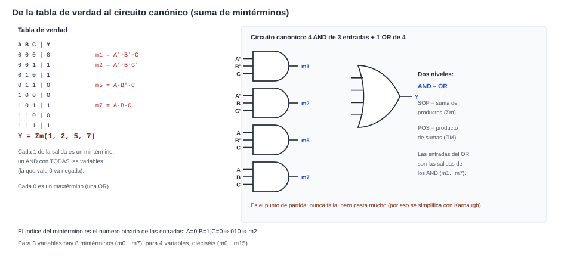

##### La tabla de los 8 mintérminos (3 variables)

| A B C | Mintérmino `m` | Expresión | Maxtérmino `M` | Expresión |
|---|---|---|---|---|
| 0 0 0 | m0 | `A'B'C'` | M0 | `A+B+C` |
| 0 0 1 | m1 | `A'B'C` | M1 | `A+B+C'` |
| 0 1 0 | m2 | `A'BC'` | M2 | `A+B'+C` |
| 0 1 1 | m3 | `A'BC` | M3 | `A+B'+C'` |
| 1 0 0 | m4 | `AB'C'` | M4 | `A'+B+C` |
| 1 0 1 | m5 | `AB'C` | M5 | `A'+B+C'` |
| 1 1 0 | m6 | `ABC'` | M6 | `A'+B'+C` |
| 1 1 1 | m7 | `ABC` | M7 | `A'+B'+C'` |

**Regla mnemotécnica:** en el mintérmino, el bit **1** va sin barra y el **0** con barra. En el maxtérmino es al
revés, y se unen con `+`.

##### Las dos formas canónicas
- **Primera forma (SOP, suma de productos):** `F = Σm(1, 3, 5, 7)` = `A'B'C + A'BC + AB'C + ABC`.
- **Segunda forma (POS, producto de sumas):** `F = ΠM(0, 2, 4, 6)` = `(A+B+C)(A+B'+C)(A'+B+C)(A'+B'+C)`.

Las dos describen **la misma** función; se elige la que tenga menos términos. Y valen las relaciones:
`Σm` de F = complemento de `Σm` de F' · `ΠM` es el complemento de `Σm` con los índices que faltan.

##### Ejemplo completo
`F(A,B,C)` vale 1 en las filas 1, 3, 5 y 7 (las combinaciones con C = 1).

1. `F = Σm(1,3,5,7) = A'B'C + A'BC + AB'C + ABC`.
2. Factor común `C`: `C·(A'B' + A'B + AB' + AB)`.
3. El paréntesis es 1 para todas las combinaciones de A y B ⇒ **`F = C`**.

Ésa es la función mínima: un solo cable. La tarjeta del TP4 pide justamente esto: ver que 4 mintérminos pueden
colapsar en un literal.

> [!warning] Errores típicos
> - **Ordenar mal las variables** y con eso cambiar todos los índices: fijate siempre si el enunciado ordena
>   `ABC` o `CBA`.
> - Confundir `m` con `M`: `Σm` es suma de productos; `ΠM` es producto de sumas.
> - Poner un término por cada **0** cuando la consigna pide `Σm`.

##### Figura del libro

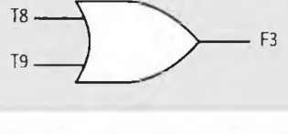

*Fig. 6.11 — Diagrama de lógica correspondiente a F3.* · Quiroga, *Arquitectura de computadoras*, p. 143.

> [!tip] Qué mirar
> `F3 = T8 + T9`: cada **mintérmino** es un AND con **todas** las variables (negadas o no) y la función es el OR de los mintérminos donde vale 1. Tantos productos parciales como unos tenga la tabla.

##### Relacionado
[[1.3.2 Mapa de Karnaugh de 2, 3 y 4 variables]] · [[1.3.3 Don't care y criterios de agrupación]] ·
[[1.2.3 Simplificación analítica]] · [[TP4 Mintérminos, maxtérminos y Karnaugh]] · [[Mintérminos y maxtérminos]] · [[Glosario — Unidad 1]]

#### 1.3.2 Mapa de Karnaugh de 2, 3 y 4 variables

> [!abstract] En una frase
> El mapa de Karnaugh es la tabla de verdad **dibujada en grilla con código Gray**, de modo que dos casillas
> vecinas (incluso por los bordes) difieren en **una sola variable**: agrupando 1, 2, 4 u 8 unos vecinos, esa
> variable **se cancela** y queda la función mínima.

> [!note] Si es la primera vez que ves esto
> Es un juego de **encerrar unos con rectángulos**. Cada rectángulo elimina las variables que cambian dentro de él.
> Cuanto más grande el rectángulo, menos literales quedan en el término: 8 unos en un solo grupo ⇒ el término es
> un **solo cable**; 2 unos ⇒ quedan 2 literales.

##### Cómo se construye (3 variables)

- Filas: `A` (0, 1). Columnas: `BC` en **Gray**: `00, 01, 11, 10`.
- Se copia cada salida de la tabla en su casilla.
- **Vecinos:** casillas que comparten un lado; los bordes **también son vecinos** (el mapa es un cilindro).

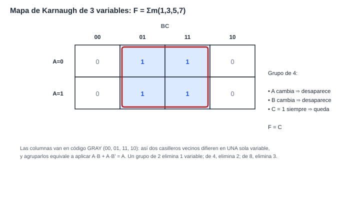

##### Reglas de agrupación (las 5 que se piden)
1. Los grupos sólo pueden tener **1, 2, 4, 8** casillas (potencias de 2).
2. Los grupos son **rectángulos** (en 4 variables también valen las esquinas y las "envolturas" por los bordes).
3. Se puede **superponer** grupos: un 1 puede usarse en dos grupos si con eso otro grupo crece.
4. Hay que cubrir **todos** los 1 con la menor cantidad de grupos y los más grandes posible.
5. Un grupo de 1 solo es válido, pero es el último recurso (deja todas las variables).

##### Qué término sale de cada grupo

| Tamaño del grupo | Variables que quedan (de 3) |
|---|---|
| 8 | ninguna → término = **1** |
| 4 | 1 literal (la que **no** cambia) |
| 2 | 2 literales |
| 1 | 3 literales (el mintérmino completo) |

##### Ejemplo resuelto (3 variables)
`F = Σm(0, 1, 4, 5, 6)`, es decir 1 en `m0, m1, m4, m5, m6` y 0 en `m2, m3, m7`.

| A \ BC | 00 | 01 | 11 | 10 |
|---|---|---|---|---|
| **0** | **1** (m0) | **1** (m1) | 0 (m3) | 0 (m2) |
| **1** | **1** (m4) | **1** (m5) | 0 (m7) | **1** (m6) |

1. **Grupo de 4:** las dos columnas `00` y `01` en las dos filas. Dentro del grupo cambian A y cambia C; lo único
   que se mantiene es **B = 0** ⇒ término **`B'`**.
2. **Grupo de 2:** `m4` (`100`) y `m6` (`110`) son vecinos (las columnas `00` y `10` son vecinas por el borde).
   Dentro del grupo cambia B; se mantienen `A = 1` y `C = 0` ⇒ término **`A·C'`**.
   (Se puede superponer con el grupo anterior: eso está permitido y no cuesta nada.)
3. **`F = B' + A·C'`** — dos términos y tres literales, contra cinco mintérminos de tres literales.

**Verificación rápida:** `m2` (`010`) → `B'` es 0 porque B = 1, y `A·C'` es 0 porque A = 0 ⇒ F = 0 ✓.
`m6` (`110`) → `B'` = 0, `A·C'` = 1·1 = 1 ⇒ F = 1 ✓.

> [!tip] Atajo para verificar
> Reemplazá el resultado en dos filas al azar (por ejemplo `m0` y `m5`) y comprobá que coincide con la tabla. Si
> falla una, el grupo está mal leído (casi siempre por confundir qué variable se mantiene).

##### Cuatro variables
Filas `AB` en Gray (`00, 01, 11, 10`), columnas `CD` también en Gray. Aparecen dos vecindades especiales: las
**cuatro esquinas** (`m0, m2, m8, m10`) forman un grupo válido de 4, y las columnas/ filas de los extremos son
vecinas.

> [!warning] Errores típicos
> - Agrupar en **diagonal**: no vale.
> - Usar grupos de 3, 5 o 6 casillas: no valen.
> - Olvidar los bordes (dejar un 1 sin agrupar cuando podía unirse con el otro extremo).
> - Leer el término mirando la casilla en vez de la **zona**: se cancela lo que cambia dentro del grupo.

##### Figura del libro

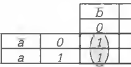

*Mapa de Karnaugh de 2 variables: dos casillas vecinas difieren en una sola variable, así que se agrupan (Quiroga, ejemplo 5.10.1).* · Quiroga, *Arquitectura de computadoras*, p. 133.

> [!tip] Qué mirar
> Cada casilla es un mintérmino. Los dos 1 son adyacentes, se agrupan y la variable que cambia (`b`) desaparece: la función queda en una sola variable.

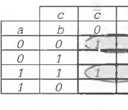

*Mapa de Karnaugh de 3 variables: las columnas van en orden Gray (00, 01, 11, 10) para que dos casillas contiguas nunca cambien en más de un bit.* · Quiroga, *Arquitectura de computadoras*, p. 133.

> [!tip] Qué mirar
> El grupo horizontal es superior y el vertical es inferior; en el de 3 variables los bordes también son vecinos. Cada grupo elimina las variables que cambian dentro del grupo.

##### Relacionado
[[1.3.1 Mintérminos y maxtérminos]] · [[1.3.3 Don't care y criterios de agrupación]] ·
[[1.2.3 Simplificación analítica]] · [[TP4 Mintérminos, maxtérminos y Karnaugh]] · [[Mintérminos y maxtérminos]] · [[Glosario — Unidad 1]]

#### 1.3.3 Don't care y criterios de agrupación

> [!abstract] En una frase
> Las **don't care** (`X`) son combinaciones de entrada que **nunca van a ocurrir** o cuya salida **no importa**:
> en el mapa se pueden tomar como 1 o como 0, **lo que convenga** para hacer grupos más grandes.

> [!note] Si es la primera vez que ves esto
> Si el circuito sólo va a recibir números del 0 al 9 (como un display BCD), las combinaciones del 10 al 15 no
> existen nunca: no tiene sentido "pelear" por ellas. El mapa te deja **elegirlas a favor tuyo**, y con eso los
> grupos crecen y el circuito se achica.

##### El mapa con X

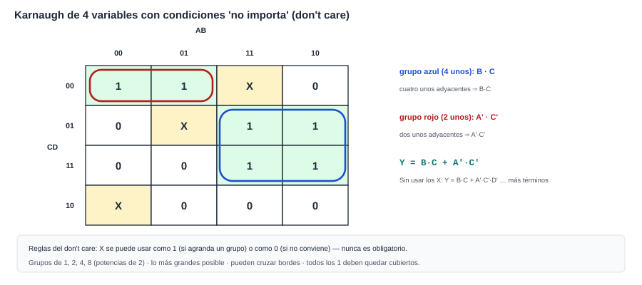

##### De dónde salen
1. **Códigos con combinaciones no usadas:** BCD (0-9) en 4 bits deja libres 10 a 15.
2. **Entradas físicamente imposibles:** dos sensores que nunca se activan juntos.
3. **Salidas que no se observan:** luces de un display que no se miran en cierto modo.

##### Cómo se usan (regla práctica)
1. Marcá los 1 obligatorios y los `X`.
2. Armá los grupos **incluyendo las X sólo si agrandan** el grupo (2 → 4, 4 → 8).
3. Una `X` **no** obliga a nada: si no ayuda, se deja como 0 y no se cubre.
4. Verificá que **todos los 1** queden cubiertos; las X pueden quedar afuera.

##### Ejemplo: display de 7 segmentos en BCD
Entradas `A B C D` (0 a 9) y salida para el segmento **e**:

| Entrada | e | Mintérmino |
|---|---|---|
| 0, 2, 6, 8 | 1 | m0, m2, m6, m8 |
| 1, 3, 4, 5, 7, 9 | 0 | — |
| 10 a 15 | **X** | m10 … m15 |

En el mapa, los `X` de 10 a 15 permiten unir `m8` con `m0` y `m2` por el borde, y `m6` con `m2`/`m14` (`X`), con
lo que el segmento **e** sale con **2 o 3 términos cortos** en vez de 4 mintérminos completos.

##### Los otros criterios (cuando hay varias soluciones válidas)
| Criterio | Qué mirar |
|---|---|
| **Menos términos** | primero achicar la cantidad de grupos (menos compuertas OR) |
| **Menos literales** | después achicar el tamaño de cada término (menos entradas por compuerta) |
| **Sin superposición innecesaria** | si un grupo puede evitarse sin perder cobertura, se evita |
| **Que no queden "unos" sueltos** | un grupo de 1 suele indicar que se puede agrandar con una X |

> [!warning] Errores típicos
> - Cubrir una `X` **antes** que un 1 y dejar un 1 sin agrupar.
> - Tratar la `X` como 0 fijo (se pierde toda la ventaja).
> - Meter una X en un grupo **sin** que el grupo crezca: no aporta y confunde la corrección.
> - Olvidar que con BCD los códigos 10-15 **no se validan nunca**.

##### Figura del libro

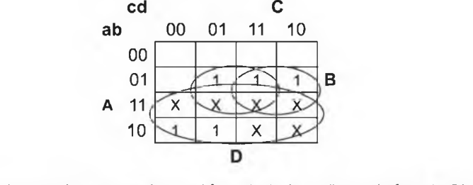

*Fig. 6.7 — Diagramas de simplificación (a, b, c, d) para la función F0.* · Quiroga, *Arquitectura de computadoras*, p. 142.

> [!tip] Qué mirar
> Las `X` son **condiciones irrelevantes** (don't care): combinaciones de entrada que nunca ocurren. Se agrupan con los 1 para armar grupos más grandes; tomarlas como 1 o como 0 es decisión del diseñador.

##### Relacionado
[[1.3.2 Mapa de Karnaugh de 2, 3 y 4 variables]] · [[1.3.1 Mintérminos y maxtérminos]] ·
[[TP4 Mintérminos, maxtérminos y Karnaugh]] · [[Mintérminos y maxtérminos]] · [[Glosario — Unidad 1]]

### 1.4 Bloques combinacionales

#### 1.4.1 Decodificador

> [!abstract] En una frase
> Un decodificador de `n` entradas tiene `2ⁿ` salidas y activa **exactamente una**: la que corresponde al número
> binario de la entrada. Su función es `Yi = mi` (cada salida es el mintérmino de su combinación), sin simplificar.

> [!note] Si es la primera vez que ves esto
> Es el "portero de un edificio con 4 departamentos": según el número que le digan (00, 01, 10, 11), toca el
> timbre de **uno solo**. Se usa en todas partes: para elegir una palabra de memoria, para habilitar una
> instrucción, para encender un dígito de un display.

##### Tabla del 2 → 4

| A1 | A0 | Y3 | Y2 | Y1 | Y0 |
|---|---|---|---|---|---|
| 0 | 0 | 0 | 0 | 0 | **1** |
| 0 | 1 | 0 | 0 | **1** | 0 |
| 1 | 0 | 0 | **1** | 0 | 0 |
| 1 | 1 | **1** | 0 | 0 | 0 |

##### Funciones canónicas y circuito
```
Y0 = A1'·A0'
Y1 = A1'·A0
Y2 = A1 ·A0'
Y3 = A1 ·A0
```
**Se dibuja con `n` inversores y `2ⁿ` compuertas AND de `n` entradas.** Para 2→4: 2 NOT y 4 AND de 2.


##### El 3 → 8 (y el que aparece en la materia)
3 entradas, 8 salidas, `Yi = mi`. Se usa con **enable**: una entrada `E` que habilita todo el bloque
(`Yi = E · mi`). En la Unidad de Control de la BLUE hay un decodificador **1→16** que recibe el opcode y activa
la línea de una instrucción.


##### Usos concretos
| Dónde | Para qué |
|---|---|
| Memoria RAM/ROM | elegir la **fila** (palabra) con los bits de dirección |
| Unidad de Control | activar **una** instrucción a la vez (1→16) |
| Display 7 segmentos | encender el dígito que corresponde a la dirección |
| Expansión de memoria | activar un chip sí y los otros no (`E`) |

> [!warning] Errores típicos
> - Simplificar las `Yi`: **no se simplifican**, cada salida es un mintérmino puro.
> - Olvidar el inversor de la entrada negada (sale `Y0 = A1·A0`, que es `Y3`).
> - Contar mal las compuertas: para 3→8 son **3 inversores y 8 AND de 3 entradas**.

##### Ejemplo resuelto
Un decodificador **2 → 4** con salidas **activas en bajo** y entradas `A1 A0 = 10`:
`Y0 = Y1 = Y3 = 1` y **`Y2 = 0`**. Si el que está en 0 es el que habilita, sólo responde la salida 2.
- Con `A1 A0 = 11` responde `Y3`; con `00`, `Y0`.
- Agregando una entrada de **habilitación `E`**, todas las salidas quedan en 1 cuando `E = 0`: así se **encadenan**
  dos decodificadores 2→4 para armar uno 3→8.

##### Figura del libro

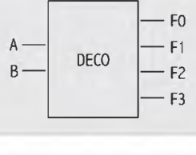

*Fig. 6.13 — Diagrama de bloque del decodificador n → 2ⁿ (2 → 4), sin entrada de habilitación.* · Quiroga, *Arquitectura de computadoras*, p. 145.

> [!tip] Qué mirar
> Dos entradas de selección (`A`, `B`) dan 4 salidas y **una sola** está en 1 por vez: con `A = 1`, `B = 1` se activa `F3`.

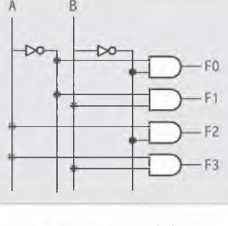

*Fig. 6.15 — Diagrama de lógica de un decodificador 2 → 4 (dos inversores y cuatro AND).* · Quiroga, *Arquitectura de computadoras*, p. 146.

> [!tip] Qué mirar
> Cada salida es un mintérmino: `F0 = ā·b̄`, `F1 = ā·b`, `F2 = a·b̄`, `F3 = a·b`. Por eso el decodificador y la ROM (decodificador + OR) son el mismo circuito con distinto uso.

##### Relacionado
[[1.4.2 Codificador]] · [[1.4.4 Demultiplexor]] · [[Decodificador]] · [[TP6 Decodificadores y demultiplexores]] ·
[[1.3.1 Mintérminos y maxtérminos]] · [[Glosario — Unidad 1]]

#### 1.4.2 Codificador

> [!abstract] En una frase
> El codificador es el **circuito inverso** al decodificador: recibe `2ⁿ` (o menos) líneas de entrada, de las
> cuales **una sola** está activa, y entrega el **código binario** de n bits que dice cuál fue.

> [!note] Si es la primera vez que ves esto
> Es la "planilla del portero": le dicen "sonó el 3" y él anota `11`. Nada más. Si están permitidas varias
> entradas a la vez (por ejemplo, varios botones), se usa la versión con **prioridad**.

##### Tabla del 8 → 3 (una sola entrada activa)

| E7 | E6 | E5 | E4 | E3 | E2 | E1 | E0 | A2 | A1 | A0 |
|---|---|---|---|---|---|---|---|---|---|---|
| 0 | 0 | 0 | 0 | 0 | 0 | 0 | **1** | 0 | 0 | 0 |
| 0 | 0 | 0 | 0 | 0 | 0 | **1** | 0 | 0 | 0 | 1 |
| 0 | 0 | 0 | 0 | 0 | **1** | 0 | 0 | 0 | 1 | 0 |
| 0 | 0 | 0 | 0 | **1** | 0 | 0 | 0 | 0 | 1 | 1 |
| 0 | 0 | 0 | **1** | 0 | 0 | 0 | 0 | 1 | 0 | 0 |
| 0 | 0 | **1** | 0 | 0 | 0 | 0 | 0 | 1 | 0 | 1 |
| 0 | **1** | 0 | 0 | 0 | 0 | 0 | 0 | 1 | 1 | 0 |
| **1** | 0 | 0 | 0 | 0 | 0 | 0 | 0 | 1 | 1 | 1 |

##### Funciones (son puras OR)
```
A2 = E4 + E5 + E6 + E7
A1 = E2 + E3 + E6 + E7
A0 = E1 + E3 + E5 + E7
```
Cada salida se activa con la mitad de las entradas; no hace falta nada más.

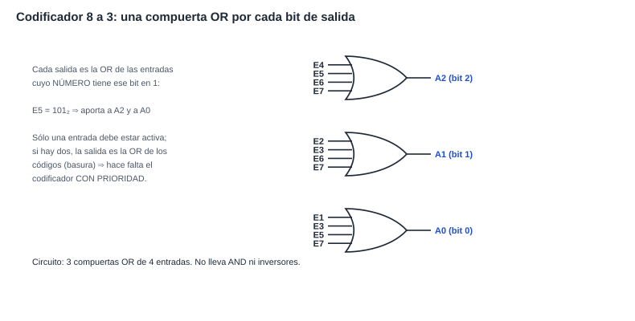

##### Codificador con prioridad
Cuando puede haber **varias** entradas activas, gana la de **mayor índice**. Se resuelve agregando, en cada
salida, la condición "y no hay una entrada mayor activa":

```
A2 = E4 + E5 + E6 + E7                      (sin cambios)
A1 = E2·E4'·E5'·E6'·E7' + E3·E4'·E5'·E6'·E7' + E6 + E7
A0 = E1·(nada mayor) + E3·(nada 4..7) + E5·(nada 6,7) + E7
```
Y se agrega una salida **"hay alguna entrada activa"** (OR de todas), que es la que avisa que el código es válido.

##### Usos
- **Teclado**: se presiona una tecla y se obtiene su código.
- **Interrupciones**: varios periféricos piden atención y el codificador con prioridad dice cuál atender primero.
- **Compactar líneas**: 8 sensores → 3 cables.

> [!warning] Errores típicos
> - Usar la tabla simple cuando el enunciado permite **varias entradas a la vez** (hay que usar prioridad).
> - Invertir el orden de las entradas (¿E0 es la menos significativa?). Confirmalo con la consigna.
> - Simplificar el OR: `A2 = E4+E5+E6+E7` **ya está** mínima.

> [!example] Codificador 8 → 3
> Si está activa **sólo** la entrada 5, la salida es `101` (el número 5 en binario). Con la entrada 0 ⇒ `000`; con la
> 7 ⇒ `111`. Regla: `2ⁿ` entradas → `n` salidas, y **una sola** entrada activa por vez (por eso el simple necesita
> el `EI`, *enable input*, para encadenar dos y armar uno de 16 → 4).

##### Figura del libro

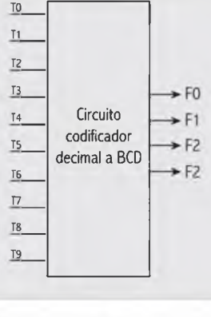

*Fig. 6.10 — Diagrama de bloque del codificador decimal a BCD.* · Quiroga, *Arquitectura de computadoras*, p. 143.

> [!tip] Qué mirar
> Es el camino inverso al decodificador: 10 entradas (una por tecla) y 4 de salida. Si se aprieta `T7`, la salida vale `0111`; si no se aprieta ninguna, la salida es `0000`.

##### Relacionado
[[1.4.1 Decodificador]] · [[1.4.3 Multiplexor]] · [[Codificador]] ·
[[TP7 Codificadores y multiplexores]] · [[Interrupciones y entrada-salida]] · [[Glosario — Unidad 1]]

#### 1.4.3 Multiplexor

> [!abstract] En una frase
> El multiplexor (MUX) tiene `n` entradas de **dato**, `k` entradas de **selección** (`n = 2^k`) y **una** salida:
> la salida es **la entrada que elige el código de selección**. Su función es `Y = Σ mi · Ii`.

> [!note] Si es la primera vez que ves esto
> Es una **llave selectora de varias posiciones**: hay 4 caños que llegan y vos girás la perilla (la selección)
> para que pase uno solo. En una computadora es lo que permite que **muchas fuentes manden al mismo bus**, de a una.

##### Tabla del 4 → 1

| S1 | S0 | Y |
|---|---|---|
| 0 | 0 | I0 |
| 0 | 1 | I1 |
| 1 | 0 | I2 |
| 1 | 1 | I3 |

##### Función canónica y circuito
```
Y = S1'·S0'·I0 + S1'·S0·I1 + S1·S0'·I2 + S1·S0·I3
```
**Se dibuja con**: `k` inversores, `n` compuertas AND de `k+1` entradas (una por cada entrada de dato) y **una OR**
de `n` entradas. Para 4→1: 2 NOT, 4 AND de 3 y 1 OR de 4.


##### Variantes que se piden
| Variante | Qué agrega |
|---|---|
| **MUX con enable** | una entrada `E` que, en 0, pone la salida en 0 (o en alta impedancia) |
| **MUX en cascada** | dos 4→1 más un 2→1 dan un 8→1 (y así siguiendo) |
| **MUX como función lógica** | con las variables de la función en las entradas de selección, un MUX de 8→1 **implementa cualquier** función de 3 variables poniendo 0/1 en los datos |

##### Usos en la materia
- **Bus único de la BLUE:** selecciona qué registro pone su dato en el bus.
- **ALU:** elige el resultado que va al acumulador y qué operación se ejecuta.
- **Selección de banco de memoria** en sistemas con varios chips.

> [!warning] Errores típicos
> - Confundir **entradas de dato** con **entradas de selección** al contar (un 8→1 tiene 8 datos y **3** de selección).
> - Invertir el orden de S1/S0 y con eso espejar la tabla.
> - Poner una OR **antes** de las AND (el orden es: AND de selección y dato → OR final).

##### Ejemplo resuelto
MUX **4 → 1** con `S1 S0 = 01`: la salida es `F = D1`. Con `D0 = 0, D1 = 1, D2 = 1, D3 = 0`:
`S = 00 → F = 0` · `S = 01 → F = 1` · `S = 10 → F = 1` · `S = 11 → F = 0`.
- Su función canónica es `F = S1'S0'·D0 + S1'S0·D1 + S1S0'·D2 + S1S0·D3`.
- Un MUX **8 → 1** necesita **3** bits de selección (y 2 MUX de 4→1 + 1 de 2→1 lo arman).

##### Figura del libro

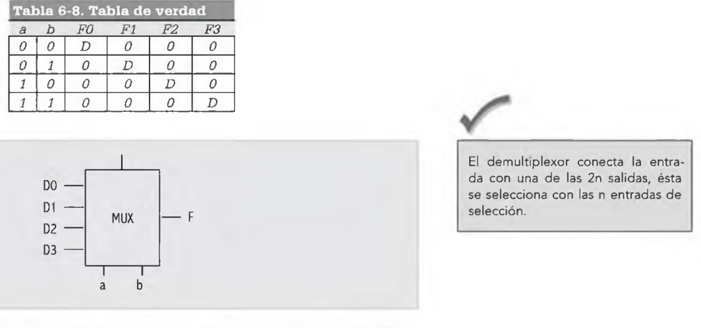

*Fig. 6.20 — Diagrama de bloque de un multiplexor para cuatro entradas (D0 a D3) y dos entradas de selección.* · Quiroga, *Arquitectura de computadoras*, p. 149.

> [!tip] Qué mirar
> Con `ab = 10` la salida `F` es `D2`. El MUX es un selector: `2ⁿ` entradas de dato, `n` de selección y una de salida.

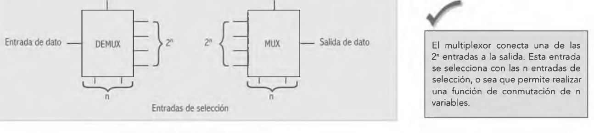

*Fig. 6.18 — Diagrama de bloque: el multiplexor conecta una de las salidas de los registros al bus y el demultiplexor reparte el dato del bus a un registro.* · Quiroga, *Arquitectura de computadoras*, p. 149.

> [!tip] Qué mirar
> Así se arma un **bus único**: el MUX elige qué registro escribe en el bus y el DEMUX elige cuál lo lee. Es el mismo esquema que usa la BLUE en cada pulso.

##### Relacionado
[[1.4.4 Demultiplexor]] · [[1.4.1 Decodificador]] · [[Multiplexor]] ·
[[TP7 Codificadores y multiplexores]] · [[ALU]] · [[Glosario — Unidad 1]]

#### 1.4.4 Demultiplexor

> [!abstract] En una frase
> El demultiplexor (DEMUX) tiene **una** entrada de dato `D`, `k` entradas de selección y `2^k` salidas: el dato
> sale **por una sola** de las salidas, la que indica la selección. Su función es `Yi = D · mi`.

> [!note] Si es la primera vez que ves esto
> Es un **distribuidor de caños**: llega agua por un caño y la perilla decide a cuál de las cuatro salidas va. Si
> `D = 1` siempre, se comporta como un **decodificador** — por eso se dice que el decodificador es el caso
> particular con `D = 1`.

##### Tabla del 1 → 4

| S1 | S0 | Y3 | Y2 | Y1 | Y0 |
|---|---|---|---|---|---|
| 0 | 0 | 0 | 0 | 0 | **D** |
| 0 | 1 | 0 | 0 | **D** | 0 |
| 1 | 0 | 0 | **D** | 0 | 0 |
| 1 | 1 | **D** | 0 | 0 | 0 |

##### Funciones y circuito
```
Y0 = D · S1'·S0'
Y1 = D · S1'·S0
Y2 = D · S1 ·S0'
Y3 = D · S1 ·S0
```
**Se dibuja con** `k` inversores y `2^k` compuertas **AND de `k+1` entradas** (la selección más el dato). Para
1→4: 2 NOT y 4 AND de 3. **No lleva OR.**


##### Demux vs decodificador (la comparación que se pregunta)

| | Decodificador | Demultiplexor |
|---|---|---|
| Entradas | `n` de código | `n` de código **+ 1 de dato** |
| Salidas | `2ⁿ`, se activa una | `2ⁿ`, recibe el dato una |
| Función | `Yi = mi` | `Yi = D·mi` |
| Compuertas | AND de `n` entradas | AND de `n+1` entradas |
| Relación | caso particular con `D = 1` | generaliza al decodificador |

##### Usos
- **Escribir en una celda de memoria:** el DEMUX reparte la señal de escritura a la palabra seleccionada.
- **Repartir un dato** a varios periféricos de a uno (E/S).
- **Generar señales de habilitación** en la Unidad de Control.

> [!warning] Errores típicos
> - Agregar una OR en la salida (eso convertiría el circuito en un MUX).
> - Olvidar el dato `D` en cada término: sin él, es un decodificador y no un DEMUX.
> - Contar mal: para 1→4 son 4 AND de **3** entradas (2 de selección + D).

##### Ejemplo resuelto
DEMUX **1 → 4** con `D = 1` y `S1 S0 = 10`: sale **`Y2 = 1`** y `Y0 = Y1 = Y3 = 0`. Si `D = 0`, todas las
salidas quedan en 0.
- Con `D` fijo en 1 el DEMUX **es** un decodificador 2→4: ésa es la relación que se pregunta.
- Para repartir un dato entre 8 destinos: DEMUX 1→8, 3 bits de selección.

##### Figura del libro

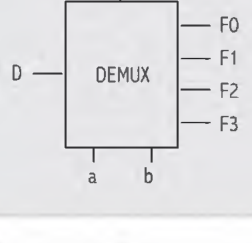

*Fig. 6.19 — Diagrama de bloque de un demultiplexor: una entrada de dato, dos de selección y cuatro salidas.* · Quiroga, *Arquitectura de computadoras*, p. 149.

> [!tip] Qué mirar
> El DEMUX reparte: el dato entra por `D` y sale **sólo** por la línea que indican `a` y `b`. Es el inverso del MUX y se usa para habilitar un registro por vez.

##### Relacionado
[[1.4.3 Multiplexor]] · [[1.4.1 Decodificador]] · [[Demultiplexor]] ·
[[TP6 Decodificadores y demultiplexores]] · [[Memoria RAM 8x3]] · [[Glosario — Unidad 1]]

### 1.5 Aritmética combinacional

#### 1.5.1 Semisumador y sumador completo

> [!abstract] En una frase
> El **semisumador** suma 2 bits (`S = A⊕B`, `C = A·B`); el **sumador completo** suma 3 (los 2 bits más el acarreo
> que viene del anterior: `S = A⊕B⊕Cin`, `Cout = A·B + Cin·(A⊕B)`). Con sumadores completos encadenados se suma
> cualquier cantidad de bits.

> [!note] Si es la primera vez que ves esto
> Cuando sumás `7 + 5` en papel, en la columna de las unidades te sale `12`: escribís **2** y te **llevás 1**. Ese
> "me llevo" es el **acarreo** (`carry`). El semisumador resuelve una columna **sin** acarreo entrante (la primera,
> o la suma de un solo bit); el sumador completo resuelve cualquier columna **con** acarreo entrante.

##### Semisumador: tabla y funciones

| A | B | S (suma) | C (acarreo) |
|---|---|---|---|
| 0 | 0 | 0 | 0 |
| 0 | 1 | 1 | 0 |
| 1 | 0 | 1 | 0 |
| 1 | 1 | 0 | **1** |

```
S = A ⊕ B = A'B + AB'
C = A · B
```
**Circuito:** un **XOR** y una **AND**. Dos compuertas, nada más.


##### Sumador completo: tabla y funciones

| A | B | Cin | S | Cout |
|---|---|---|---|---|
| 0 | 0 | 0 | 0 | 0 |
| 0 | 0 | 1 | 1 | 0 |
| 0 | 1 | 0 | 1 | 0 |
| 0 | 1 | 1 | 0 | **1** |
| 1 | 0 | 0 | 1 | 0 |
| 1 | 0 | 1 | 0 | **1** |
| 1 | 1 | 0 | 0 | **1** |
| 1 | 1 | 1 | 1 | **1** |

```
S    = A ⊕ B ⊕ Cin
Cout = A·B + Cin·(A ⊕ B)
```
**Circuito:** **2 XOR + 2 AND + 1 OR** (5 compuertas). La segunda XOR recibe el `Cin`; las dos AND detectan
"hubo dos o más unos" (que es exactamente cuándo hay acarreo).


> [!tip] Dos formas de decir lo mismo
> `Cout` también se escribe como **mayoría**: vale 1 cuando **al menos dos** de las tres entradas son 1.
> `S` vale 1 cuando la cantidad de unos es **impar**. Con esas dos frases podés reconstruir la tabla sin mirarla.

##### Ejemplo
`A = 1`, `B = 1`, `Cin = 1` (la columna del medio de `11 + 01 + acarreo`):

- `A ⊕ B = 0` ⇒ `S = 0 ⊕ 1 = 1`
- `Cout = 1·1 + 1·(0) = 1`

Resultado: `S = 1`, `Cout = 1`, es decir `111₂ = 7`: y efectivamente `1 + 1 + 1 = 3 = 11₂`, con lo que la columna
da 1 y se llevan 1. ✓

Otro: `A = 0`, `B = 1`, `Cin = 1` ⇒ `S = 0`, `Cout = 1` (`0+1+1 = 10₂`). ✓

> [!warning] Errores típicos
> - Usar un semisumador en una columna del medio (ignora el acarreo entrante).
> - Escribir `Cout = A·B + Cin` (falta el `(A⊕B)`).
> - Invertir `S` y `Cout` al armar la tabla: `S` es la columna de las unidades, `Cout` el "me llevo".

##### Figura del libro

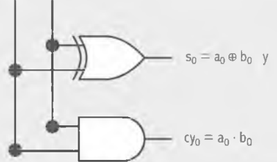

*Fig. 5.17 — Circuito lógico del semisumador.* · Quiroga, *Arquitectura de computadoras*, p. 127.

##### Relacionado
[[1.5.2 Sumador de n bits y resta en complemento a 2]] · [[1.4.3 Multiplexor]] · [[Semisumador]] ·
[[Sumador completo]] · [[TP5 Sumadores]] · [[Glosario — Unidad 1]]

#### 1.5.2 Sumador de n bits y resta en complemento a 2

> [!abstract] En una frase
> Se encadenan `n` sumadores completos (el `Cout` de uno entra como `Cin` del siguiente) y se obtiene un sumador de
> n bits; **restando** es lo mismo pero con las entradas de B **negadas** y `Cin = 1`: `A − B = A + B' + 1`.

> [!note] Si es la primera vez que ves esto
> Es la misma suma de la escuela: se suman las columnas de derecha a izquierda y el "me llevo" pasa a la siguiente.
> La parte linda es la resta: en binario **no se resta**, se suma el complemento a 2 (que es "dar vuelta los bits
> y sumar 1"). Por eso un solo circuito sirve para las dos operaciones.

##### n bits en cascada, y la resta

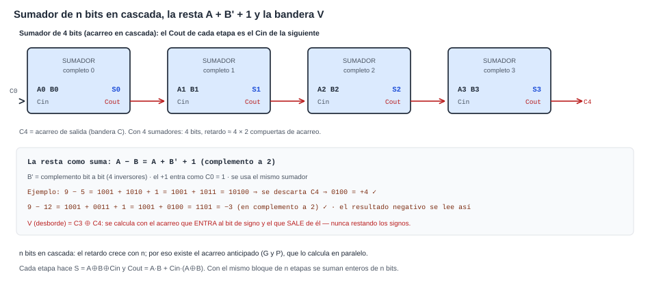

##### Sumador de 4 bits (acarreo en cascada)
```
      C4   C3   C2   C1   C0=0
       ↑    ↑    ↑    ↑
   [ FA3 ][ FA2 ][ FA1 ][ FA0 ]
      A3B3   A2B2   A1B1   A0B0
      S3     S2     S1     S0
```
- El **acarreo se propaga** de derecha a izquierda: por eso se llama *ripple carry* (acarreo ondulante).
- El retardo total crece con `n`: cada FA agrega su tiempo. Es lo que después se mejora con **acarreo anticipado**
  (Unidad 9).
- El último `Cout` (`C4`) indica **desbordamiento** en aritmética sin signo.

##### Resta: el truco del complemento a 2
`A − B = A + (−B) = A + (B' + 1)` ⇒ **negar B y poner `Cin = 1`**.

Para convertir el sumador en **sumador/restador** se pone una entrada de control `SUB`:

| SUB | B que entra al FA | Cin | Operación |
|---|---|---|---|
| 0 | `B` | 0 | `A + B` |
| 1 | `B ⊕ 1 = B'` | 1 | `A + B' + 1 = A − B` |

Es decir: **cuatro XOR** (uno por bit, con `SUB` como segunda entrada) y `SUB` conectado al `Cin` del primer FA.
**Un solo circuito, dos operaciones.**

##### Ejemplo: `6 − 3` en 4 bits
1. `A = 0110`, `B = 0011`.
2. `B' = 1100`, `+1` ⇒ `−B = 1101`.
3. `0110 + 1101 = 1 0011` ⇒ se descarta el acarreo final ⇒ **`0011` = 3**. ✓

##### Desbordamiento (lo que se pregunta aparte)
En **complemento a 2** hay desbordamiento si se suman dos números del **mismo signo** y el resultado cambia de
signo. La fórmula práctica:
```
V = Cin_al_último ⊕ Cout_del_último
```
En suma sin signo, en cambio, el desbordamiento es simplemente `C4 = 1`.

> [!warning] Errores típicos
> - Restar "dando vuelta los bits" **sin** sumar 1 (eso es complemento a 1, no a 2).
> - Olvidar que el acarreo final de la resta **se descarta**.
> - Confundir desbordamiento con acarreo: en A2 el `C4` puede ser 1 sin que haya error (`6 − 3`), y puede haber
>   error sin `C4`.

##### Figura del libro

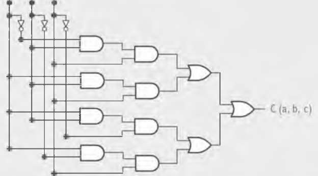

*Fig. 5.19 — Circuito lógico con las FN D del sumador completo.* · Quiroga, *Arquitectura de computadoras*, p. 131.

##### Relacionado
[[1.5.1 Semisumador y sumador completo]] · [[00 Tema 1.5 — índice]] · [[Sumador completo]] ·
[[ALU]] · [[Hardware aritmético (resumen)]] · [[TP5 Sumadores]] · [[Glosario — Unidad 1]]

### 1.6 Códigos binarios

#### 1.6.1 Códigos ponderados y no ponderados

> [!abstract] En una frase
> En un **código ponderado** cada posición tiene un **peso** y el valor se obtiene sumando los pesos de los bits
> en 1 (binario natural `8-4-2-1`, **AIKEN** `2-4-2-1`); en un **código no ponderado** no hay pesos, hay una
> **regla** (el **exceso 3** es "binario puro + 3"). El **BCD** no es un código nuevo: es usar el binario natural
> **por dígito decimal**, y viene **empaquetado** (dos dígitos por byte) o **desempaquetado** (uno por byte).

> [!note] Si es la primera vez que ves esto
> Pensá en los códigos como **etiquetas**. El número cinco existe una sola vez, pero se puede etiquetar de varias
> formas: `0101` (natural), `1011` (Aiken), `1000` (exceso 3). Todas las etiquetas son válidas; se elige la que
> conviene según lo que haya que hacer después (sumar, transmitir, mostrar en un display).

##### Ponderados: natural y AIKEN

Un código es **ponderado** si existe un peso `wi` por posición y el valor decimal es `Σ bi · wi`.

| Código | Pesos | Cómo se escribe el 5 | Detalle |
|---|---|---|---|
| **Binario natural** | `8 4 2 1` | `0101` | es el sistema de numeración de siempre |
| **AIKEN (2-4-2-1)** | `2 4 2 1` | `1011` | pesos en otro orden: `1·2 + 0·4 + 1·2 + 1·1 = 5` |
| **BCD natural** | `8 4 2 1` **por dígito** | `0101` (un dígito) | cada dígito decimal ocupa 4 bits |

| Decimal | Natural `8-4-2-1` | AIKEN `2-4-2-1` |
|---|---|---|
| 0 | `0000` | `0000` |
| 1 | `0001` | `0001` |
| 2 | `0010` | `0010` |
| 3 | `0011` | `0011` |
| 4 | `0100` | `0100` |
| **5** | `0101` | **`1011`** |
| **6** | `0110` | **`1100`** |
| **7** | `0111` | **`1101`** |
| **8** | `1000` | **`1110`** |
| **9** | `1001` | **`1111`** |

Del 0 al 4 los dos códigos coinciden; **desde el 5 se separan**. En Aiken el 9 es `1111` y el complemento a 9 de
un dígito se obtiene **invirtiendo los bits** (igual que en exceso 3), lo que simplifica la resta decimal.

##### No ponderado: exceso 3

**Regla:** al binario puro del dígito se le **suma 3**.

| Decimal | Binario puro | Exceso 3 (`n + 3`) |
|---|---|---|
| 0 | `0000` | `0011` |
| 1 | `0001` | `0100` |
| 2 | `0010` | `0101` |
| 5 | `0101` | `1000` |
| 9 | `1001` | `1100` |

Dos propiedades que se preguntan:

1. Es **autocomplementario**: el complemento a 9 se obtiene **invirtiendo todos los bits** (`0011` ↔ `1100`).
2. **No usa `0000`**: si un cable se corta y la línea queda en 0, el receptor no lee un "0" válido sino una
   combinación imposible ⇒ detecta la falla. Por eso se usa en transmisión.

##### BCD: empaquetado y desempaquetado

| Formato | Cómo se guarda | Ejemplo con 62 |
|---|---|---|
| **BCD desempaquetado** | 1 dígito por **byte**, el otro nible en 0 | `0000 0110` y `0000 0010` (2 bytes) |
| **BCD empaquetado** | 2 dígitos por **byte**, uno por nible | `0110 0010` (1 byte) |

> [!example] El 27 en BCD empaquetado
> `27` ⇒ `0010` (el 2) y `0111` (el 7) ⇒ **`0010 0111`**. En cambio el 27 en binario puro es `0001 1011`: son
> cosas distintas. Si el examen dice "BCD", cada dígito va en su nible.

> [!example] Sumar en BCD no es sumar en binario
> `27 + 35`: en binario puro da `0011 1110` = 62 ✓. En BCD empaquetado, `0010 0111 + 0011 0101 = 0101 1100`, y
> ese `1100` no es un dígito BCD válido ⇒ hay que **corregir con +0110** al nible bajo: `0101 1100 + 0110 =
> 0110 0010` = **62**. La corrección se desarrolla en [[9.5.1 Suma decimal corregida]].

##### Los códigos, dibujados

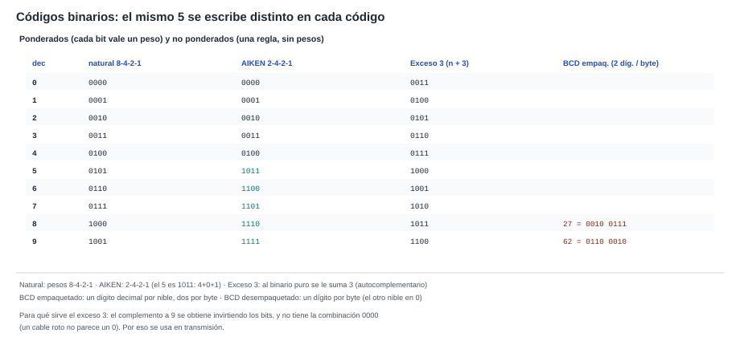

> [!example] Ejercicio típico de parcial
> "Escriba el 8 en binario natural, AIKEN y exceso 3". Natural `1000`; AIKEN `1110` (`1·2+1·4+1·2+0·1 = 8`);
> exceso 3: `1000 + 0011 = 1011`. Y la pregunta trampa: "¿cuántos bits necesita el exceso 3 para el 9?" Cuatro,
> porque `1100` entra cómodo (con 3 bits no alcanzaría: `1001 + 11 = 1100`).

> [!warning] Errores que se ven seguido
> - Escribir el 9 en AIKEN como `1001`: es **`1111`**.
> - Confundir **exceso 3** con **complemento a 2**: en exceso 3 se suma 3 al binario del dígito, no se niega nada.
> - Decir que el BCD "es otro sistema de numeración": no, es binario natural **por dígito**.

##### Figura del libro

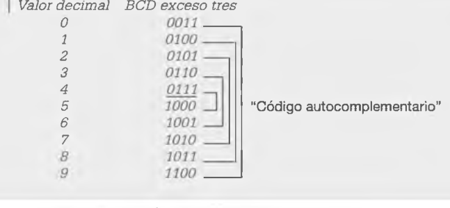

*Fig. 3.5 — Código BCD exceso tres (no ponderado y autocomplementario).* · Quiroga, *Arquitectura de computadoras*, p. 82.

> [!tip] Qué mirar
> No hay pesos que sumen para dar el dígito: se obtiene del BCD sumando 3 a cada combinación. El complemento a 9 sale **invirtiendo todos los bits**, y por eso se dice autocomplementario.

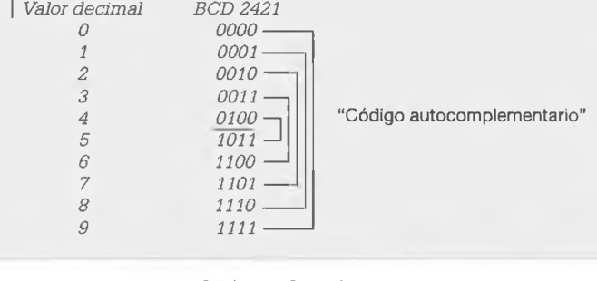

*Fig. 3.6 — Código BCD Aiken (2-4-2-1): ponderado y autocomplementario.* · Quiroga, *Arquitectura de computadoras*, p. 83.

> [!tip] Qué mirar
> Acá sí hay pesos (2-4-2-1) pero se repiten, y el 9 se escribe `1111`. Comparar con el 8-4-2-1: el Aiken también es autocomplementario, el 8-4-2-1 no.

##### Relacionado
[[1.6.2 Códigos continuos y cíclicos]] · [[1.4.2 Codificador]] · [[9.5.1 Suma decimal corregida]] ·
[[2.3.4 Detección y corrección de errores (paridad, LRC, CRC y Hamming)]] · [[Glosario — Unidad 1]]

#### 1.6.2 Códigos continuos y cíclicos

> [!abstract] En una frase
> Un código es **continuo** (o progresivo) si las combinaciones de números **consecutivos** son **adyacentes**,
> es decir que difieren en **un solo bit**; es **cíclico** si además la **última** combinación es adyacente a la
> **primera**. Los dos ejemplos de la cátedra son el **Gray** (reflejado) y el **Johnson**.

> [!note] Si es la primera vez que ves esto
> Imaginá un codificador de posición que gira: si pasa de `0111` a `1000` cambian **cuatro** bits a la vez y, en el
> instante de la transición, se pueden leer combinaciones **intermedias falsas**. Con un código continuo cambia
> **un solo bit**: no hay estado intermedio posible. Ésa es toda la idea.

##### Gray (reflejado)

Se construye por **reflejo**: el código de `n` bits se arma copiando el de `n-1` bits al derecho (con 0 adelante)
y al revés (con 1 adelante).

| Decimal | Gray 2 bits | Gray 3 bits | Gray 4 bits |
|---|---|---|---|
| 0 | `00` | `000` | `0000` |
| 1 | `01` | `001` | `0001` |
| 2 | `11` | `011` | `0011` |
| 3 | `10` | `010` | `0010` |
| 4 | — | `110` | `0110` |
| 5 | — | `111` | `0111` |
| 6 | — | `101` | `0101` |
| 7 | — | `100` | `0100` |
| 8 | — | — | `1100` |
| 9 | — | — | `1101` |
| 10 | — | — | `1111` |
| 11 | — | — | `1110` |
| 12 | — | — | `1010` |
| 13 | — | — | `1011` |
| 14 | — | — | `1001` |
| 15 | — | — | `1000` |

Propiedades para el final:

| Propiedad | Qué significa |
|---|---|
| **Continuo** | de una fila a la siguiente cambia **1 bit** |
| **Cíclico** | de la última (`1000`) a la primera (`0000`) cambia **1 bit** |
| **Reflejado** | el 2.º grupo es el 1.º al revés con el bit de arriba en 1 |
| **Conversión binario → Gray** | `G = B ⊕ (B >> 1)`: el Gray 3 de `B=101` es `101 ⊕ 010 = 111` |

> [!example] Conversión, con números
> Binario `1011` (11) ⇒ se corre un lugar y se hace XOR con el original: `1011 ⊕ 0101 = 1110` ⇒ Gray = `1110`
> (que en la tabla de 4 bits es, efectivamente, el 11). Y al revés (Gray → binario) se va acumulando el XOR de
> izquierda a derecha: `1110` ⇒ `1`, `1⊕1=0`, `0⊕1=1`, `1⊕0=1` ⇒ `1011` ✓.

##### Johnson (5 bits)

Se obtiene con un **registro de desplazamiento realimentado con la salida negada**. Con `n` biestables da `2n`
estados (no `2ⁿ`), y también es continuo y cíclico.

| Decimal | Johnson (5 bits) |
|---|---|
| 0 | `00000` |
| 1 | `00001` |
| 2 | `00011` |
| 3 | `00111` |
| 4 | `01111` |
| 5 | `11111` |
| 6 | `11110` |
| 7 | `11100` |
| 8 | `11000` |
| 9 | `10000` |

Se ven las dos mitades: primero **entran unos** por la izquierda, después **entran ceros**. El paso del 9 al 0
(`10000 → 00000`) también cambia **un solo bit** ⇒ cíclico.

##### Los dos códigos, dibujados

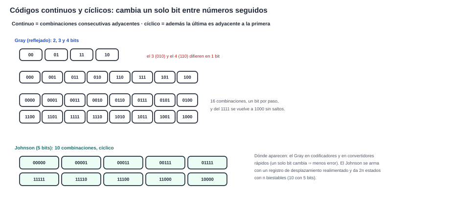

> [!example] Para qué se usa cada uno
> - **Gray**: codificadores de posición (discos ópticos), convertidores analógico-digitales y en las tablas de
>   Karnaugh — por eso las filas y columnas del mapa se numeran `00, 01, 11, 10` (ver
>   [[1.3.2 Mapa de Karnaugh de 2, 3 y 4 variables]]).
> - **Johnson**: contadores con pocas compuertas; un contador Johnson de 5 biestables cuenta de 0 a 9 y se
>   **autocorrige** si arranca en un estado válido.

> [!warning] No confundir
> **Gray ≠ Johnson**. El Gray usa **todas** las `2ⁿ` combinaciones (4 bits → 16 estados); el Johnson usa
> **`2n`** (5 bits → 10 estados). Y "continuo" no es lo mismo que "cíclico": todo cíclico es continuo, pero un
> continuo puede no cerrar (por ejemplo, el contador Gray de 3 bits usado en un rango parcial).

##### Relacionado
[[1.6.1 Códigos ponderados y no ponderados]] · [[1.3.2 Mapa de Karnaugh de 2, 3 y 4 variables]] ·
[[2.2.3 Contadores binarios y módulo N]] · [[1.4.2 Codificador]] · [[Glosario — Unidad 1]]

## Unidad 2 — Memorias y circuitos secuenciales

> [!info] Unidad 2
> 20 subtemas · 14.622 palabras ·
> síntesis de una página: [[00 Síntesis — Unidad 2]] · archivo de la unidad: [[00 Unidad 2 completa (lectura de corrido)]]

### 2.1 Biestables y flip-flops

#### 2.1.1 Biestable RS (NOR y NAND)

> [!abstract] En una frase
> El biestable **RS** es **dos compuertas cruzadas** (NOR o NAND): con `S` (set) guarda un **1**, con `R` (reset)
> guarda un **0**, y con las dos en reposo **mantiene** lo que tenía. Con `S = R = 1` (en la versión NOR) aparece el
> **estado prohibido**.

> [!note] Si es la primera vez que ves esto
> Todo circuito que estudiaste hasta acá "olvida": si sacás la entrada, la salida desaparece. Este no: la salida
> **vuelve a entrar** como entrada de la otra compuerta (realimentación), y eso lo hace **recordar**. Es un
> interruptor de luz con dos botones, uno para prender y otro para apagar, donde la luz queda como la dejaste.

##### Estructura y tabla de estados


**Versión con NOR** (entradas activas en **alto**):

| S | R | Q⁺ | Estado |
|---|---|---|---|
| 0 | 0 | **Q** | mantiene (memoria) |
| 0 | 1 | **0** | reset |
| 1 | 0 | **1** | set |
| 1 | 1 | **0 / 0** | **prohibido** (las dos salidas en 0) |

**Versión con NAND** (entradas activas en **bajo**, `S'` y `R'`): la tabla es la misma pero **invertida** en las
entradas, y el estado prohibido es `S = R = 0` (las dos salidas en **1**).

##### Ecuación característica (desde el mapa)
Con la tabla de estados y tratando `Q` como variable:

| S \ R | Q=0 | Q=1 |
|---|---|---|
| 0 | 0 | **1** |
| 1 | **1** | **X** (don't care) |

Agrupando: **`Q⁺ = S + R'·Q`**.

> [!tip] Cómo leerla
> "Se pone en 1 si `S = 1`; si no, **se queda** como estaba (`R'·Q`)". Es la definición de memoria: cuando `R` no
> está activo, el valor viejo sobrevive.

##### Por qué el estado prohibido es prohibido
Con `S = R = 1` las dos salidas van a 0, y eso rompe la condición `Q` y `Q'` complementarias. Peor: al **soltar**
las dos entradas a la vez, cuál queda en 1 depende de la velocidad de cada compuerta (**carrera**). Por eso el RS
NOR no admite `S = R = 1`, y de ahí nacen el JK (que lo resuelve) y el D (que lo evita por construcción).

##### Ejemplo de secuencia
`S=1,R=0` → `Q=1` · luego `S=0,R=0` → **sigue** en 1 · luego `S=0,R=1` → `Q=0` · luego `S=0,R=0` → **sigue** en 0.
La salida "recuerda" el último pulso que la tocó.

> [!warning] Errores típicos
> - Invertir la polaridad: en NOR, `S=1` **pone** a 1; en NAND, `S=0` pone a 1 (activo bajo).
> - Decir que con `S=R=0` la salida es 0: en NOR **mantiene**.
> - Olvidar que `Q⁺` depende de `Q`: no es una tabla de verdad combinacional, es una **tabla de estados**.

##### Figura del libro

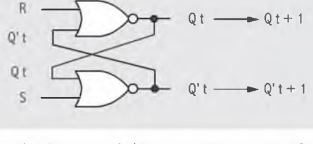

*Fig. 6.27 — Diagrama de lógica con compuertas NOR: biestable RS.* · Quiroga, *Arquitectura de computadoras*, p. 157.

> [!tip] Qué mirar
> Las dos NOR cruzadas se realimentan: `R = 1` pone `Q = 0`, `S = 1` pone `Q = 1`, y con `R = S = 0` el biestable **memoriza**. `R = S = 1` es el estado prohibido (las dos salidas a 0).

##### Relacionado
[[2.1.2 Flip-flops D y T]] · [[2.1.3 Flip-flop JK y ecuaciones características]] · [[2.1.4 Conversión entre biestables]] ·
[[TP8 Biestables RS]] · [[Flip-Flops SR, D, JK y T]] · [[Glosario — Unidad 2]]

#### 2.1.2 Flip-flops D y T

> [!abstract] En una frase
> El **D** (data) guarda lo que hay en su entrada: `Q⁺ = D`. El **T** (toggle) cambia de estado cada vez que su
> entrada vale 1: `Q⁺ = T⊕Q`. Los dos nacen del RS, pero **sin** estado prohibido.

> [!note] Si es la primera vez que ves esto
> El **D** es la "caja donde dejás un papel": lo que ponés, queda. Es el ladrillo de los **registros** y de la
> memoria (cada celda es un D). El **T** es el "interruptor de escalera": cada pulso lo cambia de posición; es el
> ladrillo de los **contadores**.

##### D y T, con su tabla

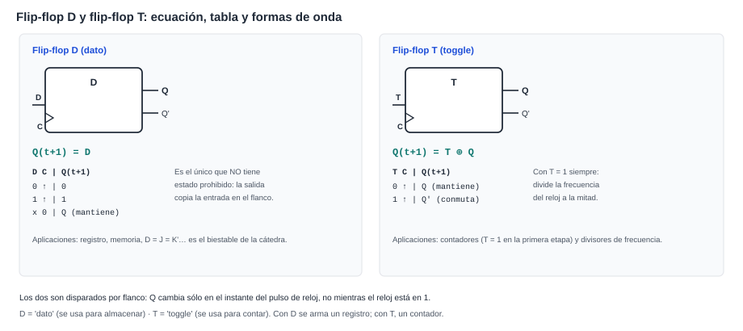

##### Flip-flop D

| D | Q⁺ |
|---|---|
| 0 | 0 |
| 1 | 1 |

**`Q⁺ = D`** — una sola línea, sin mapa.

**Cómo se construye desde el RS:** se conecta `D` a `S` y **`D'` a `R`** (con un inversor). Así nunca llegan los dos
en 1, y el estado prohibido desaparece por construcción.

**Versión con habilitación (enable):** el flip-flop sólo toma el dato cuando `E = 1`; si `E = 0`, mantiene. Es la
base de los registros con señal de carga (`LOAD`).

```
Q⁺ = E·D + E'·Q      (D con enable)
```

**D disparado por flanco:** los reales son *edge-triggered* (toman el dato en el flanco de subida o de bajada del
reloj). Es lo que permite que un registro con 8 flip-flops cargue **todos los bits a la vez**, sin carreras.

##### Flip-flop T

| T | Q⁺ |
|---|---|
| 0 | **Q** (mantiene) |
| 1 | **Q'** (cambia) |

**`Q⁺ = T⊕Q`** — y de ahí sale la tabla:

| T | Q | Q⁺ |
|---|---|---|
| 0 | 0 | 0 |
| 0 | 1 | 1 |
| 1 | 0 | 1 |
| 1 | 1 | 0 |

**Cómo se construye desde el JK:** un JK con `J = K = T`. Con `T = 1` cae en el caso "toggle".

##### Cuándo se usa cada uno

| Flip-flop | Se usa en |
|---|---|
| **D** | registros, memoria (celda RAM), latch de datos, registro de instrucción |
| **T** | contadores, divisores de frecuencia (un T con `T=1` divide el reloj por 2) |
| **JK** | contadores y máquinas de estado (con `J` y `K` distintos) |
| **RS** | el modelo teórico del que salen los otros |

> [!tip] El detalle que se pregunta
> Un **T con T = 1 permanente divide la frecuencia del reloj por 2** (cambia en cada pulso). Encadenando cuatro
> T se obtiene un **contador de 4 bits**: ésa es la estructura de un contador asíncrono.

> [!warning] Errores típicos
> - Decir que el D "recuerda" sin reloj: sin `enable`/flanco, sigue al dato (es un cable con buffer).
> - Escribir `Q⁺ = T + Q` (es **XOR**, no OR: con `T=1,Q=1` da 0).
> - Confundir `Q⁺` con `Q`: `Q⁺` es el estado **después** del pulso.

##### Figura del libro

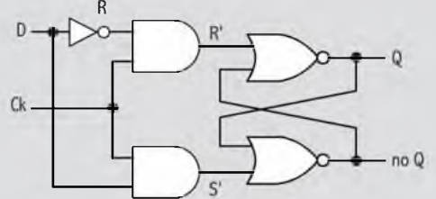

*Fig. 6.34 — Diagrama de lógica de un biestable D sincrónico* · Quiroga, *Arquitectura de computadoras*, p. 159.

##### Ejemplo resuelto
- **D**: aplicando `D = 1` y un flanco ⇒ `Q = 1`; después `D = 0` y otro flanco ⇒ `Q = 0`. Copia la entrada en
  cada flanco: `Q⁺ = D`.
- **T**: con `T = 1`, en cada flanco **alterna**. Partiendo de `Q = 0`, tres pulsos dan `1 → 0 → 1`: `Q⁺ = T ⊕ Q`.
- Con `T = 1` fijo, un flip-flop T **divide la frecuencia por 2**: 8 pulsos de reloj ⇒ 4 pulsos en `Q`. Eso es lo
  que hace un contador (ver [[2.2.3 Contadores binarios y módulo N]]).

##### Relacionado
[[2.1.1 Biestable RS (NOR y NAND)]] · [[2.1.3 Flip-flop JK y ecuaciones características]] ·
[[2.2.3 Contadores binarios y módulo N]] · [[TP9 Biestables D, JK y T]] · [[Flip-Flops SR, D, JK y T]] · [[Glosario — Unidad 2]]

#### 2.1.3 Flip-flop JK y ecuaciones características

> [!abstract] En una frase
> El **JK** es el RS que **resolvió** el estado prohibido: con `J = K = 1` no se rompe, **cambia de estado**
> (*toggle*). Su ecuación es `Q⁺ = J·Q' + K'·Q`, y sale del mapa de Karnaugh de su tabla de estados.

> [!note] Si es la primera vez que ves esto
> Al RS no se le podía pedir "las dos cosas a la vez". El JK dice: "si me pedís las dos, **invierto** lo que
> tengo". Con eso se vuelve el biestable más versátil (y el que usan los contadores), y de él se derivan el D y
> el T.

##### J-K completo

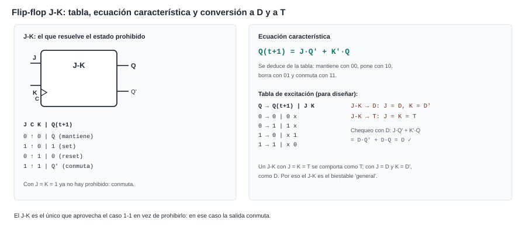

##### Tabla de estados (la que se completa en el TP)

| J | K | Q⁺ | Qué hace |
|---|---|---|---|
| 0 | 0 | **Q** | mantiene |
| 0 | 1 | **0** | reset |
| 1 | 0 | **1** | set |
| 1 | 1 | **Q'** | **toggle** (invierte) |

Y con `Q` como variable, la tabla de 8 filas para el mapa:

| J | K | Q | Q⁺ |
|---|---|---|---|
| 0 | 0 | 0 | 0 |
| 0 | 0 | 1 | 1 |
| 0 | 1 | 0 | 0 |
| 0 | 1 | 1 | 0 |
| 1 | 0 | 0 | 1 |
| 1 | 0 | 1 | 1 |
| 1 | 1 | 0 | 1 |
| 1 | 1 | 1 | 0 |

##### La ecuación, paso a paso
Mapa de `Q⁺` con filas `JK` (00, 01, 11, 10) y columnas `Q` (0, 1):

| JK \ Q | 0 | 1 |
|---|---|---|
| 00 | 0 | **1** |
| 01 | 0 | 0 |
| 11 | **1** | 0 |
| 10 | **1** | **1** |

Dos grupos de 2: `J·Q'` (columna Q=0, filas 11-10) y `K'·Q` (columna Q=1, filas 00-10).

> [!important] `Q⁺ = J·Q' + K'·Q`
> Leída en castellano: "**se pone en 1** si J lo pide (`JQ'`), y **se mantiene en 1** si K no lo borra (`K'Q`)".

##### Las cuatro ecuaciones, juntas (cuadro para memorizar)

| Biestable | Ecuación característica | Caso especial |
|---|---|---|
| **RS** | `Q⁺ = S + R'·Q` | `S = R = 1` prohibido |
| **D** | `Q⁺ = D` | — |
| **JK** | `Q⁺ = J·Q' + K'·Q` | `J = K = 1` ⇒ toggle |
| **T** | `Q⁺ = T ⊕ Q` | `T = 1` ⇒ toggle |

**Relaciones entre ellos:** `D` = JK con `J = D, K = D'` · `T` = JK con `J = K = T` · `JK` = RS con
`S = JQ', R = KQ`.

##### Tabla de excitación (la que se usa para diseñar)
Al revés: dado el cambio que quiero (`Q → Q⁺`), ¿qué entradas necesito?

| Transición | J K | D | T | S R |
|---|---|---|---|---|
| 0 → 0 | 0 **X** | 0 | 0 | 0 X |
| 0 → 1 | 1 **X** | 1 | 1 | 1 0 |
| 1 → 0 | **X** 1 | 0 | 1 | 0 1 |
| 1 → 1 | **X** 0 | 1 | 0 | X 0 |

> [!warning] Errores típicos
> - Usar el mapa de 4 filas (J,K) en vez del de 8: `Q⁺` **depende de Q**, así que Q tiene que estar en el mapa.
> - Escribir `Q⁺ = JQ + K'Q` (falta la negación de Q en el primer término).
> - Confundir la **tabla de estados** (funcionamiento) con la **tabla de excitación** (diseño).

##### Figura del libro

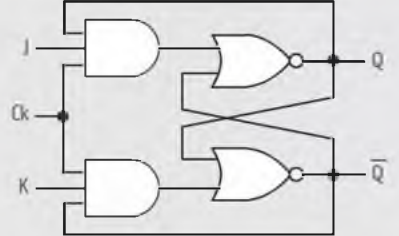

*Fig. 6.30 — Diagrama de lógica de un biestable J-K sincrónico.* · Quiroga, *Arquitectura de computadoras*, p. 158.

##### Ejemplo resuelto
Partiendo de `Q = 0`, con `J = K = 1` (modo *toggle*): pulsos ⇒ `Q = 1 → 0 → 1 → 0`.
- `J = 1, K = 0` ⇒ `Q⁺ = 1` (**set**) sin importar el estado anterior.
- `J = 0, K = 1` ⇒ `Q⁺ = 0` (**reset**).
- `J = K = 0` ⇒ **mantiene**; `J = K = 1` ⇒ **alterna**. Por eso `Q⁺ = J·Q' + K'·Q`.
- Trampa clásica: `J = K = 1` **no** es estado prohibido (eso era el RS); acá es el modo útil para contar.

##### Relacionado
[[2.1.2 Flip-flops D y T]] · [[2.1.4 Conversión entre biestables]] · [[1.3.2 Mapa de Karnaugh de 2, 3 y 4 variables]] ·
[[TP9 Biestables D, JK y T]] · [[Flip-Flops SR, D, JK y T]] · [[Glosario — Unidad 2]]

#### 2.1.4 Conversión entre biestables

> [!abstract] En una frase
> Convertir un biestable en otro es **agregar compuertas a sus entradas**: se escribe la **tabla de excitación** del
> biestable que tengo y se arman las funciones de sus entradas con la salida que quiero obtener. El caso estrella es
> **RS → JK**: `S = J·Q'`, `R = K·Q`.

> [!note] Si es la primera vez que ves esto
> Tenés una caja llena de flip-flops RS y necesitás que se comporten como JK. No hace falta tirar la caja: se
> **traduce** la orden. "Quiero cambiar de estado" (JK con `J=K=1`) se convierte en "poné a 1 sólo si estaba en 0, y
> a 0 sólo si estaba en 1". Eso son dos compuertas AND.

##### El procedimiento (5 pasos)
1. Escribir la **tabla de estados** del biestable que quiero obtener (el objetivo).
2. Al lado, escribir la **tabla de excitación** del biestable que tengo (el disponible).
3. Para cada fila, anotar qué entradas necesita el disponible para lograr esa transición (con `X` = no importa).
4. **Minimizar** cada entrada con Karnaugh (o analíticamente).
5. Dibujar: el biestable disponible + las compuertas de la entrada.

##### RS → JK (el que se toma en el examen)

Objetivo: que el RS se comporte como JK.

| J | K | Q | Q⁺ (JK) | Para lograrlo con RS (S,R) |
|---|---|---|---|---|
| 0 | 0 | 0 | 0 | 0 X |
| 0 | 0 | 1 | 1 | X 0 |
| 0 | 1 | 0 | 0 | 0 X |
| 0 | 1 | 1 | 0 | 0 1 |
| 1 | 0 | 0 | 1 | 1 0 |
| 1 | 0 | 1 | 1 | X 0 |
| 1 | 1 | 0 | 1 | 1 0 |
| 1 | 1 | 1 | 0 | 0 1 |

**Mapas:** `S` vale 1 donde `J=1` y `Q=0` ⇒ **`S = J·Q'`**; `R` vale 1 donde `K=1` y `Q=1` ⇒ **`R = K·Q`**.

**Circuito:** un inversor de `Q`, una AND para `S` y una AND para `R`. **Dos compuertas más** y el RS ya es JK.


##### Las otras conversiones (para tener el cuadro completo)

| Conversión | Entradas a calcular | Resultado |
|---|---|---|
| **JK → D** | `J = D`, `K = D'` | un inversor |
| **JK → T** | `J = K = T` | un cable |
| **D → T** | `D = T⊕Q` | un XOR |
| **RS → D** | `S = D`, `R = D'` | un inversor |
| **T → JK** | `T = J·Q' + K·Q` | dos AND y una OR |

> [!tip] Cómo se verifica
> Tomá una fila conflictiva del JK (`J=K=1`) y comprobá que en el RS nunca aparezca `S=R=1`:
> con `Q=0` da `S=1,R=0` (set) y con `Q=1` da `S=0,R=1` (reset). El estado prohibido **no se alcanza nunca**.

> [!warning] Errores típicos
> - Confundir `S = JQ'` con `S = JQ` (si está en 1, poner a 1 otra vez no cambia nada: no sirve).
> - Olvidar el inversor o las AND y decir "es equivalente".
> - Usar la tabla de estados en lugar de la de **excitación**.

##### Ejemplo resuelto
Convertir un **JK en D**: hay que lograr `Q⁺ = D`, y la ecuación del JK es `Q⁺ = J·Q' + K'·Q` ⇒
**`J = D`, `K = D'`**. Verificación: `D = 1` ⇒ `J = 1, K = 0` (set) ⇒ `Q = 1` ✓; `D = 0` ⇒ `J = 0, K = 1`
(reset) ⇒ `Q = 0` ✓.
- **D en T**: `T = D ⊕ Q`. Con `Q = 0` y `D = 1` ⇒ `T = 1` (alterna y queda en 1) ✓.
- **T en D**: `D = T ⊕ Q`.
- Regla general: se escribe la ecuación del que **tengo** igualada a la del que **quiero** y se despejan las
  entradas.

##### Figura del libro

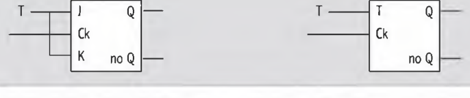

*Fig. 6.31 — Diagrama de bloque de la conversión de un biestable T a J-K (y la tabla de excitación que la justifica).* · Quiroga, *Arquitectura de computadoras*, p. 159.

> [!tip] Qué mirar
> Para convertir se pone lógica a la entrada del biestable que se tiene: `T = J·Q̄ + K·Q`. La tabla de excitación dice qué entrada hay que darle a cada tipo para pasar de `Q` a `Q⁺`.

##### Relacionado
[[2.1.3 Flip-flop JK y ecuaciones características]] · [[2.1.2 Flip-flops D y T]] · [[1.3.2 Mapa de Karnaugh de 2, 3 y 4 variables]] ·
[[TP9 Biestables D, JK y T]] · [[Conversión entre biestables (RS, JK, D, T)]] · [[Glosario — Unidad 2]]

### 2.2 Registros y contadores

#### 2.2.1 Registros PIPO y SISO

> [!abstract] En una frase
> Un **registro** son `n` flip-flops D con el **mismo reloj**: el **PIPO** (Parallel In / Parallel Out) carga y
> entrega los `n` bits **a la vez**; el **SISO** (Serial In / Serial Out) los hace **entrar y salir de a uno**,
> desplazándose de flip-flop en flip-flop.

> [!note] Si es la primera vez que ves esto
> Pensá en una **fila de cajones numerados**. En el PIPO abrís todos los cajones al mismo tiempo y guardás una caja
> en cada uno. En el SISO hay un solo lugar por donde entran las cajas: cada pulso de reloj corre todas las cajas un
> cajón a la derecha, y así van saliendo por el otro extremo.

##### PIPO y SISO dibujados

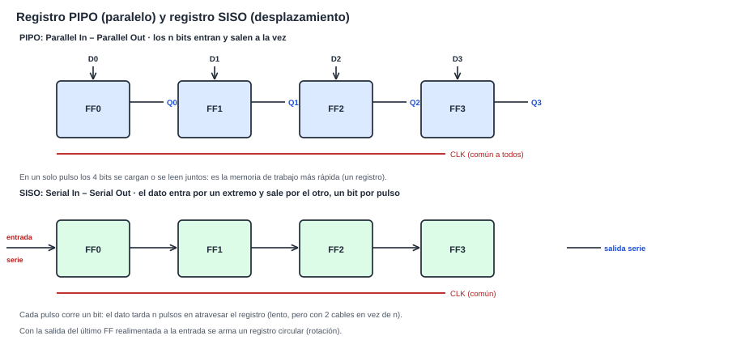

##### PIPO: carga paralela

```
        D3   D2   D1   D0      (entradas de dato)
        │    │    │    │
     ┌──▼─┐┌──▼─┐┌──▼─┐┌──▼─┐
CLK ─┤ FF ├┤ FF ├┤ FF ├┤ FF │
     └──┬─┘└──┬─┘└──┬─┘└──┬─┘
        Q3   Q2   Q1   Q0      (salidas en paralelo)
```

| Señal | Qué hace |
|---|---|
| `CLK` | con cada pulso, **todos** los FF toman su entrada |
| `LOAD` (enable) | si vale 0, el registro **mantiene** lo que tiene |
| `CLR` | borra todo a 0 (asíncrono o sincrónico) |

Cada flip-flop es un **D con enable**: `Q⁺ = LOAD·Di + LOAD'·Q`. Por eso es un registro **de n bits** con una sola
señal de carga.

**Para qué se usa:** es el registro típico de la CPU — el **IR** (registro de instrucción), el **MAR** y el
acumulador reciben el dato completo en **un pulso**. En la BLUE, `CP6: MBR → IR` es exactamente una carga paralela.

##### SISO: desplazamiento

```
      entrada serie ──►┌────┐  ┌────┐  ┌────┐  ┌────┐
                      │ FF │─►│ FF │─►│ FF │─►│ FF │──► salida serie
       CLK ───────────►└────┘  └────┘  └────┘  └────┘
```

- La salida de cada FF va a la **entrada D del siguiente**.
- Cada pulso **desplaza** un bit; en `n` pulsos entra (o sale) una palabra completa.
- Se usa para **comunicación serie** (un solo cable) y para **retardar** una señal `n` pulsos.

| | PIPO | SISO |
|---|---|---|
| Entrada | paralela (n cables) | serie (1 cable) |
| Salida | paralela (n cables) | serie (1 cable) |
| Velocidad | 1 pulso por palabra | n pulsos por palabra |
| Cables | n + 1 | 1 + 1 |

> [!tip] La frase que más se pregunta
> "¿Por qué el registro de instrucción es PIPO?" Porque la instrucción tiene que estar **completa** en un pulso
> para poder decodificarla; el SISO tardaría 16 pulsos en juntar los 16 bits.

> [!warning] Errores típicos
> - Poner relojes distintos en cada flip-flop (un registro tiene **un solo CLK**).
> - Confundir `LOAD` con `CLK`: `LOAD` habilita, `CLK` es el instante.
> - Decir que el SISO "guarda" la palabra completa de entrada: la va **recibiendo** de a un bit.

##### Figura del libro

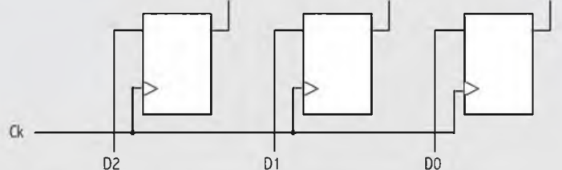

*Fig. 6.35 — Diagrama de bloque de un registro paralelo-paralelo.* · Quiroga, *Arquitectura de computadoras*, p. 160.

##### Ejemplo resuelto
Cargar **`1011`** en un PIPO: en **1 pulso** los cuatro flip-flops toman `D3..D0 = 1,0,1,1` y las salidas quedan
`Q3 Q2 Q1 Q0 = 1011`. Para **sacar** esos bits en serie con un SISO hacen falta **4 pulsos** (uno por bit).
- PIPO: 4 bits en **1** pulso ⇒ es el registro del `IR` o del `MAR` de la CPU.
- SISO: 4 bits en **4** pulsos ⇒ es un retardo o un buffer serie.
- Cuenta que se pregunta: para mover un byte, PIPO tarda **1 ciclo** y SISO **8**.

##### Relacionado
[[2.2.2 Registros SIPO y PISO]] · [[2.2.3 Contadores binarios y módulo N]] · [[2.1.2 Flip-flops D y T]] ·
[[TP10 Registros PIPO y SISO]] · [[Registros]] · [[Glosario — Unidad 2]]

#### 2.2.2 Registros SIPO y PISO

> [!abstract] En una frase
> **SIPO** = entra **serie**, sale **paralelo** (recibir una palabra bit a bit y entregarla junta). **PISO** =
> entra **paralelo**, sale **serie** (tomar una palabra de la CPU y transmitirla por un cable).

> [!note] Si es la primera vez que ves esto
> Son los **traductores** entre el mundo de la CPU (todo en paralelo, 8 o 16 cables a la vez) y el mundo de las
> comunicaciones (un solo cable, un bit atrás del otro). Sin ellos no habría puertos serie, USB ni teclados.

##### SIPO y PISO dibujados

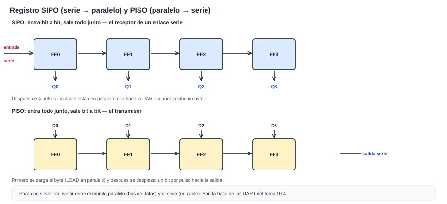

##### SIPO: serie → paralelo

```
entrada serie ──►┌────┐  ┌────┐  ┌────┐  ┌────┐
                 │ FF │─►│ FF │─►│ FF │─►│ FF │
   CLK ─────────►└──┬─┘  └──┬─┘  └──┬─┘  └──┬─┘
                    │       │       │       │
                    Q3      Q2      Q1      Q0   ◄── salida paralela (después de n pulsos)
```

**Secuencia típica:** se recibe `1011` con el bit **menos** significativo primero:
`1` → `1` → `0` → `1`, y después de 4 pulsos las salidas quedan `Q3..Q0 = 1011`.
Se usa con una señal de **habilitación de salida** (o un `LOAD` al final) para que la palabra no cambie mientras se
la está leyendo.

##### PISO: paralelo → serie

```
D3..D0 ──►[ carga paralela ]──►┌────┐  ┌────┐  ┌────┐  ┌────┐──► salida serie
                               │ FF │─►│ FF │─►│ FF │─►│ FF │
                        CLK ──►└────┘  └────┘  └────┘  └────┘
```

- **Paso 1:** `LOAD = 1` → los `n` bits entran a la vez (como un PIPO).
- **Paso 2:** `SHIFT = 1` → cada pulso saca un bit por la derecha y mete 0 (o el bit de entrada).
- En `n` pulsos salió la palabra completa, **primero el bit menos significativo**.

##### Los cuatro registros, en una tabla

| Tipo | Entrada | Salida | Pulsos por palabra | Se usa en |
|---|---|---|---|---|
| **PIPO** | paralelo | paralelo | 1 | IR, MAR, acumulador |
| **SISO** | serie | serie | n | retardo, repetidor serie |
| **SIPO** | serie | paralelo | n | recepción serie (teclado, UART RX) |
| **PISO** | paralelo | serie | 1 + n | transmisión serie (UART TX) |

> [!important] Lo que se pregunta en el oral
> "¿Cómo convierte un registro serie-paralelo?" → **desplazando**: cada pulso mete un bit por la izquierda (o por
> la derecha) y corre los anteriores; después de `n` pulsos la palabra está alineada y se habilita la salida
> paralela. El registro **no** "adivina" el dato: lo **arma** de a un bit.

> [!warning] Errores típicos
> - Olvidar el orden (¿primero el LSB o el MSB?): cambia el valor que se lee.
> - Decir que el SIPO necesita `n` pulsos **y** un pulso más para la salida: la salida paralela está disponible
>   desde el pulso `n` (si hay latch de salida, un pulso más).
> - Mezclar PISO con SIPO al nombrarlos: la primera letra es la **entrada**.

##### Ejemplo resuelto
**SIPO**: entran `1, 1, 0, 1` en 4 pulsos; al cuarto pulso la salida paralela vale **`Q3 Q2 Q1 Q0 = 1101`**
(el primero que entró quedó en el extremo más lejano).
**PISO**: se carga `1101` en paralelo (1 pulso) y sale en serie `1, 1, 0, 1` en 4 pulsos.
- SIPO = **serie → paralelo** (lo que hace un receptor serie: USB, RS-232).
- PISO = **paralelo → serie** (lo que hace un transmisor).
- Los dos juntos son la base de un **UART**.

##### Relacionado
[[2.2.1 Registros PIPO y SISO]] · [[2.2.3 Contadores binarios y módulo N]] · [[TP11 Registros SIPO y PISO]] ·
[[Registros]] · [[Interrupciones y entrada-salida]] · [[Glosario — Unidad 2]]

#### 2.2.3 Contadores binarios y módulo N

> [!abstract] En una frase
> Un contador es un **registro que se incrementa en cada pulso**. El **asíncrono** encadena flip-flops T (el reloj
> de cada uno es la salida del anterior); el **síncrono** les da a todos el mismo reloj y decide con compuertas
> cuándo cada uno debe cambiar. El **módulo N** corta la cuenta después de N estados.

> [!note] Si es la primera vez que ves esto
> Es el **cuentakilómetros**: cada vez que la rueda de las unidades pasa de 9 a 0, la de las decenas avanza uno. En
> binario pasa lo mismo: cuando un bit pasa de 1 a 0, **habilita** al siguiente. Eso es exactamente "el reloj de uno
> es la salida del anterior".

##### Contar con flip-flops

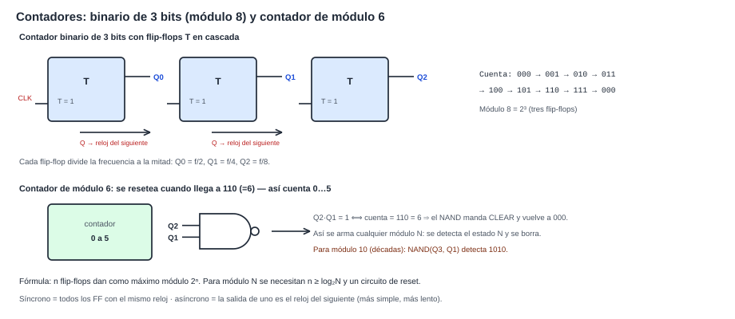

##### Contador asíncrono (de acarreo ondulante) de 4 bits

```
        ┌────┐   ┌────┐   ┌────┐   ┌────┐
CLK ───►│ T0 │──►│ T1 │──►│ T2 │──►│ T3 │
        │    │Q0 │    │Q1 │    │Q2 │    │Q3
        └────┘   └────┘   └────┘   └────┘
```
Cada T tiene `T = 1` (siempre toggle); el reloj del siguiente es `Q` del anterior.

| Pulso | Q3 Q2 Q1 Q0 | Decimal |
|---|---|---|
| 0 | 0000 | 0 |
| 1 | 0001 | 1 |
| 2 | 0010 | 2 |
| 3 | 0011 | 3 |
| … | … | … |
| 15 | 1111 | 15 |
| 16 | 0000 | 0 (vuelve) |

- **Ventaja:** pocas compuertas. **Desventaja:** los bits cambian **en cascada** (retardo acumulado) y aparecen
  **glitches** transitorios en la salida (por ejemplo `0111 → 1000` pasa por estados intermedios).
- Con `n` flip-flops cuenta **2ⁿ estados**: es un contador **módulo 2ⁿ**.

##### Contador síncrono
Todos los flip-flops reciben **el mismo CLK**; las entradas `J`/`K` (o `T`) se calculan para que cada bit cambie
sólo cuando corresponde:

```
T0 = 1
T1 = Q0
T2 = Q0·Q1
T3 = Q0·Q1·Q2
```
Es la misma lógica del acarreo. **Ventaja:** todos los bits cambian juntos (sin glitches, más rápido).
**Desventaja:** más compuertas a medida que crece `n`.

##### Contador módulo N (N no potencia de 2)
Para contar de 0 a `N−1` con `n` flip-flops (donde `2ⁿ > N`), se detecta el estado `N` y se **resetea**:

```
RESET = Q2·Q1·Q0 … (AND de los bits que valen 1 en el estado N)
```
Ejemplo **módulo 10** (BCD, de 0 a 9): con 4 FF se detecta el estado `1010` (= 10) y se fuerza `CLR`, con lo que
la secuencia salta de `1001` a `0000`. **N = 10 → 10 estados.**

| Contador | Secuencia | Detección |
|---|---|---|
| módulo 2ⁿ | 0 … 2ⁿ−1 | natural (desborde) |
| módulo 10 (BCD) | 0 … 9 | `Q3·Q1` (= 1010) |
| módulo 6 | 0 … 5 | `Q2·Q1` (= 110) |

> [!tip] La cuenta que hay que saber justificar
> "¿Cuántos flip-flops para un contador módulo 100?" → `2ⁿ ≥ 100` ⇒ **n = 7** (128 estados, se usan 100 y se
> resetea en 100 = `1100100`).

> [!warning] Errores típicos
> - Decir que un contador de 4 bits cuenta hasta 16: cuenta **0 a 15** (16 estados).
> - Confundir el reset asíncrono (inmediato) con el sincrónico (en el próximo pulso).
> - En el asíncrono, conectar el reloj del siguiente a `Q'` en vez de `Q` y "contar al revés" sin darse cuenta.

##### Figura del libro

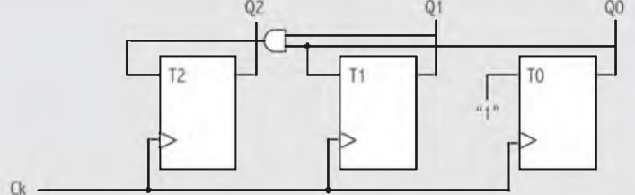

*Fig. 6.36 — Diagrama de bloque de un contador progresivo de 8 eventos con biestables T.* · Quiroga, *Arquitectura de computadoras*, p. 160.

> [!example] Contador módulo 6 con 3 flip-flops
> Cuenta `000 → 001 → 010 → 011 → 100 → 101 → 000`: **6 estados**, se saltea `110` y `111`. El detector de módulo
> es una NAND de las salidas que valen 1 en el estado **6** (`110` ⇒ `Q2·Q1`), que resetea al contador. Con `n`
> flip-flops: `2ⁿ ≥ N` ⇒ para `N = 6`, `n = 3`.

##### Relacionado
[[2.2.1 Registros PIPO y SISO]] · [[2.1.2 Flip-flops D y T]] · [[2.1.3 Flip-flop JK y ecuaciones características]] ·
[[Contadores]] · [[TP9 Biestables D, JK y T]] · [[Glosario — Unidad 2]]

### 2.3 La celda y el chip de memoria

#### 2.3.1 Celda elemental de memoria

> [!abstract] En una frase
> Una celda de memoria guarda **un bit** y tiene siempre **cuatro cosas**: un **biestable** (que recuerda), una
> **selección** (que la elige), una señal de **lectura/escritura** (que decide qué hacer) y un **buffer de 3
> estados** (que la conecta al bus sólo cuando es leída).

> [!note] Si es la primera vez que ves esto
> Pensá en un **casillero de un vestuario**: tiene un número (selección), una puerta con cerradura que se abre
> desde afuera (L/E), y adentro un perchero (el biestable). Y hay una ventanilla que sólo se abre cuando alguien
> viene a mirar (el buffer de 3 estados) — así los miles de casilleros no hablan todos por el mismo pasillo a la
> vez.

##### La celda por dentro

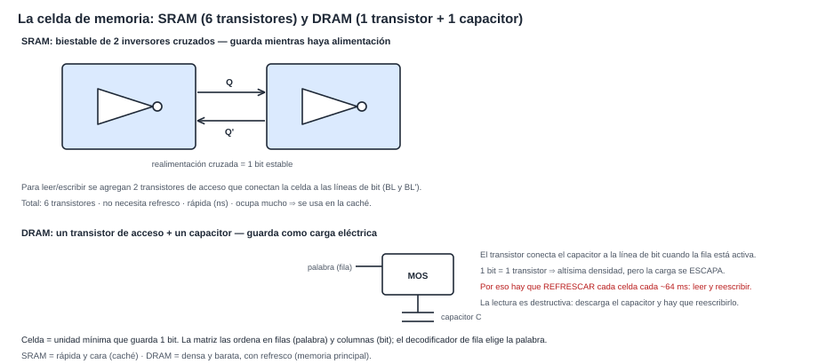

##### Los cuatro bloques

```
              SELECCIÓN (de la dirección)         L/E (del control)
                     │                                 │
               ┌─────▼─────┐                    ┌──────▼──────┐
   D ─────────►│  BIESTABLE │───────────────────►│ 3 ESTADOS   │────► BUS DE DATOS
               └─────┬─────┘   (guarda el bit)   └─────────────┘
                     │
                 MANTIENE
```

| Bloque | Para qué sirve | Qué pasa si falta |
|---|---|---|
| **Biestable** | guardar el bit | no hay memoria, es un cable |
| **Selección** | activar **sólo** la celda direccionada | todas las celdas responderían a la vez |
| **L/E** | leer o escribir según la orden | no se puede distinguir lectura de escritura |
| **3 estados** | conectar al bus sólo cuando se lee | las celdas chocarían contra el bus (cortocircuito lógico) |

##### El buffer de 3 estados (lo que más se pregunta)
Tiene tres estados: **0**, **1** y **alta impedancia (Z)**. Con `EN = 1` copia el valor del biestable al bus; con
`EN = 0` se desconecta (no es 0 ni 1: es un **circuito abierto**).

**Por qué es imprescindible:** la memoria tiene miles de celdas conectadas al **mismo** bus de datos. Sólo la
direccionada debe manejarlo; las demás quedan en `Z`. Sin buffers, dos celdas con valores distintos se pelearían
por el cable.

##### Operación de una celda

| Operación | SEL | L/E | Bus | Qué hace el biestable |
|---|---|---|---|---|
| mantener | 0 | X | Z | conserva el bit |
| **leer** | 1 | 0 (lectura) | sale `Q` | no cambia |
| **escribir** | 1 | 1 (escritura) | entra `D` | toma el valor del bus |

##### De la celda a la palabra
Una **palabra** de `m` bits son `m` celdas que comparten **la misma selección** y **la misma L/E**: se leen y se
escriben **juntas**. Eso es lo que hace que una memoria de 8 palabras × 3 bits tenga **24 celdas** y 8 selecciones
(una por palabra).

> [!warning] Errores típicos
> - Olvidar el buffer de 3 estados (es el bloque que más se valora en la corrección).
> - Decir que la selección "guarda" la dirección: la selección **activa** la celda a partir del decodificador.
> - Confundir `L/E` con el reloj: `L/E` decide la operación; el reloj marca el instante de la escritura.

##### Figura del libro

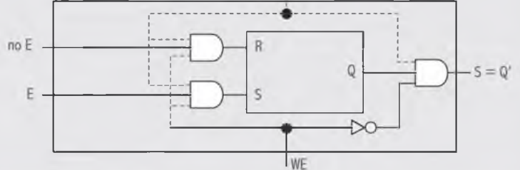

*Fig. 9.4 — Diagrama más detallado de la celda.* · Quiroga, *Arquitectura de computadoras*, p. 238.

##### Ejemplo resuelto
Guardar un **1** y leerlo:
1. La dirección activa `SEL` de esa celda (a través del decodificador).
2. Con `WE = 1` y `D = 1`, el biestable queda en `Q = 1` ⇒ el bit está **escrito**.
3. Para leer hay que poner `WE = 0`: el buffer de 3 estados deja pasar `Q` al bus de datos **sólo si `SEL = 1`**.
   Si `SEL = 0`, la salida queda en **alta impedancia** y el bus sigue libre para otra celda.
- Ésa es la razón del 3.er estado: **miles de celdas comparten un bus** y sólo una habla por vez.

##### Relacionado
[[2.3.2 SRAM y DRAM]] · [[2.3.3 Matriz, expansión y RAM 8x3]] · [[1.4.1 Decodificador]] ·
[[TP13 Componentes internos]] · [[Celda elemental de memoria]] · [[Glosario — Unidad 2]]

#### 2.3.2 SRAM y DRAM

> [!abstract] En una frase
> **SRAM** = celda con **6 transistores** (dos inversores realimentados = un biestable): guarda mientras haya
> alimentación, es **rápida y cara**. **DRAM** = celda con **1 transistor y 1 capacitor**: guarda una **carga**, es
> **densa y barata**, pero la carga se pierde y hay que **refrescarla** cada pocos milisegundos.

> [!note] Si es la primera vez que ves esto
> La SRAM es una **pizarra**: escribís y queda, rápido, pero ocupa lugar. La DRAM es un **vaso con agua**: guarda el
> valor como "agua en el vaso", entra muchísima más cantidad en el mismo espacio, pero el agua se **evapora** y hay
> que volver a llenarlo cada tanto. Esa evaporación es el **refresco** (refresh).

##### SRAM contra DRAM, con el refresco

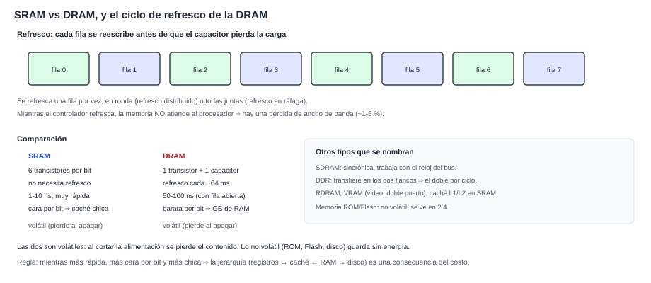

##### Comparación (la tabla que se pide)

| | **SRAM** | **DRAM** |
|---|---|---|
| Celda | 6 transistores (2 inversores + 2 de acceso) | 1 transistor + 1 capacitor |
| Principio | biestable realimentado | carga del capacitor |
| ¿Necesita refresco? | **no** | **sí** (cada ~2-64 ms) |
| Velocidad | muy alta | alta (con latencia y filas) |
| Densidad | baja | **muy alta** |
| Costo por bit | alto | bajo |
| Consumo | bajo (en reposo) | con picos por el refresco |
| Volatilidad | volátil (pierde sin alimentación) | volátil |
| Se usa en | **caché**, registros | **memoria principal (RAM)** |

##### El refresco (por qué existe)
El capacitor se descarga por las corrientes de fuga. Cada celda se lee y se reescribe (**ciclo de refresco**) de
forma periódica y **en filas completas**, no celda por celda. Mientras se refresca, la memoria **no atiende** un
acceso normal: de ahí vienen los "ciclos robados" y parte de la latencia de la DRAM.

##### Por qué la computadora usa las dos
- La **caché** tiene que ser **rapidísima** y es chica ⇒ SRAM.
- La **memoria principal** tiene que ser **grande y barata** ⇒ DRAM.
Esa mezcla es la base de la **jerarquía de memorias** ([[2.5.1 Jerarquía y localidad]]): lo rápido y caro cerca de
la CPU, lo lento y barato lejos.

##### El ejemplo de chip: SRAM 1024 × 1 (Intel 2102)

La SRAM que se usa como ejemplo en la materia es la **2102**: **1024 palabras de 1 bit** (1024 bits en total).

| Dato | Valor | Cuenta |
|---|---|---|
| Capacidad | 1024 × 1 | `2¹⁰` palabras ⇒ **10 bits de dirección** |
| Celda | 1 flip-flop (6 transistores) | no necesita refresco |
| Salida | 1 bit | para armar 8 bits se ponen **8 chips en paralelo**, todos con la misma dirección |
| Tiempo de acceso | del orden de decenas de ns | más rápida que la DRAM, más cara por bit |

##### Tipo de acceso (cómo se clasifican las memorias)

| Tipo de acceso | Qué significa | Ejemplos |
|---|---|---|
| **Aleatorio** (*random*) | cualquier posición tarda **lo mismo** | RAM (SRAM/DRAM), ROM |
| **En serie** o secuencial | el tiempo depende de **dónde esté** la palabra: hay que pasar por las anteriores | cinta magnética |
| **Directo** | salta al bloque y dentro busca en serie | disco, SSD (por bloques) |
| **Asociativo** | se busca **por contenido**, no por dirección | memoria asociativa / CAM |

> [!warning] Lo que se confunde
> "RAM" no significa "memoria" sino **Random Access Memory**: lo que la define es el **acceso aleatorio**, no que sea
> volátil. Una ROM también es de acceso aleatorio; un disco, no.

##### Otras tecnologías que aparecen
| Tecnología | Celda | Rasgo |
|---|---|---|
| **SDRAM / DDR** | DRAM sincrónica | sincronizada con el reloj y con transferencia doble (DDR) |
| **NVRAM** | SRAM + batería | conserva el dato sin alimentación |
| **Flash** | celda flotante | no volátil, escritura por bloques (ver [[2.4.2 PROM, EPROM, EEPROM y Flash]]) |

> [!warning] Errores típicos
> - Decir que la SRAM es no volátil: **las dos son volátiles**.
> - Confundir "refresco" con "recargar la batería": es reescribir el dato.
> - Invertir la densidad: la DRAM guarda **más** bits por mm², no menos.

##### Figura del libro


*Fig. 5.3 — DRAM típica de 16 megabits (4M 4).* · Stallings, *Organización y arquitectura de computadores*, 7ª ed., p. 178.

##### Del chip al módulo: DIMM, SODIMM y las DDR

El chip de la figura no se suelda en la placa: se monta en un **módulo** junto con otros chips, y la PC compra
módulos. Lo que se pregunta de esto es el **nombre y la diferencia**, no el número de pines de memoria.

| Tipo | Dónde va | Detalle |
|---|---|---|
| **SIMM** | placas viejas | contactos en una sola cara |
| **DIMM** (*Dual In-line Memory Module*) | **escritorio** | contactos en las dos caras; **168, 184, 240 o 288 pines** según la generación |
| **SODIMM** (*Small Outline DIMM*) | **notebooks** | más corto, misma función |

| Generación | Novedad | Detalle |
|---|---|---|
| **SDRAM** | sincrónica con el reloj del bus | una transferencia por ciclo |
| **DDR, DDR2, DDR3, DDR4, DDR5** | *Double Data Rate*: **dos transferencias por ciclo** | cada generación sube frecuencia y baja tensión; el **orificio (muesca)** del módulo impide poner una generación donde no va |

> [!example] La cuenta que se pregunta
> Un módulo **DDR4-3200** tiene reloj de 1600 MHz y transfiere 2 veces por ciclo ⇒ **3200 MT/s** por pin. Con
> **64 bits** de ancho de bus: `3200 × 10⁶ × 64 / 8 = 25,6 GB/s`. Con un solo canal. Con dos canales
> (dual channel), el doble. Es exactamente la cuenta de [[8.3.1 Bancos de memoria y ancho de banda]].


##### Relacionado
[[2.3.1 Celda elemental de memoria]] · [[2.3.3 Matriz, expansión y RAM 8x3]] · [[2.5.1 Jerarquía y localidad]] ·
[[Celda elemental de memoria]] · [[TP12 Memoria principal]] · [[Glosario — Unidad 2]]

#### 2.3.3 Matriz, expansión y RAM 8x3

> [!abstract] En una frase
> Un chip de memoria es una **matriz** de celdas: el **decodificador** convierte la dirección en una **fila**
> activa, y las `m` celdas de esa fila salen juntas por el bus (una **palabra**). Para agrandar se combinan chips en
> **profundidad** (más palabras, con `CS`) o en **ancho** (más bits por palabra).

> [!note] Si es la primera vez que ves esto
> Es un **estacionamiento**: cada fila tiene lugar para un auto por carril (bits) y la dirección dice en qué fila
> estacionar. El decodificador es el que **abre la barrera de una sola fila**; los demás quedan cerrados.

##### La matriz de 8 palabras × 3 bits

```
                 ┌───────────────────────────────┐
   A2 ──┐        │  decodificador 3 → 8          │
   A1 ──┼───────►│  (una salida activa por vez)  │
   A0 ──┘        └───┬───┬───┬───┬───┬───┬───┬───┬┘
                     │   │   │   │   │   │   │   │  (selección de fila)
                  ┌──▼─┐…  cada fila = 3 celdas
                  │FFF │  palabra 0: 3 bits
                  └──┬─┘
                     │ 3
   L/E ──────────────┤ (lectura / escritura para todas las celdas de la fila)
   D2..D0 ◄─────────►│ bus de datos (3 bits, con buffers de 3 estados)
```

| Parte | Detalle |
|---|---|
| **Direcciones** | `log₂(8) = 3` bits (`A2 A1 A0`) |
| **Decodificador** | 3 → 8 (3 inversores + 8 AND de 3) |
| **Celdas** | 8 palabras × 3 bits = **24 celdas** |
| **Datos** | bus de **3** bits (uno por columna) |
| **Control** | `L/E` (0 = leer, 1 = escribir) · `CS`/`EN` (chip select) |


> [!warning] Ojo con el nombre: 8×3 o 3×8
> La misma memoria se nombra de las dos formas según el libro o el profesor: **8 × 3** (8 palabras de 3 bits) o
> **3 × 8** (3 bits por cada una de las 8 posiciones). **Es la misma máquina**: 8 filas y 3 columnas. Si en el final
> te dicen "RAM 3×8", contá 8 posiciones × 3 bits y no te trabes con el orden.

##### Cómo se escribe una palabra (ejemplo: dirección 5, dato 101)
1. `A2A1A0 = 101`; el decodificador activa **sólo** la salida 5.
2. `L/E = 1` (escritura): las 3 celdas de la fila 5 toman el valor del bus (`1`, `0`, `1`).
3. Las otras 7 filas no reciben selección y **no cambian**.

##### Cómo se lee
1. Misma dirección ⇒ se activa la fila 5.
2. `L/E = 0`: los buffers de 3 estados se habilitan y ponen `101` en el bus.
3. Las celdas **no** se modifican (la lectura en SRAM no destruye).

##### Expansión (lo que pide el TP12)
| Quiero… | Cómo se hace | Señales |
|---|---|---|
| **más palabras** (profundidad) | chips en paralelo de datos, **uno habilitado a la vez** | bits altos de dirección al decodificador que maneja los `CS` |
| **palabras más anchas** (ancho) | chips en paralelo de datos, **todos habilitados juntos** | el mismo `CS` para todos; cada chip aporta sus bits |

**Ejemplo:** una memoria de `2^n` palabras × 8 bits con chips de `2^(n-1)` × 4 ⇒ **4 chips**: 2 para duplicar la
profundidad y 2 para completar los 8 bits.

> [!warning] Errores típicos
> - Contar celdas como palabras (8×3 son **24 celdas**, no 8).
> - Olvidar que el decodificador tiene **una sola salida activa**.
> - En la expansión de profundidad, habilitar dos chips a la vez (choque en el bus de datos).

##### Figura del libro


*Fig. 5.5 — Organización de una memoria de 256 KB.* · Stallings, *Organización y arquitectura de computadores*, 7ª ed., p. 181.

> [!example] RAM 8 × 3 (8 palabras de 3 bits)
> Hacen falta **8 celdas por bit** y **3 planos** (uno por bit) ⇒ **24 celdas**, un **decodificador 3 → 8** (3 bits
> de dirección) y **3 buffers** de salida de 3 estados. Para pasar a 16 × 3: dos chips de 8 × 3 y el bit más alto de
> dirección elige el chip (`CS`) con un decodificador 1 → 2.

##### Relacionado
[[2.3.1 Celda elemental de memoria]] · [[2.3.2 SRAM y DRAM]] · [[1.4.1 Decodificador]] ·
[[Memoria RAM 8x3]] · [[TP12 Memoria principal]] · [[Glosario — Unidad 2]]

#### 2.3.4 Detección y corrección de errores (paridad, LRC, CRC y Hamming)

> [!abstract] En una frase
> Como una memoria o un cable puede devolver un bit cambiado, se le **agregan bits redundantes**: con **paridad**
> o **LRC** se **detecta** que hubo un error; con **CRC** (polinomio) se detectan casi todas las ráfagas; con
> **Hamming** además se **corrige**, porque el patrón de fallas indica **qué bit** está mal.

> [!note] Si es la primera vez que ves esto
> Es el mismo truco del DNI: además del número hay un **dígito verificador**. No agrega información, pero si te
> equivocás al copiar, el verificador no cierra y te avisa. La paridad es eso: un bit de más que dice "la cuenta
> de unos tiene que dar par".

##### Paridad (detecta 1 bit)

Se agrega **un** bit para que la cantidad de unos del grupo sea par (paridad **par**) o impar (paridad **impar**).

| Dato | Unos | Paridad par | Paridad impar |
|---|---|---|---|
| `1011 0010` | 4 | `P = 0` (queda par) | `P = 1` |
| `1011 0011` | 5 | `P = 1` | `P = 0` |

| Pregunta | Respuesta |
|---|---|
| ¿Detecta 1 bit mal? | sí: el receptor cuenta unos y no le cierra |
| ¿Detecta 2 bits mal? | **no**: dos errores dejan la cuenta igual |
| ¿Corrige? | **no**: no sabe *cuál* de los bits está mal |

##### LRC: paridad por bloque (longitudinal)

Se calcula un byte de paridad **por columna** sobre una trama. Es lo que la cátedra muestra con una trama ASCII:

```
01 + 08 + 00 + 00 + 61 + 62 = CC   (suma hexadecimal de los datos)
complemento a 2 de CC       = 34   ⇒  LRC = 34
```

El receptor **suma los datos + el LRC**: si el resultado no da `00`, hubo error. Detecta **una** ráfaga de hasta
un byte por bloque y se usa en E/S industrial (comunicación entre instrumentos y una PC).

##### CRC: polinomio generador (detecta ráfagas)

La trama se interpreta como un **polinomio** `D(X)`: cada posición de bit es un término. A `D(X)` se lo **divide**
por un **polinomio generador normalizado** `G(X)` y se transmite el **resto**. En el receptor, `D(X)` + el resto
dividido por `G(X)` tiene que dar **resto 0**.

| Generador | Polinomio | Redundancia |
|---|---|---|
| **CRC-8** | `X⁸ + X⁵ + X⁴ + 1` | 8 bits |
| **CRC-12** | `X¹² + X¹¹ + X³ + X² + X + 1` | 12 bits |
| **CRC-16** | `X¹⁶ + X¹⁵ + X² + 1` | 16 bits |

**Cómo se calcula a mano:** `D(X) · X⁸` (o sea, desplazar 8 lugares a la izquierda) y dividir por `G(X)` en
módulo 2 (XOR); el resto son los 8 bits de CRC. Es lo que hacen los ZIP, Ethernet y los discos.

> [!example] El polinomio de un bloque
> Un bloque de 6 bytes son 48 bits ⇒ el polinomio puede llegar a grado 47. Si los bits son
> `0000 0001 0000 1000 …`, el término de mayor peso es `X⁴⁷` y los demás se agregan con los bits en 1:
> `D(X) = X⁴⁰ + X³⁵ + X¹⁴ + X¹³ + X⁸ + X⁶ + X¹`.

##### Hamming: detecta y corrige (el síndrome es la posición)

Los bits de control van en las **potencias de 2** (`1, 2, 4, 8, …`) y cada uno controla las posiciones cuya
representación binaria incluye ese bit.

| Posición | 1 | 2 | 3 | 4 | 5 | 6 | 7 | 8 | 9 | 10 | 11 | 12 |
|---|---|---|---|---|---|---|---|---|---|---|---|---|
| Bit | `P1` | `P2` | `D1` | `P4` | `D2` | `D3` | `D4` | `P8` | `D5` | `D6` | `D7` | `D8` |

| Control | Cubre las posiciones |
|---|---|
| `P1` | 1, 3, 5, 7, 9, 11 |
| `P2` | 2, 3, 6, 7, 10, 11 |
| `P4` | 4, 5, 6, 7, 12 |
| `P8` | 8, 9, 10, 11, 12 |

El receptor recalcula los controles y arma un **síndrome** con ellos: si vale `0` no hubo error; si vale `k`,
**el bit `k` es el que falló** y se lo invierte. Cuesta `k` bits de control para `2ᵏ − 1 − k` de datos: `(12, 8)`,
`(7, 4)` y, en las memorias con ECC, **72 bits por línea = 64 de datos + 8 de control**.

##### Los cuatro, dibujados


##### Figura del libro


*Fig. 5.11 — Código SEC-DED de Hamming.* · Stallings, *Organización y arquitectura de computadores*, 7ª ed., p. 186.

> [!example] Ejercicio numérico de Hamming (8, 4)
> Datos `1011` ⇒ `D1=1, D2=0, D3=1, D4=1`. Con paridad **par**: `P1` cubre 3, 5, 7 ⇒ `D1, D2, D4` = `1, 0, 1`
> (dos unos) ⇒ `P1 = 1`. `P2` cubre 3, 6, 7 ⇒ `D1, D3, D4` = `1, 1, 1` (tres) ⇒ `P2 = 1`. `P4` cubre 5, 6, 7 ⇒
> `D2, D3, D4` = `0, 1, 1` (dos) ⇒ `P4 = 0`. Se transmite `P1 P2 D1 P4 D2 D3 D4` = **`1 1 1 0 0 1 1`**.

> [!important] Qué se pregunta de verdad
> 1. La diferencia entre **detectar y corregir** (paridad vs Hamming).
> 2. Cuántos bits de control necesita Hamming para `n` datos: el menor `k` con `2ᵏ ≥ n + k + 1`.
> 3. El cálculo del **LRC** con la suma hexadecimal y el complemento a 2.
> 4. Que el **CRC se divide** y en el receptor el resto debe dar **0**.

> [!warning] Ojo con los dos "1 bit"
> La paridad detecta **un** bit mal y **no** corrige. Hamming corrige **un** bit; si fallan **dos**, el síndrome
> apunta a una posición equivocada y "corrige" mal. Por eso existe el **SEC-DED** (*single error correction,
> double error detection*): agrega un bit más para avisar que hubo dos.

##### Relacionado
[[2.3.2 SRAM y DRAM]] · [[2.4.2 PROM, EPROM, EEPROM y Flash]] · [[10.4.1 Discos, SSD y latencias]] ·
[[1.6.1 Códigos ponderados y no ponderados]] · [[Glosario — Unidad 2]]

### 2.4 ROM y memorias no volátiles

#### 2.4.1 ROM = decodificador + OR

> [!abstract] En una frase
> Una ROM de `2ⁿ` palabras de `m` bits es **un decodificador de `n` a `2ⁿ`** (que elige la palabra) más **`m`
> compuertas OR** (una por bit de salida), donde cada OR suma **los mintérminos de las direcciones** en las que ese
> bit vale 1.

> [!note] Si es la primera vez que ves esto
> Una ROM **no es un circuito raro**: es una **tabla de verdad guardada**. Le das una dirección y te devuelve el
> dato que tiene anotado para esa dirección. Como cualquier tabla se puede escribir como suma de mintérminos, la
> ROM es exactamente eso hecho hardware: decodificador + OR.

##### ROM = decodificador + OR


##### Estructura

```
   A1 ──┐                      ┌──── OR ────► D3
   A0 ──┼──►[ decodificador ]──┤──── OR ────► D2
        │        2 → 4         │──── OR ────► D1
        │                     └──── OR ────► D0
    (una sola línea activa = una palabra)
```

**Ejemplo: ROM de 4 × 4** con este contenido:

| Dirección | D3 D2 D1 D0 |
|---|---|
| 0 (00) | 0 1 1 0 |
| 1 (01) | 1 0 0 1 |
| 2 (10) | 1 1 0 0 |
| 3 (11) | 0 1 1 1 |

Cada salida se escribe como suma de los mintérminos donde vale 1:
```
D3 = m1 + m2      D2 = m0 + m2 + m3      D1 = m0 + m3      D0 = m1 + m3
```
Esas cuatro OR **son** la ROM. La "programación" es decidir **qué fusible/unión** queda conectado a cada OR.

##### Por qué la ROM es no volátil
El valor no está en un biestable alimentado: está en la **presencia o ausencia de una conexión** (diodo, fusible,
transistor de compuerta flotante). No hay nada que "se descargue", así que al cortar la luz el dato sigue.

##### Usos
| Uso | Por qué una ROM |
|---|---|
| BIOS / firmware | tiene que estar al encender, antes de cargar nada |
| Microcódigo de la UC | el microprograma del 8088 vive en una ROM de 504×21 |
| Tablas de funciones | seno, logaritmos, decodificación de caracteres |
| Generador de caracteres | la fuente de un display: cada dirección es una fila de píxeles |

> [!tip] Una ROM también es una función lógica
> Cualquier función combinacional de `n` variables se implementa con una ROM de `2ⁿ` palabras de 1 bit: se guarda la
> tabla de verdad. Es la forma más directa (aunque no la más barata) de "hacer una función".

> [!warning] Errores típicos
> - Decir que la ROM "tiene biestables": no los necesita, guarda conexiones.
> - Confundir cantidad de palabras con bits por palabra (4×4 son **16 bits**, no 4).
> - Olvidar que el decodificador activa **una** palabra por vez.

##### Figura del libro


*Fig. 6.23 — Diagrama de bloque de cualquiera de las memorias de sólo lectura.* · Quiroga, *Arquitectura de computadoras*, p. 153.

> [!example] ROM de 4 × 4
> 2 bits de dirección ⇒ decodificador 2 → 4 (4 líneas de palabra) y 4 líneas de datos; la matriz OR tiene
> `4 × 4 = 16` puntos de conexión. Si `M[3] = 1010`, la línea 3 activa los OR de las columnas que deben dar 1.
> **Cambiar el contenido = cambiar la matriz**: por eso la ROM se programa una sola vez.

##### Relacionado
[[2.4.2 PROM, EPROM, EEPROM y Flash]] · [[1.4.1 Decodificador]] · [[1.3.1 Mintérminos y maxtérminos]] ·
[[Memoria ROM y sus tipos]] · [[TP12 Memoria principal]] · [[Glosario — Unidad 2]]

#### 2.4.2 PROM, EPROM, EEPROM y Flash

> [!abstract] En una frase
> Son las **variantes programables** de la ROM: **PROM** se graba **una sola vez** (fusibles), **EPROM** se borra
> con **luz ultravioleta**, **EEPROM** se borra **eléctricamente byte por byte** y **Flash** es una EEPROM que se
> borra **por bloques** (es la que usás todos los días).

> [!note] Si esta es la primera vez que ves esto
> La ROM de fábrica no se puede cambiar: si hay un error, se tira el chip. Entonces aparecieron versiones
> "regrabables", de la más incómoda a la más cómoda: sacar el chip y meterlo en un aparato con luz UV (EPROM),
> borrarlo con una señal eléctrica desde el mismo circuito (EEPROM), o hacerlo por bloques y a gran velocidad
> (Flash).

##### De la PROM a la Flash


##### La tabla completa

| Tipo | Se graba | Se borra | Veces | Tiempo de escritura | Uso típico |
|---|---|---|---|---|---|
| **ROM de máscara** | en fábrica (máscara) | no | 1 | — | productos de altísimo volumen |
| **PROM** | una vez, con un programador | no (fusible quemado) | 1 | lento | prototipos viejos |
| **EPROM** | con programador (voltaje alto) | **UV** (~20 min, ventana de cuarzo) | ~miles | lento | desarrollo, años 80-90 |
| **EEPROM** | eléctricamente, **byte a byte** | eléctricamente | ~1 millón | medio | configuración, datos chicos |
| **Flash NOR** | por bloques | por bloques | ~100 mil | medio | firmware (BIOS), código |
| **Flash NAND** | por páginas | por bloques | ~10 mil | rápido | **SSD**, pendrives, tarjetas |

##### Cómo guarda un bit (la idea física)
Todas las regrabables usan un **transistor de compuerta flotante**: la carga atrapada en la compuerta flotante
cambia el umbral del transistor. Con carga = un estado; sin carga = el otro.
- **Programar** = meter carga (voltaje alto).
- **Borrar (Flash/EEPROM)** = sacar la carga; **EPROM** = sacarla con fotones de UV.

El dato **sobrevive** al corte de energía, y eso las hace **no volátiles**; la carga se degrada muy lentamente
(retensión típica: 10-20 años).

##### Consecuencias prácticas (lo que se pregunta)
- **Borrar por bloques** es lo que hace lento escribir en Flash: para cambiar un byte hay que **leer el bloque,
  modificarlo y reescribirlo entero**.
- **Duración limitada**: cada borrado desgasta la celda ⇒ los SSD hacen *wear leveling*.
- **Flash no es RAM**: se lee rápido pero se escribe lento y por bloques; por eso los sistemas la usan para
  almacenar y copian a DRAM para trabajar.

> [!warning] Errores típicos
> - Decir que la EPROM se borra con electricidad (es **UV**; la eléctrica es la EEPROM).
> - Confundir EEPROM con Flash: misma familia, distinta **granularidad** de borrado (byte vs bloque).
> - Decir que son volátiles: **son no volátiles** (por eso guardan el firmware).

##### Ejemplo resuelto
Comparar una **EPROM 2716** (2 K × 8 = **16 Kbit**) con una **flash** del mismo tamaño:
- La EPROM se borra **entera** con **luz ultravioleta** (ventana de cuarzo, ~20 minutos) y se programa con
  `VPP` ≈ **+12,5 V** aplicado en un pin.
- La EEPROM se borra **por byte** (eléctricamente) pero es más cara y más lenta.
- La **flash** se borra **por bloques** (sectores) y se programa por página: es la que se usa en los pen drives
  y en el firmware (BIOS/UEFI), porque combina densidad de EPROM con borrado eléctrico.
- Cuenta típica: 2 K × 8 = 2048 × 8 = **16 384 bits** = 16 Kbit = **2 KB**.

##### Relacionado
[[2.4.1 ROM = decodificador + OR]] · [[2.3.2 SRAM y DRAM]] · [[2.6.2 Memoria auxiliar y memoria asociativa]] ·
[[Memoria ROM y sus tipos]] · [[TP12 Memoria principal]] · [[Glosario — Unidad 2]]

### 2.5 Jerarquía y caché

#### 2.5.1 Jerarquía y localidad

> [!abstract] En una frase
> La jerarquía de memorias ordena los niveles por **velocidad, tamaño y costo**: registros → caché (L1/L2/L3) → RAM
> → disco/SSD. Funciona porque los programas tienen **localidad**: usan muchas veces pocas zonas de memoria.

> [!note] Si es la primera vez que ves esto
> Es la **heladera, la alacena y el supermercado**: lo que vas a usar ahora lo tenés a mano (heladera = registros),
> lo de la semana en la alacena (RAM), y lo de todo el mes en el supermercado (disco). Vas al supermercado pocas
> veces porque ya sabés que **casi siempre** usás lo mismo. La computadora hace exactamente eso.

##### La pirámide


| Nivel | Tecnología | Tamaño típico | Latencia | Costo/bit | Quién la administra |
|---|---|---|---|---|---|
| **Registros** | flip-flops | ~decenas de bytes | < 1 ns | altísimo | el **compilador** |
| **L1** | SRAM | 32-64 KB | ~1 ns | muy alto | el hardware (transparente) |
| **L2 / L3** | SRAM | 256 KB – 32 MB | ~5-15 ns | alto | el hardware |
| **RAM** | DRAM | 8-64 GB | ~50-100 ns | medio | el **sistema operativo** |
| **SSD / disco** | Flash / magnético | 256 GB – varios TB | 0,1-10 ms | bajo | SO y usuario |
| **Cinta / nube** | — | ilimitado | segundos-minutos | mínimo | archivo |

**Regla:** al bajar un nivel, el tamaño crece ~×10 y la latencia crece ~×10; el costo por bit baja ~×10.

##### Las dos localidades (por qué la pirámide funciona)
- **Temporal:** si una instrucción o un dato se usó, es probable que se **vuelva a usar** (un lazo que repite el
  mismo contador).
- **Espacial:** si se usó la dirección `X`, es probable que se usen `X+1`, `X+2`… (un arreglo que se recorre en
  orden, instrucciones que se ejecutan en secuencia).

Eso permite traer **bloques completos** (líneas de 32-128 bytes) en cada acceso y aprovecharlos después.

##### Qué gana y qué no
- **No mejora un acceso aislado**: si el dato no está en caché, el acceso es igual de lento (o más, por el
  chequeo).
- **Mejora el promedio**: con buena tasa de aciertos, el sistema se comporta casi como el nivel rápido.
  Eso se formaliza con el **AMAT** ([[2.5.3 AMAT y cálculo de mejora]]).

> [!tip] La pregunta clásica del oral
> "¿Por qué no hacemos toda la memoria con SRAM?" → por **costo y densidad**: con SRAM la memoria sería
> enormemente cara y ocuparía una habitación. La jerarquía da **casi** la velocidad de la SRAM con el **costo** de
> la DRAM.

> [!warning] Errores típicos
> - Decir que la jerarquía hace más rápida **cada** operación.
> - Confundir "volátil" con "lenta": son cosas distintas (la RAM es volátil **y** rápida comparada con el disco).
> - Olvidar que la caché es **transparente**: el programador no la maneja.

##### Figura del libro


*Fig. 4.1 — Jerarquía de memoria.* · Stallings, *Organización y arquitectura de computadores*, 7ª ed., p. 130.

##### Ejemplo resuelto (localidad)
Un bucle que recorre un arreglo de **1000 enteros** de 4 bytes, uno detrás del otro:
- **Localidad espacial**: al traer el primer entero se trae **toda la línea** de caché (por ejemplo 64 B = 16
  enteros) ⇒ los 15 accesos siguientes **aciertan**.
- **Localidad temporal**: las instrucciones del bucle (`for`, comparación, incremento) se ejecutan **1000 veces**
  ⇒ quedan en caché y se leen del camino rápido.
- Ésa es toda la jerarquía: registros (1 ciclo) → caché (3-10) → memoria (100) → disco (millones).

##### Relacionado
[[2.5.2 Caché: mapeos y políticas]] · [[2.5.3 AMAT y cálculo de mejora]] · [[2.3.2 SRAM y DRAM]] ·
[[Jerarquía de memorias]] · [[TP12 Memoria principal]] · [[Glosario — Unidad 2]]

#### 2.5.2 Caché: mapeos y políticas

> [!abstract] En una frase
> La caché es una memoria rápida y chica que guarda **copias de bloques** de la RAM. Para saber si un dato está
> (y dónde), la dirección se parte en **etiqueta / índice / desplazamiento**; el **mapeo** decide en qué línea puede
> ir cada bloque, y las **políticas** deciden qué escribir y qué expulsar.

> [!note] Si la primera vez que ves esto
> Es una **biblioteca con estantes fijos y un catálogo**: los libros (bloques) no pueden ir a cualquier estante. En
> el **mapeo directo** cada libro tiene **un solo** estante posible (rápido de buscar, pero dos libros que caen en
> el mismo estante se pelean). En el **totalmente asociativo** cualquier libro puede ir a cualquier estante (no hay
> peleas, pero hay que **revisar todos**). El **asociativo por conjuntos** es el compromiso: cada libro puede ir a
> un grupo chico de estantes.

##### La dirección, vista por la caché

```
┌───────────────┬──────────────┬────────────────────┐
│   ETIQUETA    │   ÍNDICE     │  DESPLAZAMIENTO    │
│  ¿es mi bloque?│ ¿qué línea? │ ¿qué byte del bloque?│
└───────────────┴──────────────┴────────────────────┘
```

| Campo | Para qué sirve | Se calcula |
|---|---|---|
| **Desplazamiento** | elegir el byte dentro de la línea | `log₂(tamaño de línea)` |
| **Índice** | elegir la línea (o conjunto) | `log₂(cantidad de líneas / vías)` |
| **Etiqueta** | comparar y confirmar el acierto | los bits que sobran |

##### Los tres mapeos


| Mapeo | Cada bloque puede ir a… | Ventaja | Desventaja |
|---|---|---|---|
| **Directo** | **una** línea (índice) | simple, barato, rápido | conflictos: dos bloques con el mismo índice se expulsan |
| **Totalmente asociativo** | **cualquier** línea | sin conflictos | comparar **todas** las etiquetas a la vez (caro) |
| **Asociativo por conjuntos** (n vías) | una de las `n` líneas de su conjunto | buen equilibrio | más lógica que el directo |

**Cálculo típico:** caché de 32 KB, líneas de 32 B ⇒ 1024 líneas.
- Directo: índice = 10 bits, desplazamiento = 5 bits.
- 4 vías: 256 conjuntos ⇒ índice = 8 bits; se comparan **4** etiquetas en paralelo.

##### Políticas de escritura

| Política | Qué hace | Consecuencia |
|---|---|---|
| **write-through** | escribe en caché **y** en RAM a la vez | siempre coherente, más tráfico |
| **write-back** | escribe sólo en caché y marca **dirty**; baja a RAM cuando se expulsa | menos tráfico, necesita bit *dirty* |
| **write-allocate** | al fallar una escritura, trae el bloque a caché | bien con write-back |
| **no-write-allocate** | escribe directo en RAM sin traerlo | típico con write-through |

##### Políticas de reemplazo (cuando hay que sacar uno)
- **LRU** (*Least Recently Used*): el que hace más tiempo no se usa. La mejor, pero cara de implementar.
- **FIFO**: el más viejo. Simple.
- **Aleatorio**: sorprendentemente competitivo.
- **LFU**: el menos usado.

##### Aciertos y fallos
| Tipo de fallo | Qué lo causa | Cómo se combate |
|---|---|---|
| **Frío (compulsorio)** | primera referencia al bloque | no se evita (sólo se amortigua con prefetch) |
| **De conflicto** | dos bloques compiten por la misma línea/conjunto | más vías |
| **De capacidad** | la caché es chica para el conjunto de trabajo | caché más grande |

> [!warning] Errores típicos
> - Sumar mal los bits: la suma **etiqueta + índice + desplazamiento = bits de la dirección**.
> - Confundir *write-back* con *write-allocate* (una es dónde se escribe, la otra si se trae el bloque).
> - Decir que el índice "identifica el bloque": identifica la **línea**; quien identifica el bloque es la etiqueta.

##### Figura del libro


*Fig. 4.8 — Ejemplo de correspondencia directa.* · Stallings, *Organización y arquitectura de computadores*, 7ª ed., p. 141.


*Fig. 4.12 — Ejemplo de correspondencia asociativa por conjuntos de dos vías.* · Stallings, *Organización y arquitectura de computadores*, 7ª ed., p. 147.

> [!example] Los tres mapeos con la misma dirección
> Caché de 64 líneas de 4 palabras ⇒ desplazamiento = 2 bits. **Directa**: 6 bits de línea, se usa un pedazo de la
> dirección tal cual ⇒ 1 comparación, pero un bloque conflictivo desaloja siempre. **Asociativa total**: no hay
> campo de línea, se compara contra **todas** las etiquetas a la vez. **Por conjuntos de 2 vías**: 5 bits de
> conjunto + 1 de vía ⇒ el compromiso que usan todas las PC.

##### Relacionado
[[2.5.1 Jerarquía y localidad]] · [[2.5.3 AMAT y cálculo de mejora]] · [[2.3.2 SRAM y DRAM]] ·
[[Memoria caché]] · [[TP12 Memoria principal]] · [[Glosario — Unidad 2]]

#### 2.5.3 AMAT y cálculo de mejora

> [!abstract] En una frase
> `AMAT = tiempo de acierto + tasa de fallos × penalidad de fallo`. Es el tiempo **promedio** por acceso teniendo
> en cuenta la caché, y es la forma de cuantificar si la jerarquía mejora de verdad.

> [!note] Si la primera vez que ves esto
> Si el 95 % de las veces encontrás lo que buscás en la heladera (1 segundo) y el 5 % restante tenés que ir al
> supermercado (100 segundos), tu tiempo promedio por búsqueda es `1 + 0,05 × 100 = 6 segundos`, no 100. Eso es el
> AMAT: **el promedio**, ponderado por la probabilidad de fallar.

##### AMAT con uno y con dos niveles


##### La fórmula

```
AMAT = h + m × P
```
| Símbolo | Significado |
|---|---|
| `h` | tiempo de **acierto** (hit time): lo que tarda la caché |
| `m` | **tasa de fallos** (miss rate) = `1 − tasa de aciertos` |
| `P` | **penalidad** del fallo: lo que tarda traer el bloque de RAM |

##### Ejemplo 1 (el clásico)
Caché de 1 ns, tasa de aciertos 95 %, penalidad 100 ns:
`AMAT = 1 + 0,05 × 100 = 1 + 5 = ` **6 ns** por acceso.
Sin caché, todos los accesos tardarían **100 ns** ⇒ se acelera ~**16,7 veces**.

##### Ejemplo 2 (comparar dos cachés)
| Caché | `h` | Aciertos | `P` | AMAT |
|---|---|---|---|---|
| A | 1 ns | 90 % | 100 ns | `1 + 0,1·100 = ` **11 ns** |
| B | 2 ns | 97 % | 100 ns | `2 + 0,03·100 = ` **5 ns** |

**Conclusión:** B es mejor **aunque sea más lenta en el acierto**: lo que manda es `m × P`. Bajar la tasa de
fallos vale mucho más que bajar 1 ns de acierto.

##### Ejemplo 3 (con L1 y L2)
`L1: 1 ns, 90 %` · `L2: 5 ns, 95 % de los fallos de L1 resueltos` · `RAM: 100 ns`.
- Fallo de L1 (10 %) → se consulta L2: 95 % acierta en 5 ns; 5 % de esos (0,5 % del total) va a RAM en 100 ns.
- `AMAT = 1 + 0,10 × [5 + 0,05 × 100] = 1 + 0,10 × 10 = ` **2 ns**.

##### Qué se puede concluir (lo que se pide argumentar)
1. La mejora viene de la **tasa de aciertos**, no del tamaño bruto.
2. Un fallo muy caro (RAM lenta) hace que convenga **cualquier** mejora en la tasa de fallos.
3. Por eso existen **L1 chica y rápida** + **L2/L3 más grandes**: cada nivel filtra los fallos del anterior.
4. La fórmula **no** dice nada de un acceso aislado: es un **promedio** estadístico.

> [!warning] Errores típicos
> - Usar la tasa de **aciertos** en lugar de la de **fallos**: `m = 1 − aciertos`.
> - Mezclar unidades (ns con µs) sin convertir.
> - Comparar cachés mirando sólo el tiempo de acierto.
> - Olvidar que en un sistema con L2 hay que **anidar** los cálculos.

##### Figura del libro


*Fig. 4.5 — Operación de lectura de caché.* · Stallings, *Organización y arquitectura de computadores*, 7ª ed., p. 135.

##### Relacionado
[[2.5.1 Jerarquía y localidad]] · [[2.5.2 Caché: mapeos y políticas]] · [[Memoria caché]] ·
[[Jerarquía de memorias]] · [[TP12 Memoria principal]] · [[Glosario — Unidad 2]]

### 2.6 Memorias complementarias

#### 2.6.1 Memoria virtual y paginación

> [!abstract] En una frase
> La memoria virtual es una **ilusión** que da el sistema operativo: cada programa cree tener un espacio de
> direcciones propio y continuo (memoria **virtual**), que el hardware traduce a direcciones **físicas** por
> **páginas** de tamaño fijo, usando la **tabla de páginas** y la **TLB**.

> [!note] Si la primera vez que ves esto
> Imaginá que en la facultad te dan un **número de legajo** (dirección virtual) y no un aula. El legajo es tuyo y
> fijo, pero la facultad puede cambiarte de aula (marco físico) cuando quiere, sin avisarte. La "tabla de páginas"
> es la cartelera que traduce legajo → aula.

##### Virtual a física


##### De la dirección virtual a la física

```
  dirección virtual (VA)
  ┌─────────────┬──────────────┐
  │  PÁGINA (p) │ DESPLAZ. (d) │
  └──────┬──────┴──────┬───────┘
         │             │
   [tabla de páginas]  │
         │             │
  ┌──────▼─────┬───────▼──────┐
  │ MARCO (f)  │  DESPLAZ. (d)│  = dirección física
  └────────────┴──────────────┘
```

| Concepto | Qué es |
|---|---|
| **Página** | bloque de tamaño fijo del espacio **virtual** (típico 4 KB) |
| **Marco** (frame) | bloque del mismo tamaño en la **RAM física** |
| **Tabla de páginas** | dice en qué marco está cada página (y sus permisos) |
| **TLB** | caché de esa tabla (para no consultarla en cada acceso) |
| **Fallo de página** | la página no está en RAM: hay que traerla del disco (muy caro) |

**El desplazamiento no se traduce:** es el mismo dentro de la página y del marco (eso permite que las páginas sean
de tamaño fijo).

##### Qué resuelve (las cuatro razones)
1. **Aislamiento:** un proceso no puede leer la memoria de otro (cada uno tiene su tabla).
2. **Más memoria que la física:** las páginas que no se usan se dejan en el disco (swap).
3. **Reubicación:** el programa no necesita saber en qué dirección física quedó.
4. **Protección:** la tabla indica lectura/escritura/ejecución por página.

##### La TLB (lo que lo hace rápido)
La tabla de páginas está en memoria: consultarla en **cada** acceso duplicaría el tiempo. La **TLB** es una
memoria **asociativa** chica (32-512 entradas) que guarda las traducciones recientes:
`acierto en TLB ⇒ 1 ciclo` · `fallo ⇒ consultar la tabla (y quizá el disco)`.

##### Comparación con la caché (para no mezclar)
| | Caché | Memoria virtual |
|---|---|---|
| Qué guarda | **copias** de bloques de RAM | **traducciones** y páginas |
| Si falla | se trae el bloque de RAM | se trae la página del **disco** |
| Quién la maneja | el hardware | el **SO** (+ hardware de traducción) |
| Tamaño del bloque | 32-128 B | 4 KB |

> [!warning] Errores típicos
> - Decir que la memoria virtual "es la RAM del disco": es una **dirección**, no un lugar.
> - Traducir también el desplazamiento (no se toca).
> - Confundir fallo de página (disco) con fallo de caché (RAM).

##### Figura del libro


*Fig. 14.1 — Traducción de la dirección virtual.* · Quiroga, *Arquitectura de computadoras*, p. 362.


*Fig. 8.18 — Funcionamiento de la paginación y del buffer de traducción* · Stallings, *Organización y arquitectura de computadores*, 7ª ed., p. 303.

##### Ejemplo resuelto (con números)
Dirección **virtual de 32 bits** y páginas de **4 KB**:
- `4 KB = 2¹²` ⇒ los **12 bits bajos** son el **desplazamiento** dentro de la página.
- Los **20 bits altos** son el **número de página virtual (VPN)** ⇒ `2²⁰ = 1 048 576` páginas posibles.
- La **MMU** traduce el VPN al número de marco físico con la tabla de páginas; el desplazamiento **no se toca**.
- Costo: si el marco no está en el `TLB`, la traducción cuesta **1 acceso extra a memoria** por cada acceso.

##### Relacionado
[[2.6.2 Memoria auxiliar y memoria asociativa]] · [[2.5.2 Caché: mapeos y políticas]] · [[2.5.1 Jerarquía y localidad]] ·
[[Memoria virtual y administración de memoria]] · [[Glosario — Unidad 2]]

#### 2.6.2 Memoria auxiliar y memoria asociativa

> [!abstract] En una frase
> La **memoria auxiliar** es el último nivel de la jerarquía (disco rígido, SSD, cinta): enorme, barata y **no
> volátil**, pero miles de veces más lenta. La **memoria asociativa** (CAM) no se direcciona por posición sino que
> se **consulta por contenido**: se le pregunta "¿tenés este dato?" y **todas** las posiciones comparan a la vez.

> [!note] Si la primera vez que ves esto
> La auxiliar es el **placard**: guardás todo, pero tardás en encontrar algo. La asociativa es un **buscador**: no
> abrís cajón por cajón, gritás un nombre y todos contestan al mismo tiempo si lo tienen.

##### Buscar por contenido


##### Memoria auxiliar

| Tecnología | Cómo guarda | Latencia | Ventaja | Desventaja |
|---|---|---|---|---|
| **Disco rígido (HDD)** | magnetismo en platos giratorios | 5-10 ms | barato por TB | partes móviles, lento |
| **SSD (Flash)** | celda flotante | 0,1-0,2 ms | rápido, sin partes móviles | desgaste, más caro |
| **Cinta** | magnetismo secuencial | segundos | archivo masivo | acceso secuencial |
| **Óptico (CD/DVD)** | surcos y reflejo | ~100 ms | distribución | baja capacidad |

**Por qué existe:** la RAM es volátil y cara. Todo lo que tiene que sobrevivir al apagado vive acá, y el SO lo
sube a RAM cuando hace falta (paginación, *swap*, archivos mapeados en memoria).

**Diferencia clave con la RAM:** acá se accede **por bloques/sectores** (512 B – 4 KB), no por byte; y el tiempo se
mide en **ms**, no en ns.

##### Memoria asociativa (CAM)

```
   dato buscado ──►┌────┬────┬────┬────┐
                   │ C0 │ C1 │ C2 │ C3 │   todas comparan en paralelo
                   └─┬──┴─┬──┴─┬──┴─┬──┘
                     └────┴────┴────┘
                            │
                    ¿alguna coincide?  ──► acierto + índice
```

| | Memoria **RAM** normal | Memoria **asociativa (CAM)** |
|---|---|---|
| Se accede por | **dirección** (posición) | **contenido** (etiqueta) |
| Comparaciones por acceso | 1 | **todas en paralelo** |
| Costo | bajo | **muy alto** (una comparación por celda) |
| Tamaño | grande | chica |
| Se usa en | memoria principal | **TLB**, caché asociativa, tablas de ruteo |

**Por qué es cara y chica:** cada celda necesita su **comparador** y la lógica de prioridad para devolver el
primer acierto. Se reserva para donde la velocidad de búsqueda es crítica (TLB, routers).

##### Cómo se conectan los dos conceptos
La **TLB** del tema anterior **es** una memoria asociativa: guarda pares `página → marco` y los busca por contenido.
Y la caché totalmente asociativa también necesita comparar etiquetas en paralelo: es el mismo principio.

> [!warning] Errores típicos
> - Decir que la memoria auxiliar "es la virtual" (una es el **nivel físico**, la otra la **ilusión de
>   direcciones**).
> - Confundir acceso por bloque con acceso por byte.
> - Decir que la CAM es grande: es **chica y carísima**.

##### Figura del libro


*Fig. 8.19 — Buffer de traducción anticipada y funcionamiento de la caché.* · Stallings, *Organización y arquitectura de computadores*, 7ª ed., p. 304.

##### Ejemplo resuelto
Un `TLB` de **64 entradas** asociativas:
- Busca el VPN en **las 64 entradas a la vez** (memoria asociativa): 1 ciclo.
- Si **acierta** (caso normal, > 90 %): la traducción no cuesta nada extra.
- Si **falla**: hay que ir a la tabla de páginas en memoria (**1 acceso más**, y si está en disco, muchísimo más).
- AMAT con `h = 0,95`, acierto 1 ciclo y fallo 20 ciclos: `1 + 0,05 × 20 = 2` ciclos.

##### Relacionado
[[2.6.1 Memoria virtual y paginación]] · [[2.5.1 Jerarquía y localidad]] · [[2.4.2 PROM, EPROM, EEPROM y Flash]] ·
[[Memoria auxiliar y memoria asociativa]] · [[Jerarquía de memorias]] · [[Glosario — Unidad 2]]

### 2.7 Dimensionar memorias

#### 2.7.1 Bits de dirección igual a log2 de celdas

> [!abstract] En una frase
> Si una memoria tiene `N` celdas direccionables, necesita **`log₂(N)` bits de dirección**. Lo que importa es la
> **cantidad de celdas**, no los bytes totales: primero se divide el tamaño por el tamaño de celda.

> [!note] Si la primera vez que ves esto
> Es como numerar los asientos de un estadio: si hay 4096 asientos, necesitás 12 bits para numerarlos
> (`2¹² = 4096`). Si en cambio hay 1 GB de bytes y cada celda guarda 4 bytes, no hay 1 GB de asientos: hay
> **250 millones** (un cuarto), porque cada asiento es más grande.

##### Cuántas líneas hacen falta


##### La receta de 4 pasos
1. **Convertir el tamaño a bytes** (potencias de 2).
2. **Dividir por el tamaño de celda** ⇒ cantidad de celdas `N`.
3. Calcular `log₂(N)` ⇒ bits de dirección.
4. Verificar: `2^(bits)` tiene que dar `N`.

##### Las potencias de 2 que hay que tener a mano
| | Bytes | Potencia |
|---|---|---|
| 1 KB | 1 024 | 2¹⁰ |
| 1 MB | 1 048 576 | 2²⁰ |
| 1 GB | — | 2³⁰ |
| 1 TB | — | 2⁴⁰ |

##### Ejemplos resueltos
**a) 4 KB con celdas de 1 byte:** `4096 = 2¹²` ⇒ **12 bits**.

**b) 512 MB con celdas de 4 bytes:** `512 MB = 2²⁹` bytes; `2²⁹ / 2² = 2²⁷` celdas ⇒ **27 bits**.

**c) 1 GB con celdas de 4 bytes:** `2³⁰ / 2² = 2²⁸` celdas ⇒ **28 bits**.

**d) 256 KB con celdas de 8 bytes:** `2¹⁸ / 2³ = 2¹⁵` ⇒ **15 bits**.

**e) RAM de 8 palabras:** `log₂ 8 = ` **3 bits** (el caso de la RAM 8×3).

##### Cómo se relaciona con el chip físico
Si la memoria total se arma con **4 chips**, los **2 bits más altos** de la dirección se usan para elegir el chip
(van a un decodificador que maneja los `CS`), y los restantes entran al chip. Por eso:
`bits de dirección = bits de selección de chip + bits internos del chip`.

##### Errores que se pagan caro
- **Dividir mal:** usar MB como 1 000 000 en vez de 2²⁰ (en la materia, **siempre** potencias de 2).
- **Olvidar el tamaño de celda:** decir "1 GB ⇒ 30 bits" cuando la celda es de 4 B (son 28).
- **Sumar en vez de restar** al repartir palabra de instrucción (eso es el tema 2.7.2).
- Confundir **bits de dirección** con **bits de dato**: la dirección dice *cuál*; el dato dice *qué*.

> [!tip] Verificación en 5 segundos
> `2^bits de dirección × tamaño de celda` tiene que dar **exactamente** el tamaño total de la memoria. Si no da, el
> error está en el exponente o en la división.

##### Figura del libro


*Fig. 7.7 — Memoria para instrucciones y para datos: 4 Kbytes = 4096 palabras de 16 bits ⇒ 2¹² ⇒ 12 bits de dirección.* · Quiroga, *Arquitectura de computadoras*, p. 175.

> [!warning] El error que más se repite
> Confundir **bits de dirección** con **bits de dato**: una memoria de 4096 × 16 necesita **12** bits de dirección
> (por las 4096 palabras) y tiene **16** bits de dato (por el ancho de la palabra). Si el examen pide "cuántas
> líneas de dirección", la respuesta es `log₂(cantidad de palabras)`, **no** el ancho de la palabra.

##### Relacionado
[[2.7.2 CodOp vs campo de dirección]] · [[2.3.3 Matriz, expansión y RAM 8x3]] ·
[[Espacio de direccionamiento y cálculo de CodOp-Dirección]] · [[TP18 Direccionamiento de memoria]] · [[Glosario — Unidad 2]]

#### 2.7.2 CodOp vs campo de dirección

> [!abstract] En una frase
> En una instrucción, la palabra se reparte entre **código de operación** (qué hacer) y **campo de dirección**
> (dónde): `bits de CodOp = bits de la palabra − bits de dirección`. Cuanta más memoria hay que direccionar, **menos
> instrucciones distintas** entran.

> [!note] Si la primera vez que ves esto
> Tenés una palabra de 16 bits y tenés que repartirla como una **pieza de 16 casillas** entre dos usos que compiten:
> "qué hacer" y "dónde". Si la memoria es chica y necesita 12 casillas para la dirección, te quedan **4** para el
> opcode (16 instrucciones). Si la memoria crece y necesita 13, te quedan **3** (8 instrucciones). **Es un
> presupuesto, no un regalo.**

##### El reparto de los bits


##### La fórmula y el reparto

```
┌───────────────┬────────────────────────────┐
│    CodOp      │   campo de dirección        │
│  (p − d) bits │        d bits               │
└───────────────┴────────────────────────────┘
        palabra de p bits, memoria de 2^d celdas
```

`d = log₂(celdas)` (tema 2.7.1) ⇒ `CodOp = p − d` ⇒ **cantidad de instrucciones = 2^CodOp**.

##### Ejemplos
| Memoria | Celda | `d` | Palabra | `CodOp` | Instrucciones posibles |
|---|---|---|---|---|---|
| 4 K celdas | 1 B | 12 | 16 bits | **4** | 16 |
| 512 MB | 4 B | 27 | 32 bits | **5** | 32 |
| 1 GB | 4 B | 28 | 32 bits | **4** | 16 |
| 64 K celdas | 1 B | 16 | 16 bits | **0** | ✗ (no entra ninguna) |

> [!important] El caso de la BLUE
> La BLUE tiene 4096 celdas de 16 bits ⇒ `d = 12` bits de dirección y la palabra es de 16 ⇒ **`CodOp = 4` bits**,
> es decir **16 opcodes**: exactamente los `00` a `17` en octal (HLT, ADD, XOR, AND, IOR, NOT, LDA, STA, SRJ, JMA,
> JMP, INP, OUT, RAL, CSA, NOP).

##### Qué pasa cuando la memoria crece (el trade-off)
1. **Menos opcodes** (se achica el CodOp) ⇒ menos instrucciones distintas.
2. Para evitarlo se inventan **formatos**: instrucciones de 2 palabras (la segunda aporta más dirección) o
   registros índice que suman a un campo corto. Eso es exactamente lo que hacen la BLUE indexada y el 8086.
3. Otra salida: **palabras más largas** (32 o 64 bits), a costa de más memoria por instrucción.

##### Errores típicos
- Restar mal: `CodOp = 16 − 12 = 4` (no 12).
- Confundir "bits de dirección **por palabra**" con "bits de la palabra".
- Olvidar que `2^CodOp` es la cantidad de **instrucciones distintas**, no de operandos.
- Decir que un campo de 12 bits direcciona 12 celdas: direcciona **4096**.

> [!tip] Cómo se pregunta en el final
> "Si la memoria tiene 512 MB y celdas de 4 bytes, y la palabra es de 32 bits, ¿cuántas instrucciones distintas
> puede tener la máquina?" → `2²⁹/2² = 2²⁷` ⇒ 27 bits de dirección ⇒ `32 − 27 = 5` ⇒ **2⁵ = 32 instrucciones**.

> [!warning] El error que más se repite
> Sumar mal: `opcode + dirección` tiene que dar **exactamente** el ancho de la instrucción (12 bits en la BLUE,
> 12 + 4 = 16). Si la memoria crece, crece el campo de dirección y **se achica** el opcode (o la instrucción se
> alarga): no se pueden los dos a la vez. Y con `2ᵏ` opcodes no "sobran" códigos: cada uno es una instrucción.

##### Figura del libro


*Fig. 7.9 — Código de instrucción: los 16 bits repartidos en OP y DATA.* · Quiroga, *Arquitectura de computadoras*, p. 177.

> [!tip] Qué mirar
> De los 16 bits, 4 son código de operación y 12 de dirección (o dato). La instrucción entra al IR, se separan los campos y el decodificador de OP decide qué hacer: **más opcodes = menos direcciones**.

##### Relacionado
[[2.7.1 Bits de dirección igual a log2 de celdas]] · [[Formato de la instrucción (4 formatos)]] ·
[[Espacio de direccionamiento y cálculo de CodOp-Dirección]] · [[TP17 Formato básico de instrucciones]] · [[Glosario — Unidad 2]]

## Unidad 3 — Transferencia de registros y microoperaciones

> [!info] Unidad 3
> 7 subtemas · 5.062 palabras ·
> síntesis de una página: [[00 Síntesis — Unidad 3]] · archivo de la unidad: [[00 Unidad 3 completa (lectura de corrido)]]

### 3.1 Microoperaciones y bus

#### 3.1.1 Notación de transferencia entre registros

> [!abstract] En una frase
> La notación de transferencia (RTL) describe el funcionamiento de la máquina con **microoperaciones**: cada línea
> dice **qué registro recibe** (`←`) qué valor, y todas se ejecutan en **un pulso de reloj**.

> [!note] Si es la primera vez que ves esto
> Es el **guion de una receta**: "poné la harina en el bol" sería `BOL ← HARINA`. La flecha `←` no es igualdad
> matemática: es **"se copia en"** (el registro de la izquierda toma el valor de la derecha, y el de la derecha
> **no cambia**).

##### Una transferencia por pulso


##### Los símbolos

| Símbolo | Significado | Ejemplo |
|---|---|---|
| `←` | transferencia (copia) | `MAR ← PC` |
| `,` | varias microoperaciones **en el mismo pulso** | `MAR ← PC, PC ← PC + 1` (¡sólo si hay dos caminos!) |
| `:` | condición (transferencia condicional) | `RUN: IR ← MBR` |
| `X'` o `X̄` | complemento lógico | `AC ← AC'` |
| subíndice | bit | `PC(0)` es el bit menos significativo |
| `M[dir]` | contenido de memoria en esa dirección | `AC ← M[1000]` |
| `+`, `−`, `⊕`, `·`, `+` | aritmética, XOR, AND, OR | `AC ← AC + MBR` |

##### Ejemplos que hay que saber leer y escribir

| Microoperación | Qué hace |
|---|---|
| `MAR ← PC` | el PC pone la dirección en el registro de dirección (para ir a buscar la instrucción) |
| `MBR ← M[MAR]` | **lectura**: la memoria entrega la palabra direccionada |
| `PC ← PC + 1` | incrementa el contador de programa |
| `IR ← MBR` | la instrucción llega al registro de instrucción |
| `M[MAR] ← MBR` | **escritura**: el dato del MBR va a memoria |
| `AC ← AC + MBR` | suma el dato al acumulador |
| `A ← AC, Z ← 0` | dos destinos en el mismo pulso (el bus lo permite a la vez) |

> [!important] `←` vs `=`
> `X ← Y` **no** dice que X valga siempre Y: dice que **en este pulso** se copia. Por eso después puede haber
> `X ← X + 1` sin contradicción.

##### El registro de estado y las condiciones
Las transferencias condicionales se escriben con la condición delante:
```
SI'·CP8 : PC ← 0        (si no hay interrupción, no pasa nada)
RUN·CP1 : MAR ← PC
```
El bit `RUN` y los bits de estado (`SI` = hay interrupción pendiente) son los que habilitan cada línea.

##### Ejemplo completo (sumar dos números de memoria)
```
CP1: MAR ← PC,            (dirección de la instrucción)
CP2: MBR ← M[MAR], PC ← PC + 1
CP3: IR ← MBR
...
CP9: MAR ← IR(dir),       (dirección del primer operando)
CP10: MBR ← M[MAR]
CP11: AC ← AC + MBR
```
Cada línea es **un pulso**; juntas son el **ciclo de instrucción** de esa instrucción (Unidad 4).

> [!warning] Errores típicos
> - Leer `←` como igualdad y "despejar".
> - Poner dos transferencias por pulso cuando hay **un solo bus** (ver [[3.1.2 Bus único y buffers de 3 estados]]).
> - Olvidar que `M[MAR]` en el lado derecho es **lectura** y en el izquierdo **escritura**.

##### Figura del libro


*Fig. 16.5 — Caminos de datos y señales de control.* · Stallings, *Organización y arquitectura de computadores*, 7ª ed., p. 633.

##### Relacionado
[[3.1.2 Bus único y buffers de 3 estados]] · [[3.2.2 Operaciones aritméticas, lógicas y flags]] ·
[[Proceso de manejo de una instrucción]] · [[TP14 Buses]] · [[Glosario — Unidad 3]]

#### 3.1.2 Bus único y buffers de 3 estados

> [!abstract] En una frase
> El **bus único** es un conjunto de cables compartido por todos los registros; como es **uno solo**, en cada pulso
> **una** fuente puede manejarlo y uno o varios registros pueden leerlo. Los **buffers de 3 estados** son los que
> desconectan a los registros que no están hablando.

> [!note] Si es la primera vez que ves esto
> Es una **calle de un solo carril** con muchos garajes: en cada momento **un** auto puede estar en la calle (los
> demás esperan en su garaje con la puerta cerrada). El buffer de 3 estados es esa **puerta del garaje**: cerrada
> cuando el registro no transmite. Si dos autos salieran a la vez, chocarían — en electrónica eso es un
> **cortocircuito lógico** en el bus.

##### El tercer estado


##### Por qué "una transferencia por pulso"
Con un bus de 16 bits compartido, la transferencia `MAR ← PC, PC ← PC + 1` es **imposible en un pulso**: para sumar
hay que llevar el valor del PC a la ALU, sumarle 1, y traerlo de vuelta. Eso son **tres** pasos:

```
CP2: PC → Y        (el PC sale al bus y entra al registro Y de la ALU)
CP3: Y + 1 → Z     (la ALU suma; el resultado queda en Z)
CP4: Z → PC        (vuelve al PC)
```

> [!important] La consecuencia que hay que saber explicar
> **La simplicidad del hardware cuesta pulsos.** Un bus único es barato de construir y fácil de controlar, pero
> necesita más pulsos por instrucción (la BLUE tarda 8 pulsos en el ciclo de búsqueda). Con **dos o tres buses**
> (uno para cada operando) se haría en menos, a costa de más cables y más pines.

##### El buffer de 3 estados

| `EN` (habilitación) | Salida |
|---|---|
| 1 | copia el valor del registro (0 o 1) |
| 0 | **alta impedancia (Z)**: desconectado |

**Funciones:** selector de fuente del bus (`PC`, `MBR`, `AC`… uno habilitado por vez) y salida de memoria
(la celda sólo pone el dato cuando se la lee).

##### Cómo queda el dibujo de la máquina

```
      ┌──────┐   ┌──────┐   ┌──────┐   ┌──────┐
      │  PC  │   │  AC  │   │  IR  │   │ MBR  │      registros
      └──┬───┘   └──┬───┘   └──┬───┘   └──┬───┘
         │[3e]      │[3e]      │[3e]      │[3e]        ← buffers de 3 estados
   ══════╧══════════╧══════════╧══════════╧═══════     BUS ÚNICO (16 bits)
         │                     ▲
      ┌──▼───┐             ┌───┴───┐
      │ MAR  │             │  UC   │  ← la UC habilita un buffer por pulso
      └──────┘             └───────┘
```

**Cada señal de habilitación** es una compuerta AND entre el pulso y el estado: `PC_out = CP1` significa "en el
pulso 1, el PC pone su contenido en el bus".

##### Bus único vs varios buses

| | Bus único | 2-3 buses |
|---|---|---|
| Cables / pines | pocos | muchos |
| Pulsos por instrucción | más (8, 16…) | menos |
| Control | simple | complejo |
| Se usa en | BLUE (didáctica), microcontroladores chicos | CPUs modernas |

> [!warning] Errores típicos
> - Habilitar dos fuentes en el mismo pulso (dos valores peleando el bus).
> - Creer que `←` mueve datos "por dentro" de la máquina mágicamente: siempre pasa por el bus.
> - Olvidar que el registro **fuente no se borra** al transferir (copiar, no mover).

##### Figura del libro


*Fig. 5.15 — Buffer triestado.* · Quiroga, *Arquitectura de computadoras*, p. 126.

##### Ejemplo resuelto
Transferir `R1 ← R2` en una máquina de **bus único**:
1. En un pulso se activa **`R2out = 1`**: el buffer de 3 estados de `R2` pone sus bits en el bus.
2. En **ese mismo pulso** se activa **`R1in = 1`**: `R1` copia el bus en el flanco.
- Son **2 señales de control simultáneas**; si se activan dos `out` a la vez, **dos** registros manejan el bus ⇒
  **cortocircuito**. Por eso el 3.er estado es obligatorio.
- Ésa es la respuesta a "¿cuántas señales hacen falta para mover un dato?": **dos** (origen y destino).

##### Relacionado
[[3.1.1 Notación de transferencia entre registros]] · [[3.1.3 Buses de datos, de direcciones y de control]] ·
[[Flujo de información en BLUE (datos y direcciones)]] · [[Ciclo de máquina]] · [[TP14 Buses]] · [[Glosario — Unidad 3]]

#### 3.1.3 Buses de datos, de direcciones y de control

> [!abstract] En una frase
> Un bus es un **conjunto de líneas compartidas**. El de **datos** lleva la información (bidireccional), el de
> **direcciones** indica a quién se habla (unidireccional, desde la CPU) y el de **control** lleva las órdenes
> (leer, escribir, interrumpir).

> [!note] Si la primera vez que ves esto
> Pensá en una **oficina de correos**: el bus de direcciones es el **domicilio** (¿a dónde va?), el de datos es el
> **sobre con la carta** (qué se manda) y el de control son las **instrucciones** ("entregar" o "retirar"). Sin
> dirección, el cartero no sabe dónde ir; sin control, no sabe si dejar o llevarse algo.

##### Los tres grupos de líneas


##### Los tres buses

| Bus | Dirección | ¿De qué depende su tamaño? | Ejemplo (BLUE) |
|---|---|---|---|
| **Datos** | bidireccional | tamaño de la palabra | **16 bits** |
| **Direcciones** | unidireccional (CPU → memoria) | `log₂(celdas)` | **12 bits** (4096 celdas) |
| **Control** | según línea | — | `Read`, `Write`, `Clock`, `IRQ`, `Reset` |

**Regla que se pregunta siempre:** la cantidad de **bits de dirección** fija el **espacio de direccionamiento**:
`2^bits` celdas. Con 12 bits se direccionan 4096; con 32 bits, `2³²` = 4 G celdas.

##### Buses interno y externo

| | Bus interno | Bus externo |
|---|---|---|
| Qué conecta | los registros y la ALU **dentro** del chip | la CPU con la memoria y los periféricos |
| Velocidad | muy alta | menor (sale del chip) |
| Ancho | el de la palabra interna | puede ser menor (se hace en varios ciclos) |

Ejemplo histórico: el **8088** tiene bus interno de 16 bits y **externo de 8**: cada acceso de 16 bits ocupa dos
ciclos de bus. Eso muestra que interno ≠ externo.

##### El ciclo de bus (cómo se usa)
1. La CPU pone la **dirección** en el bus de direcciones.
2. Pone la orden en el de **control** (`Read` o `Write`).
3. Los **datos** viajan por el bus de datos (memoria → CPU en lectura; CPU → memoria en escritura).
4. La memoria confirma (`ACK`/`READY`) y el ciclo termina.

##### Bus único vs buses separados: el costo
| Esquema | Ventaja | Desventaja |
|---|---|---|
| **Bus único compartido** (datos y direcciones multiplexados) | menos pines, más barato | menos pulsos útiles: primero la dirección, después el dato → 2 ciclos por acceso |
| **Buses separados** | un acceso por ciclo | más pines y más pista en la placa |

Por eso las memorias modernas **multiplexan** parte de la dirección (RAS/CAS en la DRAM) para no duplicar pines.

##### Cómo se lee esto en la materia
- En la **BLUE**, el bus único interno obliga a que cada microoperación use un pulso
  ([[3.1.2 Bus único y buffers de 3 estados]]).
- El **MAR** alimenta el bus de direcciones; el **MBR** se conecta al de datos: por eso son registros separados
  ([[3.3.1 AC, PC, IR, MAR y MBR]]).
- La **señal `Read`/`Write`** de la memoria es la que distingue lectura de escritura en la celda
  ([[2.3.1 Celda elemental de memoria]]).

> [!warning] Errores típicos
> - Decir que el bus de direcciones es bidireccional (es **unidireccional**: la CPU manda).
> - Confundir ancho del bus de datos con tamaño de la memoria (el tamaño lo fija el de **direcciones**).
> - Olvidar las líneas de control: sin `Read`/`Write` el dato no se sabe si entra o sale.

##### Figura del libro


*Fig. 3.16 — Esquema de interconexión mediante un bus.* · Stallings, *Organización y arquitectura de computadores*, 7ª ed., p. 99.


*Fig. 3.19 — Temporización síncrona de las operaciones de bus.* · Stallings, *Organización y arquitectura de computadores*, 7ª ed., p. 106.

> [!example] Las tres líneas en una lectura
> `LDA 500`: el **bus de direcciones** lleva `500` (12 bits en la BLUE), el **bus de datos** trae `M[500]` y el
> **bus de control** activa `MEMout`/`MBRin` y `Read`. Tres grupos de líneas, **una** operación: si falta la señal
> de control, el dato sale pero nadie lo guarda.

##### Relacionado
[[3.1.2 Bus único y buffers de 3 estados]] · [[3.3.1 AC, PC, IR, MAR y MBR]] · [[Estructura básica de un computador]] ·
[[TP14 Buses]] · [[2.7.1 Bits de dirección igual a log2 de celdas]] · [[Glosario — Unidad 3]]

### 3.2 La ALU

#### 3.2.1 Estructura, G-P y señales de selección

> [!abstract] En una frase
> La ALU tiene **dos entradas de datos** (A y B), **un paquete de líneas de selección** `S` que dice qué operación
> hacer, y **una salida** `F`. En las etapas encadenadas, cada bit informa a la siguiente con **`G` (genera
> acarreo)** y **`P` (propaga acarreo)**.

> [!note] Si la primera vez que ves esto
> Es una **calculadora con un solo botón giratorio**: según en qué posición esté la perilla (`S`), suma, resta,
> hace AND o pasa el dato. Las entradas siempre son las mismas dos; lo que cambia es la operación. `G` y `P` son
> los "mensajeros" que le avisan al bit de al lado si hay que llevarse uno.

##### La ALU como bloque


##### Diagrama de bloques

```
        A (n bits)   B (n bits)
            │            │
            └────►[ ALU ]◄────┘
                    │  ▲
                    │  └── S (selección)   Cin (acarreo de entrada)
                    │
                 F (resultado) + flags (Z, C, N, V)
```

| Señal | Función |
|---|---|
| `A`, `B` | operandos (vienen de registros, del bus o del MBR) |
| `S` (`S3..S0`) | código de operación: suma, resta, AND, OR, XOR, NOT, incremento, passthrough |
| `Cin` | acarreo de entrada (con `Cin = 1` y `B` negado, resta) |
| `F` | resultado |
| **flags** | `Z` cero, `C` acarreo, `N` negativo, `V` desbordamiento |

##### G y P: cómo se comunican las etapas
Para sumar dos números de `n` bits se encadenan `n` sumadores completos. El acarreo puede **propagarse** por
cadena (lento) o **calcularse por anticipado** con dos señales por bit:

```
G  = A · B        "este bit genera acarreo"        (los dos son 1)
P  = A ⊕ B        "este bit propaga el acarreo"    (si le entra, lo pasa)
Cout = G + P · Cin
```

Con eso, el acarreo del bit `i` se calcula **en paralelo**:
```
C1 = G0 + P0·C0
C2 = G1 + P1·G0 + P1·P0·C0
C3 = G2 + P2·G1 + P2·P1·G0 + P2·P1·P0·C0
```
La suma de cada bit, en cambio, es simplemente `F = P ⊕ Cin` (con `P = A⊕B`).

> [!important] Por qué importa
> Con acarreo en cascada, sumar 32 bits tarda `32 × retardo`. Con **acarreo anticipado** (`G`/`P`) tarda unas
> pocas compuertas por más bits que haya. Es una de las mejoras de la Unidad 9 y la razón de que existan `G` y `P`.

##### El selector: qué código hace qué
| `S` (ejemplo) | Operación | Cómo se logra |
|---|---|---|
| `000` | `F = A + B` | suma con `Cin = 0` |
| `001` | `F = A − B` | `A + B' + 1` → negar B y `Cin = 1` |
| `010` | `F = A · B` | compuertas AND |
| `011` | `F = A + B` (OR lógica) | compuertas OR |
| `100` | `F = A ⊕ B` | XOR |
| `101` | `F = A'` | NOT |
| `110` | `F = A + 1` | incremento (`B = 0`, `Cin = 1`) |
| `111` | `F = A` | passthrough (para circular un dato) |

> [!warning] Errores típicos
> - Confundir `P = A⊕B` con `P = A+B`: las dos variantes existen en los libros, pero **hay que decir cuál se usa**
>   (con `A⊕B` el cálculo del acarreo es el de arriba).
> - Decir que la ALU tiene memoria: **no la tiene**, sólo combina.
> - Olvidar `Cin`: sin él no hay resta ni incremento.

##### Figura del libro


*Fig. 7.1 — Diagrama de bloque de un dispositivo que suma los bits de los registro A y B.* · Quiroga, *Arquitectura de computadoras*, p. 170.


*Fig. 9.1 — Entradas y salidas de la ALU.* · Stallings, *Organización y arquitectura de computadores*, 7ª ed., p. 325.

> [!example] La ALU en una suma
> `AC = 0000 1010` y `MBR = 0000 0011`, selección `ADD` ⇒ `G = 0000 1101` (13). El acarreo de salida `Cout = 0`, y
> como los dos operandos son positivos y el resultado también, `V = Cin ⊕ Cout = 0`. Si la operación fuera `AND`,
> `G = 0000 0010` y las banderas se recalculan igual.

##### Relacionado
[[3.2.2 Operaciones aritméticas, lógicas y flags]] · [[1.5.2 Sumador de n bits y resta en complemento a 2]] ·
[[ALU]] · [[Hardware aritmético (resumen)]] · [[Glosario — Unidad 3]]

#### 3.2.2 Operaciones aritméticas, lógicas y flags

> [!abstract] En una frase
> La ALU agrupa tres familias de operaciones —**aritméticas** (suma, resta, incremento, decremento),
> **lógicas** (AND, OR, XOR, NOT) y de **desplazamiento/rotación**— y después de cada una actualiza los **flags**
> (`Z`, `C`, `N`, `V`), que son los que permiten tomar decisiones (saltos condicionales).

> [!note] Si la primera vez que ves esto
> Los **flags** son las "luces del tablero" del resultado: si dio **cero** (Z), si se **llevó** uno (C), si el bit
> de signo quedó en 1 (N) y si el resultado **no entra** en el tamaño (V). El programa después pregunta por esas
> luces: "si dio cero, salta" es `JZ` en un 8086 o `SRJ` condicionado en la BLUE.

##### Cómo se arma cada bandera


##### Las operaciones

| Familia | Operación | Expresión | Se usa para |
|---|---|---|---|
| Aritmética | suma | `F = A + B` | todo |
| Aritmética | **resta** | `F = A + B' + 1` | restar, comparar (`A − B`) |
| Aritmética | incremento / decremento | `F = A ± 1` | PC+1, contadores |
| Lógica | AND | `F = A·B` | enmascarar bits (quedarse con algunos) |
| Lógica | OR | `F = A+B` | encender bits (poner una bandera) |
| Lógica | XOR | `F = A⊕B` | invertir bits selectivamente, comparar |
| Lógica | NOT | `F = A'` | complemento a 1 (paso previo al A2) |
| Desplazamiento | `SHL` / `SHR` | `F = A << 1` / `A >> 1` | multiplicar / dividir por 2 |
| Rotación | `ROL` / `ROR` | el bit que sale entra | rotar sin perder bits |

**Comparar sin restar:** `A = B` ⇔ `A ⊕ B = 0`. Es lo que hace la ALU con la salida `Z` del XOR.

##### Los flags (registro de estado)

| Flag | Vale 1 si… | Cómo se calcula |
|---|---|---|
| **Z** (cero) | el resultado es 0 | `NOR` de todos los bits de `F` |
| **C** (acarreo) | se llevó/pidió uno | `Cout` del bit más significativo |
| **N** (negativo) | el bit de signo es 1 | `F(n−1)` |
| **V** (desbordamiento) | el resultado no entra en A2 | `Cin_último ⊕ Cout_último` |

> [!important] `C` no es `V`
> `C` mira el acarreo **sin signo** (¿pasó de `2ⁿ−1`?); `V` mira el **signo** (¿dos positivos dieron negativo?).
> En una resta `6 − 3 = 3` puede haber `C = 1` **sin** error. La distinción es una pregunta clásica.

##### Ejemplo completo
`A = 0110` (6), `B = 0011` (3), `S = resta`:

1. Se niega `B` → `1100`, y `Cin = 1`.
2. `0110 + 1100 + 1 = 1 0011`.
3. `F = 0011` ⇒ `Z = 0` (no es cero), `N = 0` (positivo), `C = 1` (hubo acarreo de salida, se descarta),
   `V = Cin_últ ⊕ Cout_últ = 1 ⊕ 1 = 0` (no hubo error). Resultado **3**, correcto.

##### Cómo lo controla la máquina
La UC pone el código en `S` y habilita la escritura del flag en el registro de estado, **en el mismo pulso** en que
el resultado se guarda en el acumulador. En la BLUE, la señal de una suma es
`E·CP8·(ADD + …)` (ver [[Cómo se implementa la Unidad de Control]]).

> [!warning] Errores típicos
> - Decir que la ALU "guarda" el resultado: lo deja en `F`; el que lo guarda es el registro (AC).
> - Confundir `F = A + B'` (complemento a 1) con la resta completa (`+1`).
> - Olvidar que las operaciones lógicas **no** producen acarreo (C no cambia o se pone en 0 según la máquina).

##### Figura del libro


*Fig. 7.25 — Instrucciones aritméticas y lógicas en la ALU.* · Quiroga, *Arquitectura de computadoras*, p. 196.

##### Relacionado
[[3.2.1 Estructura, G-P y señales de selección]] · [[3.3.2 Base, índice, puntero de pila y estado]] ·
[[ALU]] · [[Hardware aritmético (resumen)]] · [[1.5.2 Sumador de n bits y resta en complemento a 2]] · [[Glosario — Unidad 3]]

### 3.3 Registros de la CPU

#### 3.3.1 AC, PC, IR, MAR y MBR

> [!abstract] En una frase
> Los cinco registros básicos de una CPU con acumulador son: **PC** (dirección de la próxima instrucción), **MAR**
> (dirección que se está accediendo), **MBR** (dato que va o viene de memoria), **IR** (instrucción en curso) y
> **AC** (acumulador donde se opera).

> [!note] Si la primera vez que ves esto
> Imaginá que estás **copiando un texto a mano**: el **PC** es tu dedo que marca el renglón que sigue, el **IR** es
> el renglón que estás copiando ahora, el **AC** es el papel donde escribís el resultado, y **MAR/MBR** son el
> "número de página" y el "renglón que trajiste" del libro que tenés al lado.

##### Los registros y su cableado


##### La tabla de los cinco

| Registro | Nombre | Qué guarda | Ancho típico (BLUE) |
|---|---|---|---|
| **PC** | Program Counter | dirección de la **próxima** instrucción | 12 bits |
| **MAR** | Memory Address Register | dirección que va al **bus de direcciones** | 12 bits |
| **MBR** | Memory Buffer Register | dato que entra o sale de memoria | 16 bits |
| **IR** | Instruction Register | la instrucción que se está ejecutando | 16 bits |
| **AC** | ACcumulator | operando y resultado de la ALU | 16 bits |

> [!important] Por qué MAR y MBR son dos registros distintos
> El **ancho de la dirección** (12) no coincide con el **ancho del dato** (16). Son dos buses distintos, con dos
> funciones distintas: uno dice **a quién** se accede, el otro lleva **qué**. Y el MBR permite además **sostener** el
> dato en el bus mientras la CPU hace otras cosas (por ejemplo, decodificar en el IR).

##### Cómo se usan en el ciclo (las 6 primeras microoperaciones)
```
CP1: MAR ← PC          (digo a qué dirección voy)
CP2: PC ← PC + 1       (dejo listo el siguiente renglón)
      Read             (orden de lectura)
CP5: MBR ← M[MAR]      (llega la palabra)
CP6: IR ← MBR          (la instrucción va al IR)
      [decodificación] (la UC mira el opcode del IR)
```
Después, en la ejecución, el `IR` **sigue teniendo la instrucción**: de su campo de dirección salen los accesos a
los operandos. El `AC` es el que cambia con el resultado.

##### Quién es visible para el programador
| Registro | ¿El programa lo usa? |
|---|---|
| **PC** | indirectamente: los saltos lo modifican |
| **AC** | **sí**, es el operando implícito de `ADD`, `LDA`, etc. |
| **IR** | **no**: es interno del hardware |
| **MAR / MBR** | **no**: son transparentes (sólo los ve la UC) |

Por eso los dos últimos **no aparecen** en un lenguaje ensamblador pero **sí** en el diagrama de bloques.

> [!warning] Errores típicos
> - Decir que el PC apunta a la instrucción **que se está ejecutando**: apunta a la **próxima** (ya se incrementó).
> - Confundir MAR con MBR (dirección vs dato).
> - Poner el resultado de la ALU en el IR: va al **AC** (o al registro que diga la instrucción).

##### Figura del libro


*Fig. 1.5 — La unidad central de procesamiento (CPU).* · Stallings, *Organización y arquitectura de computadores*, 7ª ed., p. 36.

> [!example] Después de `LDA 500`
> `PC = 201` (ya apunta a la próxima), `MAR = 500`, `MBR = M[500]`, `IR = LDA 500`, `AC = M[500]`. Si el examen
> pregunta "¿qué vale el MAR al final?", la respuesta es **500**: el último acceso fue al operando.

##### Relacionado
[[3.3.2 Base, índice, puntero de pila y estado]] · [[3.1.1 Notación de transferencia entre registros]] ·
[[Flujo de información en BLUE (datos y direcciones)]] · [[Registros de la CPU]] · [[Ciclo de búsqueda (7 y 8 pulsos)]] · [[Glosario — Unidad 3]]

#### 3.3.2 Base, índice, puntero de pila y estado

> [!abstract] En una frase
> Además de los cinco básicos, la CPU necesita **registros que ayuden a calcular direcciones** —**base** (`RB`),
> **índice** (`RIF`, `RID`)—, uno que administre la **pila** (**SP**) y uno que guarde las **banderas** del
> resultado (**registro de estado**).

> [!note] Si la primera vez que ves esto
> Son las "herramientas de dirección" del cartero: el **base** es el **edificio** (se suma siempre), el **índice**
> es el **departamento** que va cambiando mientras recorrés el pasillo, y el **puntero de pila** es el **montón de
> papeles** donde dejás lo que después vas a necesitar de vuelta (por ejemplo, al atender una interrupción).

##### Dónde viven base, índice y pila


##### Los registros auxiliares

| Registro | Para qué sirve | Efecto en la dirección |
|---|---|---|
| **RB** (registro base) | **reubicar** todo el programa (lo maneja el sistema, no el programador) | `EA = RB + campo` (siempre) |
| **RIF** (registro índice de **fuente**) | apuntar al **origen** de una copia o de una operación | `EA = campo + RIF` cuando la instrucción lo indica |
| **RID** (registro índice de **destino**) | apuntar al **destino** (copia vector-vector) | `EA = campo + RID` |
| **SP** (puntero de pila) | guardar/recuperar contexto (interrupciones, llamadas) | apila en `M[SP]`, `SP ← SP − 1` (o +1) |
| **Estado** (flags / EMR) | `Z, C, N, V` y bits de control como la **máscara de interrupciones** | no direcciona: decide saltos |

##### Cómo se combinan (la fórmula de la BLUE indexada)
```
EA = RB + campo de dirección [+ RIF o RID]
```
- **Base siempre**: si el programa se mueve de lugar, se cambia **solo** `RB` y ninguna instrucción se toca.
- **Índice sólo cuando la instrucción lo pide**: un modo de direccionamiento de 2 bits dice si se suma `RIF`,
  `RID` o nada.

**Ejemplo (recorrer un arreglo de 100 números):**
```
      RB = 1000            (base del arreglo)
      RIF = 0
lazo: LDA 0, RIF          (EA = RB + 0 + RIF)
      ADD acumulador
      RIF = RIF + 1       (incremento del índice)
      comparar con 100
      SRJ lazo
```
Cambiar `RIF` recorre el arreglo **sin reescribir** la instrucción: eso es el ahorro que justifica el registro
índice (y por eso existe la BLUE indexada, que cuesta 24 pulsos).

##### El registro de estado y la máscara
| Bit | Qué controla |
|---|---|
| `Z, C, N, V` | resultado de la última operación (para saltos condicionales) |
| **`SI`** | hay una interrupción pendiente |
| **`EMR`** (máscara) | si está en 1, **se ignoran** las interrupciones (sección crítica) |
| `RUN` | la CPU está en marcha (halt vs run) |

> [!important] `SI` y `EMR` se confunden siempre
> `SI` = "**hay** un pedido" (lo levanta el periférico) · `EMR` = "**quiero** atenderlo" (lo decide el programa).
> La interrupción se atiende sólo si los dos están en 1: `IRQ · SI · EMR · CP8`.

##### Quién los ve
- **RB**: sólo el sistema operativo (reubicación).
- **RIF / RID**: el programador, en los modos indexados.
- **SP**: el programador indirectamente (`PUSH`/`POP`, llamadas a subrutina, interrupciones).
- **Estado**: el programador lo lee (saltos) y lo escribe (máscara).

> [!warning] Errores típicos
> - Decir que el base cambia con cada instrucción: el base es **fijo** para todo el programa.
> - Confundir índice de **fuente** con índice de **destino** (RIF = origen, RID = destino).
> - Olvidar que el `SP` **se mueve** al apilar (no es una dirección fija).

##### Figura del libro


*Fig. 16.6 — Procesador con bus interno.* · Stallings, *Organización y arquitectura de computadores*, 7ª ed., p. 635.

> [!example] Para qué está cada uno
> `LDA (RIF+4)` con `RIF = 100` ⇒ la dirección efectiva es `104`: el **índice** evita recalcular la dirección en cada
> vuelta del bucle. El **puntero de pila** (`SP`) dice dónde está el tope de la pila, y el **registro de estado**
> guarda las banderas `Z, C, V, N` de la última operación.

##### Relacionado
[[3.3.1 AC, PC, IR, MAR y MBR]] · [[Registros base e índice]] · [[Interrupciones y entrada-salida]] ·
[[BLUE indexada (RIF, RID, nuevo formato)]] · [[Registros de la CPU]] · [[Glosario — Unidad 3]]

## Unidad 4 — Organización y diseño básico

> [!info] Unidad 4
> 10 subtemas · 8.367 palabras ·
> síntesis de una página: [[00 Síntesis — Unidad 4]] · archivo de la unidad: [[00 Unidad 4 completa (lectura de corrido)]]

### 4.1 Estructura y modelo von Neumann

#### 4.1.1 Unidades funcionales de una computadora

> [!abstract] En una frase
> Una computadora tiene **cinco unidades funcionales**: **entrada**, **salida**, **memoria**, **ALU** y **unidad de
> control**. ALU + UC + registros forman la **CPU**; todas se comunican por los **buses** de datos, de direcciones
> y de control.

> [!note] Si la primera vez que ves esto
> Es una **cocina**: la **memoria** es la despensa (guarda ingredientes e instrucciones de la receta), la **ALU** es
> la mesada donde se mezcla, la **UC** es el cocinero que lee la receta y dice qué hacer en cada momento, la
> **entrada** es el delivery y la **salida** es el plato servido. Sin el cocinero (UC) todo está quieto; sin
> despensa, no hay nada que cocinar.

##### Las cinco unidades

| Unidad | Función | Ejemplos |
|---|---|---|
| **Entrada** | traer datos del exterior | teclado, mouse, sensor, lector |
| **Salida** | entregar resultados | monitor, impresora, LED |
| **Memoria** | guardar instrucciones y datos | RAM, ROM, caché |
| **ALU** | hacer las operaciones | sumador, compuertas lógicas |
| **Unidad de Control** | **decidir** y **ordenar** | decodificador + secuenciador |

**CPU = UC + ALU + registros.** Es la que *ejecuta*: la memoria sólo guarda y la E/S sólo transporta.

##### El diagrama de bloques


```
        ┌──────────────────── CPU ────────────────────┐
        │  ┌───────────────┐      ┌─────────────────┐  │
 datos  │  │ UNIDAD DE     │      │      ALU        │  │
◄──────►│  │ CONTROL       │─────►│  (operaciones)  │  │
        │  └───────┬───────┘      └────────┬────────┘  │
        │          │  señales              │           │
        │  ┌───────▼───────────────────────▼────────┐  │
        │  │           REGISTROS (PC, AC, IR…)      │  │
        │  └────────────────────┬───────────────────┘  │
        └───────────────────────┼──────────────────────┘
                                │
        ════════════════════════╪════════════════  buses (datos / direcciones / control)
                                │
        ┌───────────────────────┴──────────────────────┐
        │  MEMORIA            │        E/S              │
        └─────────────────────┴─────────────────────────┘
```

##### Qué hace la UC que no hace nadie más
- **Secuencia**: decide qué se hace en cada pulso (buscar, decodificar, ejecutar).
- **Decodifica**: mira el opcode del IR y activa la instrucción que corresponde.
- **Emite señales**: `PC_out`, `MAR_in`, `Read`, `ALU_op`, `AC_in`… Una por microoperación.
- **Atiende excepciones**: interrupciones, halt, reset.

> [!tip] La frase que ordena el oral
> "La memoria **guarda**, la ALU **calcula**, la E/S **transporta** y la UC **ordena**. El programa almacenado
> (tema 4.1.2) es lo que permite que la UC lea sus propias órdenes de la memoria."

##### Registros mínimos de la CPU
`PC`, `MAR`, `MBR`, `IR`, `AC` (ver [[3.3.1 AC, PC, IR, MAR y MBR]]). Sin ellos no hay forma de recordar dónde
estoy, a quién le hablo y qué me pidieron.

> [!warning] Errores típicos
> - Poner la ALU fuera de la CPU.
> - Decir que la memoria "ejecuta" instrucciones: las ejecuta la CPU.
> - Olvidar los **buses de control**: sin ellos las unidades no se coordinan.

##### Figura del libro


*Fig. 1.1 — Una visión funcional de un computador.* · Stallings, *Organización y arquitectura de computadores*, 7ª ed., p. 32.

> [!example] Recorrido de un dato
> Escribís `2 + 3` en el teclado: **entrada** (teclado → buffer) → **memoria** (guarda los dígitos) → **ALU** (suma)
> → **salida** (pantalla). Las cinco unidades clásicas —entrada, memoria, ALU, control y salida— unidas por buses:
> ésa es la unidad funcional de von Neumann.

##### Relacionado
[[4.1.2 IAS y el programa almacenado]] · [[4.2.1 Especificación, registros y 4096x16]] ·
[[3.1.3 Buses de datos, de direcciones y de control]] · [[Estructura básica de un computador]] ·
[[TP15 Arquitectura de Von Neumann (IAS)]] · [[Glosario — Unidad 4]]

#### 4.1.2 IAS y el programa almacenado

> [!abstract] En una frase
> El modelo **von Neumann** (1945, máquina **IAS** de Princeton) guarda **instrucciones y datos en la misma
> memoria**: la UC lee sus propias órdenes de ahí. Eso es el **programa almacenado**, y es lo que hace que una
> computadora pueda cambiar de tarea **cargando otro programa**.

> [!note] Si la primera vez que ves esto
> Antes había que **recablear** la máquina para cada cálculo (como cambiar todas las fichas de un teléfono). Von
> Neumann dijo: "guardemos también la **receta** en la misma memoria que los ingredientes y que la máquina la lea".
> Desde entonces, programar es **escribir en memoria**, no enchufar cables.

##### La máquina IAS


##### La máquina IAS (los números que suelen pedirse)

| Característica | Valor |
|---|---|
| Palabra | **40 bits** |
| Instrucción | **20 bits** (dos por palabra) |
| Memoria | **1000 palabras** (direccionables por palabra) |
| Números | 40 bits, signo + 39 de magnitud (o complemento a 2 en variantes) |
| Registros | `MBR`, `MAR`, `IR`, `IBR`, `PC`, `AC`, `MQ` |

**Los registros que agrega respecto de la BLUE:** `IBR` (buffer de instrucción: guarda la segunda instrucción de la
palabra) y `MQ` (multiplicador-cociente, para multiplicar y dividir). El `PC` apunta a **palabra**, no a
instrucción: por eso hace falta el `IBR`.

**Formato de instrucción IAS:** 8 bits de opcode + **12 bits de dirección** (2 instrucciones de 20 bits en 40).
Es exactamente el mismo reparto que después usa la BLUE (4 + 12), con otro ancho de opcode.

##### El ciclo del programa almacenado
1. La UC **busca** la instrucción en la dirección del `PC`.
2. La **decodifica** (mira el opcode).
3. **Ejecuta**: accede a los operandos y opera.
4. Vuelve a 1 con el `PC` apuntando a la siguiente.

Ese lazo es igual en una IAS de 1945, en la BLUE didáctica y en un Ryzen. Cambian los anchos y las etapas, no la
idea.

##### Las consecuencias (lo que se pregunta como "ventajas y desventajas")
**A favor:**
- **Flexibilidad total**: cambiar de programa = cargar otra memoria (no recablear).
- **Autosimilitud**: como una instrucción es un dato, un programa puede **tratar a otro programa como dato**
  (compiladores, cargadores, sistemas operativos, JIT).
- **Simplicidad de hardware**: una sola memoria y un solo camino.

**En contra:**
- **Cuello de botella von Neumann**: instrucciones y datos comparten el mismo bus ⇒ no se pueden traer a la vez.
  Es la razón de las cachés separadas (I-cache / D-cache) y del pipeline.
- **Vulnerabilidad**: si se puede escribir donde hay código, se puede inyectar código (de ahí el bit NX).
- **Un solo camino** ⇒ menos paralelismo que Harvard.

##### Harvard (el contraste que se pregunta)
| | **von Neumann** | **Harvard** |
|---|---|---|
| Memorias | una sola (datos + instrucciones) | **dos separadas** |
| Buses | uno | dos |
| Ventaja | flexibilidad, simple | más rápido (busca instrucción y dato a la vez) |
| Uso | computadoras de propósito general | microcontroladores, DSP, caché L1 (I/D separadas) |

> [!warning] Errores típicos
> - Decir que en von Neumann las instrucciones están en una memoria distinta de los datos (eso es **Harvard**).
> - Confundir el **modelo** con la **máquina IAS** (la IAS es una implementación concreta del modelo).
> - Olvidar el `IBR`: sin él no se explica cómo la IAS tiene 2 instrucciones por palabra y un `PC` por palabra.

##### Figura del libro


*Fig. 2.1 — Estructura del computador IAS.* · Stallings, *Organización y arquitectura de computadores*, 7ª ed., p. 42.


*Fig. 2.4 — Diagrama de flujo parcial de las operaciones del IAS.* · Stallings, *Organización y arquitectura de computadores*, 7ª ed., p. 46.

##### Ejemplo resuelto (una instrucción en la IAS)
`PC = 100`, y en `M[100]` está la instrucción "sumar `M[500]` al acumulador":
1. **Búsqueda**: `MAR ← PC (100)`, `MBR ← M[100]`, `IR ← MBR`, `PC ← 101`.
2. **Decodificación**: la UC ve que es un ADD y que el operando está en `500`.
3. **Ejecución**: `MAR ← 500`, `MBR ← M[500]`, `AC ← AC + MBR`.
- Termina con `PC = 101` **sin que la instrucción haya dicho nada del PC**: eso es el **programa almacenado**
  (la próxima instrucción es la siguiente dirección de memoria).

##### Relacionado
[[4.1.1 Unidades funcionales de una computadora]] · [[4.2.1 Especificación, registros y 4096x16]] ·
[[Estructura básica de un computador]] · [[TP15 Arquitectura de Von Neumann (IAS)]] · [[Pipeline]] · [[Glosario — Unidad 4]]

### 4.2 La máquina BLUE

#### 4.2.1 Especificación, registros y 4096x16

> [!abstract] En una frase
> La BLUE es una máquina **didáctica**: memoria de **4096 palabras de 16 bits**, **bus único**, arquitectura de
> **acumulador**, con **8 pulsos de 125 ns** por ciclo de máquina (1 µs) y **16 instrucciones** de un solo operando
> de dirección.

> [!note] Si la primera vez que ves esto
> Es la computadora "de juguete" que tiene **lo justo** para mostrar cómo funciona una de verdad: un solo bus (para
> ver la regla de una transferencia por pulso), un solo acumulador (para no perderse entre registros) y un juego
> mínimo de instrucciones (para poder aprenderlas todas). Todo lo demás se entiende a partir de acá.

##### Especificación

| Parámetro | Valor | Consecuencia |
|---|---|---|
| Memoria | **4096 palabras × 16 bits** | dirección de **12 bits** (`2¹² = 4096`) |
| Palabra | 16 bits | datos y direcciones de 16 bits |
| Instrucción | 1 palabra: **4 bits opcode + 12 bits dirección** | 16 instrucciones |
| Bus | **único** de 16 bits | una transferencia por pulso |
| Arquitectura | de **acumulador** (`AC`) | un operando queda implícito |
| Reloj | pulso de **125 ns** | 8 MHz |
| Ciclo de máquina | **8 pulsos = 1 µs** | 1 000 000 de ciclos/s |
| Instrucciones | **16** | ver [[4.2.2 Los 16 opcodes octales]] |
| Números | **punto fijo**, complemento a dos | 16 bits = **15 de magnitud + 1 de signo** (rango −32 768 a +32 767) |
| E/S | **64 dispositivos** (6 bits) | dato de **8 bits** por transferencia |


##### La consola (lo que el operador manipula)

La BLUE se opera desde un panel: 16 llaves para escribir, 16 luces para ver y seis pulsadores. Esto **se pregunta**
en el oral porque explica cómo se carga un programa sin sistema operativo.

| Elemento | Función |
|---|---|
| **Registro de llaves** (16 llaves de 3 posiciones) | escribe un valor: **arriba = 1**, **centro = sin efecto**, **abajo = 0** |
| **16 leds** | muestran el contenido de los registros (luces encendidas = 1) |
| **START** (arranque) | pone `RUN = 1`: la máquina empieza a buscar instrucciones desde el `PC` |
| **STOP** (parada) | detiene la ejecución al terminar el ciclo en curso |
| **LOAD PC** (cargar PC) | copia los 12 bits bajos del registro de llaves en el `PC` |
| **DEPOSIT** (depositar) | escribe en la celda apuntada por el `PC` el valor de las llaves, y **suma 1 al `PC`** |
| **EXAMINE** (examinar) | trae a la consola la celda apuntada por el `PC` (va al `IR`/luces) y **suma 1 al `PC`** |
| **MASTER CLEAR / RESET** | borrado total: deja la máquina en el estado inicial de alistamiento |

> [!tip] Cómo se carga un programa a mano
> 1. **LOAD PC** con la primera dirección del programa. 2. Escribir la instrucción con las llaves. 3. **DEPOSIT**
> (la guarda y avanza el `PC`). 4. Repetir 2 y 3 con cada palabra. 5. **LOAD PC** otra vez al inicio y **START**.
> Para verificar lo cargado: **LOAD PC** + **EXAMINE** repetidos.

##### Los registros

| Registro | Ancho | Función |
|---|---|---|
| **PC** | 12 | dirección de la próxima instrucción |
| **MAR** | 12 | dirección que va a memoria |
| **MBR** | 16 | dato que va/viene de memoria |
| **IR** | 16 | instrucción en curso (opcode + dirección) |
| **AC** | 16 | acumulador: operando y resultado |
| **Estado** | — | `RUN`, `STATE`, `TRA` (+ `SI`/`EMR` en la variante con interrupciones) |

**Los tres flip-flops de estado** son la clave del control:

| Flip-flop | Qué indica |
|---|---|
| **RUN** | la máquina está en marcha (si se apaga, `HLT`) |
| **STATE** | 0 = **búsqueda** (*fetch*), 1 = **ejecución** |
| **TRA** | transferencia: hay una operación de E/S esperando |

##### Direccionamiento
La instrucción trae **12 bits de dirección**, que se usan de dos formas:
- **Directa**: `EA = campo` (la dirección tal cual).
- **Para E/S**: los **6 bits bajos del IR** (`IR5–IR0`) se mandan por las líneas de selección de dispositivo ⇒
  **64 dispositivos** (0 a 63). El campo de dirección de `INP`/`OUT` se escribe `XXYY`: la parte `XX` se ignora y
  `YY` es el número de dispositivo. El **dato** que se transfiere es de **8 bits** (los 8 bajos del `AC` al entrar,
  los 8 altos al salir).

La BLUE **básica no tiene indexación**: para recorrer un arreglo hay que **modificar la instrucción** (auto
modificarse) o usar `JMA`. Eso es justamente lo que viene a resolver la **BLUE indexada** (24 pulsos).

##### Tiempos
```
1 pulso  = 125 ns
1 ciclo de máquina (búsqueda) = 8 pulsos = 1 µs
1 instrucción de 1 ciclo = 1 µs
1 instrucción de 2 ciclos (ADD, XOR, AND, IOR, LDA, STA) = 2 µs
```

> [!tip] La justificación del "8"
> La búsqueda usa **7 pulsos** de trabajo real; el 8.º es la **reescritura** de la memoria de ferrita (se leía
> destruyendo el dato). Por eso el ciclo quedó en **8**: siete de operación y uno de reescritura. Es la respuesta
> que se espera cuando preguntan "¿por qué 8 y no 7?".

> [!warning] Errores típicos
> - Decir 4096 **bytes**: son 4096 **palabras** de 16 bits (8 KB de 8 bits).
> - Poner 8 bits de dirección (son **12**).
> - Decir que el acumulador es opcional: en esta arquitectura **todo** pasa por el `AC`.

##### Ejemplo resuelto (dimensionar la BLUE)
- `4096 palabras × 16 bits`: `4096 = 2¹²` ⇒ **12 bits de dirección** y **16 bits de dato**.
- Capacidad total: `4096 × 16 = 65 536 bits = 8 KB`.
- Instrucción = **4 bits de opcode + 12 de dirección** = 16 bits ⇒ **16 instrucciones** distintas y direcciona
  **cualquier** palabra de la memoria.
- Tiempo: 8 pulsos de 125 ns = **1 µs** por ciclo de máquina ⇒ **1 000 000** de ciclos por segundo.

##### Figura del libro


*Fig. 3.5 — Ejemplo de ejecución de un programa: contenidos de la memoria y registros de la CPU paso a paso.* · Stallings, *Organización y arquitectura de computadores*, 7ª ed., p. 86.

> [!tip] Qué mirar
> Los seis pasos muestran cómo cambian `PC`, `IR`, `MAR`, `MDR` y el acumulador en cada instrucción. Es la misma mecánica de la BLUE: la memoria siempre se toca a través de `MAR` y `MDR`.

##### Relacionado
[[4.2.2 Los 16 opcodes octales]] · [[4.2.3 Programar en BLUE]] · [[4.3.2 Búsqueda, los 8 pulsos]] ·
[[Máquina BLUE — arquitectura y conjunto de instrucciones]] · [[TP16 Ciclo de instrucción básico]] · [[Glosario — Unidad 4]]

#### 4.2.2 Los 16 opcodes octales

> [!abstract] En una frase
> La BLUE tiene **16 instrucciones**, numeradas en **octal** del `00` al `17`: 4 bits de código de operación y 12
> bits de dirección. Ocho se ejecutan en **un ciclo**, dos usan **dos ciclos** (LDA y STA) y dos hablan con
> periféricos (**INP**, **OUT**).

> [!note] Si la primera vez que ves esto
> El **opcode** es el número de la instrucción, como el código de un trámite: `06` siempre significa "traeme el dato
> que está en tal dirección" (`LDA`). No hay que confundirlo con los nemónicos del 8086: **éstos son los 16 de la
> BLUE** y son los que se usan en el pizarrón.

##### Los 16 opcodes, en octal


##### La tabla completa

| Octal | Mnemónico | Qué hace | Ciclos | Pulsos |
|---|---|---|---|---|
| `00` | **HLT** | detiene la máquina (`RUN = 0`) | 1 | 8 |
| `01` | **ADD** | `AC ← AC + M[dir]` | **2** | 16 |
| `02` | **XOR** | `AC ← AC ⊕ M[dir]` | **2** | 16 |
| `03` | **AND** | `AC ← AC · M[dir]` | **2** | 16 |
| `04` | **IOR** | `AC ← AC + M[dir]` (OR lógica) | **2** | 16 |
| `05` | **NOT** | `AC ← AC'` | 1 | 8 |
| `06` | **LDA** | `AC ← M[dir]` (cargar) | **2** | 16 |
| `07` | **STA** | `M[dir] ← AC` (guardar) | **2** | 16 |
| `10` | **SRJ** | salto relativo (vuelve por el `AC`) | 1 | 8 |
| `11` | **JMA** | salto **absoluto** incondicional | 1 | 8 |
| `12` | **JMP** | salto **indirecto** | 1 | 8 |
| `13` | **INP** | entra un dato de 8 bits del dispositivo `YY` | 2+n | 16+ |
| `14` | **OUT** | sale el byte alto del `AC` al dispositivo `YY` | 2+n | 16+ |
| `15` | **RAL** | rota el `AC` a la izquierda | 1 | 8 |
| `16` | **CSA** | copia las llaves al `AC` (y salta si es 0) | 1 | 8 |
| `17` | **NOP** | no operación | 1 | 8 |

**Las cuentas, agrupadas:**

| Grupo | Instrucciones | ¿Por qué? |
|---|---|---|
| **1 ciclo (8 pulsos)** | HLT, NOT, SRJ, JMA, JMP, RAL, CSA, NOP | no van a memoria a buscar operandos: terminan sin cambiar `STATE` |
| **2 ciclos (16 pulsos)** | **ADD, XOR, AND, IOR, LDA, STA** | necesitan **un acceso más a memoria** para traer el operando (o llevarlo) |
| **2+n pulsos** | INP, OUT | esperan al periférico (`TRA`/listo): el ciclo de ejecución se repite |

> [!important] Ojo con la numeración
> Después de `07` **no** sigue `08`: es **octal**, así que sigue `10`. Escribir `08`, `09` o `15` como decimal es el
> error más común de esta tabla.

##### El formato de la instrucción

```
  15        12 11                          0
 ┌────────────┬────────────────────────────┐
 │  OPCODE 4  │      DIRECCIÓN / YY (12)   │
 └────────────┴────────────────────────────┘
```

- **Aritméticas y lógicas** (`01`-`04`): la dirección apunta al **operando** en memoria (`NOT` y `RAL` trabajan sólo sobre el `AC`).
- **LDA / STA** (`06`, `07`): la dirección es el operando; el acceso usa el **2.º ciclo**.
- **Saltos** (`10`, `11`, `12`): la dirección es **a dónde saltar**.
- **E/S** (`13`, `14`): los **bits bajos** son el número de dispositivo; los altos, `00`.
- **Sin operando** (`00`, `15`, `16`, `17`): la dirección se ignora (`000`).

##### Ejemplos de codificación

| Instrucción | Binario (4 + 12) | Octal |
|---|---|---|
| `HLT` | `0000 000 000 000 000` | `00 0000` |
| `ADD 100` (decimal 100) | `0001 0000 0110 0100` | `01 0144` |
| `LDA 2048` | `0110 1000 0000 0000` | `06 4000` |
| `STA 4095` | `0111 1111 1111 1111` | `07 7777` |
| `INP 5` | `1101 0000 0000 0101` | `14 0005` (octal) |

##### Programa mínimo (sumar 5 + 3)
```
0000  06 0010      LDA 10       (AC ← M[10] = 5)
0001  01 0011      ADD 11       (AC ← AC + M[11] = 8)
0002  07 0012      STA 12       (M[12] ← AC)
0003  00 0000      HLT
...
0010  00 0005      5
0011  00 0003      3
0012  00 0000      resultado
```

> [!warning] Errores típicos
> - Usar nemónicos del 8086 (`SUB`, `JZ`, `MOV`, `IN`/`OUT` con otro formato) en la BLUE.
> - Confundir `JMA` (absoluto) con `JMP` (indirecto) y `SRJ` (relativo).
> - Contar `08` como opcode.
> - Decir que `LDA` es de un ciclo: **necesita dos** (buscar la instrucción y después el dato).

##### Figura del libro


*Fig. 7.6 — Formato de instrucción de la CPU de «X»: 4 bits de código de operación y 12 de dirección o ignorado.* · Quiroga, *Arquitectura de computadoras*, p. 175.

> [!tip] Qué mirar
> Es exactamente el formato de la BLUE: `15..12` opcode y `11..0` dirección ⇒ 16 opcodes y 4096 posiciones. Los 4 bits son los que permiten escribir los opcodes en octal del `00` al `17`.

##### Relacionado
[[4.2.3 Programar en BLUE]] · [[4.2.1 Especificación, registros y 4096x16]] ·
[[Las 16 instrucciones de BLUE — ciclo completo pulso por pulso]] · [[Máquina BLUE — arquitectura y conjunto de instrucciones]] · [[Glosario — Unidad 4]]

#### 4.2.3 Programar en BLUE

> [!abstract] En una frase
> Programar la BLUE es **escribir una lista de instrucciones y datos en memoria**: las instrucciones se ejecutan en
> orden desde la dirección 0 y el `PC` las recorre. No hay variables: hay **direcciones**.

> [!note] Si la primera vez que ves esto
> Es como escribir una **receta para alguien muy obediente y muy literal**: "buscá el número de la dirección 10,
> sumale el de la 11, guardá el resultado en la 12, terminá". Nada de `for` ni `if`: los lazos y las decisiones se
> hacen con **saltos** (`JMA`, `SRJ`) y comparaciones.

##### Un programa en memoria


##### Los tres patrones que hay que saber

###### 1) Suma de dos números (secuencia directa)
```
0000  06 0010   LDA 10        AC ← 5
0001  01 0011   ADD 11        AC ← AC + 3
0002  07 0012   STA 12        M[12] ← AC
0003  00 0000   HLT
0010  00 0005   dato 5
0011  00 0003   dato 3
0012  00 0000   resultado
```

###### 2) Lazo sin índices (auto modificación)
La BLUE básica **no tiene registros índice**: para recorrer un arreglo hay que **cambiar la dirección de la
instrucción**. El truco clásico es mantener en memoria una instrucción y modificarla:
```
lazo: LDA 0, dir_dato     (carga el dato apuntado)
      ADD acumulador
      STA acumulador
      ... incrementar la dirección guardada ...
      JMA lazo
```
En la práctica, en el TP se hace con un contador y una condición de corte: **es la limitación que motiva la BLUE
indexada** (allí el lazo se escribe una vez y sólo se incrementa `RIF`).

###### 3) Decisión (si … entonces)
```
      LDA dato
      AND mascara         (¿tiene el bit?)
      CSA                 (si el resultado es 0, salta la próxima)
      JMA  caso_si
      JMA  caso_no
```

##### Las instrucciones que hacen "magia"
| Instrucción | Para qué se usa en un programa |
|---|---|
| **RAL** | rotar el `AC` a la izquierda: multiplicar por 2 y mover bits |
| **CSA** | limpiar el `AC` y saltar si quedó en 0 (comparación) |
| **SRJ** | llamar a una subrutina o saltar relativamente (corto) |
| **JMA / JMP** | ir a otra dirección de forma absoluta / indirecta (tablas de saltos) |
| **INP / OUT** | leer o escribir 8 bits de un dispositivo |

##### Cómo se cuenta lo que tarda un programa
```
tiempo = (instrucciones de 1 ciclo × 1 µs) + (instrucciones de 2 ciclos × 2 µs)
```
Ejemplo: en el programa de la suma, `LDA` son **2** ciclos, `ADD` **2**, `STA` **2** y `HLT` **1** ⇒
`2 + 2 + 2 + 1 = 7` ⇒ **7 µs**. En un lazo de 100 vueltas se multiplica por las vueltas.

##### Reglas de estilo del TP
1. **Reservar las direcciones de datos** después del código (por ejemplo desde 100).
2. Comentar **cada línea** con la microoperación (`AC ← AC + M[11]`).
3. Terminar siempre con `HLT` (si no, la máquina sigue leyendo memoria).
4. Verificar los valores finales a mano, instrucción por instrucción.

> [!tip] Lo que se evalúa
> No se evalúa la elegancia: se evalúa que el programa **termine**, que el resultado quede donde se pide y que se
> pueda **explicar qué hace cada instrucción**.

> [!warning] Errores típicos
> - Olvidar el `HLT` y "caer" en la zona de datos.
> - Confundir direcciones **decimales** con **octales** al codificar el campo.
> - Usar `STA` para leer o `LDA` para escribir.
> - Intentar indexar sin tocar la instrucción (la BLUE básica no lo permite).

> [!example] Un programa de 3 instrucciones
> Sumar `M[500] + M[501]` y guardar en `M[502]`: `LDA 500` (16 pulsos) · `ADD 501` (16 pulsos) · `STA 502`
> (16 pulsos) = **48 pulsos = 6 µs**. Un bucle de 10 repeticiones serían **60 µs**: por eso se cuenta en pulsos y
> no en "instrucciones".

##### Figura del libro


*Fig. 8.2 — Ciclo de instrucción para las n instrucciones de un programa.* · Quiroga, *Arquitectura de computadoras*, p. 213.

> [!tip] Qué mirar
> Un programa es una cadena de ciclos de instrucción: búsqueda, ejecución y paso a la siguiente. Programar en BLUE es ordenar esas instrucciones y tener en cuenta cuántos pulsos cuesta cada una.

##### Relacionado
[[4.2.2 Los 16 opcodes octales]] · [[4.2.1 Especificación, registros y 4096x16]] · [[Programar en BLUE — ejemplos]] ·
[[BLUE indexada (RIF, RID, nuevo formato)]] · [[TP16 Ciclo de instrucción básico]] · [[Glosario — Unidad 4]]

### 4.3 El ciclo de instrucción

#### 4.3.1 Ciclo de reloj, de máquina y de instrucción

> [!abstract] En una frase
> Hay **tres ciclos anidados**: el **de reloj** (un pulso, 125 ns en la BLUE), el **de máquina** (8 pulsos, 1 µs:
> una búsqueda completa) y el **de instrucción** (uno o más ciclos de máquina, según la instrucción).

> [!note] Si la primera vez que ves esto
> Pensá en un **reloj de pared**: el **tic** es el ciclo de reloj; las **12 campanadas** que marcan una hora son el
> ciclo de máquina (varios tics juntos con un sentido); y "desde que te levantás hasta que terminás de desayunar" es
> el ciclo de instrucción (puede durar una o varias horas).

##### Los tres niveles

| Ciclo | Qué es | En la BLUE | Equivale a |
|---|---|---|---|
| **De reloj** | un pulso | **125 ns** | 1 microoperación |
| **De máquina** | 8 pulsos | **1 µs** | 1 búsqueda (+ ejecución de las de 1 ciclo) |
| **De instrucción** | 1, 2 o 2+n ciclos de máquina | 1-2 µs (o más con E/S) | ejecutar la instrucción completa |

```
                  ┌──────── ciclo de instrucción ────────┐
   ┌── ciclo de máquina (búsqueda) ──┐ ┌── ejecución ──┐
   │ CP1 CP2 CP3 CP4 CP5 CP6 CP7 CP8 │ │ CP1 … CP8     │
   └─────────────────────────────────┘ └───────────────┘
     ↑ un ciclo de reloj = un pulso
```


##### Cuántos ciclos tiene cada instrucción

| Tipo | Instrucciones | Ciclos de máquina | Pulsos |
|---|---|---|---|
| **1 ciclo** | HLT, NOT, SRJ, JMA, JMP, RAL, CSA, NOP | 1 | 8 |
| **2 ciclos** | **ADD, XOR, AND, IOR, LDA, STA** | 2 | 16 |
| **2+n** | **INP, OUT** | 2 + espera | 16 o más |

> [!important] Por qué las seis son de dos ciclos
> La **búsqueda** trae la **instrucción** (opcode + dirección) al `IR`, pero **no el operando**. Las seis que operan
> con un dato de memoria necesitan un ciclo extra para: poner la dirección del campo en el `MAR` (`IR → MAR`) y
> hacer la lectura. Las otras ocho (HLT, NOT, RAL, CSA y los saltos) **no van a memoria** por un operando: viven
> con lo que ya tienen (`AC`, `PC` o las llaves), así que ejecutan sus pocas microoperaciones dentro del mismo ciclo
> de búsqueda y **no cambian** el biestable `STATE`.

##### Los flip-flops de estado en el tiempo
```
        búsqueda            ejecución
STATE =    0        →          1        →   0 (vuelve a buscar)
```
- `STATE = 0` ⇒ la UC ejecuta la secuencia de **búsqueda**.
- `STATE = 1` ⇒ ejecuta la secuencia de **ejecución** de la instrucción decodificada.
- `TRA = 1` ⇒ hay una transferencia de E/S en curso: el ciclo de ejecución **se repite** hasta que el periférico
  responda.

##### Cálculo de tiempos (lo que se pregunta)
```
tiempo de una instrucción = ciclos de máquina × 1 µs
programa = Σ (instrucciones × sus ciclos) × 1 µs
```
Ejemplo: un programa con 100 `ADD` y 10 `LDA` tarda `(100 × 2 + 10 × 2) µs = 220 µs`.

> [!warning] Errores típicos
> - Confundir ciclo de **máquina** con ciclo de **instrucción**.
> - Decir que la BLUE tiene 8 pulsos por instrucción (tiene 8 por **ciclo de máquina**).
> - Multiplicar por 125 ns cuando piden el tiempo total de la instrucción (hay que usar 1 µs).

##### Figura del libro


*Fig. 3.3 — Ciclo de instrucción básico.* · Stallings, *Organización y arquitectura de computadores*, 7ª ed., p. 84.


*Fig. 3.6 — Diagrama de estados del ciclo de intrucción.* · Stallings, *Organización y arquitectura de computadores*, 7ª ed., p. 87.

> [!example] Las tres escalas de tiempo
> Pulso: **125 ns**. Ciclo de máquina: **8 pulsos = 1 µs**. Instrucción: 1 ciclo (8 pulsos) o 2 ciclos (16 pulsos)
> ⇒ **1 o 2 µs**. Reloj de 8 MHz ⇒ 8 millones de pulsos por segundo. Si preguntan cuánto tardan 100 instrucciones
> de 2 ciclos: `100 × 2 µs = 200 µs`.

##### Relacionado
[[4.3.2 Búsqueda, los 8 pulsos]] · [[4.3.3 Ejecución instrucción por instrucción]] · [[Ciclo de máquina]] ·
[[Ciclo de búsqueda (7 y 8 pulsos)]] · [[Glosario — Unidad 4]]

#### 4.3.2 Búsqueda, los 8 pulsos

> [!abstract] En una frase
> La **búsqueda** (*fetch*) es la secuencia de **8 pulsos** que trae la instrucción de la memoria al `IR` y deja el
> `PC` apuntando a la siguiente. Es **igual para todas las instrucciones** y se hace siempre.

> [!note] Si la primera vez que ves esto
> Es el momento en que la máquina "**va a leer el renglón siguiente**" de la receta. Como el bus es único, hay que
> hacerlo por partes: primero decir **a qué dirección** ir (CP1), después **actualizar el marcador** para la próxima
> (CP2-CP4), después **recibir** el dato (CP5), después **guardarlo** en el registro de instrucción (CP6), y al
> final **decidir** si se pasa a ejecutar (CP8).

##### Los 8 pulsos de la búsqueda


##### La tabla de la búsqueda (la que se dibuja en el pizarrón)

| Pulso | Microoperación | Nombre de la señal | Para qué |
|---|---|---|---|
| **CP1** | `MAR ← PC` + **Read** | `PC_out`, `MAR_in`, `Read` | decir a qué dirección se accede |
| **CP2** | `PC + 1 → Y` | `PC_out`, `Y_in` | el PC entra a la ALU por Y |
| **CP3** | `Y + 1 → Z` (ALU) | `ALU: suma`, `Z_in` | se calcula el incremento |
| **CP4** | `Z → PC` | `Z_out`, `PC_in` | el PC ya apunta a la siguiente |
| **CP5** | `MBR ← M[MAR]` (*strobe*) | `MBR_in`, `strobe` | llega la palabra de memoria |
| **CP6** | `MBR → IR` | `MBR_out`, `IR_in` | la instrucción va al registro |
| **CP7** | (E/S) `TRA ← 1` si es `INP`/`OUT` | `TRA_in` | prepara la transferencia |
| **CP8** | `STATE ← 1` si la instrucción lo pide · o `E → STATE` | `STATE_in` | pasa a ejecución (o queda en búsqueda) |

> [!important] Por qué son **dos** pulsos para el `PC + 1`
> Porque hay **un solo bus**: el PC no puede, en el mismo pulso, salir al bus (para ir a `MAR`) y a la vez entrar a
> la ALU. Por eso va **primero** a `MAR` (CP1) y **después** a `Y` (CP2). Es el ejemplo canónico de la regla
> "una transferencia por pulso".

##### Y el pulso 8, ¿para qué está?
En la memoria de **ferrita** original, **leer destruye el dato**: había que **reescribirlo**. El 8.º pulso es
justamente esa **reescritura**. De ahí que la búsqueda "real" parezca de 7 pulsos y el ciclo sea de **8**:

```
7 pulsos de operación  +  1 pulso de reescritura  =  8 pulsos = 1 µs
```

##### Qué queda al terminar la búsqueda
| Registro | Contenido |
|---|---|
| `IR` | la instrucción (opcode de 4 bits + dirección de 12) |
| `PC` | la dirección de la **siguiente** instrucción |
| `MBR` | la palabra que se trajo (la instrucción) |
| `STATE` | 0 (sigue en búsqueda) o 1 (pasa a ejecutar) |

Con el `IR` cargado, la UC ya puede **decodificar**: el decodificador 1→16 activa la línea de la instrucción
([[4.4.2 estado·pulso·instrucción y el decodificador 1-16]]).

> [!warning] Errores típicos
> - Poner `PC ← PC + 1` en el mismo pulso que `MAR ← PC` (viola la regla del bus único).
> - Confundir `MBR ← M[MAR]` (lectura, CP5) con `M[MAR] ← MBR` (escritura, que es de `STA`).
> - Decir que la búsqueda cambia según la instrucción: **es siempre la misma**.

##### Figura del libro


*Fig. 7.10 — Fase fetch.* · Quiroga, *Arquitectura de computadoras*, p. 178.

> [!example] Los 8 pulsos, en una línea
> `CP1: PC → MAR` · `CP2: PC + 1` · `CP3: MEMout, MBRin` (llega la instrucción) · `CP4: MBR → IR` · `CP5: decodifica
> el opcode` · `CP6: decodifica la dirección` · `CP7-CP8: decide el ciclo de ejecución`. Al terminar, el `IR` tiene
> la instrucción y el `PC` ya apunta a la siguiente.

##### Relacionado
[[4.3.3 Ejecución instrucción por instrucción]] · [[4.3.1 Ciclo de reloj, de máquina y de instrucción]] ·
[[Ciclo de búsqueda (7 y 8 pulsos)]] · [[Ciclo de ejecución — todas las operaciones]] · [[Ciclo de máquina]] · [[Glosario — Unidad 4]]

#### 4.3.3 Ejecución instrucción por instrucción

> [!abstract] En una frase
> La **ejecución** es la parte que cambia: **8 instrucciones** la resuelven **dentro** del ciclo de búsqueda (no
> cambian `STATE`), **6** piden un **ciclo de ejecución completo** porque van a buscar un operando a memoria (ADD,
> XOR, AND, IOR, LDA, STA) y **2** (INP, OUT) esperan al periférico.

> [!note] Si la primera vez que ves esto
> Pensá en el **CP8 de la búsqueda como una bifurcación**: "¿esta instrucción necesita algo más de la memoria?" Si
> la respuesta es **no** (un salto, un `HLT`, un `NOT`), la máquina termina ahí y vuelve a buscar. Si es **sí**, pone
> `STATE = 1` y hace **otra vuelta de 8 pulsos** dedicada a traer ese dato.

##### La instrucción, pulso por pulso


##### Grupo A — las 8 que caben en el ciclo de búsqueda (1 ciclo)

| Instrucción | Qué hace al final | Dónde |
|---|---|---|
| **HLT** (00) | `RUN ← 0` | CP8 |
| **NOP** (17) | nada | — |
| **JMA** (11) | `PC ← IR(dir)` (salto absoluto) | CP8 |
| **JMP** (12) | salto indirecto (la dirección está en memoria) | CP8 |
| **SRJ** (10) | guarda el retorno en el `AC` y salta | CP7-CP8 |
| **CSA** (16) | copia las llaves al `AC` | CP8 |
| **NOT** (05) | `AC → Z` en CP7 y `Z' → AC` en CP8 | CP7-CP8 |
| **RAL** (15) | `AC → Z` y `2·Z → AC` (rotación) | CP7-CP8 |

> [!note] Por qué NOT y RAL usan el par Z → A
> La ALU **sólo** trabaja con las entradas `Y` y `Z`. Entonces el dato tiene que pasar del acumulador a `Z` (CP7),
> la ALU calcula (`Z'` o `2·Z`) y en CP8 el resultado vuelve al `AC`. Es el mismo truco del `PC + 1`.

##### Grupo B — las 6 que necesitan un ciclo de ejecución (2 ciclos, 16 pulsos)

Todas terminan la **búsqueda** con `CP8: E → STATE` y después ejecutan:

###### LDA — cargar el acumulador
| Fase | CP1 | CP2 | CP3 | CP4 | CP5 | CP6 | CP7 | CP8 |
|---|---|---|---|---|---|---|---|---|
| Búsqueda | PC→MAR, lectura | +1→Y | — | SUMA→PC | Strobe MBR | MBR→IR | — | **E→STATE** |
| Ejecución | **IR→MAR**, lectura | — | — | — | Strobe MBR | **MBR→A** | — | **F→STATE** |

###### STA — almacenar el acumulador
| Fase | CP1 | CP2 | CP3 | CP4 | CP5 | CP6 | CP7 | CP8 |
|---|---|---|---|---|---|---|---|---|
| Búsqueda | PC→MAR, lectura | +1→Y | — | SUMA→PC | Strobe MBR | MBR→IR | — | **E→STATE** |
| Ejecución | **IR→MAR** | — | — | **A→MBR**, **escritura** | — | — | — | **F→STATE** |

###### ADD / XOR / AND / IOR — las cuatro aritmético-lógicas
| Fase | CP1 | CP2 | CP3 | CP4 | CP5 | CP6 | CP7 | CP8 |
|---|---|---|---|---|---|---|---|---|
| Búsqueda | PC→MAR, lectura | +1→Y | — | SUMA→PC | Strobe MBR | MBR→IR | — | **E→STATE** |
| Ejecución | **IR→MAR**, lectura | **A→Z** | — | — | Strobe MBR | **MBR→Y** | — | **SUMA/XOR/AND/OR → A**, `F→STATE` |

> [!important] La lógica de las cuatro (la que se valora)
> En **CP2** el acumulador va a `Z`; en **CP6** el dato de memoria va a `Y`. La ALU queda con los **dos operandos** y
> en **CP8** hace la operación: el resultado cae en el `AC`. **La única diferencia entre ADD, XOR, AND e IOR es qué
> salida de la ALU se habilita en CP8.**

##### Grupo C — las 2 de entrada/salida (16 pulsos o más)
Usan **`TRA`** (transferencia en curso) y la señal **`R`** (periférico listo):

| Fase | CP7 | CP8 |
|---|---|---|
| Búsqueda | **TRA ← 1** (se manda el número de dispositivo por las líneas de selección) | **E → STATE** |
| Ejecución | si **R = 1** → copiar el dato (`INP`: líneas de entrada → `AC`) y **TRA ← 0** | si `TRA = 0` → **F → STATE**; si no, **se repite el ciclo** |

- `INP` (13): los **8 bits bajos** del `AC` ← dato del dispositivo; los altos, en 0.
- `OUT` (14): los **8 bits altos** del `AC` → dispositivo.
- Si el periférico no está listo, **se repite** el ciclo: 16, 24, 32… pulsos. Ése es el defecto de la E/S por
  consulta y la razón de ser de las **interrupciones**.

##### Resumen en una tabla

| Instrucción | Ciclos | Pulsos | ¿Cambia STATE? |
|---|---|---|---|
| HLT, NOP, JMA, JMP, SRJ, CSA, NOT, RAL | 1 | 8 | **no** |
| ADD, XOR, AND, IOR, LDA, STA | 2 | 16 | sí (`E→STATE` y después `F→STATE`) |
| INP, OUT | 2+n | 16+ | sí, y puede repetirse |

> [!warning] Errores típicos
> - Decir que `ADD` es de un ciclo (es de **dos**: necesita traer el operando).
> - Poner el resultado de la ALU en el `MBR` (va al `AC`).
> - Olvidar que en `STA` la **escritura** ocurre en el **CP4**, no en el CP5.
> - Contar 8 pulsos para `LDA` (son 16).

##### Figura del libro


*Fig. 7.13 — Fase execute LDA.* · Quiroga, *Arquitectura de computadoras*, p. 182.


*Fig. 7.14 — Fase execute ADA.* · Quiroga, *Arquitectura de computadoras*, p. 183.

##### Ejemplo resuelto (contar los pulsos)
`ADD dir` en la BLUE, que necesita **2 ciclos** (búsqueda + ejecución):

| Pulsos | Qué hace |
|---|---|
| CP1-CP8 (búsqueda) | `PC → MAR`, `M[MAR] → MBR`, `MBR → IR`, `PC + 1`, decodifica |
| CP9-CP16 (ejecución) | `IR(dirección) → MAR`, `M[MAR] → MBR`, `AC ← AC + MBR` |

Total **16 pulsos = 2 µs**. Una instrucción de 1 ciclo (como `NOT`) son **8 pulsos = 1 µs**. La cuenta
`pulsos × 125 ns` es lo primero que se pregunta.

##### Relacionado
[[4.3.2 Búsqueda, los 8 pulsos]] · [[4.4.1 Funciones y señales de control]] ·
[[Las 16 instrucciones de BLUE — ciclo completo pulso por pulso]] · [[Ciclo de ejecución — todas las operaciones]] ·
[[Interrupciones y entrada-salida]] · [[Glosario — Unidad 4]]

### 4.4 Unidad de Control

#### 4.4.1 Funciones y señales de control

> [!abstract] En una frase
> La Unidad de Control **secuencia** (búsqueda/ejecución), **decodifica** la instrucción, **emite las señales** que
> abren y cierran las compuertas del bus, y **atiende** las excepciones (halt, reset, interrupciones).

> [!note] Si la primera vez que ves esto
> Es el **director de orquesta**: no toca ningún instrumento (no suma, no guarda), pero dice **quién entra y
> cuándo**. Cada músico es una compuerta del bus; la partitura son las señales; el compás es el pulso del reloj.

##### La UC y sus señales


##### Las cuatro funciones

| Función | Qué hace | Con qué |
|---|---|---|
| **1. Secuenciar** | decidir búsqueda o ejecución, y qué pulso toca | los FF `STATE`, `RUN`, `TRA` y el contador de pulsos |
| **2. Decodificar** | saber qué instrucción es | decodificador 1→16 sobre el opcode del `IR` |
| **3. Generar señales** | abrir/cerrar compuertas del bus y de la ALU | compuertas AND y OR |
| **4. Controlar excepciones** | halt, reset, interrupciones | `RUN`, `SI`, `EMR` |

##### Las señales (el vocabulario)
| Señal | Qué hace |
|---|---|
| `PC_out` / `PC_in` | habilita el PC a salir al bus / a cargarse |
| `MAR_in` | carga el MAR desde el bus |
| `Read` / `Write` | orden de lectura / escritura a memoria |
| `MBR_in` / `MBR_out` | carga el MBR / lo pone en el bus |
| `IR_in`, `AC_in`, `Z_in`, `Y_in` | cargan cada registro |
| `ALU_op` | qué operación hace la ALU (suma, XOR, AND, OR, NOT, 2·Z…) |
| `STATE_in`, `RUN_in`, `TRA_in` | cambian el estado de la máquina |

> [!important] Cada señal es un **AND** de tres cosas
> `PC_out` en el CP1 de la búsqueda no es una señal suelta: es `STATE' · CP1` (**estado** de búsqueda **y** pulso 1).
> Si además depende de la instrucción, se agrega el término del decodificador: `STATE · CP1 · LDA`.

##### Quién es síncrono y quién asíncrono
- **Señales sincrónicas**: todas las de los pulsos (ocurren con el reloj).
- **Señales asíncronas**: `Reset` (borra todo en cualquier momento) y, en algunas máquinas, la carga del `PC` por
  interrupción.
- **El reloj**: `RUN` habilita el reloj; con `RUN = 0` (después de `HLT`) la máquina **se detiene** porque no llegan
  pulsos.

##### Cómo se prueba que la UC está bien diseñada
1. **Para cada microoperación** de la tabla del ciclo, existe **una** señal que la habilita.
2. **Ningún pulso habilita dos fuentes** del mismo bus (no hay conflicto).
3. Toda instrucción **termina** en `F → STATE` o en `HLT` (no queda colgada).

> [!warning] Errores típicos
> - Decir que la UC **ejecuta** las operaciones: las ejecuta la ALU; la UC **ordena**.
> - Olvidar que la UC también decide **cuándo no hacer nada** (los CP sin microoperación).
> - Confundir el decodificador de instrucción (1→16) con el de memoria (n→2ⁿ).

##### Figura del libro


*Fig. 7.11 — Estructura de una parte del módulo de control para la fase fetch.* · Quiroga, *Arquitectura de computadoras*, p. 179.


*Fig. 7.21 — Diseño parcial del control para la orden de lectura de la memoria.* · Quiroga, *Arquitectura de computadoras*, p. 193.

##### Ejemplo resuelto (señales de una instrucción)
Para `LDA dir` (cargar al acumulador), las señales de control por pulso son:

| Pulso | Señal | Efecto |
|---|---|---|
| CP2 | `PCout`, `MARin` | la dirección de la instrucción va al `MAR` |
| CP4 | `MEMout`, `MBRin` | se lee la palabra de memoria |
| CP6 | `MBRout`, `IRin` | la instrucción queda en el `IR` |
| CP10 | `IRout`, `MARin` | la dirección del operando va al `MAR` |
| CP12 | `MEMout`, `MBRin` | se lee el operando |
| CP14 | `MBRout`, `ACin` | el operando queda en el acumulador |

Cada fila son **dos** señales: nunca una sola, porque siempre hay **origen y destino**.

##### Relacionado
[[4.4.2 estado·pulso·instrucción y el decodificador 1-16]] · [[4.3.2 Búsqueda, los 8 pulsos]] ·
[[Cómo se implementa la Unidad de Control]] · [[Unidad de Control]] · [[Unidad de control cableada y microprogramada]] · [[Glosario — Unidad 4]]

#### 4.4.2 estado·pulso·instrucción y el decodificador 1-16

> [!abstract] En una frase
> Toda señal de control de la BLUE se escribe como **`señal = estado · pulso · instrucción`**: el estado dice *en
> qué fase* estamos, el pulso dice *en qué instante*, la instrucción dice *para quién*. El **decodificador 1→16**
> convierte los 4 bits del opcode en **una línea activa** por instrucción.

> [!note] Si la primera vez que ves esto
> Es un **semáforo con tres condiciones**: la luz verde sólo se prende si es de día (estado), si toca el minuto 8
> (pulso) y si el que espera es un auto (instrucción). Las tres cosas a la vez: eso es un **AND** de tres entradas.

##### estado · pulso · instrucción


##### El decodificador de instrucción

```
        IR (bits 15..12) = opcode de 4 bits
                    │
              ┌─────▼─────┐
              │  1 → 16   │   (4 NOT + 16 AND de 4 entradas)
              └─────┬─────┘
     ┌───────┬──────┴──────┬────────┐
    L_HLT  L_ADD   …      L_IOR   L_NOP      ← una sola activa
```

| Salida | Se activa con | Ejemplo |
|---|---|---|
| `L_HLT` | `opcode = 0000` | `IR15..12 = 0000` |
| `L_ADD` | `opcode = 0001` | `IR15..12 = 0001` |
| … | … | … |
| `L_NOP` | `opcode = 1111` | `IR15..12 = 1111` |

**Costo:** 4 inversores y **16 compuertas AND de 4 entradas** (una por instrucción). Es el mismo circuito que un
decodificador de memoria: `Yi = mi` ([[1.4.1 Decodificador]]).

##### La fórmula de la señal

```
señal = (estado) · (pulso) · (línea de instrucción)
```

Ejemplos reales de la BLUE:

| Señal | Expresión | Qué habilita |
|---|---|---|
| `MBR_in` (strobe) en búsqueda | `F · CP5` | cargar el MBR desde memoria |
| `IR_in` | `F · CP6` | pasar el MBR al IR |
| `E → STATE` (pasar a ejecutar) | `F · CP8 · (ADD + XOR + AND + IOR + LDA + STA + INP + OUT)` | ejecución de las de 2 ciclos |
| `A → Z` (aritméticas) | `E · CP2 · (ADD + XOR + AND + IOR)` | primer operando a la ALU |
| `MBR → Y` | `E · CP6 · (ADD + XOR + AND + IOR)` | segundo operando a la ALU |
| `ALU → A` (la suma) | `E · CP8 · ADD` | guardar el resultado |
| `MBR → A` (cargar) | `E · CP6 · LDA` | `LDA` |
| `A → MBR` + `Write` (guardar) | `E · CP4 · STA` | `STA` |
| `IR → MAR` | `E · CP1 · (ADD + XOR + AND + IOR + LDA + STA)` | dirección del operando al MAR |

> [!important] Y las OR
> Las señales que producen **el mismo efecto** se juntan: `MBR_in` puede ser `F·CP5` **o** `E·CP5·(las de 2 ciclos)`.
> Entonces:
> ```
> MBR_in = F·CP5 + E·CP5·(ADD + XOR + AND + IOR + LDA + STA)
> ```
> **Los AND «eligen», las OR «juntan».** Con esas dos reglas se dibuja cualquier UC cableada.

##### Cómo se implementa (los dos caminos)
| | **Cableada** | **Microprogramada** |
|---|---|---|
| Cómo | compuertas AND/OR + decodificador | una **ROM** con una palabra de control por pulso |
| Velocidad | más rápida | más lenta (leer la ROM) |
| Cambios | recablear | reprogramar la ROM |
| Se usa en | **BLUE**, RISC | CISC, 8088 |

La BLUE usa cableada: son pocas instrucciones y siempre las mismas.

> [!warning] Errores típicos
> - Poner `·` cuando corresponde `+` (o al revés) al juntar señales.
> - Olvidar el término de la instrucción y activar una señal en todas las instrucciones.
> - Usar el pulso **sin** el estado: `CP8` existe en búsqueda **y** en ejecución; hay que decir cuál.
> - Decir que el decodificador 1→16 simplifica: son 16 AND sin simplificar.

##### Figura del libro


*Fig. 16.10 — Unidad de control con entradas decodificadas.* · Stallings, *Organización y arquitectura de computadores*, 7ª ed., p. 642.

> [!example] El AND de estado y pulso
> Si `PCout` debe activarse en `estado1, CP1`, entonces `PCout = E1 · CP1`: la señal se activa **sólo** si el estado
> es el correcto **y** el pulso es el correcto. Ése es todo el decodificador **1 de 16** (4 bits de estado → 16
> líneas) más los generadores de pulso.

##### Relacionado
[[4.4.1 Funciones y señales de control]] · [[4.3.3 Ejecución instrucción por instrucción]] ·
[[Cómo se implementa la Unidad de Control]] · [[Unidad de control cableada y microprogramada]] · [[1.4.1 Decodificador]] · [[Glosario — Unidad 4]]

## Unidad 5 — Programación básica y CPU convencional

> [!info] Unidad 5
> 13 subtemas · 9.342 palabras ·
> síntesis de una página: [[00 Síntesis — Unidad 5]] · archivo de la unidad: [[00 Unidad 5 completa (lectura de corrido)]]

### 5.1 Lenguaje máquina

#### 5.1.1 Instrucción, opcode y operandos

> [!abstract] En una frase
> Una instrucción tiene **dos partes**: el **código de operación** (qué hay que hacer) y los **operandos** (con qué
> datos). El opcode es un número que la UC **decodifica**; los operandos son **direcciones, registros o valores**.

> [!note] Si la primera vez que ves esto
> Es una **orden de trabajo** en un taller: "atornillar (qué) la pieza A con el tornillo B (con qué)". La orden se
> repite siempre igual (un número: el opcode); lo que cambia es sobre qué la aplicás (los operandos).

##### Los campos de la instrucción


##### Las partes

```
┌──────────────┬───────────────┬───────────────┬───────────────┐
│  opcode      │  operando 1   │  operando 2   │  operando 3   │
│ (qué hacer)  │   (destino)   │  (fuente 1)   │  (fuente 2)   │
└──────────────┴───────────────┴───────────────┴───────────────┘
```

| Parte | Qué indica | Ejemplo |
|---|---|---|
| **opcode** | la operación | `ADD` = sumar |
| **operando destino** | dónde queda el resultado | `AC`, `R1`, `M[100]` |
| **operando fuente** | de dónde sale el dato | `AC`, `M[100]`, el campo `5` |

##### Operandos implícitos vs explícitos
- **Explícito**: está escrito en la instrucción (`ADD 100` → dirección 100).
- **Implícito**: está **sobreentendido** por el hardware. En la BLUE, `ADD 100` significa `AC ← AC + M[100]`: el
  `AC` (destino y primera fuente) **no aparece** en la instrucción. Eso es la **arquitectura de acumulador**.

> [!important] La consecuencia
> Con acumulador, la instrucción es **más corta** (todo el campo se usa para una dirección) pero el programa tiene
> **más instrucciones** (cada resultado hay que guardarlo antes de la próxima operación). Con registros (RISC), la
> instrucción es más larga y el programa más corto.

##### Cuántos operandos puede haber
| Nº de operandos | Ejemplo | Máquina típica |
|---|---|---|
| **0** | `HLT`, `NOP`, `RET` | implícito total |
| **1** | `ADD 100` (BLUE) | acumulador |
| **2** | `ADD R1, R2` | CISC (8086) |
| **3** | `ADD R1, R2, R3` | RISC (MIPS, ARM) |

##### La instrucción de la BLUE
```
15      12 11                              0
┌──────────┬────────────────────────────────┐
│ opcode 4 │  dirección / YY (12 bits)      │
└──────────┴────────────────────────────────┘
```
- 4 bits de opcode ⇒ **16 instrucciones**.
- 12 bits ⇒ **4096 direcciones**.
- **1 operando explícito**; el otro es el `AC` (implícito).

> [!warning] Errores típicos
> - Decir que la dirección de la instrucción **es** el operando: es **dónde está** el operando (o el valor, en
>   modo inmediato).
> - Olvidar los operandos **implícitos** al contar cuántos operandos tiene la máquina.
> - Confundir **opcode** (qué) con **código de instrucción completo** (opcode + operandos).

##### Figura del libro


*Fig. 11.8 — Formato de instrucciones del Pentium.* · Stallings, *Organización y arquitectura de computadores*, 7ª ed., p. 451.

> [!example] Desarmar una instrucción
> `LDA 500` en la BLUE: `opcode = 06` (4 bits: `0110`) y `dirección = 500` (12 bits: `0001 1111 0100`) ⇒
> `0110 0001 1111 0100`. Tres cosas en 16 bits: **qué** hacer (opcode), **con qué** (operando) y **dónde** está
> (campo de dirección). Si la instrucción no lleva dirección (como `NOT`), se desperdician 12 bits: de eso trata
> el tema de formatos.

##### Relacionado
[[5.1.2 Clasificación de las instrucciones]] · [[5.2.1 Los 4 formatos y el campo único de dirección]] ·
[[4.2.2 Los 16 opcodes octales]] · [[Lenguaje máquina y clasificación de instrucciones]] · [[Glosario — Unidad 5]]

#### 5.1.2 Clasificación de las instrucciones

> [!abstract] En una frase
> Las instrucciones se agrupan en **cinco familias**: **transferencia de datos**, **aritméticas**, **lógicas**,
> **de control** (saltos) y **de entrada/salida**; a las que se suman las de **desplazamiento/rotación** y las de
> **control del sistema** (halt, reset).

> [!note] Si la primera vez que ves esto
> Es como clasificar los verbos de un idioma: los que **mueven** cosas (poner, traer), los que **calculan** (sumar),
> los que **deciden** (si… saltar) y los que **hablan con afuera** (leer, escribir). Con esas cuatro ideas se
> entiende cualquier repertorio, del de la BLUE al de un Ryzen.

##### Los grupos del repertorio


##### Las familias

| Familia | Qué hace | BLUE | 8086 |
|---|---|---|---|
| **Transferencia de datos** | mover datos entre registros y memoria | `LDA`, `STA` | `MOV`, `PUSH`, `POP`, `XCHG` |
| **Aritméticas** | cuentas | `ADD` | `ADD`, `SUB`, `INC`, `DEC`, `MUL`, `DIV` |
| **Lógicas** | operaciones bit a bit | `AND`, `IOR`, `XOR`, `NOT` | `AND`, `OR`, `XOR`, `NOT`, `TEST` |
| **De control (salto)** | romper la secuencia | `JMA`, `JMP`, `SRJ`, `HLT` | `JMP`, `JZ`, `JNZ`, `CALL`, `RET` |
| **Entrada / salida** | hablar con periféricos | `INP`, `OUT` | `IN`, `OUT` |
| **Desplazamiento / rotación** | mover bits | `RAL` | `SHL`, `SHR`, `ROL`, `ROR` |
| **Control del sistema** | estado de la máquina | `HLT`, `NOP`, `CSA` | `HLT`, `NOP`, `INT`, `IRET` |

##### Cómo se reconocen (sin tabla)
- **Mueve** algo de un lado a otro sin transformarlo ⇒ transferencia.
- **Cambia el valor** con una cuenta ⇒ aritmética.
- **Combina bit a bit** ⇒ lógica.
- **Cambia el `PC`** (o lo condiciona) ⇒ control.
- **Toca las líneas de E/S** (o espera `R`) ⇒ entrada/salida.

> [!important] Las condicionales
> Un salto puede ser **incondicional** (`JMA`, `JMP`) o **condicional**: en la BLUE se arman combinando `CSA` (que
> deja el resultado en el `AC` y salta si es 0) con un `JMA`; en el 8086 existen `JZ`, `JNZ`, `JC`, `JNC`… que miran
> los **flags**. La diferencia es que el 8086 tiene el registro de estado y la BLUE no.

##### Clasificación por otra cosa (lo que se pregunta de costado)
| Criterio | Tipos | Ejemplo |
|---|---|---|
| **Nº de operandos** | 0, 1, 2, 3 | `HLT` (0), `ADD 100` (1, BLUE), `ADD R1,R2` (2, 8086) |
| **Longitud** | fija / variable | BLUE: fija (1 palabra) · 8086: variable (1 a 6 bytes) |
| **Qué modifican** | datos / control / estado | `ADD` / `JMA` / `HLT` |
| **Si acceden a memoria** | sí / no | `LDA` / `ADD R1, R2` |

##### Ejemplo: el mismo programa en las cinco familias
```
LDA 10        transferencia   (traer el dato)
ADD 11        aritmética      (sumarlo)
AND mascara   lógica          (limpiar unos bits)
CSA           control         (si es 0, salta)
HLT           control sistema (terminar)
```
Y `INP`/`OUT` si el dato viniera del teclado o fuera a una pantalla.

> [!warning] Errores típicos
> - Meter `NOT` y `RAL` en "aritméticas": son **lógicas** y de **desplazamiento** respectivamente.
> - Decir que `HLT` es un salto (no: apaga la máquina).
> - Olvidar la familia de **E/S** en la clasificación (es una de las cinco clásicas).
> - Confundir `CSA` de la BLUE con un salto condicional del 8086.

##### Figura del libro


*Fig. 10.6 — Instrucciones de bifurcación (salto relativo `BRR`).* · Stallings, *Organización y arquitectura de computadores*, 7ª ed., p. 394.

> [!tip] Qué mirar
> `BRR` salta a una dirección **relativa**: es la instrucción de control de flujo típica, la que cambia el `PC` en vez de usarlo para buscar la siguiente. Las de transferencia, aritméticas y lógicas no tocan el `PC`.

##### Relacionado
[[5.1.1 Instrucción, opcode y operandos]] · [[5.1.3 Registros de la CPU]] · [[4.2.2 Los 16 opcodes octales]] ·
[[Lenguaje máquina y clasificación de instrucciones]] · [[CISC y RISC]] · [[Glosario — Unidad 5]]

#### 5.1.3 Registros de la CPU

> [!abstract] En una frase
> Una CPU convencional (8086) tiene **14 registros de 16 bits** en cuatro grupos: **propósito general** (AX, BX, CX,
> DX), **punteros** (SP, BP), **índices** (SI, DI), **segmento** (CS, DS, SS, ES) más **IP** y **flags**. La BLUE,
> en cambio, tiene sólo **cinco** y un acumulador.

> [!note] Si la primera vez que ves esto
> Son las **manos** de la CPU: pocas y rapidísimas. Todo lo demás (memoria) es la mochila: grande y lenta. Cuantos
> más registros, menos viajes a la mochila; por eso los procesadores modernos tienen decenas.

##### Los registros, en su lugar


##### Los 14 del 8086

| Grupo | Registros | Para qué |
|---|---|---|
| **Propósito general** | `AX`, `BX`, `CX`, `DX` | datos; cada uno con uso "preferido" (acumulador, base, contador, dato) |
| **Punteros** | `SP`, `BP` | tope de la pila / base del marco de pila |
| **Índices** | `SI`, `DI` | origen y destino en copias de arreglos |
| **Segmento** | `CS`, `DS`, `SS`, `ES` | base de código, datos, pila y extra (para los 20 bits) |
| **Instrucción** | `IP` | desplazamiento de la próxima instrucción |
| **Estado** | `FLAGS` | `Z, C, S, O, P, I, D` |

**Los cuatro de propósito general se pueden partir en dos mitades de 8 bits**: `AX` = `AH` + `AL`. Por eso el 8086
es "de 16 bits con acceso a byte".

##### Comparación: BLUE vs 8086 vs RISC
| | **BLUE** | **8086** | **RISC (MIPS)** |
|---|---|---|---|
| Cantidad | 5 + estado | **14** | ~32 |
| Ancho | 12/16 | 16 | 32/64 |
| Acumulador | `AC` (todo pasa por él) | `AX` (preferido, no único) | ninguno |
| Índices | RIF/RID sólo en la **indexada** | `SI`, `DI` + `BX`, `BP` | cualquier registro |
| Segmentos | no | **sí** (4 × 64 KB) | no (espacio plano) |

##### Para qué sirve cada uno en la práctica
- **`AX`**: acumulador de facto; las multiplicaciones y las E/S lo usan.
- **`BX`**: puntero base para estructuras y arreglos.
- **`CX`**: contador de lazos (las instrucciones de repetición lo usan).
- **`DX`**: datos auxiliares; parte alta en multiplicaciones y en E/S.
- **`SP`**: **siempre** apunta al tope de la pila (crece hacia abajo); lo tocan `PUSH`, `POP`, `CALL`, `RET` e
  interrupciones.
- **`BP`**: base del marco de pila de la función actual (variables locales).
- **`SI`/`DI`**: recorrer arreglos (origen/destino en `MOVS`).
- **`CS:IP`**: la instrucción que se ejecuta; **`SS:SP`**, la pila; **`DS`**, los datos.

> [!important] La diferencia conceptual con la BLUE
> En la BLUE **todo** pasa por el `AC` (una sola "mano"). En el 8086 hay **muchas manos**, y por eso puede hacer
> `ADD BX, [SI]` sin tocar el acumulador. Ese es el primer paso hacia RISC.

> [!warning] Errores típicos
> - Decir que los 14 son de propósito general (son 4 grupos distintos).
> - Confundir `SP` (tope de pila) con `BP` (base del marco).
> - Olvidar que `IP` **no se modifica directamente** (lo cambian los saltos).
> - Decir que el 8086 tiene registros de 32 bits (son **16**).

##### Figura del libro


*Fig. 1.5 — La unidad central de procesamiento (CPU).* · Stallings, *Organización y arquitectura de computadores*, 7ª ed., p. 36.

##### Ejemplo resuelto (el viaje de un dato)
`PC = 200` y en `M[200]` está `LDA 500`:
1. `PC → MAR` (200) · `PC + 1` ⇒ `PC = 201`.
2. `M[200] → MBR` → `IR` (el opcode y la dirección 500 quedan en el `IR`).
3. `500 → MAR` → `M[500] → MBR` → `AC`.
Al final: `AC = M[500]`, `MAR = 500`, `MBR` = el dato, `IR` = la instrucción, `PC = 201`. **Cada registro con un
valor distinto y todos explicables**: eso es lo que se pide dibujar.

##### Relacionado
[[3.3.1 AC, PC, IR, MAR y MBR]] · [[3.3.2 Base, índice, puntero de pila y estado]] · [[5.6.1 BIU, EU y segmentación]] ·
[[Registros de la CPU]] · [[Registros base e índice]] · [[Glosario — Unidad 5]]

### 5.2 Formato de la instrucción

#### 5.2.1 Los 4 formatos y el campo único de dirección

> [!abstract] En una frase
> Hay cuatro formatos de instrucción según **cuántas direcciones** llevan: **4, 3, 2 y 1**. Cuantas más, más corto
> el programa y más larga (y más compleja) la instrucción. La BLUE usa el de **una dirección** (con el `AC`
> implícito).

> [!note] Si la primera vez que ves esto
> Para calcular `X = A + B` hay dos maneras: con una instrucción que diga **todo** ("X, A, B") o con varias que
> digan **de a poco** ("traé A", "sumale B", "guardá en X"). La primera instrucción es **más larga** pero hay
> **una sola**; las otras son cortas pero hay **tres**.

##### El mismo cálculo en los cuatro formatos

| Formato | Cómo se escribe | Instrucciones |
|---|---|---|
| **4 direcciones** | `ADD X, A, B, próxima` | **1** |
| **3 direcciones** | `ADD X, A, B` | **1** (el `PC` es implícito) |
| **2 direcciones** | `MOV X, A` · `ADD X, B` | **2** |
| **1 dirección** | `LDA A` · `ADD B` · `STA X` | **3** |


##### Ventajas y desventajas

| Formato | A favor | En contra | Máquina típica |
|---|---|---|---|
| **4 dir.** | programa mínimo | instrucción larguísima; casi nadie la usa | teórico |
| **3 dir.** | equilibrado; el resultado no pisa un operando | instrucción larga | **RISC** (MIPS, ARM) |
| **2 dir.** | buena densidad; el destino es uno de los operandos | pisa un operando | **CISC** (8086, x86) |
| **1 dir.** | instrucción corta; todo el campo es dirección | muchas instrucciones; cuello en el `AC` | **acumulador** (BLUE) |

##### El formato de la BLUE (16 bits)
```
15      12 11                              0
┌──────────┬────────────────────────────────┐
│ opcode 4 │        dirección 12            │
└──────────┴────────────────────────────────┘
```
| Instrucción | Cómo se lee |
|---|---|
| `LDA 100` | `AC ← M[100]` |
| `ADD 101` | `AC ← AC + M[101]` |
| `STA 102` | `M[102] ← AC` |

**Un solo campo de dirección** ⇒ tres instrucciones para el mismo cálculo, pero cada una de **16 bits**.
RISC haría la misma cuenta con **una instrucción de 32 bits**.

##### El formato variable (lo que viene después)
La **BLUE indexada** y el **8086** usan **formatos variables**: la instrucción mide 1 o 2 palabras (o 1 a 6 bytes)
según el modo de direccionamiento que se elija. Ventaja: aprovecha el espacio; desventaja: decodificar es más
complicado (y frena el pipeline).

> [!warning] Errores típicos
> - Decir "más direcciones = mejor" sin mencionar el costo en bits.
> - Contar el `PC` como una dirección explícita en el formato de 3.
> - Creer que la BLUE es de 2 direcciones porque `ADD` usa el `AC`: el `AC` es **implícito**.

##### Ejemplo resuelto (elegir formato)
Calcular `X = A + B` en los cuatro formatos:

| Formato | Programa | Instrucciones |
|---|---|---|
| 3 direcciones | `ADD X, A, B` | 1 |
| 2 direcciones | `MOV X, A` · `ADD X, B` | 2 |
| 1 dirección | `LDA A` · `ADD B` · `STA X` | 3 |
| 0 direcciones (pila) | `PUSH A` · `PUSH B` · `ADD` · `POP X` | 4 |

Más direcciones ⇒ **menos instrucciones** pero **cada una más larga**. La BLUE usa el de **1 dirección** porque su
palabra es de 16 bits: 4 de opcode + 12 de dirección.

##### Figura del libro


*Fig. 10.15 — Comparación de tres programas para calcular lo mismo (pila, registros generales y registro único).* · Stallings, *Organización y arquitectura de computadores*, 7ª ed., p. 421.

> [!tip] Qué mirar
> Los tres hacen la misma cuenta con 10, 7 y 8 instrucciones. Cuantas menos direcciones lleva cada instrucción, **más instrucciones** hay que escribir: ese es el compromiso de los formatos de 0 a 3 direcciones.


*Fig. 13.8 — Formatos de instrucciones del MIPS (formato de tres operandos).* · Stallings, *Organización y arquitectura de computadores*, 7ª ed., p. 533.

> [!tip] Qué mirar
> Formato de 3 direcciones, todas de registro: `rd`, `rs`, `rt` más un campo de función. Es el formato típico de RISC, donde `LOAD`/`STORE` son las únicas que llevan dirección.

##### Relacionado
[[5.2.2 Cálculo de CodOp según el tamaño de memoria]] · [[5.3.1 Los 7 modos]] · [[Formato de la instrucción (4 formatos)]] ·
[[CISC y RISC]] · [[4.2.2 Los 16 opcodes octales]] · [[Glosario — Unidad 5]]

#### 5.2.2 Cálculo de CodOp según el tamaño de memoria

> [!abstract] En una frase
> La palabra de instrucción es un **presupuesto**: si la memoria necesita `d` bits de dirección, al opcode le quedan
> **`CodOp = p − d`** bits, y la máquina puede tener **`2^CodOp` instrucciones**.

> [!note] Si la primera vez que ves esto
> Es una **valija de 16 lugares** donde tenés que meter dos cosas: "qué hacer" y "dónde". Si la memoria es grande,
> la dirección se lleva casi toda la valija y te quedan pocas combinaciones para las instrucciones. La solución
> histórica: **formatos variables** (una segunda palabra que aporte más dirección).

##### k + d = instrucción


##### La fórmula y el procedimiento
```
d  = log₂(celdas de memoria)          ← bits de dirección
CodOp = p − d                          ← p = bits de la palabra de instrucción
instrucciones posibles = 2^CodOp
```

##### Ejemplos (los que se toman)

| Memoria | Celda | `d` | Palabra | `CodOp` | Instrucciones |
|---|---|---|---|---|---|
| 4096 celdas (**BLUE**) | 16 bits | **12** | 16 | **4** | **16** |
| 4 K celdas | 1 B | 12 | 16 | 4 | 16 |
| 512 MB | 4 B | **27** | 32 | **5** | 32 |
| 1 GB | 4 B | **28** | 32 | **4** | 16 |
| 64 K celdas | 1 B | 16 | 16 | **0** | ✗ no entra |
| 1 M celdas | 1 B | 20 | 32 | 12 | 4096 |

> [!important] El caso de la BLUE, paso a paso
> 4096 celdas ⇒ `d = log₂ 4096 = 12`; palabra de 16 ⇒ `CodOp = 16 − 12 = 4` ⇒ `2⁴ = 16` instrucciones: exactamente
> los `00` a `17` octales.

##### Qué se hace cuando no alcanza
| Solución | Cómo | Costo |
|---|---|---|
| **Palabra más larga** | 16 → 32 bits | más memoria por instrucción |
| **Formato variable** | 2.ª palabra con más dirección | decodificación compleja |
| **Registros índice** | campo corto + registro que suma | hardware extra (la BLUE indexada) |
| **Segmentos** | base + desplazamiento | direccionamiento en dos pasos (8086) |
| **Banco de registros** | la dirección apunta a un registro, no a memoria | menos datos en memoria (RISC) |

##### Ejercicio tipo final
> "Una máquina tiene memoria de 256 KB con celdas de 2 bytes y palabra de instrucción de 24 bits. ¿Cuántas
> instrucciones distintas puede tener?"

`256 KB = 2¹⁸` bytes ⇒ `2¹⁸ / 2 = 2¹⁷` celdas ⇒ `d = 17` ⇒ `CodOp = 24 − 17 = 7` ⇒ **2⁷ = 128 instrucciones**.

> [!warning] Errores típicos
> - Olvidar dividir por el tamaño de celda.
> - Usar `CodOp = d − p` (es al revés).
> - Dar como respuesta `CodOp` cuando piden **cantidad** de instrucciones (hay que hacer `2^CodOp`).
> - Mezclar bits con bytes en la resta.

##### Figura del libro


*Fig. 11.6 — Formatos de instrucciones utilizados en el PDP-11.* · Stallings, *Organización y arquitectura de computadores*, 7ª ed., p. 448.

> [!tip] Qué mirar
> La instrucción mide 16 bits y se reparte en campos de 3 y de 3: cuantos más bits se le den al opcode, menos direcciones quedan. De acá salen los cálculos de «¿cuánto CodOp entra con esta memoria?».

##### Relacionado
[[5.2.1 Los 4 formatos y el campo único de dirección]] · [[2.7.2 CodOp vs campo de dirección]] ·
[[Espacio de direccionamiento y cálculo de CodOp-Dirección]] · [[TP17 Formato básico de instrucciones]] · [[Glosario — Unidad 5]]

### 5.3 Modos de direccionamiento

#### 5.3.1 Los 7 modos

> [!abstract] En una frase
> El **modo de direccionamiento** es la regla que dice cómo se calcula la **dirección efectiva (EA)** del operando:
> puede ser el propio campo (inmediato), el campo (directo), el contenido del campo (indirecto), un registro, el
> contenido de un registro, una suma registro + desplazamiento, o el tope de la pila.

> [!note] Si la primera vez que ves esto
> Es como pedir una pizza de **siete maneras**: "traeme la pizza" (inmediato: ya la tenés), "andá a Rivadavia 100"
> (directo), "andá a la dirección que está escrita en el papel" (indirecto), "usá la que tenés en la mano"
> (registro), "la dirección está en la mano" (registro indirecto), "Rivadavia 100 + 3" (desplazamiento) o "la de
> arriba del montón" (pila).

##### Los modos, dibujados


##### La tabla de los siete

| # | Modo | Dirección efectiva | Ejemplo | Accesos |
|---|---|---|---|---|
| 1 | **Inmediato** | no hay EA: el operando **es** el campo | `LDI 5` | **0** |
| 2 | **Directo (absoluto)** | `EA = campo` | `LDA 100` | 1 |
| 3 | **Indirecto** | `EA = M[campo]` | `LDA @100` | **2** |
| 4 | **De registro** | el operando está **en un registro** | `ADD R1` | **0** |
| 5 | **Registro indirecto** | `EA = R` (el registro **es** el puntero) | `LDA (R1)` | 1 |
| 6 | **De desplazamiento / indexado** | `EA = R + desplazamiento` | `LDA 2(RIF)` | 1 |
| 7 | **De pila** | el operando está en el **tope** (`SP`) | `PUSH` / `POP` | 1 |

##### Para qué sirve cada uno
| Modo | Ventaja | Desventaja |
|---|---|---|
| Inmediato | rapidísimo, no toca memoria | el dato está limitado a los bits del campo |
| Directo | simple y claro | direcciona sólo lo que entra en el campo |
| Indirecto | direcciona **toda** la memoria con un campo chico | el más lento (2 accesos) |
| De registro | sin tráfico de bus | hay pocos registros |
| Reg. indirecto | el registro es un **puntero** (listas, vectores) | igual hay acceso a memoria |
| Desplazamiento | **arreglos y estructuras**; código reutilizable | cálculo extra; desplazamiento corto |
| De pila | automatiza subrutinas y contextos | riesgo de desbordamiento |

> [!important] Los dos que resuelven los arreglos
> **Desplazamiento** (`EA = registro + d`) permite recorrer un arreglo cambiando **sólo el registro**, sin reescribir
> la instrucción. **Registro indirecto** permite apuntar a cualquier parte con un puntero. Sin estos dos, un lazo
> sobre 100 elementos obliga a **modificar el programa** (lo que hacía la BLUE básica).

##### Cómo se escribe en la BLUE y en el 8086
| Modo | BLUE (básica) | BLUE indexada | 8086 |
|---|---|---|---|
| Directo | `LDA 100` | `LDA 100` | `MOV AX, [100]` |
| Indirecto | — | — | `MOV AX, [BX]` (reg. indirecto) |
| Indexado | — | `LDA 3, RIF` | `MOV AX, [BX+SI+4]` |
| Inmediato | — (no hay) | — (no hay) | `MOV AX, 5` |
| E/S | `INP YY` | `INP YY` | `IN AX, DX` |

> [!warning] Errores típicos
> - Confundir **directo** con **indirecto**: en el directo el campo **es** la dirección; en el indirecto el campo
>   **contiene** la dirección (una "dirección de la dirección").
> - Confundir **de registro** (el dato está en el registro) con **registro indirecto** (el registro tiene la
>   dirección).
> - Decir que el inmediato "accede a memoria" (no accede: el dato viaja en la instrucción).

##### Figura del libro


*Fig. 11.1 — Modos de direccionamiento.* · Stallings, *Organización y arquitectura de computadores*, 7ª ed., p. 431.

> [!example] El mismo dato en 7 modos
> `M[20] = 100`, `M[100] = 42`, `R1 = 30`, `RIF = 100`, `SP = 200`. Inmediato ⇒ operando `20`; directo ⇒ `M[20] = 100`;
> indirecto ⇒ `M[100] = 42`; de registro ⇒ `30`; reg. indirecto ⇒ `M[30]`; indexado ⇒ `M[130]`; de pila
> ⇒ `M[200]`. **Siete caminos, un solo dato final**: por eso el modo es parte de la instrucción.

##### Relacionado
[[5.3.2 Dirección efectiva y costo en accesos]] · [[5.4.1 RIF, RID y RB]] · [[Modos de direccionamiento]] ·
[[TP19 Modos de direccionamiento]] · [[Glosario — Unidad 5]]

#### 5.3.2 Dirección efectiva y costo en accesos

> [!abstract] En una frase
> La **dirección efectiva (EA)** es la dirección **final** que se pone en el `MAR`. Cada modo la obtiene con una
> cuenta distinta, y esa cuenta define **cuántos accesos a memoria** cuesta el operando (0, 1 o 2).

> [!note] Si la primera vez que ves esto
> La EA es el **número de la casa** al que finalmente hay que ir. Según el modo, ese número lo sabés de una, lo
> tenés que buscar en una guía (un acceso más) o lo calculás sumando dos datos (un cálculo más).

##### La dirección efectiva, con costos


##### La tabla (con el mismo dato, para comparar)

Supongamos `M[20] = 0100`, `M[100] = 0042`, `R1 = 0030`, `RIF = 100`, `SP = 200`, `M[200] = 0077`.

| Modo | Cálculo | EA | Resultado en `AC` | Accesos |
|---|---|---|---|---|
| **Inmediato** | el operando es el campo | — | `AC = 0030` | **0** |
| **Directo** | `EA = 30` | 30 | `AC = M[30]` | 1 |
| **Indirecto** | `EA = M[30] = 50` | 50 | `AC = M[50]` | **2** |
| **De registro** | el operando es `R1` | — | `AC = 0030` | **0** |
| **Reg. indirecto** | `EA = R2 = 100` | 100 | `AC = 0042` | 1 |
| **Desplazamiento** | `EA = RIF + 2 = 102` | 102 | `AC = M[102]` | 1 |
| **De pila** | `EA = SP = 200` | 200 | `AC = 0077` | 1 |

> [!important] La regla del costo
> **0 accesos** = el dato viene en la instrucción o en un registro · **1 acceso** = una lectura normal ·
> **2 accesos** = primero hay que leer la dirección y después el dato (indirecto).
> Por eso el indirecto es el más lento y el inmediato el más rápido.

##### Cuándo conviene cada uno (criterio de diseño)
- **Constantes** en el programa ⇒ **inmediato**.
- **Variable global** de dirección conocida ⇒ **directo**.
- **Puntero, lista enlazada, paso por referencia** ⇒ **indirecto / registro indirecto**.
- **Arreglo, tabla, campo de una estructura** ⇒ **desplazamiento**.
- **Subrutinas y contexto** ⇒ **pila**.

##### La misma cuenta en la BLUE y en el 8086
| Situación | BLUE indexada | 8086 |
|---|---|---|
| Recorrer `V[0..99]` | `LDA 0, RIF` + `RIF ← RIF + 1` | `MOV AX, [SI]` + `INC SI` |
| Acceder al campo 4 de una estructura | `LDA 4, RIF` | `MOV AX, [BX+4]` |
| Leer un puntero | — (no hay indirecto) | `MOV BX, [BX]` |

> [!tip] Cómo se pregunta
> "Calcule la EA y diga cuántos accesos cuesta" → escribir **la fórmula del modo**, sustituir los valores del
> enunciado y contar. Siempre conviene **dibujar la memoria** con las direcciones usadas.

##### Cuánto tarda (unidad de tiempo del final)
Si cada acceso a memoria cuesta `t` y el cálculo de la EA en la ALU es despreciable:
`inmediato = 0` · `directo = 1t` · `indirecto = 2t` · `registro = 0` · `desplazamiento = 1t`.
En un lazo de 100 vueltas, la diferencia entre `1t` y `2t` es **100 accesos**: ésa es la cuenta que se valora.

> [!warning] Errores típicos
> - Contar **1 acceso** para el inmediato (el dato está en la instrucción, que ya se buscó).
> - Sumar un acceso extra en el desplazamiento (la suma la hace la ALU, no la memoria).
> - Confundir el acceso a la **instrucción** (siempre 1, en la búsqueda) con el acceso al **operando**.
> - Olvidar que en el indirecto el primer acceso devuelve una **dirección**, no un dato.

##### Figura del libro


*Fig. 11.2 — Cálculos en el modo de direccionamiento del Pentium.* · Stallings, *Organización y arquitectura de computadores*, 7ª ed., p. 438.

##### Ejemplo resuelto (contar accesos)
`AC = 0030`, `RIF = 100`, `M[30] = 50`, `M[100] = M[130] = 0077` (campo de dirección `30`):
| Modo | EA | Accesos |
|---|---|---|
| Inmediato | — (el 30 es el dato) | **0** |
| Directo | 30 | **1** |
| Indirecto | `M[30] = 50` | **2** |
| Indexado (`RIF = 100`) | `100 + 30 = 130` | **1** (más el cálculo) |
La regla: **0** si el dato viene en la instrucción o en un registro, **1** si hay que ir a memoria una vez, **2** si
primero hay que **buscar la dirección**.

##### Relacionado
[[5.3.1 Los 7 modos]] · [[5.4.1 RIF, RID y RB]] · [[Modos de direccionamiento]] ·
[[TP19 Modos de direccionamiento]] · [[TP18 Direccionamiento de memoria]] · [[Glosario — Unidad 5]]

### 5.4 La BLUE indexada

#### 5.4.1 RIF, RID y RB

> [!abstract] En una frase
> **RB** (registro base) se suma **siempre** a la dirección y sirve para **reubicar** el programa; **RIF** (índice de
> **fuente**) y **RID** (índice de **destino**) se suman **sólo cuando la instrucción lo pide** y sirven para
> **recorrer arreglos** sin reescribir el código.

> [!note] Si la primera vez que ves esto
> Tres punteros con tres oficios: el **base** es el **edificio** (donde está el programa: si lo mudan, cambiás el
> edificio y listo); el de **fuente** es el **dedo** que marca de dónde leo; el de **destino**, el dedo que marca
> dónde escribo. Al sumarlos al campo de la instrucción, movés el dedo sin tocar la instrucción.

##### Los tres registros nuevos


##### Los tres registros

| Registro | Se suma… | Lo maneja | Para qué |
|---|---|---|---|
| **RB** | **siempre** | el sistema (no el programador) | **reubicación**: mover todo el programa sin tocar una instrucción |
| **RIF** | si el modificador = `01` o `11` | el programador | apuntar al **origen** (leer de un arreglo) |
| **RID** | si el modificador = `10` o `11` | el programador | apuntar al **destino** (escribir en otro arreglo) |

**Los tres son de 12 bits** (el mismo ancho que el campo de dirección y que el `MAR`).

##### La dirección efectiva
```
EA = RB + campo + (0 | RIF | RID | RIF + RID)
      └── fijo ──┘   └──── según el modificador de 2 bits ────┘
```

> [!important] Por qué el base no lo toca el programador
> Porque existe para que el **sistema operativo** pueda cargar el programa en **otra parte** de la memoria sin
> recompilarlo. Si el programador lo usara para sus arreglos, esa función se perdería.

##### Ejemplo: copiar un vector (la razón de ser de RIF y RID)
```
      RB  = 1000        base del programa
      RIF = 0           origen  (V1)
      RID = 100         destino (V2, 100 posiciones más adelante)

lazo: LDA  0, RIF       AC ← M[RB + 0 + RIF] = V1[i]
      STA  0, RID       M[RB + 0 + RID] ← AC = V2[i]
      RIF = RIF + 1     (instrucción de incremento)
      RID = RID + 1
      SRJ  lazo         repetir 100 veces (control con un contador)
```
Con la **BLUE básica** esto obligaba a **modificar las instrucciones** `LDA`/`STA` en memoria en cada vuelta. Con
los índices, la instrucción **no se toca**: sólo cambian los registros.

##### Lo que se gana y lo que se paga

| | BLUE básica | BLUE indexada |
|---|---|---|
| Direccionamiento | directo (1 modo) | **4 modos** (los 2 bits del modificador) |
| Arreglos | hay que auto modificarse | lazo con `RIF`/`RID` |
| Espacio | 4096 palabras | 64 K (campo de 16 bits en 2 palabras) |
| Instrucciones | 16 | **32** |
| Pulsos por instrucción con memoria | 16 | **24** |

> [!warning] Errores típicos
> - Decir que `RIF` y `RID` son "lo mismo": **RIF = fuente (de dónde leo), RID = destino (dónde escribo)**.
> - Sumar el base **sólo** en los modos indexados: el base se suma **siempre**.
> - Confundir el registro base con el `BP` del 8086 (aquél es de marco de pila).
> - Olvidar que la dirección sigue siendo de 12 bits **después** de la suma (con vuelta al principio si se pasa).

##### Relacionado
[[5.4.2 Modificador de 2 bits y los 24 pulsos]] · [[BLUE indexada (RIF, RID, nuevo formato)]] ·
[[Registros base e índice]] · [[5.3.1 Los 7 modos]] · [[Glosario — Unidad 5]]

#### 5.4.2 Modificador de 2 bits y los 24 pulsos

> [!abstract] En una frase
> La palabra de la indexada mide **32 bits** (5 de opcode + **2 de modificador** + 9 de campo + 16 de dirección) y
> **necesita 2 ciclos de búsqueda + 1 de ejecución = 24 pulsos** para una instrucción con memoria.

> [!note] Si la primera vez que ves esto
> El **modificador** es un pequeño menú de 4 opciones que dice *qué* sumar a la dirección: nada, `RIF`, `RID` o los
> dos. Es lo que convierte un direccionamiento directo en indexado, sin cambiar de instrucción.

##### De dónde salen los 24 pulsos


##### El modificador (2 bits)

| Modificador | Modo | Dirección efectiva |
|---|---|---|
| `00` | directo / **no indexado** | `EA = RB + campo` |
| `01` | indexado por **fuente** | `EA = RB + campo + RIF` |
| `10` | indexado por **destino** | `EA = RB + campo + RID` |
| `11` | indexado por **fuente y destino** | `EA = RB + campo + RIF + RID` |

##### El formato nuevo (2 palabras = 32 bits)
```
palabra 1:  ┌────────┬──────┬───────────┐
            │ opcode │ mod  │  campo 9  │
            │  5     │  2   │           │
            └────────┴──────┴───────────┘
palabra 2:  ┌──────────────────────────────┐
            │      dirección (16 bits)     │
            └──────────────────────────────┘
```
- **9 bits de campo** en la primera palabra: es el **desplazamiento** (0-511).
- **16 bits** en la segunda: la **dirección** (hasta 64 K).
- **Opcode de 5 bits** ⇒ **32 instrucciones** (el doble que la básica).

##### Los 24 pulsos de una instrucción indexada (ej. `LDA 3, X`)
| Ciclo | Qué hace | Pulsos |
|---|---|---|
| **1.º** (búsqueda, 1.ª palabra) | trae opcode + mod + campo | 8 |
| **2.º** (búsqueda, 2.ª palabra) | trae la dirección, la suma al base y a los índices (**calcula la EA**) | 8 |
| **3.º** (ejecución) | usa la EA: trae el dato (o lo escribe) | 8 |
| **Total** | | **24** |

> [!important] La comparación que se pide
> La misma `LDA` en la **BLUE básica** cuesta **16 pulsos**; en la **indexada**, **24**. Se paga **50 % más de
> tiempo** por instrucción a cambio de: arreglos sin auto modificación, 64 K de memoria, 32 instrucciones y
> reubicación con `RB`. **El indirecto** de la indexada llega a **32 pulsos** (un acceso más).

##### Tabla de costos completa
| Instrucción | Básica | Indexada (mod 00) | Indexada (mod ≠ 00) | Indexada (indirecto) |
|---|---|---|---|---|
| Sin memoria (HLT, NOP, NOT, RAL…) | 8 | 16 | 16 | — |
| Con memoria (ADD, LDA, STA) | 16 | 16 | **24** | **32** |
| E/S (INP, OUT) | 16+ | 16+ | 24+ | — |

##### Cómo se justifica el costo
1. **Menos instrucciones en el programa**: un lazo sobre 100 elementos usa **una** `LDA` en vez de 100.
2. **Menos memoria ocupada** por el programa (aunque cada instrucción ocupe 2 palabras).
3. **Reubicación gratis** con `RB`.
En tiempo total, para lazos largos, la indexada **gana**: el costo por instrucción sube 50 %, pero la cantidad de
instrucciones baja mucho más.

> [!warning] Errores típicos
> - Decir que son 24 pulsos **para todas** las instrucciones (las que no van a memoria son 16).
> - Confundir los 2 bits del modificador con los 4 del opcode.
> - Sumar `RIF` cuando el modificador es `00` (no se suma nada).
> - Decir que la palabra sigue siendo de 16 bits (son **dos**).

##### Figura del libro


*Fig. 7.15 — Fase execute SHR.* · Quiroga, *Arquitectura de computadoras*, p. 184.

##### Ejemplo resuelto (24 pulsos)
`LDA` indexada por `RIF` con `RIF = 100`, campo `30`, `RB = 0`:
- `EA = RB + campo + RIF = 0 + 30 + 100 = 130`.
- Ciclos: **2 de búsqueda** (la instrucción ocupa **2 palabras** de 16 bits: opcode+mod+campo y la dirección) +
  **1 de ejecución** = **3 ciclos de 8 pulsos = 24 pulsos**.
- Tiempo: `24 × 125 ns = 3 µs`.
- Si el modificador fuera `00` (no indexado), la instrucción sigue siendo de 2 palabras ⇒ **también 24 pulsos**:
  el costo está en el **formato**, no en el modo.

##### Relacionado
[[5.4.1 RIF, RID y RB]] · [[Ciclo de LDA indexada (los 24 pulsos)]] · [[BLUE vs BLUE indexada — qué cambia y por qué]] ·
[[BLUE indexada (RIF, RID, nuevo formato)]] · [[Glosario — Unidad 5]]

### 5.5 Interrupciones

#### 5.5.1 IRQ, SI y CP8

> [!abstract] En una frase
> Una interrupción se detecta en **un solo lugar del ciclo**: la señal **`IRQ · SI · CP8`**; si está activa, la
> máquina **termina la instrucción en curso** y en vez de buscar la siguiente **salta a la rutina de servicio**.

> [!note] Si la primera vez que ves esto
> Es el **timbre de la puerta**. No lo mirás todo el día (`polling`); cuando suena, terminás la frase que estabas
> escribiendo y atendés. `SI` es el **interruptor general del timbre**: si está en 0, aunque toquen, no suena.

##### IRQ · SI · CP8


##### Las tres letras
| Señal | Nombre | Quién lo pone | Qué significa |
|---|---|---|---|
| **`IRQ`** | *interrupt request* | el **periférico** (por una línea del bus) | "necesito atención" |
| **`SI`** | *set interrupt* / habilitación | la **CPU** (un bit de estado, lo tocan `CSI`/`CEI`) | "acepto interrupciones" |
| **`CP8`** | pulso 8 del ciclo | el **reloj** | "recién acá se pregunta" |

**La condición:** `IRQ = 1` **y** `SI = 1` **y** `CP8 = 1` ⇒ interrupción.

##### Por qué justo en `CP8`
En `CP8` la instrucción **ya terminó** (el estado se actualizó en `CP8` de la ejecución) y todavía **no se buscó**
la próxima. Es el único instante en que se puede desviar el `PC` sin dejar nada a medias:

```
CP1..CP8  instrucción en curso (termina normalmente)
CP8       ¿IRQ·SI = 1?  ── sí ──▶  TRA ← 1  (pedido de transferencia)
                              ▼
          se guarda PC en la pila y se carga la dirección de la rutina
                              ▼
          se ejecuta la rutina de servicio (ISR)
                              ▼
          RTI vuelve a la instrucción siguiente
```

##### Polling del flag (`TRA`)
La BLUE no tiene línea dedicada de interrupción en su versión básica: el periférico **activa un flag** y la CPU lo
**consulta** con una instrucción de E/S. El registro **`TRA`** (*transfer*) indica que hay un pedido de
transferencia pendiente:

| Camino | Cómo funciona | Costo |
|---|---|---|
| **Consulta (polling)** | la CPU lee el flag en un lazo; si está en 1, va a la rutina | gasta tiempo preguntando |
| **Interrupción** | `IRQ·SI·CP8` desvía sola; la CPU sigue trabajando mientras tanto | casi nada |

> [!important] Cuándo usar cada uno
> **Polling**: periféricos lentos y predecibles, o cuando el sistema no puede permitirse el hardware de interrupción.
> **Interrupción**: cuando el evento es **asíncrono** (teclado, disco, timer) y no se sabe cuándo llega.

##### El código típico con polling
```
lazo: INP  1         AC ← estado del periférico
      AND  mascara   ¿está listo el bit 0?
      CSA            si AC = 0 …
      JMA lazo       … volver a preguntar
      LDA dato       listo: procesar
      ...
```
Con interrupción todo ese lazo **desaparece**: el programa principal corre y el periférico interrumpe cuando
corresponde.

> [!warning] Errores típicos
> - Decir que la interrupción se atiende **en medio** de una instrucción (siempre se espera al final).
> - Olvidar que hacen falta **`IRQ` y `SI`**: con `SI = 0` (interrupciones deshabilitadas) no pasa nada.
> - Confundir `SI` con la línea de E/S: es un **bit de estado interno**.
> - Creer que el polling "no tiene costo" (consume ciclos de CPU).

##### Figura del libro


*Fig. 7.6 — Procedimiento de interrupción simple.* · Stallings, *Organización y arquitectura de computadores*, 7ª ed., p. 244.


*Fig. 3.9 — Ciclo de instrucción con interrupciones.* · Stallings, *Organización y arquitectura de computadores*, 7ª ed., p. 91.

##### Ejemplo resuelto (la condición de aceptación)
La señal es **`IRQ · SI · CP8`**:
- `IRQ = 1` (el periférico pidió), `SI = 1` (las interrupciones están habilitadas) y llega **`CP8`** (fin del ciclo
  de instrucción actual) ⇒ se acepta.
- Si `SI = 0` (máscara puesta) o `IRQ = 0`, **no pasa nada**: la instrucción sigue normalmente.
- Al aceptarla: `SI ← 0` (se deshabilitan las demás), se guarda el `PC` en `M[0]` y se salta a la rutina.
- Cuenta: si la rutina tarda **21 µs** y se ejecuta cada milisegundo ⇒ **2,1 %** de la CPU.

##### Relacionado
[[5.5.2 Máscara, pila y RTI]] · [[Interrupciones y entrada-salida]] · [[4.3.2 Búsqueda, los 8 pulsos]] · [[Glosario — Unidad 5]]

#### 5.5.2 Máscara, pila y RTI

> [!abstract] En una frase
> Atender bien una interrupción exige **tres cosas**: **guardar el contexto** (en la pila), **respetar la máscara**
> (qué se puede interrumpir y qué no) y **volver con `RTI`**, que restaura todo. Durante la rutina de servicio, las
> interrupciones se **deshabilitan** solas.

> [!note] Si la primera vez que ves esto
> Estás escribiendo una carta, suena el timbre: **dejás el señalador donde estaba** (guardás el PC), atendés,
> volvés y **seguís desde el señalador** (`RTI`). El `RTI` es lo que evita tener que "acordarte" dónde estabas.

##### La pila y el retorno


##### Qué se guarda en la pila
| Se guarda | Por qué |
|---|---|
| **`PC` (dirección de vuelta)** | para saber dónde continuar |
| **Registro de estado / `AC`** | la rutina va a usarlos y no debe cambiar el resultado del programa |
| **Registros que use la rutina** (RIF, RID, `AC`…) | "contexto" completo |

**Orden:** primero el `PC` (normalmente lo hace el hardware), después los registros (lo hace el software).

##### La máscara
| Concepto | Qué es |
|---|---|
| **Habilitación general (`SI`)** | bit que dice si se aceptan interrupciones |
| **Máscara por dispositivo** | cada línea tiene un bit; en 0, esa interrupción se **ignora** |
| **Prioridad** | si llegan dos a la vez, gana la de mayor prioridad |

Al entrar a una rutina, el hardware (o la primera instrucción `CDI`) pone **`SI = 0`** para que la propia rutina no
sea interrumpida. Al salir, **`RTI`** lo vuelve a `1`. Eso evita la recursión descontrolada.

##### `RTI` — *return from interrupt*
```
RTI ≡  sacar de la pila los registros en orden inverso
       sacar de la pila el PC
       habilitar interrupciones (SI ← 1)
```
Es el **espejo exacto** de lo que hizo la entrada a la rutina. Si el orden de `POP` no es el inverso del de
`PUSH`, se vuelve a una dirección basura: es el error clásico de los ejercicios.

##### El ciclo completo
```
   programa principal          rutina de servicio (ISR)
        │                            ▲
        │ CP8: IRQ·SI = 1            │
        ▼                            │
   PUSH PC ───────────────────────▶ │   PUSH AC / estado
        │                            │   (SI ← 0 automático)
        ▼                            │   ... procesar el evento ...
   PC ← dirección de la ISR          │   limpiar el flag del periférico
        │                            │   POP estado / AC
        ▼                            │   RTI  (POP PC, SI ← 1)
   ejecuta la ISR ──────────────────▶┘
        │
        ▼
   sigue con la instrucción siguiente al punto de interrupción
```

> [!important] No olvidar **limpiar el flag del periférico**
> Si la rutina no desactiva el pedido (`IRQ` queda en 1), al volver y habilitar `SI` la máquina **vuelve a
> interrumpir de inmediato**: entra en un lazo infinito de interrupciones. Es la falla más común en los finales.

##### Interrupciones por hardware vs por software
| | Hardware | Software |
|---|---|---|
| Origen | una línea (`IRQ`) | una instrucción (`INT n`) |
| Cuándo | asíncrona | en el punto del programa |
| Uso | periféricos, timer | llamadas al sistema (`INT 21h`) |

> [!warning] Errores típicos
> - Volver con `JMP` o `RET` en vez de `RTI` (no se restaura ni el `PC` ni la habilitación).
> - Guardar los registros en un orden y sacarlos en el mismo orden (va **al revés**).
> - Omitir el `PUSH` del registro de estado: la rutina "rompe" los flags del programa interrumpido.
> - No limpiar el flag del periférico antes del `RTI`.

##### Figura del libro


*Fig. 10.8 — Uso de una pila para implementar el anidamiento de subrutinas* · Stallings, *Organización y arquitectura de computadores*, 7ª ed., p. 397.

##### Ejemplo resuelto (guardar y volver)
Llega una interrupción cuando `PC = 300`:
1. El hardware guarda `M[0] ← 300` (dirección de vuelta) y salta a la rutina.
2. La rutina guarda en la pila lo que va a usar (`AC`, `RIF`, …): `PUSH AC` ⇒ `SP ← SP − 1`, `M[SP] ← AC`.
3. Al terminar, `POP` recupera en orden inverso y **`RTI`** hace `PC ← M[0] = 300` ⇒ el programa sigue donde
   estaba, como si nada.
- Si dentro de la rutina se quiere permitir otra interrupción, hay que volver a poner `SI = 1`
  (**anidamiento**); si no, la segunda espera.

##### Relacionado
[[5.5.1 IRQ, SI y CP8]] · [[Interrupciones y entrada-salida]] · [[3.2.2 Operaciones aritméticas, lógicas y flags]] ·
[[5.6.2 La pila y el registro SP]] · [[Glosario — Unidad 5]]

### 5.6 El 8086

#### 5.6.1 BIU, EU y segmentación

> [!abstract] En una frase
> El 8086 direcciona **1 MB con registros de 16 bits** mediante **segmentos**: `dirección física = segmento × 16 +
> desplazamiento`. Y se divide en **BIU** (busca instrucciones) y **EU** (las ejecuta), que trabajan **en paralelo**.

> [!note] Si la primera vez que ves esto
> Con 16 bits sólo podés contar hasta 65 535 casas, pero la ciudad tiene un millón. La solución: **barrios**
> (segmentos) de 64 K casas cada uno; decís "barrio 5, casa 100" y se calcula la dirección real. Y hay dos
> empleados: uno que **trae** los pedidos (BIU) y otro que los **ejecuta** (EU), cada uno en su escritorio.

##### BIU y EU en paralelo


##### La segmentación
```
dirección física (20 bits) = (segmento << 4) + desplazamiento
                          = segmento × 16 + desplazamiento
```
| Registro de segmento | Con | Apunta a |
|---|---|---|
| `CS` | `IP` | el **código** (la próxima instrucción) |
| `DS` | `SI`, `DI`, `BX`, un campo | los **datos** |
| `SS` | `SP`, `BP` | la **pila** |
| `ES` | `DI` | segmento **extra** (destino en copias) |

**Ejemplo:** `CS = 1000h`, `IP = 0023h` ⇒ física = `1000h × 16 + 0023h = 10023h`.

- Segmento de **64 KB** (un desplazamiento de 16 bits).
- Los segmentos **pueden solaparse** (por eso se dice que el 8086 "no tiene protección de memoria").
- Direcciones físicas posibles: `2²⁰ = 1 MB`.

##### La división BIU / EU
| Unidad | Nombre | Qué hace | Registros |
|---|---|---|---|
| **BIU** | *Bus Interface Unit* | calcula direcciones físicas, lee/escribe memoria y trae instrucciones | `CS`, `DS`, `SS`, `ES`, `IP` |
| **EU** | *Execution Unit* | decodifica y **ejecuta** | `AX`, `BX`, `CX`, `DX`, `SP`, `BP`, `SI`, `DI`, `FLAGS` |

**La cola de instrucciones (*instruction queue*)**: 6 bytes. Mientras la EU ejecuta una instrucción, la BIU llena la
cola con las siguientes. Eso es el primer **solapamiento** (prefetch) de la historia del x86.

> [!important] Por qué importa
> El **pipeline** de las unidades siguientes (y del final) empieza acá: dos unidades haciendo dos cosas distintas
> al mismo tiempo. La limitación del 8086 es que si la EU necesita un dato de memoria, la BIU **deja de buscar**
> (un solo bus): el paralelismo no es perfecto.

##### Costo en ciclos (reloj de 5 MHz)
| Instrucción | Ciclos |
|---|---|
| `MOV` registro-registro | 2 |
| `MOV` registro-memoria | 8-9 |
| `ADD` registro-registro | 3 |
| `MUL` | ~70-118 |

Por eso, el 8086 tarda **mucho** más en las que tocan memoria: la cola amortigua la **búsqueda** de la instrucción,
pero no la del **operando**.

##### Comparación con la BLUE
| | BLUE | 8086 |
|---|---|---|
| Direcciones | 12 bits, planas | 20 bits, segmentadas |
| Formato | fijo (1 o 2 palabras) | **variable** (1 a 6 bytes) |
| Unidades | una sola UC | **BIU + EU** |
| Pipeline | no | **cola de 6 bytes** |
| Modos | 1 (directo) | varios (registro, indirecto, indexado, base) |

> [!warning] Errores típicos
> - Sumar `segmento + desplazamiento` en vez de `segmento × 16 + desplazamiento` (desplazado 4 bits).
> - Decir que el 8086 direcciona 64 KB (64 KB es **un segmento**; el total es **1 MB**).
> - Confundir qué registros son de la BIU y cuáles de la EU.
> - Creer que la cola de 6 bytes es un *pipeline* completo (es sólo *prefetch* de instrucciones).

##### Figura del libro


*Fig. 12.2 — Estructura interna del procesador.* · Stallings, *Organización y arquitectura de computadores*, 7ª ed., p. 462.

> [!example] Por qué el 8086 es más rápido que la BLUE
> La **BIU** trae instrucciones y la **EU** las ejecuta **a la vez**. Con la cola de 6 bytes llena, mientras la EU
> suma, la BIU ya está buscando la instrucción siguiente: si no es un salto, se **ahorra** el ciclo de búsqueda. Es
> el mismo `k + (n − 1)` del pipeline (ver [[7.1.3 Cálculo de speedup y límites]]).

##### Relacionado
[[5.6.2 La pila y el registro SP]] · [[5.1.3 Registros de la CPU]] · [[TP21 intro al emu8086]] ·
[[Pipeline]] · [[Glosario — Unidad 5]]

#### 5.6.2 La pila y el registro SP

> [!abstract] En una frase
> La **pila** del 8086 es una zona de memoria con dos operaciones, **`PUSH`** (deja un dato arriba) y **`POP`**
> (lo saca), organizada como **LIFO** y apuntada por **`SS:SP`**. El `SP` **decrece** al apilar y **crece** al
> desapilar. Es la clave de las subrutinas, las interrupciones y las variables locales.

> [!note] Si la primera vez que ves esto
> Es una **pila de platos**: el último que ponés es el primero que sacás. En el 8086 la pila **crece hacia abajo**
> (hacia direcciones menores): cada plato nuevo se pone *debajo* de los anteriores.

##### La pila del 8086


##### Cómo funciona
```
SS:SP ──▶ ┌──────────┐  dirección baja  (la pila crece hacia acá)
          │  último  │ ◀── tope (SP)
          ├──────────┤
          │  anterior│
          ├──────────┤
          │   ...    │
          └──────────┘  dirección alta
```

| Instrucción | Qué hace | `SP` |
|---|---|---|
| **`PUSH AX`** | `SP ← SP − 2`; `M[SS:SP] ← AX` | **decrece** |
| **`POP AX`** | `AX ← M[SS:SP]`; `SP ← SP + 2` | **crece** |

> [!important] El orden importa
> `PUSH A` seguido de `PUSH B` obliga a hacer `POP B` y después `POP A`. Si se invierte, se "cruzan" los valores:
> es el mismo error que con `RTI` en las interrupciones.

##### Para qué se usa (las tres razones)
1. **Subrutinas** — `CALL` apila la dirección de vuelta; `RET` la desapila.
   ```
   CALL SUB        ; PUSH IP  (y CS si es far) ; IP ← SUB
   ...
   SUB: ...
        RET        ; POP IP
   ```
2. **Interrupciones** — el hardware apila `FLAGS`, `CS` e `IP`; `IRET` los restaura.
3. **Variables locales y paso de parámetros** — `BP` marca el comienzo del **marco** de la subrutina:
   ```
   PUSH BP          ; guardo el marco anterior
   MOV  BP, SP      ; nuevo marco
   SUB  SP, 4       ; espacio para 2 variables locales
   ...
   MOV  SP, BP      ; deshago
   POP  BP
   RET
   ```

##### Desbordamiento y subdesbordamiento
| Problema | Qué pasa |
|---|---|
| **Desbordamiento** (*overflow*) | se hacen más `PUSH` que espacio hay ⇒ se pisa otra zona de memoria |
| **Subdesbordamiento** (*underflow*) | se hacen más `POP` que `PUSH` ⇒ se sacan datos basura |
| **No hay protección** | el 8086 no avisa: el programa "se cuelga" o da resultados absurdos |

##### Comparación con la pila de la BLUE
| | BLUE | 8086 |
|---|---|---|
| Puntero | `SP` (12 bits) | `SS:SP` (20 bits) |
| Crecimiento | hacia abajo | hacia abajo |
| Quién la usa | instrucciones de pila / interrupciones | `PUSH`, `POP`, `CALL`, `RET`, `INT`, `IRET` |
| Variables locales | no | sí (con `BP`) |

> [!warning] Errores típicos
> - Decir que el `SP` **aumenta** al apilar (decrece).
> - Olvidar que `PUSH`/`POP` mueven **2 bytes** (son de 16 bits).
> - Confundir `CALL` (subrutina, guarda `IP`) con `JMP` (salto, no guarda nada).
> - No restaurar `SP` al final de una subrutina que reservó espacio local.

##### Figura del libro


*Fig. 10.13 — Operaciones básicas con la pila.* · Stallings, *Organización y arquitectura de computadores*, 7ª ed., p. 418.

##### Ejemplo resuelto (la pila crece hacia abajo)
Con `SP = 0100H`:
- `PUSH AX` ⇒ `SP ← 00FEH` y `M[00FEH] ← AX` (2 bytes, porque el 8086 trabaja de a 16 bits).
- `PUSH BX` ⇒ `SP ← 00FCH` y `M[00FCH] ← BX`.
- `POP BX` ⇒ `BX ← M[00FCH]`, `SP ← 00FEH`; `POP AX` ⇒ `SP ← 0100H` (vuelve al inicio).
- Por eso el 8086 usa `SS:SP`: el **segmento de pila** más el puntero. Y por eso el **desborde de pila** es un
  error real: si `SP` baja más allá del segmento, pisa datos.

##### Relacionado
[[5.6.1 BIU, EU y segmentación]] · [[5.5.2 Máscara, pila y RTI]] · [[TP21 intro al emu8086]] ·
[[3.3.2 Base, índice, puntero de pila y estado]] · [[Glosario — Unidad 5]]

## Unidad 6 — Control microprogramado

> [!info] Unidad 6
> 5 subtemas · 4.778 palabras ·
> síntesis de una página: [[00 Síntesis — Unidad 6]] · archivo de la unidad: [[00 Unidad 6 completa (lectura de corrido)]]

### 6.1 Control cableado

#### 6.1.1 Circuito, compuertas y señales

> [!abstract] En una frase
> La UC cableada es un **circuito combinacional y secuencial**: tres flip-flops de **estado** (`RUN`, `STATE`,
> `TRA`) + un **reloj** que reparte 8 pulsos + un **decodificador** del opcode, y a la salida una AND por señal con
> `señal = estado · pulso · instrucción`, juntadas con **OR**.

> [!note] Si la primera vez que ves esto
> Pensalo como una **receta de cocina sin libro**: las instrucciones están "escritas" en el cableado. Cada cable
> dice "si estás friendo (estado), y toca el minuto 3 (pulso), y el plato es milanesa (instrucción), entonces subí
> el fuego". Cambiar la receta obliga a **volver a soldar**.

##### Las cuatro funciones de la UC
| Función | Qué hace | Con qué |
|---|---|---|
| **Sincronizar** | marca el ritmo | reloj maestro → `CP1…CP8` |
| **Decodificar** | sabe qué instrucción es | `IR15..12` → decodificador 1→16 |
| **Secuenciar** | decide búsqueda o ejecución | FF `STATE`, FF `RUN` |
| **Generar** | activa las señales | compuertas AND/OR |

##### Los tres flip-flops de estado

| FF | Se pone en 1 con | Se pone en 0 con | Para qué |
|---|---|---|---|
| **`RUN`** | `START` | `STOP`, `HLT` (CP7), **overflow** | mientras está en 1 el reloj avanza; en 0 la máquina se congela |
| **`STATE`** | `F · CP8 · REF` (fin de búsqueda de una instrucción con memoria) | `E · CP8` (fin de la ejecución) | `F` = búsqueda · `E` = ejecución |
| **`TRA`** | `F · CP7 · (INP + OUT)` | fin de la E/S | hay una operación de E/S en curso |

> [!important] `RUN` y el overflow
> El **overflow** apaga `RUN`: es una **parada por error** (no por programa). Es la razón por la que la BLUE no
> tiene una instrucción de "trap": la protección está cableada.

##### El reloj: 8 pulsos por cadena de retardos
```
            ┌──►CP1  ┌──►CP2        ┌──►CP8
   pulso ───┤125ns├──┤125ns├─ ... ──┤125ns├──┐
            └─────┘  └─────┘        └─────┘  │
                ▲                            │
                └──────── realimentación ◄────┘   (si RUN = 1 · o si STATE = E)
```
- Cada derivación de la cadena da **una línea** `CP1…CP8`, todas del mismo ancho (125 ns).
- Al terminar la octava, el pulso **realimenta** y empieza otro ciclo de máquina.
- **Un ciclo de máquina = 8 pulsos = 1 µs.** La instrucción de 2 ciclos = 2 µs.

##### La decodificación del opcode
`IR15..12` (4 bits) → **decodificador 1→16** = 4 inversores + **16 AND de 4 entradas**:

| Salida | Opcode | Salida | Opcode |
|---|---|---|---|
| `HLT` | `0000` | `SRJ` | `1000` |
| `ADD` | `0001` | `JMA` | `1001` |
| `XOR` | `0010` | `JMP` | `1010` |
| `AND` | `0011` | `INP` | `1011` |
| `IOR` | `0100` | `OUT` | `1100` |
| `NOT` | `0101` | `RAL` | `1101` |
| `LDA` | `0110` | `CSA` | `1110` |
| `STA` | `0111` | `NOP` | `1111` |

**Una sola línea activa a la vez** ⇒ esa línea es el "factor instrucción" de las ecuaciones.

##### La generación de señales


```
señal = (estado) · (pulso) · (línea de instrucción)
```

| Señal de control | Ecuación | Qué habilita |
|---|---|---|
| `Send PC, Load MAR` | `F · CP1` | poner el `PC` en el bus y cargar el `MAR` |
| `Read` (búsqueda) | `F · CP1` | orden de lectura de la instrucción |
| `Send MBR, Load IR` | `F · CP6` | pasar la instrucción al `IR` |
| `E → STATE` | `F · CP8 · REF` | pasar a ejecutar |
| `Send IR, Load MAR` | `E · CP1 · REF` | dirección del operando al `MAR` |
| `Send A, Load Z` | `E · CP2 · ARITH` | primer operando a la ALU |
| `Send MBR, Load Y` | `E · CP6 · ARITH` | segundo operando a la ALU |
| `Send SUM, Load A` | `E · CP8 · ADD` | guardar el resultado |
| `Send MBR, Load A` | `E · CP6 · LDA` | cargar el dato |
| `Send A, Load MBR` + `Write` | `E · CP4 · STA` | guardar en memoria |
| `Send IR, Load PC` | `CP8 · (JMP + JMA·A15 + SRJ)` | salto |

###### Las familias que ahorran cableado
```
REF   = LDA + STA + ADD + XOR + AND + IOR     ← todas las que tocan memoria con un operando
ARITH = ADD + XOR + AND + IOR                 ← las que usan la ALU con dos operandos
DTA   = REF                                   ← las que traen o llevan un dato
```
Usarlas cambia **una** ecuación por un grupo de líneas:
`Send IR, Load MAR = E · CP1 · REF` en lugar de seis términos.

> [!important] Las OR: el paso que más se olvida
> Cuando **la misma señal** se activa desde varios lugares distintos, no se duplican cables: se juntan con una OR.
> ```
> MBR_in = F·CP5  +  E·CP5·REF
> ```
> **Los AND eligen; las OR juntan.** La UC cableada es, literalmente, una **suma de productos** gigante: el mismo
> formato de la 3.ª tanda del final (tabla de verdad → función → compuertas).

##### Ejemplo resuelto: la `LDA` completa en ecuaciones
`LDA 100` = `AC ← M[100]`, 2 ciclos (16 pulsos):

| Ciclo | Pulsos | Ecuaciones activas |
|---|---|---|
| **Búsqueda** | 1-2 | `F·CP1`: `PC→MAR`, `Read` · `F·CP2`: `+1→Y` · `F·CP3`: ALU · `F·CP4`: `Z→PC` |
| | 5-6 | `F·CP5`: `MBR_in` · `F·CP6`: `MBR→IR` |
| | 8 | `F·CP8·REF`: `E→STATE` |
| **Ejecución** | 1 | `E·CP1·REF`: `IR→MAR`, `Read` |
| | 5 | `E·CP5·REF`: `MBR_in` |
| | 6 | `E·CP6·LDA`: `MBR→A` |
| | 8 | `E·CP8`: `E→STATE` = 0 (vuelve a buscar) |

**Verificación:** 7 señales distintas, ninguna se repite en el mismo pulso, y las que aparecen dos veces
(`MBR_in`, `Read`) quedan juntadas con OR. ✔

##### Cuántas compuertas cuesta (orden de magnitud)
| Bloque | Cantidad |
|---|---|
| Decodificador 1→16 | 4 NOT + 16 AND de 4 entradas |
| Estado | 3 flip-flops + compuertas de control |
| Reloj | 8 retardos + realimentación |
| Señales | ~1 AND por señal (2-4 entradas) + ~1 OR por señal |

La cableada crece **rápido** con la cantidad de instrucciones: cada instrucción nueva multiplica los términos.

> [!warning] Errores típicos
> - Decir que la UC **hace** las cuentas: las hace la ALU; la UC **habilita** las salidas correctas.
> - Olvidar el **estado** en la ecuación (`CP1` existe en los dos ciclos).
> - Poner `+` donde va `·` al combinar estado, pulso e instrucción.
> - Creer que `RUN` y `STATE` son lo mismo: `RUN` enciende la máquina, `STATE` elige la fase.
> - Decir que `overflow` genera una interrupción (acá **apaga** `RUN`, no hay vector).

##### Figura del libro


*Fig. 16.4 — Diagrama de bloques de la unidad de control.* · Stallings, *Organización y arquitectura de computadores*, 7ª ed., p. 631.

##### Relacionado
[[00 Tema 6.1 — índice]] · [[4.4.2 estado·pulso·instrucción y el decodificador 1-16]] ·
[[6.2.1 Memoria de control y microinstrucción]] · [[Cómo se implementa la Unidad de Control]] ·
[[4.3.2 Búsqueda, los 8 pulsos]] · [[Glosario — Unidad 6]]

### 6.2 Control microprogramado

#### 6.2.1 Memoria de control y microinstrucción

> [!abstract] En una frase
> La **memoria de control** es una ROM donde cada **palabra (microinstrucción)** contiene, en bits, las **señales
> que hay que activar en un pulso**; el conjunto de palabras que ejecuta una instrucción de máquina es su
> **microprograma**.

> [!note] Si la primera vez que ves esto
> Es **cambiar el cableado por un libro de recetas**: en vez de que la cocina esté soldada para hacer milanesas,
> hay un cuaderno que dice paso 1, paso 2, paso 3. Cambiar el menú es cambiar el cuaderno, no la cocina.

##### Los cinco nombres que hay que distinguir

| Nombre | Qué es | Escala |
|---|---|---|
| **Microorden** | una señal elemental ("`PC → MAR`") | la más chica |
| **Microinstrucción** | una **palabra** de la memoria de control = un conjunto de microórdenes | 1 fila de la ROM |
| **Microprograma** | secuencia de microinstrucciones que ejecuta **una** instrucción de máquina | 1 rutina |
| **Memoria de control** | la ROM que guarda **todos** los microprogramas | el "libro" completo |
| **Firmware** | el contenido de esa memoria (software metido en hardware) | — |

> [!important] La confusión que cuesta puntos
> **Instrucción** = la del programa (`LDA 100`). **Microinstrucción** = una fila de la ROM de control. Una
> instrucción se ejecuta con **varias** microinstrucciones, nunca una sola.

##### La estructura


```
IR (opcode) ─► PLA ─► microMAR ─► MEMORIA DE CONTROL ─► registro de control ─► señales
                        ▲                  │
                        └── secuenciador ◄─┘
```

| Bloque | Función |
|---|---|
| **PLA** (o ROM de traducción) | convierte el **opcode** en la **dirección inicial** del microprograma |
| **microMAR** / registro de dirección de control | guarda la dirección de la microinstrucción actual |
| **Memoria de control** | ROM: dirección → palabra de control |
| **Registro de control** | retiene los bits de la palabra mientras dura el pulso (las señales deben ser estables) |
| **Secuenciador** | calcula la **próxima** dirección (ver 6.2.2) |

##### El formato de la microinstrucción (los campos)
```
┌──────────┬──────────┬─────────┬────────┬─────────┬──────────┬────────────┐
│ fuente   │ destino  │  tipo   │  ALU   │ registro│ condición│  próxima   │
│  (5)     │   (5)    │   (3)   │  (4)   │   (3)   │   (1)    │ dirección  │
└──────────┴──────────┴─────────┴────────┴─────────┴──────────┴────────────┘
```
| Campo | Para qué |
|---|---|
| **fuente** | de qué registro sale el dato (hacia el bus) |
| **destino** | a qué registro entra |
| **tipo** | naturaleza de la operación (transferencia, memoria, E/S…) |
| **ALU** | operación de la ALU |
| **registro** | registro auxiliar (contador, índice…) |
| **condición** | si el salto es condicional y con qué flag |
| **próxima dirección** | a dónde sigue (cuando la ROM la incluye) |

##### Horizontal vs vertical

| | **Horizontal** | **Vertical** |
|---|---|---|
| Bits por señal | **1 bit = 1 señal** | campos **codificados** |
| Ancho de la palabra | grande (muchos bits) | chico |
| Velocidad | **más rápida** (no hay que decodificar) | más lenta (hay que decodificar) |
| Paralelismo | alto: varias microórdenes a la vez | bajo: casi una por palabra |
| Microprograma | **corto** | **largo** |

**Compromiso:** el horizontal gasta **memoria de control**; el vertical gasta **tiempo y palabras**. Los diseños
reales son intermedios (campos codificados sólo donde conviene).

##### Ejemplo: el microprograma de la búsqueda
| µdirección | Microoperación | Señales | ¿Igual a la BLUE? |
|---|---|---|---|
| 0 | `MAR ← PC` | `PCout`, `MARin` | CP1 ✔ |
| 1 | `MBR ← M[MAR]` ; `PC ← PC + 1` | `MEMR`, `MBRin`, `PCinc` | CP5 + CP2-CP4 ✔ |
| 2 | `IR ← MBR` | `MBRout`, `IRin` | CP6 ✔ |
| 3 | **mapeo**: salto a la rutina del opcode | opcode del `IR` | CP8 ✔ |

Es **el mismo ciclo de búsqueda de 8 pulsos**, pero escrito como 4 filas de ROM en vez de 8 pulsos cableados: en
la microprogramada, cada palabra **no** ocupa un pulso fijo — el secuenciador puede tardar los pulsos que haga
falta en cada una.

##### Cuánto mide la memoria de control (cálculo típico)
```
microinstrucciones = Σ pasos de todos los microprogramas
bits totales       = microinstrucciones × ancho de la palabra
bits del microPC   ≥ log₂(microinstrucciones)
```
**Ejemplo (8088):** `504` palabras × `21` bits = **10 584 bits** ≈ **1,3 KB** de ROM, y el microPC necesita
`log₂ 504 = 9` bits.

> [!warning] Errores típicos
> - Decir que la memoria de control es RAM: es **ROM** (se escribe al fabricar/actualizar, no en ejecución).
> - Confundir **PLA** (traduce el opcode a una dirección) con **memoria de control** (guarda las palabras).
> - Olvidar el **registro de control** a la salida y usar las señales directo de la ROM (se inestabilizan).
> - Decir que una microinstrucción = una instrucción.
> - Sumar mal el ancho: `5+5+3+4+3+1 = 21`, no 20.

##### Figura del libro


*Fig. 17.2 — Organización de la memoria de control.* · Stallings, *Organización y arquitectura de computadores*, 7ª ed., p. 649.


*Fig. 17.5 — Unidad de control microprogramada de Wilkes.* · Stallings, *Organización y arquitectura de computadores*, 7ª ed., p. 652.

##### Relacionado
[[6.2.2 Secuenciamiento y microPC]] · [[6.1.1 Circuito, compuertas y señales]] ·
[[6.3.2 El 8088, ROM de control 504x21]] · [[Unidad de control cableada y microprogramada]] · [[Glosario — Unidad 6]]

#### 6.2.2 Secuenciamiento y microPC

> [!abstract] En una frase
> El **secuenciador** es el "PC de la UC": guarda en el **microPC** la dirección de la microinstrucción actual y
> calcula la próxima con **cuatro mecanismos**: **incremento**, **salto condicional**, **mapeo del opcode** y
> **microsubrutinas** (con el registro `SR` o una micro-pila).

> [!note] Si la primera vez que ves esto
> Es el **marcapáginas del cuaderno de recetas**. Normalmente pasa a la página siguiente (+1); si la receta dice
> "si el horno está caliente, andá a la página 20", salta; cuando termina una receta común, vuelve a la página que
> había dejado anotada.

##### El secuenciamiento


##### El bucle del secuenciador
```
                    ┌───────────────────────┐
                    ▼                       │
   condición ─► [ MUX ] ─► microPC ─► ROM ───┴──► microinstrucción ─► señales
                  ▲           │
        +1 ◄──────┘           └──► dirección de la actual
        mapeo (opcode) ◄────────── IR
        retorno (SR) ◄──────────── micro-pila
```

##### Los cuatro mecanismos

| # | Mecanismo | Cuándo se usa | Cómo se implementa |
|---|---|---|---|
| 1 | **Incremento** (`+1`) | secuencia lineal de microoperaciones | un contador (microPC + 1) |
| 2 | **Salto condicional** | decidir según un **flag** o `R` del periférico | **MUX** en la entrada del microPC, seleccionado por la condición |
| 3 | **Mapeo del opcode** | al empezar la **ejecución**: ir a la rutina de esa instrucción | **PLA**: `dirección = f(opcode)` |
| 4 | **Microsubrutina** | secuencias comunes (búsqueda, cálculo de la EA) llamadas desde varias rutinas | registro **`SR`** o **micro-pila** para el retorno |

> [!important] El mapeo, con el truco del cableado mínimo
> Para no construir una PLA grande se **meten los bits del opcode dentro de la dirección**:
> `µdirección = (1) · opcode · (00)` ⇒ con 4 bits de opcode y 2 ceros ya se salta de 4 en 4 a la zona de ese
> opcode. Menos compuertas, un poco de memoria desperdiciada.

##### Qué decide cada mecanismo, en el ciclo de una instrucción
| Momento | Quién manda |
|---|---|
| Arranca la búsqueda | microPC = dirección fija de la rutina de búsqueda |
| Termina la búsqueda | **mapeo**: microPC = dirección inicial del opcode |
| Dentro de una instrucción de 2 ciclos | **incremento** (+1) |
| `JMA` con `A15 = 1` | **salto condicional**: la condición elige entre la rama del salto y la secuencia |
| Fin de la instrucción | **retorno** de la microsubrutina de búsqueda (con `SR`) |

##### Ejemplo resuelto: mapeo con 4 bits de opcode
> "La memoria de control tiene 504 palabras y el opcode es de 4 bits. ¿Cómo se arma la dirección inicial sin una
> PLA grande?"

1. Se reserva una zona de 16 entradas consecutivas (una por opcode): `base = 1000000` (binario).
2. `µdirección = base + opcode · 4` ⇒ `1000000 + (opcode << 2)`.
3. `LDA` (`0110`) ⇒ `1000000 + 011000 = 1011000` = **88** ⇒ la rutina de `LDA` empieza en la µdirección 88.
4. Cada rutina tiene hasta **4** palabras antes de necesitar un salto (por eso los 2 ceros).

**Verificación:** el campo de opcode ocupa 4 bits y la dirección 9 bits, así que sobran 5 bits para la base:
el truco entra sin problema. ✔

##### El registro `SR` y la micro-pila
| | **`SR` (un solo nivel)** | **micro-pila** |
|---|---|---|
| Guarda | 1 dirección de retorno | varias |
| Alcanza para | una microsubrutina a la vez (la búsqueda) | microsubrutinas anidadas |
| Costo | 1 registro | `n` registros o memoria |

`SR` = *subroutine register*: antes de saltar a la rutina se guarda la dirección siguiente; al terminar, se
restaura. Es el mismo `CALL`/`RET` que ya conocés, **un nivel más abajo**.

##### Comparación con la UC cableada
| | Cableada | Microprogramada |
|---|---|---|
| "Quién decide el paso siguiente" | los biestables de estado + el reloj | el **secuenciador** con el microPC |
| Costo de un paso | 1 pulso de 125 ns | 1 acceso a la memoria de control (más lento) |
| Cambiar la secuencia | recablear | reescribir la ROM |

> [!warning] Errores típicos
> - Confundir **microPC** con el **PC**: el `PC` apunta a la instrucción del programa; el microPC, a la
>   microinstrucción.
> - Olvidar el **mapeo** (sin él la UC no sabe dónde empieza la rutina de cada opcode).
> - Usar sólo `+1` y no explicar los saltos condicionales.
> - Decir que `SR` es una pila completa (es **un** nivel).
> - Olvidar que la condición puede venir de `R` (periférico), no sólo de los flags de la ALU.

##### Figura del libro


*Fig. 17.6 — Lógica de control de salto con dos campos de dirección.* · Stallings, *Organización y arquitectura de computadores*, 7ª ed., p. 657.


*Fig. 17.7 — Lógica de control de salto con un único campo de dirección.* · Stallings, *Organización y arquitectura de computadores*, 7ª ed., p. 658.

##### Relacionado
[[6.2.1 Memoria de control y microinstrucción]] · [[6.3.2 El 8088, ROM de control 504x21]] ·
[[3.2.2 Operaciones aritméticas, lógicas y flags]] · [[Multiplexor]] · [[Unidad de control cableada y microprogramada]] · [[Glosario — Unidad 6]]

### 6.3 Comparación y caso real

#### 6.3.1 Cableada vs microprogramada

> [!abstract] En una frase
> La **cableada** es **más rápida** pero **rígida** (cambiarla es rediseñar); la **microprogramada** es **más
> lenta** pero **flexible** (cambiarla es reescribir la ROM). Esa única disyuntiva explica por qué **RISC eligió
> cableado** y **CISC se hizo microprogramado**.

> [!note] Si la primera vez que ves esto
> Compará una **calculadora de mesa** (cableada: hace cuatro cosas, rapidísimo, no se le puede agregar nada) con
> una **computadora con recetas** (microprogramada: hace de todo, un paso más lenta por receta, pero le cambiás la
> receta y hace otra cosa).

##### Las dos, lado a lado


##### La tabla de examen

| | **Cableada** | **Microprogramada** |
|---|---|---|
| **Cómo guarda la secuencia** | en compuertas (fija) | en una **ROM de control** (cambiable) |
| **Velocidad** | **más rápida**: no hay que leer control | más lenta: **1 acceso a la memoria de control por paso** |
| **Flexibilidad** | nula una vez construida | alta: se reescribe la ROM |
| **Costo de diseño** | crece rápido con el ISA | ordenado y barato para ISA grande |
| **Instrucciones complejas** | difíciles de cablear | naturales |
| **Se usa en** | **RISC**, máquinas chicas (**BLUE**) | **CISC** (8088, x86) |
| **Cuánto ocupa** | compuertas | ROM (1,3 KB en el 8088) |

##### El porqué, en tres frases
1. **Velocidad:** la cableada produce la señal en el retardo de una compuerta; la microprogramada debe leer la ROM
   (y sostenerla en un registro). Un acceso de ROM por microinstrucción.
2. **Flexibilidad:** corregir un error en el 8088 es cambiar la ROM; en la BLUE sería volver a diseñar el circuito.
3. **Escala:** con 16 instrucciones la cableada es chica; con 200 (x86) el cableado es inmanejable.

##### CISC y RISC: la consecuencia histórica
| | **CISC** (microprogramado) | **RISC** (cableado) |
|---|---|---|
| Instrucciones | muchas y complejas | pocas y simples |
| Largo | variable | fijo |
| Quién ejecuta una instrucción | varias microinstrucciones | idealmente **1 ciclo** |
| UC | microprogramada | cableada |
| Ejemplo | 8086/8088, x86 | MIPS, ARM, RISC-V |

**Hoy es híbrido:** los x86 modernos traducen el CISC a microoperaciones **internas** (tipo RISC) y las ejecutan
con un núcleo **cableado** con pipeline. La disyuntiva de 1980 sigue existiendo, pero **dentro** del chip.

##### Comparación de tiempo (ejemplo numérico)
> "Una instrucción necesita 6 microoperaciones. En la cableada cada una cuesta 125 ns; en la microprogramada,
> 125 ns de reloj **más** 100 ns de acceso a la memoria de control. ¿Cuánto tarda cada una?"

| | Cálculo | Tiempo |
|---|---|---|
| **Cableada** | `6 × 125 ns` | **750 ns** |
| **Microprogramada** | `6 × (125 + 100) ns` | **1 350 ns** |

**Conclusión:** la microprogramada tarda **1,8 veces más** en esa instrucción; a cambio, agregar una instrucción
nueva no cuesta ni una compuerta.

##### Cuándo conviene cada una (regla de decisión)
| Situación | Conviene |
|---|---|
| Máquina chica, repertorio fijo, se quiere velocidad | **cableada** |
| Muchas instrucciones, compatibilidad hacia atrás, se corrigen errores | **microprogramada** |
| Se necesita **pipeline** agresivo (1 ciclo por instrucción) | **cableada** |
| El ISA debe sobrevivir a varias generaciones de hardware | **microprogramada** |

> [!warning] Errores típicos
> - Decir que la microprogramada es **más rápida** por ser "más moderna" (es al revés).
> - Confundir **flexible** con **rápida**: son objetivos en conflicto.
> - Decir que RISC "no tiene UC" (tiene, **cableada**).
> - Olvidar el híbrido actual al cerrar la respuesta.
> - Comparar sin mencionar el **acceso extra** a la memoria de control.

##### Figura del libro


*Fig. 17.3 — Microarquitectura de una unidad de control.* · Stallings, *Organización y arquitectura de computadores*, 7ª ed., p. 649.

> [!example] Cambiar una instrucción
> En **cableada** hay que **rediseñar el circuito** (agregar compuertas). En **microprogramada** se **agregan 21
> bits** al microprograma que ya está en la ROM de control: se cambia el contenido, no el hardware. Ése es el
> argumento del examen: **flexibilidad** contra **velocidad**.

##### Relacionado
[[6.3.2 El 8088, ROM de control 504x21]] · [[6.2.2 Secuenciamiento y microPC]] · [[CISC y RISC]] ·
[[Unidad de control cableada y microprogramada]] · [[Técnicas para aumentar la velocidad]] · [[Glosario — Unidad 6]]

#### 6.3.2 El 8088, ROM de control 504x21

> [!abstract] En una frase
> La UC del **8088 es microprogramada**: una **ROM de control de 504 palabras de 21 bits** guarda unos **90
> microprocedimientos**; el opcode, por una **PLA**, da la dirección inicial, y cada microinstrucción dice *fuente
> (5) · destino (5) · tipo (3) · ALU (4) · registro (3) · condición (1)*.

> [!note] Si la primera vez que ves esto
> Es la misma idea de [[6.2.1 Memoria de control y microinstrucción]], pero con **números reales**: 504 recetas de
> 21 bits cada una dentro de un chip que además parte el trabajo entre **BIU** (busca) y **EU** (ejecuta).

##### 504 × 21


##### Los números

| Dato | Valor | De dónde sale |
|---|---|---|
| Palabras de la memoria de control | **504** | apuntes de cátedra (sección del 8088) |
| Ancho de la microinstrucción | **21 bits** | `5+5+3+4+3+1` |
| Bits totales de la ROM | **10 584** ≈ **1,3 KB** | `504 × 21` |
| Bits del microPC | **9** | `log₂ 504 ≈ 8,98` ⇒ 9 |
| Microprocedimientos | ~**90** | ≈ `504 / 90 ≈ 5,6` palabras por rutina |
| Traducción de opcode | **PLA** | opcode → dirección inicial |

##### El formato de la microinstrucción (campo por campo)
```
 5        5        3      4       3        1
┌───────┬────────┬─────┬──────┬────────┬───────────┐
│fuente │destino │tipo │ ALU  │registro│ condición │
└───────┴────────┴─────┴──────┴────────┴───────────┘
  20..16   15..11  10..8  7..4    3..1      0
```

| Campo | Bits | Qué elige |
|---|---|---|
| **fuente** | 5 | qué registro sale al bus (hasta 32 opciones) |
| **destino** | 5 | qué registro lo recibe (hasta 32) |
| **tipo** | 3 | clase de microoperación: transferencia, memoria, E/S, incremento, reset… |
| **ALU** | 4 | operación de la ALU (hasta 16: `ADD`, `AND`, …) |
| **registro** | 3 | registro auxiliar del contador/índice |
| **condición** | 1 | si el salto es condicional o no |

**Cálculo:** `5 + 5 + 3 + 4 + 3 + 1 = 21` ✔

##### Cómo se ejecuta una instrucción en el 8088
```
CP: búsqueda (microprograma común, una sola vez por instrucción)
      │
      ├─ BIU trae los bytes y los encola en la FIFO de 4 bytes
      ▼
   IR tiene el opcode
      │
      ├─ PLA traduce opcode → dirección inicial del microprocedimiento
      ▼
   el secuenciador recorre las microinstrucciones (µPC +1, saltos, SR)
      │
      ▼
   cada microinstrucción, en un pulso, activa fuente/destino/tipo/ALU/registro
```
- **BIU** (*Bus Interface Unit*): calcula la dirección física (`segmento × 16 + desplazamiento`) y llena la **FIFO
  de 4 bytes**.
- **EU** (*Execution Unit*): ejecuta; pide microoperaciones a la ROM de control.
- La **FIFO** es lo que permite que la EU no espere a la memoria en cada instrucción (primer *prefetch* del x86).

##### Por qué 504 y no más
| Si se quisiera… | Consecuencia |
|---|---|
| instrucciones nuevas | más microprocedimientos ⇒ más palabras |
| palabras más anchas (horizontales) | menos microoperaciones por rutina, ROM más ancha |
| ahorrar ROM | microprogramas **verticales** (campos codificados) ⇒ más lentos |
| no usar ROM | UC **cableada** ⇒ imposible con ~90 rutinas y compatibilidad hacia atrás |

> [!important] El dato que impresiona en el oral
> El 8088 tiene **un solo bus de datos de 8 bits** (el 8086 lo tiene de 16): la palabra de instrucción de 16 bits
> llega en **dos** accesos. Eso, sumado a una microprogramada, es lo que lo hace lento frente a un RISC, y es
> exactamente lo que atacan las técnicas de la Unidad 7.

##### Ejercicio tipo final
> "El microPC del 8088 tiene 9 bits y la memoria de control 504 palabras. ¿Cuántas direcciones quedan sin usar y
> cuántas microinstrucciones podría direccionar un microPC de 9 bits?"

- `2⁹ = 512` direcciones posibles; se usan `504` ⇒ **8 quedan libres** (reserva para futuras versiones o
  microsubrutinas).
- La ROM se direcciona con `log₂ 504 = 9` bits; con 9 bits **se podrían** direccionar **512** palabras.

> [!warning] Errores típicos
> - Decir 504 **bits** (son 504 **palabras** de 21 bits).
> - Sumar el ancho mal: `5+5+3+4+3+1 = 21`, no 20 ni 22.
> - Confundir la **PLA** (traduce) con la **ROM de control** (almacena).
> - Decir que el 8088 es cableado (es **microprogramado**; el 8086/8088 es el ejemplo CISC de la unidad).
> - Olvidar la FIFO de 4 bytes de la BIU y la segmentación al explicar cómo se ejecuta.

##### Figura del libro


*Fig. 17.14 — Organización de la unidad de control del LSI-11.* · Stallings, *Organización y arquitectura de computadores*, 7ª ed., p. 670.

> [!example] 504 × 21 = 10 584
> 504 microinstrucciones × 21 bits = **10 584 bits** ≈ **1,3 KB** de ROM de control. Dirección de la ROM:
> `2⁹ = 512` (504 usadas) ⇒ **9 bits**. Cablear lo mismo serían cientos de compuertas y un rediseño por cada
> instrucción nueva.

##### Relacionado
[[6.2.1 Memoria de control y microinstrucción]] · [[6.2.2 Secuenciamiento y microPC]] ·
[[5.6.1 BIU, EU y segmentación]] · [[El 8086 como CPU convencional (TP21)]] · [[CISC y RISC]] · [[Glosario — Unidad 6]]

## Unidad 7 — CPU y arquitecturas

> [!info] Unidad 7
> 9 subtemas · 8.503 palabras ·
> síntesis de una página: [[00 Síntesis — Unidad 7]] · archivo de la unidad: [[00 Unidad 7 completa (lectura de corrido)]]

### 7.1 Pipeline

#### 7.1.1 Etapas y diagrama en escalera

> [!abstract] En una frase
> El pipeline parte la ejecución de una instrucción en **5 etapas** —**búsqueda, decodificación, cálculo de
> direcciones, búsqueda de operandos y ejecución**— cada una con su propio hardware, y las hace avanzar **como una
> línea de montaje**: `n` instrucciones tardan **`k + (n − 1)`** ciclos.

> [!note] Si la primera vez que ves esto
> Una lavandería con **una** persona: lavar 30 min, secar 30, doblar 30 ⇒ cada carga tarda 90 min. Con **tres**
> personas (una lava, otra seca, otra dobla) la primera carga sigue tardando 90 min, pero **sale una carga nueva
> cada 30 min**. Eso es el pipeline: no mejora **una** tarea, mejora el **ritmo**.

##### Las cinco etapas

| # | Etapa | Qué hace | En la BLUE | Recurso que usa |
|---|---|---|---|---|
| 1 | **Búsqueda** (*fetch*) | traer la instrucción de memoria | `PC → MAR`, lectura, `MBR → IR` (CP1-CP6) | memoria |
| 2 | **Decodificación** | averiguar qué instrucción es | la UC decodifica `IR15..12` | decodificador / UC |
| 3 | **Cálculo de dirección** | hallar la dirección efectiva del operando | el sumador de direcciones de la indexada (`EA = D + RIF`) | sumador |
| 4 | **Búsqueda de operandos** | leer los operandos | `MBR → Y`, `AC → Z` | banco de registros |
| 5 | **Ejecución** | operar y escribir el resultado | la ALU en CP8 (`SUM → A`) | ALU |

> [!important] Por qué las etapas se eligen así
> Porque cada una usa un **recurso distinto**. Si dos etapas necesitaran el mismo hardware no podrían solaparse:
> eso es un **conflicto estructural** (7.1.2). El caso clásico: búsqueda y datos comparten la memoria ⇒ hace falta
> **caché I y D separadas**.

##### El diagrama en escalera


Con `k = 5` etapas e instrucciones `I1`, `I2`, `I3`:

| Ciclo | 1 | 2 | 3 | 4 | 5 | 6 | 7 |
|---|---|---|---|---|---|---|---|
| **I1** | B | D | CD | BO | E | | |
| **I2** | | B | D | CD | BO | E | |
| **I3** | | | B | D | CD | BO | E |

- **I1 termina en el ciclo 5** (igual que sin pipeline: **la latencia no mejora**).
- **I3 termina en el ciclo 7**; sin pipeline habría sido el **15**.
- **Desde el ciclo 5 sale una instrucción por ciclo** ⇒ ése es el ritmo de producción.

##### La cuenta

```
sin pipeline:  k · n            ciclos
con pipeline:  k + (n − 1)      ciclos
speedup:       S = k·n / (k + n − 1)   →  k
```

| k | n | Sin pipeline | Con pipeline | S |
|---|---|---|---|---|
| 5 | 3 | 15 | **7** | 2,14 |
| 5 | 10 | 50 | **14** | 3,57 |
| 5 | 100 | 500 | **104** | 4,81 |
| 5 | 1 000 | 5 000 | **1 004** | 4,98 |

**El ejemplo de la cátedra:** "en **8 pulsos** pude hacer **3 operaciones**, cuando sin pipeline necesitaba **8 por
cada una**" ⇒ `24` pulsos contra `8`; y a partir del pulso 6 ya sale una por pulso.

> [!example] Ejemplo resuelto
> "Un pipeline de 4 etapas ejecuta 12 instrucciones a 500 MHz. ¿Cuántos ciclos, cuánto tarda y qué speedup da?"
>
> 1. Ciclos: `4 + (12 − 1) = 15`.
> 2. Período: `1 / 500 MHz = 2 ns` ⇒ `15 × 2 ns =` **30 ns**.
> 3. Sin pipeline: `4 × 12 = 48` ciclos ⇒ `96 ns`.
> 4. `S = 48 / 15 =` **3,2** (techo: 4).

##### Lo que el pipeline **no** hace
| Se dice | Es |
|---|---|
| "Cada instrucción tarda menos" | **No**: tarda lo mismo (o un poco más por los registros de etapa) |
| "El speedup es `k` siempre" | **No**: tiende a `k` sólo con `n ≫ k` y **sin conflictos** |
| "Es multiprocesamiento" | **No**: es paralelismo **temporal** dentro de un solo flujo (**SISD**) |
| "Sirve para cualquier programa" | **No**: necesita instrucciones **independientes** que se puedan solapar |

##### Los registros de etapa
Entre etapa y etapa hay un **registro** que guarda lo que produjo la anterior. Eso agrega:
- **1 ciclo de latencia** por etapa (el dato tiene que asentarse antes de que lo use la siguiente).
- La necesidad de **señales de habilitación** (para congelar una etapa cuando hay un conflicto).
Por eso el pipeline profundo mejora el **throughput** pero **empeora** la latencia individual y el costo de un
salto mal predicho.

> [!warning] Errores típicos
> - Usar `k·n` para el caso con pipeline (es `k + n − 1`).
> - Decir que la primera instrucción sale antes (sale en el ciclo `k`, igual que sin pipeline).
> - Olvidar los **registros de etapa** al explicar por qué la latencia empeora.
> - Poner etapas que usan **el mismo** recurso (imposible solapar).
> - Contar el pipeline como MIMD en Flynn (es **SISD**).

##### Figura del libro


*Fig. 12.10 — Diagrama de tiempos del funcionamiento de un cauce de instrucciones.* · Stallings, *Organización y arquitectura de computadores*, 7ª ed., p. 474.


*Fig. 12.12 — Cauce de instrucciones de un procesador, con seis etapas.* · Stallings, *Organización y arquitectura de computadores*, 7ª ed., p. 475.

##### Relacionado
[[7.1.2 Hazards y sus soluciones]] · [[7.1.3 Cálculo de speedup y límites]] · [[Pipeline]] ·
[[4.3.2 Búsqueda, los 8 pulsos]] · [[8.1.1 Etapas segmentadas y suma de vectores]] · [[Glosario — Unidad 7]]

#### 7.1.2 Hazards y sus soluciones

> [!abstract] En una frase
> Un **conflicto** (*hazard*) es una situación que impide que la próxima instrucción entre al pipeline en su ciclo:
> **estructural** (dos etapas quieren el mismo recurso), **de datos** (necesito un resultado que todavía no está) o
> **de control** (no sé qué instrucción sigue porque hay un salto).

> [!note] Si la primera vez que ves esto
> Es el **embotellamiento** de la línea de montaje. Se frena porque dos puestos se pelean la misma herramienta
> (estructural), porque falta una pieza que todavía se está fabricando (datos) o porque el jefe no dijo qué modelo
> se arma después (control). Cada conflicto tiene **su** solución.

##### Los tres, con su solución


| Conflicto | Cuándo ocurre | Ejemplo | Solución |
|---|---|---|---|
| **Estructural** | dos etapas piden **el mismo recurso** en el mismo ciclo | búsqueda y acceso a datos quieren la memoria | **caché I y D separadas**, duplicar hardware, bancos de memoria |
| **De datos (RAW)** | una instrucción **necesita el resultado** de otra que aún no lo escribió | `ADD R1, R2, R3` y después `SUB R4, R1, R5` | **forwarding** (*bypass*), **stall**, insertar `NOP`, renombrar registros |
| **De control** | no se sabe cuál es la próxima instrucción | `JMP`, `JZ`, `CALL` | **predicción**, *delay slot*, *branch target buffer* |

##### Conflicto de datos, con números
```
I1:  ADD R1, R2, R3      (escribe R1 en la etapa E)
I2:  SUB R4, R1, R5      (necesita R1 en la etapa BO)
```
Si `I2` lee `R1` antes de que `I1` lo escriba, lee **basura**.

| Solución | Qué hace | Costo |
|---|---|---|
| **Stall** (burbuja) | congela `I2` hasta que `I1` escriba | 1-2 ciclos perdidos |
| **NOP** del compilador | relleno inútil | tamaño de código |
| **Forwarding / bypass** | **adelanta** el resultado por un camino lateral: `I2` lo toma de la salida de la ALU | hardware extra, **0 ciclos** |
| **Renombrar registros** | `I1` escribe en otro registro físico | hardware, pero elimina falsas dependencias |

> [!important] El caso que **sí** necesita stall
> El forwarding no puede resolver la dependencia **load → uso**: el dato de un `LW` recién está al final de la
> etapa de memoria. Ahí hace falta **1 ciclo de stall** aunque haya forwarding. Es la respuesta clásica cuando
> preguntan "¿cuándo **no** alcanza el forwarding?".

##### Conflicto de control: el costo del salto
Mientras la etapa de búsqueda ya trajo la instrucción siguiente, la de decodificación descubre que **era un salto**.
Hay dos caminos:

| Estrategia | Idea | Costo |
|---|---|---|
| **Congelar** hasta saber | esperar | **penalidad alta** (2-3 ciclos) |
| **Predecir "no salta"** | seguir de largo | si salta, se tira lo que estaba en vuelo |
| **Salto retardado** (*delay slot*) | el compilador pone una instrucción **útil** en el hueco | 0 ciclos, 1 instrucción de código |
| **Predicción dinámica** (7.2.2) | historial de saltos + BTB | acierta ~90-95 % |
| **Ejecución especulativa** | ejecuta la rama predicha y deshace si falla | hardware complejo |

La **penalidad** por conflicto de control es lo que más castiga a un pipeline **profundo**: con 20 etapas, tirar es
tirar veinte ciclos de trabajo.

##### Tabla de diagnóstico (para el oral)
| Si el enunciado dice… | Es un conflicto… | Se resuelve con… |
|---|---|---|
| "dos instrucciones usan la memoria a la vez" | **estructural** | caché I/D o bancos |
| "necesito el resultado de la anterior" | **datos** | forwarding / stall |
| "después de un salto no sé qué sigue" | **control** | predicción / delay slot |
| "hay un `LW` seguido de un uso del dato" | **datos** (load-use) | **stall** de 1 ciclo |
| "el programa tiene muchos lazos" | **control** frecuente | predicción con historial |

> [!warning] Errores típicos
> - Confundir el conflicto **estructural** con el de **datos** (el primero es de **recursos**).
> - Decir que el forwarding resuelve **todo**: el caso *load-use* pide stall.
> - Creer que un stall "borra" la instrucción (sólo **congela** la etapa).
> - Olvidar que un salto mal predicho **descarta** lo que estaba en vuelo (no es gratis).
> - Decir que el conflicto de control se arregla "con más registros".

##### Figura del libro


*Fig. 12.11 — Efecto de un salto condicional en el funcionamiento de un cauce* · Stallings, *Organización y arquitectura de computadores*, 7ª ed., p. 474.

##### Cuando no hay con qué adelantar: relleno con NOP

Si el hazard **no se puede resolver** (no hay otra instrucción útil para poner en el hueco ni se puede adelantar el
dato), la solución que siempre funciona es **insertar NOP** (*no operation*): instrucciones que ocupan el ciclo sin
cambiar nada. El pipeline queda correcto pero **pierde tiempo**: cada NOP es un ciclo regalado.

| Solución al hazard | Costo | Cuándo se usa |
|---|---|---|
| **Detener** el pipeline (*stall*) | 1 ciclo por cada ciclo de espera | siempre funciona, es la más simple |
| **Rellenar con NOP** | igual que el stall, pero explícito en el código | cuando lo hace el compilador |
| **Reordenar** instrucciones | 0 ciclos | si hay instrucciones independientes cerca |
| **Adelantamiento** (*forwarding*) | 0 ciclos, agrega hardware | para ALU → ALU |
| **Predecir** el salto | 0 ciclos si acierta | en saltos |

> [!example] Contar los NOP
> `LOAD R1, M` (usa la memoria en la etapa 4) seguida de `ADD R2, R1` necesita **2 NOP** entre ellas si no hay
> forwarding; con forwarding, **1**. En un bucle de 100 iteraciones eso son **200 ciclos perdidos**: exactamente la
> penalidad que se suma en [[7.1.3 Cálculo de speedup y límites]].


##### Relacionado
[[7.1.1 Etapas y diagrama en escalera]] · [[7.1.3 Cálculo de speedup y límites]] · [[7.2.2 Caché y predicción de saltos]] ·
[[Pipeline]] · [[2.5.1 Jerarquía y localidad]] · [[Glosario — Unidad 7]]

#### 7.1.3 Cálculo de speedup y límites

> [!abstract] En una frase
> El speedup **ideal** es `k·n / (k + n − 1)` y tiende a `k`; el speedup **real** se calcula sumando los **ciclos
> perdidos** por stalls y saltos mal predichos: `T = (k + n − 1 + penalidades) · t`.

> [!note] Si la primera vez que ves esto
> El cálculo del pipeline es como calcular un viaje en auto: el tiempo ideal es la distancia dividida la velocidad,
> pero después hay que **sumar los semáforos**. La fórmula `k + n − 1` es el tiempo sin semáforos; los hazards son
> los semáforos.

##### El techo es k


##### Las tres fórmulas

```
ideal:    T_ideal = (k + n − 1) · t
real:     T_real  = (k + n − 1 + P) · t        P = ciclos perdidos
speedup:  S = T_serie / T_real = k·n / (k + n − 1 + P)
CPI:      CPI = T_real / n
```

donde `t` es el período del reloj (el de la **etapa más lenta**, más el registro de etapa).

##### Ejemplo resuelto 1: stalls de datos
> "Pipeline de 5 etapas, 100 instrucciones, 20 de ellas son `LW` seguidas de un uso inmediato (1 ciclo de stall
> cada una). Frecuencia: 1 GHz. Calcular ciclos, tiempo, speedup y CPI."

| Paso | Cuenta |
|---|---|
| Ciclos ideales | `5 + 99 = 104` |
| Stall por load-use | `20 × 1 = 20` |
| **Ciclos reales** | `104 + 20 =` **124** |
| Tiempo | `124 × 1 ns =` **124 ns** |
| Sin pipeline | `5 × 100 = 500` ciclos ⇒ `500 ns` |
| **Speedup real** | `500 / 124 =` **4,03** (ideal: `500/104 = 4,81`) |
| **CPI** | `124 / 100 =` **1,24** |

**Lectura:** se perdió un **16 %** del rendimiento ideal sólo por 20 stalls. Los stalls **se pagan en CPI**.

##### Ejemplo resuelto 2: saltos
> "El mismo pipeline, con 15 % de instrucciones de salto y una penalidad de 2 ciclos cuando el salto se toma (50 %
> de las veces). ¿Cuántos ciclos se pierden?"

1. Saltos: `0,15 × 100 = 15` instrucciones.
2. Se toman la mitad: `7,5` (redondeamos a 8).
3. Penalidad: `7,5 × 2 = 15` ciclos.
4. **Total con saltos:** `104 + 15 = 119` ⇒ `S = 500/119 = 4,20`.

**Si además hay los stalls del ejemplo 1:** `104 + 20 + 15 = 139` ⇒ `S = 3,60` y `CPI = 1,39`.

##### La tabla de las penalidades

| Fuente de ciclos perdidos | Fórmula | Se paga… |
|---|---|---|
| **Llenado** | `k − 1` | una vez por programa (amortizado) |
| **Stall por dependencia** | nº de casos × ciclos de espera | por instrucción afectada |
| **Salto tomado** | `nº de saltos tomados × penalidad` | por salto |
| **Salto mal predicho** | `nº de fallos × penalidad` | por fallo |
| **Interrupción** | ciclos de guardado de contexto | por evento |

> [!important] El techo no es `k` "y listo"
> `S → k` sólo si `n → ∞` **y** `P → 0`. En la práctica el techo lo pone la **frecuencia de dependencias** del
> código: si cada instrucción depende de la anterior, `P ≈ n` y el pipeline **no gana nada** (queda en `CPI ≈ 1`
> sin solapamiento real).

##### Cuándo conviene un pipeline más profundo
| A favor | En contra |
|---|---|
| Más etapas ⇒ etapas más cortas ⇒ **más frecuencia** | Más registros de etapa ⇒ más latencia |
| Más instrucciones en vuelo | Cada conflicto tira **más** trabajo |
| | La penalidad de salto crece **con `k`** |

**Regla:** profundizar conviene si el programa tiene **pocas dependencias y pocos saltos** (código vectorial,
compilado para pipeline). En código con muchos saltos (interpretadores, lógica), el pipeline profundo se castiga.

##### Cómo se relaciona con lo demás
| Técnica | Qué le suma al speedup |
|---|---|
| **Forwarding** | reduce `P` de datos |
| **Predicción de saltos** | reduce `P` de control |
| **Caché I/D** | elimina conflictos estructurales y esperas de memoria |
| **Superscalar** | más de una instrucción por ciclo ⇒ `CPI < 1` (7.2.1) |
| **Superpipeline** | más `k`, más frecuencia, más penalidad (7.2.1) |

> [!warning] Errores típicos
> - Calcular el speedup con la fórmula ideal cuando el enunciado da stalls o saltos.
> - Olvidar el **llenado** (`k − 1` ciclos) en programas cortos: con `n = 3` el speedup es **2,14**, no 5.
> - Sumar los ciclos de stall **después** de calcular el speedup.
> - Confundir `CPI` con "ciclos por etapa" (es ciclos **por instrucción**).
> - Decir que más etapas siempre es mejor.

##### Figura del libro


*Fig. 14.5 — Incremento de velocidad de diversas organizaciones de una máquina,* · Stallings, *Organización y arquitectura de computadores*, 7ª ed., p. 562.

##### Relacionado
[[7.1.2 Hazards y sus soluciones]] · [[7.2.1 Superscalar, superpipeline, SMT y multicore]] ·
[[7.1.1 Etapas y diagrama en escalera]] · [[Pipeline]] · [[8.4.1 Multicore, coherencia de caché y ley de Amdahl]] · [[Glosario — Unidad 7]]

### 7.2 Técnicas para aumentar la velocidad

#### 7.2.1 Superscalar, superpipeline, SMT y multicore

> [!abstract] En una frase
> Para pasar de **menos de una** instrucción por ciclo hay cuatro caminos que se combinan: **superpipeline** (más
> etapas ⇒ más frecuencia), **superscalar** (**varias** instrucciones por ciclo), **SMT** (varios hilos en un
> núcleo) y **multicore** (varios núcleos).

> [!note] Si la primera vez que ves esto
> Una línea de montaje de autos: el **superpipeline** acorta cada puesto (más autos por hora comprimiendo el
> ritmo); el **superscalar** pone **varias líneas en paralelo** dentro de la misma fábrica; el **SMT** hace que dos
> pedidos distintos compartan la misma línea; el **multicore** construye **otra fábrica** al lado.

##### Cuatro formas de ir más rápido


##### Las cuatro, comparadas

| Técnica | Qué agrega | Ganancia típica | Costo / límite |
|---|---|---|---|
| **Superpipeline** | más **etapas** (más finas) | más **frecuencia** | más latencia, más penalidad por conflicto |
| **Superscalar** | `m` instrucciones **por ciclo** | hasta `m×` | necesita **muchos recursos duplicados** + detectar dependencias |
| **SMT** (*hyper-threading*) | 2 hilos comparten **un** núcleo | 1,2-1,3× | más registros y lógica de selección |
| **Multicore** | `n` núcleos con su caché | hasta `n×` (Amdahl) | coherencia de caché, software paralelo |

##### Superscalar: lo que cuesta emitir dos por ciclo
```
     ┌──► pipeline 1 ──► instrucción A
──┬──┤
  │  └──► pipeline 2 ──► instrucción B
  └─ la unidad de emisión decide cuáles dos instrucciones pueden ir juntas
```
| Requisito | Por qué |
|---|---|
| **Dos (o cuatro) decodificadores** | hay que decodificar 2 instrucciones en el mismo ciclo |
| **Detectar dependencias en el mismo ciclo** | si `B` depende de `A`, no pueden ir juntas |
| **Suficientes unidades funcionales** | 2 ALU, 2 accesos a memoria… |
| **Registros de etapa duplicados** | guardar los dos caminos |

**Ejemplo:** un procesador **4-wide** (4 instrucciones por ciclo) a 2 GHz haría
`4 × 2·10⁹ = 8·10⁹` instrucciones/s **en el mejor caso** (`CPI = 0,25`). En la práctica, las dependencias y los
saltos lo bajan a `CPI ≈ 0,6-1`.

| Ancho | CPI ideal | MIPS a 2 GHz |
|---|---|---|
| 1 (escalar) | 1 | 2 000 |
| 2 | 0,5 | 4 000 |
| 4 | 0,25 | 8 000 |

> [!important] Por qué un superscalar no da `m×` nunca
> Porque el **código tiene dependencias**: si la instrucción 2 necesita lo que produce la 1, no se pueden emitir
> juntas. La ganancia real depende del **ILP** (paralelismo a nivel de instrucciones) que tenga el programa.

##### Superpipeline
Más etapas ⇒ cada etapa hace menos ⇒ el **reloj sube**. Pero:
- **más latencia** por instrucción (más registros de etapa),
- **mayor penalidad** por salto (hay más instrucciones en vuelo que se tiran).

| Pipeline | Etapas | Frecuencia | Penalidad de salto |
|---|---|---|---|
| Clásico | 5 | 1 GHz | 2 ciclos |
| Profundo | 20 | 3 GHz | **10-15 ciclos** |

Es lo que se hizo en los Pentium 4 (31 etapas) y lo que se abandonó después: el castigo por saltos mal predichos
era peor que la ganancia en frecuencia.

##### SMT: dos hilos, un núcleo
El núcleo tiene **dos juegos de registros** y alterna entre los hilos: cuando un hilo está **esperando memoria**, el
otro usa las unidades ociosas.
- **Ganancia:** 1,2-1,3× (el sistema operativo ve **2 procesadores lógicos** por núcleo).
- **Diferencia con multicore:** en SMT los hilos **comparten** todo el hardware de ejecución; en multicore, cada uno
  tiene su núcleo completo.

##### Multicore
Varios núcleos con **su** pipeline y **su** caché L1/L2, compartiendo la L3 y la memoria (y por eso el problema de
**coherencia de caché** de la Unidad 8). Su techo lo pone la **ley de Amdahl**.

> [!example] Ejemplo resuelto (las cuatro juntas)
> "Un chip tiene 4 núcleos, cada uno 2-wide, con SMT (2 hilos), a 3 GHz. ¿Cuántas instrucciones por ciclo puede
> emitir como máximo y cuántas por segundo?"
>
> 1. Por núcleo: `2` (ancho) `× 2` (hilos SMT) = **4** instrucciones por ciclo (si los recursos alcanzan).
> 2. Total del chip: `4 núcleos × 4 =` **16** instrucciones por ciclo.
> 3. Por segundo: `16 × 3·10⁹ =` **48·10⁹** instrucciones/s **teóricas**.
> 4. Real: con `CPI` efectivo de ~1 por hilo, del orden de **10-12·10⁹** ⇒ el techo teórico **no** se alcanza.

##### Cómo se elige cada una (criterio de diseño)
| Situación | Conviene |
|---|---|
| Código con mucho ILP, una sola tarea | **superscalar + superpipeline** |
| Muchas esperas de memoria (servidor, base de datos) | **SMT** (tapa la espera) |
| Muchas tareas independientes | **multicore** |
| Consumo ajustado (móvil) | pocos núcleos, **big.LITTLE** (núcleos grandes + chicos) |

> [!warning] Errores típicos
> - Decir que superscalar "duplica la velocidad" (el código con dependencias no lo permite).
> - Confundir **SMT** (2 hilos, 1 núcleo) con **multicore** (2 núcleos).
> - Creer que más etapas siempre es mejor (la penalidad de salto crece con `k`).
> - Sumar las ganancias multiplicando sin límites: `4-wide × 4 núcleos × 3 GHz` es un **techo teórico**, no un
>   resultado.
> - Olvidar que **todo esto necesita software paralelo** para aprovecharse.

##### Figura del libro


*Fig. 14.15 — Un procesador superescalar con un cauce doble.* · Stallings, *Organización y arquitectura de computadores*, 7ª ed., p. 582.

![Estructura de cauces del PowerPC 601 [POTT94].](../assets/libro-stallings-f14-11.png)

*Fig. 14.11 — Estructura de cauces del PowerPC 601 [POTT94].* · Stallings, *Organización y arquitectura de computadores*, 7ª ed., p. 573.

##### Relacionado
[[7.2.2 Caché y predicción de saltos]] · [[7.1.3 Cálculo de speedup y límites]] · [[8.4.1 Multicore, coherencia de caché y ley de Amdahl]] ·
[[Técnicas para aumentar la velocidad]] · [[CISC y RISC]] · [[Glosario — Unidad 7]]

#### 7.2.2 Caché y predicción de saltos

> [!abstract] En una frase
> De las dos esperas que arruinan un pipeline —**la memoria** y **los saltos**—, la **caché** tapa la primera
> (convierte un acceso de 100 ciclos en 1) y la **predicción de saltos** tapa la segunda (apuesta cuál es la próxima
> instrucción).

> [!note] Si la primera vez que ves esto
> La caché es tener **los útiles a mano** en vez de bajar al sótano cada vez. La predicción es **adivinar** qué
> viene: si acertás seguís leyendo sin frenar; si no, tenés que volver atrás (y eso cuesta ciclos).

##### El predictor de 2 bits


##### Parte 1: la caché

**Funciona por localidad** (temporal y espacial): si usaste un dato, lo vas a volver a usar; si usaste una dirección,
las vecinas también.

```
AMAT = tiempo de acierto + (tasa de fallos × penalidad de fallo)
```

> [!example] Ejemplo resuelto
> "Caché L1 con acierto de 1 ciclo, tasa de fallos del 5 % y penalidad de 100 ciclos. ¿AMAT?"

| Cálculo | Resultado |
|---|---|
| `AMAT = 1 + 0,05 × 100` | **6 ciclos** |
| Sin caché | **100 ciclos** |
| Ganancia | `100 / 6 ≈` **16,7×** |

**Con dos niveles** (L1 + L2): `AMAT = 1 + 0,05 × (10 + 0,20 × 100) = 1 + 0,05 × 30 =` **2,5 ciclos**.

| Concepto | Efecto en el pipeline |
|---|---|
| **Caché I y D separadas** | elimina el **conflicto estructural** de la etapa de búsqueda vs la de datos |
| **Acierto** | la etapa de memoria tarda 1 ciclo ⇒ el pipeline **no** se frena |
| **Fallo** | hay un **stall** de muchos ciclos (se congela el pipeline) |
| **Multinivel** | L1 chica y rápida, L2/L3 grandes y lentas |

> [!important] El dato que hay que saber
> Un fallo de caché a memoria principal cuesta **decenas o cientos** de ciclos: es la **espera más cara** de todas.
> Por eso los procesadores gastan más transistores en caché que en la ALU.

##### Parte 2: la predicción de saltos

**El problema:** en la etapa de búsqueda todavía **no se sabe** si la instrucción que se está decodificando es un
salto, ni si se va a tomar. Hay que **apostar**.

| Tipo | Cómo | Acierto típico |
|---|---|---|
| **Estática: "no salta"** (*predict not taken*) | seguir de largo | ~50-70 % |
| **Estática por dirección** | los saltos **hacia atrás** (lazos) se toman; los **hacia adelante**, no | mejor en lazos |
| **Dinámica de 2 bits** | contador por salto: 2 fallos seguidos para cambiar de opinión | ~85-90 % |
| **BTB** (*branch target buffer*) | caché con la **dirección destino** del salto ya calculada | ahorra el cálculo |
| **Historial + correlación** | usa el patrón de los últimos saltos | **95 %+** |

###### El costo del fallo
```
ciclos perdidos = (nº de saltos) × (tasa de fallo) × (penalidad)
```

> [!example] Ejemplo resuelto
> "Un programa de 1 000 instrucciones tiene 20 % de saltos; el predictor acierta el 90 % y la penalidad es de 5
> ciclos. ¿Cuánto sube el CPI?"

1. Saltos: `0,20 × 1 000 = 200`.
2. Fallos: `10 %` ⇒ **20** saltos mal predichos.
3. Ciclos perdidos: `20 × 5 =` **100**.
4. `CPI = (1 000 + 100) / 1 000 =` **1,10** ⇒ el pipeline perdió un **10 %**.

**Con un predictor del 95 %:** `10 × 5 = 50` ciclos ⇒ `CPI = 1,05`. **Duplicar la precisión reduce a la mitad la
pérdida**: por eso se invierte tanto en el predictor.

##### Las dos juntas, en el CPI final
```
CPI_real = 1 + (fallos de caché × penalidad) / n + (saltos mal predichos × penalidad) / n
```

| Fuente | Ejemplo de aporte al CPI |
|---|---|
| Base (ideal) | 1,00 |
| Fallos de caché (2 % × 100) | +2,00 |
| Saltos (20 % × 10 % × 5) | +0,10 |
| **Total** | **3,10** |

> [!important] La conclusión que se espera
> Con `CPI` de 3,10, tener un pipeline de 5 etapas **no** da 5×: da **1,6×**. Las **esperas** se comen el
> paralelismo. Por eso las técnicas de 7.2.1 (más ancho, más hilos) sirven justamente para **tapar** esas esperas
> con otro trabajo.

> [!warning] Errores típicos
> - Calcular `AMAT` sin multiplicar la tasa de fallos por la penalidad.
> - Confundir **tasa de acierto** con **tasa de fallo** (si acierta 95 %, falla 5 %).
> - Decir que la caché "aumenta la capacidad de la memoria" (guarda **copias** de lo usado).
> - Olvidar que un fallo de caché **congela** el pipeline (stall), no sólo "tarda más".
> - Creer que la predicción elimina la penalidad (la **reduce**, no la elimina).
> - Mezclar el predictor **estático** (fijo en el diseño/compilador) con el **dinámico** (aprende en ejecución).

##### Figura del libro


*Fig. 12.17 — Diagrama de estados de la predicción de saltos.* · Stallings, *Organización y arquitectura de computadores*, 7ª ed., p. 482.


*Fig. 12.16 — Diagrama de flujo de la predicción de saltos.* · Stallings, *Organización y arquitectura de computadores*, 7ª ed., p. 482.

##### Relacionado
[[7.2.1 Superscalar, superpipeline, SMT y multicore]] · [[7.1.2 Hazards y sus soluciones]] ·
[[2.5.3 AMAT y cálculo de mejora]] · [[Jerarquía de memorias]] · [[Técnicas para aumentar la velocidad]] · [[Glosario — Unidad 7]]

### 7.3 CISC y RISC

#### 7.3.1 Tabla comparativa y ejemplos

> [!abstract] En una frase
> **CISC** apuesta a **pocas instrucciones complejas** de largo variable que operan sobre memoria (x86, 8086);
> **RISC** apuesta a **muchas instrucciones simples**, todas del **mismo largo**, con acceso a memoria **sólo**
> por `load`/`store` y **muchos registros** (ARM, MIPS, RISC-V).

> [!note] Si la primera vez que ves esto
> Es el **cuchillo multiuso** contra el **juego de cuchillos especializados**. El multiuso hace de todo con una sola
> pieza (menos instrucciones, cada una hace mucho); el juego corta mejor, pero hay que saber cuál agarrar (más
> instrucciones, cada una hace poquito). Las CPU actuales son **híbridas**: hablan multiuso por fuera y trabajan con
> especializados por dentro.

##### La tabla de examen


| | **CISC** | **RISC** |
|---|---|---|
| Filosofía | pocas instrucciones, **complejas** | muchas instrucciones, **simples** |
| Longitud de la instrucción | **variable** (1 a 6 bytes o más) | **fija** (4 bytes) |
| Modos de direccionamiento | muchos | **pocos** (registro + desplazamiento) |
| Acceso a memoria | cualquier instrucción puede operar sobre memoria | **sólo** `LOAD` / `STORE` |
| Operandos | 1 o 2, muchos implícitos | **3 registros explícitos** |
| Registros | pocos | **muchos** (32 o más) |
| Unidad de control | **microprogramada** | **cableada** |
| Pipeline | difícil | **natural** |
| Ciclos por instrucción | varios (2-10) | **casi 1** |
| Densidad de código | **alta** | menor |
| Compilador | complejo (muchas opciones) | **simple** |
| Consumo / área | mayor | menor |
| Ejemplos | **x86**, 8086/8088, VAX, IBM 360 | **ARM**, MIPS, PowerPC, RISC-V |

##### El mismo programa en los dos estilos
Sea `a = b + c` (los tres en memoria):

**CISC (x86):**
```
ADD  [a], [b], [c]      ; 1 instrucción, 3 operandos de memoria
```
- **1 instrucción**… pero de varios ciclos y de largo variable.
- La UC **microprogramada** la descompone internamente en varias microoperaciones.

**RISC (MIPS):**
```
LW   R1, b(R0)          ; R1 ← b
LW   R2, c(R0)          ; R2 ← c
ADD  R3, R1, R2         ; R3 ← R1 + R2
SW   a(R0), R3          ; a  ← R3
```
- **4 instrucciones**, todas del mismo largo y de 1 ciclo.
- Más código, pero **predecible** ⇒ pipeline perfecto.

> [!important] Lo que hay que decir al comparar
> El CISC gana en **densidad de código** (el programa ocupa menos memoria) y el RISC gana en **simplicidad para el
> hardware**. Con la memoria barata y el pipeline dominante, **la balanza se inclinó a RISC**… y el x86 sobrevive
> porque **traduce** a microoperaciones simples por dentro.

##### La historia, en cuatro líneas
| Época | Qué pasó |
|---|---|
| **60-70** | La memoria es carísima ⇒ se agregan instrucciones complejas para acortar programas (**CISC**) |
| **80** | Se descubre que el compilador usa **el 20 % del repertorio en el 80 % del código** ⇒ sobra complejidad |
| **80-90** | **RISC**: repertorio chico, `load/store`, muchos registros, cableado, 1 ciclo ⇒ pipeline |
| **Hoy** | **Híbrido**: x86 traduce a µ-ops (RISC por dentro); ARM y RISC-V son RISC puros |

**La regla 80/20** es el argumento central: si el 80 % del código usa 20 % de las instrucciones, agregar
instrucciones complejas **no** acelera el programa típico; sólo complica el hardware.

##### Qué se pregunta siempre
| Pregunta | Respuesta corta |
|---|---|
| ¿Cuál es más rápido? | **Depende**: RISC por ciclo, CISC por instrucción. El programa real suele favorecer a RISC |
| ¿Cuál ocupa menos memoria? | **CISC** (instrucciones más densas) |
| ¿Cuál tiene pipeline mejor? | **RISC** (largo fijo, 1 ciclo, pocos modos) |
| ¿Cuál tiene el compilador más simple? | **RISC** |
| ¿Por qué x86 no desapareció? | **Compatibilidad**: hay décadas de software compilado |
| ¿CISC desapareció? | No: **sobrevive** como interfaz externa con núcleo tipo RISC |

> [!warning] Errores típicos
> - Decir "RISC tiene menos instrucciones que CISC": tiene **más** instrucciones, pero **más simples**. Lo
>   "reducido" es la **complejidad**, no la cantidad.
> - Decir que RISC es siempre más rápido (depende del programa y de la implementación).
> - Olvidar el `load/store` como la restricción **clave** de RISC.
> - Mezclar CISC/RISC con **cableada/microprogramada**: van juntas por historia, pero no son lo mismo (un RISC
>   *podría* ser microprogramado).
> - Creer que un CISC no puede tener pipeline (el Pentium y todos los x86 lo tienen: traducen primero).

##### Figura del libro


*Fig. 14.8 — Cauce segmentado del Pentium 4.* · Stallings, *Organización y arquitectura de computadores*, 7ª ed., p. 566.

> [!example] CISC contra RISC con números
> Sumar 100 elementos: **CISC** con `500 instrucciones` (5 por elemento) y `CPI ≈ 3` ⇒ **1500 ciclos**; **RISC**
> con `800` (8 por elemento, más simples) y `CPI ≈ 1,1` ⇒ **880 ciclos**. RISC gana **1,7×** aun haciendo más
> instrucciones: lo que importa es `instrucciones × CPI`.

##### Relacionado
[[7.3.2 UC cableada vs microprogramada y load-store]] · [[CISC y RISC]] · [[00 Unidad 6 — temas y subtemas]] ·
[[Técnicas para aumentar la velocidad]] · [[5.1.2 Clasificación de las instrucciones]] · [[Glosario — Unidad 7]]

#### 7.3.2 UC cableada vs microprogramada y load-store

> [!abstract] En una frase
> **RISC elige control cableado** porque cada instrucción debe resolverse en **un ciclo** (leer una ROM de control
> costaría un ciclo más) y **limita la memoria a `load`/`store`** porque así la etapa de memoria es **corta y
> uniforme**, que es la condición para que todas las etapas duren lo mismo y el pipeline funcione.

> [!note] Si la primera vez que ves esto
> El pipeline es una línea de montaje donde **cada puesto tarda lo mismo**. Un `load/store` único hace que el puesto
> de memoria haga **siempre lo mismo** (traer o llevar un dato). Si cualquier instrucción pudiera tocar memoria, el
> puesto tendría a veces mucho trabajo y a veces nada: **la línea se trabaría**.

##### La cadena causal


##### El control: cableado vs microprogramado

| | **Cableada** (RISC) | **Microprogramada** (CISC) |
|---|---|---|
| Velocidad | **1 ciclo** por instrucción | **2 o más**: leer la ROM de control |
| Flexibilidad | ninguna (recablear) | alta (reescribir la ROM) |
| Costo de diseño | alto con repertorio grande | ordenado para repertorios grandes |
| Se usa en | ARM, MIPS, RISC-V | x86, 8086/8088 |

👉 El desarrollo completo está en [[6.3.1 Cableada vs microprogramada]] y [[6.2.1 Memoria de control y microinstrucción]].

> [!important] La cadena de razonamiento que se pide
> instrucciones **simples** ⇒ se pueden generar con **compuertas** (cableada) ⇒ **1 ciclo** ⇒ **pipeline** ⇒
> **CPI ≈ 1**. Si el repertorio fuera complejo, haría falta **microprograma** ⇒ varios ciclos ⇒ el pipeline se
> rompe (una instrucción que dura 10 ciclos obliga a frenar la línea).

##### El `load/store`: la restricción que ordena todo

| Modelo | Instrucciones que tocan memoria | Etapa de memoria |
|---|---|---|
| **CISC** | casi todas (`ADD [a],[b],[c]`) | variable: a veces lee 2 datos y escribe 1 |
| **RISC** | **sólo** `LW` / `SW` | **fija**: un acceso por instrucción |

Consecuencias para el pipeline:

| Requisito del pipeline | Cómo lo cumple `load/store` |
|---|---|
| Etapas **parejas** | la etapa de memoria siempre tarda lo mismo (1 acceso) |
| Instrucciones de **largo fijo** | sin campos extra de direcciones de memoria |
| Cálculo de dirección **simple** | casi todos los accesos son `registro + desplazamiento` |
| Pocos **conflictos estructurales** | sólo `LW`/`SW` compiten por la memoria |

**El costo:** más instrucciones (hay que mover explícitamente) y más código. **El beneficio:** un `CPI` de 1 y un
pipeline que no se traba.

##### Comparación de CPI y código (ejemplo numérico)
Programa: sumar dos vectores de 100 elementos y guardar el resultado.

| Estilo | Instrucciones del lazo | Instrucciones totales | CPI | Ciclos |
|---|---|---|---|---|
| **CISC** (operando en memoria) | `MOV` + `ADD [ ], [ ]` + `INC` + `CMP` + `JNZ` ≈ 5 | ~500 | **3** | **1 500** |
| **RISC** (`load/store`) | `LW` + `LW` + `ADD` + `SW` + `INC×3` + `BNE` ≈ 8 | ~800 | **1,1** | **880** |

**Resultado:** el RISC ejecuta **más instrucciones** (800 contra 500) y aun así tarda **menos ciclos** (880 contra
1 500). Ésa es exactamente la sorpresa de los años 80: **no importa cuántas instrucciones, sino cuántos ciclos por
instrucción.**

**Verificación:** `800 × 1,1 = 880` ✔ · `500 × 3 = 1 500` ✔ ⇒ el RISC gana por **1,7×** con **60 % más** de
instrucciones.

##### El híbrido actual
```
x86 (CISC) ──► decodificador que traduce ──► micro-operaciones tipo RISC ──► núcleo cableado con pipeline
```
- El **ISA** que ve el programador es CISC (compatibilidad).
- El **motor** que ejecuta es RISC (velocidad).
- La **ROM de microcódigo** sigue existiendo para instrucciones raras y para corregir errores después de fabricar
  (¡se puede parchear un CPU con una actualización de microcódigo!).

> [!warning] Errores típicos
> - Decir que CISC **no puede** tener pipeline (todos los x86 lo tienen, con traducción previa).
> - Creer que cableada/microprogramada **es** lo mismo que RISC/CISC (es una **tendencia**, no una identidad).
> - Olvidar el **costo** del `load/store`: más instrucciones y más presión en los registros.
> - Decir que "menos instrucciones = más rápido" sin mirar el CPI.
> - Confundir el **microcódigo** del x86 (interno) con el **programa** del usuario.

##### Figura del libro


*Fig. 12.15 — Buffer de bucles.* · Stallings, *Organización y arquitectura de computadores*, 7ª ed., p. 480.

> [!example] La cadena causal
> Instrucciones **simples y de tamaño fijo** ⇒ se decodifican en paralelo ⇒ **pipeline** ⇒ hace falta que casi
> todas tarden lo mismo ⇒ **load/store** (sólo `LOAD` y `STORE` tocan memoria). Si se rompe un eslabón, el pipeline
> pierde: por eso RISC es "un paquete".

##### Relacionado
[[7.3.1 Tabla comparativa y ejemplos]] · [[6.3.2 El 8088, ROM de control 504x21]] · [[6.3.1 Cableada vs microprogramada]] ·
[[7.1.2 Hazards y sus soluciones]] · [[CISC y RISC]] · [[Glosario — Unidad 7]]

### 7.4 Arquitecturas y buses

#### 7.4.1 von Neumann vs Harvard

> [!abstract] En una frase
> **von Neumann**: **una sola** memoria y un solo bus para instrucciones y datos ⇒ simple, barato, pero con un
> **cuello de botella** (no se puede buscar la instrucción y leer el dato a la vez). **Harvard**: memorias y buses
> **separados** ⇒ las dos cosas van en el mismo ciclo, a cambio de **duplicar** la memoria.

> [!note] Si la primera vez que ves esto
> von Neumann es una **puerta** para entrar y salir: si alguien entra, el otro espera. Harvard son **dos puertas**:
> uno entra mientras el otro sale. Cuesta más (dos puertas), pero no hay cola.

##### Los dos esquemas


| | **von Neumann** | **Harvard** |
|---|---|---|
| Memoria | **una**, compartida | **dos** (instrucciones y datos) |
| Bus | uno | **dos** |
| En el mismo ciclo | o busca instrucción **o** accede al dato | **las dos cosas** |
| Ventaja | simple, barata, flexible (el programa puede automodificarse) | **más rápida** (sin conflicto) |
| Desventaja | **cuello de botella** | más costosa, menos flexible |
| Ejemplos | **BLUE**, PCs (memoria principal), la mayoría de los ISA | DSP, microcontroladores, **caché L1 I/D** |

##### El cuello de botella
```
CPU ──► bus único ──► MEMORIA (instrucciones + datos)

ciclo 1: buscar instrucción
ciclo 2: leer operando          ← tiene que esperar el turno
ciclo 3: escribir resultado
```
Todo lo que se gana con etapas más rápidas se pierde **esperando el bus**. Se lo llama **cuello de botella de von
Neumann** y es la razón histórica por la que se agregaron **cachés** y **bancos de memoria**.

**Mitigaciones (todas conocidas):** caché (evita ir a memoria), caché **I y D separadas** (Harvard por dentro),
bancos entrelazados, *prefetch* (la BIU del 8086 con su cola de 6 bytes).

##### El híbrido: cómo es una PC de verdad
```
        ┌──────── CPU ────────┐
        │  L1 de instrucciones│   ← Harvard
        │  L1 de datos        │   ← Harvard
        │  L2 unificada       │   ← von Neumann
        └──────────┬──────────┘
                   │ bus del sistema
              memoria principal          ← von Neumann
```
**"Harvard modificado"**: separado en el **primer nivel** (donde el conflicto estructural duele) y unificado más
abajo (donde la memoria es grande y cara).

> [!important] Cómo se conecta con el pipeline
> El conflicto **estructural** de la etapa de búsqueda contra la de datos **desaparece** si hay caché I y D. Ésa es
> la razón por la que **todo** procesador con pipeline usa Harvard en L1, aunque el ISA sea von Neumann.

##### Comparación para el final

| Pregunta | von Neumann | Harvard |
|---|---|---|
| ¿Cuántas memorias? | 1 | 2 |
| ¿Se puede ejecutar código de los datos? | sí (y es un riesgo de seguridad) | no (más seguro) |
| ¿Qué cuesta más? | — | el doble de memoria y buses |
| ¿Dónde se usa? | memoria principal, máquinas didácticas (BLUE) | DSP, microcontroladores, L1 |
| ¿Qué problema resuelve? | simplicidad | conflicto estructural del pipeline |

> [!warning] Errores típicos
> - Decir que la PC es **puramente** Harvard o **puramente** von Neumann (es **híbrida**).
> - Confundir Harvard con "tener caché" (Harvard es **separar** instrucciones y datos).
> - Olvidar que la BLUE (y el modelo del teórico) es von Neumann **pura**.
> - Decir que Harvard es "más moderna" (nació **antes**, en los años 40, con la máquina de Harvard Mark I).
> - Creer que el cuello de botella se arregla **sólo** subiendo la frecuencia del bus.

> [!example] Un solo bus o dos
> **von Neumann**: `LDA` usa el mismo camino para la instrucción y para el dato ⇒ **2 accesos consecutivos**.
> **Harvard**: dos buses ⇒ instrucción y dato viajan **a la vez** ⇒ menos conflicto, pero más cables y el programa
> no puede vivir en el mismo espacio que los datos. La BLUE y el 8086 son von Neumann; los DSP y las cachés L1
> separadas son Harvard.

##### Figura del libro


*Fig. 1.3 — Esquema básico de una computadora von Neumann.* · Quiroga, *Arquitectura de computadoras*, p. 32.

> [!tip] Qué mirar
> Un **solo** juego de colectores (buses) entre la CPU y la memoria, y por ahí pasan tanto las instrucciones como los datos. Ese es el cuello de botella que Harvard evita separando memorias y buses.

##### Relacionado
[[7.4.2 Buses internos y externos]] · [[7.1.2 Hazards y sus soluciones]] · [[4.1.1 Unidades funcionales de una computadora]] ·
[[2.5.2 Caché: mapeos y políticas]] · [[5.6.1 BIU, EU y segmentación]] · [[Glosario — Unidad 7]]

#### 7.4.2 Buses internos y externos

> [!abstract] En una frase
> Un **bus** es un conjunto de conductores compartidos con **tres grupos de líneas** —**direcciones, datos y
> control**—; el **interno** conecta los bloques dentro del chip y el **externo** (del sistema) conecta CPU, memoria
> y periféricos. Su **ancho de banda** es `(bits / 8) × frecuencia`.

> [!note] Si la primera vez que ves esto
> El bus es la **autopista** del computador: cuántos carriles (bits de datos), cuántos km/h (frecuencia) y las
> señales de tránsito (control). Y como es **compartida**, hay un **guardia** que decide quién pasa: el
> **arbitraje**.

##### Los tres grupos de líneas
| Grupo | Función | Sentido | Cuántas |
|---|---|---|---|
| **Direcciones** | **cuál** es la posición de memoria o el periférico | **un solo sentido** (CPU → memoria) | tantas como bits de dirección |
| **Datos** | **qué** se transfiere | **bidireccional** | 8, 16, 32, 64 bits |
| **Control** | **cómo**: `Read`, `Write`, reloj, `IRQ`, `Ready`, selección | según la línea | varias |

**De la BLUE:** el bus tiene **12 líneas de dirección** (4096 celdas) y **16 de datos** ⇒ es un bus único
compartido por CPU, memoria y periféricos ([[3.1.2 Bus único y buffers de 3 estados]]).

##### Interno vs externo


| | **Bus interno** | **Bus externo** (del sistema) |
|---|---|---|
| Dónde está | dentro del chip | en la placa madre |
| Conecta | registros, ALU, UC, caché | CPU ↔ memoria ↔ E/S |
| Ancho | muy grande (varios cientos de bits) | 64 bits típico |
| Velocidad | la del reloj del núcleo | menor (con multiplicadores) |
| Quién lo maneja | la UC | **arbitraje** entre maestros |

##### El cálculo del ancho de banda
```
ancho de banda = (bits del bus de datos / 8) × frecuencia de transferencia
tiempo de transferencia = bytes a transferir / ancho de banda
```

> [!example] Ejemplo resuelto 1
> "Bus de datos de 64 bits a 200 MHz. ¿Ancho de banda? ¿Cuánto tarda en transferir 1 MB?"
>
> 1. `64 bits = 8 bytes` por transferencia.
> 2. `8 B × 200·10⁶ = 1,6·10⁹ B/s =` **1,6 GB/s**.
> 3. `1 MB / 1,6 GB/s = 1,048·10⁶ / 1,6·10⁹ =` **0,655 ms** (≈ 0,62 ms con 1 MB = 10⁶ B).

> [!example] Ejemplo resuelto 2
> "El mismo bus, pero de **32 bits** a **400 MHz**. ¿Mejor o peor?"
>
> - `4 B × 400·10⁶ =` **1,6 GB/s** ⇒ **lo mismo**. Duplicar la frecuencia con la mitad del ancho **no cambia** el
>   caudal; cambiar los dos sí.
> - **Conclusión:** el ancho de banda depende **del producto** `ancho × frecuencia`, no de uno solo.

##### Los conceptos que se preguntan
| Concepto | Qué es |
|---|---|
| **Maestro** (*master*) | el que **inicia** la transferencia (CPU, DMA, un periférico) |
| **Esclavo** (*slave*) | el que **responde** (memoria, registro de un periférico) |
| **Arbitraje** | quién tiene el bus cuando hay varios maestros: **centralizado** o **distribuido** |
| **Ciclo de bus** | una transferencia completa (dirección + dato + *handshake*) |
| **Handshake** | protocolo de "estoy listo / recibido" (`Ready`, `Ack`) |
| **Espera** (*wait state*) | ciclos extra porque el esclavo es lento |
| **Ráfaga** (*burst*) | varias transferencias con **una sola** dirección inicial ⇒ más eficiente |

##### La jerarquía real de buses
| Nivel | Ejemplo | Ancho típico |
|---|---|---|
| **Interno del núcleo** | ALU ↔ registros | cientos de bits |
| **Caché ↔ núcleo** | L1 | 128-512 bits |
| **Del sistema** | CPU ↔ DRAM | 64 bits × varios canales |
| **De E/S** | PCIe, USB, SATA | seriales de alta velocidad (PCIe x16 ≈ 32 GB/s) |

> [!important] Por qué hoy casi todo es **serial**
> Un bus paralelo de 32 líneas tiene **desfasajes** entre líneas a frecuencias altas (unos cables llegan antes que
> otros). Un enlace **serial** de muy alta frecuencia es más fácil de sincronizar: por eso PCIe reemplazó a PCI y
> SATA a IDE. **"Serial" no significa "lento"**: significa un solo carril, pero a GHz.

> [!warning] Errores típicos
> - Confundir **ancho de banda** con **latencia** (el bus puede tener mucho caudal y mucha demora).
> - Calcular el ancho de banda con los bits de **dirección** (se calcula con los de **datos**).
> - Olvidar que el bus es **compartido**: si dos maestros lo piden, uno espera (arbitraje).
> - Decir que un bus más ancho siempre es mejor (si el resto del sistema no lo aprovecha, no cambia nada).
> - Creer que serial = lento.

##### Figura del libro


*Fig. 3.17 — Implementación física típica de una arquitectura de bus.* · Stallings, *Organización y arquitectura de computadores*, 7ª ed., p. 101.

##### Dónde está el bus en la placa: FSB, puente norte y DMI

En una PC real el "bus externo" no es un solo cable: hay un **chipset** en el medio.

| Nombre | Qué conecta | Nota |
|---|---|---|
| **FSB** (*Front-Side Bus*) | **CPU ↔ memoria** (a través del **puente norte**) | es el bus del sistema clásico; su frecuencia se mide en MHz y define la velocidad de la RAM |
| **Puente norte** (*Northbridge*) | CPU, memoria y video | lo que la cátedra llama "ruta de comunicación entre la memoria y la CPU" |
| **Puente sur** (*Southbridge*) | discos, USB, audio, red | más lento, cuelga del norte |
| **DMI / QPI** | reemplazan al FSB en las PC actuales: el controlador de memoria pasó **dentro de la CPU** | por eso hoy "FSB" ya no existe como tal |

> [!important] Para el final
> Si preguntan *"¿por dónde circula la dirección de memoria?"*: por el **bus de direcciones** del FSB (o del DMI
> en las PC nuevas), desde el **MAR** hasta la memoria. Y si preguntan por qué el FSB limitaba el rendimiento: porque
> **todas** las transferencias de memoria y de E/S pasaban por un único bus compartido.


##### Relacionado
[[7.4.1 von Neumann vs Harvard]] · [[3.1.2 Bus único y buffers de 3 estados]] · [[3.1.1 Notación de transferencia entre registros]] ·
[[8.3.1 Bancos de memoria y ancho de banda]] · [[Técnicas para aumentar la velocidad]] · [[Glosario — Unidad 7]]

## Unidad 8 — Paralelismo

> [!info] Unidad 8
> 9 subtemas · 7.500 palabras ·
> síntesis de una página: [[00 Síntesis — Unidad 8]] · archivo de la unidad: [[00 Unidad 8 completa (lectura de corrido)]]

### 8.1 Pipeline aritmético

#### 8.1.1 Etapas segmentadas y suma de vectores

> [!abstract] En una frase
> Un **pipeline aritmético** parte una operación larga (una suma en punto flotante, una multiplicación) en **k
> etapas** con hardware propio, y acepta **un elemento nuevo por ciclo**: así `n` operaciones se hacen en
> **`k + (n − 1)`** ciclos en lugar de `k·n`.

> [!note] Si la primera vez que ves esto
> Es la **línea de montaje** de una fábrica: el primer auto tarda 4 estaciones en salir, pero después **sale uno
> por estación**. La primera operación no se hace más rápido; lo que cambia es el **ritmo**.

##### Las 4 etapas de una suma en punto flotante

| Etapa | Qué hace | Por qué es lenta sola |
|---|---|---|
| **E1 · alineación** | iguala los exponentes (desplaza la mantisa menor) | comparar y desplazar |
| **E2 · suma** | suma las mantisas (sumador completo de `n` bits) | propagación del acarreo |
| **E3 · normalización** | corre la coma para que quede en 1,xxx | contar ceros, desplazar |
| **E4 · redondeo** | ajusta el último bit y escribe el resultado | lógica de redondeo |

Cada etapa tiene **su propio hardware**. Eso es lo que permite que trabajen a la vez: si dos etapas compartieran
un bloque, no se podría solapar (**conflicto estructural**).


##### El diagrama en escalera (n = 5 elementos)

| ciclo | 1 | 2 | 3 | 4 | 5 | 6 | 7 | 8 |
|---|---|---|---|---|---|---|---|---|
| **C[0]** | E1 | E2 | E3 | E4 | | | | |
| **C[1]** | | E1 | E2 | E3 | E4 | | | |
| **C[2]** | | | E1 | E2 | E3 | E4 | | |
| **C[3]** | | | | E1 | E2 | E3 | E4 | |
| **C[4]** | | | | | E1 | E2 | E3 | E4 |

- **C[0] sale en el ciclo 4** (igual que sin pipeline).
- **C[4] sale en el ciclo 8**; en serie habría sido el ciclo **20**.
- Desde el ciclo 4, **sale un resultado por ciclo**.

##### La cuenta general
```
sin pipeline:   k · n          ciclos
con pipeline:   k + (n − 1)    ciclos
speedup:        S = k·n / (k + n − 1)     →  k  cuando n ≫ k
```

| k (etapas) | n (elementos) | Serie | Pipeline | Speedup |
|---|---|---|---|---|
| 4 | 5 | 20 | 8 | **2,5** |
| 4 | 100 | 400 | 103 | **3,88** |
| 4 | 1000 | 4000 | 1003 | **3,99** |
| 8 | 100 | 800 | 107 | **7,48** |

> [!important] El límite es `k`, no más
> El speedup **tiende** a `k` (la cantidad de etapas) y nunca lo supera: en el límite, cada ciclo entrega **un**
> elemento. Para ir más allá hay que **duplicar el pipeline** (superescalar) o **ensanchar** el vector (SIMD).

##### Diferencia con el pipeline de instrucciones

| | **Pipeline aritmético** (8.1) | **Pipeline de instrucciones** (Unidad 7) |
|---|---|---|
| Qué se solapa | operaciones **de datos** (elementos del vector) | **instrucciones** del programa |
| Etapas | fases de una operación (alinear, sumar, normalizar) | búsqueda, decodificación, operandos, ejecución |
| Quién lo usa | procesadores **vectoriales**, GPU | toda CPU moderna |
| Conflictos | dependencia entre elementos, etapa no uniforme | estructural, de datos (RAW), de control (saltos) |
| Clasificación de Flynn | **SIMD** | sigue siendo **SISD** (paralelismo temporal) |

##### Ejemplo resuelto (el que se toma)
> "Se suman dos vectores de 60 elementos en un pipeline aritmÉtico de 4 etapas que funciona a 200 MHz. ¿Cuánto
> tarda y qué speedup se obtiene?"

1. Ciclos con pipeline: `4 + (60 − 1) = 63`.
2. Tiempo: `63 / 200 MHz = 63 × 5 ns = 315 ns`.
3. Ciclos en serie: `4 × 60 = 240` ⇒ `240 × 5 ns = 1 200 ns`.
4. `Speedup = 240 / 63 = 3,81` (cerca del máximo teórico, 4).

**Verificación:** `3,81 < 4` ✔ y el tiempo baja al 26 % del original ✔.

> [!warning] Errores típicos
> - Decir que **una** operación tarda menos: tarda lo mismo (4 ciclos) o un poco más por los registros de etapa.
> - Usar `k·n` para el caso con pipeline (es `k + n − 1`).
> - Prometer speedup mayor que `k` con un solo pipeline.
> - Olvidar que la etapa **más lenta** fija el período del reloj: si E2 tarda el doble, todas esperan.
> - Confundir este pipeline con el de instrucciones: acá se solapan **datos**.

##### Figura del libro


*Fig. 18.13 — Ejemplo de suma vectorial.* · Stallings, *Organización y arquitectura de computadores*, 7ª ed., p. 727.


*Fig. 18.15 — Alternativas para la computación vectorial.* · Stallings, *Organización y arquitectura de computadores*, 7ª ed., p. 729.

##### Relacionado
[[8.1.2 Encadenamiento y speedup]] · [[Pipeline]] · [[Paralelismo y procesamiento vectorial]] ·
[[TP5 Sumadores]] · [[4.3.1 Ciclo de reloj, de máquina y de instrucción]] · [[Glosario — Unidad 8]]

#### 8.1.2 Encadenamiento y speedup

> [!abstract] En una frase
> El **encadenamiento** (*chaining*) conecta la **salida** de una etapa con la **entrada** de la siguiente operación
> **sin pasar por los registros**: así una cadena de operaciones sobre vectores (`C = (A+B)·D`) avanza al ritmo de
> la etapa más lenta, no al de la operación completa.

> [!note] Si la primera vez que ves esto
> Sin encadenamiento, cada resultado espera a "guardarse en la caja" antes de que lo use la etapa siguiente. Con
> encadenamiento, el resultado **sale por la ventana** y la etapa siguiente lo toma al vuelo, como en una cadena de
> montaje donde el auto pasa directo al siguiente puesto.

##### Encadenar etapas


##### Qué es exactamente
```
sin encadenamiento:   E1→E2→E3→E4 → [registro] → E1→E2→E3→E4
con encadenamiento:   E1→E2→E3→E4 ─────────────► E1→E2→E3→E4
                                    (el dato sale de E4 y entra a E1 sin esperar)
```
En un procesador vectorial, **cada etapa de una operación puede alimentar la etapa equivalente de la otra**:
`A+B` en E4 pasa a la multiplicación en su E1 mientras los elementos siguientes siguen entrando.

##### El speedup, con sus tres límites

| Límite | Qué hace | Cómo se nota |
|---|---|---|
| **Etapas desparejas** | el período es el de la etapa más lenta | si E2 tarda 2 ciclos, todo tarda 2 ciclos |
| **Dependencias** | el elemento `i` necesita el `i−1` | aparece un **stall** (burbuja) |
| **Tiempo de llenado** | el primer resultado tarda `k` ciclos | con `n` chico el speedup se derrumba |

```
S(n) = k·n / (k + n − 1)
```
| n con k = 4 | S | Comentario |
|---|---|---|
| 4 | 2,29 | el llenado pesa tanto como el trabajo |
| 10 | 3,08 | |
| 100 | 3,88 | |
| ∞ | **4** | techo |

> [!important] La consecuencia práctica
> Un pipeline aritmético **sólo vale la pena con vectores largos**. Por eso el procesamiento vectorial (8.2) usa
> vectores de cientos o miles de elementos y "**strip mining**": cortar un vector enorme en bloques del ancho del
> registro.

##### Ejemplo resuelto: `C[i] = (A[i] + B[i]) · D[i]`
> Pipeline de 4 etapas para la suma y 4 para el producto, a 250 MHz (4 ns por ciclo), vector de 100 elementos.
> ¿Cuánto tarda sin encadenamiento y con encadenamiento?

| Caso | Qué pasa | Ciclos | Tiempo |
|---|---|---|---|
| **Sin encadenamiento** | el producto **no arranca** hasta que la suma terminó **todo** el vector | `(4+99) + (4+99) = 206` | `206 × 4 ns =` **824 ns** |
| **Con encadenamiento** | el producto toma el primer resultado de la suma y avanza de a uno | `4 + 4 + (100−1) = 107` | `107 × 4 ns =` **428 ns** |

`Speedup = 206 / 107 = 1,93` — casi el doble, **sin agregar hardware**: sólo dejando que el dato pase de una
unidad a la otra sin esperar a que se escriba el registro.

> [!tip] La regla
> Sin encadenamiento se paga **dos veces el llenado y dos veces el vaciado** del vector. Con encadenamiento se paga
> **un llenado** (`k1 + k2 − 2` ciclos de arranque) y después un elemento por ciclo.

##### Producto punto: el caso donde se ve
```
escalar:     AC ← 0 ;  para i: AC ← AC + A[i]·B[i]
vectorial:   multiplicar el vector A por el B (pipeline de producto)
             y encadenar con el sumador de acumulación (árbol de suma)
```
- Sin encadenamiento: cada `A[i]·B[i]` debe **terminar** para sumarse ⇒ 1 elemento cada 8 ciclos.
- Con encadenamiento y **suma en árbol**: se suman 4 productos a la vez ⇒ 1 elemento cada ciclo o mejor.

##### Cómo se relaciona con lo demás
| Técnica | Qué agrega sobre el pipeline simple |
|---|---|
| **Encadenamiento** | solapa operaciones **distintas** sobre datos distintos |
| **Múltiples pipelines funcionales** | permite lanzar suma y producto a la vez (uno por tipo) |
| **Suma en árbol** (reducción) | reduce `n` valores en `log₂ n` etapas en vez de `n` |
| **SIMD** | procesa 4-8 elementos por **instrucción** |

> [!warning] Errores típicos
> - Creer que el encadenamiento duplica la velocidad: elimina **esperas**, no etapas.
> - Olvidar que la **etapa más lenta** define el período (diseñar etapas parejas).
> - Aplicar la fórmula `k + n − 1` **sin** sumar el llenado de cada operación encadenada.
> - Confundir encadenamiento con *forwarding*: el primero es entre **operaciones vectoriales**; el segundo, entre
>   **instrucciones** de un pipeline de instrucciones.

##### Figura del libro


*Fig. 18.19 — Programas alternativos de computación vectorial.* · Stallings, *Organización y arquitectura de computadores*, 7ª ed., p. 734.

##### Relacionado
[[8.1.1 Etapas segmentadas y suma de vectores]] · [[8.2.1 SIMD, registros vectoriales y GPU]] ·
[[8.2.3 Multiplicación de matrices]] · [[Pipeline]] · [[Técnicas para aumentar la velocidad]] · [[Glosario — Unidad 8]]

### 8.2 Procesamiento vectorial y SIMD

#### 8.2.1 SIMD, registros vectoriales y GPU

> [!abstract] En una frase
> **SIMD** = *Single Instruction, Multiple Data*: **una instrucción** que opera sobre **muchos datos a la vez**.
> Se implementa con **registros vectoriales** anchos (64 a 512 bits) y con muchas unidades de ejecución en
> paralelo; es la base del procesamiento vectorial, de SSE/AVX y de las **GPU**.

> [!note] Si la primera vez que ves esto
> En vez de decirle al pintor "pintá esta pared", "pintá esta otra", "pintá esta otra" (una instrucción por pared),
> le das **un rodillo ancho** y dice "pintá estas cuatro a la vez". La orden es una; el trabajo, cuádruple.

##### Lanes en un registro


##### La idea en código
```
escalar:    for i in 0..n-1:  C[i] = A[i] + B[i]     ← n instrucciones (+ lazos)
vectorial:  VADD C, A, B                             ← 1 instrucción, n operaciones
```

| | Escalar | Vectorial |
|---|---|---|
| Instrucciones para 1000 elementos | 1000 `ADD` + lazos | 125 `VADD` (con AVX-256) |
| Búsqueda/decodificación | una por elemento | una por **grupo** |
| Registros | 8-32 de 32/64 bits | 16-32 de 128/256/512 bits |

##### Los registros vectoriales

| Arquitectura | Ancho | Cuántos enteros de 32 bits |
|---|---|---|
| MMX | 64 bits | 2 |
| SSE / SSE2 | 128 bits | 4 |
| AVX | 256 bits | 8 |
| AVX-512 | 512 bits | 16 |
| Vectorial clásico (Cray) | 64 × 64 bits | 64 (¡registros de 4 kbit!) |

**Cuenta rápida:** un registro de **256 bits** con enteros de **32 bits** guarda `256 / 32 = 8` elementos ⇒ procesar
un vector de **1 000** elementos pide `1000 / 8 = 125` instrucciones.

##### Las tres formas de implementarlo
| Forma | Cómo | Costo |
|---|---|---|
| **Unidad vectorial segmentada** | un pipeline aritmético ancho que procesa el vector elemento por elemento (Cray) | hardware caro, muy eficiente con vectores largos |
| **Extensiones SIMD del ISA** | registros anchos + una ALU por `lane` (SSE, AVX, NEON) | se agrega a una CPU normal |
| **GPU** | miles de hilos SIMT, cada uno con su ALU, agrupados en *warps* de 32 | enorme throughput, mala latencia individual |

**SIMT** (*Single Instruction, Multiple Threads*) es el SIMD de las GPU: el programador escribe **un** programa por
hilo y el hardware ejecuta los 32 hilos del *warp* con la misma instrucción.

> [!important] Por qué la GPU gana en lo suyo
> No porque cada núcleo sea más rápido (son **más lentos** que un núcleo de CPU), sino porque hay **miles**. Sirve
> para tareas **paralelas de datos**: píxeles, vértices, multiplicación de matrices, redes neuronales. Falla en
> tareas con dependencias en cadena (un solo hilo que decide todo).

##### Lo que se gana y lo que no
| Se gana | No se gana |
|---|---|
| Throughput: elementos por segundo | **latencia**: un elemento solo no va más rápido |
| Menos instrucciones ⇒ menos búsquedas | Si el vector es corto, el llenado se come la ganancia |
| Menos consumo por operación | Código con `if` distintos por elemento (divergencia) |
| Se aprovecha el pipeline aritmético | Datos no contiguos ⇒ hay que reordenarlos (`gather`/`scatter`) |

##### Ejemplo resuelto
> "Un procesador con AVX-512 (16 enteros de 32 bits por registro) suma dos vectores de 10 000 enteros. El `VADD`
> tarda 1 ciclo y la frecuencia es 3 GHz. Comparar con el escalar (1 `ADD` por ciclo, más 2 ciclos de búsqueda por
> instrucción)."

| | Instrucciones | Ciclos | Tiempo |
|---|---|---|---|
| **Escalar** | 10 000 | `10 000 × (1 + 2) = 30 000` | `10 µs` |
| **Vectorial** | `10 000 / 16 = 625` | `625 × (1 + 2) = 1 875` | `0,625 µs` |

**Speedup ≈ 16×** — exactamente el ancho del registro, porque el trabajo por elemento es el mismo y la
decodificación se amortiza.

> [!warning] Errores típicos
> - Decir que SIMD **baja la latencia**: baja el **tiempo total** (throughput).
> - Confundir el ancho del registro con la cantidad de instrucciones (hay que **dividir**).
> - Olvidar la divergencia: si cada elemento toma un camino distinto, SIMD pierde.
> - Decir que una GPU reemplaza a la CPU (es un **acelerador**: necesita a la CPU para todo lo secuencial).
> - Confundir SIMD (una instrucción, muchos datos) con el pipeline aritmético (mismo dato fluyendo por etapas).

##### Relacionado
[[8.2.2 Flynn, arreglos SIMD y conectados]] · [[8.2.3 Multiplicación de matrices]] ·
[[8.1.1 Etapas segmentadas y suma de vectores]] · [[Paralelismo y procesamiento vectorial]] · [[Glosario — Unidad 8]]

#### 8.2.2 Flynn, arreglos SIMD y conectados

> [!abstract] En una frase
> Flynn clasifica las arquitecturas por **cuántos flujos de instrucciones** y **cuántos flujos de datos** tienen
> (SISD, SIMD, MISD, MIMD); dentro del SIMD, un **arreglo de procesadores** pone **un PE por dato** y, si además los
> PE están **interconectados**, se convierte en un **arreglo conectado**.

> [!note] Si la primera vez que ves esto
> Un **arreglo SIMD** es un aula donde todos los alumnos (PE) hacen **la misma consigna** con **su propia** hoja.
> Un **arreglo conectado** es la misma aula, pero además los alumnos **se pasan papelitos** entre bancos vecinos.

##### La clasificación de Flynn


| Clase | Instrucciones | Datos | Ejemplo | ¿Dónde está en la cursada? |
|---|---|---|---|---|
| **SISD** | 1 | 1 | CPU escalar clásica, **BLUE** | Unidades 4-5 |
| **SIMD** | 1 | muchos | vectorial, GPU, MMX/SSE/AVX | **esta unidad** |
| **MISD** | muchas | 1 | casi no existe (tolerancia a fallas, *systolic arrays*) | mención |
| **MIMD** | muchas | muchos | multicore, multiprocesadores, clústeres | 8.4 |

> [!important] El pipeline no está en Flynn
> El pipeline de instrucciones es paralelismo **temporal dentro de un flujo**: sigue siendo **SISD**. Metros de
> gente lo responde como "MIMD" porque "hace varias cosas a la vez"; **no**: hay una sola instrucción por ciclo
> saliendo por el cauce, no muchas.

##### Arreglo SIMD (sin conexión)
```
        ┌──────────────── UC común (una instrucción) ────────────────┐
        ▼             ▼             ▼             ▼             ▼
      ┌─────┐      ┌─────┐      ┌─────┐      ┌─────┐      ┌─────┐
      │ PE0 │      │ PE1 │      │ PE2 │      │ PE3 │  ... │ PEn │
      │ALU+M│      │ALU+M│      │ALU+M│      │ALU+M│      │ALU+M│
      └─────┘      └─────┘      └─────┘      └─────┘      └─────┘
       dato 0       dato 1       dato 2       dato 3       dato n
```
- **Un PE** (*processing element*) = una ALU chica + su memoria local.
- Todos reciben **la misma instrucción** y trabajan sobre **su** dato.
- **Ejemplo típico:** procesar los píxeles de una imagen (un PE por píxel), aplicar un filtro, umbralizar.

##### Arreglo conectado (con red de interconexión)
```
      PE0 ──── PE1 ──── PE2
       │  ╲     │     ╱  │
       │    ╲   │   ╱    │        malla 2D: cada PE habla con sus 4 vecinos
      PE3 ──── PE4 ──── PE5       (o hipercubo, toroide, árbol…)
       │    ╱   │   ╲    │
      PE6 ──── PE7 ──── PE8
```
**Agrega el intercambio de datos entre PE**. Sirve cuando cada elemento **necesita a sus vecinos**:

| Aplicación | Por qué necesita vecinos |
|---|---|
| **Autómata celular** (Juego de la vida) | cada celda mira sus 8 vecinas |
| **Simulación física** (difusión, calor) | el valor nuevo depende de la celda y sus contiguas |
| **Procesamiento de imágenes** (convolución) | cada píxel se calcula con su entorno 3×3 |

> [!important] La diferencia que se pregunta
> **Arreglo SIMD** = mismos datos distintos, **sin** comunicación. **Arreglo conectado** = lo mismo **+ red** entre
> PE. La red es lo que permite resolver problemas con **dependencia espacial**.

##### El problema del arreglo: el tamaño
| Situación | Qué se hace |
|---|---|
| El problema es **más chico** que el arreglo | se apagan PE (desperdicio) |
| El problema es **más grande** | se parte en tandas (*strip mining*) |
| Los datos necesitan viajar lejos | cuesta más la comunicación que el cálculo |

##### Monousuario vs multiusuario (cierre del tema)

| | **Monousuario** (PC, notebook) | **Multiusuario** (servidor, mainframe) |
|---|---|---|
| Paralelismo típico | ILP + SIMD + pocos núcleos | **MIMD** con muchos núcleos/nodos |
| Objetivo | **latencia**: que *mi* programa termine ya | **productividad** (*throughput*): muchas tareas por hora |
| Memoria | jerarquía local + caché grande | compartida o distribuida + red de interconexión |
| E/S | estándar | canales de E/S de alta capacidad |
| Se mide con | tiempo de respuesta | trabajos por unidad de tiempo |
| Ejemplo | Ryzen de 8 núcleos | clúster, mainframe, granja de servidores |

**La misma idea de SIMD aplica distinto:** en un PC sirve para acelerar **un** programa (juegos, video); en un
servidor, para atender **muchos** usuarios a la vez.

> [!warning] Errores típicos
> - Confundir SIMD con MIMD (una instrucción vs muchas).
> - Decir que el pipeline es MIMD (es SISD, paralelismo temporal).
> - Confundir arreglo SIMD con arreglo conectado (falta la red).
> - Invertir los objetivos: el servidor busca **throughput**, el PC busca **latencia**.
> - Olvidar que MISD casi no existe.

> [!example] Flynn con ejemplos
> **SISD**: la BLUE (una instrucción, un dato). **SIMD**: una GPU sumando un vector (una instrucción, 32 datos).
> **MISD**: casi no existe (aviónica redundante). **MIMD**: un multicore o un cluster (cada núcleo con su
> instrucción y su dato). Para clasificar cualquier máquina alcanza con contar **cuántas instrucciones** y
> **cuántos datos** procesa por vez.

##### Figura del libro


*Fig. 18.4 — Diagrama de bloques genérico de un multiprocesador fuertemente acoplado.* · Stallings, *Organización y arquitectura de computadores*, 7ª ed., p. 696.

> [!tip] Qué mirar
> Varios procesadores, una memoria principal y una red de interconexión común: es la clase **MIMD** con acoplamiento fuerte (memoria compartida). En un cluster la memoria no se comparte y la red es externa.

##### Relacionado
[[8.2.1 SIMD, registros vectoriales y GPU]] · [[8.2.3 Multiplicación de matrices]] · [[8.4.2 Monousuario vs multiusuario]] ·
[[Paralelismo y procesamiento vectorial]] · [[CISC y RISC]] · [[Glosario — Unidad 8]]

#### 8.2.3 Multiplicación de matrices

> [!abstract] En una frase
> `C = A · B` con matrices de `n × n` necesita **`n³`** multiplicaciones y **`n³`** sumas; el procesamiento
> vectorial ataca el **lazo interno** (producto punto) y por eso es **el** benchmark clásico del paralelismo.

> [!note] Si la primera vez que ves esto
> Cada elemento de `C` es el **producto punto** de una fila de `A` con una columna de `B`: multiplicar de a pares y
> sumar todo. Ese "multiplicar de a pares y sumar" es justo lo que el hardware vectorial hace en un ciclo.

##### Matrices con SIMD


##### La fórmula
```
C[i][j] = Σ (k = 0..n-1)  A[i][k] · B[k][j]
```
```
escalar (3 lazos anidados):
    for i: for j: { s = 0 ; for k: s += A[i][k] * B[k][j] ; C[i][j] = s }
```

##### Las tres versiones

| Versión | Qué se vectoriza | Ganancia |
|---|---|---|
| **Escalar** | nada: `n³` multiplicaciones una por una | 1× |
| **Vectorial** (producto punto vectorial) | el lazo **interno** `k` se hace de a `w` elementos | ≈ `w` (ancho del registro) |
| **Vectorial + encadenamiento + bloqueo** | además se encadena `mult` con `suma` y se corta la matriz en bloques que entran en los registros | hasta `w` con mejor uso del pipeline |

**Bloqueo (*blocking*):** en lugar de recorrer `k` de 1 en 1, se toman bloques de `w` (el ancho vectorial) para que
cada dato traído de memoria se use `w` veces.

> [!important] El cuello de botella real: la memoria
> La cuenta dice `n³` operaciones, pero la **memoria** es lo que manda: para `n = 1000` haría falta mover del orden
> de **cientos de MB** por cada pasada si se recorre mal. Por eso se combina con **memoria entrelazada** (8.3) y con
> **caché** (reutilizar bloques). Sin eso, el pipeline se queda esperando datos.

##### Ejemplo resuelto 2 × 2 (a mano, para el pizarrón)
```
A = ┌ 1 2 ┐      B = ┌ 5 6 ┐
    └ 3 4 ┘          └ 7 8 ┘

C[0][0] = 1·5 + 2·7 = 5 + 14 = 19
C[0][1] = 1·6 + 2·8 = 6 + 16 = 22
C[1][0] = 3·5 + 4·7 = 15 + 28 = 43
C[1][1] = 3·6 + 4·8 = 18 + 32 = 50

C = ┌ 19 22 ┐
    └ 43 50 ┘
```
**Verificación con la traza:** `tr(C) = 69` y `tr(A)·tr(B) = 5 × 13 = 65`; no tienen por qué coincidir (el
producto de trazas no es la traza del producto) ⇒ **no** sirve como control. El control correcto es **recalcular
un elemento** por la definición: `C[1][1] = 43` ✔.

##### Cuánto cuesta

| n | Operaciones (`n³`) | Con vector de ancho 8 | Instrucciones |
|---|---|---|---|
| 10 | 1 000 | 1 000 / 8 | 125 (+ sumas) |
| 100 | 1 000 000 | 125 000 | ~250 000 |
| 1 000 | 1 000 000 000 | 125 000 000 | — |

**Comparación de tiempo (n = 100, 1 ciclo por operación vectorial a 3 GHz):** `125 000 / 3·10⁹ ≈ 42 µs` contra
`1 000 000 / 3·10⁹ ≈ 333 µs` del escalar ⇒ **8×** (el ancho del registro).

##### Por qué es *el* benchmark
- Es **regular**: mismo trabajo para todos los elementos (SIMD lo ama).
- Es **paralelizable** por filas: cada fila de `C` es independiente ⇒ se reparte entre núcleos (MIMD).
- Mide **cómputo + memoria + red** a la vez ⇒ **LINPACK** y el ranking **TOP500** se basan en esto.

> [!warning] Errores típicos
> - Decir `n²` operaciones (son `n³`: por cada uno de los `n²` elementos hay una suma de `n` productos).
> - Vectorizar el lazo **externo** en vez del **interno** (el interno es el que tiene datos contiguos).
> - Olvidar el costo de memoria: la ganancia vectorial se pierde si no hay ancho de banda.
> - Confundir transponer `B` (para acceder por filas) con "cambiar el algoritmo": es lo mismo, pero con memoria
>   amigable (**por eso las bibliotecas reales transponen**).

##### Relacionado
[[8.2.1 SIMD, registros vectoriales y GPU]] · [[8.3.1 Bancos de memoria y ancho de banda]] ·
[[8.1.2 Encadenamiento y speedup]] · [[8.4.1 Multicore, coherencia de caché y ley de Amdahl]] · [[Glosario — Unidad 8]]

### 8.3 Memoria entrelazada

#### 8.3.1 Bancos de memoria y ancho de banda

> [!abstract] En una frase
> La **memoria entrelazada** divide la memoria en **bancos independientes** que atienden accesos **al mismo
> tiempo**; si las direcciones consecutivas caen en bancos distintos, el **ancho de banda se multiplica por la
> cantidad de bancos** sin que baje el tiempo de acceso de cada palabra.

> [!note] Si la primera vez que ves esto
> Un supermercado con **una** caja: cada cliente espera lo mismo. Con **cuatro** cajas y la gente repartida, en el
> tiempo de una atención salen cuatro clientes. El tiempo **de cada** cliente no cambió; la **cantidad por hora**,
> sí. Eso es ancho de banda.

##### El esquema


```
banco = dirección mod (nº de bancos)

dir 0 → banco 0        dir 4 → banco 0
dir 1 → banco 1        dir 5 → banco 1
dir 2 → banco 2        dir 6 → banco 2
dir 3 → banco 3        dir 7 → banco 3
```

Cada banco tiene **su propio** decodificador y su propio registro de datos: se accede a los cuatro **en el mismo
ciclo**.

##### Tiempo de acceso vs ancho de banda

| Concepto | Qué mide | Efecto del entrelazado |
|---|---|---|
| **Latencia** (tiempo de acceso) | cuánto tarda **una** palabra | **no cambia** |
| **Ancho de banda** | cuántos bytes por segundo | **se multiplica por el nº de bancos** |

```
ancho de banda = (nº de bancos × bytes por palabra) / tiempo de ciclo
```

> [!example] Ejemplo resuelto
> "Memoria de 4 bancos, palabras de **8 bytes**, tiempo de ciclo **10 ns**. ¿Ancho de banda? ¿Y con 8 bancos?"

| Bancos | Cálculo | Ancho de banda |
|---|---|---|
| 1 | `8 B / 10 ns` | **0,8 GB/s** |
| 4 | `4 × 8 B / 10 ns` | **3,2 GB/s** |
| 8 | `8 × 8 B / 10 ns` | **6,4 GB/s** |

**Verificación:** `4 × 8 = 32 B` por ciclo de 10 ns ⇒ `32 / 10·10⁻⁹ = 3,2·10⁹ B/s` ✔

##### Para qué sirve en la práctica
| Consumidor | Por qué lo necesita |
|---|---|
| **Procesador vectorial** | pide **un elemento por ciclo**: sin bancos, se queda esperando |
| **Pipeline de instrucciones** | busca instrucción **y** dato en el mismo ciclo (bancos distintos o caché I/D) |
| **DMA / GPU** | transfiere bloques enteros |
| **Multicore** | varios núcleos pidiendo a la vez |
| **DRAM moderna** | los *channels* y los *banks* internos del chip son exactamente esto |

##### Las dos formas de repartir
| Forma | Cómo | Cuándo conviene |
|---|---|---|
| **Entrelazado por bits bajos** (*low-order*) | `banco = dirección mod n` (los bits bajos eligen el banco) | accesos **consecutivos** (vectores, código) |
| **Entrelazado por bits altos** (*high-order*) | los bits altos eligen el banco (cada banco es un rango contiguo) | varios **procesos** trabajando en zonas distintas |

El caso normal en un procesador vectorial es el **low-order**: es el que hace que `A[0], A[1], A[2], A[3]` estén en
cuatro bancos distintos.

##### Lo que hay que decir junto a esto
1. **El entrelazado no reduce la latencia**: sólo mejora el caudal.
2. **Necesita accesos independientes**: si el programa pide la misma dirección, no hay paralelismo que valga.
3. **Se combina con la caché**: la caché evita el acceso; el entrelazado hace que, cuando hay que ir, vaya rápido.
4. **Cuesta hardware**: más decodificadores, más buses, más pines.

> [!warning] Errores típicos
> - Decir que el entrelazado **baja el tiempo de acceso** (no: sube el ancho de banda).
> - Olvidar dividir/multiplicar por el tamaño de palabra: confundir **palabras** con **bytes**.
> - Creer que más bancos siempre es mejor (cuesta y hay conflicto; ver 8.3.2).
> - Mezclar esta técnica con **caché**: son cosas distintas y complementarias.

##### Figura del libro


*Fig. 5.12 — RAM dinámica síncrona (SDRAM): varios chips en paralelo sobre el mismo bus de direcciones.* · Stallings, *Organización y arquitectura de computadores*, 7ª ed., p. 188.

> [!tip] Qué mirar
> Cada chip aporta una parte del dato y todos se direccionan a la vez: así se arma el **ancho** de la memoria. El ancho de banda sube con la cantidad de bancos que pueden trabajar en paralelo.

##### Relacionado
[[8.3.2 Patrón de entrelazado y conflictos de banco]] · [[2.3.3 Matriz, expansión y RAM 8x3]] ·
[[2.5.3 AMAT y cálculo de mejora]] · [[Jerarquía de memorias]] · [[Técnicas para aumentar la velocidad]] · [[Glosario — Unidad 8]]

#### 8.3.2 Patrón de entrelazado y conflictos de banco

> [!abstract] En una frase
> El entrelazado sólo da ganancia si los accesos **caen en bancos distintos**: cuando el **paso** (*stride*) es
> **múltiplo del número de bancos**, todas las direcciones van al **mismo banco** ⇒ **conflicto de banco** y la
> ganancia desaparece.

> [!note] Si la primera vez que ves esto
> Cuatro cajas y todos los clientes con el número de ticket par: van **todos a la misma caja**. La culpa no es del
> supermercado, es del **patrón** de llegada. Acá pasa igual: la culpa es del paso del lazo.

##### Módulo bancos


##### El conflicto, con números
4 bancos, `banco = dirección mod 4`:

| Paso (*stride*) | Direcciones | Bancos | Resultado |
|---|---|---|---|
| **1** | 0, 1, 2, 3 | 0, 1, 2, 3 | **4 en paralelo** ✔ |
| **2** | 0, 2, 4, 6 | 0, 2, 0, 2 | 2 por ciclo (mitad) |
| **4** | 0, 4, 8, 12 | **0, 0, 0, 0** | **conflicto total**: 1 por ciclo ✘ |
| **3** | 0, 3, 6, 9 | 0, 3, 2, 1 | 4 en paralelo ✔ (3 y 4 son coprimos) |

> [!important] La regla
> Con `B` bancos, hay conflicto si `stride` y `B` **comparten divisores**. Lo ideal: `stride` **coprimo** con `B`
> (por ejemplo `B` primo o impar).

##### Dónde aparece en la práctica (el caso de la matriz)
Recorrer una matriz `n × n` guardada **por filas**:
```
A[i][j]  está en la dirección  i·n + j
```
- Recorrer **por filas** (lazo `j` interno): `stride = 1` ⇒ **sin conflicto**.
- Recorrer **por columnas** (lazo `i` interno): `stride = n`. Si `n = 4` y hay 4 bancos ⇒ `stride = 4` ⇒
  **conflicto total**.

| Recorrido | `stride` | Con 4 bancos |
|---|---|---|
| por filas | 1 | 4 accesos/ciclo |
| por columnas, `n = 4` | 4 | **1 acceso/ciclo** (4× más lento) |
| por columnas, `n = 5` | 5 | 4 accesos/ciclo (5 y 4 coprimos) |

**La solución clásica:** **transponer** `B` (o recorrer por filas) para que el lazo interno tenga `stride = 1`, o
**rellenar** la matriz (`padding`) con una columna para que `n` deje de ser múltiplo de los bancos.

> [!example] Ejemplo resuelto
> "Un procesador con 4 bancos recorre una matriz de 100 × 100 por columnas. ¿Cuánto pierde respecto del recorrido
> por filas?"

1. Por filas: `stride = 1`, 4 palabras por ciclo ⇒ `10 000 / 4 = 2 500` ciclos.
2. Por columnas: `stride = 100`, y `100 mod 4 = 0` ⇒ **todas** al mismo banco ⇒ `10 000` ciclos.
3. Pérdida: `10 000 / 2 500 =` **4× más lento**.
4. Arreglo: transponer `B` (o `padding` a 101 columnas, `101 mod 4 = 1` ⇒ sin conflicto).

##### El entrelazado en la memoria real
| Nivel | Cómo se ve |
|---|---|
| **Bancos del chip** | la DRAM tiene 4-16 *banks* por chip y los abre en paralelo |
| **Canales** | dos o cuatro canales de DRAM (como "bancos" externos) |
| **Módulos** | *dual channel* del mother: `4 GB + 4 GB` en canales distintos |
| **Caché** | los *sets* de la caché también pueden tener conflictos (mismo problema, otra escala) |

> [!warning] Errores típicos
> - Decir que el conflicto depende de la memoria y no del **programa**: el patrón de acceso lo pone el código.
> - Olvidar que el conflicto también existe en la caché (conflictos de *set*).
> - Creer que "más bancos" siempre ayuda: con `stride` múltiplo, sigue habiendo conflicto.
> - Confundir `stride` con la cantidad de bancos.

##### Figura del libro


*Fig. 5.14 — Estructura RDRAM: un controlador y varios canales (RDRAM1 a RDRAMn) que trabajan en paralelo.* · Stallings, *Organización y arquitectura de computadores*, 7ª ed., p. 190.

> [!tip] Qué mirar
> Es entrelazado llevado al extremo: los canales se reparten las direcciones y transmiten a la vez. El patrón de acceso decide si el paralelismo se aprovecha o si todos los pedidos caen en el mismo canal (conflicto).

##### Relacionado
[[8.3.1 Bancos de memoria y ancho de banda]] · [[8.2.3 Multiplicación de matrices]] · [[2.5.2 Caché: mapeos y políticas]] ·
[[Jerarquía de memorias]] · [[8.4.1 Multicore, coherencia de caché y ley de Amdahl]] · [[Glosario — Unidad 8]]

### 8.4 Multiprocesadores

#### 8.4.1 Multicore, coherencia de caché y ley de Amdahl

> [!abstract] En una frase
> Un **multiprocesador** pone varios núcleos a trabajar sobre el mismo problema, pero aparece un problema nuevo
> (**coherencia de caché**: cada núcleo tiene su copia) y un techo matemático (**ley de Amdahl**: la parte
> secuencial no se paraleliza).

> [!note] Si la primera vez que ves esto
> Diez personas pintando una pared: van 10 veces más rápido **si** cada uno tiene su franja y no se pisan. Si hay
> que preparar la pintura entre todos y esperar a uno solo para decidir el color, esa parte **no** se acelera, y
> por más gente que pongas el trabajo tarda lo mismo en esa parte.

##### La curva de Amdahl


##### Los tipos de multiprocesador

| Tipo | Memoria | Cómo se comunican | Ejemplo |
|---|---|---|---|
| **Multicore** (chip) | **compartida** (misma DRAM) | cachés L2/L3 compartidas | Ryzen, Core i7 |
| **Multiprocesador simétrico (SMP)** | compartida | bus o red de interconexión | servidores de 2-4 sockets |
| **Clúster / NUMA** | **distribuida** (cada nodo la suya) | red (mensajes) | supercomputadoras, granjas |

**UMA** (*Uniform Memory Access*): todos tardan lo mismo en llegar a la memoria (multicore chico).
**NUMA**: la memoria local es más rápida que la remota (varios sockets).

##### El problema: coherencia de caché

```
núcleo 1 ── L1 (copia de X = 5) ──┐
                                  ├── DRAM (X = 5)
núcleo 2 ── L1 (copia de X = 5) ──┘

núcleo 1 escribe X = 9  ⇒  su L1 dice 9, la de 2 sigue diciendo 5  ⇒  ¡INCOHERENTE!
```

| Protocolo | Idea |
|---|---|
| **Snooping** (espía) | cada caché **escucha** el bus; si ve una escritura a una dirección que tiene, la invalida |
| **Directorio** | una tabla central dice quién tiene copia de cada bloque (para muchos núcleos) |
| **MESI** | cada línea está en un estado: **M**odificada, **E**xclusiva, **S**hared, **I**nvalid |

**En MESI:** para escribir una línea compartida, el núcleo debe **invalidar** las copias de los demás (o
actualizarlas) antes de escribir. Eso cuesta tiempo ⇒ es la razón por la que muchos hilos escribiendo **la misma**
variable escalan mal.

> [!important] Falso compartido (*false sharing*)
> Dos hilos escriben **variables distintas** que caen en la **misma línea de caché** (64 B): el protocolo invalida
> igual, aunque no haya dato compartido. Se arregla **separando** (`padding`) las variables. Es un error de
> rendimiento clásico y muy preguntable.

##### La ley de Amdahl
```
S(n) = 1 / ((1 − f) + f/n)          f = fracción paralelizable · n = nº de procesadores
```
| f | n = 4 | n = 8 | n = 16 | n → ∞ |
|---|---|---|---|---|
| 0,50 | 1,60 | 1,78 | 1,88 | **2,0** |
| 0,90 | **3,08** | 3,60 | 3,90 | **10,0** |
| 0,95 | 3,48 | 5,93 | 8,42 | **20,0** |
| 1,00 | 4,00 | 8,00 | 16,00 | ∞ |

**La lectura:** con un **10 %** secuencial, el máximo es **10×** aunque pongas mil núcleos. **La parte secuencial
manda.**

> [!example] Ejemplo resuelto
> "Un programa tarda 100 s; el 80 % es paralelizable. ¿Cuánto tarda con 4 procesadores y qué speedup da?"

1. `f = 0,8`; secuencial: `100 × 0,2 = 20 s` (no se toca).
2. Paralelo: `80 / 4 = 20 s`.
3. Total: `20 + 20 = 40 s` ⇒ `S = 100 / 40 =` **2,5**.
4. Verificación con la fórmula: `1 / (0,2 + 0,8/4) = 1 / 0,4 = 2,5` ✔
5. Techo con infinitos procesadores: `1 / 0,2 =` **5×**.

##### Escalabilidad
| Concepto | Pregunta | Qué se mantiene |
|---|---|---|
| **Escalado fuerte** (*strong*) | con el mismo problema, ¿cuánto acelera? | tamaño del problema |
| **Escalado débil** (*weak*) | con `n` veces más trabajo, ¿tarda lo mismo? | tiempo por núcleo |

Un problema **grande** escala mejor que uno chico (la parte secuencial pesa menos en proporción). Por eso las
supercomputadoras se miden con problemas enormes (LINPACK, matrices gigantes).

##### Otros límites, además de Amdahl
| Límite | Qué es |
|---|---|
| **Ley de Gustafson** | si el problema **crece** con `n`, se puede escalar casi linealmente |
| **Comunicación / sincronización** | compartir datos cuesta (barreras, mensajes) |
| **Ancho de banda de memoria** | todos los núcleos piden a la misma DRAM (por eso el entrelazado) |
| **Consumo y temperatura** | más núcleos = más calor (*dark silicon*) |
| **Coherencia** | invalidaciones, falso compartido |

> [!warning] Errores típicos
> - Decir que 4 núcleos = 4× siempre (Amdahl: la parte secuencial no se divide).
> - Confundir **multicore** (memoria compartida) con **clúster** (distribuida).
> - Olvidar la **coherencia de caché** al explicar multiprocesadores.
> - Confundir coherencia (mismo dato en varias cachés) con **consistencia** (orden de las escrituras).
> - Aplicar Amdahl con `f = 1` en un caso real.

##### Figura del libro


*Fig. 18.7 — Diagrama de transición de estados MESI.* · Stallings, *Organización y arquitectura de computadores*, 7ª ed., p. 706.


*Fig. 18.5 — Organización de multiprocesador simétrico.* · Stallings, *Organización y arquitectura de computadores*, 7ª ed., p. 697.

##### Relacionado
[[8.4.2 Monousuario vs multiusuario]] · [[8.3.1 Bancos de memoria y ancho de banda]] · [[2.5.2 Caché: mapeos y políticas]] ·
[[Técnicas para aumentar la velocidad]] · [[Paralelismo y procesamiento vectorial]] · [[Glosario — Unidad 8]]

#### 8.4.2 Monousuario vs multiusuario

> [!abstract] En una frase
> Un sistema **monousuario** optimiza la **latencia** (que *mi* programa termine cuanto antes); un sistema
> **multiusuario** optimiza la **productividad** (*throughput*: cuántas tareas terminan por unidad de tiempo). Son
> dos objetivos distintos y llevan a máquinas distintas.

> [!note] Si la primera vez que ves esto
> Un **taxi** y un **colectivo**. El taxi te lleva a vos rápido aunque el resto espere (latencia); el colectivo
> lleva a muchos por hora aunque cada uno tarde más (productividad). Los dos son "transporte", pero no se diseñan
> igual.

##### Compartida o distribuida


##### La tabla

| | **Monousuario** (PC, notebook, celular) | **Multiusuario** (servidor, mainframe) |
|---|---|---|
| Objetivo | **latencia** mínima | **throughput** máximo |
| Se mide con | tiempo de respuesta | trabajos / hora, usuarios simultáneos |
| Paralelismo típico | ILP + **SIMD** + pocos núcleos | **MIMD** con muchos núcleos / nodos |
| Memoria | jerarquía local, caché grande, poca DRAM | mucha memoria, compartida o **distribuida** + red |
| E/S | estándar (SATA, USB, red doméstica) | **canales de E/S** de alta capacidad |
| Disponibilidad | se reinicia y listo | tolerancia a fallas, redundancia, *hot swap* |
| Ejemplo | Ryzen 8 núcleos | clúster, mainframe, granja de servidores |

##### Cómo cambia el diseño de cada uno
| Decisión | Monousuario | Multiusuario |
|---|---|---|
| Núcleos | pocos y **muy rápidos** (frecuencia alta) | muchos, más lentos, con **SMT** |
| Caché | grande y jerárquica (L1/L2/L3) por núcleo | compartida con **protocolo de coherencia** y directorio |
| Pipeline | profundo para latencia | ancho y **superescalar** para throughput |
| Red | no aplica | **interconexión** (InfiniBand, Ethernet rápida) |
| Balance | cómputo ≫ E/S | **E/S y memoria** tan importantes como el cómputo |

##### Qué se pregunta en el final
1. **Diferencia conceptual:** latencia (tiempo de **una** tarea) vs productividad (tareas por **unidad de tiempo**).
2. **Consecuencia:** el monousuario prioriza **frecuencia y caché**; el multiusuario, **núcleos, memoria y E/S**.
3. **Métricas:** el PC se prueba con *benchmarks* de un hilo y de juegos; el servidor, con **tpmC**, **SPEC** de
   throughput y **LINPACK**.
4. **Cierre:** ambos usan las mismas técnicas (paralelismo, jerarquía de memoria, entrelazado); cambia **el
   objetivo** con que se combinan.

> [!important] El puente con Amdahl
> En un servidor, el trabajo **es** paralelo (muchos usuarios, cada uno independiente) ⇒ `f` alta ⇒ escala bien.
> En un PC, un programa de un usuario suele tener partes secuenciales grandes ⇒ `f` baja ⇒ los núcleos extra se
> quedan ociosos. **Por eso el servidor justifica 64 núcleos y la notebook, 8.**

##### Confusiones frecuentes
| Se dice | Es |
|---|---|
| "Multiusuario = más rápido" | no: es **más productivo**; puede ser más lento por tarea |
| "Un servidor es una PC más grande" | no: cambia el **balance** (memoria, E/S, redundancia) |
| "Tiempo compartido (*time sharing*) = paralelismo" | no: es **multiprogramación** en un solo núcleo (se turnan) |
| "Multicore y multiusuario son lo mismo" | no: multicore es **hardware**; multiusuario, **modo de uso** |

> [!warning] Errores típicos
> - Invertir los objetivos (decir que el servidor busca latencia).
> - Confundir **multiprogramación** (turnos en una CPU) con **multiprocesamiento** (varias CPU a la vez).
> - Olvidar la E/S: en un servidor es la mitad del diseño.
> - Decir que un mainframe es "lento" sin aclarar que es lento **por tarea** y rapidísimo **por hora**.

##### Figura del libro


*Fig. 18.12 — Organización CC-NUMA.* · Stallings, *Organización y arquitectura de computadores*, 7ª ed., p. 724.


*Fig. 18.2 — Organizaciones de computador alternativas.* · Stallings, *Organización y arquitectura de computadores*, 7ª ed., p. 694.

> [!example] Los límites de cada modelo
> **Monousuario** (una PC): todos los recursos para uno, el límite es el reloj. **Multiusuario** (servidor): muchos
> usuarios a la vez ⇒ el límite es el **ancho de banda de memoria**, la coherencia de caché y la planificación del
> SO. Escalar de 4 a 16 núcleos no da 4×: con `p = 0,9`, Amdahl da **3,08** y **5,93** (ver
> [[8.4.1 Multicore, coherencia de caché y ley de Amdahl]]).

##### Relacionado
[[8.4.1 Multicore, coherencia de caché y ley de Amdahl]] · [[8.2.2 Flynn, arreglos SIMD y conectados]] ·
[[Técnicas para aumentar la velocidad]] · [[Paralelismo y procesamiento vectorial]] · [[Interrupciones y entrada-salida]] · [[Glosario — Unidad 8]]

## Unidad 9 — Hardware aritmético

> [!info] Unidad 9
> 10 subtemas · 9.213 palabras ·
> síntesis de una página: [[00 Síntesis — Unidad 9]] · archivo de la unidad: [[00 Unidad 9 completa (lectura de corrido)]]

### 9.1 Suma y resta

#### 9.1.1 Complemento a 2 y desbordamiento

> [!abstract] En una frase
> En **complemento a 2** la resta es `A + B' + 1` ⇒ **un solo sumador** hace suma y resta, sin doble cero; el
> **desbordamiento** (`V`) ocurre cuando el resultado **no entra** y se detecta comparando los **dos** acarreos del
> bit de signo: `V = Cin ⊕ Cout`.

> [!note] Si la primera vez que ves esto
> Con magnitud y signo hay que **decidir** antes de operar ("¿signos iguales? sumo; distintos, resto y me quedo con
> el signo del mayor"). Con complemento a 2 **no se decide nada**: se suma siempre, y el hardware de control queda
> en una línea (`SUB`).

##### Rango y banderas


##### Las cuatro representaciones (n bits)

| Representación | Rango | Negativo de `+x` | Problema |
|---|---|---|---|
| **Magnitud y signo** | `−(2ⁿ⁻¹−1) … +(2ⁿ⁻¹−1)` | cambiar el bit de signo | **dos ceros** (`+0` y `−0`) |
| **Complemento a 1** | `−(2ⁿ⁻¹−1) … +(2ⁿ⁻¹−1)` | negar todos los bits | dos ceros; la resta pide **acarreo circular** |
| **Complemento a 2** | `−2ⁿ⁻¹ … +(2ⁿ⁻¹−1)` | negar todo y **sumar 1** | un número negativo **sin positivo** (`−128` en 8 bits) |
| **Sin signo** | `0 … 2ⁿ−1` | no aplica | — |

| n | Rango en complemento a 2 | Valor "raro" |
|---|---|---|
| 4 | **−8 … +7** | `1000` = −8 (no hay +8) |
| 8 | **−128 … +127** | `10000000` = −128 |
| 16 | −32 768 … +32 767 | — |
| 32 | −2 147 483 648 … +2 147 483 647 | — |

> [!important] Por qué complemento a 2 y no las otras
> 1. **Un solo circuito:** `A − B = A + B' + 1` (XOR en las entradas de `B` + acarreo de entrada = `SUB`).
> 2. **Un solo cero:** no hay que corregir `+0 = −0`.
> 3. **El acarreo de salida no se descarta con "vuelta"**: se ignora y listo.
> 4. Es la que usan **todas** las CPUs reales (y la BLUE, y el 8086).

##### La resta con el mismo sumador
```
        B3 B2 B1 B0
          │  │  │  │
        ┌─┴──┴──┴──┴─┐
  SUB ─►│ XOR ×4     │   SUB = 0 ⇒ pasa B (suma)
        └─┬──┬──┬──┬─┘   SUB = 1 ⇒ pasa B' (resta)
          ▼  ▼  ▼  ▼
        ┌───────────┐
   SUB ─┤  SUMADOR  │──► S (resultado)
        └───────────┘       + C (acarreo de salida) + V (desbordamiento)
```
`A − B` se hace con `A + B' + SUB`, donde `SUB` **es** el acarreo de entrada `C0`.

##### El desbordamiento (signed) vs el acarreo (unsigned)

| Concepto | Qué significa | Cómo se detecta |
|---|---|---|
| **`C`** (carry) | el resultado **sin signo** no entra en `n` bits | acarreo de **salida** del MSB |
| **`V`** (overflow) | el resultado **con signo** no entra | `V = Cin(MSB) ⊕ Cout(MSB)` |
| **`Z`** | resultado cero | todas las salidas en 0 |
| **`S`** (signo) | bit de signo del resultado | el MSB |

> [!example] Los dos casos, con 4 bits
> **Desbordamiento con signo:** `0111 + 0001`
> ```
>    0111   (+7)
>  + 0001   (+1)
>  ────────
>    1000   (−8)  ← ¡7 + 1 no puede dar −8!
> ```
> `Cin(MSB) = 1`, `Cout(MSB) = 0` ⇒ **`V = 1`**. El acarreo de salida `C = 0`.
>
> **Acarreo sin signo:** `1111 + 0001`
> ```
>    1111   (15)
>  + 0001   ( 1)
>  ────────
>  1 0000   (16 no entra en 4 bits)
> ```
> `C = 1`, pero `Cin(MSB) = 1` y `Cout = 1` ⇒ **`V = 0`**: como **con signo** el resultado es correcto
> (`1111` = −1, `0001` = +1, suma `0000` = 0 ✔).

**Regla mnemotécnica:** si los dos operandos tienen **el mismo signo** y el resultado tiene **signo distinto** ⇒
overflow. `+` con `+` da `−` ⇒ mal.

##### Ejemplo resuelto completo
> "Calcule `A − B` con `A = 0110 (+6)` y `B = 1001 (−7)` en 4 bits, e indique `C`, `V` y `Z`."

1. `B' = 0110`; `B' + 1 = 0111` (complemento a 2 de `B` = `+7` ✔ porque `−(−7) = +7`).
2. `SUB = 1` ⇒ se suman `A + B' + 1 = 0110 + 0110 + 1`:
   ```
      0110
   +  0110
   +     1
   ────────
      1101
   ```
3. Resultado `1101` = **−3**. Verificación decimal: `6 − (−7) = 13`, que **no entra** en 4 bits con signo
   (máximo +7) ⇒ **tiene que haber overflow**.
4. Flags: `Cin(MSB)` = acarreo que entra al bit 3 → sumando `0110+0110+1`: bit2 genera acarreo (1+1+carry…), el
   acarreo hacia el bit 3 es **1**; `Cout(MSB)` = **0** ⇒ **`V = 1`** ✔. `C = 0`, `Z = 0`.
5. **La cuenta correcta con 5 bits** habría dado `01101 = +13` ✔: el resultado existe, no entraba.

> [!warning] Errores típicos
> - Detectar el overflow mirando **sólo** el acarreo de salida (`C` no es `V`).
> - Decir que `−(−8)` en 4 bits da `+8` (no entra: da `−8`; es el caso borde del complemento a 2).
> - Olvidar el `+1` al complementar (`B'` no es `−B`; `B' + 1` sí).
> - Confundir `Z` con `V`: `Z` mira el resultado, `V` mira los acarreos del MSB.
> - Decir que la magnitud y signo "es más simple": lo es para el humano, **no** para el hardware.

##### Figura del libro


*Fig. 9.3 — Suma de números representados en complemento a dos.* · Stallings, *Organización y arquitectura de computadores*, 7ª ed., p. 333.


*Fig. 9.5 — Descripción geométrica de los enteros en complemento a dos.* · Stallings, *Organización y arquitectura de computadores*, 7ª ed., p. 335.

##### Relacionado
[[9.1.2 Acarreo anticipado (G y P)]] · [[3.2.2 Operaciones aritméticas, lógicas y flags]] ·
[[1.5.2 Sumador de n bits y resta en complemento a 2]] · [[Hardware aritmético (resumen)]] · [[1.5.1 Semisumador y sumador completo]] · [[Glosario — Unidad 9]]

#### 9.1.2 Acarreo anticipado (G y P)

> [!abstract] En una frase
> En un sumador de **acarreo en cadena** (*ripple carry*) el bit `i` no puede sumar hasta que llegó el acarreo del
> `i−1`: el retardo crece **linealmente** con los bits. Con **acarreo anticipado** (CLA) cada posición calcula su
> acarreo **en paralelo** usando **`G = A·B`** (genera) y **`P = A⊕B`** (propaga).

> [!note] Si la primera vez que ves esto
> Es el **efecto dominó** de una fila de personas pasándose un balde: el último no tiene agua hasta que le llegue.
> El acarreo anticipado es ponerle a cada uno **su propia manguera**, calculada con dos datos que ya tiene: si él
> y su vecino generan agua (`G`) o si la dejan pasar (`P`).

##### El problema del ripple carry
```
FA0 ──C1──► FA1 ──C2──► FA2 ──C3──► FA3 ──► Cout
```
Cada `FA` tarda **2 niveles** de compuerta (un XOR de 3 entradas o dos XOR + el acarreo `AB + Cin(A⊕B)`).
Para `n = 32`: `32 × 2 =` **64 niveles** de retardo ⇒ **limita la frecuencia del reloj**.

##### Las dos señales mágicas


| Señal | Fórmula | Significado |
|---|---|---|
| **`G(i)`** (generate) | `A(i) · B(i)` | **genera** acarreo por sí mismo (1+1) |
| **`P(i)`** (propagate) | `A(i) ⊕ B(i)` | **propaga** el acarreo que le llega |
| **Acarreo** | `C(i+1) = G(i) + P(i)·C(i)` | la ecuación de recurrencia |
| **Suma** | `S(i) = P(i) ⊕ C(i)` | la suma ya no depende del acarreo (sólo del `P` y `C`) |

> [!important] La idea en una frase
> `C(i+1) = G(i) + P(i)·C(i)` dice: **"hay acarreo si lo genero yo, o si me llega y lo dejo pasar"**. Y esa
> expresión se puede **expandir** hasta `C0` ⇒ ningún acarreo depende de otro acarreo, sólo de `G`, `P` y `C0`.

##### Las ecuaciones expandidas (4 bits)
```
C1 = G0 + P0·C0
C2 = G1 + P1·G0 + P1·P0·C0
C3 = G2 + P2·G1 + P2·P1·G0 + P2·P1·P0·C0
C4 = G3 + P3·G2 + P3·P2·G1 + P3·P2·P1·G0 + P3·P2·P1·P0·C0
```
Todos los `C` se calculan **a la vez**, en **3 niveles** de compuerta (una AND de 5 entradas + una OR), en lugar de
`4 × 2 = 8`.

| Sumador | Niveles de retardo (4 bits) | 32 bits |
|---|---|---|
| **Ripple carry** | 8 | **64** |
| **CLA de 4 bits** | ~4 (G, P, C, S) | — |
| **CLA en bloques de 4** | 4 + 2 × 8 bloques ≈ 20 | ~20 |

##### Ejemplo resuelto (con los `G` y `P`)
> "Sume `A = 1011` y `B = 0110` con acarreo anticipado de 4 bits y `C0 = 0`. Muestre todos los `G`, `P` y `C`."

| i | A | B | `G = A·B` | `P = A⊕B` |
|---|---|---|---|---|
| 0 | 1 | 0 | **0** | **1** |
| 1 | 1 | 1 | **1** | **0** |
| 2 | 0 | 1 | **0** | **1** |
| 3 | 1 | 0 | **0** | **1** |

```
C1 = G0 + P0·C0 = 0 + 1·0 = 0
C2 = G1 + P1·C1 = 1 + 0·0 = 1
C3 = G2 + P2·C2 = 0 + 1·1 = 1
C4 = G3 + P3·C3 = 0 + 1·1 = 1
```
```
S0 = P0 ⊕ C0 = 1 ⊕ 0 = 1
S1 = P1 ⊕ C1 = 0 ⊕ 0 = 0
S2 = P2 ⊕ C2 = 1 ⊕ 1 = 0
S3 = P3 ⊕ C3 = 1 ⊕ 1 = 0
C4 = 1  ⇒  resultado = 1 0001
```
**Verificación decimal:** `1011 = 11`, `0110 = 6` ⇒ `17 = 10001` ✔ (5 bits: `S3..S0` = `0001` y `C4` = 1).

##### Cómo se escala: CLA en bloques
Con 32 bits no se hace una AND de 33 entradas: se agrupa en **bloques de 4** y cada bloque calcula su
**genera de grupo** `G*` y **propaga de grupo** `P*`:
```
G* = G3 + P3·G2 + P3·P2·G1 + P3·P2·P1·G0      (¿el bloque genera?)
P* = P3·P2·P1·P0                              (¿el bloque propaga?)
```
Con esos dos valores, la unidad de anticipación **entre** bloques funciona igual que dentro de un bloque.

| Estrategia | Retardo | Área |
|---|---|---|
| Ripple | `O(n)` | mínima |
| **CLA en bloques** | `O(n/k)` | media (lo normal en una ALU real) |
| Árbol de anticipación (*lookahead* completo) | `O(log n)` | grande |

> [!warning] Errores típicos
> - Confundir `G` y `P`: **G genera** (`A·B`), **P propaga** (`A⊕B`, ¡es un **XOR**, no un OR!).
> - Usar `P = A + B` en lugar de `A ⊕ B` (funciona para el acarreo, pero **rompe** la suma `S = P ⊕ C`).
> - Decir que el CLA **elimina** el retardo del acarreo: lo reduce de `O(n)` a `O(n/k)` o `O(log n)`.
> - Olvidar el acarreo de entrada `C0` en las expresiones (es el que permite restar).
> - Creer que el CLA es más "barato": gasta **más compuertas** por la velocidad.

##### Figura del libro


*Fig. 4.1 — Esquema de registros para la suma de 8 bits, con el acarreo serie y las banderas S, Z, C y V.* · Quiroga, *Arquitectura de computadoras*, p. 100.

> [!tip] Qué mirar
> El acarreo va pasando de bloque en bloque y las banderas se actualizan al final: `C` es el acarreo de salida y `V` el desborde con signo.


*Fig. 5.16 — Sumador binario paralelo con acarreo serie (SS y SC en cadena).* · Quiroga, *Arquitectura de computadoras*, p. 126.

> [!tip] Qué mirar
> El problema que resuelve el acarreo anticipado: `C4` no puede empezar hasta que termina `C3`, y así hasta `C1`. Con `n` bits el retardo crece con `n`; con lógica `G`/`P` todos los acarreos se calculan en dos niveles.

##### Relacionado
[[9.1.1 Complemento a 2 y desbordamiento]] · [[3.2.1 Estructura, G-P y señales de selección]] ·
[[1.5.1 Semisumador y sumador completo]] · [[Hardware aritmético (resumen)]] · [[TP5 Sumadores]] · [[Glosario — Unidad 9]]

### 9.2 Multiplicación

#### 9.2.1 Sumas y desplazamientos

> [!abstract] En una frase
> Multiplicar a mano es sumar el multiplicando **desplazado** por cada bit del multiplicador que vale 1. El
> hardware lo hace con **un sumador, dos registros y un desplazamiento**: `n` pasos para `n` bits (el doble ancho en
> el resultado).

> [!note] Si la primera vez que ves esto
> `13 × 11` no es más que `13` + `13×2` + `13×8` = `13 + 26 + 104 = 143`. Cada "×2" es **un desplazamiento a la
> izquierda**; cada suma parcial es **un `ADD`**. Todo el algoritmo es eso.

##### Sumar y desplazar


##### El algoritmo (sin signo, n bits)

```
M = multiplicando     Q = multiplicador     A = 0 (acumulador)     C = 0 (bit que se pierde)

repetir n veces:
    1. si Q0 = 1  ⇒  A ← A + M        (si no, nada)
    2. desplazar a la derecha (C, A, Q) en bloque de 1 bit
resultado = A (parte alta) · Q (parte baja)
```

| Registro | Ancho | Para qué |
|---|---|---|
| **`M`** | `n` | multiplicando (fijo) |
| **`Q`** | `n` | multiplicador; se va convirtiendo en la **parte baja** del producto |
| **`A`** | `n` | acumulador; termina siendo la **parte alta** |
| **`C`** | 1 | guarda el bit que sale de `A` al desplazar |

**Producto de doble ancho:** `2n` bits (`A` `Q`). Por eso una `MUL` de 8 bits da 16.

##### Ejemplo resuelto: 13 × 11
`M = 1101` (13) · `Q = 1011` (11) · `A = 0000` · `C = 0`. Cuatro iteraciones:

| Iter | `Q0` | Acción | `A` (con el `C` en el MSB) | Desplazar `(C,A,Q)` ⇒ `A` / `Q` |
|---|---|---|---|---|
| 1 | **1** | `A ← A + M` = `1101`, `C = 0` | `0 1101` | `0110` / `1101` |
| 2 | **1** | `A ← A + M` = `0110 + 1101 = 1 0011` ⇒ `A = 0011`, **`C = 1`** | `1 0011` | `1001` / `1110` |
| 3 | **0** | no suma | `0 1001` | `0100` / `1111` |
| 4 | **1** | `A ← A + M` = `0100 + 1101 = 1 0001` ⇒ `A = 0001`, **`C = 1`** | `1 0001` | `1000` / `1111` |

**Producto = `A Q` = `1000 1111` = 143** ✔

###### La verificación por productos parciales (la misma cuenta, a mano)
```
        1101          (13)
      × 1011          (11)
      ──────
        1101          ← bit 0 = 1  ⇒  13
       1101·          ← bit 1 = 1  ⇒  26
      0000··          ← bit 2 = 0  ⇒   0
     1101···          ← bit 3 = 1  ⇒ 104
     ────────
    10001111          = 143 ✔
```
| Comprobación | Cuenta |
|---|---|
| Binario | `10001111` = `128 + 8 + 4 + 2 + 1 = 143` ✔ |
| Decimal | `13 × 11 = 143` ✔ |
| Productos parciales | `13 + 26 + 0 + 104 = 143` ✔ |

> [!important] El detalle que se olvida
> El **`C`** no es decorativo: cuando la suma desborda los `n` bits del acumulador, ese 1 **entra al `A` al
> desplazar** (iteraciones 2 y 4 de la tabla). Si se descarta, el producto sale mal. En cambio el `C` **anterior**
> siempre vuelve a 0 después del desplazamiento.

##### Tiempo
| Implementación | Ciclos | Hardware |
|---|---|---|
| Sumas y desplazamientos | **`n`** (más el llenado) | 1 sumador de `n` bits + 2 registros |
| `n` bits, `n = 32` | 32 ciclos | — |
| Booth | `n` (pero menos sumas) | sumador/restador + lógica |
| Arreglo | 0 (combinacional) | `n²` sumadores |

##### Con signo: la vía simple
| Método | Cómo |
|---|---|
| **Magnitud y signo** | `signo = sA ⊕ sB`, multiplicar las **magnitudes**, aplicar el signo |
| **Complemento a 2 (sin Booth)** | convertir a positivo, multiplicar, y **negar** si el signo es negativo |
| **Booth** (9.2.2) | opera directo sobre complemento a 2 |

> [!warning] Errores típicos
> - Quedarse con `n` bits de producto (son **`2n`**: `8 × 8 ⇒ 16`).
> - Mezclar desplazamiento del acumulador con desplazamiento del multiplicando **en la misma tabla**.
> - Olvidar que el último paso **no necesita** sumar si el bit ya se procesó.
> - Signar el resultado con `sA · sB` (es **XOR**: `1·1 = 0`, o sea `− × − = +`).
> - Decir que la multiplicación se hace "en un ciclo" en un procesador común (tarda `n` o usa un arreglo).

##### Figura del libro


*Fig. 9.7 — Multiplicación de enteros binarios sin signo.* · Stallings, *Organización y arquitectura de computadores*, 7ª ed., p. 336.


*Fig. 9.10 — Multiplicación de dos enteros sin signo de cuatro bits para producir* · Stallings, *Organización y arquitectura de computadores*, 7ª ed., p. 339.

##### Relacionado
[[9.2.2 Algoritmo de Booth]] · [[9.2.3 Arreglo multiplicador]] · [[9.1.2 Acarreo anticipado (G y P)]] ·
[[Hardware aritmético (resumen)]] · [[2.2.1 Registros PIPO y SISO]] · [[Glosario — Unidad 9]]

#### 9.2.2 Algoritmo de Booth

> [!abstract] En una frase
> Booth **recodifica el multiplicador** mirando **pares** de bits `(Q0, Q−1)`: `01` ⇒ **sumar** `M`, `10` ⇒
> **restar** `M`, `00`/`11` ⇒ **sólo desplazar**. Multiplica **números con signo en complemento a 2 sin separar el
> signo**, y hace **menos sumas** cuando el multiplicador tiene rachas largas de 1.

> [!note] Si la primera vez que ves esto
> En vez de sumar "por cada 1", Booth agrupa: una racha de unos `0111` = `1000 − 0001` ⇒ un **+** y un **−** en vez
> de tres sumas. Es la misma idea que `7 = 8 − 1`: escribir el número con menos dígitos.

##### Booth, con traza


##### La regla de recodificación

| `(Q0, Q−1)` | Operación | Por qué |
|---|---|---|
| `00` | **nada** | en medio de una racha de ceros |
| `01` | `A ← A + M` | **empieza** una racha de unos |
| `10` | `A ← A − M` | **termina** una racha de unos |
| `11` | **nada** | en medio de una racha de unos |

Después de cada paso: **desplazamiento aritmético a la derecha** de `(A, Q, Q−1)` — el signo se replica.

**Hardware:** un sumador/**restador** (`M` o `M'`+1), lógica de recodificación (un XOR y poco más) y el registro
`Q−1` de 1 bit.

##### Ejemplo resuelto: 6 × (−3)
`M = 0110` (+6) · `−M = 1010` · `Q = 1101` (−3) · `A = 0000` · `Q−1 = 0`.

| Iter | `(Q0, Q−1)` | Operación | `A` | `Q` | `Q−1` |
|---|---|---|---|---|---|
| inicio | — | — | `0000` | `1101` | `0` |
| 1 | `1 0` | **`A ← A − M`** = `0000 + 1010 = 1010` | `1010` → `**1101**` | `1101` → `**0110**` | `1` |
| 2 | `0 1` | **`A ← A + M`** = `1101 + 0110 = 1 0011` → `0011` | `0011` → `**0001**` | `0110` → `**1011**` | `0` |
| 3 | `1 0` | **`A ← A − M`** = `0001 + 1010 = 1011` | `1011` → `**1101**` | `1011` → `**1101**` | `1` |
| 4 | `1 1` | **nada** | `1101` → `**1110**` | `1101` → `**1110**` | `1` |

**Producto = `A Q` = `1110 1110`.** Verificación: `1110 1110` como 8 bits con signo =
`256 − 18 =` **−18** ✔ y `6 × (−3) = −18` ✔

> [!important] Las dos comprobaciones que no fallan
> 1. **Decimal:** el producto de 8 bits con signo debe dar el producto real.
> 2. **Cantidad de sumas:** en el ejemplo fueron **2** (`−M` y `+M`) en lugar de 3 (los tres unos de `1101`).

##### Cuándo gana y cuándo no

| Multiplicador | Sumas con "sumas y desplazamientos" | Sumas con Booth |
|---|---|---|
| `00001111` (racha de 4) | 4 | **2** |
| `01010101` (alternado) | 4 | **8** (¡peor!) |
| `11111111` (−1) | 8 (con signo, imposible sin Booth) | **1** |
| `1101` (−3) | — | **2** |

**Conclusión:** Booth **no siempre es más rápido**, pero **siempre funciona con signo** y en promedio ayuda (las
rachas son comunes en datos reales).

##### Variantes
| Variante | Idea |
|---|---|
| **Booth de 2 bits** (radix-4) | mira 3 bits ⇒ la mitad de iteraciones (`n/2`); procesa dígitos `0, ±1, ±2` |
| **Booth de 3 bits** (radix-8) | `n/3` iteraciones; usa también `±3M`, `±4M` |
| **Arreglo multiplicador con Booth** | `n²` celdas con celdas de Booth ⇒ combinacional y con signo |

En los procesadores reales se usa **radix-4**, porque reduce las iteraciones sin complicar demasiado el hardware.

> [!warning] Errores típicos
> - Decir que Booth sirve **sólo** para números sin signo (es justo al revés: su gracia es el **signo**).
> - Invertir la regla: `01` **suma** (empieza la racha), `10` **resta**.
> - Usar **desplazamiento lógico** en vez de **aritmético** (se pierde el signo).
> - Olvidar el registro `Q−1` (sin él no hay par que mirar).
> - Prometer que Booth siempre hace menos operaciones.

##### Figura del libro


*Fig. 9.12 — Algoritmo de Booth para la multiplicación en complemento a dos.* · Stallings, *Organización y arquitectura de computadores*, 7ª ed., p. 340.


*Fig. 9.13 — Ejemplo de aplicación del algoritmo de Booth (7 3).* · Stallings, *Organización y arquitectura de computadores*, 7ª ed., p. 341.

##### Relacionado
[[9.2.1 Sumas y desplazamientos]] · [[9.2.3 Arreglo multiplicador]] · [[9.1.1 Complemento a 2 y desbordamiento]] ·
[[Hardware aritmético (resumen)]] · [[Glosario — Unidad 9]]

#### 9.2.3 Arreglo multiplicador

> [!abstract] En una frase
> El **multiplicador de arreglo** pone **todos** los productos parciales en una matriz de sumadores y los suma en
> paralelo: es **combinacional** (no tiene ciclos, el producto aparece con el retardo de la matriz) a cambio de
> **`n²` celdas**.

> [!note] Si la primera vez que ves esto
> Es pasar de "cocinar de a un plato" (sumas y desplazamientos, `n` ciclos) a **una cocina con `n²` hornallas**
> donde todo se hace a la vez. Rapidísimo, carísimo, y cabe sólo si hay lugar en el chip.

##### La matriz


```
     M3 M2 M1 M0
  ×  Q3 Q2 Q1 Q0
  ─────────────────
  PP0 = M · Q0      (todo o nada, según Q0)
  PP1 = M · Q1  ←   un lugar a la izquierda
  PP2 = M · Q2  ←←
  PP3 = M · Q3  ←←←
  ─────────────────
  P7 … P0   (8 bits)
```
Cada fila se suma a la acumulación anterior con una fila de **sumadores completos**; el acarreo baja a la fila
siguiente. Con `n = 4` son **16 celdas**; con `n = 32`, **1 024**.

| Implementación | Retardo | Área | Reloj |
|---|---|---|---|
| Sumas y desplazamientos | `n` ciclos | 1 sumador | sí |
| **Arreglo** | ≈ `2n` niveles de compuerta | **`n²`** sumadores | **no** (combinacional) |
| Arreglo con **carry-save** | ≈ `n` niveles (más rápido) | `n²` + registros | no |
| Arreglo **segmentado** (pipelined) | 1 producto por ciclo (después del llenado) | `n²` + registros de etapa | sí |

> [!important] El compromiso clásico
> El arreglo cambia **tiempo por área**: hace en nanosegundos lo que el secuencial hace en `n` ciclos, pero con
> `n²` sumadores. Por eso los procesadores reales usan **arreglos segmentados**: un arreglo (área) partido en etapas
> (frecuencia), y así sacan **un producto por ciclo** con un reloj alto.

##### Cómo se reduce el área
| Técnica | Idea |
|---|---|
| **Carry-save** | en vez de propagar el acarreo en cada fila, se **guarda** y se propaga al final (sumador final con CLA) |
| **Booth radix-4** | la mitad de filas (productos parciales) ⇒ casi la mitad de celdas |
| **Árbol de Wallace / Dadda** | suma los productos parciales en `log n` niveles en vez de `n` |
| **Multiplicador secuencial** | volver al 9.2.1 cuando el área importa más que la velocidad (microcontroladores) |

##### Dónde se ve
| Lugar | Por qué |
|---|---|
| **FPU** (punto flotante) | multiplicar mantisas es esto; de ahí la Unidad 9.4 |
| **GPU** | miles de multiplicadores chicos en paralelo (SIMD) |
| **DSP / filtros** | un `MAC` (multiplicar-acumular) por ciclo |
| **Microcontroladores baratos** | **no** tienen arreglo: usan sumas y desplazamientos |

> [!warning] Errores típicos
> - Decir `n` celdas (son **`n²`**).
> - Decir que el arreglo "tiene `n` ciclos" (es **combinacional**: no tiene ciclos; su límite es el retardo).
> - Olvidar el **producto de doble ancho** (`2n` bits).
> - Confundir *carry-save* (no propaga el acarreo hasta el final) con *carry-lookahead* (lo calcula antes).
> - Creer que "más rápido" siempre gana: el área y el consumo son el otro lado del compromiso.

##### Ejemplo resuelto (4 × 4)
Multiplicar `1011` (11) por `1101` (13) con la matriz:
- `PP0 = M · Q0 = 1011` (Q0 = 1) ⇒ se alinea en la columna 0.
- `PP1 = M · Q1 = 1011` desplazado 1 lugar (`Q1 = 1`).
- `PP2 = M · Q2 = 0000` (`Q2 = 0`).
- `PP3 = M · Q3 = 1011` desplazado 3 lugares (`Q3 = 1`).
- La suma de los cuatro productos parciales da **`1000 1111` = 143** (que es 11 × 13 ✓).
Con `n = 4` son **16 celdas** y el resultado sale **sin reloj** (combinacional); con `n = 32`, **1024**.

##### Relacionado
[[9.2.1 Sumas y desplazamientos]] · [[9.2.2 Algoritmo de Booth]] · [[9.1.2 Acarreo anticipado (G y P)]] ·
[[9.4.1 Formato, normalización y operaciones]] · [[Hardware aritmético (resumen)]] · [[Glosario — Unidad 9]]

### 9.3 División

#### 9.3.1 Restauración y no restauración

> [!abstract] En una frase
> Dividir es **restar y desplazar** `n` veces: el método **restaurativo** prueba `A − M`, y si da **negativo** lo
> **deshace** (`A + M`) poniendo `0` en el cociente; el **no restaurativo** deja el resto negativo y **compensa** en
> la iteración siguiente, ahorrando la mitad de las operaciones.

> [!note] Si la primera vez que ves esto
> Es la división larga del colegio: "¿cuántas veces entra el 3 en el 7?" ⇒ tanteás, si te pasaste **volvés atrás**.
> El restaurativo vuelve atrás; el no restaurativo **no** vuelve: sigue con el negativo y lo corrige después.

##### Restaurar el resto


##### Los registros

| Registro | Ancho | Para qué |
|---|---|---|
| **`A`** | `n` | resto parcial (empieza en 0) |
| **`Q`** | `n` | **dividendo**; se convierte en el **cociente** |
| **`M`** | `n` | divisor (fijo) |

**Restricción:** el divisor debe ser **mayor** que la mitad del dividendo de `n` bits (si no, el cociente no
entra): por eso se trabaja con el dividendo de **`2n`** bits y se controla el sobreflujo (9.3.2).

##### Algoritmo restaurativo

```
repetir n veces:
    1. desplazar a la izquierda (A, Q) en bloque
    2. A ← A − M
    3. si A ≥ 0  ⇒  Q0 ← 1                    (entra: cociente 1)
       si A < 0  ⇒  Q0 ← 0 ;  A ← A + M       (no entra: se RESTAURA)
al final:  cociente = Q  ·  resto = A
```

##### Ejemplo resuelto: 7 ÷ 3
`A = 0000` · `Q = 0111` (=7) · `M = 0011` (=3).

| Iter | Desplazar (A,Q) | `A − M` | ¿≥ 0? | Acción | `A` | `Q` |
|---|---|---|---|---|---|---|
| 1 | `0000 1110` | `1101` (−3) | **no** | `Q0 = 0`, restaurar | `0000` | `1110` |
| 2 | `0001 1100` | `1110` (−2) | **no** | `Q0 = 0`, restaurar | `0001` | `1100` |
| 3 | `0011 1000` | `0000` | **sí** | `Q0 = 1` | `0000` | `1001` |
| 4 | `0001 0010` | `1110` (−2) | **no** | `Q0 = 0`, restaurar | `0001` | `0010` |

**Cociente `Q` = `0010` = 2 · Resto `A` = `0001` = 1.**
**Verificación:** `7 = 3 × 2 + 1` ✔ y `resto < divisor` ✔

##### Algoritmo no restaurativo

```
repetir n veces:
    1. desplazar a la izquierda (A, Q)
    2. si A ≥ 0  ⇒  A ← A − M        si A < 0  ⇒  A ← A + M
    3. si el nuevo A ≥ 0  ⇒  Q0 ← 1   si no  ⇒  Q0 ← 0
al final:  si A < 0  ⇒  A ← A + M     (corrección final)
```

Ya **no hay restauración**: se ahorra una suma por iteración (la mitad de las operaciones del paso 3 del otro
método).

##### El mismo ejemplo, sin restaurar

| Iter | Desplazar (A,Q) | Signo de `A` antes | Operación | `A` nuevo | ¿≥ 0? | `Q0` | `Q` |
|---|---|---|---|---|---|---|---|
| 1 | `0000 1110` | ≥ 0 | `A − M` = `1101` | `1101` | no | 0 | `1110` |
| 2 | `1011 1100` | < 0 | `A + M` = `1110` | `1110` | no | 0 | `1100` |
| 3 | `1101 1000` | < 0 | `A + M` = `0000` | `0000` | sí | 1 | `1001` |
| 4 | `0001 0010` | ≥ 0 | `A − M` = `1110` | `1110` | no | 0 | `0010` |
| final | — | < 0 | **corrección:** `A + M` = `0001` | `0001` | — | — | `0010` |

**Cociente 2, resto 1** — el mismo resultado con **una** operación menos por iteración. ✔

##### Comparación

| | **Restaurativo** | **No restaurativo** |
|---|---|---|
| Operaciones por iteración | 1 resta + (a veces) 1 suma | **siempre 1** suma o resta |
| Pasos extra | la restauración | una corrección **final** |
| Lógica de control | simple | un poco más (mira el signo anterior) |
| Velocidad | más lento | **más rápido** |
| Se usa en | didáctico / hardware simple | hardware real |

> [!important] Lo que hay que poder dibujar
> El esquema **A–Q desplazándose a la izquierda** con el **sumador/restador** y la **línea de signo** que vuelve a
> la lógica de control. Es el mismo bloque que el multiplicador secuencial: **sumador + dos registros + control**.

> [!warning] Errores típicos
> - Restaurar cuando la resta **no** dio negativa (no hay nada que deshacer).
> - Olvidar la **corrección final** del no restaurativo (el resto queda negativo).
> - Desplazar **sólo `Q`** en vez de `(A, Q)` en bloque.
> - Invertir el sentido del cociente: `Q0 = 1` ⇔ **la resta entró** (resto ≥ 0).
> - Confundir el **resto** (`A`) con el cociente (`Q`).

##### Figura del libro


*Fig. 9.15 — División de enteros binarios sin signo.* · Stallings, *Organización y arquitectura de computadores*, 7ª ed., p. 344.


*Fig. 9.16 — Diagrama de flujo para la división de binarios sin signo.* · Stallings, *Organización y arquitectura de computadores*, 7ª ed., p. 345.

##### Relacionado
[[9.3.2 Sobreflujo y división con signo]] · [[9.2.1 Sumas y desplazamientos]] · [[9.1.1 Complemento a 2 y desbordamiento]] ·
[[Hardware aritmético (resumen)]] · [[Glosario — Unidad 9]]

#### 9.3.2 Sobreflujo y división con signo

> [!abstract] En una frase
> La división tiene **dos** formas de fallar —**divisor 0** y **cociente que no entra** (`dividendo ≥ divisor ×
> 2ⁿ`)— y con **signo** hay que decidir si se resuelve por **magnitudes** (signo aparte) o por **complemento a 2**
> con corrección.

> [!note] Si la primera vez que ves esto
> Es como repartir 300 caramelos entre 1 chico: el resultado "300" no entra en la cajita de 2 dígitos. No es que la
> cuenta esté mal: **el resultado no cabe**. Eso es sobreflujo, y hay que **avisar** (trap/interrupción) en vez de
> devolver un número truncado.

##### Signos y sobreflujo


##### Cuándo hay sobreflujo

| Caso | Ejemplo (8 bits) | Qué pasa |
|---|---|---|
| **Divisor = 0** | `7 / 0` | **indefinido** ⇒ trap |
| **Cociente no entra en `n` bits** | `200 / 1 = 200`… cabe; pero en 4 bits `15 / 1 = 15` no entra en 4 bits con signo | overflow |
| **Regla formal** | `dividendo ≥ divisor × 2ⁿ` | el cociente ocuparía `> n` bits |

**Con `2n` bits de dividendo** (lo habitual): hay sobreflujo si la **mitad alta** (`A`) es **mayor o igual** que el
divisor ⇒ es lo primero que se chequea, **antes** de empezar, y si pasa se genera la interrupción.

> [!example] Ejemplo resuelto
> "En una ALU de 8 bits se divide el dividendo de 16 bits `A:Q = 0000 0001 : 1110 1000` (`= 488`) por
> `M = 0000 0010` (`= 2`). ¿Hay sobreflujo? ¿Cuál es el resultado?"

1. División entera: `488 / 2 = 244`, resto `0`.
2. ¿Entra `244` en 8 bits? `244 ≤ 255` ⇒ **sí**, no hay sobreflujo.
3. Resultado: `Q = 1111 0100` (=244), `A = 0000 0000` (resto 0).
4. **Pero** si el cociente hubiera sido `300` (dividendo `600`), `300 > 255` ⇒ **sobreflujo** aunque la cuenta sea
   exacta: `600 = 2 × 300 + 0`.

##### División con signo: dos caminos

| Camino | Cómo | Costo |
|---|---|---|
| **Magnitudes** | `signo = sA ⊕ sB`; dividir magnitudes; aplicar signo | conversiones a/desde complemento a 2 |
| **Complemento a 2 directo** | usar el algoritmo no restaurativo con **desplazamiento aritmético** y corregir el **signo del resto** al final | más lógica de control |

**Regla del resto:** en la división con signo, el signo del **resto** sigue al del **dividendo**
(`−7 / 3 = −2` con resto `−1`); el del **cociente** es el XOR de los signos. Esto se pregunta mucho.

| Operación | Cociente | Resto |
|---|---|---|
| `7 / 3` | `2` | `1` |
| `−7 / 3` | `−2` | `−1` |
| `7 / −3` | `−2` | `1` |
| `−7 / −3` | `2` | `−1` |

Comprobación de la fila 2: `−2 × 3 + (−1) = −7` ✔ — el resto **siempre cumple** `dividendo = cociente × divisor +
resto`.

##### El caso extremo de complemento a 2
En 8 bits, `−128 / −1 = +128`, que **no existe** (el máximo es `+127`) ⇒ **sobreflujo** aunque el divisor no sea 0.
Es el mismo caso borde que `−(−128)` en la negación (9.1.1).

| Operación | Resultado | Flag |
|---|---|---|
| `−128 / −1` (8 bits) | indefinido | **overflow** |
| `x / 0` | indefinido | **división por cero** |
| `0 / x` | `0` | normal |

> [!important] Cómo lo resuelve el hardware real
> Una instrucción `DIV` **no** devuelve un resultado silencioso: si hay divisor 0 o cociente que no entra, genera
> una **excepción** (en el 8086, `INT 0` para división por cero). El sistema operativo decide qué hacer. **La ALU
> no "redondea"**: avisa.

> [!warning] Errores típicos
> - Decir que sólo hay sobreflujo con divisor 0 (también con cociente que no entra).
> - Dar `−7 / 3` con resto `+1` (es **−1**: el resto sigue al dividendo).
> - Poner el signo del cociente como `sA · sB` (es **XOR**).
> - Olvidar el chequeo **previo** de la mitad alta del dividendo.
> - Creer que la división entera redondea: **trunca** (y por eso `−7/3` da `−2`, no `−3`).

##### Relacionado
[[9.3.1 Restauración y no restauración]] · [[9.1.1 Complemento a 2 y desbordamiento]] · [[5.5.2 Máscara, pila y RTI]] ·
[[Hardware aritmético (resumen)]] · [[Glosario — Unidad 9]]

### 9.4 Punto flotante

#### 9.4.1 Formato, normalización y operaciones

> [!abstract] En una frase
> Un número en punto flotante se guarda como **signo · exponente (con exceso) · mantisa normalizada**, y vale
> `(−1)ˢ × 1.M × 2^(E − exceso)`. Operar exige **alinear** exponentes (suma), **sumar/restar** exponentes
> (multiplicación), **normalizar** y **redondear**.

> [!note] Si la primera vez que ves esto
> Es la **notación científica** de la física: `6,02 × 10²³`. Cambia la base 10 por base 2 y agrega el signo. La
> ventaja es la misma: representar números **enormes y diminutos** con la misma cantidad de dígitos.

##### Normalizar


##### El formato

```
┌───────┬──────────────────┬─────────────────────────────┐
│ signo │    exponente     │        mantisa (M)          │
│  1    │  (con exceso)    │     normalizada: 1.M        │
└───────┴──────────────────┴─────────────────────────────┘
```
```
valor = (−1)^S × 1.M × 2^(E − exceso)
```

| Parte | Qué aporta | Detalle |
|---|---|---|
| **signo `S`** | `+` o `−` | 1 bit (0 = positivo) |
| **exponente `E`** | la **escala** (potencia de 2) | se guarda **con exceso** (`E = e + exceso`) para no necesitar signo |
| **mantisa `M`** | los **dígitos significativos** | **normalizada**: el 1 de adelante es implícito (no se guarda) |

**Normalizar** = dejar el número como `1.xxxx × 2^e`: un solo 1 antes de la coma. Así se **gana un bit** de
precisión (el 1 no se almacena) y la representación es **única**.

| Número | Binario | Normalizado | `S` · `M` · `e` |
|---|---|---|---|
| 6,5 | `110,1` | **`1,101 × 2²`** | `0` · `101` · `2` |
| 0,375 | `0,011` | **`1,1 × 2⁻²`** | `0` · `1` · `−2` |
| −12 | `−1100` | **`−1,1 × 2³`** | `1` · `1` · `3` |

##### Las tres operaciones

###### Suma / resta (la difícil)
| Paso | Qué hace | Por qué |
|---|---|---|
| 1 | **comparar exponentes** | hay que trabajar a la misma escala |
| 2 | **alinear**: desplazar la mantisa del **menor** | si no, se suman peras con manzanas |
| 3 | **sumar/restar mantisas** | con el sumador de 9.1 |
| 4 | **normalizar** | el resultado puede salir `10,xx` o `0,001x` |
| 5 | **redondear** | al ancho de la mantisa |

> [!example] Ejemplo resuelto: 6,5 + 1,5
> 1. `6,5 = 1,101 × 2²` · `1,5 = 1,1 × 2¹` (¡exponentes distintos!)
> 2. **Alinear** al mayor (`2²`): `1,1 × 2¹ = 0,11 × 2²` (desplazar la mantisa **1** lugar a la derecha).
> 3. **Sumar**: `1,101 + 0,011 = 10,000` ⇒ `10,000 × 2²`.
> 4. **Normalizar**: `10,000 = 1,000 × 2¹` ⇒ `1,000 × 2³`.
> 5. **Redondear**: ya tiene 3 bits ⇒ queda `1,000 × 2³ = 1000₂ =` **8** ✔ (`6,5 + 1,5 = 8`)

###### Multiplicación
| Paso | Qué hace |
|---|---|
| 1 | **sumar exponentes** y **restar el exceso** (`e = e1 + e2`) |
| 2 | **multiplicar mantisas** (9.2: arreglo multiplicador) |
| 3 | **normalizar** (`1,1 × 1,1 = 10,01` ⇒ `1,001 × 2¹`) y **redondear** |
| 4 | `signo = S1 ⊕ S2` |

###### División
| Paso | Qué hace |
|---|---|
| 1 | **restar exponentes** (`e = e1 − e2`) |
| 2 | **dividir mantisas** (9.3) |
| 3 | **normalizar** y **redondear** |
| 4 | `signo = S1 ⊕ S2` |

##### Los bits que salvan la precisión

| Bit | Para qué |
|---|---|
| **guarda** (*guard*) | 1 bit extra a la derecha de la mantisa |
| **redondeo** (*round*) | otro bit extra |
| **pegajoso** (*sticky*) | **OR** de todo lo que se descartó: si algo se perdió, queda en 1 |

Sin estos bits, `(a + b) + c` puede dar distinto que `a + (b + c)`: la **suma deja de ser asociativa** en punto
flotante (uno de los errores conceptuales más preguntados).

##### Lo que sale mal
| Problema | Causa |
|---|---|
| **Pérdida de precisión** | alinear un número muy chico con uno muy grande (los bits chicos "desaparecen") |
| **Cancelación catastrófica** | restar dos números casi iguales ⇒ el resultado es pura basura de redondeo |
| **No asociativa** | `(1e20 + 1) − 1e20 = 0` pero `1e20 + (1 − 1e20) = ...` |
| **No distributiva** | por el redondeo |

> [!warning] Errores típicos
> - Sumar mantisas **sin alinear** los exponentes.
> - Olvidar **normalizar** después de operar (`10,xx` no es válido).
> - Guardar el **1 implícito** en la mantisa (se ahorra un bit justamente por eso).
> - Restar el exceso **dos veces** al multiplicar (es `e1 + e2 − exceso`).
> - Creer que el punto flotante es exacto: **no** lo es, y por eso `0.1 + 0.2 ≠ 0.3` en una computadora.

##### Figura del libro


*Fig. 9.23 — Multiplicación en coma flotante (Z ←X Y).* · Stallings, *Organización y arquitectura de computadores*, 7ª ed., p. 356.


*Fig. 9.24 — División en coma flotante (Z ←X/Y).* · Stallings, *Organización y arquitectura de computadores*, 7ª ed., p. 357.

##### La convención de la cátedra: exceso 64 y mantisa entre 1/2 y 1

La cátedra escribe el formato como **S · E · M** con el exponente en **exceso 2ⁿ⁻¹** y la mantisa normalizada en
el rango **1/2 ≤ M < 1** (o sea, `0,1xxx…`). Es la misma idea de IEEE 754, con la coma en otro lugar y otro exceso.

| Campo | Qué dice la cátedra |
|---|---|
| **S** | 1 bit: `0` positivo, `1` negativo |
| **E** | exponente con **convención exceso 2ⁿ⁻¹**: por ejemplo **exceso 64 con 7 bits** y **exceso 128 con 8 bits** |
| **M** | mantisa fraccionaria **normalizada**: el bit más significativo vale **1**, y `1/2 ≤ M < 1` |

| Operación | Signo | Exponente | Mantisa |
|---|---|---|---|
| **Multiplicación** `S1E1M1 × S2E2M2 = SpEpMp` | `Sp = 0` si `S1 = S2`; `Sp = 1` si `S1 ≠ S2` | `Ep = E1 + E2 − 64 − K` | `Mp = M1 × M2 × 2^K`, con `K` tal que `1/2 ≤ M1·M2·2^K < 1` |
| **División** `S1E1M1 ÷ S2E2M2 = SdEdMd` | `Sd = 0` si `S1 = S2` | `Ed = E1 − E2 + 64 + K` | `Md = (M1 / M2) × 2^K`, con `K` tal que `1/2 ≤ Md < 1` |

> [!example] Multiplicar con exceso 64
> `A = 0 1000100 1000…` (`E = 68 − 64 = 4`) y `B = 0 1000011 1100…` (`E = 67 − 64 = 3`), `M1 = 1/2`,
> `M2 = 3/4`. `M1 × M2 = 3/8`: ya está en `[1/2, 1)` ⇒ `K = 0`. `Ep = 68 + 67 − 64 = 71` ⇒ el exponente real es
> `71 − 64 = 7 = 4 + 3` ✓. Resultado: `0 1000111 110…`.

> [!warning] Las dos trampas de esta parte
> 1. **Restar el exceso una sola vez**: en la multiplicación se suman dos exponentes que **ya** traen el exceso, por
>    eso se resta **una** vez (`−64`). Si se resta dos veces, el resultado queda con la mitad del valor.
> 2. **`K` es 0, +1 o −1**, no un número libre: la mantisa del producto de dos fracciones en `[1/2, 1)` cae en
>    `[1/4, 1)`, así que a lo sumo hay que **correr la coma un lugar** y ajustar el exponente.


##### Relacionado
[[9.4.2 IEEE 754]] · [[9.2.3 Arreglo multiplicador]] · [[9.1.2 Acarreo anticipado (G y P)]] ·
[[8.1.1 Etapas segmentadas y suma de vectores]] · [[Hardware aritmético (resumen)]] · [[Glosario — Unidad 9]]

#### 9.4.2 IEEE 754

> [!abstract] En una frase
> El estándar **IEEE 754** fija el formato: **simple** = `1 + 8 + 23` bits con **exceso 127**, **doble** =
> `1 + 11 + 52` con **exceso 1023**; y define los casos especiales (**±0**, **subnormales**, **±∞**, **NaN**) para
> que dos computadoras distintas den **el mismo resultado bit a bit**.

> [!note] Si la primera vez que ves esto
> Es el "**sistema internacional**" de los números reales en informática: sin él, cada fabricante guardaba los bits
> a su manera y una suma daba distinto en un Intel y en un Motorola. El estándar dice **cuántos bits** van en cada
> campo y **cómo** se redondea.

##### Simple y doble


##### Los dos formatos

| | **Simple (binary32)** | **Doble (binary64)** |
|---|---|---|
| Signo | 1 | 1 |
| Exponente | **8** | **11** |
| Mantisa | **23** | **52** |
| Exceso (*bias*) | **127** | **1023** |
| Total | **32 bits** | **64 bits** |
| Precisión decimal | ~7 dígitos | ~16 dígitos |
| Menor normal | `2⁻¹²⁶ ≈ 1,18 × 10⁻³⁸` | `2⁻¹⁰²² ≈ 2,2 × 10⁻³⁰⁸` |
| Mayor | `≈ 3,4 × 10³⁸` | `≈ 1,8 × 10³⁰⁸` |
| Precisión de la mantisa | `2⁻²³ ≈ 1,19 × 10⁻⁷` | `2⁻⁵² ≈ 2,2 × 10⁻¹⁶` |

```
simple:   S EEEEEEEE MMMMMMMMMMMMMMMMMMMMMMM
          1    8               23
doble:    S EEEEEEEEEEE MMMMMMMMMMMMMMMMMMMMMMMMMMMMMMMMMMMMMMMMMMMM
          1       11                        52
```

##### Ejemplo resuelto 1: codificar −6,5 en simple
1. Magnitud: `6,5 = 110,1₂`.
2. **Normalizar:** `110,1 = 1,101 × 2²` ⇒ `M = 101`, `e = 2`.
3. `S = 1` (negativo).
4. Exponente con exceso: `E = 2 + 127 = 129 = 1000 0001₂`.
5. Mantisa a 23 bits: `101 0000 0000 0000 0000 0000`.
6. Ensamblar:
   ```
   1 10000001 10100000000000000000000
   = 1100 0000 1101 0000 0000 0000 0000 0000
   = C0D0 0000h   ✔
   ```

##### Ejemplo resuelto 2: decodificar `4120 0000h`
1. Binario: `0100 0001 0010 0000 0000 0000 0000 0000`.
2. `S = 0` (positivo) · `E = 1000 0010 = 130` · `M = 010 0…`.
3. Exponente real: `e = 130 − 127 = 3`.
4. Valor: `+1,010 × 2³ = 1010₂ =` **10** ✔

> [!tip] Los tres valores que conviene memorizar
> `3F80 0000h = 1,0` · `C0D0 0000h = −6,5` · `4120 0000h = 10,0`.
> Con esos tres se comprueba cualquier ejercicio de codificación/decodificación en segundos.

##### Los casos especiales (lo que distingue a IEEE 754)

| Exponente | Mantisa | Significado |
|---|---|---|
| Todos **0** | Todos **0** | **±0** (hay dos ceros, pero `+0 = −0` al comparar) |
| Todos **0** | **≠ 0** | **subnormal**: `0.M × 2⁻¹²⁶` (números diminutos, sin el 1 implícito) |
| **1 … 254** | cualquiera | número **normal** (`1.M`) |
| Todos **1** | Todos **0** | **±∞** (resultado de `1/0`, desborde) |
| Todos **1** | **≠ 0** | **NaN** (*not a number*): `0/0`, `∞ − ∞`, `√−1` |

> [!important] Por qué existen los subnormales
> Sin ellos habría un "**pozo**" entre 0 y el menor normal (`1,18 × 10⁻³⁸`): cualquier número menor sería 0.
> Los subnormales **gastan precisión** (menos bits significativos) para poder representar valores cada vez más
> chicos de forma **gradual** (*gradual underflow*).

##### El redondeo (también está normado)
| Modo | Regla |
|---|---|
| **Al más cercano, empates al par** (por defecto) | `2,5 → 2` y `3,5 → 4` |
| Hacia cero (truncar) | descarta |
| Hacia +∞ / −∞ | siempre para ese lado |

**Empates al par** se eligió porque **no acumula sesgo** al sumar millones de números.

##### Lo que hay que decir de la FPU
| Idea | Detalle |
|---|---|
| La FPU es una unidad **segmentada** | alinear / sumar / normalizar / redondear ⇒ **pipeline aritmético** (8.1) |
| Es **más lenta** que la ALU entera | más pasos y más bits |
| Usa **bits de guarda, redondeo y sticky** | para no perder precisión |
| Reemplazó a la FPU externa | el 8086 necesitaba el **8087**; hoy está en el chip |
| Explica `0,1 + 0,2 ≠ 0,3` | `0,1` no tiene representación exacta en binario (igual que `1/3` en decimal) |

> [!warning] Errores típicos
> - Usar exceso **128** en simple (es **127**).
> - Sumar el 1 implícito **dentro** de los 23 bits (no se guarda).
> - Decir que `−0` y `+0` son distintos al comparar (IEEE dice que son **iguales**).
> - Confundir **∞** (exponente todo 1, mantisa 0) con **NaN** (mantisa ≠ 0).
> - Creer que doble precisión "no tiene error" (tiene menos error, no cero).
> - Decir que el punto flotante es una representación exacta de los reales.

##### Figura del libro


*Fig. 10.4 — Formatos de datos numéricos en el Pentium.* · Stallings, *Organización y arquitectura de computadores*, 7ª ed., p. 383.

##### Relacionado
[[9.4.1 Formato, normalización y operaciones]] · [[9.1.1 Complemento a 2 y desbordamiento]] ·
[[8.1.1 Etapas segmentadas y suma de vectores]] · [[Hardware aritmético (resumen)]] · [[Glosario — Unidad 9]]

### 9.5 Aritmética BCD

#### 9.5.1 Suma decimal corregida

> [!abstract] En una frase
> En **BCD** cada dígito decimal ocupa **4 bits** (sólo `0000` a `1001` son válidos); al sumar con un sumador
> binario el resultado puede caer en los **6 códigos inválidos** (`1010`…`1111`) o pasar de 9 ⇒ se **suma `0110`**
> (6) y se **propaga acarreo** al dígito siguiente.

> [!note] Si la primera vez que ves esto
> Es como un **reloj de agujas** que en vez de pasar de 12 a 1 tuviera **seis horas de más**: cuando el resultado
> "se pasa" del 9, le das **un empujoncito de 6** para saltear los códigos que no existen y quede un dígito limpio.
> Los 6 salteados son justo los seis códigos inválidos: `1010, 1011, 1100, 1101, 1110, 1111`.

##### El +6


##### Por qué hace falta la corrección
```
BCD: 4 bits por dígito  ⇒  16 combinaciones  ⇒  sólo 10 sirven
válidos:   0000 0001 0010 0011 0100 0101 0110 0111 1000 1001   (0-9)
inválidos: 1010 1011 1100 1101 1110 1111                        (10-15)
```
El sumador binario **no sabe** de decimales: `8 + 5` le da `1101` (=13, inválido). Hay que corregir.

##### La regla (las dos condiciones)
```
si (resultado > 1001)  o  (hubo acarreo de salida)  ⇒  sumar 0110  y propagar acarreo
```

| Suma | Binario | ¿> 9? | Corrección | Resultado BCD |
|---|---|---|---|---|
| `4 + 3` | `0111` (7) | no | — | **7** |
| `8 + 5` | `1101` (13) | **sí** | `1101 + 0110 = 1 0011` | **3**, acarreo **1** ⇒ **13** |
| `9 + 9` | `1 0010` (18) | acarreo + `0010` | `0010 + 0110 = 1000` | **8**, acarreo **1** ⇒ **18** |
| `9 + 1` | `1010` (10) | **sí** | `1010 + 0110 = 1 0000` | **0**, acarreo **1** ⇒ **10** |

> [!important] Por qué exactamente 6
> Porque hay **6** códigos inválidos (`2⁴ − 10 = 6`). Sumar 6 hace que el dígito "salte" la zona prohibida y su
> acarreo salga **en el bit 4**, que es justo lo que hay que propagar al dígito siguiente.

##### Ejemplo resuelto: 47 + 38 = 85 (BCD empaquetado)
```
  A = 0100 0111   (4 7)
  B = 0011 1000   (3 8)
```
**Dígito de unidades:**
```
  0111 + 1000 = 1111   (15, inválido: > 1001)
  1111 + 0110 = 1 0101  ⇒ dígito 5, acarreo 1
```
**Dígito de decenas** (con el acarreo que entra):
```
  0100 + 0011 + 1 = 1000   (8, válido)  ⇒ no se corrige
```
**Resultado:** `1000 0101` = **85** ✔ (`47 + 38 = 85`)

**Verificación:** `47 + 38 = 85` ✔ · el acarreo se propagó **una vez** ✔ · ningún dígito quedó inválido ✔

##### La resta BCD
| Método | Cómo |
|---|---|
| **Complemento a 10** | `A − B = A + (10000 − B)` en 4 bits, con corrección |
| **Complemento a 9 y corregir** | complementar dígito a dígito y sumar 1 al final |
| **Regla práctica** | si al restar **hay préstamo**, se **resta 6** al resultado (el espejo de la suma) |

El 8086 tiene instrucciones para esto: **`DAA`** (*decimal adjust after addition*) y **`DAS`** (after subtraction)
ajustan `AL` justamente con esta regla.

##### Dónde se usa
| Lugar | Por qué BCD y no binario |
|---|---|
| **Sistemas financieros / facturación** | el decimal es **exacto**: `0,10 + 0,20 = 0,30` sin errores de punto flotante |
| **Contadores de display** | coinciden con los 7 segmentos |
| **Relojes, instrumentos** | se leen dígito a dígito |
| **8086 / mainframes** | instrucciones BCD empaquetadas (`DAA`, `DAS`, `AAA`) |

**Costo:** se desperdicia el **37,5 %** del espacio (`6 de 16` códigos no se usan) y la suma necesita un
**corrector** (detector de `>9` o acarreo + un sumador de 4 bits más).

> [!warning] Errores típicos
> - Sumar 6 **siempre** (sólo cuando `> 9` **o** hubo acarreo).
> - Olvidar **propagar** el acarreo al dígito siguiente.
> - Aplicar la corrección **antes** de sumar en vez de **después**.
> - Confundir BCD (`0100 0111` = 47) con binario (`0100 0111` = 71).
> - Decir que BCD es "más rápido": es más **lento** y más caro; se usa por **exactitud decimal**.

##### Relacionado
[[9.4.2 IEEE 754]] · [[9.1.1 Complemento a 2 y desbordamiento]] · [[4.2.2 Los 16 opcodes octales]] ·
[[Hardware aritmético (resumen)]] · [[00 Tema 9.5 — índice]] · [[Glosario — Unidad 9]]

## Unidad 10 — Entrada y Salida

> [!info] Unidad 10
> 7 subtemas · 7.016 palabras ·
> síntesis de una página: [[00 Síntesis — Unidad 10]] · archivo de la unidad: [[00 Unidad 10 completa (lectura de corrido)]]

### 10.1 Entrada y salida programada

#### 10.1.1 Polling y sus límites

> [!abstract] En una frase
> **Polling** (E/S **por consulta** o **programada**) es que la CPU **pregunte en un lazo** si el periférico está
> listo y **espere** ahí mismo. Es lo más barato de construir y lo más caro en tiempo: mientras consulta, la CPU
> **no hace nada útil**.

> [!note] Si la primera vez que ves esto
> Es el **microondas sin timbre**: te quedás parado mirando si la comida está caliente. Podrías estar lavando los
> platos (haciendo otras instrucciones) y volver cuando suene (interrupción). El *polling* funciona, pero te ata.


##### Cómo es, en la BLUE
En la BLUE la E/S es **aislada**, por acumulador y **por consulta**: la instrucción `INP` **no termina** hasta que
el periférico pone en 1 la línea **`R`** (*ready*). Ésa es la forma más cruda de polling: **espera dentro de la
instrucción**.

```
     INP  5        ; leer el dispositivo 5 ⇒ la CPU se queda acá hasta que R = 1
     STA  DATO     ; ya lo tengo
```

En un procesador real el polling se escribe **explícitamente**, con tres pasos:

```
esperar:  LEA  FLAG       ; dirección del registro de estado
          CPF             ; ¿bandera de "listo" en 1?
          JMP  esperar    ; si no, volver a preguntar
          INP  5          ; sí ⇒ transferir el dato
```

**Ese lazo de 3 instrucciones es el costo**: cada vuelta gasta **8 pulsos por instrucción** (24 pulsos en la BLUE)
y no produce **ningún** resultado útil.

##### Cuánto se pierde (el número que hay que saber)

| Dato | Valor de la cátedra |
|---|---|
| Una instrucción de la BLUE | **8 pulsos** × 125 ns = **1 µs** |
| Un lazo de consulta de 3 instrucciones | **24 pulsos** = **3 µs** |
| Un periférico lento (teclado, disco, impresora) | **milisegundos** |

> [!example] Ejemplo resuelto 1 — cuántas vueltas y cuánto se pierde
> "El periférico tarda **1 ms** en estar listo. El lazo de consulta tarda **3 µs**. ¿Cuánto tiempo gasta la CPU?"
>
> 1. Vueltas: `1 ms / 3 µs = 1 000 µs / 3 µs ≈` **333 vueltas**.
> 2. Tiempo de CPU gastado: `333 × 3 µs ≈ 1 000 µs =` **1 ms** (¡todo el tiempo!).
> 3. Trabajo útil en ese intervalo: **0**.
> 4. Pulsos tirados: `1 ms / 125 ns =` **8 000 pulsos**.
>
> **Conclusión:** durante 1 ms la CPU fue un **reloj caro** que sólo preguntaba "¿ya?". Con interrupciones, ese
> mismo milisegundo se usa para correr el programa.

> [!example] Ejemplo resuelto 2 — dos periféricos
> "Hay un teclado que produce una tecla cada **100 ms** y un disco que entrega un bloque cada **10 ms**. Con
> polling, ¿se puede atender a los dos?"
>
> - Si el lazo consulta **primero el teclado** y el teclado no tiene nada, se pierden **3 µs por vuelta**; el disco
>   hay que consultarlo **también**, así que cada vuelta pasa a **6 µs**.
> - El disco se atiende sí o sí en menos de **10 ms** ⇒ obliga a un lazo de, como máximo, `10 ms / 6 µs ≈ 1 660`
>   vueltas. Se puede, pero **la CPU no hace otra cosa**.
> - Peor: un periférico **raro** (falla, se desconecta) deja `R` en 0 para siempre ⇒ **la CPU queda colgada**.

##### Los límites, en limpio

| Problema | Por qué |
|---|---|
| **Desperdicia la CPU** | el 100 % del tiempo de espera se va en preguntar |
| **No escala** | con `n` periféricos, el lazo crece y la atención se hace más lenta |
| **Se cuelga** | si el dispositivo nunca queda listo, no hay salida |
| **No tiene prioridad** | el orden del lazo **es** la prioridad, y es fija |
| **Sincroniza mal** | si el periférico escribe de nuevo antes de que la CPU lea, se **pierde** el dato |

> [!important] Cuándo **sí** conviene el polling
> Cuando el periférico es **predecible y rápido**: leer un sensor cada 1 ms, un ADC que siempre responde, un
> lazo de control de tiempo real. Ahí el polling es **determinista** (sabés exactamente cuándo preguntás) y no
> paga el costo de una interrupción. La regla: **espera corta y conocida ⇒ polling; espera larga o impredecible
> ⇒ interrupción**.

##### El contraste que se pregunta en el final

| | **Polling** (E/S programada) | **Interrupciones** |
|---|---|---|
| Quién avisa | **la CPU pregunta** | **el periférico avisa** |
| La CPU mientras espera | **espera** (activa) | **sigue trabajando** |
| Hardware extra | mínimo | líneas `IRQ`, biestable `SI`, máscara, pila |
| Tiempo perdido | proporcional a la espera | sólo la rutina de servicio (≈ decenas de ciclos) |
| Si el periférico falla | **se cuelga** | nunca llega el pedido |
| Determinismo | **alto** | menor (llega cuando llega) |
| En la BLUE | `INP`/`OUT` con la línea `R` | `IRQ·SI·CP8` (lo agrega la cátedra) |

> [!warning] Errores típicos
> - Decir que el polling "no funciona": **funciona**, sólo **desperdicia**.
> - Confundir la **E/S por consulta** (la CPU espera al periférico) con el **polling de identificación** dentro de
>   una rutina de interrupción (la rutina pregunta **cuál** dispositivo interrumpió). Son dos *pollings* distintos.
> - Olvidar que en la BLUE `INP` **ya** es polling: espera la línea `R` adentro de la instrucción.
> - Decir que el polling es siempre peor: en tiempo real **determinista** a veces es mejor.
> - Pensar que el problema es la lentitud del periférico: el problema es que **la CPU lo espera** en vez de seguir.

##### Figura del libro


*Fig. 7.1 — Módulo genérico de un módulo E/S.* · Stallings, *Organización y arquitectura de computadores*, 7ª ed., p. 231.

##### Relacionado
[[10.1.2 Puertos, interfaces y handshake]] · [[10.2.1 Mecanismo completo]] · [[Interrupciones y entrada-salida]] ·
[[5.5.1 IRQ, SI y CP8]] · [[Las 16 instrucciones de BLUE — ciclo completo pulso por pulso]] · [[Glosario — Unidad 10]]

#### 10.1.2 Puertos, interfaces y handshake

> [!abstract] En una frase
> Un **puerto** es la "puerta" con dirección por la que la CPU habla con un dispositivo; una **interfaz** es el
> circuito que traduce entre el bus y el dispositivo; y el **handshake** es el protocolo de dos señales
> (**"estoy listo" / "recibido"**) que hace que la transferencia **no se pise**.

> [!note] Si la primera vez que ves esto
> El puerto es el **mostrador**; la interfaz, el **empleado** que entiende el idioma del cliente; y el handshake es
> el "**¿me lo das? — tomá — gracias**" sin el cual uno de los dos suelta el paquete antes de tiempo.

##### STB y ACK


##### Las tres piezas
| Pieza | Qué es | Dónde está |
|---|---|---|
| **Puerto** | dirección (número) que selecciona un registro del periférico | en el espacio de E/S o en el de memoria |
| **Interfaz** | circuito adaptador: buffers, *latches*, decodificación, líneas de estado | placa / chip (UART, PPI 8255) |
| **Handshake** | par de señales que sincronizan (`STB`/`ACK`, `READY`, `R`) | líneas de control del bus |

##### E/S aislada vs E/S mapeada en memoria
| | **Aislada** (puertos) | **Mapeada en memoria** |
|---|---|---|
| Espacio de direcciones | **aparte**, propio de E/S | **compartido** con la memoria |
| Instrucciones | propias: `IN`/`OUT` (x86), `INP`/`OUT` (BLUE) | las comunes `LOAD`/`STORE` |
| Bits de dirección | menos (no compite con la RAM) | los mismos de la memoria |
| Ventaja | el programa **no** puede tratar un puerto como dato | más instrucciones disponibles; más simple de programar |
| Ejemplo | **BLUE**, x86 (en parte) | ARM, MIPS, la BB de un microcontrolador |

**En la BLUE es aislada:** `INP` trae **8 bits** al `AC` y `OUT` manda los **8 bits altos** del `AC`; con
**6 líneas de selección** se direccionan hasta **64 periféricos** (`2⁶ = 64`), y la línea **`R`** indica que el
dispositivo está listo.

##### El handshake, paso a paso

```
CPU / interfaz                            PERIFÉRICO
   │  ──── dato ────────────────►           │
   │  ──── STB (strobe) ────────►           │  "ahí va el dato"
   │                                ◄──── ACK │  "lo tomé"
   │  (recién ahora se puede mandar otro)   │
```

| Señal | Quién la pone | Significado |
|---|---|---|
| **`STB`** (*strobe*) o `WR` | la CPU / interfaz | "el dato está en las líneas" |
| **`ACK`** (*acknowledge*) | el periférico | "lo recibí" |
| **`READY`** / `R` / `BUSY` | el periférico | "todavía no; esperá" |
| **`IRQ`** | el periférico | "terminé, atendeme" |

> [!example] Por qué el handshake no es opcional
> Un teclado tarda **~1 ms** en tener la tecla siguiente. Si la interfaz escribe el registro de datos **sin**
> preguntar, pasan dos cosas malas:
> 1. La CPU puede leer **dos veces el mismo** carácter (no sabe si es nuevo).
> 2. Si llega una tecla **mientras** la CPU lee, se **pierde**.
>
> Con handshake: la interfaz pone `READY = 1` **sólo** cuando hay un dato nuevo, y al leerlo lo baja a 0. Así la
> bandera significa exactamente una cosa: **"hay un dato sin leer"**.

##### Del lado de la interfaz: qué hay adentro
| Bloque | Función |
|---|---|
| **Decodificador de dirección** | reconoce *su* puerto (comparador con las líneas de dirección) |
| **Registro de datos** (*latch*/buffer) | guarda el dato entre el bus y el dispositivo |
| **Registro de estado** | banderas: *listo*, *error*, *ocupado* |
| **Registro de control** | la CPU le dice **qué hacer** (arrancar, modo, interrupciones) |
| **Buffer de 3 estados** | se conecta al bus **sólo** cuando lo seleccionan |

**Ejemplo real:** el **8255** (*PPI*) tiene 3 puertos de 8 bits y se usa tanto para E/S programada como para
*handshake*; el **8250/16550** (*UART*) es una interfaz **serie** con buffers y su propio handshake.

> [!important] Los **tres registros** que hay que saber nombrar
> Todo periférico decente expone **datos**, **estado** y **control**. El programa típico es:
> 1. escribir en **control** ("arrancá"),
> 2. leer **estado** hasta que diga *listo*,
> 3. transferir por **datos**.
> Ese patrón es el mismo en polling, en interrupciones y en el arranque de un DMA.

> [!warning] Errores típicos
> - Confundir **puerto** (dirección) con **interfaz** (el circuito) y con **periférico** (el dispositivo físico).
> - Decir que la E/S mapeada en memoria "es más rápida": no lo es; es **más cómoda**.
> - Olvidar el **buffer de 3 estados**: sin él, el periférico se conectaría al bus **siempre** y lo rompería.
> - Creer que el handshake es sólo para la E/S serie (también existe en paralelo y en el bus del sistema).
> - Mezclar `STB` (la CPU avisa que **puso** el dato) con `ACK` (el periférico avisa que lo **tomó**).

##### Figura del libro


*Fig. 7.3 — Diagrama de bloques de un módulo de E/S.* · Stallings, *Organización y arquitectura de computadores*, 7ª ed., p. 238.


*Fig. 7.10 — Interfaz teclado/pantalla en el 82C55A.* · Stallings, *Organización y arquitectura de computadores*, 7ª ed., p. 250.

##### Relacionado
[[10.1.1 Polling y sus límites]] · [[10.2.1 Mecanismo completo]] · [[10.4.2 Interfaces serie y paralelo]] ·
[[3.1.2 Bus único y buffers de 3 estados]] · [[Interrupciones y entrada-salida]] · [[Glosario — Unidad 10]]

### 10.2 Interrupciones

#### 10.2.1 Mecanismo completo

> [!abstract] En una frase
> El periférico pone **`IRQ = 1`**; la CPU, **habilitada** (`SI = 1`) y **al final de la instrucción** (`CP8`),
> **guarda el `PC`**, salta a la **rutina de servicio**, la corre y vuelve con **`RTI`** dejando todo como estaba.

> [!note] Si la primera vez que ves esto
> Es el **marcador en el libro**: dejás el programa marcado en la página exacta, atendés el timbre, y volvés a la
> misma línea. Sin marcador (sin guardar el `PC`) no hay vuelta.


##### Los diez pasos (la respuesta que se espera)
1. **El periférico pide**: pone en 1 su **bandera de dispositivo**; todas se juntan en una **OR** que produce
   `IRQ`. En la interfaz, esto es **una línea de control** del bus.
2. **La CPU termina la instrucción en curso**: la interrupción se acepta **en `CP8` del estado `E`**, nunca en el
   medio (si no, se perdería un estado intermedio del registro).
3. **Verifica la habilitación**: `SI = 1` (en el 8086, el flag `IF = 1`). Si `SI = 0`, el pedido queda **pendiente**.
4. **Reconoce el pedido**: genera `ACK`/`INTACK`; en el 8086 es el ciclo `INTA`.
5. **Guarda el contexto**: como mínimo el **`PC`** (que ya apunta a la instrucción siguiente); en máquinas reales
   también los **flags** y los registros que use la rutina.
6. **Identifica la fuente**: por ***polling* de banderas** (la rutina pregunta una por una) o por **vector** (el
   dispositivo entrega un número y hay un **salto indirecto**).
7. **Salta a la rutina de servicio** (ISR).
8. **Atiende**: lee o escribe el **registro de datos** del periférico y **baja el pedido** (si no, la interrupción
   se vuelve a disparar en el acto: *"interrupción fantasma"*).
9. **Restaura el contexto** y ejecuta **`RTI`**, que recupera el `PC` y **vuelve a habilitar** (`SI ← 1`).
10. **El programa sigue** exactamente donde estaba.

##### En la máquina de la cátedra (BLUE indexada + interrupciones)
| Elemento | Función |
|---|---|
| **`SI`** | habilita el sistema (1 = habilitado); lo manejan `ION` / `IOF` |
| **`IRQ`** | pedido único = **OR** de las banderas de dispositivo |
| **`I`** | biestable que marca "se está atendiendo" |
| **`EMR`** | carga el **registro máscara** |
| **`SKF X`** | omite la próxima si la bandera `X` está en 0 (sirve para el *polling* de identificación) |
| **`RTI`** | retorno: `PC ← M[0]` y `SI ← 1` |
| **`SP`** | puntero de pila ⇒ permite **anidamiento** |

**El ciclo de interrupción son 8 pulsos** y hace tres cosas: guardar el `PC` en la **posición 0**, poner `PC ← 1`
(la rutina arranca ahí), y bajar `SI` para no anidar sin control.

> [!example] Ejemplo resuelto — ¿cuánto cuesta atender una interrupción?
> "Una interrupción cuesta el ciclo de interrupción (**8 pulsos**) más la rutina, que son **20 instrucciones** de
> 8 pulsos. El periférico tarda **1 ms** en pedir la siguiente. ¿Qué fracción de la CPU se consume?"
>
> 1. Ciclo de interrupción: `8 × 125 ns =` **1 µs**.
> 2. Rutina: `20 × 1 µs =` **20 µs**.
> 3. Total por atención: **21 µs**.
> 4. Fracción: `21 µs / 1 000 µs =` **2,1 %**.
>
> **Comparación:** con *polling*, ese mismo periférico consumía el **100 %**. La interrupción deja **~98 %** de la
> CPU libre. Ésa es toda la diferencia.

##### Interrupción vs subrutina vs excepción
| | **Subrutina** (`CALL`/`SRJ`) | **Interrupción** | **Excepción** |
|---|---|---|---|
| Quién la dispara | **el programa** | **un evento externo** | **el propio programa** (error) |
| Cuándo | en un punto **conocido** | en cualquier momento | al ejecutar cierta instrucción |
| Dirección | fija en la instrucción | la da el vector / la tabla | la da una tabla interna |
| Retorno | `RET` | `RTI` (restaura flags y habilita) | similar a `RTI` |
| Ejemplos | `SRJ`, `CALL` | teclado, disco, timer | división por cero, opcode inválido, fallo de página |

> [!important] Las dos cosas que **siempre** se preguntan
> 1. **¿Cuándo se acepta?** Al **final** de la instrucción (`CP8` del estado `E`), nunca en el medio.
> 2. **¿Qué se guarda?** El **`PC` ya incrementado**; y con pila, todo el contexto para poder **anidar**.

> [!warning] Errores típicos
> - Decir que la interrupción "corta" la instrucción por la mitad.
> - Guardar el `PC` **antes** de incrementarlo (al volver, se **repite** la instrucción).
> - Olvidar **bajar el pedido** en la rutina ⇒ *interrupción fantasma* en bucle infinito.
> - Confundir `RTI` (retorno de interrupción: restaura y **habilita**) con `RET` (subrutina).
> - Decir que la BLUE original tiene interrupciones: **no las tiene**, las agrega la cátedra.

##### Figura del libro


*Fig. 3.12 — Diagrama de estados de un ciclo de instrucción, con interrupciones.* · Stallings, *Organización y arquitectura de computadores*, 7ª ed., p. 95.

##### Relacionado
[[10.2.2 Interrupciones vectorizadas y prioridad]] · [[10.1.1 Polling y sus límites]] ·
[[5.5.1 IRQ, SI y CP8]] · [[5.5.2 Máscara, pila y RTI]] · [[Interrupciones y entrada-salida]] · [[Glosario — Unidad 10]]

#### 10.2.2 Interrupciones vectorizadas y prioridad

> [!abstract] En una frase
> En vez de que la rutina **pregunte quién fue** (*polling* de banderas), el dispositivo **entrega su vector** (un
> número) y la CPU salta **directo** por una **tabla de vectores**; si dos piden a la vez, gana el de **mayor
> prioridad**, que se resuelve por **encadenado de `ACK`** o con un **controlador de prioridades**.

> [!note] Si la primera vez que ves esto
> *Polling* es tocar timbre en todas las puertas hasta encontrar a quién buscan. **Vectorizado** es que el que
> tocó **diga su nombre** por el portero automático: un solo salto, sin preguntas.

##### Cadena y tabla


##### Comparación de las dos identificaciones
| | **Polling de banderas** | **Vectorizada** |
|---|---|---|
| Quién identifica | **la rutina**, preguntando una por una | **el hardware** (el vector) |
| Cuánto tarda | depende del orden: hasta `n` consultas | **un solo** salto indirecto |
| Prioridad | **el orden de las consultas** | **el encadenado de `ACK`** o el controlador |
| Cambiar prioridad | se **reescribe** la rutina | se cambia la **cadena** o la programación |
| Ejemplo | BLUE de la cátedra | **8086** (`INTA` + vector), ARM, MIPS |

> [!example] Los números del polling de identificación
> Con **8 dispositivos** y `SKF`+`JMP` (**2 instrucciones = 16 pulsos = 2 µs** por consulta):
> - el primero de la lista: **2 µs**;
> - el último: `8 × 2 =` **16 µs**;
> - promedio: **9 µs**.
>
> Vectorizado: **un** salto indirecto, **≈ 1 µs**. Para el dispositivo número 8 es **16 veces** más rápido.

##### Cómo funciona el vector
```
   CPU  ──ACK──►  dispositivo  ──vector (8 bits)──►  CPU
                                                     │
                                    PC ← M[ base + vector ]
                                                     │
                                        TABLA DE VECTORES
                                        base+0 → rutina 0
                                        base+1 → rutina 1
                                        base+2 → rutina 2 …
```
El vector **no es una dirección de rutina**: es un **índice** a la tabla (o, en el 8086, cada entrada de la tabla
**contiene** la dirección). Por eso el salto es **indirecto**.

##### Prioridad: las dos formas
| Forma | Cómo | Ventaja |
|---|---|---|
| **Por software** | el **orden** de las consultas **es** la prioridad | gratis, flexible por programa |
| **Codificador de prioridad** | hardware que entrega el código del pedido más alto | rápido, fijo |
| **Encadenado de `ACK`** (*daisy chain*) | la señal `ACK` **recorre** los dispositivos en orden; el primero que pidió se la queda | sin lógica central; la prioridad es **el orden físico** |
| **Controlador de interrupciones** (8259) | concentra 8 pedidos, da prioridad, entrega el vector | programable, enmascarable por bit |

**Máscara:** registro con un bit por fuente. Tapa pedidos (**no los elimina**: quedan pendientes) y permite
**cambiar la prioridad en tiempo de ejecución** — así una rutina de mayor prioridad no es interrumpida por una de
menor. En la BLUE es el registro que carga **`EMR`**.

##### El caso concreto: el 8086
| Concepto | Valor |
|---|---|
| Tabla de vectores | **256** entradas de **4 bytes** = **1 KB** en `00000H`–`003FFH` |
| Dirección de la entrada | `vector × 4` |
| `IRQ0`–`IRQ7` (8259) | `INT 08H`–`INT 0FH` |
| `IRQ0` = timer, `IRQ1` = teclado | `INT 08H`, `INT 09H` |
| `NMI` | `INT 02H` — **no enmascarable** |
| Flag que habilita | **`IF`** (`STI` / `CLI`) |
| Reconocimiento | ciclo **`INTA`** |
| Retorno | **`IRET`** (restaura `IP`, `CS` y los flags) |

> [!example] Ejemplo resuelto — calcular la dirección de la rutina
> "Llega el pedido de `IRQ5`. ¿A qué dirección de la tabla se va?"
>
> 1. `IRQ5` ⇒ `INT 0DH` (porque `IRQ0 → 08H`).
> 2. Entrada de la tabla: `0DH × 4 = 34H =` **52** decimal.
> 3. La CPU lee los 4 bytes en `0000:0034H`: 2 para el `IP` y 2 para el `CS`.
> 4. Salta a `CS:IP` leído ⇒ **ahí está la rutina** del dispositivo 5.
>
> **Comprobación:** `IRQ1` (teclado) ⇒ `09H × 4 = 24H`; `IRQ0` ⇒ `08H × 4 = 20H`.

##### Anidamiento y pila
Una interrupción **dentro** de otra exige **pila (LIFO)** y **`SP`**: sin pila, la segunda atención **pisaría** la
dirección de retorno de la primera y el `RTI` volvería a cualquier lado. Con pila: cada entrada **apila** y cada
`RTI` **desapila**, en el orden inverso.

> [!important] Las tres reglas de la prioridad
> 1. El pedido **no se pierde** por estar enmascarado: **queda pendiente**.
> 2. Una rutina de mayor prioridad **no puede** ser interrumpida por una de menor ⇒ eso lo garantiza la máscara.
> 3. El **encadenado de `ACK`** fija la prioridad por **posición física**: el más cercano a la CPU gana.

> [!warning] Errores típicos
> - Decir que el vector **es** la dirección de la rutina (es un **índice**; la dirección se **lee** de la tabla).
> - Confundir **prioridad** con **máscara**: la prioridad **ordena**, la máscara **tapa**.
> - Olvidar que `NMI` **no** se puede enmascarar.
> - Creer que vectorizar elimina la necesidad de rutinas: cambia **cómo se llega**, no qué se hace.
> - Olvidar el `× 4` del 8086 al calcular la dirección de la tabla.

##### Figura del libro


*Fig. 7.8 — Uso del controlador de interrupciones 82C59A.* · Stallings, *Organización y arquitectura de computadores*, 7ª ed., p. 248.


*Fig. 3.14 — Ejemplo de secuencia temporal de varias interrupciones.* · Stallings, *Organización y arquitectura de computadores*, 7ª ed., p. 97.

##### Relacionado
[[10.2.1 Mecanismo completo]] · [[10.3.1 Controlador, robo de ciclo y transferencia de bloques]] ·
[[5.5.2 Máscara, pila y RTI]] · [[Interrupciones y entrada-salida]] · [[5.6.1 BIU, EU y segmentación]] · [[Glosario — Unidad 10]]

### 10.3 DMA

#### 10.3.1 Controlador, robo de ciclo y transferencia de bloques

> [!abstract] En una frase
> El **controlador de DMA** es un **maestro más del bus**: la CPU le da **dirección inicial, cantidad y sentido**;
> él **pide el bus**, mueve el bloque **palabra por palabra** (*robo de ciclo*) o **en ráfaga**, y al terminar
> **interrumpe** una sola vez.

> [!note] Si la primera vez que ves esto
> Es el **flete**. Vos (la CPU) no llevás cada caja: le decís al camionero "desde el depósito A al B, 1 MB,
> de ida", y te avisa cuando terminó. Vos seguís trabajando; sólo le cedés la calle de a ratos.


##### Los registros del controlador
| Registro | Qué guarda |
|---|---|
| **Dirección de memoria** | dónde empieza (y **se incrementa** solo) |
| **Contador de palabras** | cuántas faltan (y **decrece**; en 0 ⇒ terminó) |
| **Dirección / número de periférico** | con quién habla |
| **Control** | sentido (memoria→periférico o al revés), modo, tamaño |

**Por eso el DMA no puede ser "sin dirección":** el controlador **es un procesador chiquito** que hace un lazo
`leer / escribir / incrementar / decrecer / ¿llegué a cero?`. Lo único que **no** hace es ejecutar instrucciones.

##### La secuencia completa
1. **La CPU programa** el controlador (los 4 registros) y le dice "arrancá".
2. **El controlador pide el bus**: `BR` (*Bus Request*).
3. **La CPU termina su ciclo de bus** y **concede**: `BG` (*Bus Grant*). Desde acá, **el maestro es el DMA**.
4. **Transfiere**: en cada ciclo de bus, pone una dirección, lee o escribe el dato, **incrementa** y **decrece**.
5. **Devuelve el bus** (`BG` en 0) y **pide una interrupción**: "bloque listo".
6. **La CPU atiende** la interrupción y sigue.

> [!important] Lo que hay que decir sí o sí
> El DMA **no es magia**: usa **los mismos** ciclos de bus. Lo que ahorra es que **la CPU no ejecuta** las
> instrucciones de copia. El bus se lo **presta** (por eso se habla de *robo de ciclo*).

##### Robo de ciclo vs ráfaga
| | **Robo de ciclo** (*cycle stealing*) | **Ráfaga** (*burst*) |
|---|---|---|
| Cómo | el DMA toma **un ciclo** y devuelve el bus; después otro | toma el bus **varios ciclos seguidos** |
| Impacto en la CPU | **se frena un poco** (pierde algunos ciclos) | **se frena** durante el bloque |
| Velocidad del bloque | menor | **máxima** |
| Cuándo | periféricos lentos, sistema con mucho tráfico | bloques grandes, disco, video |

> [!example] Ejemplo resuelto 1 — cuánto se frena la CPU con robo de ciclo
> "El bus tarda **0,5 µs** por ciclo y el DMA roba **1 de cada 4** ciclos. ¿Cuánto se frena la CPU?"
>
> - De cada 4 ciclos, la CPU usa **3** ⇒ rinde `3/4 =` **75 %** de su velocidad normal.
> - En tiempo: si una tarea tardaba `T`, ahora tarda `T × 4/3 ≈ 1,33 T` ⇒ **33 % más lento**.
> - **Y aun así conviene:** copiar esos mismos datos con la CPU costaría `2` instrucciones por palabra
>   (**16 pulsos**), mucho más que los ciclos robados.

> [!example] Ejemplo resuelto 2 — el número que cierra el tema
> "Hay que mover **1 MB** desde el disco. Bus de **64 bits a 200 MHz** (1,6 GB/s). Disco a **100 MB/s**.
> Comparar el DMA contra que la CPU copie, atendiendo una interrupción cada 4 KB."
>
> **a) Con DMA**
> - Tiempo del disco: `1 MB / 100 MB/s =` **10 ms**.
> - Tiempo de bus necesario: `1 MB / 1,6 GB/s ≈` **0,65 ms**.
> - El bus es **15 veces más rápido** que el disco ⇒ la transferencia va **a la par del disco**: **10 ms**,
>   y la CPU **hace su programa** mientras tanto. Al final, **una** interrupción (≈ 21 µs).
>
> **b) Con la CPU copiando (una interrupción cada 4 KB)**
> - Bloques: `1 MB / 4 KB =` **256**.
> - Costo: `256 × 21 µs ≈` **5,4 ms** de CPU gastados **encima** de los 10 ms del disco.
>
> **Conclusión:** el DMA ahorra **~5,4 ms de CPU** (más de la mitad del tiempo total) y, sobre todo, libera al
> procesador **durante** la transferencia.

> [!example] Ejemplo resuelto 3 — ¿el bus alcanza?
> "Bus de **64 bits a 200 MHz** (1,6 GB/s) y disco a **100 MB/s**. ¿Cuánto del bus ocupa el DMA?"
>
> 1. `100 MB/s / 1 600 MB/s =` **6,25 %** del ancho de banda.
> 2. ⇒ el resto queda para la CPU: **no hay conflicto real** con un disco.
> 3. Con **video** o **red de 10 Gb/s** la historia cambia: ahí el DMA **sí** compite en serio.

##### Los tres modos de E/S, en una tabla

| | **Polling** | **Interrupciones** | **DMA** |
|---|---|---|---|
| Quién inicia | CPU | CPU (y el periférico avisa) | CPU **programa**; el DMA ejecuta |
| Quién copia el dato | **CPU** | **CPU** | **el controlador** |
| Costo por **byte** | espera | ISR (≈ 20 µs) | ~**nada** |
| Costo por **bloque** | enorme | `nº bloques × ISR` | **1** interrupción |
| Cuándo | periférico rápido y predecible | eventos esporádicos | **bloques grandes** |
| Ejemplo | sensor, ADC | teclado, ratón | disco, red, video |

> [!warning] Errores típicos
> - Decir que el DMA "no usa el bus": **usa los mismos** ciclos; lo que no usa es la **CPU**.
> - Confundir **robo de ciclo** (de a un ciclo) con **ráfaga** (varios seguidos).
> - Olvidar que el DMA **pide permiso** (`BR`/`BG`): no puede escribir la memoria a la fuerza.
> - Creer que el DMA reemplaza a las interrupciones: **las usa** para avisar el final.
> - Decir que el DMA es más rápido porque "trabaja en paralelo" **siempre**: con robo de ciclo compite con la
>   CPU por el mismo bus.
> - Olvidar que necesita **coherencia**: si hay caché, hay que ver quién ve el dato (memoria vs caché).

##### Figura del libro


*Fig. 7.11 — Diagrama de bloques típico de un módulo de DMA.* · Stallings, *Organización y arquitectura de computadores*, 7ª ed., p. 252.


*Fig. 7.12 — Puntos de ruptura para el DMA y las interrupciones en un ciclo de instrucción.* · Stallings, *Organización y arquitectura de computadores*, 7ª ed., p. 253.

##### Relacionado
[[10.2.2 Interrupciones vectorizadas y prioridad]] · [[10.4.1 Discos, SSD y latencias]] ·
[[7.4.2 Buses internos y externos]] · [[Interrupciones y entrada-salida]] · [[8.3.1 Bancos de memoria y ancho de banda]] · [[Glosario — Unidad 10]]

### 10.4 Dispositivos y almacenamiento

#### 10.4.1 Discos, SSD y latencias

> [!abstract] En una frase
> El tiempo de acceso de un **disco rígido** es **búsqueda** (mover el cabezal, ~9 ms) + **latencia rotacional**
> (media vuelta, ~4,17 ms a 7 200 rpm) + **transferencia** (~0,04 ms por 4 KB) ≈ **13 ms**; un **SSD** no tiene
> partes móviles y baja a **~0,1 ms**.

> [!note] Si la primera vez que ves esto
> El disco es un **tocadiscos**: para leer una canción el brazo tiene que **viajar** hasta el surco (búsqueda) y
> esperar que el disco **gire** hasta el punto (rotación). El SSD es un **pendrive grande**: no hay brazo ni
> vueltas, sólo direcciones.


##### Las tres partes del tiempo de acceso
```
T_acceso = t_búsqueda (seek) + t_rotacional + t_transferencia
```

| Componente | Qué es | Valor típico |
|---|---|---|
| **Búsqueda** (*seek*) | mover el cabezal al **cilindro** | **9 ms** (3-15 ms) |
| **Latencia rotacional** | esperar que el **sector** pase bajo el cabezal | **media vuelta**: 4,17 ms a 7 200 rpm |
| **Transferencia** | leer los bytes del sector | depende del **bloque** y de la **tasa** |

**La rotación, en fórmula:** `vueltas/s = rpm / 60` ⇒ a 7 200 rpm: `120 vueltas/s` ⇒ una vuelta = `1/120 s =
8,33 ms` ⇒ **promedio** (media vuelta) = **4,17 ms**.

##### Anatomía del disco (lo que se nombra)
| Término | Qué es |
|---|---|
| **Plato** y **cara** | discos apilados; cada cara tiene un cabezal |
| **Pista** (*track*) | circunferencia de una cara |
| **Cilindro** | la misma pista en **todas** las caras ⇒ el cabezal no se mueve |
| **Sector** | unidad mínima direccionable (**512 B** o **4 KB** en los modernos) |
| **CHS** vs **LBA** | direccionamiento físico (cilindro-cabeza-sector) vs **lineal** |
| **ZBR** | pistas externas con **más** sectores (más rápidas) |

> [!example] Ejemplo resuelto 1 — el clásico del final
> "Disco de **7 200 rpm**, *seek* **9 ms**, tasa **100 MB/s**. Calcule el tiempo de leer **4 KB** y los IOPS."
>
> 1. Rotacional media vuelta: `60/7200 = 8,33 ms` por vuelta ⇒ **4,17 ms**.
> 2. Transferencia: `4096 B / 100·10⁶ B/s = 0,00004096 s ≈` **0,04 ms**.
> 3. Total: `9 + 4,17 + 0,04 ≈` **13,2 ms**.
> 4. IOPS: `1 / 0,0132 s ≈` **76 operaciones/s**.
>
> **Moraleja:** la **transferencia es 0,3 %** del total. El disco **no es lento por mover bytes**, es lento por
> **posicionarse**. Por eso leer 1 MB en 256 bloques de 4 KB cuesta `256 × 13,2 ms ≈ 3,4 s`, mientras que leerlo
> **en un solo bloque contiguo** cuesta `9 + 4,17 + 10 ms ≈` **23 ms**: **150 veces** menos.

> [!example] Ejemplo resuelto 2 — ¿y un SSD?
> "Un SSD tarda **0,1 ms** por acceso aleatorio de 4 KB y transfiere a **500 MB/s**."
>
> 1. IOPS: `1 / 0,1 ms =` **10 000** (≈ **130×** el disco).
> 2. Ancho de banda al azar: `10 000 × 4 KB = 40 MB/s`.
> 3. Secuencial: **500 MB/s** (5× el disco).
> 4. ⇒ el SSD gana **muchísimo** en acceso **aleatorio** (bases de datos, arranque) y **bastante** en secuencial.

##### Comparación de los niveles
| Nivel | Tiempo típico | Tecnología | ¿Volátil? |
|---|---|---|---|
| Registros | **< 1 ns** | biestables | sí |
| Caché L1 | **~1 ns** | SRAM | sí |
| Memoria RAM | **~50-100 ns** | DRAM | sí |
| SSD / Flash | **~0,1 ms** | celda flotante | **no** |
| Disco rígido | **~13 ms** | magnetismo | **no** |
| Cinta | **segundos-minutos** | magnetismo secuencial | **no** |

**Las potencias de 10 que hay que saber decir:** la RAM es **~10⁵-10⁶** veces más lenta que los registros; el
disco es **~10⁵** veces más lento que la RAM. Ese salto es lo que hace **necesaria** la memoria virtual
([[2.6.1 Memoria virtual y paginación]]) y la caché de disco.

##### RAID, en una tabla (se pregunta como "concepto")
| Nivel | Qué hace | Ventaja | Costo |
|---|---|---|---|
| **0** | *striping* (reparte) | velocidad | **sin** tolerancia |
| **1** | *mirroring* (duplica) | tolerancia total | 50 % del espacio |
| **5** | *striping* + **paridad** distribuida | buen equilibrio | tolera **1** falla |
| **10** | espejo + reparto | rápido y seguro | 50 % del espacio |

> [!important] Las tres cosas que se preguntan de memoria
> 1. **Las tres partes** del tiempo de acceso y que **la rotacional es media vuelta**.
> 2. Que el **acceso aleatorio** domina: **trasladarse cuesta más que transferir**.
> 3. Que el SSD elimina **búsqueda y rotación** ⇒ gana sobre todo en **aleatorio**.

> [!warning] Errores típicos
> - Usar **una vuelta completa** (8,33 ms) en vez de **media** (4,17 ms) para la latencia rotacional.
> - Sumar la transferencia como si fuera grande: a 4 KB es **despreciable** frente al *seek*.
> - Confundir **pista** con **cilindro** (el cilindro es la misma pista en todas las caras).
> - Decir que el SSD es "más rápido porque es más moderno": es más rápido **porque no tiene partes móviles**.
> - Olvidar que el **sector** es la unidad mínima: leer 1 byte cuesta el sector entero.
> - Decir que RAID 0 da **tolerancia** a fallas: **no**, da velocidad.

##### Figura del libro


*Fig. 6.2 — Organización de los datos en el disco.* · Stallings, *Organización y arquitectura de computadores*, 7ª ed., p. 200.


*Fig. 6.6 — Pistas y cilindros.* · Stallings, *Organización y arquitectura de computadores*, 7ª ed., p. 203.

##### Relacionado
[[10.4.2 Interfaces serie y paralelo]] · [[2.6.2 Memoria auxiliar y memoria asociativa]] · [[2.5.1 Jerarquía y localidad]] ·
[[2.6.1 Memoria virtual y paginación]] · [[Jerarquía de memorias]] · [[10.3.1 Controlador, robo de ciclo y transferencia de bloques]] · [[Glosario — Unidad 10]]

#### 10.4.2 Interfaces serie y paralelo

> [!abstract] En una frase
> **Paralelo**: todos los bits a la vez por varios cables (rápido en distancias cortas, caro y con **desfasaje**);
> **serie**: un bit por vez (un cable, larga distancia, y hoy **más rápido** porque sube mucho la frecuencia y
> **embebe el reloj** en la propia señal).

> [!note] Si la primera vez que ves esto
> **Paralelo** es una **autopista de 8 carriles**: mucha capacidad, pero si un carril se tapa, todo se traba.
> **Serie** es un **tren de un carril a 300 km/h**: parece más lento, pero llega antes porque no hay que
> sincronizar carriles.

##### El skew


##### Las dos transmisiones
| | **Paralelo** | **Serie** |
|---|---|---|
| Bits a la vez | **8, 16, 32** | **1** |
| Cables | uno por bit (+ control) | uno de datos (+ reloj) |
| Distancia | **corta** (metros) | **larga** (decenas de metros a km con diferencial) |
| Problema | **desfasaje** (*skew*) entre líneas | — |
| Sincronización | reloj **aparte** (o *handshake*) | reloj **embebido** en el dato |
| Costo | alto (muchos pines) | bajo |
| Hoy | retrocede | **domina** (PCIe, SATA, USB) |

###### El desfasaje, que es **el** argumento
A frecuencias altas, las 8 (o 32) líneas de un bus paralelo **no llegan al mismo tiempo**: distinto largo, distinta
capacidad, distinto ruido. Con un período de **1 ns**, un desfasaje de **0,5 ns** ya significa leer **la mitad de
los bits de un envío y la mitad del siguiente**. Por eso el paralelo **no puede subir** mucho la frecuencia.
El serie **no tiene ese problema** (un solo carril) y puede ir a **GHz** con señalización **diferencial** (dos
cables, uno con la señal invertida: el ruido se cancela).

##### Las interfaces que hay que saber nombrar
| Interfaz | Tipo | Velocidad | Notas |
|---|---|---|---|
| **Centronics** (puerto paralelo / LPT) | paralelo, 8 bits | ~150 kB/s | impresoras; `STB`, `ACK`, `BUSY` |
| **RS-232** | serie | 9 600-115 200 bps (≈ 11,5 kB/s) | módem, terminales; ±12 V |
| **USB 2.0** | serie, diferencial | **480 Mb/s** = 60 MB/s | *plug and play*, alimentación |
| **USB 3.2** | serie | 5-20 Gb/s | 2 pares, full dúplex |
| **SATA** | serie | 6 Gb/s ≈ **600 MB/s** | discos y SSD internos |
| **PCIe 3.0 x4** | serie, **carriles** | ≈ **3,9 GB/s** | **NVMe** para SSD |
| **PCIe 4.0 x4** | serie | ≈ **7,9 GB/s** | el estándar actual de SSD |

> [!important] Cómo puede un **serie** vencer a un **paralelo**
> `RS-232` (115 kbps) contra `Centronics` (150 kB/s): **ganaba el paralelo**. Pero la comparación honesta es
> **SATA/PCIe contra el viejo bus paralelo IDE**: IDE (ATA paralelo, 133 MB/s) fue reemplazado por **SATA 600 MB/s**.
> La clave: **frecuencia**. `bits/s = baudios × bits por baudio`, y el serie sube los baudios **mucho** porque
> no tiene desfasaje. `USB 2.0` a 480 Mb/s = **60 MB/s**, más que el puerto paralelo y con **un** cable.

> [!example] Ejemplo resuelto 1 — cuánto tarda un archivo
> "Un archivo de **100 MB**. ¿Cuánto tarda por USB 2.0 (480 Mb/s), SATA (6 Gb/s) y RS-232 (115 200 bps)?"
>
> 1. **USB 2.0:** `480 Mb/s = 60 MB/s` ⇒ `100/60 ≈` **1,67 s** (en la práctica ~2 s por el protocolo).
> 2. **SATA:** `6 Gb/s = 750 MB/s` teóricos ⇒ `100/750 ≈` **0,13 s**; con codificación 8b/10b ⇒ **600 MB/s** ⇒
>    **0,17 s**.
> 3. **RS-232:** `115 200 bps ≈ 11,52 kB/s` ⇒ `100 MB / 11,52 kB/s ≈ 8 680 s ≈` **2,4 horas**.
>
> **Moraleja:** la diferencia entre interfaces es de **cuatro órdenes de magnitud**.

> [!example] Ejemplo resuelto 2 — la cuenta del codificado
> "¿Por qué `SATA 6 Gb/s` rinde **600 MB/s** y no 750 MB/s?"
>
> - La línea transmite **6 Gb/s**, pero con codificación **8b/10b** cada 8 bits útiles ocupan **10** en el cable.
> - `6 Gb/s × 8/10 = 4,8 Gb/s` útiles ⇒ `4,8 / 8 =` **600 MB/s**.
> - Lo mismo pasa en `PCIe 3.0` (128b/130b) y en `USB 3.x`.
> - **Regla:** al pasar de **bits/s** a **MB/s**, dividir por **8** y descontar el **codificado**.

##### Serie vs paralelo: la tabla del final
| Pregunta | Respuesta |
|---|---|
| ¿Cuál fue primero? | ambos casi juntos; el paralelo dominó impresoras y discos |
| ¿Por qué el paralelo perdió? | **desfasaje** y costo de pines al subir la frecuencia |
| ¿Por qué el serie gana? | **frecuencia** alta + **diferencial** + reloj embebido |
| ¿El serie es más lento? | **no**: `PCIe x16` ≈ 32 GB/s |
| ¿Qué pasa con la distancia? | el serie llega **más lejos** |
| ¿Y el paralelo? | sigue vivo **dentro** del chip y en el bus de memoria (distancias cortas) |

> [!warning] Errores típicos
> - "Serial es más lento que paralelo" ⇒ **falso** hoy; comparar **velocidades concretas**.
> - Confundir **bits/s** con **bytes/s** (dividir por 8) y olvidar el **codificado**.
> - Decir que el paralelo desapareció: es el **bus interno** y el de memoria.
> - Mezclar `RS-232` (serie, punto a punto, viejo) con `USB` (serie, diferencial, con protocolo).
> - Olvidar el handshake en el paralelo (`STB`/`ACK`/`BUSY`): sin él los datos se pisan.

##### Figura del libro


*Fig. 5.13 — Temporización de una lectura de SDRAM (longitud de ráfaga 4,* · Stallings, *Organización y arquitectura de computadores*, 7ª ed., p. 189.

##### Relacionado
[[10.4.1 Discos, SSD y latencias]] · [[10.1.2 Puertos, interfaces y handshake]] · [[7.4.2 Buses internos y externos]] ·
[[3.1.2 Bus único y buffers de 3 estados]] · [[10.3.1 Controlador, robo de ciclo y transferencia de bloques]] · [[Glosario — Unidad 10]]

---

## Después de leer todo
- **Repasar el día antes**: [[04 Resumen integrador de la materia]].
- **Practicar**: [[Banco de preguntas del final]] · [[Autoevaluación]] · [[Prácticas resueltas]].
- **El final**: [[00 Matriz del final — las 3 tandas]] · [[Guion de respuestas — preguntas principales]].
- **Las palabras**: [[Glosario]].
