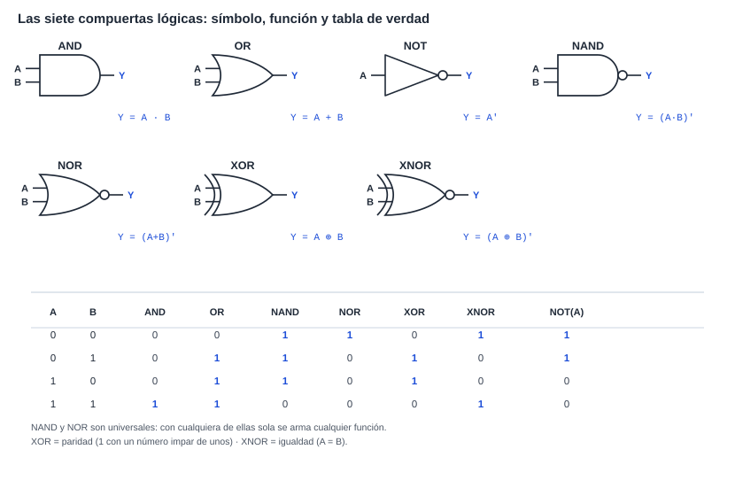
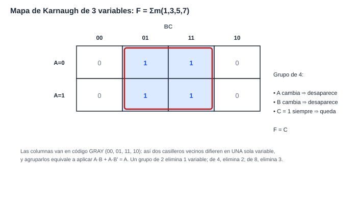

# 00 Síntesis — Unidad 1 (todo en un solo lugar)

> [!abstract] Qué es este archivo
> **Toda la Unidad 1 en una sola nota**: definiciones, tablas de verdad, funciones canónicas, reglas de Karnaugh, los cuatro bloques combinacionales y la aritmética, con los circuitos y las recetas de examen. Sirve para **repasar antes del final** y para **imprimir**: no necesita abrir ninguna otra nota. Detalle completo de cada punto, en los subtemas: [[00 Unidad 1 — temas y subtemas]].

## Contenido

1. [[#1. Las siete compuertas]] · 2. [[#2. Álgebra de Boole]] · 3. [[#3. DeMorgan]] · 4. [[#4. Formas canónicas]] · 5. [[#5. Mapa de Karnaugh]] · 6. [[#6. Los cuatro bloques combinacionales]] · 7. [[#7. Aritmética]] · 8. [[#8. Recetas de examen]] · 9. [[#9. Errores que cuestan puntos]] · 10. [[#10. Autoevaluación]]

---

## 1. Las siete compuertas

| Compuerta | Expresión | Frase | Tabla (A,B) |
|---|---|---|---|
| **AND** | `A·B` | "las dos" | 0,0,0,**1** |
| **OR** | `A+B` | "alguna" | 0,**1**,**1**,**1** |
| **NOT** | `A'` | "lo contrario" | A: 0→1, 1→0 |
| **NAND** | `(A·B)'` | "no las dos" | **1**,**1**,**1**,0 |
| **NOR** | `(A+B)'` | "ninguna" | **1**,0,0,0 |
| **XOR** | `A⊕B` | "distintas" | 0,**1**,**1**,0 |
| **XNOR** | `(A⊕B)'` | "iguales" | **1**,0,0,**1** |



**Universales:** con **NAND** o con **NOR** sola se arma cualquier función. `NOT = (A·A)'` · `AND = ((A·B)')'` · `OR = (A'·B')'` ⇒ una OR de 2 con NAND cuesta **3** compuertas.

---

## 2. Álgebra de Boole

| Postulado | Dual |
|---|---|
| `A+0 = A` | `A·1 = A` |
| `A+1 = 1` | `A·0 = 0` |
| `A+A = A` | `A·A = A` |
| `A+A' = 1` | `A·A' = 0` |
| `A+B = B+A` | `A·B = B·A` |
| `A+(B+C) = (A+B)+C` | `A·(B·C) = (A·B)·C` |
| `A+(B·C) = (A+B)·(A+C)` | `A·(B+C) = A·B + A·C` |

**Teoremas que más se usan:** absorción `A + A·B = A` · `A + A'B = A + B` · consenso `A·B + A'·C + B·C = A·B + A'·C` · involución `(A')' = A`.

**Dualidad:** cambiar `0↔1` y `·↔+` en una igualdad válida da otra igualdad válida (las variables **no** se niegan).

**Receta de simplificación:** 1) factor común → 2) complemento (`B+B'=1`) → 3) absorción → 4) DeMorgan. Se controla con la tabla de verdad o con Karnaugh.

---

## 3. DeMorgan

```
(A + B)' = A' · B'          (A · B)' = A' + B'
(A+B+C)' = A'·B'·C'         (A·B·C)' = A' + B' + C'
```
**Al negar: se invierte la operación y se niega cada término.** Ejemplos: `((A+B)·C)' = A'B' + C'` · `(A·B' + C)' = (A' + B)·C'` · `A·B + C·D = ((A·B)'·(C·D)')'` (todo NAND).

---

## 4. Formas canónicas

| | Mintérmino `m` | Maxtérmino `M` |
|---|---|---|
| Vale | **1** en una sola fila | **0** en una sola fila |
| Se escribe | producto (AND), bit 1 sin barra | suma (OR), bit 0 sin barra |
| Forma | `F = Σm(...)` = suma de productos | `F = ΠM(...)` = producto de sumas |

Tabla de los 8 mintérminos de 3 variables: `m0=A'B'C'` · `m1=A'B'C` · `m2=A'BC'` · `m3=A'BC` · `m4=AB'C'` · `m5=AB'C` · `m6=ABC'` · `m7=ABC`. (El índice es el número binario de la fila.)

Ejemplo: `F = Σm(1,3,5,7)` ⇒ `C` (porque las cuatro filas tienen C = 1).

---

## 5. Mapa de Karnaugh

**Construcción:** filas y columnas en **código Gray** (`00, 01, 11, 10`) ⇒ vecinos que difieren en **1 bit**, bordes incluidos. 3 variables: filas `A`, columnas `BC`. 4 variables: filas `AB`, columnas `CD`.



| Grupo | Variables que quedan | Ejemplo (3 var) |
|---|---|---|
| 8 | ninguna | `1` |
| 4 | 1 literal | `B'` |
| 2 | 2 literales | `A·C'` |
| 1 | 3 literales (mintérmino) | `A'·B·C` |

**Reglas:** sólo 1, 2, 4 u 8 casillas · rectángulos · se permite superponer · cubrir **todos** los 1 con la menor cantidad de grupos y los más grandes · los bordes y las esquinas son vecinos.

**Ejemplo completo:** `F = Σm(0,1,4,5,6)`

| A \ BC | 00 | 01 | 11 | 10 |
|---|---|---|---|---|
| 0 | **1** | **1** | 0 | 0 |
| 1 | **1** | **1** | 0 | **1** |

Grupo de 4 (columnas 00-01) ⇒ `B'`; grupo de 2 (`m4,m6`) ⇒ `A·C'` ⇒ **`F = B' + A·C'`**.

**Don't care (`X`):** combinaciones que no ocurren (p. ej. BCD 10-15). Se toman como 1 **sólo si agrandan** un grupo; nunca reemplazan la cobertura de un 1.

---

## 6. Los cuatro bloques combinacionales

| Bloque | Entradas | Salidas | Función | Compuertas | Se usa en |
|---|---|---|---|---|---|
| **Decodificador** `n→2ⁿ` | n de código | 2ⁿ (una activa) | `Yi = mi` | n NOT + 2ⁿ AND de n | elegir palabra de memoria, activar instrucción (1→16) |
| **Codificador** `2ⁿ→n` | 2ⁿ líneas | n bits | `A2 = E4+E5+E6+E7`… | sólo OR | teclado, prioridad de interrupciones |
| **Multiplexor** `2ⁿ→1` | 2ⁿ datos + n sel. | 1 | `Y = Σ mi·Ii` | n NOT + 2ⁿ AND de n+1 + 1 OR | bus único, ALU |
| **Demultiplexor** `1→2ⁿ` | 1 dato + n sel. | 2ⁿ | `Yi = D·mi` | n NOT + 2ⁿ AND de n+1 | escritura en memoria, repartir dato |

  

**Relaciones para no confundirse:** DEMUX con `D = 1` **es** un decodificador · MUX y DEMUX son inversos · el codificador es el inverso del decodificador.

---

## 7. Aritmética

**Semisumador** (2 bits, sin acarreo entrante): `S = A⊕B`, `C = A·B` → 2 compuertas.

**Sumador completo** (3 bits): `S = A⊕B⊕Cin`, `Cout = A·B + Cin·(A⊕B)` → 5 compuertas. Frase: `S` = "cantidad de unos impar"; `Cout` = "al menos dos unos".


**Sumador de n bits:** se encadenan los FA (`Cout` → `Cin` del siguiente). El retardo crece con `n` (*ripple carry*); se mejora con acarreo anticipado.

**Resta:** `A − B = A + B' + 1` ⇒ negar B con XOR y poner `Cin = 1`. Sumador/restador: `SUB = 0` suma, `SUB = 1` resta (4 XOR + `SUB` al `Cin`). Ejemplo `6 − 3`: `0110 + 1101 = (1)0011` ⇒ 3 (se descarta el acarreo final).

**Desbordamiento:** sin signo → `C4 = 1`. En complemento a 2 → `V = Cin_último ⊕ Cout_último` (dos del mismo signo que dan signo contrario).

---

## 7bis. Códigos binarios

| Código | Tipo | Regla | El 5 | El 9 |
|---|---|---|---|---|
| **Binario natural** | ponderado `8-4-2-1` | suma de pesos | `0101` | `1001` |
| **AIKEN** | ponderado `2-4-2-1` | pesos en otro orden | `1011` | `1111` |
| **Exceso 3** | **no** ponderado | binario puro **+ 3** | `1000` | `1100` |
| **BCD** | binario natural por dígito | 1 dígito = 4 bits | `0101` | `1001` |
| **Gray** | **continuo y cíclico** | cambia 1 bit por paso | `0111` (4 bits) | — |
| **Johnson** | continuo y cíclico | `2n` estados con `n` bits | `00111` (5 bits) | `10000` |

- **BCD empaquetado**: 2 dígitos por byte (`62` = `0110 0010`); desempaquetado: 1 por byte.

- **Por qué el exceso 3**: es autocomplementario (complemento a 9 = invertir bits) y no usa `0000`.

- **Por qué el Gray**: no hay transiciones intermedias falsas ⇒ se usa en codificadores y en el **orden de las filas del Karnaugh** (`00 01 11 10`).

- **Conversión binario → Gray**: `G = B ⊕ (B >> 1)`.

## 8. Recetas de examen

> [!important] Los cuatro movimientos de cualquier ejercicio de esta unidad
> 1. **Tabla de verdad** con todas las combinaciones (2ⁿ filas, ordenadas como dice el enunciado).
> 2. **Función canónica**: `Σm(...)` con los índices donde la salida es 1.
> 3. **Simplificación**: Karnaugh si lo piden (dibujado) o analítica por postulados.
> 4. **Circuito**: dibujar con compuertas, contando cuántas usa y de cuántas entradas.

| Si te piden… | Qué tenés que mostrar |
|---|---|
| "diseñe un circuito" | tabla + función + mapa + circuito (las cuatro cosas) |
| "simplifique" | pasos con el postulado aplicado en cada renglón |
| "implemente con NAND" | las tres equivalencias y el conteo de compuertas |
| "compare decodificador y DEMUX" | tabla de 6-6 con la relación `Yi = D·mi` |
| "sume/ reste en binario" | el algoritmo (`A+B' + 1`) y la verificación decimal |

---

## 9. Errores que cuestan puntos

- Confundir **OR con XOR** (con `1,1`: OR = 1, XOR = 0).

- Negar mal: `A+B'` no es `(A+B)'`; **falta el paréntesis**.

- Agrupar en **diagonal** en Karnaugh, o con 3/5/6 casillas.

- Olvidar los **bordes** del mapa (dejar un 1 solo cuando podía unirse con el otro extremo).

- Usar el **semisumador** en una columna del medio (ignora `Cin`).

- Restar negando **sin sumar 1** (eso es complemento a 1).

- Contar mal las compuertas del MUX/DEMUX (las AND llevan **selección + dato**).

- Tratar las **don't care** como 0 fijo.

---

## 10. Autoevaluación (con respuesta)

1. **`F = Σm(0,2,4,6)`** en 3 variables → *`C'`*.

2. **`(A·B + A·B')`** → *`A`*.

3. **`A + A'B`** → *`A + B`* (absorción 2).

4. **OR de 2 con NAND** → *3 compuertas*.

5. **Sumador completo con `A=1,B=0,Cin=1`** → *`S=0`, `Cout=1`*.

6. **`6 − 3` en 4 bits** → *`0110 + 1101 = 0011`*.

7. **Decodificador 3→8** → *3 NOT + 8 AND de 3*.

8. **DEMUX 1→4 con `D=0`** → *todas las salidas en 0*.

---

## Relacionado
[[00 Unidad 1 completa (lectura de corrido)]] · [[00 Unidad 1 — temas y subtemas]] · [[00 Tema 1.1 — índice]] · [[00 Tema 1.2 — índice]] · [[00 Tema 1.3 — índice]] · [[00 Tema 1.4 — índice]] · [[00 Tema 1.5 — índice]] · [[00 Tanda 3 — índice]] · [[00 Índice de la materia (las 10 unidades)]]
