# Unidad 1 — Circuitos de lógica digital

> [!abstract] Qué es este archivo
> **La Unidad 1 completa en un solo archivo**: los **17 subtemas** pegados uno detrás de otro,
> con todo su contenido: definiciones, tablas, diagramas, ejemplos resueltos, figuras del libro y errores
> típicos. Son **11.444 palabras** y **6 temas**. Está pensado para **leer de corrido** y para
> **imprimir**: no hace falta abrir ninguna otra nota.
>
> - **Repaso rápido** (una página): [[00 Síntesis — Unidad 1]].
> - **Buscar un punto**: el índice de abajo o el de la unidad, [[00 Unidad 1 — temas y subtemas]].
> - Cada subtema conserva su número (`1.4.1`), así coincide con el índice y con las preguntas del final.
> - **Todo junto, las 10 unidades**: [[00 Materia completa (las 10 unidades en un archivo)]].

## Contenido

**1.1 Compuertas lógicas**
- [[#1.1.1 Compuerta AND, OR y NOT]]
- [[#1.1.2 NAND, NOR, XOR y XNOR]]
- [[#1.1.3 Compuertas universales]]

**1.2 Álgebra de Boole**
- [[#1.2.1 Postulados, dualidad y teoremas]]
- [[#1.2.2 Leyes de DeMorgan]]
- [[#1.2.3 Simplificación analítica]]

**1.3 Formas canónicas y Karnaugh**
- [[#1.3.1 Mintérminos y maxtérminos]]
- [[#1.3.2 Mapa de Karnaugh de 2, 3 y 4 variables]]
- [[#1.3.3 Don't care y criterios de agrupación]]

**1.4 Bloques combinacionales**
- [[#1.4.1 Decodificador]]
- [[#1.4.2 Codificador]]
- [[#1.4.3 Multiplexor]]
- [[#1.4.4 Demultiplexor]]

**1.5 Aritmética combinacional**
- [[#1.5.1 Semisumador y sumador completo]]
- [[#1.5.2 Sumador de n bits y resta en complemento a 2]]

**1.6 Códigos binarios**
- [[#1.6.1 Códigos ponderados y no ponderados]]
- [[#1.6.2 Códigos continuos y cíclicos]]

---

## 1.1 Compuertas lógicas

### 1.1.1 Compuerta AND, OR y NOT

> [!abstract] En una frase
> **AND** da 1 sólo si **todas** sus entradas son 1 · **OR** da 1 si **alguna** entrada es 1 · **NOT** da lo
> **contrario** de su única entrada.

> [!note] Si es la primera vez que ves esto
> Pensá en **dos llaves de agua en serie** (para que salga agua tienen que estar las dos abiertas: eso es AND) y en
> **dos llaves en paralelo** (basta con que una esté abierta: eso es OR). El **NOT** es una llave que está cerrada
> cuando la otra está abierta: es el interruptor del tipo "conmutador". Una compuerta no es más que eso: un
> dispositivo de dos estados que **decide** en función de sus entradas.

#### Tabla de verdad

| A | B | A·B (AND) | A+B (OR) | A' (NOT) |
|---|---|---|---|---|
| 0 | 0 | 0 | 0 | 1 |
| 0 | 1 | 0 | 1 | 0 |
| 1 | 0 | 0 | 1 | — |
| 1 | 1 | **1** | **1** | — |

**Convenciones que hay que respetar siempre:** el producto lógico se escribe `A·B`, `AB` o `A AND B`; la suma
`A+B`; la negación `A'`, `Ā` o `¬A`. En la cátedra se usa la barra o el apóstrofo; **elegí uno y no los mezcles**
en el mismo renglón.

#### Símbolo, expresión y circuito

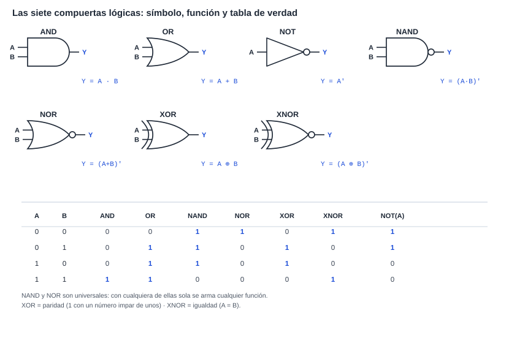

| Compuerta | Expresión | Forma |
|---|---|---|
| AND | `Y = A·B` | D de lados rectos |
| OR | `Y = A+B` | D de atrás curvo |
| NOT | `Y = A'` | triángulo con burbuja |

#### Para qué se usa en la materia
Son la base de **todo**: el decodificador es un AND por cada combinación, el codificador son OR, el MUX son
AND + OR, y la ALU empieza por acá. En la máquina BLUE, la señal de control que habilita una escritura
(`LDA·CP8·E`) es literalmente un **AND de tres entradas** con los estados y los pulsos.

#### Ejemplo (estilo TP1)
Con `A = 1`, `B = 0`:

- `A·B = 0` (falta una)
- `A+B = 1` (alcanza con A)
- `A' = 0`, `B' = 1`

Y con `A = B = 1`: `A·B = 1`, `A+B = 1`, `A' = 0`.

> [!warning] Errores típicos
> - **Confundir OR con XOR.** Con `A = B = 1`, OR da **1** y XOR da **0**.
> - Escribir `A + A = 2A`: en Boole `A + A = A` (idempotencia).
> - Olvidar la barra: `A+B'` no es `(A+B)'`. La negación de una suma **necesita paréntesis**.

#### Figura del libro

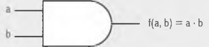

*Fig. 5.2 — Compuerta AND.* · Quiroga, *Arquitectura de computadoras*, p. 119.

#### Relacionado
[[1.1.2 NAND, NOR, XOR y XNOR]] · [[1.1.3 Compuertas universales]] · [[00 Tema 1.1 — índice]] ·
[[Compuertas lógicas]] · [[Tablas de verdad de memoria]] · [[Glosario — Unidad 1]]

### 1.1.2 NAND, NOR, XOR y XNOR

> [!abstract] En una frase
> **NAND** = AND negada (da 0 sólo con dos 1) · **NOR** = OR negada (da 1 sólo con dos 0) · **XOR** = "son
> distintas" · **XNOR** = "son iguales".

> [!note] Si es la primera vez que ves esto
> Las tres compuertas anteriores (AND, OR, NOT) son las "letras". Estas cuatro son las que **aparecen en el
> taller**: NAND y NOR porque son las únicas que se fabrican barato y con ellas se arma todo; XOR porque es la
> compuerta que **compara** dos bits, y de ahí sale el sumador.

#### Los cuatro símbolos, con su tabla

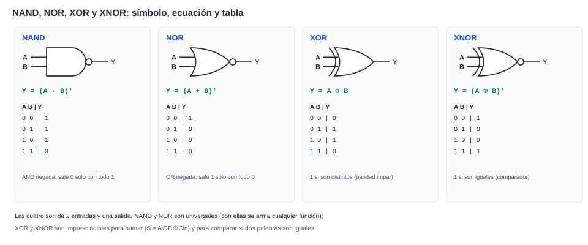

#### Tabla de verdad

| A | B | NAND `(A·B)'` | NOR `(A+B)'` | XOR `A⊕B` | XNOR `(A⊕B)'` |
|---|---|---|---|---|---|
| 0 | 0 | 1 | **1** | 0 | 1 |
| 0 | 1 | 1 | 0 | **1** | 0 |
| 1 | 0 | 1 | 0 | **1** | 0 |
| 1 | 1 | **0** | 0 | 0 | **1** |

**Cómo leerla sin memorizar:** NAND es la **única** que da 0 en la última fila; NOR es la **única** que da 1 en
la primera; XOR tiene 1 donde las entradas **difieren**.

#### Expresiones equivalentes
- `A ⊕ B = A'B + AB'` (suma de mintérminos 1 y 2)
- `A ⊕ B = (A + B) · (A·B)'` (forma útil para dibujar con NAND)
- `(A ⊕ B)' = A'B' + AB` (XNOR, detector de igualdad)

#### Para qué sirve cada una en la materia

| Compuerta | Dónde aparece |
|---|---|
| **NAND / NOR** | son **universales**: con una sola de ellas se arma cualquier circuito ([[1.1.3 Compuertas universales]]) |
| **XOR** | el **semisumador** (`S = A⊕B`), la suma binaria sin acarreo, la paridad |
| **XNOR** | comparadores de igualdad (¿A = B?) y el detector de "cero" |

#### Ejemplo (estilo TP1)
Con `A = 1`, `B = 1`: `NAND = 0`, `NOR = 0`, `XOR = 0`, `XNOR = 1`.
Con `A = 1`, `B = 0`: `NAND = 1`, `NOR = 0`, `XOR = 1`, `XNOR = 0`.

> [!warning] Errores típicos
> - Decir que "NAND es lo mismo que NOR negada". No: la negación de NOR es **OR** (`(A+B)'' = A+B`).
> - Usar XOR como OR en una simplificación: `A + A'B` **no** es `A ⊕ B`.
> - Dibujar la burbuja de NAND **antes** de la compuerta en vez de en la salida.

#### Figura del libro

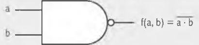

*Fig. 5.6 — Compuerta NAND.* · Quiroga, *Arquitectura de computadoras*, p. 121.

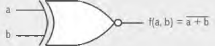

*Fig. 5.7 — Compuerta ÑOR.* · Quiroga, *Arquitectura de computadoras*, p. 121.

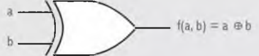

*Fig. 5.4 — Compuerta XOR.* · Quiroga, *Arquitectura de computadoras*, p. 120.

#### Relacionado
[[1.1.1 Compuerta AND, OR y NOT]] · [[1.1.3 Compuertas universales]] · [[Semisumador]] ·
[[Compuertas lógicas]] · [[Tablas de verdad de memoria]] · [[Glosario — Unidad 1]]

### 1.1.3 Compuertas universales

> [!abstract] En una frase
> **NAND y NOR son universales**: con cualquiera de las dos, repetida las veces que haga falta, se puede construir
> **cualquier** función lógica (incluidas NOT, AND, OR y un sumador completo).

> [!note] Si es la primera vez que ves esto
> En una fábrica de chips conviene **producir un solo tipo de ladrillo** y armar todo con él: sale más barato y más
> rápido. La NAND (y la NOR) tienen esa propiedad: son el "ladrillo único" de la electrónica digital. Por eso los
> circuitos reales de la materia se dibujan a veces sólo con NAND.

#### Todo con NAND

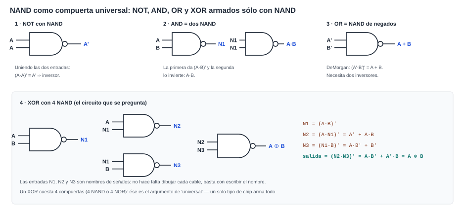

#### Las tres equivalencias que hay que saber

| Función | Con NAND | Con NOR |
|---|---|---|
| **NOT** `A'` | `(A·A)' = A'` → unir las dos entradas | `(A+A)' = A'` |
| **AND** `A·B` | `((A·B)')' = A·B` → NAND + NOT | `(A' + B')' = A·B` → NOR con entradas negadas |
| **OR** `A+B` | `(A'·B')' = A+B` → NAND con entradas negadas | `((A+B)')' = A+B` → NOR + NOT |

> [!important] La cuenta que se pregunta
> Una **OR de 2 entradas con NAND** cuesta **3 compuertas** (dos NAND como inversores + una NAND final).
> Una **AND con NAND** cuesta **2** (la NAND y un inversor). De ahí sale el "costo en compuertas" que pide el TP.

#### Por qué funciona (la razón algebraica)
Todo se apoya en **DeMorgan**: `(A·B)' = A' + B'` y `(A+B)' = A'·B'`. Como la NAND ya entrega la negación del
producto, negando otra vez (con otra NAND usada como inversor) se recupera el producto, y negando las entradas se
convierte el producto en suma.

#### Ejemplo: `Y = A·B + C` sólo con NAND

La clave es reescribir la suma como producto de negaciones (**DeMorgan**):
`A·B + C = ((A·B)' · C')'`.

1. `N1 = (A·B)'` → una NAND con A y B.
2. `N2 = (C·C)' = C'` → una NAND con C en las dos entradas (sirve de inversor).
3. `Y = (N1 · N2)'` → una NAND final.

**Total: 3 compuertas NAND.** El circuito se dibuja de izquierda a derecha en el orden N1, N2 y la final.

> [!warning] Errores típicos
> - Poner una sola burbuja y creer que ya negó "todo".
> - Contar mal el costo: el inversor hecho con NAND **es** una compuerta.
> - Olvidar que NOR también es universal (se pregunta "¿cuáles son universales?" → **las dos**, NAND y NOR).

#### Figura del libro

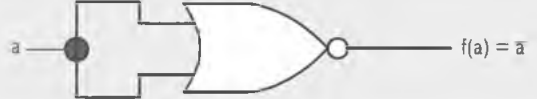

*Fig. 5.10 — I mplementación de la negación con compuertas negadas.* · Quiroga, *Arquitectura de computadoras*, p. 123.

#### Escalas de integración: SSI, MSI, LSI y VLSI

Las compuertas no se compran sueltas: vienen dentro de un **circuito integrado (chip)**. Según **cuántas compuertas
entran en un chip** se habla de escalas de integración — es la clasificación que usa la cátedra y aparece en el
parcial como definición corta.

| Escala | Nombre | Compuertas por chip | Ejemplo típico |
|---|---|---|---|
| **SSI** | *Small Scale Integration* | hasta **10** | una 7400 (4 compuertas NAND de 2 entradas) |
| **MSI** | *Medium Scale Integration* | de **10 a 100** | decodificador 74138, multiplexor 74151, sumador 7483 |
| **LSI** | *Large Scale Integration* | de **100 a 1000** | una memoria pequeña, un contador completo |
| **VLSI** | *Very Large Scale Integration* | **más de 1000** | un microprocesador, una FPGA, un chip de RAM |

> [!important] Cómo se usa esto en la materia
> Cuando el enunciado dice *"implemente con MSI"*, está pidiendo **usar un bloque ya hecho** (decodificador, MUX,
> sumador) en vez de dibujar la función con compuertas SSI. Es la diferencia entre la solución "larga" y la solución
> "de una línea" que se espera en el final. Los bloques MSI se estudian en el tema 1.4.


#### Relacionado
[[1.1.2 NAND, NOR, XOR y XNOR]] · [[1.2.2 Leyes de DeMorgan]] · [[00 Tema 1.1 — índice]] ·
[[TP1 Compuertas lógicas]] · [[Compuertas lógicas]] · [[Glosario — Unidad 1]]

## 1.2 Álgebra de Boole

### 1.2.1 Postulados, dualidad y teoremas

> [!abstract] En una frase
> El álgebra de Boole es un sistema con **dos valores (0 y 1)** y **tres operaciones (·, +, ')**, donde todo vale
> por **dualidad**: si una igualdad es cierta, también lo es la que se obtiene cambiando 0↔1 y ·↔+.

> [!note] Si es la primera vez que ves esto
> Es el "álgebra de las llaves": en vez de números, trabajamos con interruptores abiertos (0) y cerrados (1). Las
> reglas parecen raras porque la suma no es la suma (`1+1 = 1`: si hay dos llaves en paralelo y una ya está
> abierta, el agua pasa igual). Una vez que aceptás eso, el resto es aplicar reglas como en álgebra común.

#### Dualidad, identidad por identidad

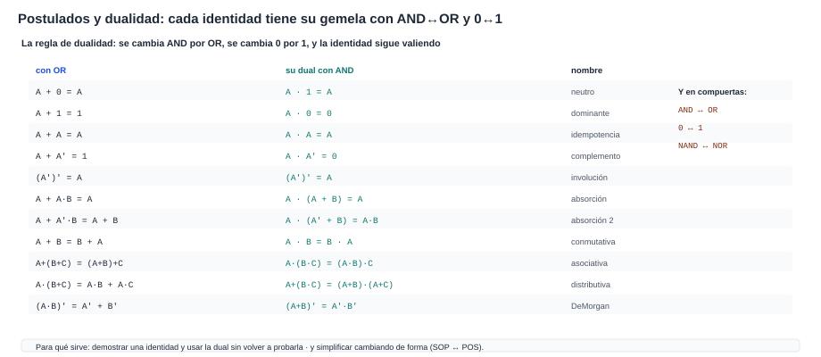

#### Los postulados (los que siempre se pueden usar)

| # | Postulado | Dual |
|---|---|---|
| 1 | `A + 0 = A` | `A · 1 = A` |
| 2 | `A + 1 = 1` | `A · 0 = 0` |
| 3 | `A + A = A` | `A · A = A` |
| 4 | `A + A' = 1` | `A · A' = 0` |
| 5 | Conmutativa: `A+B = B+A` | `A·B = B·A` |
| 6 | Asociativa: `A+(B+C) = (A+B)+C` | `A·(B·C) = (A·B)·C` |
| 7 | Distributiva: `A+(B·C) = (A+B)·(A+C)` | `A·(B+C) = A·B + A·C` |

> [!important] La distributiva "rara"
> En Boole **suma distribuye sobre producto** (`A + B·C = (A+B)(A+C)`), cosa que en álgebra común no pasa. Es la
> que más se olvida y la que más se necesita.

#### Teoremas útiles (se deducen de los postulados)

| Teorema | Forma | Dual |
|---|---|---|
| Absorción | `A + A·B = A` | `A · (A+B) = A` |
| Absorción 2 | `A + A'·B = A + B` | `A · (A'+B) = A·B` |
| Consenso | `A·B + A'·C + B·C = A·B + A'·C` | `(A+B)(A'+C)(B+C) = (A+B)(A'+C)` |
| Involución | `(A')' = A` | — |
| Idempotencia | `A + A = A` | `A · A = A` |

#### Dualidad: cómo se usa
Se toma una igualdad **válida** y se la "da vuelta": `0→1`, `1→0`, `·→+`, `+→·`. Por ejemplo, de
`A + A·B = A` sale `A·(A+B) = A`. **Las variables no se tocan** (no se niegan) y la igualdad se mantiene.

#### Ejemplo resuelto
Simplificar `Y = A·B + A·B'`.

1. Saco **factor común** A (distributiva al revés): `Y = A·(B + B')`.
2. Postulado 4: `B + B' = 1`.
3. Postulado 1: `Y = A·1 = A`.

Otro: `Y = A + A'·B` → por absorción 2, `Y = A + B`. (Sin el teorema, se hace `(A+A')(A+B) = 1·(A+B) = A+B`.)

> [!warning] Errores típicos
> - Aplicar la distributiva como en álgebra común y escribir `A·(B+C) = A·B + C` (falta `A·C`).
> - "Pasar términos al otro lado" restando: en Boole **no hay resta**; sólo se factoriza y se usan postulados.
> - Negar en la dualidad: la dual de `A+A'=1` es `A·A'=0`, **sin** cambiar las variables.

#### Figura del libro

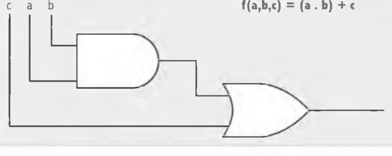

*Fig. 5.12 — Diagrama de lógica.* · Quiroga, *Arquitectura de computadoras*, p. 123.

> [!tip] Qué mirar
> Con un AND y un OR ya se escribe cualquier función como suma de productos. Los postulados son las reglas que permiten pasar de la expresión `f = (a·b) + c` al dibujo, y la dualidad dice que cada una vale igual cambiando AND por OR.

#### Relacionado
[[1.2.2 Leyes de DeMorgan]] · [[1.2.3 Simplificación analítica]] · [[00 Tema 1.2 — índice]] ·
[[TP2 Álgebra de Boole]] · [[Álgebra de Boole — postulados y teoremas]] · [[Glosario — Unidad 1]]

### 1.2.2 Leyes de DeMorgan

> [!abstract] En una frase
> `(A + B)' = A' · B'` y `(A · B)' = A' + B'`: al negar **se invierte la operación y se niega cada término**.

> [!note] Si es la primera vez que ves esto
> Necesitás "meter la barra para adentro". La regla es la de una puerta de dos hojas: si **no** entra por ninguna
> (NOR), es lo mismo que decir que **las dos** están cerradas (AND de negaciones). DeMorgan es la herramienta para
> convertir un circuito a **NAND/NOR** y para negar una función entera sin equivocarse.

#### DeMorgan, dibujado

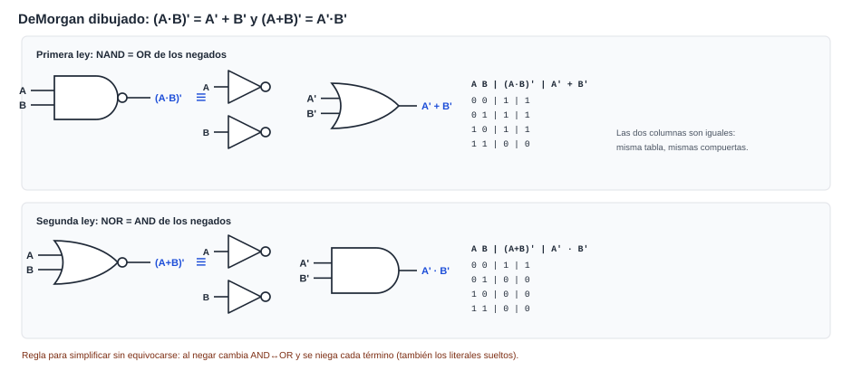

#### Las dos leyes y su generalización

| Forma | Ley |
|---|---|
| **NOR** | `(A + B)' = A' · B'` |
| **NAND** | `(A · B)' = A' + B'` |
| General | `(A + B + C + …)' = A'·B'·C'·…` · `(A·B·C·…)' = A' + B' + C' + …` |

#### Demostración por tabla de verdad (la que se pide)

| A | B | A+B | **(A+B)'** | A' | B' | **A'·B'** |
|---|---|---|---|---|---|---|
| 0 | 0 | 0 | **1** | 1 | 1 | **1** |
| 0 | 1 | 1 | **0** | 1 | 0 | **0** |
| 1 | 0 | 1 | **0** | 0 | 1 | **0** |
| 1 | 1 | 1 | **0** | 0 | 0 | **0** |

Las dos columnas en negrita son idénticas ⇒ la igualdad vale para las 4 combinaciones.

#### Cómo se aplica (receta de 3 pasos)
1. **Invertir la operación** principal (`+` ↔ `·`).
2. **Negar cada término** (si ya estaba negado, se desniega: `(A')' = A`).
3. Repetir si quedan barras que abarcan más de una variable.

**Ejemplo 1:** `Y = ((A + B) · C)'` → `Y = (A + B)' + C' = A'B' + C'`.
**Ejemplo 2:** `Y = (A·B' + C)'` → `Y = (A·B')' · C' = (A' + B) · C'`.
**Ejemplo 3 (todo a NAND):** `Y = A·B + C·D` → `Y = ((A·B)' · (C·D)')'`: dos NAND y una NAND final.

#### Dónde aparece en la materia
- **Compuertas universales:** es la justificación de que NAND y NOR alcancen para todo.
- **Karnaugh con ceros:** cuando conviene simplificar los **0** de la tabla, se aplica DeMorgan al resultado para
  volver a la función positiva.
- **Unidad de control:** las señales activas por nivel bajo (con burbuja) se describen con DeMorgan.

> [!warning] Errores típicos
> - Negar sólo la primera variable: `(A+B)' = A' + B'` ✗ (es `A'·B'`).
> - Olvidar cambiar `·` por `+`.
> - Sacar la barra sin negar nada: `(A+B)' = A+B` ✗.

> [!example] DeMorgan, con números
> `Y = (A·B)'`: si `A = 1, B = 0` ⇒ `(1·0)' = 1`. Por el otro lado `A' + B' = 0 + 1 = 1` ✓. Y con `A = B = 1`:
> `(1·1)' = 0` y `A' + B' = 0 + 0 = 0` ✓. Las dos expresiones dan **lo mismo en las 4 filas**: son equivalentes.

#### Figura del libro

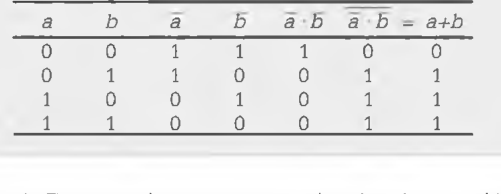

*Fig. 5.8 — Teorema de De Morgan aplicado a la suma lógica.* · Quiroga, *Arquitectura de computadoras*, p. 122.

> [!tip] Qué mirar
> Comparar las columnas: `a + b` y `ā · b̄` dan lo mismo en las cuatro filas. NAND es un OR negado: por eso `a NAND b = ā + b̄`.

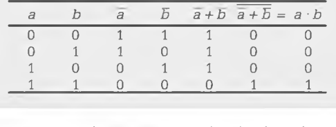

*Fig. 5.9 — Teorema de De Morgan aplicado al producto lógico.* · Quiroga, *Arquitectura de computadoras*, p. 122.

> [!tip] Qué mirar
> La otra mitad: `a · b` y `ā + b̄` son iguales. Con las dos tablas se pasa de AND-OR a NAND-NAND sin cambiar la función.

#### Relacionado
[[1.2.1 Postulados, dualidad y teoremas]] · [[1.2.3 Simplificación analítica]] ·
[[1.1.3 Compuertas universales]] · [[TP2 Álgebra de Boole]] · [[Leyes de DeMorgan]] · [[Glosario — Unidad 1]]

### 1.2.3 Simplificación analítica

> [!abstract] En una frase
> Simplificar a mano es **aplicar postulados en un orden fijo**: factor común → absorción → complemento →
> DeMorgan, hasta que no quede nada que sacar. El objetivo es **menos términos y menos literales**.

> [!note] Si es la primera vez que ves esto
> Es como reducir una fracción: no hay una única forma de hacerlo, pero hay **movimientos** que siempre acercan
> al resultado. Acá hay cuatro. Si te trabás con uno, probá el siguiente; nunca "adivines" el resultado.

#### Simplificar es sacar compuertas

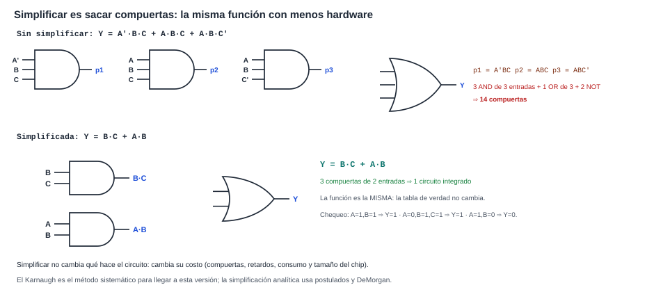

#### Los cuatro movimientos (en este orden)

| Paso | Qué hago | Herramienta |
|---|---|---|
| 1 | **Factor común** | `A·B + A·B' = A·(B+B')` |
| 2 | **Complemento** | `B + B' = 1`, `A·A' = 0` |
| 3 | **Absorción** | `A + A·B = A` · `A + A'B = A + B` |
| 4 | **DeMorgan** | para entrar o salir de una barra grande |

> [!tip] Regla de oro
> Antes de empezar, **contá** términos y literales. Si después de un paso no bajó ninguno, ese paso no sirvió:
> volvé atrás y probá otro movimiento.

#### Ejemplo 1 (típico del TP3)
`Y = A'BC' + A'BC + AB'C + ABC`

1. Factor común en los dos primeros y en los dos últimos:
   `A'B(C' + C) + AC(B' + B)`.
2. Complemento: `C' + C = 1` y `B' + B = 1` ⇒ `A'B·1 + AC·1`.
3. Postulado 1: **`Y = A'B + AC`**.

Pasó de 4 términos de 3 literales (12 literales) a 2 términos de 2 (4 literales).

#### Ejemplo 2 (con absorción)
`Y = A + A'B + AB`

1. `A + AB = A` (absorción) ⇒ queda `A + A'B`.
2. Absorción 2: `A + A'B = A + B`.

**`Y = A + B`**, de 3 términos a 2 literales.

#### Ejemplo 3 (con DeMorgan primero)
`Y = ((A + B)·(A + C))'`

1. DeMorgan: `(A+B)' + (A+C)'`.
2. DeMorgan otra vez: `A'B' + A'C'`.
3. Factor común: `A'(B' + C')`.
4. DeMorgan al revés (opcional): **`A'·(B·C)'`**.

#### Cómo se controla el resultado
Dos formas, ambas válidas para entregar:
1. **Tabla de verdad** de la función original y de la simplificada: deben coincidir en las 8 (o 16) filas.
2. **Karnaugh**: el mapa tiene que dar el mismo grupo (ver [[1.3.2 Mapa de Karnaugh de 2, 3 y 4 variables]]).

> [!warning] Errores típicos
> - Cancelar términos que no son complementarios: `A·B + A·C ≠ A·(B+C)` **sí** es válido, pero
>   `A·B + A'·C ≠ B + C` (ésta sólo se reduce con consenso).
> - Perder un término al factorizar: si sacás `A` de tres términos, los tres tienen que quedar adentro del paréntesis.
> - Entregar sin verificar: un solo error de barra invierte media tabla.

#### Figura del libro

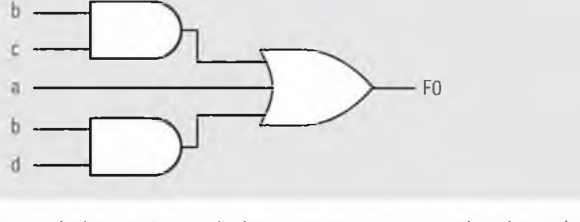

*Fig. 6.8 — Diagrama de lógica (parcial) de un circuito convertidor de código.* · Quiroga, *Arquitectura de computadoras*, p. 142.

> [!tip] Qué mirar
> Es el resultado de simplificar analíticamente las salidas de la tabla de verdad: cada salida queda como suma de productos con pocos términos, en vez de un AND por cada 1 de la tabla.

#### Relacionado
[[1.2.1 Postulados, dualidad y teoremas]] · [[1.2.2 Leyes de DeMorgan]] ·
[[1.3.2 Mapa de Karnaugh de 2, 3 y 4 variables]] · [[TP3 Simplificación analítica]] · [[Autoevaluación]] · [[Glosario — Unidad 1]]

## 1.3 Formas canónicas y Karnaugh

### 1.3.1 Mintérminos y maxtérminos

> [!abstract] En una frase
> Un **mintérmino** es un término que vale **1 en una sola fila** de la tabla (producto de todas las variables); un
> **maxtérmino** vale **0 en una sola fila** (suma de todas las variables). La función es la **suma de los
> mintérminos donde vale 1**.

> [!note] Si es la primera vez que ves esto
> La tabla de verdad dice *qué* queremos; el mintérmino es **la forma de escribirlo con compuertas**. Si la salida
> vale 1 en la fila `A=1, B=0, C=1`, ese caso se escribe `A·B'·C`, y la función es la suma (OR) de todos esos
> casos. "Canónica" quiere decir: **un término por cada 1 de la tabla**, sin agrupar todavía.

#### De la tabla al circuito

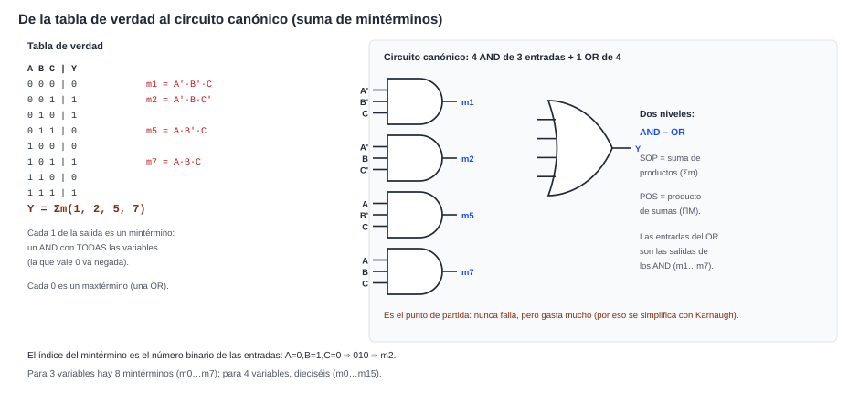

#### La tabla de los 8 mintérminos (3 variables)

| A B C | Mintérmino `m` | Expresión | Maxtérmino `M` | Expresión |
|---|---|---|---|---|
| 0 0 0 | m0 | `A'B'C'` | M0 | `A+B+C` |
| 0 0 1 | m1 | `A'B'C` | M1 | `A+B+C'` |
| 0 1 0 | m2 | `A'BC'` | M2 | `A+B'+C` |
| 0 1 1 | m3 | `A'BC` | M3 | `A+B'+C'` |
| 1 0 0 | m4 | `AB'C'` | M4 | `A'+B+C` |
| 1 0 1 | m5 | `AB'C` | M5 | `A'+B+C'` |
| 1 1 0 | m6 | `ABC'` | M6 | `A'+B'+C` |
| 1 1 1 | m7 | `ABC` | M7 | `A'+B'+C'` |

**Regla mnemotécnica:** en el mintérmino, el bit **1** va sin barra y el **0** con barra. En el maxtérmino es al
revés, y se unen con `+`.

#### Las dos formas canónicas
- **Primera forma (SOP, suma de productos):** `F = Σm(1, 3, 5, 7)` = `A'B'C + A'BC + AB'C + ABC`.
- **Segunda forma (POS, producto de sumas):** `F = ΠM(0, 2, 4, 6)` = `(A+B+C)(A+B'+C)(A'+B+C)(A'+B'+C)`.

Las dos describen **la misma** función; se elige la que tenga menos términos. Y valen las relaciones:
`Σm` de F = complemento de `Σm` de F' · `ΠM` es el complemento de `Σm` con los índices que faltan.

#### Ejemplo completo
`F(A,B,C)` vale 1 en las filas 1, 3, 5 y 7 (las combinaciones con C = 1).

1. `F = Σm(1,3,5,7) = A'B'C + A'BC + AB'C + ABC`.
2. Factor común `C`: `C·(A'B' + A'B + AB' + AB)`.
3. El paréntesis es 1 para todas las combinaciones de A y B ⇒ **`F = C`**.

Ésa es la función mínima: un solo cable. La tarjeta del TP4 pide justamente esto: ver que 4 mintérminos pueden
colapsar en un literal.

> [!warning] Errores típicos
> - **Ordenar mal las variables** y con eso cambiar todos los índices: fijate siempre si el enunciado ordena
>   `ABC` o `CBA`.
> - Confundir `m` con `M`: `Σm` es suma de productos; `ΠM` es producto de sumas.
> - Poner un término por cada **0** cuando la consigna pide `Σm`.

#### Figura del libro

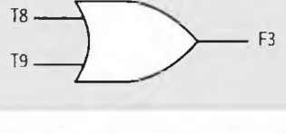

*Fig. 6.11 — Diagrama de lógica correspondiente a F3.* · Quiroga, *Arquitectura de computadoras*, p. 143.

> [!tip] Qué mirar
> `F3 = T8 + T9`: cada **mintérmino** es un AND con **todas** las variables (negadas o no) y la función es el OR de los mintérminos donde vale 1. Tantos productos parciales como unos tenga la tabla.

#### Relacionado
[[1.3.2 Mapa de Karnaugh de 2, 3 y 4 variables]] · [[1.3.3 Don't care y criterios de agrupación]] ·
[[1.2.3 Simplificación analítica]] · [[TP4 Mintérminos, maxtérminos y Karnaugh]] · [[Mintérminos y maxtérminos]] · [[Glosario — Unidad 1]]

### 1.3.2 Mapa de Karnaugh de 2, 3 y 4 variables

> [!abstract] En una frase
> El mapa de Karnaugh es la tabla de verdad **dibujada en grilla con código Gray**, de modo que dos casillas
> vecinas (incluso por los bordes) difieren en **una sola variable**: agrupando 1, 2, 4 u 8 unos vecinos, esa
> variable **se cancela** y queda la función mínima.

> [!note] Si es la primera vez que ves esto
> Es un juego de **encerrar unos con rectángulos**. Cada rectángulo elimina las variables que cambian dentro de él.
> Cuanto más grande el rectángulo, menos literales quedan en el término: 8 unos en un solo grupo ⇒ el término es
> un **solo cable**; 2 unos ⇒ quedan 2 literales.

#### Cómo se construye (3 variables)

- Filas: `A` (0, 1). Columnas: `BC` en **Gray**: `00, 01, 11, 10`.
- Se copia cada salida de la tabla en su casilla.
- **Vecinos:** casillas que comparten un lado; los bordes **también son vecinos** (el mapa es un cilindro).

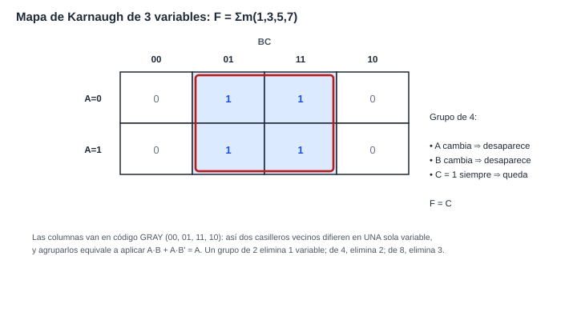

#### Reglas de agrupación (las 5 que se piden)
1. Los grupos sólo pueden tener **1, 2, 4, 8** casillas (potencias de 2).
2. Los grupos son **rectángulos** (en 4 variables también valen las esquinas y las "envolturas" por los bordes).
3. Se puede **superponer** grupos: un 1 puede usarse en dos grupos si con eso otro grupo crece.
4. Hay que cubrir **todos** los 1 con la menor cantidad de grupos y los más grandes posible.
5. Un grupo de 1 solo es válido, pero es el último recurso (deja todas las variables).

#### Qué término sale de cada grupo

| Tamaño del grupo | Variables que quedan (de 3) |
|---|---|
| 8 | ninguna → término = **1** |
| 4 | 1 literal (la que **no** cambia) |
| 2 | 2 literales |
| 1 | 3 literales (el mintérmino completo) |

#### Ejemplo resuelto (3 variables)
`F = Σm(0, 1, 4, 5, 6)`, es decir 1 en `m0, m1, m4, m5, m6` y 0 en `m2, m3, m7`.

| A \ BC | 00 | 01 | 11 | 10 |
|---|---|---|---|---|
| **0** | **1** (m0) | **1** (m1) | 0 (m3) | 0 (m2) |
| **1** | **1** (m4) | **1** (m5) | 0 (m7) | **1** (m6) |

1. **Grupo de 4:** las dos columnas `00` y `01` en las dos filas. Dentro del grupo cambian A y cambia C; lo único
   que se mantiene es **B = 0** ⇒ término **`B'`**.
2. **Grupo de 2:** `m4` (`100`) y `m6` (`110`) son vecinos (las columnas `00` y `10` son vecinas por el borde).
   Dentro del grupo cambia B; se mantienen `A = 1` y `C = 0` ⇒ término **`A·C'`**.
   (Se puede superponer con el grupo anterior: eso está permitido y no cuesta nada.)
3. **`F = B' + A·C'`** — dos términos y tres literales, contra cinco mintérminos de tres literales.

**Verificación rápida:** `m2` (`010`) → `B'` es 0 porque B = 1, y `A·C'` es 0 porque A = 0 ⇒ F = 0 ✓.
`m6` (`110`) → `B'` = 0, `A·C'` = 1·1 = 1 ⇒ F = 1 ✓.

> [!tip] Atajo para verificar
> Reemplazá el resultado en dos filas al azar (por ejemplo `m0` y `m5`) y comprobá que coincide con la tabla. Si
> falla una, el grupo está mal leído (casi siempre por confundir qué variable se mantiene).

#### Cuatro variables
Filas `AB` en Gray (`00, 01, 11, 10`), columnas `CD` también en Gray. Aparecen dos vecindades especiales: las
**cuatro esquinas** (`m0, m2, m8, m10`) forman un grupo válido de 4, y las columnas/ filas de los extremos son
vecinas.

> [!warning] Errores típicos
> - Agrupar en **diagonal**: no vale.
> - Usar grupos de 3, 5 o 6 casillas: no valen.
> - Olvidar los bordes (dejar un 1 sin agrupar cuando podía unirse con el otro extremo).
> - Leer el término mirando la casilla en vez de la **zona**: se cancela lo que cambia dentro del grupo.

#### Figura del libro

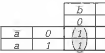

*Mapa de Karnaugh de 2 variables: dos casillas vecinas difieren en una sola variable, así que se agrupan (Quiroga, ejemplo 5.10.1).* · Quiroga, *Arquitectura de computadoras*, p. 133.

> [!tip] Qué mirar
> Cada casilla es un mintérmino. Los dos 1 son adyacentes, se agrupan y la variable que cambia (`b`) desaparece: la función queda en una sola variable.

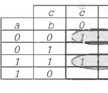

*Mapa de Karnaugh de 3 variables: las columnas van en orden Gray (00, 01, 11, 10) para que dos casillas contiguas nunca cambien en más de un bit.* · Quiroga, *Arquitectura de computadoras*, p. 133.

> [!tip] Qué mirar
> El grupo horizontal es superior y el vertical es inferior; en el de 3 variables los bordes también son vecinos. Cada grupo elimina las variables que cambian dentro del grupo.

#### Relacionado
[[1.3.1 Mintérminos y maxtérminos]] · [[1.3.3 Don't care y criterios de agrupación]] ·
[[1.2.3 Simplificación analítica]] · [[TP4 Mintérminos, maxtérminos y Karnaugh]] · [[Mintérminos y maxtérminos]] · [[Glosario — Unidad 1]]

### 1.3.3 Don't care y criterios de agrupación

> [!abstract] En una frase
> Las **don't care** (`X`) son combinaciones de entrada que **nunca van a ocurrir** o cuya salida **no importa**:
> en el mapa se pueden tomar como 1 o como 0, **lo que convenga** para hacer grupos más grandes.

> [!note] Si es la primera vez que ves esto
> Si el circuito sólo va a recibir números del 0 al 9 (como un display BCD), las combinaciones del 10 al 15 no
> existen nunca: no tiene sentido "pelear" por ellas. El mapa te deja **elegirlas a favor tuyo**, y con eso los
> grupos crecen y el circuito se achica.

#### El mapa con X

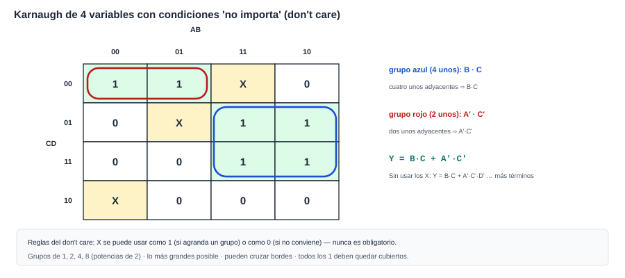

#### De dónde salen
1. **Códigos con combinaciones no usadas:** BCD (0-9) en 4 bits deja libres 10 a 15.
2. **Entradas físicamente imposibles:** dos sensores que nunca se activan juntos.
3. **Salidas que no se observan:** luces de un display que no se miran en cierto modo.

#### Cómo se usan (regla práctica)
1. Marcá los 1 obligatorios y los `X`.
2. Armá los grupos **incluyendo las X sólo si agrandan** el grupo (2 → 4, 4 → 8).
3. Una `X` **no** obliga a nada: si no ayuda, se deja como 0 y no se cubre.
4. Verificá que **todos los 1** queden cubiertos; las X pueden quedar afuera.

#### Ejemplo: display de 7 segmentos en BCD
Entradas `A B C D` (0 a 9) y salida para el segmento **e**:

| Entrada | e | Mintérmino |
|---|---|---|
| 0, 2, 6, 8 | 1 | m0, m2, m6, m8 |
| 1, 3, 4, 5, 7, 9 | 0 | — |
| 10 a 15 | **X** | m10 … m15 |

En el mapa, los `X` de 10 a 15 permiten unir `m8` con `m0` y `m2` por el borde, y `m6` con `m2`/`m14` (`X`), con
lo que el segmento **e** sale con **2 o 3 términos cortos** en vez de 4 mintérminos completos.

#### Los otros criterios (cuando hay varias soluciones válidas)
| Criterio | Qué mirar |
|---|---|
| **Menos términos** | primero achicar la cantidad de grupos (menos compuertas OR) |
| **Menos literales** | después achicar el tamaño de cada término (menos entradas por compuerta) |
| **Sin superposición innecesaria** | si un grupo puede evitarse sin perder cobertura, se evita |
| **Que no queden "unos" sueltos** | un grupo de 1 suele indicar que se puede agrandar con una X |

> [!warning] Errores típicos
> - Cubrir una `X` **antes** que un 1 y dejar un 1 sin agrupar.
> - Tratar la `X` como 0 fijo (se pierde toda la ventaja).
> - Meter una X en un grupo **sin** que el grupo crezca: no aporta y confunde la corrección.
> - Olvidar que con BCD los códigos 10-15 **no se validan nunca**.

#### Figura del libro

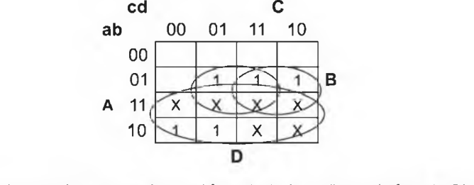

*Fig. 6.7 — Diagramas de simplificación (a, b, c, d) para la función F0.* · Quiroga, *Arquitectura de computadoras*, p. 142.

> [!tip] Qué mirar
> Las `X` son **condiciones irrelevantes** (don't care): combinaciones de entrada que nunca ocurren. Se agrupan con los 1 para armar grupos más grandes; tomarlas como 1 o como 0 es decisión del diseñador.

#### Relacionado
[[1.3.2 Mapa de Karnaugh de 2, 3 y 4 variables]] · [[1.3.1 Mintérminos y maxtérminos]] ·
[[TP4 Mintérminos, maxtérminos y Karnaugh]] · [[Mintérminos y maxtérminos]] · [[Glosario — Unidad 1]]

## 1.4 Bloques combinacionales

### 1.4.1 Decodificador

> [!abstract] En una frase
> Un decodificador de `n` entradas tiene `2ⁿ` salidas y activa **exactamente una**: la que corresponde al número
> binario de la entrada. Su función es `Yi = mi` (cada salida es el mintérmino de su combinación), sin simplificar.

> [!note] Si es la primera vez que ves esto
> Es el "portero de un edificio con 4 departamentos": según el número que le digan (00, 01, 10, 11), toca el
> timbre de **uno solo**. Se usa en todas partes: para elegir una palabra de memoria, para habilitar una
> instrucción, para encender un dígito de un display.

#### Tabla del 2 → 4

| A1 | A0 | Y3 | Y2 | Y1 | Y0 |
|---|---|---|---|---|---|
| 0 | 0 | 0 | 0 | 0 | **1** |
| 0 | 1 | 0 | 0 | **1** | 0 |
| 1 | 0 | 0 | **1** | 0 | 0 |
| 1 | 1 | **1** | 0 | 0 | 0 |

#### Funciones canónicas y circuito
```
Y0 = A1'·A0'
Y1 = A1'·A0
Y2 = A1 ·A0'
Y3 = A1 ·A0
```
**Se dibuja con `n` inversores y `2ⁿ` compuertas AND de `n` entradas.** Para 2→4: 2 NOT y 4 AND de 2.


#### El 3 → 8 (y el que aparece en la materia)
3 entradas, 8 salidas, `Yi = mi`. Se usa con **enable**: una entrada `E` que habilita todo el bloque
(`Yi = E · mi`). En la Unidad de Control de la BLUE hay un decodificador **1→16** que recibe el opcode y activa
la línea de una instrucción.


#### Usos concretos
| Dónde | Para qué |
|---|---|
| Memoria RAM/ROM | elegir la **fila** (palabra) con los bits de dirección |
| Unidad de Control | activar **una** instrucción a la vez (1→16) |
| Display 7 segmentos | encender el dígito que corresponde a la dirección |
| Expansión de memoria | activar un chip sí y los otros no (`E`) |

> [!warning] Errores típicos
> - Simplificar las `Yi`: **no se simplifican**, cada salida es un mintérmino puro.
> - Olvidar el inversor de la entrada negada (sale `Y0 = A1·A0`, que es `Y3`).
> - Contar mal las compuertas: para 3→8 son **3 inversores y 8 AND de 3 entradas**.

#### Ejemplo resuelto
Un decodificador **2 → 4** con salidas **activas en bajo** y entradas `A1 A0 = 10`:
`Y0 = Y1 = Y3 = 1` y **`Y2 = 0`**. Si el que está en 0 es el que habilita, sólo responde la salida 2.
- Con `A1 A0 = 11` responde `Y3`; con `00`, `Y0`.
- Agregando una entrada de **habilitación `E`**, todas las salidas quedan en 1 cuando `E = 0`: así se **encadenan**
  dos decodificadores 2→4 para armar uno 3→8.

#### Figura del libro

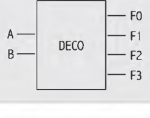

*Fig. 6.13 — Diagrama de bloque del decodificador n → 2ⁿ (2 → 4), sin entrada de habilitación.* · Quiroga, *Arquitectura de computadoras*, p. 145.

> [!tip] Qué mirar
> Dos entradas de selección (`A`, `B`) dan 4 salidas y **una sola** está en 1 por vez: con `A = 1`, `B = 1` se activa `F3`.

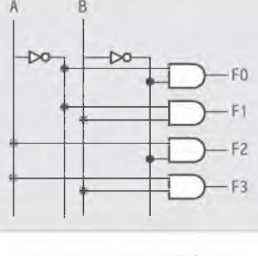

*Fig. 6.15 — Diagrama de lógica de un decodificador 2 → 4 (dos inversores y cuatro AND).* · Quiroga, *Arquitectura de computadoras*, p. 146.

> [!tip] Qué mirar
> Cada salida es un mintérmino: `F0 = ā·b̄`, `F1 = ā·b`, `F2 = a·b̄`, `F3 = a·b`. Por eso el decodificador y la ROM (decodificador + OR) son el mismo circuito con distinto uso.

#### Relacionado
[[1.4.2 Codificador]] · [[1.4.4 Demultiplexor]] · [[Decodificador]] · [[TP6 Decodificadores y demultiplexores]] ·
[[1.3.1 Mintérminos y maxtérminos]] · [[Glosario — Unidad 1]]

### 1.4.2 Codificador

> [!abstract] En una frase
> El codificador es el **circuito inverso** al decodificador: recibe `2ⁿ` (o menos) líneas de entrada, de las
> cuales **una sola** está activa, y entrega el **código binario** de n bits que dice cuál fue.

> [!note] Si es la primera vez que ves esto
> Es la "planilla del portero": le dicen "sonó el 3" y él anota `11`. Nada más. Si están permitidas varias
> entradas a la vez (por ejemplo, varios botones), se usa la versión con **prioridad**.

#### Tabla del 8 → 3 (una sola entrada activa)

| E7 | E6 | E5 | E4 | E3 | E2 | E1 | E0 | A2 | A1 | A0 |
|---|---|---|---|---|---|---|---|---|---|---|
| 0 | 0 | 0 | 0 | 0 | 0 | 0 | **1** | 0 | 0 | 0 |
| 0 | 0 | 0 | 0 | 0 | 0 | **1** | 0 | 0 | 0 | 1 |
| 0 | 0 | 0 | 0 | 0 | **1** | 0 | 0 | 0 | 1 | 0 |
| 0 | 0 | 0 | 0 | **1** | 0 | 0 | 0 | 0 | 1 | 1 |
| 0 | 0 | 0 | **1** | 0 | 0 | 0 | 0 | 1 | 0 | 0 |
| 0 | 0 | **1** | 0 | 0 | 0 | 0 | 0 | 1 | 0 | 1 |
| 0 | **1** | 0 | 0 | 0 | 0 | 0 | 0 | 1 | 1 | 0 |
| **1** | 0 | 0 | 0 | 0 | 0 | 0 | 0 | 1 | 1 | 1 |

#### Funciones (son puras OR)
```
A2 = E4 + E5 + E6 + E7
A1 = E2 + E3 + E6 + E7
A0 = E1 + E3 + E5 + E7
```
Cada salida se activa con la mitad de las entradas; no hace falta nada más.

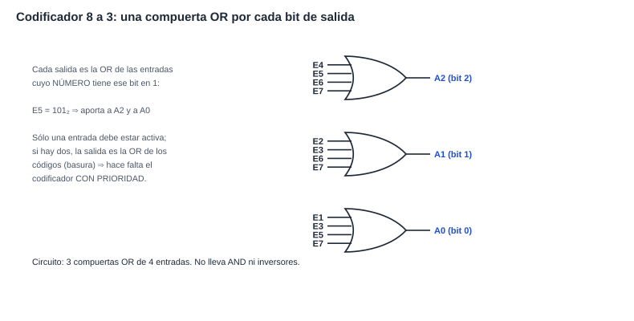

#### Codificador con prioridad
Cuando puede haber **varias** entradas activas, gana la de **mayor índice**. Se resuelve agregando, en cada
salida, la condición "y no hay una entrada mayor activa":

```
A2 = E4 + E5 + E6 + E7                      (sin cambios)
A1 = E2·E4'·E5'·E6'·E7' + E3·E4'·E5'·E6'·E7' + E6 + E7
A0 = E1·(nada mayor) + E3·(nada 4..7) + E5·(nada 6,7) + E7
```
Y se agrega una salida **"hay alguna entrada activa"** (OR de todas), que es la que avisa que el código es válido.

#### Usos
- **Teclado**: se presiona una tecla y se obtiene su código.
- **Interrupciones**: varios periféricos piden atención y el codificador con prioridad dice cuál atender primero.
- **Compactar líneas**: 8 sensores → 3 cables.

> [!warning] Errores típicos
> - Usar la tabla simple cuando el enunciado permite **varias entradas a la vez** (hay que usar prioridad).
> - Invertir el orden de las entradas (¿E0 es la menos significativa?). Confirmalo con la consigna.
> - Simplificar el OR: `A2 = E4+E5+E6+E7` **ya está** mínima.

> [!example] Codificador 8 → 3
> Si está activa **sólo** la entrada 5, la salida es `101` (el número 5 en binario). Con la entrada 0 ⇒ `000`; con la
> 7 ⇒ `111`. Regla: `2ⁿ` entradas → `n` salidas, y **una sola** entrada activa por vez (por eso el simple necesita
> el `EI`, *enable input*, para encadenar dos y armar uno de 16 → 4).

#### Figura del libro

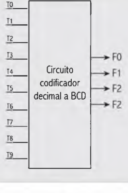

*Fig. 6.10 — Diagrama de bloque del codificador decimal a BCD.* · Quiroga, *Arquitectura de computadoras*, p. 143.

> [!tip] Qué mirar
> Es el camino inverso al decodificador: 10 entradas (una por tecla) y 4 de salida. Si se aprieta `T7`, la salida vale `0111`; si no se aprieta ninguna, la salida es `0000`.

#### Relacionado
[[1.4.1 Decodificador]] · [[1.4.3 Multiplexor]] · [[Codificador]] ·
[[TP7 Codificadores y multiplexores]] · [[Interrupciones y entrada-salida]] · [[Glosario — Unidad 1]]

### 1.4.3 Multiplexor

> [!abstract] En una frase
> El multiplexor (MUX) tiene `n` entradas de **dato**, `k` entradas de **selección** (`n = 2^k`) y **una** salida:
> la salida es **la entrada que elige el código de selección**. Su función es `Y = Σ mi · Ii`.

> [!note] Si es la primera vez que ves esto
> Es una **llave selectora de varias posiciones**: hay 4 caños que llegan y vos girás la perilla (la selección)
> para que pase uno solo. En una computadora es lo que permite que **muchas fuentes manden al mismo bus**, de a una.

#### Tabla del 4 → 1

| S1 | S0 | Y |
|---|---|---|
| 0 | 0 | I0 |
| 0 | 1 | I1 |
| 1 | 0 | I2 |
| 1 | 1 | I3 |

#### Función canónica y circuito
```
Y = S1'·S0'·I0 + S1'·S0·I1 + S1·S0'·I2 + S1·S0·I3
```
**Se dibuja con**: `k` inversores, `n` compuertas AND de `k+1` entradas (una por cada entrada de dato) y **una OR**
de `n` entradas. Para 4→1: 2 NOT, 4 AND de 3 y 1 OR de 4.


#### Variantes que se piden
| Variante | Qué agrega |
|---|---|
| **MUX con enable** | una entrada `E` que, en 0, pone la salida en 0 (o en alta impedancia) |
| **MUX en cascada** | dos 4→1 más un 2→1 dan un 8→1 (y así siguiendo) |
| **MUX como función lógica** | con las variables de la función en las entradas de selección, un MUX de 8→1 **implementa cualquier** función de 3 variables poniendo 0/1 en los datos |

#### Usos en la materia
- **Bus único de la BLUE:** selecciona qué registro pone su dato en el bus.
- **ALU:** elige el resultado que va al acumulador y qué operación se ejecuta.
- **Selección de banco de memoria** en sistemas con varios chips.

> [!warning] Errores típicos
> - Confundir **entradas de dato** con **entradas de selección** al contar (un 8→1 tiene 8 datos y **3** de selección).
> - Invertir el orden de S1/S0 y con eso espejar la tabla.
> - Poner una OR **antes** de las AND (el orden es: AND de selección y dato → OR final).

#### Ejemplo resuelto
MUX **4 → 1** con `S1 S0 = 01`: la salida es `F = D1`. Con `D0 = 0, D1 = 1, D2 = 1, D3 = 0`:
`S = 00 → F = 0` · `S = 01 → F = 1` · `S = 10 → F = 1` · `S = 11 → F = 0`.
- Su función canónica es `F = S1'S0'·D0 + S1'S0·D1 + S1S0'·D2 + S1S0·D3`.
- Un MUX **8 → 1** necesita **3** bits de selección (y 2 MUX de 4→1 + 1 de 2→1 lo arman).

#### Figura del libro

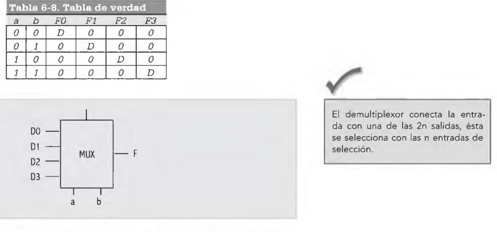

*Fig. 6.20 — Diagrama de bloque de un multiplexor para cuatro entradas (D0 a D3) y dos entradas de selección.* · Quiroga, *Arquitectura de computadoras*, p. 149.

> [!tip] Qué mirar
> Con `ab = 10` la salida `F` es `D2`. El MUX es un selector: `2ⁿ` entradas de dato, `n` de selección y una de salida.

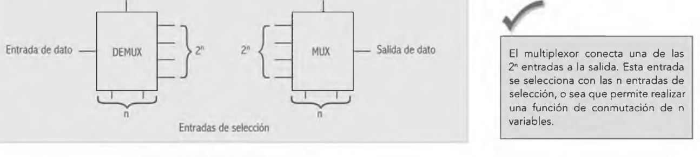

*Fig. 6.18 — Diagrama de bloque: el multiplexor conecta una de las salidas de los registros al bus y el demultiplexor reparte el dato del bus a un registro.* · Quiroga, *Arquitectura de computadoras*, p. 149.

> [!tip] Qué mirar
> Así se arma un **bus único**: el MUX elige qué registro escribe en el bus y el DEMUX elige cuál lo lee. Es el mismo esquema que usa la BLUE en cada pulso.

#### Relacionado
[[1.4.4 Demultiplexor]] · [[1.4.1 Decodificador]] · [[Multiplexor]] ·
[[TP7 Codificadores y multiplexores]] · [[ALU]] · [[Glosario — Unidad 1]]

### 1.4.4 Demultiplexor

> [!abstract] En una frase
> El demultiplexor (DEMUX) tiene **una** entrada de dato `D`, `k` entradas de selección y `2^k` salidas: el dato
> sale **por una sola** de las salidas, la que indica la selección. Su función es `Yi = D · mi`.

> [!note] Si es la primera vez que ves esto
> Es un **distribuidor de caños**: llega agua por un caño y la perilla decide a cuál de las cuatro salidas va. Si
> `D = 1` siempre, se comporta como un **decodificador** — por eso se dice que el decodificador es el caso
> particular con `D = 1`.

#### Tabla del 1 → 4

| S1 | S0 | Y3 | Y2 | Y1 | Y0 |
|---|---|---|---|---|---|
| 0 | 0 | 0 | 0 | 0 | **D** |
| 0 | 1 | 0 | 0 | **D** | 0 |
| 1 | 0 | 0 | **D** | 0 | 0 |
| 1 | 1 | **D** | 0 | 0 | 0 |

#### Funciones y circuito
```
Y0 = D · S1'·S0'
Y1 = D · S1'·S0
Y2 = D · S1 ·S0'
Y3 = D · S1 ·S0
```
**Se dibuja con** `k` inversores y `2^k` compuertas **AND de `k+1` entradas** (la selección más el dato). Para
1→4: 2 NOT y 4 AND de 3. **No lleva OR.**


#### Demux vs decodificador (la comparación que se pregunta)

| | Decodificador | Demultiplexor |
|---|---|---|
| Entradas | `n` de código | `n` de código **+ 1 de dato** |
| Salidas | `2ⁿ`, se activa una | `2ⁿ`, recibe el dato una |
| Función | `Yi = mi` | `Yi = D·mi` |
| Compuertas | AND de `n` entradas | AND de `n+1` entradas |
| Relación | caso particular con `D = 1` | generaliza al decodificador |

#### Usos
- **Escribir en una celda de memoria:** el DEMUX reparte la señal de escritura a la palabra seleccionada.
- **Repartir un dato** a varios periféricos de a uno (E/S).
- **Generar señales de habilitación** en la Unidad de Control.

> [!warning] Errores típicos
> - Agregar una OR en la salida (eso convertiría el circuito en un MUX).
> - Olvidar el dato `D` en cada término: sin él, es un decodificador y no un DEMUX.
> - Contar mal: para 1→4 son 4 AND de **3** entradas (2 de selección + D).

#### Ejemplo resuelto
DEMUX **1 → 4** con `D = 1` y `S1 S0 = 10`: sale **`Y2 = 1`** y `Y0 = Y1 = Y3 = 0`. Si `D = 0`, todas las
salidas quedan en 0.
- Con `D` fijo en 1 el DEMUX **es** un decodificador 2→4: ésa es la relación que se pregunta.
- Para repartir un dato entre 8 destinos: DEMUX 1→8, 3 bits de selección.

#### Figura del libro

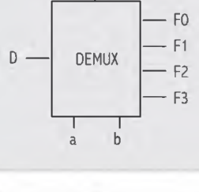

*Fig. 6.19 — Diagrama de bloque de un demultiplexor: una entrada de dato, dos de selección y cuatro salidas.* · Quiroga, *Arquitectura de computadoras*, p. 149.

> [!tip] Qué mirar
> El DEMUX reparte: el dato entra por `D` y sale **sólo** por la línea que indican `a` y `b`. Es el inverso del MUX y se usa para habilitar un registro por vez.

#### Relacionado
[[1.4.3 Multiplexor]] · [[1.4.1 Decodificador]] · [[Demultiplexor]] ·
[[TP6 Decodificadores y demultiplexores]] · [[Memoria RAM 8x3]] · [[Glosario — Unidad 1]]

## 1.5 Aritmética combinacional

### 1.5.1 Semisumador y sumador completo

> [!abstract] En una frase
> El **semisumador** suma 2 bits (`S = A⊕B`, `C = A·B`); el **sumador completo** suma 3 (los 2 bits más el acarreo
> que viene del anterior: `S = A⊕B⊕Cin`, `Cout = A·B + Cin·(A⊕B)`). Con sumadores completos encadenados se suma
> cualquier cantidad de bits.

> [!note] Si es la primera vez que ves esto
> Cuando sumás `7 + 5` en papel, en la columna de las unidades te sale `12`: escribís **2** y te **llevás 1**. Ese
> "me llevo" es el **acarreo** (`carry`). El semisumador resuelve una columna **sin** acarreo entrante (la primera,
> o la suma de un solo bit); el sumador completo resuelve cualquier columna **con** acarreo entrante.

#### Semisumador: tabla y funciones

| A | B | S (suma) | C (acarreo) |
|---|---|---|---|
| 0 | 0 | 0 | 0 |
| 0 | 1 | 1 | 0 |
| 1 | 0 | 1 | 0 |
| 1 | 1 | 0 | **1** |

```
S = A ⊕ B = A'B + AB'
C = A · B
```
**Circuito:** un **XOR** y una **AND**. Dos compuertas, nada más.


#### Sumador completo: tabla y funciones

| A | B | Cin | S | Cout |
|---|---|---|---|---|
| 0 | 0 | 0 | 0 | 0 |
| 0 | 0 | 1 | 1 | 0 |
| 0 | 1 | 0 | 1 | 0 |
| 0 | 1 | 1 | 0 | **1** |
| 1 | 0 | 0 | 1 | 0 |
| 1 | 0 | 1 | 0 | **1** |
| 1 | 1 | 0 | 0 | **1** |
| 1 | 1 | 1 | 1 | **1** |

```
S    = A ⊕ B ⊕ Cin
Cout = A·B + Cin·(A ⊕ B)
```
**Circuito:** **2 XOR + 2 AND + 1 OR** (5 compuertas). La segunda XOR recibe el `Cin`; las dos AND detectan
"hubo dos o más unos" (que es exactamente cuándo hay acarreo).


> [!tip] Dos formas de decir lo mismo
> `Cout` también se escribe como **mayoría**: vale 1 cuando **al menos dos** de las tres entradas son 1.
> `S` vale 1 cuando la cantidad de unos es **impar**. Con esas dos frases podés reconstruir la tabla sin mirarla.

#### Ejemplo
`A = 1`, `B = 1`, `Cin = 1` (la columna del medio de `11 + 01 + acarreo`):

- `A ⊕ B = 0` ⇒ `S = 0 ⊕ 1 = 1`
- `Cout = 1·1 + 1·(0) = 1`

Resultado: `S = 1`, `Cout = 1`, es decir `111₂ = 7`: y efectivamente `1 + 1 + 1 = 3 = 11₂`, con lo que la columna
da 1 y se llevan 1. ✓

Otro: `A = 0`, `B = 1`, `Cin = 1` ⇒ `S = 0`, `Cout = 1` (`0+1+1 = 10₂`). ✓

> [!warning] Errores típicos
> - Usar un semisumador en una columna del medio (ignora el acarreo entrante).
> - Escribir `Cout = A·B + Cin` (falta el `(A⊕B)`).
> - Invertir `S` y `Cout` al armar la tabla: `S` es la columna de las unidades, `Cout` el "me llevo".

#### Figura del libro

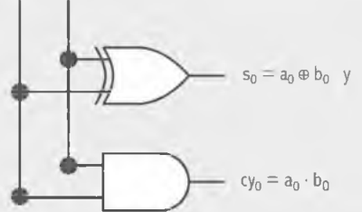

*Fig. 5.17 — Circuito lógico del semisumador.* · Quiroga, *Arquitectura de computadoras*, p. 127.

#### Relacionado
[[1.5.2 Sumador de n bits y resta en complemento a 2]] · [[1.4.3 Multiplexor]] · [[Semisumador]] ·
[[Sumador completo]] · [[TP5 Sumadores]] · [[Glosario — Unidad 1]]

### 1.5.2 Sumador de n bits y resta en complemento a 2

> [!abstract] En una frase
> Se encadenan `n` sumadores completos (el `Cout` de uno entra como `Cin` del siguiente) y se obtiene un sumador de
> n bits; **restando** es lo mismo pero con las entradas de B **negadas** y `Cin = 1`: `A − B = A + B' + 1`.

> [!note] Si es la primera vez que ves esto
> Es la misma suma de la escuela: se suman las columnas de derecha a izquierda y el "me llevo" pasa a la siguiente.
> La parte linda es la resta: en binario **no se resta**, se suma el complemento a 2 (que es "dar vuelta los bits
> y sumar 1"). Por eso un solo circuito sirve para las dos operaciones.

#### n bits en cascada, y la resta

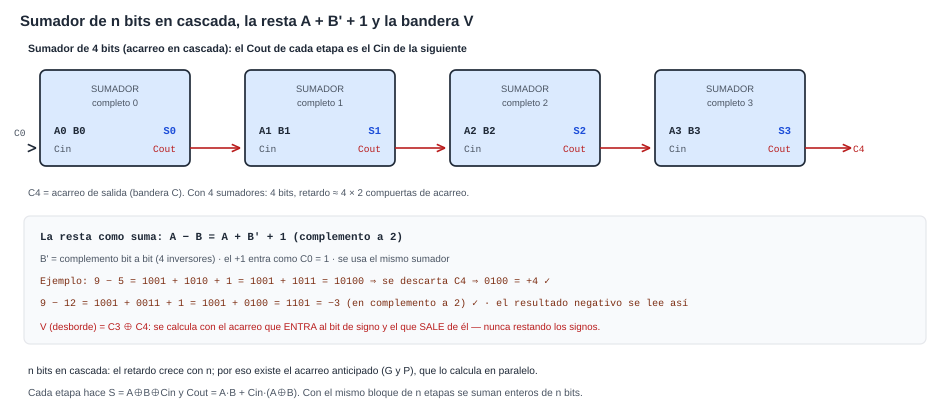

#### Sumador de 4 bits (acarreo en cascada)
```
      C4   C3   C2   C1   C0=0
       ↑    ↑    ↑    ↑
   [ FA3 ][ FA2 ][ FA1 ][ FA0 ]
      A3B3   A2B2   A1B1   A0B0
      S3     S2     S1     S0
```
- El **acarreo se propaga** de derecha a izquierda: por eso se llama *ripple carry* (acarreo ondulante).
- El retardo total crece con `n`: cada FA agrega su tiempo. Es lo que después se mejora con **acarreo anticipado**
  (Unidad 9).
- El último `Cout` (`C4`) indica **desbordamiento** en aritmética sin signo.

#### Resta: el truco del complemento a 2
`A − B = A + (−B) = A + (B' + 1)` ⇒ **negar B y poner `Cin = 1`**.

Para convertir el sumador en **sumador/restador** se pone una entrada de control `SUB`:

| SUB | B que entra al FA | Cin | Operación |
|---|---|---|---|
| 0 | `B` | 0 | `A + B` |
| 1 | `B ⊕ 1 = B'` | 1 | `A + B' + 1 = A − B` |

Es decir: **cuatro XOR** (uno por bit, con `SUB` como segunda entrada) y `SUB` conectado al `Cin` del primer FA.
**Un solo circuito, dos operaciones.**

#### Ejemplo: `6 − 3` en 4 bits
1. `A = 0110`, `B = 0011`.
2. `B' = 1100`, `+1` ⇒ `−B = 1101`.
3. `0110 + 1101 = 1 0011` ⇒ se descarta el acarreo final ⇒ **`0011` = 3**. ✓

#### Desbordamiento (lo que se pregunta aparte)
En **complemento a 2** hay desbordamiento si se suman dos números del **mismo signo** y el resultado cambia de
signo. La fórmula práctica:
```
V = Cin_al_último ⊕ Cout_del_último
```
En suma sin signo, en cambio, el desbordamiento es simplemente `C4 = 1`.

> [!warning] Errores típicos
> - Restar "dando vuelta los bits" **sin** sumar 1 (eso es complemento a 1, no a 2).
> - Olvidar que el acarreo final de la resta **se descarta**.
> - Confundir desbordamiento con acarreo: en A2 el `C4` puede ser 1 sin que haya error (`6 − 3`), y puede haber
>   error sin `C4`.

#### Figura del libro

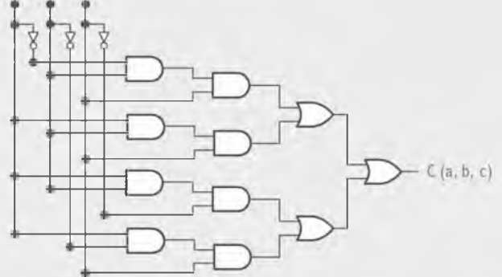

*Fig. 5.19 — Circuito lógico con las FN D del sumador completo.* · Quiroga, *Arquitectura de computadoras*, p. 131.

#### Relacionado
[[1.5.1 Semisumador y sumador completo]] · [[00 Tema 1.5 — índice]] · [[Sumador completo]] ·
[[ALU]] · [[Hardware aritmético (resumen)]] · [[TP5 Sumadores]] · [[Glosario — Unidad 1]]

## 1.6 Códigos binarios

### 1.6.1 Códigos ponderados y no ponderados

> [!abstract] En una frase
> En un **código ponderado** cada posición tiene un **peso** y el valor se obtiene sumando los pesos de los bits
> en 1 (binario natural `8-4-2-1`, **AIKEN** `2-4-2-1`); en un **código no ponderado** no hay pesos, hay una
> **regla** (el **exceso 3** es "binario puro + 3"). El **BCD** no es un código nuevo: es usar el binario natural
> **por dígito decimal**, y viene **empaquetado** (dos dígitos por byte) o **desempaquetado** (uno por byte).

> [!note] Si es la primera vez que ves esto
> Pensá en los códigos como **etiquetas**. El número cinco existe una sola vez, pero se puede etiquetar de varias
> formas: `0101` (natural), `1011` (Aiken), `1000` (exceso 3). Todas las etiquetas son válidas; se elige la que
> conviene según lo que haya que hacer después (sumar, transmitir, mostrar en un display).

#### Ponderados: natural y AIKEN

Un código es **ponderado** si existe un peso `wi` por posición y el valor decimal es `Σ bi · wi`.

| Código | Pesos | Cómo se escribe el 5 | Detalle |
|---|---|---|---|
| **Binario natural** | `8 4 2 1` | `0101` | es el sistema de numeración de siempre |
| **AIKEN (2-4-2-1)** | `2 4 2 1` | `1011` | pesos en otro orden: `1·2 + 0·4 + 1·2 + 1·1 = 5` |
| **BCD natural** | `8 4 2 1` **por dígito** | `0101` (un dígito) | cada dígito decimal ocupa 4 bits |

| Decimal | Natural `8-4-2-1` | AIKEN `2-4-2-1` |
|---|---|---|
| 0 | `0000` | `0000` |
| 1 | `0001` | `0001` |
| 2 | `0010` | `0010` |
| 3 | `0011` | `0011` |
| 4 | `0100` | `0100` |
| **5** | `0101` | **`1011`** |
| **6** | `0110` | **`1100`** |
| **7** | `0111` | **`1101`** |
| **8** | `1000` | **`1110`** |
| **9** | `1001` | **`1111`** |

Del 0 al 4 los dos códigos coinciden; **desde el 5 se separan**. En Aiken el 9 es `1111` y el complemento a 9 de
un dígito se obtiene **invirtiendo los bits** (igual que en exceso 3), lo que simplifica la resta decimal.

#### No ponderado: exceso 3

**Regla:** al binario puro del dígito se le **suma 3**.

| Decimal | Binario puro | Exceso 3 (`n + 3`) |
|---|---|---|
| 0 | `0000` | `0011` |
| 1 | `0001` | `0100` |
| 2 | `0010` | `0101` |
| 5 | `0101` | `1000` |
| 9 | `1001` | `1100` |

Dos propiedades que se preguntan:

1. Es **autocomplementario**: el complemento a 9 se obtiene **invirtiendo todos los bits** (`0011` ↔ `1100`).
2. **No usa `0000`**: si un cable se corta y la línea queda en 0, el receptor no lee un "0" válido sino una
   combinación imposible ⇒ detecta la falla. Por eso se usa en transmisión.

#### BCD: empaquetado y desempaquetado

| Formato | Cómo se guarda | Ejemplo con 62 |
|---|---|---|
| **BCD desempaquetado** | 1 dígito por **byte**, el otro nible en 0 | `0000 0110` y `0000 0010` (2 bytes) |
| **BCD empaquetado** | 2 dígitos por **byte**, uno por nible | `0110 0010` (1 byte) |

> [!example] El 27 en BCD empaquetado
> `27` ⇒ `0010` (el 2) y `0111` (el 7) ⇒ **`0010 0111`**. En cambio el 27 en binario puro es `0001 1011`: son
> cosas distintas. Si el examen dice "BCD", cada dígito va en su nible.

> [!example] Sumar en BCD no es sumar en binario
> `27 + 35`: en binario puro da `0011 1110` = 62 ✓. En BCD empaquetado, `0010 0111 + 0011 0101 = 0101 1100`, y
> ese `1100` no es un dígito BCD válido ⇒ hay que **corregir con +0110** al nible bajo: `0101 1100 + 0110 =
> 0110 0010` = **62**. La corrección se desarrolla en [[9.5.1 Suma decimal corregida]].

#### Los códigos, dibujados

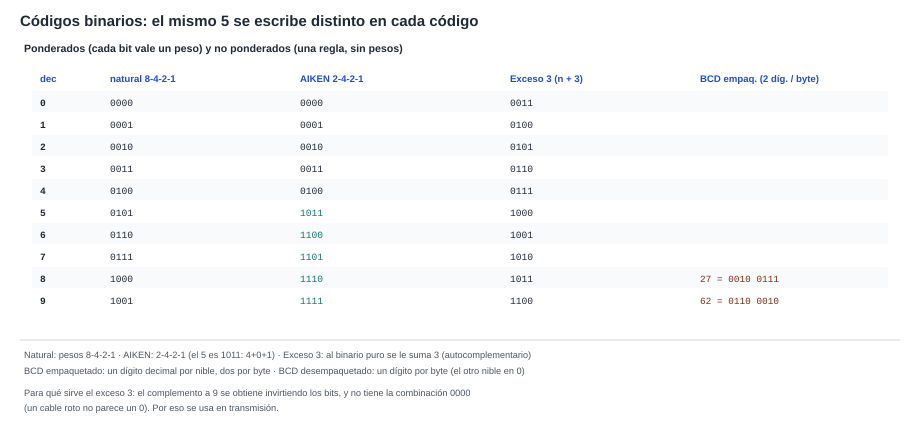

> [!example] Ejercicio típico de parcial
> "Escriba el 8 en binario natural, AIKEN y exceso 3". Natural `1000`; AIKEN `1110` (`1·2+1·4+1·2+0·1 = 8`);
> exceso 3: `1000 + 0011 = 1011`. Y la pregunta trampa: "¿cuántos bits necesita el exceso 3 para el 9?" Cuatro,
> porque `1100` entra cómodo (con 3 bits no alcanzaría: `1001 + 11 = 1100`).

> [!warning] Errores que se ven seguido
> - Escribir el 9 en AIKEN como `1001`: es **`1111`**.
> - Confundir **exceso 3** con **complemento a 2**: en exceso 3 se suma 3 al binario del dígito, no se niega nada.
> - Decir que el BCD "es otro sistema de numeración": no, es binario natural **por dígito**.

#### Figura del libro

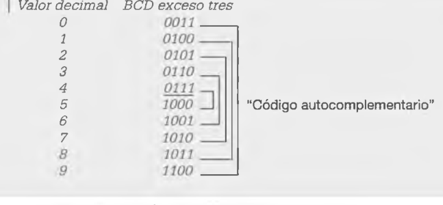

*Fig. 3.5 — Código BCD exceso tres (no ponderado y autocomplementario).* · Quiroga, *Arquitectura de computadoras*, p. 82.

> [!tip] Qué mirar
> No hay pesos que sumen para dar el dígito: se obtiene del BCD sumando 3 a cada combinación. El complemento a 9 sale **invirtiendo todos los bits**, y por eso se dice autocomplementario.

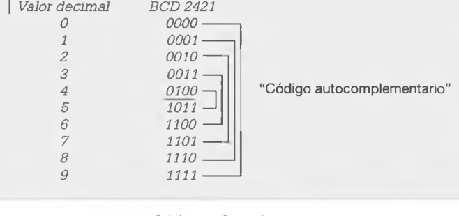

*Fig. 3.6 — Código BCD Aiken (2-4-2-1): ponderado y autocomplementario.* · Quiroga, *Arquitectura de computadoras*, p. 83.

> [!tip] Qué mirar
> Acá sí hay pesos (2-4-2-1) pero se repiten, y el 9 se escribe `1111`. Comparar con el 8-4-2-1: el Aiken también es autocomplementario, el 8-4-2-1 no.

#### Relacionado
[[1.6.2 Códigos continuos y cíclicos]] · [[1.4.2 Codificador]] · [[9.5.1 Suma decimal corregida]] ·
[[2.3.4 Detección y corrección de errores (paridad, LRC, CRC y Hamming)]] · [[Glosario — Unidad 1]]

### 1.6.2 Códigos continuos y cíclicos

> [!abstract] En una frase
> Un código es **continuo** (o progresivo) si las combinaciones de números **consecutivos** son **adyacentes**,
> es decir que difieren en **un solo bit**; es **cíclico** si además la **última** combinación es adyacente a la
> **primera**. Los dos ejemplos de la cátedra son el **Gray** (reflejado) y el **Johnson**.

> [!note] Si es la primera vez que ves esto
> Imaginá un codificador de posición que gira: si pasa de `0111` a `1000` cambian **cuatro** bits a la vez y, en el
> instante de la transición, se pueden leer combinaciones **intermedias falsas**. Con un código continuo cambia
> **un solo bit**: no hay estado intermedio posible. Ésa es toda la idea.

#### Gray (reflejado)

Se construye por **reflejo**: el código de `n` bits se arma copiando el de `n-1` bits al derecho (con 0 adelante)
y al revés (con 1 adelante).

| Decimal | Gray 2 bits | Gray 3 bits | Gray 4 bits |
|---|---|---|---|
| 0 | `00` | `000` | `0000` |
| 1 | `01` | `001` | `0001` |
| 2 | `11` | `011` | `0011` |
| 3 | `10` | `010` | `0010` |
| 4 | — | `110` | `0110` |
| 5 | — | `111` | `0111` |
| 6 | — | `101` | `0101` |
| 7 | — | `100` | `0100` |
| 8 | — | — | `1100` |
| 9 | — | — | `1101` |
| 10 | — | — | `1111` |
| 11 | — | — | `1110` |
| 12 | — | — | `1010` |
| 13 | — | — | `1011` |
| 14 | — | — | `1001` |
| 15 | — | — | `1000` |

Propiedades para el final:

| Propiedad | Qué significa |
|---|---|
| **Continuo** | de una fila a la siguiente cambia **1 bit** |
| **Cíclico** | de la última (`1000`) a la primera (`0000`) cambia **1 bit** |
| **Reflejado** | el 2.º grupo es el 1.º al revés con el bit de arriba en 1 |
| **Conversión binario → Gray** | `G = B ⊕ (B >> 1)`: el Gray 3 de `B=101` es `101 ⊕ 010 = 111` |

> [!example] Conversión, con números
> Binario `1011` (11) ⇒ se corre un lugar y se hace XOR con el original: `1011 ⊕ 0101 = 1110` ⇒ Gray = `1110`
> (que en la tabla de 4 bits es, efectivamente, el 11). Y al revés (Gray → binario) se va acumulando el XOR de
> izquierda a derecha: `1110` ⇒ `1`, `1⊕1=0`, `0⊕1=1`, `1⊕0=1` ⇒ `1011` ✓.

#### Johnson (5 bits)

Se obtiene con un **registro de desplazamiento realimentado con la salida negada**. Con `n` biestables da `2n`
estados (no `2ⁿ`), y también es continuo y cíclico.

| Decimal | Johnson (5 bits) |
|---|---|
| 0 | `00000` |
| 1 | `00001` |
| 2 | `00011` |
| 3 | `00111` |
| 4 | `01111` |
| 5 | `11111` |
| 6 | `11110` |
| 7 | `11100` |
| 8 | `11000` |
| 9 | `10000` |

Se ven las dos mitades: primero **entran unos** por la izquierda, después **entran ceros**. El paso del 9 al 0
(`10000 → 00000`) también cambia **un solo bit** ⇒ cíclico.

#### Los dos códigos, dibujados

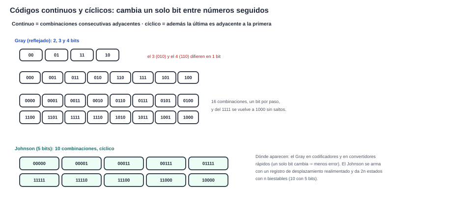

> [!example] Para qué se usa cada uno
> - **Gray**: codificadores de posición (discos ópticos), convertidores analógico-digitales y en las tablas de
>   Karnaugh — por eso las filas y columnas del mapa se numeran `00, 01, 11, 10` (ver
>   [[1.3.2 Mapa de Karnaugh de 2, 3 y 4 variables]]).
> - **Johnson**: contadores con pocas compuertas; un contador Johnson de 5 biestables cuenta de 0 a 9 y se
>   **autocorrige** si arranca en un estado válido.

> [!warning] No confundir
> **Gray ≠ Johnson**. El Gray usa **todas** las `2ⁿ` combinaciones (4 bits → 16 estados); el Johnson usa
> **`2n`** (5 bits → 10 estados). Y "continuo" no es lo mismo que "cíclico": todo cíclico es continuo, pero un
> continuo puede no cerrar (por ejemplo, el contador Gray de 3 bits usado en un rango parcial).

#### Relacionado
[[1.6.1 Códigos ponderados y no ponderados]] · [[1.3.2 Mapa de Karnaugh de 2, 3 y 4 variables]] ·
[[2.2.3 Contadores binarios y módulo N]] · [[1.4.2 Codificador]] · [[Glosario — Unidad 1]]

---

## Al terminar la unidad
- Una pasada rápida: [[00 Síntesis — Unidad 1]].
- Los subtemas por separado: [[00 Unidad 1 — temas y subtemas]].
- Seguir de corrido: [[00 Materia completa (las 10 unidades en un archivo)]].
- Practicar: [[Banco de preguntas del final]] · [[Autoevaluación]] · [[Prácticas resueltas]].
