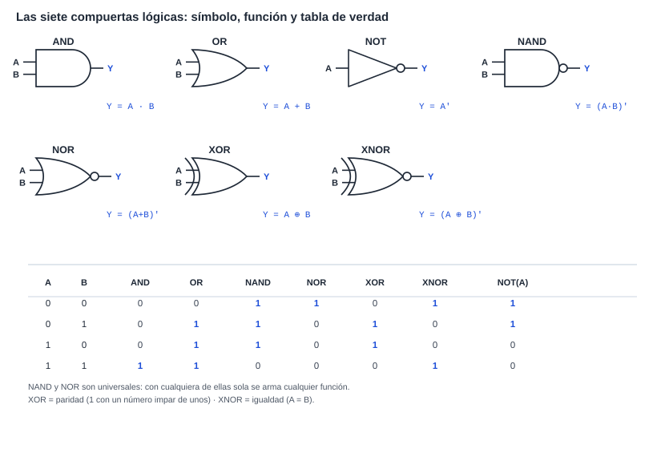

# 1.1.1 Compuerta AND, OR y NOT

> [!abstract] En una frase
> **AND** da 1 sólo si **todas** sus entradas son 1 · **OR** da 1 si **alguna** entrada es 1 · **NOT** da lo
> **contrario** de su única entrada.

> [!note] Si es la primera vez que ves esto
> Pensá en **dos llaves de agua en serie** (para que salga agua tienen que estar las dos abiertas: eso es AND) y en
> **dos llaves en paralelo** (basta con que una esté abierta: eso es OR). El **NOT** es una llave que está cerrada
> cuando la otra está abierta: es el interruptor del tipo "conmutador". Una compuerta no es más que eso: un
> dispositivo de dos estados que **decide** en función de sus entradas.

## Tabla de verdad

| A | B | A·B (AND) | A+B (OR) | A' (NOT) |
|---|---|---|---|---|
| 0 | 0 | 0 | 0 | 1 |
| 0 | 1 | 0 | 1 | 0 |
| 1 | 0 | 0 | 1 | — |
| 1 | 1 | **1** | **1** | — |

**Convenciones que hay que respetar siempre:** el producto lógico se escribe `A·B`, `AB` o `A AND B`; la suma
`A+B`; la negación `A'`, `Ā` o `¬A`. En la cátedra se usa la barra o el apóstrofo; **elegí uno y no los mezcles**
en el mismo renglón.

## Símbolo, expresión y circuito

| Compuerta | Expresión | Forma |
|---|---|---|
| AND | `Y = A·B` | D de lados rectos |
| OR | `Y = A+B` | D de atrás curvo |
| NOT | `Y = A'` | triángulo con burbuja |

## Para qué se usa en la materia
Son la base de **todo**: el decodificador es un AND por cada combinación, el codificador son OR, el MUX son
AND + OR, y la ALU empieza por acá. En la máquina BLUE, la señal de control que habilita una escritura
(`LDA·CP8·E`) es literalmente un **AND de tres entradas** con los estados y los pulsos.

## Ejemplo (estilo TP1)
Con `A = 1`, `B = 0`:

- `A·B = 0` (falta una)
- `A+B = 1` (alcanza con A)
- `A' = 0`, `B' = 1`

Y con `A = B = 1`: `A·B = 1`, `A+B = 1`, `A' = 0`.

> [!warning] Errores típicos
> - **Confundir OR con XOR.** Con `A = B = 1`, OR da **1** y XOR da **0**.
> - Escribir `A + A = 2A`: en Boole `A + A = A` (idempotencia).
> - Olvidar la barra: `A+B'` no es `(A+B)'`. La negación de una suma **necesita paréntesis**.

## Relacionado
[[1.1.2 NAND, NOR, XOR y XNOR]] · [[1.1.3 Compuertas universales]] · [[00 Tema 1.1 — índice]] ·
[[Compuertas lógicas]] · [[Tablas de verdad de memoria]]
