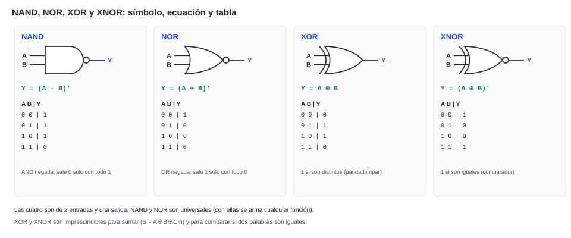
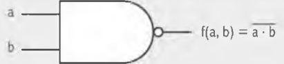
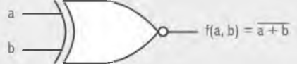
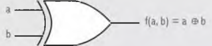

# 1.1.2 NAND, NOR, XOR y XNOR

> [!abstract] En una frase
> **NAND** = AND negada (da 0 sólo con dos 1) · **NOR** = OR negada (da 1 sólo con dos 0) · **XOR** = "son
> distintas" · **XNOR** = "son iguales".

> [!note] Si es la primera vez que ves esto
> Las tres compuertas anteriores (AND, OR, NOT) son las "letras". Estas cuatro son las que **aparecen en el
> taller**: NAND y NOR porque son las únicas que se fabrican barato y con ellas se arma todo; XOR porque es la
> compuerta que **compara** dos bits, y de ahí sale el sumador.

## Los cuatro símbolos, con su tabla

## Tabla de verdad

| A | B | NAND `(A·B)'` | NOR `(A+B)'` | XOR `A⊕B` | XNOR `(A⊕B)'` |
|---|---|---|---|---|---|
| 0 | 0 | 1 | **1** | 0 | 1 |
| 0 | 1 | 1 | 0 | **1** | 0 |
| 1 | 0 | 1 | 0 | **1** | 0 |
| 1 | 1 | **0** | 0 | 0 | **1** |

**Cómo leerla sin memorizar:** NAND es la **única** que da 0 en la última fila; NOR es la **única** que da 1 en
la primera; XOR tiene 1 donde las entradas **difieren**.

## Expresiones equivalentes
- `A ⊕ B = A'B + AB'` (suma de mintérminos 1 y 2)
- `A ⊕ B = (A + B) · (A·B)'` (forma útil para dibujar con NAND)
- `(A ⊕ B)' = A'B' + AB` (XNOR, detector de igualdad)

## Para qué sirve cada una en la materia

| Compuerta | Dónde aparece |
|---|---|
| **NAND / NOR** | son **universales**: con una sola de ellas se arma cualquier circuito ([[1.1.3 Compuertas universales]]) |
| **XOR** | el **semisumador** (`S = A⊕B`), la suma binaria sin acarreo, la paridad |
| **XNOR** | comparadores de igualdad (¿A = B?) y el detector de "cero" |

## Ejemplo (estilo TP1)
Con `A = 1`, `B = 1`: `NAND = 0`, `NOR = 0`, `XOR = 0`, `XNOR = 1`.
Con `A = 1`, `B = 0`: `NAND = 1`, `NOR = 0`, `XOR = 1`, `XNOR = 0`.

> [!warning] Errores típicos
> - Decir que "NAND es lo mismo que NOR negada". No: la negación de NOR es **OR** (`(A+B)'' = A+B`).
> - Usar XOR como OR en una simplificación: `A + A'B` **no** es `A ⊕ B`.
> - Dibujar la burbuja de NAND **antes** de la compuerta en vez de en la salida.

## Figura del libro

*Fig. 5.6 — Compuerta NAND.* · Quiroga, *Arquitectura de computadoras*, p. 121.

*Fig. 5.7 — Compuerta ÑOR.* · Quiroga, *Arquitectura de computadoras*, p. 121.

*Fig. 5.4 — Compuerta XOR.* · Quiroga, *Arquitectura de computadoras*, p. 120.

## Relacionado
[[1.1.1 Compuerta AND, OR y NOT]] · [[1.1.3 Compuertas universales]] · [[Semisumador]] ·
[[Compuertas lógicas]] · [[Tablas de verdad de memoria]]
