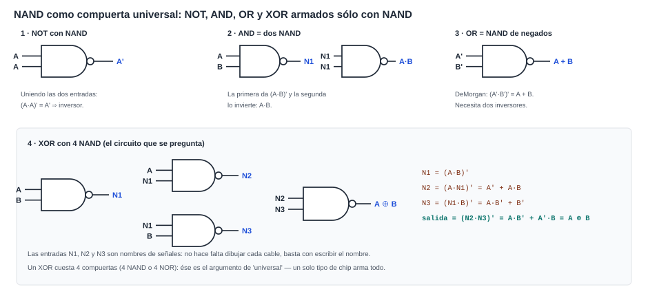
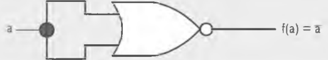

# 1.1.3 Compuertas universales

> [!abstract] En una frase
> **NAND y NOR son universales**: con cualquiera de las dos, repetida las veces que haga falta, se puede construir
> **cualquier** función lógica (incluidas NOT, AND, OR y un sumador completo).

> [!note] Si es la primera vez que ves esto
> En una fábrica de chips conviene **producir un solo tipo de ladrillo** y armar todo con él: sale más barato y más
> rápido. La NAND (y la NOR) tienen esa propiedad: son el "ladrillo único" de la electrónica digital. Por eso los
> circuitos reales de la materia se dibujan a veces sólo con NAND.

## Todo con NAND

## Las tres equivalencias que hay que saber

| Función | Con NAND | Con NOR |
|---|---|---|
| **NOT** `A'` | `(A·A)' = A'` → unir las dos entradas | `(A+A)' = A'` |
| **AND** `A·B` | `((A·B)')' = A·B` → NAND + NOT | `(A' + B')' = A·B` → NOR con entradas negadas |
| **OR** `A+B` | `(A'·B')' = A+B` → NAND con entradas negadas | `((A+B)')' = A+B` → NOR + NOT |

> [!important] La cuenta que se pregunta
> Una **OR de 2 entradas con NAND** cuesta **3 compuertas** (dos NAND como inversores + una NAND final).
> Una **AND con NAND** cuesta **2** (la NAND y un inversor). De ahí sale el "costo en compuertas" que pide el TP.

## Por qué funciona (la razón algebraica)
Todo se apoya en **DeMorgan**: `(A·B)' = A' + B'` y `(A+B)' = A'·B'`. Como la NAND ya entrega la negación del
producto, negando otra vez (con otra NAND usada como inversor) se recupera el producto, y negando las entradas se
convierte el producto en suma.

## Ejemplo: `Y = A·B + C` sólo con NAND

La clave es reescribir la suma como producto de negaciones (**DeMorgan**):
`A·B + C = ((A·B)' · C')'`.

1. `N1 = (A·B)'` → una NAND con A y B.
2. `N2 = (C·C)' = C'` → una NAND con C en las dos entradas (sirve de inversor).
3. `Y = (N1 · N2)'` → una NAND final.

**Total: 3 compuertas NAND.** El circuito se dibuja de izquierda a derecha en el orden N1, N2 y la final.

> [!warning] Errores típicos
> - Poner una sola burbuja y creer que ya negó "todo".
> - Contar mal el costo: el inversor hecho con NAND **es** una compuerta.
> - Olvidar que NOR también es universal (se pregunta "¿cuáles son universales?" → **las dos**, NAND y NOR).

## Figura del libro

*Fig. 5.10 — I mplementación de la negación con compuertas negadas.* · Quiroga, *Arquitectura de computadoras*, p. 123.

## Escalas de integración: SSI, MSI, LSI y VLSI

Las compuertas no se compran sueltas: vienen dentro de un **circuito integrado (chip)**. Según **cuántas compuertas
entran en un chip** se habla de escalas de integración — es la clasificación que usa la cátedra y aparece en el
parcial como definición corta.

| Escala | Nombre | Compuertas por chip | Ejemplo típico |
|---|---|---|---|
| **SSI** | *Small Scale Integration* | hasta **10** | una 7400 (4 compuertas NAND de 2 entradas) |
| **MSI** | *Medium Scale Integration* | de **10 a 100** | decodificador 74138, multiplexor 74151, sumador 7483 |
| **LSI** | *Large Scale Integration* | de **100 a 1000** | una memoria pequeña, un contador completo |
| **VLSI** | *Very Large Scale Integration* | **más de 1000** | un microprocesador, una FPGA, un chip de RAM |

> [!important] Cómo se usa esto en la materia
> Cuando el enunciado dice *"implemente con MSI"*, está pidiendo **usar un bloque ya hecho** (decodificador, MUX,
> sumador) en vez de dibujar la función con compuertas SSI. Es la diferencia entre la solución "larga" y la solución
> "de una línea" que se espera en el final. Los bloques MSI se estudian en el tema 1.4.

## Relacionado
[[1.1.2 NAND, NOR, XOR y XNOR]] · [[1.2.2 Leyes de DeMorgan]] · [[00 Tema 1.1 — índice]] ·
[[TP1 Compuertas lógicas]] · [[Compuertas lógicas]]
