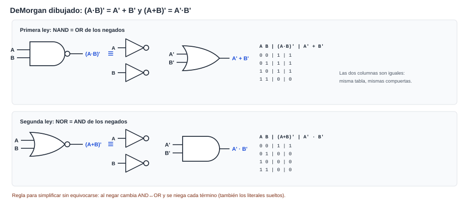

# 1.2.2 Leyes de DeMorgan

> [!abstract] En una frase
> `(A + B)' = A' · B'` y `(A · B)' = A' + B'`: al negar **se invierte la operación y se niega cada término**.

> [!note] Si es la primera vez que ves esto
> Necesitás "meter la barra para adentro". La regla es la de una puerta de dos hojas: si **no** entra por ninguna
> (NOR), es lo mismo que decir que **las dos** están cerradas (AND de negaciones). DeMorgan es la herramienta para
> convertir un circuito a **NAND/NOR** y para negar una función entera sin equivocarse.

## DeMorgan, dibujado

## Las dos leyes y su generalización

| Forma | Ley |
|---|---|
| **NOR** | `(A + B)' = A' · B'` |
| **NAND** | `(A · B)' = A' + B'` |
| General | `(A + B + C + …)' = A'·B'·C'·…` · `(A·B·C·…)' = A' + B' + C' + …` |

## Demostración por tabla de verdad (la que se pide)

| A | B | A+B | **(A+B)'** | A' | B' | **A'·B'** |
|---|---|---|---|---|---|---|
| 0 | 0 | 0 | **1** | 1 | 1 | **1** |
| 0 | 1 | 1 | **0** | 1 | 0 | **0** |
| 1 | 0 | 1 | **0** | 0 | 1 | **0** |
| 1 | 1 | 1 | **0** | 0 | 0 | **0** |

Las dos columnas en negrita son idénticas ⇒ la igualdad vale para las 4 combinaciones.

## Cómo se aplica (receta de 3 pasos)
1. **Invertir la operación** principal (`+` ↔ `·`).
2. **Negar cada término** (si ya estaba negado, se desniega: `(A')' = A`).
3. Repetir si quedan barras que abarcan más de una variable.

**Ejemplo 1:** `Y = ((A + B) · C)'` → `Y = (A + B)' + C' = A'B' + C'`.
**Ejemplo 2:** `Y = (A·B' + C)'` → `Y = (A·B')' · C' = (A' + B) · C'`.
**Ejemplo 3 (todo a NAND):** `Y = A·B + C·D` → `Y = ((A·B)' · (C·D)')'`: dos NAND y una NAND final.

## Dónde aparece en la materia
- **Compuertas universales:** es la justificación de que NAND y NOR alcancen para todo.
- **Karnaugh con ceros:** cuando conviene simplificar los **0** de la tabla, se aplica DeMorgan al resultado para
  volver a la función positiva.
- **Unidad de control:** las señales activas por nivel bajo (con burbuja) se describen con DeMorgan.

> [!warning] Errores típicos
> - Negar sólo la primera variable: `(A+B)' = A' + B'` ✗ (es `A'·B'`).
> - Olvidar cambiar `·` por `+`.
> - Sacar la barra sin negar nada: `(A+B)' = A+B` ✗.

> [!example] DeMorgan, con números
> `Y = (A·B)'`: si `A = 1, B = 0` ⇒ `(1·0)' = 1`. Por el otro lado `A' + B' = 0 + 1 = 1` ✓. Y con `A = B = 1`:
> `(1·1)' = 0` y `A' + B' = 0 + 0 = 0` ✓. Las dos expresiones dan **lo mismo en las 4 filas**: son equivalentes.

## Relacionado
[[1.2.1 Postulados, dualidad y teoremas]] · [[1.2.3 Simplificación analítica]] ·
[[1.1.3 Compuertas universales]] · [[TP2 Álgebra de Boole]] · [[Leyes de DeMorgan]]
