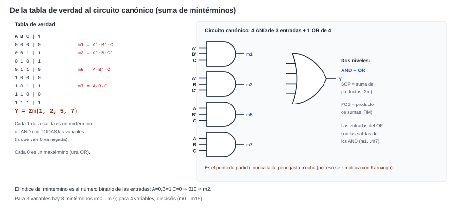

# 1.3.1 Mintérminos y maxtérminos

> [!abstract] En una frase
> Un **mintérmino** es un término que vale **1 en una sola fila** de la tabla (producto de todas las variables); un
> **maxtérmino** vale **0 en una sola fila** (suma de todas las variables). La función es la **suma de los
> mintérminos donde vale 1**.

> [!note] Si es la primera vez que ves esto
> La tabla de verdad dice *qué* queremos; el mintérmino es **la forma de escribirlo con compuertas**. Si la salida
> vale 1 en la fila `A=1, B=0, C=1`, ese caso se escribe `A·B'·C`, y la función es la suma (OR) de todos esos
> casos. "Canónica" quiere decir: **un término por cada 1 de la tabla**, sin agrupar todavía.

## De la tabla al circuito

## La tabla de los 8 mintérminos (3 variables)

| A B C | Mintérmino `m` | Expresión | Maxtérmino `M` | Expresión |
|---|---|---|---|---|
| 0 0 0 | m0 | `A'B'C'` | M0 | `A+B+C` |
| 0 0 1 | m1 | `A'B'C` | M1 | `A+B+C'` |
| 0 1 0 | m2 | `A'BC'` | M2 | `A+B'+C` |
| 0 1 1 | m3 | `A'BC` | M3 | `A+B'+C'` |
| 1 0 0 | m4 | `AB'C'` | M4 | `A'+B+C` |
| 1 0 1 | m5 | `AB'C` | M5 | `A'+B+C'` |
| 1 1 0 | m6 | `ABC'` | M6 | `A'+B'+C` |
| 1 1 1 | m7 | `ABC` | M7 | `A'+B'+C'` |

**Regla mnemotécnica:** en el mintérmino, el bit **1** va sin barra y el **0** con barra. En el maxtérmino es al
revés, y se unen con `+`.

## Las dos formas canónicas
- **Primera forma (SOP, suma de productos):** `F = Σm(1, 3, 5, 7)` = `A'B'C + A'BC + AB'C + ABC`.
- **Segunda forma (POS, producto de sumas):** `F = ΠM(0, 2, 4, 6)` = `(A+B+C)(A+B'+C)(A'+B+C)(A'+B'+C)`.

Las dos describen **la misma** función; se elige la que tenga menos términos. Y valen las relaciones:
`Σm` de F = complemento de `Σm` de F' · `ΠM` es el complemento de `Σm` con los índices que faltan.

## Ejemplo completo
`F(A,B,C)` vale 1 en las filas 1, 3, 5 y 7 (las combinaciones con C = 1).

1. `F = Σm(1,3,5,7) = A'B'C + A'BC + AB'C + ABC`.
2. Factor común `C`: `C·(A'B' + A'B + AB' + AB)`.
3. El paréntesis es 1 para todas las combinaciones de A y B ⇒ **`F = C`**.

Ésa es la función mínima: un solo cable. La tarjeta del TP4 pide justamente esto: ver que 4 mintérminos pueden
colapsar en un literal.

> [!warning] Errores típicos
> - **Ordenar mal las variables** y con eso cambiar todos los índices: fijate siempre si el enunciado ordena
>   `ABC` o `CBA`.
> - Confundir `m` con `M`: `Σm` es suma de productos; `ΠM` es producto de sumas.
> - Poner un término por cada **0** cuando la consigna pide `Σm`.

## Relacionado
[[1.3.2 Mapa de Karnaugh de 2, 3 y 4 variables]] · [[1.3.3 Don't care y criterios de agrupación]] ·
[[1.2.3 Simplificación analítica]] · [[TP4 Mintérminos, maxtérminos y Karnaugh]] · [[Mintérminos y maxtérminos]] · [[Glosario — Unidad 1]]
