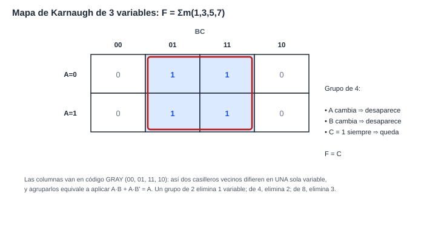
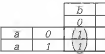
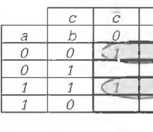

# 1.3.2 Mapa de Karnaugh de 2, 3 y 4 variables

> [!abstract] En una frase
> El mapa de Karnaugh es la tabla de verdad **dibujada en grilla con código Gray**, de modo que dos casillas vecinas (incluso por los bordes) difieren en **una sola variable**: agrupando 1, 2, 4 u 8 unos vecinos, esa variable **se cancela** y queda la función mínima.

> [!note] Si es la primera vez que ves esto
> Es un juego de **encerrar unos con rectángulos**. Cada rectángulo elimina las variables que cambian dentro de él. Cuanto más grande el rectángulo, menos literales quedan en el término: 8 unos en un solo grupo ⇒ el término es un **solo cable**; 2 unos ⇒ quedan 2 literales.

## Cómo se construye (3 variables)

- Filas: `A` (0, 1). Columnas: `BC` en **Gray**: `00, 01, 11, 10`.

- Se copia cada salida de la tabla en su casilla.

- **Vecinos:** casillas que comparten un lado; los bordes **también son vecinos** (el mapa es un cilindro).

## Reglas de agrupación (las 5 que se piden)

1. Los grupos sólo pueden tener **1, 2, 4, 8** casillas (potencias de 2).

2. Los grupos son **rectángulos** (en 4 variables también valen las esquinas y las "envolturas" por los bordes).

3. Se puede **superponer** grupos: un 1 puede usarse en dos grupos si con eso otro grupo crece.

4. Hay que cubrir **todos** los 1 con la menor cantidad de grupos y los más grandes posible.

5. Un grupo de 1 solo es válido, pero es el último recurso (deja todas las variables).

## Qué término sale de cada grupo

| Tamaño del grupo | Variables que quedan (de 3) |
|---|---|
| 8 | ninguna → término = **1** |
| 4 | 1 literal (la que **no** cambia) |
| 2 | 2 literales |
| 1 | 3 literales (el mintérmino completo) |

## Ejemplo resuelto (3 variables)
`F = Σm(0, 1, 4, 5, 6)`, es decir 1 en `m0, m1, m4, m5, m6` y 0 en `m2, m3, m7`.

| A \ BC | 00 | 01 | 11 | 10 |
|---|---|---|---|---|
| **0** | **1** (m0) | **1** (m1) | 0 (m3) | 0 (m2) |
| **1** | **1** (m4) | **1** (m5) | 0 (m7) | **1** (m6) |

1. **Grupo de 4:** las dos columnas `00` y `01` en las dos filas. Dentro del grupo cambian A y cambia C; lo único que se mantiene es **B = 0** ⇒ término **`B'`**.

2. **Grupo de 2:** `m4` (`100`) y `m6` (`110`) son vecinos (las columnas `00` y `10` son vecinas por el borde). Dentro del grupo cambia B; se mantienen `A = 1` y `C = 0` ⇒ término **`A·C'`**. (Se puede superponer con el grupo anterior: eso está permitido y no cuesta nada.)

3. **`F = B' + A·C'`** — dos términos y tres literales, contra cinco mintérminos de tres literales.

**Verificación rápida:** `m2` (`010`) → `B'` es 0 porque B = 1, y `A·C'` es 0 porque A = 0 ⇒ F = 0 ✓. `m6` (`110`) → `B'` = 0, `A·C'` = 1·1 = 1 ⇒ F = 1 ✓.

> [!tip] Atajo para verificar
> Reemplazá el resultado en dos filas al azar (por ejemplo `m0` y `m5`) y comprobá que coincide con la tabla. Si falla una, el grupo está mal leído (casi siempre por confundir qué variable se mantiene).

## Cuatro variables
Filas `AB` en Gray (`00, 01, 11, 10`), columnas `CD` también en Gray. Aparecen dos vecindades especiales: las **cuatro esquinas** (`m0, m2, m8, m10`) forman un grupo válido de 4, y las columnas/ filas de los extremos son vecinas.

> [!warning] Errores típicos
> - Agrupar en **diagonal**: no vale.
> - Usar grupos de 3, 5 o 6 casillas: no valen.
> - Olvidar los bordes (dejar un 1 sin agrupar cuando podía unirse con el otro extremo).
> - Leer el término mirando la casilla en vez de la **zona**: se cancela lo que cambia dentro del grupo.

## Figura del libro

*Mapa de Karnaugh de 2 variables: dos casillas vecinas difieren en una sola variable, así que se agrupan (Quiroga, ejemplo 5.10.1).* · Quiroga, *Arquitectura de computadoras*, p. 133.

> [!tip] Qué mirar
> Cada casilla es un mintérmino. Los dos 1 son adyacentes, se agrupan y la variable que cambia (`b`) desaparece: la función queda en una sola variable.

*Mapa de Karnaugh de 3 variables: las columnas van en orden Gray (00, 01, 11, 10) para que dos casillas contiguas nunca cambien en más de un bit.* · Quiroga, *Arquitectura de computadoras*, p. 133.

> [!tip] Qué mirar
> El grupo horizontal es superior y el vertical es inferior; en el de 3 variables los bordes también son vecinos. Cada grupo elimina las variables que cambian dentro del grupo.

## Relacionado
[[1.3.1 Mintérminos y maxtérminos]] · [[1.3.3 Don't care y criterios de agrupación]] · [[1.2.3 Simplificación analítica]] · [[TP4 Mintérminos, maxtérminos y Karnaugh]] · [[Mintérminos y maxtérminos]] · [[Glosario — Unidad 1]]
