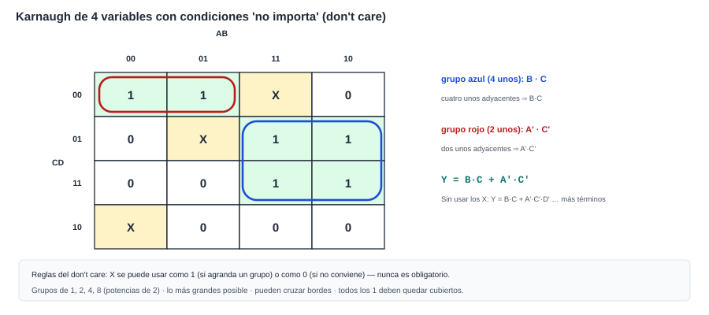
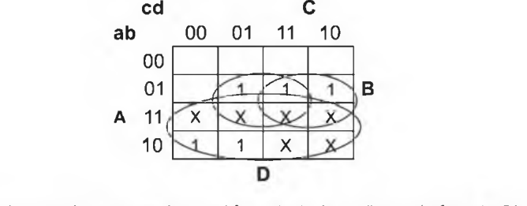

# 1.3.3 Don't care y criterios de agrupación

> [!abstract] En una frase
> Las **don't care** (`X`) son combinaciones de entrada que **nunca van a ocurrir** o cuya salida **no importa**: en el mapa se pueden tomar como 1 o como 0, **lo que convenga** para hacer grupos más grandes.

> [!note] Si es la primera vez que ves esto
> Si el circuito sólo va a recibir números del 0 al 9 (como un display BCD), las combinaciones del 10 al 15 no existen nunca: no tiene sentido "pelear" por ellas. El mapa te deja **elegirlas a favor tuyo**, y con eso los grupos crecen y el circuito se achica.

## El mapa con X

## De dónde salen

1. **Códigos con combinaciones no usadas:** BCD (0-9) en 4 bits deja libres 10 a 15.

2. **Entradas físicamente imposibles:** dos sensores que nunca se activan juntos.

3. **Salidas que no se observan:** luces de un display que no se miran en cierto modo.

## Cómo se usan (regla práctica)

1. Marcá los 1 obligatorios y los `X`.

2. Armá los grupos **incluyendo las X sólo si agrandan** el grupo (2 → 4, 4 → 8).

3. Una `X` **no** obliga a nada: si no ayuda, se deja como 0 y no se cubre.

4. Verificá que **todos los 1** queden cubiertos; las X pueden quedar afuera.

## Ejemplo: display de 7 segmentos en BCD
Entradas `A B C D` (0 a 9) y salida para el segmento **e**:

| Entrada | e | Mintérmino |
|---|---|---|
| 0, 2, 6, 8 | 1 | m0, m2, m6, m8 |
| 1, 3, 4, 5, 7, 9 | 0 | — |
| 10 a 15 | **X** | m10 … m15 |

En el mapa, los `X` de 10 a 15 permiten unir `m8` con `m0` y `m2` por el borde, y `m6` con `m2`/`m14` (`X`), con lo que el segmento **e** sale con **2 o 3 términos cortos** en vez de 4 mintérminos completos.

## Los otros criterios (cuando hay varias soluciones válidas)

| Criterio | Qué mirar |
|---|---|
| **Menos términos** | primero achicar la cantidad de grupos (menos compuertas OR) |
| **Menos literales** | después achicar el tamaño de cada término (menos entradas por compuerta) |
| **Sin superposición innecesaria** | si un grupo puede evitarse sin perder cobertura, se evita |
| **Que no queden "unos" sueltos** | un grupo de 1 suele indicar que se puede agrandar con una X |

> [!warning] Errores típicos
> - Cubrir una `X` **antes** que un 1 y dejar un 1 sin agrupar.
> - Tratar la `X` como 0 fijo (se pierde toda la ventaja).
> - Meter una X en un grupo **sin** que el grupo crezca: no aporta y confunde la corrección.
> - Olvidar que con BCD los códigos 10-15 **no se validan nunca**.

## Figura del libro

*Fig. 6.7 — Diagramas de simplificación (a, b, c, d) para la función F0.* · Quiroga, *Arquitectura de computadoras*, p. 142.

> [!tip] Qué mirar
> Las `X` son **condiciones irrelevantes** (don't care): combinaciones de entrada que nunca ocurren. Se agrupan con los 1 para armar grupos más grandes; tomarlas como 1 o como 0 es decisión del diseñador.

## Relacionado
[[1.3.2 Mapa de Karnaugh de 2, 3 y 4 variables]] · [[1.3.1 Mintérminos y maxtérminos]] · [[TP4 Mintérminos, maxtérminos y Karnaugh]] · [[Mintérminos y maxtérminos]] · [[Glosario — Unidad 1]]
