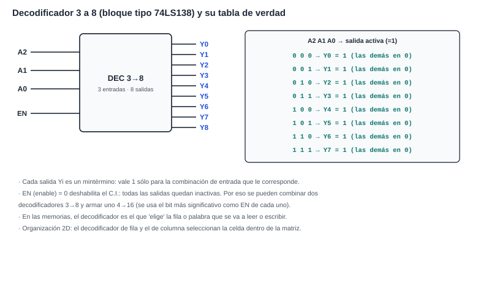

# 1.4.1 Decodificador

> [!abstract] En una frase
> Un decodificador de `n` entradas tiene `2ⁿ` salidas y activa **exactamente una**: la que corresponde al número
> binario de la entrada. Su función es `Yi = mi` (cada salida es el mintérmino de su combinación), sin simplificar.

> [!note] Si es la primera vez que ves esto
> Es el "portero de un edificio con 4 departamentos": según el número que le digan (00, 01, 10, 11), toca el
> timbre de **uno solo**. Se usa en todas partes: para elegir una palabra de memoria, para habilitar una
> instrucción, para encender un dígito de un display.

## Tabla del 2 → 4

| A1 | A0 | Y3 | Y2 | Y1 | Y0 |
|---|---|---|---|---|---|
| 0 | 0 | 0 | 0 | 0 | **1** |
| 0 | 1 | 0 | 0 | **1** | 0 |
| 1 | 0 | 0 | **1** | 0 | 0 |
| 1 | 1 | **1** | 0 | 0 | 0 |

## Funciones canónicas y circuito
```
Y0 = A1'·A0'
Y1 = A1'·A0
Y2 = A1 ·A0'
Y3 = A1 ·A0
```
**Se dibuja con `n` inversores y `2ⁿ` compuertas AND de `n` entradas.** Para 2→4: 2 NOT y 4 AND de 2.


## El 3 → 8 (y el que aparece en la materia)
3 entradas, 8 salidas, `Yi = mi`. Se usa con **enable**: una entrada `E` que habilita todo el bloque
(`Yi = E · mi`). En la Unidad de Control de la BLUE hay un decodificador **1→16** que recibe el opcode y activa
la línea de una instrucción.



## Usos concretos
| Dónde | Para qué |
|---|---|
| Memoria RAM/ROM | elegir la **fila** (palabra) con los bits de dirección |
| Unidad de Control | activar **una** instrucción a la vez (1→16) |
| Display 7 segmentos | encender el dígito que corresponde a la dirección |
| Expansión de memoria | activar un chip sí y los otros no (`E`) |

> [!warning] Errores típicos
> - Simplificar las `Yi`: **no se simplifican**, cada salida es un mintérmino puro.
> - Olvidar el inversor de la entrada negada (sale `Y0 = A1·A0`, que es `Y3`).
> - Contar mal las compuertas: para 3→8 son **3 inversores y 8 AND de 3 entradas**.

## Relacionado
[[1.4.2 Codificador]] · [[1.4.4 Demultiplexor]] · [[Decodificador]] · [[TP6 Decodificadores y demultiplexores]] ·
[[1.3.1 Mintérminos y maxtérminos]]
