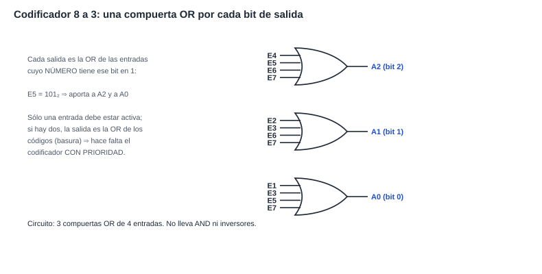

# 1.4.2 Codificador

> [!abstract] En una frase
> El codificador es el **circuito inverso** al decodificador: recibe `2ⁿ` (o menos) líneas de entrada, de las
> cuales **una sola** está activa, y entrega el **código binario** de n bits que dice cuál fue.

> [!note] Si es la primera vez que ves esto
> Es la "planilla del portero": le dicen "sonó el 3" y él anota `11`. Nada más. Si están permitidas varias
> entradas a la vez (por ejemplo, varios botones), se usa la versión con **prioridad**.

## Tabla del 8 → 3 (una sola entrada activa)

| E7 | E6 | E5 | E4 | E3 | E2 | E1 | E0 | A2 | A1 | A0 |
|---|---|---|---|---|---|---|---|---|---|---|
| 0 | 0 | 0 | 0 | 0 | 0 | 0 | **1** | 0 | 0 | 0 |
| 0 | 0 | 0 | 0 | 0 | 0 | **1** | 0 | 0 | 0 | 1 |
| 0 | 0 | 0 | 0 | 0 | **1** | 0 | 0 | 0 | 1 | 0 |
| 0 | 0 | 0 | 0 | **1** | 0 | 0 | 0 | 0 | 1 | 1 |
| 0 | 0 | 0 | **1** | 0 | 0 | 0 | 0 | 1 | 0 | 0 |
| 0 | 0 | **1** | 0 | 0 | 0 | 0 | 0 | 1 | 0 | 1 |
| 0 | **1** | 0 | 0 | 0 | 0 | 0 | 0 | 1 | 1 | 0 |
| **1** | 0 | 0 | 0 | 0 | 0 | 0 | 0 | 1 | 1 | 1 |

## Funciones (son puras OR)
```
A2 = E4 + E5 + E6 + E7
A1 = E2 + E3 + E6 + E7
A0 = E1 + E3 + E5 + E7
```
Cada salida se activa con la mitad de las entradas; no hace falta nada más.



## Codificador con prioridad
Cuando puede haber **varias** entradas activas, gana la de **mayor índice**. Se resuelve agregando, en cada
salida, la condición "y no hay una entrada mayor activa":

```
A2 = E4 + E5 + E6 + E7                      (sin cambios)
A1 = E2·E4'·E5'·E6'·E7' + E3·E4'·E5'·E6'·E7' + E6 + E7
A0 = E1·(nada mayor) + E3·(nada 4..7) + E5·(nada 6,7) + E7
```
Y se agrega una salida **"hay alguna entrada activa"** (OR de todas), que es la que avisa que el código es válido.

## Usos
- **Teclado**: se presiona una tecla y se obtiene su código.
- **Interrupciones**: varios periféricos piden atención y el codificador con prioridad dice cuál atender primero.
- **Compactar líneas**: 8 sensores → 3 cables.

> [!warning] Errores típicos
> - Usar la tabla simple cuando el enunciado permite **varias entradas a la vez** (hay que usar prioridad).
> - Invertir el orden de las entradas (¿E0 es la menos significativa?). Confirmalo con la consigna.
> - Simplificar el OR: `A2 = E4+E5+E6+E7` **ya está** mínima.

> [!example] Codificador 8 → 3
> Si está activa **sólo** la entrada 5, la salida es `101` (el número 5 en binario). Con la entrada 0 ⇒ `000`; con la
> 7 ⇒ `111`. Regla: `2ⁿ` entradas → `n` salidas, y **una sola** entrada activa por vez (por eso el simple necesita
> el `EI`, *enable input*, para encadenar dos y armar uno de 16 → 4).

## Relacionado
[[1.4.1 Decodificador]] · [[1.4.3 Multiplexor]] · [[Codificador]] ·
[[TP7 Codificadores y multiplexores]] · [[Interrupciones y entrada-salida]] · [[Glosario — Unidad 1]]
