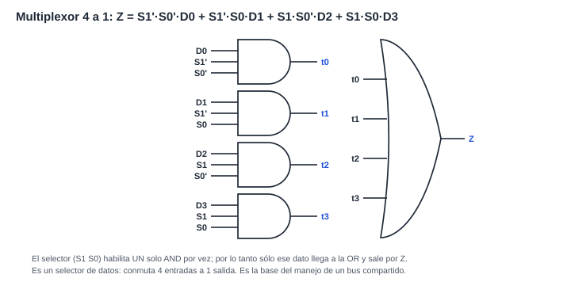
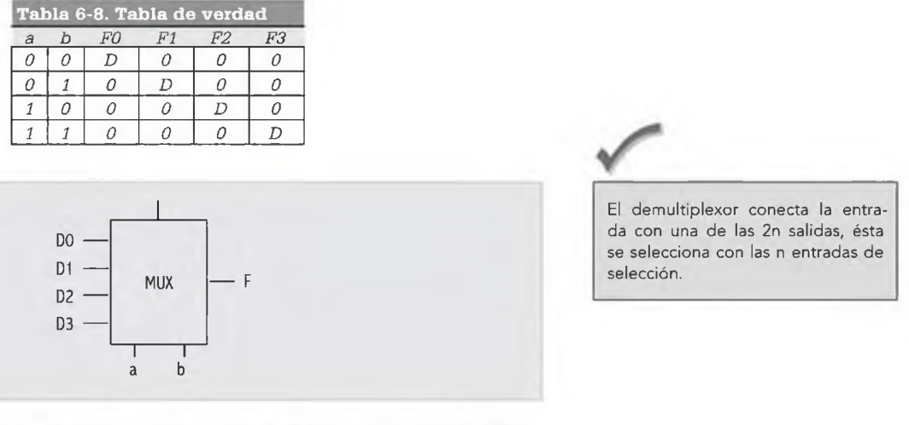
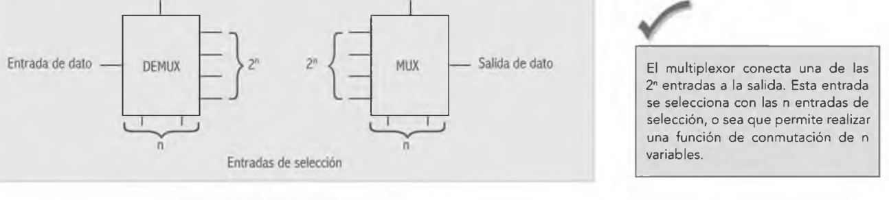

# 1.4.3 Multiplexor

> [!abstract] En una frase
> El multiplexor (MUX) tiene `n` entradas de **dato**, `k` entradas de **selección** (`n = 2^k`) y **una** salida:
> la salida es **la entrada que elige el código de selección**. Su función es `Y = Σ mi · Ii`.

> [!note] Si es la primera vez que ves esto
> Es una **llave selectora de varias posiciones**: hay 4 caños que llegan y vos girás la perilla (la selección)
> para que pase uno solo. En una computadora es lo que permite que **muchas fuentes manden al mismo bus**, de a una.

## Tabla del 4 → 1

| S1 | S0 | Y |
|---|---|---|
| 0 | 0 | I0 |
| 0 | 1 | I1 |
| 1 | 0 | I2 |
| 1 | 1 | I3 |

## Función canónica y circuito
```
Y = S1'·S0'·I0 + S1'·S0·I1 + S1·S0'·I2 + S1·S0·I3
```
**Se dibuja con**: `k` inversores, `n` compuertas AND de `k+1` entradas (una por cada entrada de dato) y **una OR**
de `n` entradas. Para 4→1: 2 NOT, 4 AND de 3 y 1 OR de 4.



## Variantes que se piden
| Variante | Qué agrega |
|---|---|
| **MUX con enable** | una entrada `E` que, en 0, pone la salida en 0 (o en alta impedancia) |
| **MUX en cascada** | dos 4→1 más un 2→1 dan un 8→1 (y así siguiendo) |
| **MUX como función lógica** | con las variables de la función en las entradas de selección, un MUX de 8→1 **implementa cualquier** función de 3 variables poniendo 0/1 en los datos |

## Usos en la materia
- **Bus único de la BLUE:** selecciona qué registro pone su dato en el bus.
- **ALU:** elige el resultado que va al acumulador y qué operación se ejecuta.
- **Selección de banco de memoria** en sistemas con varios chips.

> [!warning] Errores típicos
> - Confundir **entradas de dato** con **entradas de selección** al contar (un 8→1 tiene 8 datos y **3** de selección).
> - Invertir el orden de S1/S0 y con eso espejar la tabla.
> - Poner una OR **antes** de las AND (el orden es: AND de selección y dato → OR final).

## Ejemplo resuelto
MUX **4 → 1** con `S1 S0 = 01`: la salida es `F = D1`. Con `D0 = 0, D1 = 1, D2 = 1, D3 = 0`:
`S = 00 → F = 0` · `S = 01 → F = 1` · `S = 10 → F = 1` · `S = 11 → F = 0`.
- Su función canónica es `F = S1'S0'·D0 + S1'S0·D1 + S1S0'·D2 + S1S0·D3`.
- Un MUX **8 → 1** necesita **3** bits de selección (y 2 MUX de 4→1 + 1 de 2→1 lo arman).

## Figura del libro



*Fig. 6.20 — Diagrama de bloque de un multiplexor para cuatro entradas (D0 a D3) y dos entradas de selección.* · Quiroga, *Arquitectura de computadoras*, p. 149.

> [!tip] Qué mirar
> Con `ab = 10` la salida `F` es `D2`. El MUX es un selector: `2ⁿ` entradas de dato, `n` de selección y una de salida.



*Fig. 6.18 — Diagrama de bloque: el multiplexor conecta una de las salidas de los registros al bus y el demultiplexor reparte el dato del bus a un registro.* · Quiroga, *Arquitectura de computadoras*, p. 149.

> [!tip] Qué mirar
> Así se arma un **bus único**: el MUX elige qué registro escribe en el bus y el DEMUX elige cuál lo lee. Es el mismo esquema que usa la BLUE en cada pulso.

## Relacionado
[[1.4.4 Demultiplexor]] · [[1.4.1 Decodificador]] · [[Multiplexor]] ·
[[TP7 Codificadores y multiplexores]] · [[ALU]] · [[Glosario — Unidad 1]]
