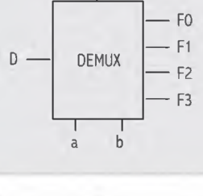

# 1.4.4 Demultiplexor

> [!abstract] En una frase
> El demultiplexor (DEMUX) tiene **una** entrada de dato `D`, `k` entradas de selección y `2^k` salidas: el dato
> sale **por una sola** de las salidas, la que indica la selección. Su función es `Yi = D · mi`.

> [!note] Si es la primera vez que ves esto
> Es un **distribuidor de caños**: llega agua por un caño y la perilla decide a cuál de las cuatro salidas va. Si
> `D = 1` siempre, se comporta como un **decodificador** — por eso se dice que el decodificador es el caso
> particular con `D = 1`.

## Tabla del 1 → 4

| S1 | S0 | Y3 | Y2 | Y1 | Y0 |
|---|---|---|---|---|---|
| 0 | 0 | 0 | 0 | 0 | **D** |
| 0 | 1 | 0 | 0 | **D** | 0 |
| 1 | 0 | 0 | **D** | 0 | 0 |
| 1 | 1 | **D** | 0 | 0 | 0 |

## Funciones y circuito
```
Y0 = D · S1'·S0'
Y1 = D · S1'·S0
Y2 = D · S1 ·S0'
Y3 = D · S1 ·S0
```
**Se dibuja con** `k` inversores y `2^k` compuertas **AND de `k+1` entradas** (la selección más el dato). Para
1→4: 2 NOT y 4 AND de 3. **No lleva OR.**


## Demux vs decodificador (la comparación que se pregunta)

| | Decodificador | Demultiplexor |
|---|---|---|
| Entradas | `n` de código | `n` de código **+ 1 de dato** |
| Salidas | `2ⁿ`, se activa una | `2ⁿ`, recibe el dato una |
| Función | `Yi = mi` | `Yi = D·mi` |
| Compuertas | AND de `n` entradas | AND de `n+1` entradas |
| Relación | caso particular con `D = 1` | generaliza al decodificador |

## Usos
- **Escribir en una celda de memoria:** el DEMUX reparte la señal de escritura a la palabra seleccionada.
- **Repartir un dato** a varios periféricos de a uno (E/S).
- **Generar señales de habilitación** en la Unidad de Control.

> [!warning] Errores típicos
> - Agregar una OR en la salida (eso convertiría el circuito en un MUX).
> - Olvidar el dato `D` en cada término: sin él, es un decodificador y no un DEMUX.
> - Contar mal: para 1→4 son 4 AND de **3** entradas (2 de selección + D).

## Ejemplo resuelto
DEMUX **1 → 4** con `D = 1` y `S1 S0 = 10`: sale **`Y2 = 1`** y `Y0 = Y1 = Y3 = 0`. Si `D = 0`, todas las
salidas quedan en 0.
- Con `D` fijo en 1 el DEMUX **es** un decodificador 2→4: ésa es la relación que se pregunta.
- Para repartir un dato entre 8 destinos: DEMUX 1→8, 3 bits de selección.

## Figura del libro



*Fig. 6.19 — Diagrama de bloque de un demultiplexor: una entrada de dato, dos de selección y cuatro salidas.* · Quiroga, *Arquitectura de computadoras*, p. 149.

> [!tip] Qué mirar
> El DEMUX reparte: el dato entra por `D` y sale **sólo** por la línea que indican `a` y `b`. Es el inverso del MUX y se usa para habilitar un registro por vez.

## Relacionado
[[1.4.3 Multiplexor]] · [[1.4.1 Decodificador]] · [[Demultiplexor]] ·
[[TP6 Decodificadores y demultiplexores]] · [[Memoria RAM 8x3]] · [[Glosario — Unidad 1]]
