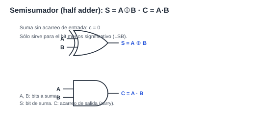
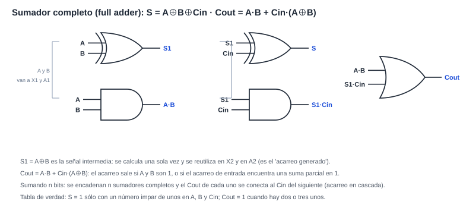
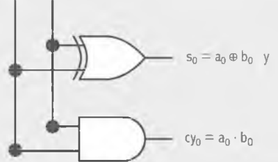

# 1.5.1 Semisumador y sumador completo

> [!abstract] En una frase
> El **semisumador** suma 2 bits (`S = A⊕B`, `C = A·B`); el **sumador completo** suma 3 (los 2 bits más el acarreo
> que viene del anterior: `S = A⊕B⊕Cin`, `Cout = A·B + Cin·(A⊕B)`). Con sumadores completos encadenados se suma
> cualquier cantidad de bits.

> [!note] Si es la primera vez que ves esto
> Cuando sumás `7 + 5` en papel, en la columna de las unidades te sale `12`: escribís **2** y te **llevás 1**. Ese
> "me llevo" es el **acarreo** (`carry`). El semisumador resuelve una columna **sin** acarreo entrante (la primera,
> o la suma de un solo bit); el sumador completo resuelve cualquier columna **con** acarreo entrante.

## Semisumador: tabla y funciones

| A | B | S (suma) | C (acarreo) |
|---|---|---|---|
| 0 | 0 | 0 | 0 |
| 0 | 1 | 1 | 0 |
| 1 | 0 | 1 | 0 |
| 1 | 1 | 0 | **1** |

```
S = A ⊕ B = A'B + AB'
C = A · B
```
**Circuito:** un **XOR** y una **AND**. Dos compuertas, nada más.



## Sumador completo: tabla y funciones

| A | B | Cin | S | Cout |
|---|---|---|---|---|
| 0 | 0 | 0 | 0 | 0 |
| 0 | 0 | 1 | 1 | 0 |
| 0 | 1 | 0 | 1 | 0 |
| 0 | 1 | 1 | 0 | **1** |
| 1 | 0 | 0 | 1 | 0 |
| 1 | 0 | 1 | 0 | **1** |
| 1 | 1 | 0 | 0 | **1** |
| 1 | 1 | 1 | 1 | **1** |

```
S    = A ⊕ B ⊕ Cin
Cout = A·B + Cin·(A ⊕ B)
```
**Circuito:** **2 XOR + 2 AND + 1 OR** (5 compuertas). La segunda XOR recibe el `Cin`; las dos AND detectan
"hubo dos o más unos" (que es exactamente cuándo hay acarreo).



> [!tip] Dos formas de decir lo mismo
> `Cout` también se escribe como **mayoría**: vale 1 cuando **al menos dos** de las tres entradas son 1.
> `S` vale 1 cuando la cantidad de unos es **impar**. Con esas dos frases podés reconstruir la tabla sin mirarla.

## Ejemplo
`A = 1`, `B = 1`, `Cin = 1` (la columna del medio de `11 + 01 + acarreo`):

- `A ⊕ B = 0` ⇒ `S = 0 ⊕ 1 = 1`
- `Cout = 1·1 + 1·(0) = 1`

Resultado: `S = 1`, `Cout = 1`, es decir `111₂ = 7`: y efectivamente `1 + 1 + 1 = 3 = 11₂`, con lo que la columna
da 1 y se llevan 1. ✓

Otro: `A = 0`, `B = 1`, `Cin = 1` ⇒ `S = 0`, `Cout = 1` (`0+1+1 = 10₂`). ✓

> [!warning] Errores típicos
> - Usar un semisumador en una columna del medio (ignora el acarreo entrante).
> - Escribir `Cout = A·B + Cin` (falta el `(A⊕B)`).
> - Invertir `S` y `Cout` al armar la tabla: `S` es la columna de las unidades, `Cout` el "me llevo".

## Figura del libro



*Fig. 5.17 — Circuito lógico del semisumador.* · Quiroga, *Arquitectura de computadoras*, p. 127.

## Relacionado
[[1.5.2 Sumador de n bits y resta en complemento a 2]] · [[1.4.3 Multiplexor]] · [[Semisumador]] ·
[[Sumador completo]] · [[TP5 Sumadores]]
