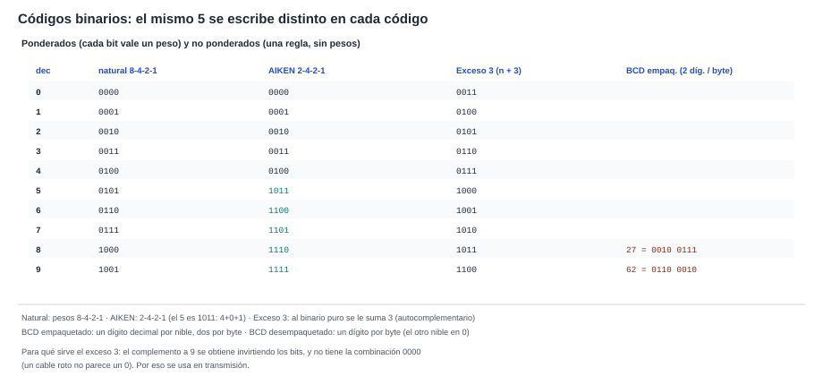

# 1.6.1 Códigos ponderados y no ponderados

> [!abstract] En una frase
> En un **código ponderado** cada posición tiene un **peso** y el valor se obtiene sumando los pesos de los bits
> en 1 (binario natural `8-4-2-1`, **AIKEN** `2-4-2-1`); en un **código no ponderado** no hay pesos, hay una
> **regla** (el **exceso 3** es "binario puro + 3"). El **BCD** no es un código nuevo: es usar el binario natural
> **por dígito decimal**, y viene **empaquetado** (dos dígitos por byte) o **desempaquetado** (uno por byte).

> [!note] Si es la primera vez que ves esto
> Pensá en los códigos como **etiquetas**. El número cinco existe una sola vez, pero se puede etiquetar de varias
> formas: `0101` (natural), `1011` (Aiken), `1000` (exceso 3). Todas las etiquetas son válidas; se elige la que
> conviene según lo que haya que hacer después (sumar, transmitir, mostrar en un display).

## Ponderados: natural y AIKEN

Un código es **ponderado** si existe un peso `wi` por posición y el valor decimal es `Σ bi · wi`.

| Código | Pesos | Cómo se escribe el 5 | Detalle |
|---|---|---|---|
| **Binario natural** | `8 4 2 1` | `0101` | es el sistema de numeración de siempre |
| **AIKEN (2-4-2-1)** | `2 4 2 1` | `1011` | pesos en otro orden: `1·2 + 0·4 + 1·2 + 1·1 = 5` |
| **BCD natural** | `8 4 2 1` **por dígito** | `0101` (un dígito) | cada dígito decimal ocupa 4 bits |

| Decimal | Natural `8-4-2-1` | AIKEN `2-4-2-1` |
|---|---|---|
| 0 | `0000` | `0000` |
| 1 | `0001` | `0001` |
| 2 | `0010` | `0010` |
| 3 | `0011` | `0011` |
| 4 | `0100` | `0100` |
| **5** | `0101` | **`1011`** |
| **6** | `0110` | **`1100`** |
| **7** | `0111` | **`1101`** |
| **8** | `1000` | **`1110`** |
| **9** | `1001` | **`1111`** |

Del 0 al 4 los dos códigos coinciden; **desde el 5 se separan**. En Aiken el 9 es `1111` y el complemento a 9 de
un dígito se obtiene **invirtiendo los bits** (igual que en exceso 3), lo que simplifica la resta decimal.

## No ponderado: exceso 3

**Regla:** al binario puro del dígito se le **suma 3**.

| Decimal | Binario puro | Exceso 3 (`n + 3`) |
|---|---|---|
| 0 | `0000` | `0011` |
| 1 | `0001` | `0100` |
| 2 | `0010` | `0101` |
| 5 | `0101` | `1000` |
| 9 | `1001` | `1100` |

Dos propiedades que se preguntan:

1. Es **autocomplementario**: el complemento a 9 se obtiene **invirtiendo todos los bits** (`0011` ↔ `1100`).
2. **No usa `0000`**: si un cable se corta y la línea queda en 0, el receptor no lee un "0" válido sino una
   combinación imposible ⇒ detecta la falla. Por eso se usa en transmisión.

## BCD: empaquetado y desempaquetado

| Formato | Cómo se guarda | Ejemplo con 62 |
|---|---|---|
| **BCD desempaquetado** | 1 dígito por **byte**, el otro nible en 0 | `0000 0110` y `0000 0010` (2 bytes) |
| **BCD empaquetado** | 2 dígitos por **byte**, uno por nible | `0110 0010` (1 byte) |

> [!example] El 27 en BCD empaquetado
> `27` ⇒ `0010` (el 2) y `0111` (el 7) ⇒ **`0010 0111`**. En cambio el 27 en binario puro es `0001 1011`: son
> cosas distintas. Si el examen dice "BCD", cada dígito va en su nible.

> [!example] Sumar en BCD no es sumar en binario
> `27 + 35`: en binario puro da `0011 1110` = 62 ✓. En BCD empaquetado, `0010 0111 + 0011 0101 = 0101 1100`, y
> ese `1100` no es un dígito BCD válido ⇒ hay que **corregir con +0110** al nible bajo: `0101 1100 + 0110 =
> 0110 0010` = **62**. La corrección se desarrolla en [[9.5.1 Suma decimal corregida]].

## Los códigos, dibujados

> [!example] Ejercicio típico de parcial
> "Escriba el 8 en binario natural, AIKEN y exceso 3". Natural `1000`; AIKEN `1110` (`1·2+1·4+1·2+0·1 = 8`);
> exceso 3: `1000 + 0011 = 1011`. Y la pregunta trampa: "¿cuántos bits necesita el exceso 3 para el 9?" Cuatro,
> porque `1100` entra cómodo (con 3 bits no alcanzaría: `1001 + 11 = 1100`).

> [!warning] Errores que se ven seguido
> - Escribir el 9 en AIKEN como `1001`: es **`1111`**.
> - Confundir **exceso 3** con **complemento a 2**: en exceso 3 se suma 3 al binario del dígito, no se niega nada.
> - Decir que el BCD "es otro sistema de numeración": no, es binario natural **por dígito**.

## Relacionado
[[1.6.2 Códigos continuos y cíclicos]] · [[1.4.2 Codificador]] · [[9.5.1 Suma decimal corregida]] ·
[[2.3.4 Detección y corrección de errores (paridad, LRC, CRC y Hamming)]] · [[Glosario — Unidad 1]]
