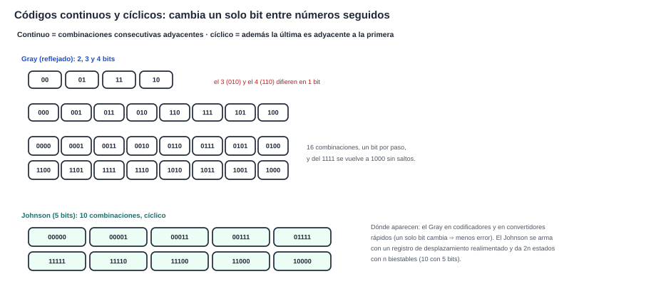

# 1.6.2 Códigos continuos y cíclicos

> [!abstract] En una frase
> Un código es **continuo** (o progresivo) si las combinaciones de números **consecutivos** son **adyacentes**, es decir que difieren en **un solo bit**; es **cíclico** si además la **última** combinación es adyacente a la **primera**. Los dos ejemplos de la cátedra son el **Gray** (reflejado) y el **Johnson**.

> [!note] Si es la primera vez que ves esto
> Imaginá un codificador de posición que gira: si pasa de `0111` a `1000` cambian **cuatro** bits a la vez y, en el instante de la transición, se pueden leer combinaciones **intermedias falsas**. Con un código continuo cambia **un solo bit**: no hay estado intermedio posible. Ésa es toda la idea.

## Gray (reflejado)

Se construye por **reflejo**: el código de `n` bits se arma copiando el de `n-1` bits al derecho (con 0 adelante) y al revés (con 1 adelante).

| Decimal | Gray 2 bits | Gray 3 bits | Gray 4 bits |
|---|---|---|---|
| 0 | `00` | `000` | `0000` |
| 1 | `01` | `001` | `0001` |
| 2 | `11` | `011` | `0011` |
| 3 | `10` | `010` | `0010` |
| 4 | — | `110` | `0110` |
| 5 | — | `111` | `0111` |
| 6 | — | `101` | `0101` |
| 7 | — | `100` | `0100` |
| 8 | — | — | `1100` |
| 9 | — | — | `1101` |
| 10 | — | — | `1111` |
| 11 | — | — | `1110` |
| 12 | — | — | `1010` |
| 13 | — | — | `1011` |
| 14 | — | — | `1001` |
| 15 | — | — | `1000` |

Propiedades para el final:

| Propiedad | Qué significa |
|---|---|
| **Continuo** | de una fila a la siguiente cambia **1 bit** |
| **Cíclico** | de la última (`1000`) a la primera (`0000`) cambia **1 bit** |
| **Reflejado** | el 2.º grupo es el 1.º al revés con el bit de arriba en 1 |
| **Conversión binario → Gray** | `G = B ⊕ (B >> 1)`: el Gray 3 de `B=101` es `101 ⊕ 010 = 111` |

> [!example] Conversión, con números
> Binario `1011` (11) ⇒ se corre un lugar y se hace XOR con el original: `1011 ⊕ 0101 = 1110` ⇒ Gray = `1110` (que en la tabla de 4 bits es, efectivamente, el 11). Y al revés (Gray → binario) se va acumulando el XOR de izquierda a derecha: `1110` ⇒ `1`, `1⊕1=0`, `0⊕1=1`, `1⊕0=1` ⇒ `1011` ✓.

## Johnson (5 bits)

Se obtiene con un **registro de desplazamiento realimentado con la salida negada**. Con `n` biestables da `2n` estados (no `2ⁿ`), y también es continuo y cíclico.

| Decimal | Johnson (5 bits) |
|---|---|
| 0 | `00000` |
| 1 | `00001` |
| 2 | `00011` |
| 3 | `00111` |
| 4 | `01111` |
| 5 | `11111` |
| 6 | `11110` |
| 7 | `11100` |
| 8 | `11000` |
| 9 | `10000` |

Se ven las dos mitades: primero **entran unos** por la izquierda, después **entran ceros**. El paso del 9 al 0 (`10000 → 00000`) también cambia **un solo bit** ⇒ cíclico.

## Los dos códigos, dibujados

> [!example] Para qué se usa cada uno
> - **Gray**: codificadores de posición (discos ópticos), convertidores analógico-digitales y en las tablas de
>   Karnaugh — por eso las filas y columnas del mapa se numeran `00, 01, 11, 10` (ver   [[1.3.2 Mapa de Karnaugh de 2, 3 y 4 variables]]).
> - **Johnson**: contadores con pocas compuertas; un contador Johnson de 5 biestables cuenta de 0 a 9 y se
>   **autocorrige** si arranca en un estado válido.

> [!warning] No confundir
> **Gray ≠ Johnson**. El Gray usa **todas** las `2ⁿ` combinaciones (4 bits → 16 estados); el Johnson usa **`2n`** (5 bits → 10 estados). Y "continuo" no es lo mismo que "cíclico": todo cíclico es continuo, pero un continuo puede no cerrar (por ejemplo, el contador Gray de 3 bits usado en un rango parcial).

## Relacionado
[[1.6.1 Códigos ponderados y no ponderados]] · [[1.3.2 Mapa de Karnaugh de 2, 3 y 4 variables]] · [[2.2.3 Contadores binarios y módulo N]] · [[1.4.2 Codificador]] · [[Glosario — Unidad 1]]
