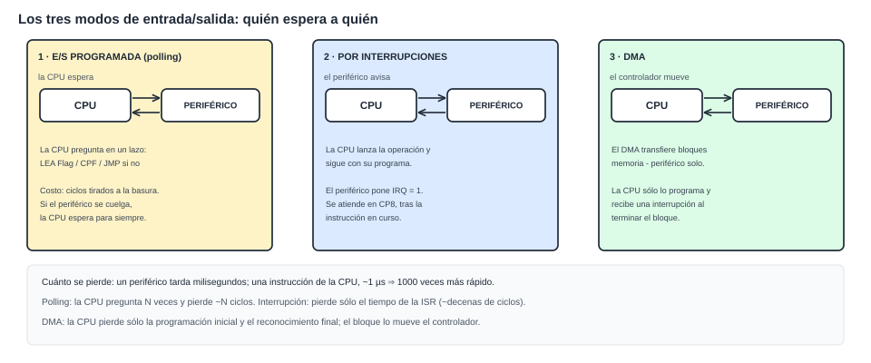
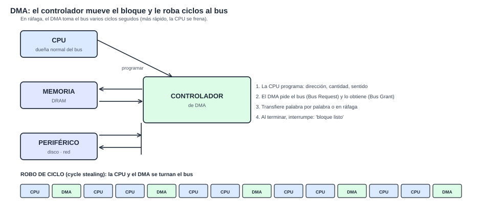
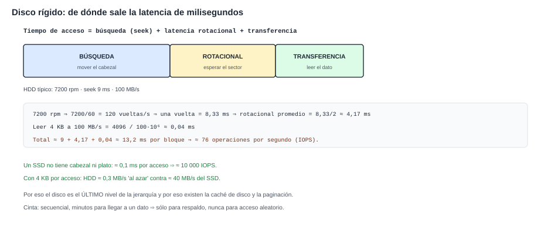

# Síntesis — Unidad 10: Entrada y Salida

> [!abstract] Qué es este archivo
> **Toda la Unidad 10 en un solo lugar**: los tres modos de E/S (polling, interrupciones, DMA), puertos e interfaces con handshake, vectorización y prioridad, y los dispositivos reales (discos, SSD, serie vs paralelo). Con todas las cuentas hechas, recetas de examen y autoevaluación.

> [!tip] Cómo usarlo
> 1. Leer **§1 a §6** (25 minutos).
> 2. Rehacer **a mano** el cálculo de polling (§1), el del disco (§5) y el del DMA (§4).
> 3. Recitar la tabla comparativa de los tres modos.
> 4. Contestar **§9** de memoria.

## Índice

1. [[#1. Los tres modos de E/S]]

2. [[#2. E/S programada y polling]]

3. [[#3. Interrupciones]]

4. [[#4. DMA]]

5. [[#5. Dispositivos y almacenamiento]]

6. [[#6. Interfaces serie y paralelo]]

7. [[#7. Tablas de memoria rápida]]

8. [[#8. Recetas de examen y errores]]

9. [[#9. Autoevaluación]]

---

## 1. Los tres modos de E/S



| | **Polling** | **Interrupciones** | **DMA** |
|---|---|---|---|
| Quién inicia | **CPU**, y **espera** | CPU inicia, **el periférico avisa** | CPU **programa**; ejecuta el **controlador** |
| Quién copia el dato | **CPU** | **CPU** | **el controlador** |
| Costo por **byte** | espera activa | ISR ≈ 20 µs | ≈ 0 |
| Costo por **bloque** | enorme | nº de bloques × ISR | **1** interrupción |
| Si el periférico falla | **se cuelga** | no pasa nada | no pasa nada |
| Hardware extra | mínimo | `IRQ`, `SI`, máscara, pila | controlador + `BR`/`BG` |
| Cuándo | espera corta y **predecible** | eventos esporádicos | **bloques grandes** |
| Ejemplo | sensor, ADC | teclado, timer | disco, red, video |

```
la CPU espera  →  el periférico avisa  →  un tercero mueve
```

## 2. E/S programada y polling

**En la BLUE:** E/S **aislada** por acumulador; `INP` trae **8 bits** al `AC`, `OUT` manda los **8 altos**; **6 líneas de selección** ⇒ **64 periféricos** (`2⁶`); la línea **`R`** indica *listo* — y `INP` **espera adentro de la instrucción**.

**El lazo típico** (`LEA FLAG` / `CPF` / `JMP esperar`) = **24 pulsos = 3 µs** por vuelta.

> [!example] El cálculo que se pregunta
> Periférico que tarda **1 ms**; lazo de **3 µs**: `1 000 µs / 3 µs ≈` **333 vueltas** ⇒ **1 ms de CPU** gastado ⇒ **0 % de trabajo útil** (8 000 pulsos tirados a 125 ns).

| Límite del polling | Por qué |
|---|---|
| Desperdicia la CPU | todo el tiempo de espera se va en preguntar |
| No escala | con `n` periféricos el lazo crece |
| Se cuelga | si nunca queda listo, no hay salida |
| Prioridad fija | el orden del lazo **es** la prioridad |

**Puertos e interfaces:** el **puerto** es la **dirección**; la **interfaz** es el **circuito**; el **handshake** (`STB` / `ACK` / `READY`) es el protocolo que evita pisar datos. Todo periférico decente expone **datos**, **estado** y **control**.

👉 [[10.1.1 Polling y sus límites]] · [[10.1.2 Puertos, interfaces y handshake]]

## 3. Interrupciones

**Condición de aceptación:** `IRQ = 1` **y** `SI = 1` **y** `CP8` (final del estado `E`) ⇒ **nunca en medio de una instrucción**.

**Los 10 pasos:** pide el periférico → termina la instrucción → verifica habilitación → reconoce (`ACK`/`INTA`) → **guarda el `PC`** → identifica la fuente → salta a la **ISR** → atiende y **baja el pedido** → restaura → **`RTI`**.

> [!example] Costo de atender (BLUE)
> Ciclo de interrupción **8 pulsos** (1 µs) + rutina de **20 instrucciones** (20 µs) = **21 µs**; con un periférico cada 1 ms ⇒ **2,1 %** de la CPU (contra el **100 %** del polling).

### Polling de identificación vs vectorización

| | **Polling de banderas** | **Vectorizada** |
|---|---|---|
| Quién identifica | la rutina (`SKF`, `CPF`) | el **hardware** entrega el **vector** |
| Costo | 2 µs por consulta: el 8.º dispositivo, **16 µs** | **1** salto indirecto ≈ 1 µs |
| Prioridad | **orden de las consultas** | **encadenado de `ACK`** / controlador |

**8086:** tabla de **256** vectores × **4 B** = **1 KB** en `00000H`–`003FFH`; dirección = **`vector × 4`**; `IRQ0`–`IRQ7` → `INT 08H`–`0FH`; `IF` habilita (`STI`/`CLI`); `NMI` → `INT 02H` (**no** enmascarable); retorno **`IRET`**.

> [!example] `IRQ5` ⇒ `INT 0DH` ⇒ `0DH × 4 = 34H` ⇒ la CPU lee 4 bytes en `0000:0034H` (IP y CS) ⇒ salta ahí.

**Máscara:** **tapa** (no elimina: queda **pendiente**) y permite **cambiar prioridades**. **Anidamiento**: necesita **pila** y **`SP`**; sin pila se **pisa** la dirección de retorno.

👉 [[10.2.1 Mecanismo completo]] · [[10.2.2 Interrupciones vectorizadas y prioridad]]

## 4. DMA



**Registros:** dirección de memoria (se incrementa), contador de palabras (decrece), periférico, control. **Secuencia:** programa la CPU → `BR` (pide el bus) → `BG` (se lo conceden) → transfiere → devuelve el bus → **una** interrupción.

| | **Robo de ciclo** | **Ráfaga** |
|---|---|---|
| Cómo | un ciclo sí, uno no | varios ciclos seguidos |
| CPU | se frena **poco** | se frena **durante el bloque** |
| Cuándo | periférico lento | bloques grandes (disco, video) |

> [!example] Cuánto se frena con robo de ciclo
> Roba **1 de cada 4** ciclos ⇒ la CPU rinde `3/4 =` **75 %** ⇒ una tarea tarda `4/3 ≈ 1,33×`.

> [!example] 1 MB desde el disco (100 MB/s), bus de 1,6 GB/s
> | | |
> |---|---|
> | Disco | `1 MB / 100 MB/s =` **10 ms** |
> | Bus | `1 MB / 1,6 GB/s ≈` **0,65 ms** (15× más rápido ⇒ **no** es el límite) |
> | Con DMA | **10 ms** y **1** interrupción (≈ 21 µs) |
> | Copiando la CPU, 1 ISR cada 4 KB | `256 × 21 µs ≈` **5,4 ms** de CPU **extra** |

**Clave:** el DMA **usa los mismos ciclos de bus**; lo que ahorra es que la **CPU no ejecuta** las instrucciones de copia. Y **necesita** interrupciones para avisar el final.

👉 [[10.3.1 Controlador, robo de ciclo y transferencia de bloques]]

## 5. Dispositivos y almacenamiento



```
T_acceso = t_búsqueda (seek) + t_rotacional (½ vuelta) + t_transferencia
vueltas/s = rpm / 60
```

> [!example] El clásico: 7 200 rpm · seek 9 ms · 100 MB/s · bloque de 4 KB
> | Paso | Cuenta | Resultado |
> |---|---|---|
> | Rotacional | `7200/60 = 120 vueltas/s` ⇒ 8,33 ms/vuelta | **4,17 ms** (media) |
> | Transferencia | `4096 / 100·10⁶` | **0,04 ms** |
> | Total | `9 + 4,17 + 0,04` | **≈ 13,2 ms** |
> | IOPS | `1 / 0,0132` | **≈ 76** |
>
> La **transferencia es el 0,3 %**: el disco es lento por **posicionarse**, no por transferir. 1 MB en 256 bloques de 4 KB ⇒ **3,4 s**; 1 MB contiguo ⇒ **≈ 23 ms** (**150×** menos).

**SSD:** ~**0,1 ms** por acceso ⇒ **10 000 IOPS**; al azar con 4 KB ⇒ **40 MB/s**; secuencial **500 MB/s**. **RAID:** 0 = velocidad · 1 = espejo · 5 = paridad distribuida (tolera 1 falla) · 10 = espejo + reparto.

| Nivel | Tiempo |
|---|---|
| Registros | < 1 ns |
| Caché L1 | ~1 ns |
| RAM | ~50-100 ns |
| SSD | ~0,1 ms |
| Disco | ~13 ms |
| Cinta | segundos |

👉 [[10.4.1 Discos, SSD y latencias]]

## 6. Interfaces serie y paralelo

| | **Paralelo** | **Serie** |
|---|---|---|
| Bits a la vez | 8/16/32 | 1 |
| Distancia | corta | larga (diferencial) |
| Problema | **desfasaje** (*skew*) | — |
| Frecuencia | limitada | **muy alta** (GHz) |
| Hoy | dentro del chip | **PCIe, SATA, USB** |

| Interfaz | Velocidad | En MB/s |
|---|---|---|
| Centronics (paralelo) | ~150 kB/s | 0,15 |
| RS-232 | 115 200 bps | ≈ 0,0115 |
| USB 2.0 | 480 Mb/s | **60** |
| SATA 6 Gb/s | 6 Gb/s (8b/10b) | **600** |
| PCIe 4.0 x4 | — | **≈ 7 900** |

> [!example] Codificado: `6 Gb/s × 8/10 = 4,8 Gb/s` útiles ⇒ `/8 =` **600 MB/s** (no 750).

> [!example] 100 MB por cada interfaz
> USB 2.0 ⇒ **1,67 s** · SATA ⇒ **0,17 s** · RS-232 ⇒ **≈ 2,4 horas** (4 órdenes de magnitud).

👉 [[10.4.2 Interfaces serie y paralelo]]

## 7. Tablas de memoria rápida

| Qué | Fórmula |
|---|---|
| Vueltas de polling | `t_espera / t_lazo` |
| Fracción de CPU perdida (polling) | **100 %** del intervalo de espera |
| Costo de una interrupción | `8 pulsos + rutina` |
| Dirección en la tabla del 8086 | `vector × 4` |
| Frenado por robo de ciclo | `(ciclos totales) / (ciclos de la CPU)` |
| Tiempo de acceso al disco | `seek + ½ vuelta + bloque / tasa` |
| IOPS | `1 / T_acceso` |
| Bytes/s de un enlace | `bits/s / 8 × (bits útiles / bits codificados)` |

**Números de la unidad:** instrucción BLUE **1 µs** (8 × 125 ns) · lazo de polling **3 µs** · interrupción atendida **21 µs** · robo 1 de 4 ⇒ **75 %** · disco 7 200 rpm ⇒ **13,2 ms** y **76 IOPS** · SSD **0,1 ms** y **10 000 IOPS** · `IRQ5 → 0DH → 34H`.

## 8. Recetas de examen y errores

> [!example] Receta 1 — "Compare los tres modos de E/S"
> 1. Tabla: quién inicia · quién copia · costo por byte · costo por bloque · cuándo conviene.
> 2. Un ejemplo numérico por modo (polling: 333 vueltas; interrupción: 2,1 %; DMA: 1 ISR por bloque).
> 3. Cierre: "cada modo existe porque el anterior **desperdicia** algo".

> [!example] Receta 2 — "Describa la atención de una interrupción"
> 1. Condición: `IRQ · SI · CP8` (final de la instrucción).
> 2. Los 10 pasos, recalcando **guardar el `PC`** y **bajar el pedido**.
> 3. Contexto: `PC` mínimo; con **pila** se puede **anidar**.
> 4. Identificación: **polling** vs **vector**; prioridad: orden / `ACK` encadenado / 8259.
> 5. Retorno: **`RTI`/`IRET`** restaura y **vuelve a habilitar**.

> [!example] Receta 3 — "Explique el DMA"
> 1. Definición: controlador **maestro del bus** que mueve el bloque.
> 2. Registros y secuencia (`BR`/`BG`).
> 3. **Robo de ciclo** vs **ráfaga** + la cuenta del frenado.
> 4. Ahorro: una interrupción por **bloque** en vez de una por byte, con el ejemplo de los 5,4 ms.

> [!example] Receta 4 — "Tiempo de acceso de un disco"
> 1. `rpm/60` ⇒ ms por vuelta ⇒ **media vuelta**.
> 2. Transferencia = `bloque / tasa`.
> 3. Sumar; **comparar** con lo que pesa cada parte (0,3 %).
> 4. Convertir a **IOPS** y contrastar con un SSD.

> [!example] Receta 5 — "Serie vs paralelo"
> 1. Tabla (bits, distancia, desfasaje, frecuencia).
> 2. El argumento del **skew** y la **frecuencia**.
> 3. Tres velocidades concretas y una cuenta de `bits/s → MB/s` con codificado.

### Errores que cuestan puntos

| Error | Lo correcto |
|---|---|
| "El polling no funciona" | funciona; **desperdicia** la CPU |
| Confundir E/S por consulta con polling de identificación | son dos *pollings* distintos |
| "La interrupción corta la instrucción" | se acepta **al final** (`CP8`) |
| Guardar el `PC` sin incrementar | al volver, **repite** la instrucción |
| Olvidar bajar el pedido en la ISR | *interrupción fantasma* en bucle |
| Decir que la máscara **elimina** | **posterga** (queda pendiente) |
| El vector **es** la dirección de la rutina | es un **índice**; la dirección se **lee** de la tabla |
| Olvidar el `× 4` del 8086 | `IRQ5 → 0DH × 4 = 34H` |
| `NMI` se puede enmascarar | **no** se puede |
| "El DMA no usa el bus" | usa los mismos ciclos; **no** usa la CPU |
| DMA **reemplaza** a las interrupciones | las **usa** para el aviso final |
| Latencia rotacional = **una** vuelta | **media** vuelta |
| "El SSD es más rápido por moderno" | porque **no tiene partes móviles** |
| "Serie = lento" | PCIe x16 ≈ 32 GB/s |
| Pasar de `Gb/s` a `MB/s` sin codificado | descontar **8b/10b** |
| RAID 0 da tolerancia | da **velocidad** |

## 9. Autoevaluación

1. Nombrá los tres modos de E/S y qué desperdicia cada uno.

2. Periférico de 2 ms, lazo de consulta de 3 µs: ¿cuántas vueltas y cuánta CPU se pierde?

3. ¿Cómo hace la E/S la BLUE? ¿Cuántos periféricos direcciona y con qué línea avisa que está listo?

4. ¿Qué diferencia hay entre **puerto**, **interfaz** y **periférico**?

5. ¿Qué es el handshake y qué dos problemas evita?

6. E/S aislada vs mapeada en memoria: dos ventajas de cada una.

7. ¿En qué momento del ciclo se acepta una interrupción y por qué **no** antes?

8. Enumerá los 10 pasos de la atención y decí **qué** se guarda como contexto mínimo.

9. Interrupción con ciclo de 8 pulsos y rutina de 25 instrucciones: ¿qué fracción de la CPU consume si el periférico pide cada 500 µs?

10. Polling de identificación con 8 dispositivos: costo del primero, del último y promedio. Comparalo con vectorizar.

11. `IRQ3`: ¿qué `INT` es y en qué dirección de la tabla se busca la rutina?

12. ¿Qué es el encadenado de `ACK` y cómo fija la prioridad?

13. ¿Por qué hace falta la **pila** para anidar interrupciones?

14. ¿Qué registros tiene un controlador de DMA y qué hace cada uno?

15. Robo de ciclo 1 de cada 3: ¿qué fracción de velocidad pierde la CPU?

16. 2 MB desde un disco de 200 MB/s por un bus de 1,6 GB/s: tiempo con DMA y ahorro contra ISR cada 8 KB.

17. Disco de 5 400 rpm, seek 8 ms, 80 MB/s: tiempo de acceso a 4 KB e IOPS.

18. ¿Por qué leer 1 MB en bloques de 4 KB es ~150 veces más lento que leerlo contiguo?

19. ¿Por qué el paralelo perdió contra el serie si tiene más cables?

20. `SATA 6 Gb/s`: ¿por qué rinde 600 MB/s? Hacé la cuenta.

---

## Relacionado
[[00 Unidad 10 completa (lectura de corrido)]] · [[00 Unidad 10 — temas y subtemas]] · [[00 Unidad 9 — temas y subtemas]] · [[00 Índice de la materia (las 10 unidades)]] · [[Interrupciones y entrada-salida]] · [[Jerarquía de memorias]]
