# Unidad 10 — Entrada y Salida

> [!abstract] Qué es este archivo
> **La Unidad 10 completa en un solo archivo**: los **7 subtemas** pegados uno detrás de otro,
> con todo su contenido: definiciones, tablas, diagramas, ejemplos resueltos, figuras del libro y errores
> típicos. Son **7.016 palabras** y **4 temas**. Está pensado para **leer de corrido** y para
> **imprimir**: no hace falta abrir ninguna otra nota.
>
> - **Repaso rápido** (una página): [[00 Síntesis — Unidad 10]].
> - **Buscar un punto**: el índice de abajo o el de la unidad, [[00 Unidad 10 — temas y subtemas]].
> - Cada subtema conserva su número (`1.4.1`), así coincide con el índice y con las preguntas del final.
> - **Todo junto, las 10 unidades**: [[00 Materia completa (las 10 unidades en un archivo)]].
>
> *Archivo generado con `tools/unir_unidades.py`: no editarlo a mano, editar el subtema y regenerar.*

## Contenido

**10.1 Entrada y salida programada**
- [[#10.1.1 Polling y sus límites]]
- [[#10.1.2 Puertos, interfaces y handshake]]

**10.2 Interrupciones**
- [[#10.2.1 Mecanismo completo]]
- [[#10.2.2 Interrupciones vectorizadas y prioridad]]

**10.3 DMA**
- [[#10.3.1 Controlador, robo de ciclo y transferencia de bloques]]

**10.4 Dispositivos y almacenamiento**
- [[#10.4.1 Discos, SSD y latencias]]
- [[#10.4.2 Interfaces serie y paralelo]]

---

## 10.1 Entrada y salida programada

### 10.1.1 Polling y sus límites

> [!abstract] En una frase
> **Polling** (E/S **por consulta** o **programada**) es que la CPU **pregunte en un lazo** si el periférico está
> listo y **espere** ahí mismo. Es lo más barato de construir y lo más caro en tiempo: mientras consulta, la CPU
> **no hace nada útil**.

> [!note] Si la primera vez que ves esto
> Es el **microondas sin timbre**: te quedás parado mirando si la comida está caliente. Podrías estar lavando los
> platos (haciendo otras instrucciones) y volver cuando suene (interrupción). El *polling* funciona, pero te ata.

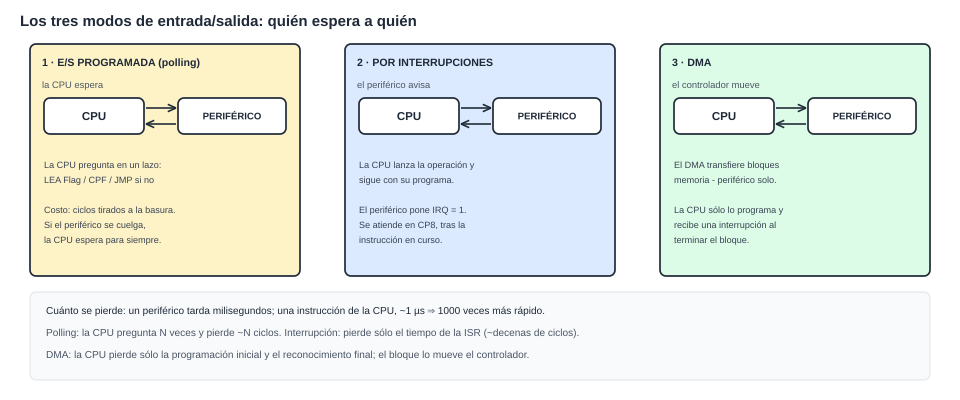

#### Cómo es, en la BLUE
En la BLUE la E/S es **aislada**, por acumulador y **por consulta**: la instrucción `INP` **no termina** hasta que
el periférico pone en 1 la línea **`R`** (*ready*). Ésa es la forma más cruda de polling: **espera dentro de la
instrucción**.

```
     INP  5        ; leer el dispositivo 5 ⇒ la CPU se queda acá hasta que R = 1
     STA  DATO     ; ya lo tengo
```

En un procesador real el polling se escribe **explícitamente**, con tres pasos:

```
esperar:  LEA  FLAG       ; dirección del registro de estado
          CPF             ; ¿bandera de "listo" en 1?
          JMP  esperar    ; si no, volver a preguntar
          INP  5          ; sí ⇒ transferir el dato
```

**Ese lazo de 3 instrucciones es el costo**: cada vuelta gasta **8 pulsos por instrucción** (24 pulsos en la BLUE)
y no produce **ningún** resultado útil.

#### Cuánto se pierde (el número que hay que saber)

| Dato | Valor de la cátedra |
|---|---|
| Una instrucción de la BLUE | **8 pulsos** × 125 ns = **1 µs** |
| Un lazo de consulta de 3 instrucciones | **24 pulsos** = **3 µs** |
| Un periférico lento (teclado, disco, impresora) | **milisegundos** |

> [!example] Ejemplo resuelto 1 — cuántas vueltas y cuánto se pierde
> "El periférico tarda **1 ms** en estar listo. El lazo de consulta tarda **3 µs**. ¿Cuánto tiempo gasta la CPU?"
>
> 1. Vueltas: `1 ms / 3 µs = 1 000 µs / 3 µs ≈` **333 vueltas**.
> 2. Tiempo de CPU gastado: `333 × 3 µs ≈ 1 000 µs =` **1 ms** (¡todo el tiempo!).
> 3. Trabajo útil en ese intervalo: **0**.
> 4. Pulsos tirados: `1 ms / 125 ns =` **8 000 pulsos**.
>
> **Conclusión:** durante 1 ms la CPU fue un **reloj caro** que sólo preguntaba "¿ya?". Con interrupciones, ese
> mismo milisegundo se usa para correr el programa.

> [!example] Ejemplo resuelto 2 — dos periféricos
> "Hay un teclado que produce una tecla cada **100 ms** y un disco que entrega un bloque cada **10 ms**. Con
> polling, ¿se puede atender a los dos?"
>
> - Si el lazo consulta **primero el teclado** y el teclado no tiene nada, se pierden **3 µs por vuelta**; el disco
>   hay que consultarlo **también**, así que cada vuelta pasa a **6 µs**.
> - El disco se atiende sí o sí en menos de **10 ms** ⇒ obliga a un lazo de, como máximo, `10 ms / 6 µs ≈ 1 660`
>   vueltas. Se puede, pero **la CPU no hace otra cosa**.
> - Peor: un periférico **raro** (falla, se desconecta) deja `R` en 0 para siempre ⇒ **la CPU queda colgada**.

#### Los límites, en limpio

| Problema | Por qué |
|---|---|
| **Desperdicia la CPU** | el 100 % del tiempo de espera se va en preguntar |
| **No escala** | con `n` periféricos, el lazo crece y la atención se hace más lenta |
| **Se cuelga** | si el dispositivo nunca queda listo, no hay salida |
| **No tiene prioridad** | el orden del lazo **es** la prioridad, y es fija |
| **Sincroniza mal** | si el periférico escribe de nuevo antes de que la CPU lea, se **pierde** el dato |

> [!important] Cuándo **sí** conviene el polling
> Cuando el periférico es **predecible y rápido**: leer un sensor cada 1 ms, un ADC que siempre responde, un
> lazo de control de tiempo real. Ahí el polling es **determinista** (sabés exactamente cuándo preguntás) y no
> paga el costo de una interrupción. La regla: **espera corta y conocida ⇒ polling; espera larga o impredecible
> ⇒ interrupción**.

#### El contraste que se pregunta en el final

| | **Polling** (E/S programada) | **Interrupciones** |
|---|---|---|
| Quién avisa | **la CPU pregunta** | **el periférico avisa** |
| La CPU mientras espera | **espera** (activa) | **sigue trabajando** |
| Hardware extra | mínimo | líneas `IRQ`, biestable `SI`, máscara, pila |
| Tiempo perdido | proporcional a la espera | sólo la rutina de servicio (≈ decenas de ciclos) |
| Si el periférico falla | **se cuelga** | nunca llega el pedido |
| Determinismo | **alto** | menor (llega cuando llega) |
| En la BLUE | `INP`/`OUT` con la línea `R` | `IRQ·SI·CP8` (lo agrega la cátedra) |

> [!warning] Errores típicos
> - Decir que el polling "no funciona": **funciona**, sólo **desperdicia**.
> - Confundir la **E/S por consulta** (la CPU espera al periférico) con el **polling de identificación** dentro de
>   una rutina de interrupción (la rutina pregunta **cuál** dispositivo interrumpió). Son dos *pollings* distintos.
> - Olvidar que en la BLUE `INP` **ya** es polling: espera la línea `R` adentro de la instrucción.
> - Decir que el polling es siempre peor: en tiempo real **determinista** a veces es mejor.
> - Pensar que el problema es la lentitud del periférico: el problema es que **la CPU lo espera** en vez de seguir.

#### Figura del libro

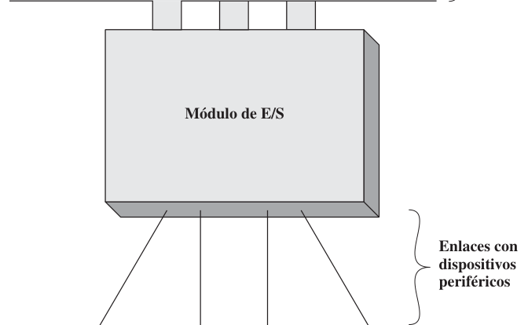

*Fig. 7.1 — Módulo genérico de un módulo E/S.* · Stallings, *Organización y arquitectura de computadores*, 7ª ed., p. 231.

#### Relacionado
[[10.1.2 Puertos, interfaces y handshake]] · [[10.2.1 Mecanismo completo]] · [[Interrupciones y entrada-salida]] ·
[[5.5.1 IRQ, SI y CP8]] · [[Las 16 instrucciones de BLUE — ciclo completo pulso por pulso]] · [[Glosario — Unidad 10]]

### 10.1.2 Puertos, interfaces y handshake

> [!abstract] En una frase
> Un **puerto** es la "puerta" con dirección por la que la CPU habla con un dispositivo; una **interfaz** es el
> circuito que traduce entre el bus y el dispositivo; y el **handshake** es el protocolo de dos señales
> (**"estoy listo" / "recibido"**) que hace que la transferencia **no se pise**.

> [!note] Si la primera vez que ves esto
> El puerto es el **mostrador**; la interfaz, el **empleado** que entiende el idioma del cliente; y el handshake es
> el "**¿me lo das? — tomá — gracias**" sin el cual uno de los dos suelta el paquete antes de tiempo.

#### STB y ACK

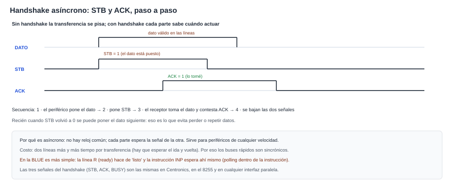

#### Las tres piezas
| Pieza | Qué es | Dónde está |
|---|---|---|
| **Puerto** | dirección (número) que selecciona un registro del periférico | en el espacio de E/S o en el de memoria |
| **Interfaz** | circuito adaptador: buffers, *latches*, decodificación, líneas de estado | placa / chip (UART, PPI 8255) |
| **Handshake** | par de señales que sincronizan (`STB`/`ACK`, `READY`, `R`) | líneas de control del bus |

#### E/S aislada vs E/S mapeada en memoria
| | **Aislada** (puertos) | **Mapeada en memoria** |
|---|---|---|
| Espacio de direcciones | **aparte**, propio de E/S | **compartido** con la memoria |
| Instrucciones | propias: `IN`/`OUT` (x86), `INP`/`OUT` (BLUE) | las comunes `LOAD`/`STORE` |
| Bits de dirección | menos (no compite con la RAM) | los mismos de la memoria |
| Ventaja | el programa **no** puede tratar un puerto como dato | más instrucciones disponibles; más simple de programar |
| Ejemplo | **BLUE**, x86 (en parte) | ARM, MIPS, la BB de un microcontrolador |

**En la BLUE es aislada:** `INP` trae **8 bits** al `AC` y `OUT` manda los **8 bits altos** del `AC`; con
**6 líneas de selección** se direccionan hasta **64 periféricos** (`2⁶ = 64`), y la línea **`R`** indica que el
dispositivo está listo.

#### El handshake, paso a paso

```
CPU / interfaz                            PERIFÉRICO
   │  ──── dato ────────────────►           │
   │  ──── STB (strobe) ────────►           │  "ahí va el dato"
   │                                ◄──── ACK │  "lo tomé"
   │  (recién ahora se puede mandar otro)   │
```

| Señal | Quién la pone | Significado |
|---|---|---|
| **`STB`** (*strobe*) o `WR` | la CPU / interfaz | "el dato está en las líneas" |
| **`ACK`** (*acknowledge*) | el periférico | "lo recibí" |
| **`READY`** / `R` / `BUSY` | el periférico | "todavía no; esperá" |
| **`IRQ`** | el periférico | "terminé, atendeme" |

> [!example] Por qué el handshake no es opcional
> Un teclado tarda **~1 ms** en tener la tecla siguiente. Si la interfaz escribe el registro de datos **sin**
> preguntar, pasan dos cosas malas:
> 1. La CPU puede leer **dos veces el mismo** carácter (no sabe si es nuevo).
> 2. Si llega una tecla **mientras** la CPU lee, se **pierde**.
>
> Con handshake: la interfaz pone `READY = 1` **sólo** cuando hay un dato nuevo, y al leerlo lo baja a 0. Así la
> bandera significa exactamente una cosa: **"hay un dato sin leer"**.

#### Del lado de la interfaz: qué hay adentro
| Bloque | Función |
|---|---|
| **Decodificador de dirección** | reconoce *su* puerto (comparador con las líneas de dirección) |
| **Registro de datos** (*latch*/buffer) | guarda el dato entre el bus y el dispositivo |
| **Registro de estado** | banderas: *listo*, *error*, *ocupado* |
| **Registro de control** | la CPU le dice **qué hacer** (arrancar, modo, interrupciones) |
| **Buffer de 3 estados** | se conecta al bus **sólo** cuando lo seleccionan |

**Ejemplo real:** el **8255** (*PPI*) tiene 3 puertos de 8 bits y se usa tanto para E/S programada como para
*handshake*; el **8250/16550** (*UART*) es una interfaz **serie** con buffers y su propio handshake.

> [!important] Los **tres registros** que hay que saber nombrar
> Todo periférico decente expone **datos**, **estado** y **control**. El programa típico es:
> 1. escribir en **control** ("arrancá"),
> 2. leer **estado** hasta que diga *listo*,
> 3. transferir por **datos**.
> Ese patrón es el mismo en polling, en interrupciones y en el arranque de un DMA.

> [!warning] Errores típicos
> - Confundir **puerto** (dirección) con **interfaz** (el circuito) y con **periférico** (el dispositivo físico).
> - Decir que la E/S mapeada en memoria "es más rápida": no lo es; es **más cómoda**.
> - Olvidar el **buffer de 3 estados**: sin él, el periférico se conectaría al bus **siempre** y lo rompería.
> - Creer que el handshake es sólo para la E/S serie (también existe en paralelo y en el bus del sistema).
> - Mezclar `STB` (la CPU avisa que **puso** el dato) con `ACK` (el periférico avisa que lo **tomó**).

#### Figura del libro

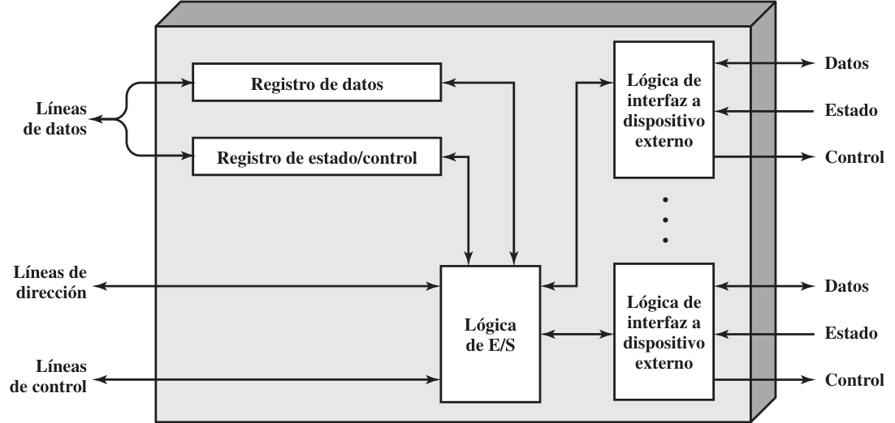

*Fig. 7.3 — Diagrama de bloques de un módulo de E/S.* · Stallings, *Organización y arquitectura de computadores*, 7ª ed., p. 238.

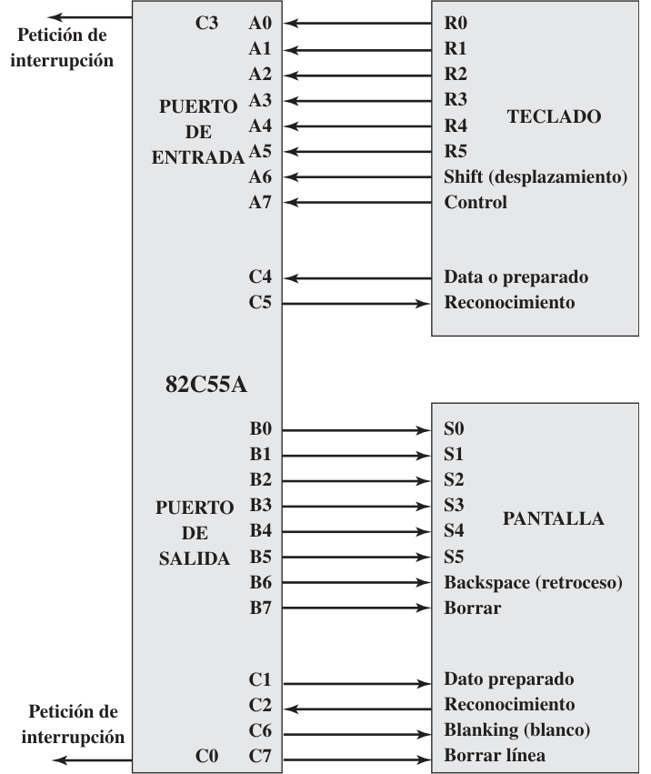

*Fig. 7.10 — Interfaz teclado/pantalla en el 82C55A.* · Stallings, *Organización y arquitectura de computadores*, 7ª ed., p. 250.

#### Relacionado
[[10.1.1 Polling y sus límites]] · [[10.2.1 Mecanismo completo]] · [[10.4.2 Interfaces serie y paralelo]] ·
[[3.1.2 Bus único y buffers de 3 estados]] · [[Interrupciones y entrada-salida]] · [[Glosario — Unidad 10]]

## 10.2 Interrupciones

### 10.2.1 Mecanismo completo

> [!abstract] En una frase
> El periférico pone **`IRQ = 1`**; la CPU, **habilitada** (`SI = 1`) y **al final de la instrucción** (`CP8`),
> **guarda el `PC`**, salta a la **rutina de servicio**, la corre y vuelve con **`RTI`** dejando todo como estaba.

> [!note] Si la primera vez que ves esto
> Es el **marcador en el libro**: dejás el programa marcado en la página exacta, atendés el timbre, y volvés a la
> misma línea. Sin marcador (sin guardar el `PC`) no hay vuelta.


#### Los diez pasos (la respuesta que se espera)
1. **El periférico pide**: pone en 1 su **bandera de dispositivo**; todas se juntan en una **OR** que produce
   `IRQ`. En la interfaz, esto es **una línea de control** del bus.
2. **La CPU termina la instrucción en curso**: la interrupción se acepta **en `CP8` del estado `E`**, nunca en el
   medio (si no, se perdería un estado intermedio del registro).
3. **Verifica la habilitación**: `SI = 1` (en el 8086, el flag `IF = 1`). Si `SI = 0`, el pedido queda **pendiente**.
4. **Reconoce el pedido**: genera `ACK`/`INTACK`; en el 8086 es el ciclo `INTA`.
5. **Guarda el contexto**: como mínimo el **`PC`** (que ya apunta a la instrucción siguiente); en máquinas reales
   también los **flags** y los registros que use la rutina.
6. **Identifica la fuente**: por ***polling* de banderas** (la rutina pregunta una por una) o por **vector** (el
   dispositivo entrega un número y hay un **salto indirecto**).
7. **Salta a la rutina de servicio** (ISR).
8. **Atiende**: lee o escribe el **registro de datos** del periférico y **baja el pedido** (si no, la interrupción
   se vuelve a disparar en el acto: *"interrupción fantasma"*).
9. **Restaura el contexto** y ejecuta **`RTI`**, que recupera el `PC` y **vuelve a habilitar** (`SI ← 1`).
10. **El programa sigue** exactamente donde estaba.

#### En la máquina de la cátedra (BLUE indexada + interrupciones)
| Elemento | Función |
|---|---|
| **`SI`** | habilita el sistema (1 = habilitado); lo manejan `ION` / `IOF` |
| **`IRQ`** | pedido único = **OR** de las banderas de dispositivo |
| **`I`** | biestable que marca "se está atendiendo" |
| **`EMR`** | carga el **registro máscara** |
| **`SKF X`** | omite la próxima si la bandera `X` está en 0 (sirve para el *polling* de identificación) |
| **`RTI`** | retorno: `PC ← M[0]` y `SI ← 1` |
| **`SP`** | puntero de pila ⇒ permite **anidamiento** |

**El ciclo de interrupción son 8 pulsos** y hace tres cosas: guardar el `PC` en la **posición 0**, poner `PC ← 1`
(la rutina arranca ahí), y bajar `SI` para no anidar sin control.

> [!example] Ejemplo resuelto — ¿cuánto cuesta atender una interrupción?
> "Una interrupción cuesta el ciclo de interrupción (**8 pulsos**) más la rutina, que son **20 instrucciones** de
> 8 pulsos. El periférico tarda **1 ms** en pedir la siguiente. ¿Qué fracción de la CPU se consume?"
>
> 1. Ciclo de interrupción: `8 × 125 ns =` **1 µs**.
> 2. Rutina: `20 × 1 µs =` **20 µs**.
> 3. Total por atención: **21 µs**.
> 4. Fracción: `21 µs / 1 000 µs =` **2,1 %**.
>
> **Comparación:** con *polling*, ese mismo periférico consumía el **100 %**. La interrupción deja **~98 %** de la
> CPU libre. Ésa es toda la diferencia.

#### Interrupción vs subrutina vs excepción
| | **Subrutina** (`CALL`/`SRJ`) | **Interrupción** | **Excepción** |
|---|---|---|---|
| Quién la dispara | **el programa** | **un evento externo** | **el propio programa** (error) |
| Cuándo | en un punto **conocido** | en cualquier momento | al ejecutar cierta instrucción |
| Dirección | fija en la instrucción | la da el vector / la tabla | la da una tabla interna |
| Retorno | `RET` | `RTI` (restaura flags y habilita) | similar a `RTI` |
| Ejemplos | `SRJ`, `CALL` | teclado, disco, timer | división por cero, opcode inválido, fallo de página |

> [!important] Las dos cosas que **siempre** se preguntan
> 1. **¿Cuándo se acepta?** Al **final** de la instrucción (`CP8` del estado `E`), nunca en el medio.
> 2. **¿Qué se guarda?** El **`PC` ya incrementado**; y con pila, todo el contexto para poder **anidar**.

> [!warning] Errores típicos
> - Decir que la interrupción "corta" la instrucción por la mitad.
> - Guardar el `PC` **antes** de incrementarlo (al volver, se **repite** la instrucción).
> - Olvidar **bajar el pedido** en la rutina ⇒ *interrupción fantasma* en bucle infinito.
> - Confundir `RTI` (retorno de interrupción: restaura y **habilita**) con `RET` (subrutina).
> - Decir que la BLUE original tiene interrupciones: **no las tiene**, las agrega la cátedra.

#### Figura del libro

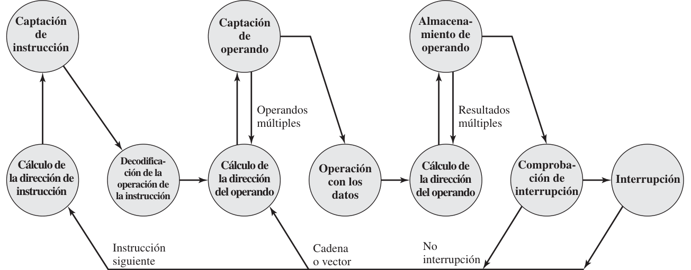

*Fig. 3.12 — Diagrama de estados de un ciclo de instrucción, con interrupciones.* · Stallings, *Organización y arquitectura de computadores*, 7ª ed., p. 95.

#### Relacionado
[[10.2.2 Interrupciones vectorizadas y prioridad]] · [[10.1.1 Polling y sus límites]] ·
[[5.5.1 IRQ, SI y CP8]] · [[5.5.2 Máscara, pila y RTI]] · [[Interrupciones y entrada-salida]] · [[Glosario — Unidad 10]]

### 10.2.2 Interrupciones vectorizadas y prioridad

> [!abstract] En una frase
> En vez de que la rutina **pregunte quién fue** (*polling* de banderas), el dispositivo **entrega su vector** (un
> número) y la CPU salta **directo** por una **tabla de vectores**; si dos piden a la vez, gana el de **mayor
> prioridad**, que se resuelve por **encadenado de `ACK`** o con un **controlador de prioridades**.

> [!note] Si la primera vez que ves esto
> *Polling* es tocar timbre en todas las puertas hasta encontrar a quién buscan. **Vectorizado** es que el que
> tocó **diga su nombre** por el portero automático: un solo salto, sin preguntas.

#### Cadena y tabla

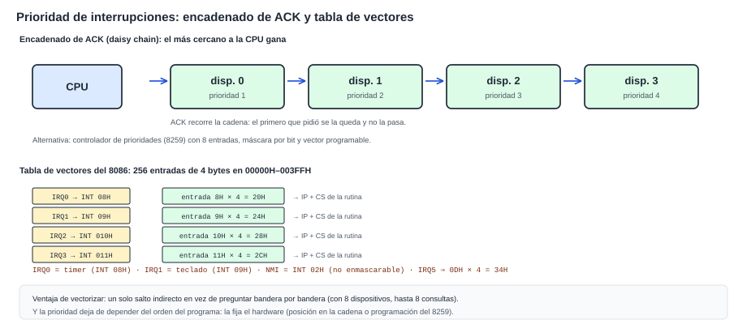

#### Comparación de las dos identificaciones
| | **Polling de banderas** | **Vectorizada** |
|---|---|---|
| Quién identifica | **la rutina**, preguntando una por una | **el hardware** (el vector) |
| Cuánto tarda | depende del orden: hasta `n` consultas | **un solo** salto indirecto |
| Prioridad | **el orden de las consultas** | **el encadenado de `ACK`** o el controlador |
| Cambiar prioridad | se **reescribe** la rutina | se cambia la **cadena** o la programación |
| Ejemplo | BLUE de la cátedra | **8086** (`INTA` + vector), ARM, MIPS |

> [!example] Los números del polling de identificación
> Con **8 dispositivos** y `SKF`+`JMP` (**2 instrucciones = 16 pulsos = 2 µs** por consulta):
> - el primero de la lista: **2 µs**;
> - el último: `8 × 2 =` **16 µs**;
> - promedio: **9 µs**.
>
> Vectorizado: **un** salto indirecto, **≈ 1 µs**. Para el dispositivo número 8 es **16 veces** más rápido.

#### Cómo funciona el vector
```
   CPU  ──ACK──►  dispositivo  ──vector (8 bits)──►  CPU
                                                     │
                                    PC ← M[ base + vector ]
                                                     │
                                        TABLA DE VECTORES
                                        base+0 → rutina 0
                                        base+1 → rutina 1
                                        base+2 → rutina 2 …
```
El vector **no es una dirección de rutina**: es un **índice** a la tabla (o, en el 8086, cada entrada de la tabla
**contiene** la dirección). Por eso el salto es **indirecto**.

#### Prioridad: las dos formas
| Forma | Cómo | Ventaja |
|---|---|---|
| **Por software** | el **orden** de las consultas **es** la prioridad | gratis, flexible por programa |
| **Codificador de prioridad** | hardware que entrega el código del pedido más alto | rápido, fijo |
| **Encadenado de `ACK`** (*daisy chain*) | la señal `ACK` **recorre** los dispositivos en orden; el primero que pidió se la queda | sin lógica central; la prioridad es **el orden físico** |
| **Controlador de interrupciones** (8259) | concentra 8 pedidos, da prioridad, entrega el vector | programable, enmascarable por bit |

**Máscara:** registro con un bit por fuente. Tapa pedidos (**no los elimina**: quedan pendientes) y permite
**cambiar la prioridad en tiempo de ejecución** — así una rutina de mayor prioridad no es interrumpida por una de
menor. En la BLUE es el registro que carga **`EMR`**.

#### El caso concreto: el 8086
| Concepto | Valor |
|---|---|
| Tabla de vectores | **256** entradas de **4 bytes** = **1 KB** en `00000H`–`003FFH` |
| Dirección de la entrada | `vector × 4` |
| `IRQ0`–`IRQ7` (8259) | `INT 08H`–`INT 0FH` |
| `IRQ0` = timer, `IRQ1` = teclado | `INT 08H`, `INT 09H` |
| `NMI` | `INT 02H` — **no enmascarable** |
| Flag que habilita | **`IF`** (`STI` / `CLI`) |
| Reconocimiento | ciclo **`INTA`** |
| Retorno | **`IRET`** (restaura `IP`, `CS` y los flags) |

> [!example] Ejemplo resuelto — calcular la dirección de la rutina
> "Llega el pedido de `IRQ5`. ¿A qué dirección de la tabla se va?"
>
> 1. `IRQ5` ⇒ `INT 0DH` (porque `IRQ0 → 08H`).
> 2. Entrada de la tabla: `0DH × 4 = 34H =` **52** decimal.
> 3. La CPU lee los 4 bytes en `0000:0034H`: 2 para el `IP` y 2 para el `CS`.
> 4. Salta a `CS:IP` leído ⇒ **ahí está la rutina** del dispositivo 5.
>
> **Comprobación:** `IRQ1` (teclado) ⇒ `09H × 4 = 24H`; `IRQ0` ⇒ `08H × 4 = 20H`.

#### Anidamiento y pila
Una interrupción **dentro** de otra exige **pila (LIFO)** y **`SP`**: sin pila, la segunda atención **pisaría** la
dirección de retorno de la primera y el `RTI` volvería a cualquier lado. Con pila: cada entrada **apila** y cada
`RTI` **desapila**, en el orden inverso.

> [!important] Las tres reglas de la prioridad
> 1. El pedido **no se pierde** por estar enmascarado: **queda pendiente**.
> 2. Una rutina de mayor prioridad **no puede** ser interrumpida por una de menor ⇒ eso lo garantiza la máscara.
> 3. El **encadenado de `ACK`** fija la prioridad por **posición física**: el más cercano a la CPU gana.

> [!warning] Errores típicos
> - Decir que el vector **es** la dirección de la rutina (es un **índice**; la dirección se **lee** de la tabla).
> - Confundir **prioridad** con **máscara**: la prioridad **ordena**, la máscara **tapa**.
> - Olvidar que `NMI` **no** se puede enmascarar.
> - Creer que vectorizar elimina la necesidad de rutinas: cambia **cómo se llega**, no qué se hace.
> - Olvidar el `× 4` del 8086 al calcular la dirección de la tabla.

#### Figura del libro

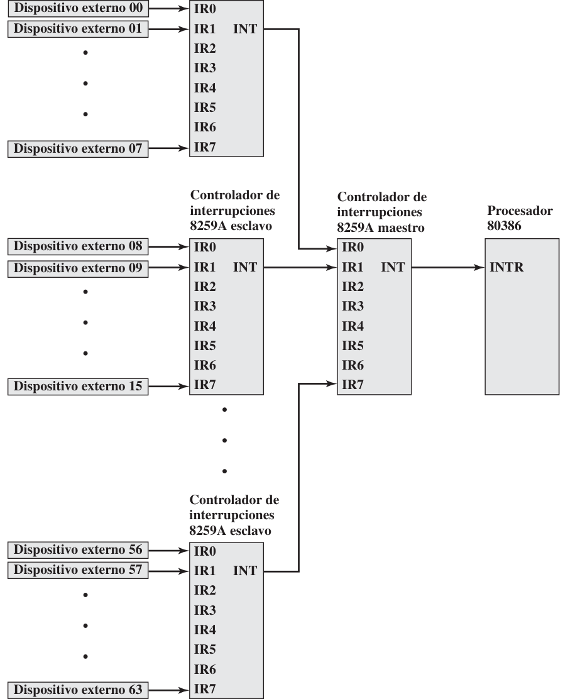

*Fig. 7.8 — Uso del controlador de interrupciones 82C59A.* · Stallings, *Organización y arquitectura de computadores*, 7ª ed., p. 248.

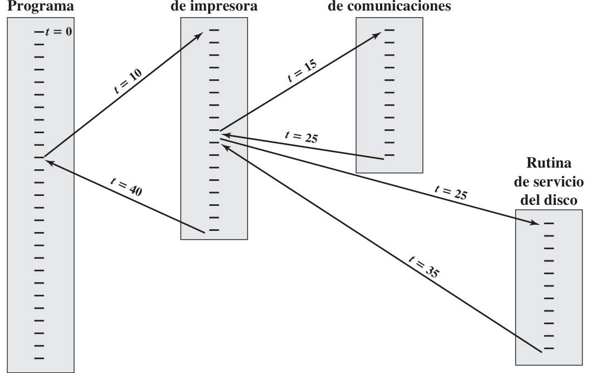

*Fig. 3.14 — Ejemplo de secuencia temporal de varias interrupciones.* · Stallings, *Organización y arquitectura de computadores*, 7ª ed., p. 97.

#### Relacionado
[[10.2.1 Mecanismo completo]] · [[10.3.1 Controlador, robo de ciclo y transferencia de bloques]] ·
[[5.5.2 Máscara, pila y RTI]] · [[Interrupciones y entrada-salida]] · [[5.6.1 BIU, EU y segmentación]] · [[Glosario — Unidad 10]]

## 10.3 DMA

### 10.3.1 Controlador, robo de ciclo y transferencia de bloques

> [!abstract] En una frase
> El **controlador de DMA** es un **maestro más del bus**: la CPU le da **dirección inicial, cantidad y sentido**;
> él **pide el bus**, mueve el bloque **palabra por palabra** (*robo de ciclo*) o **en ráfaga**, y al terminar
> **interrumpe** una sola vez.

> [!note] Si la primera vez que ves esto
> Es el **flete**. Vos (la CPU) no llevás cada caja: le decís al camionero "desde el depósito A al B, 1 MB,
> de ida", y te avisa cuando terminó. Vos seguís trabajando; sólo le cedés la calle de a ratos.

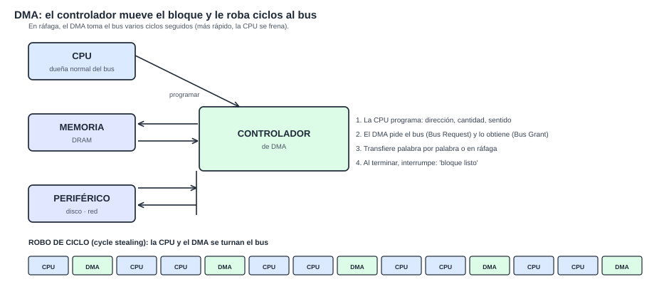

#### Los registros del controlador
| Registro | Qué guarda |
|---|---|
| **Dirección de memoria** | dónde empieza (y **se incrementa** solo) |
| **Contador de palabras** | cuántas faltan (y **decrece**; en 0 ⇒ terminó) |
| **Dirección / número de periférico** | con quién habla |
| **Control** | sentido (memoria→periférico o al revés), modo, tamaño |

**Por eso el DMA no puede ser "sin dirección":** el controlador **es un procesador chiquito** que hace un lazo
`leer / escribir / incrementar / decrecer / ¿llegué a cero?`. Lo único que **no** hace es ejecutar instrucciones.

#### La secuencia completa
1. **La CPU programa** el controlador (los 4 registros) y le dice "arrancá".
2. **El controlador pide el bus**: `BR` (*Bus Request*).
3. **La CPU termina su ciclo de bus** y **concede**: `BG` (*Bus Grant*). Desde acá, **el maestro es el DMA**.
4. **Transfiere**: en cada ciclo de bus, pone una dirección, lee o escribe el dato, **incrementa** y **decrece**.
5. **Devuelve el bus** (`BG` en 0) y **pide una interrupción**: "bloque listo".
6. **La CPU atiende** la interrupción y sigue.

> [!important] Lo que hay que decir sí o sí
> El DMA **no es magia**: usa **los mismos** ciclos de bus. Lo que ahorra es que **la CPU no ejecuta** las
> instrucciones de copia. El bus se lo **presta** (por eso se habla de *robo de ciclo*).

#### Robo de ciclo vs ráfaga
| | **Robo de ciclo** (*cycle stealing*) | **Ráfaga** (*burst*) |
|---|---|---|
| Cómo | el DMA toma **un ciclo** y devuelve el bus; después otro | toma el bus **varios ciclos seguidos** |
| Impacto en la CPU | **se frena un poco** (pierde algunos ciclos) | **se frena** durante el bloque |
| Velocidad del bloque | menor | **máxima** |
| Cuándo | periféricos lentos, sistema con mucho tráfico | bloques grandes, disco, video |

> [!example] Ejemplo resuelto 1 — cuánto se frena la CPU con robo de ciclo
> "El bus tarda **0,5 µs** por ciclo y el DMA roba **1 de cada 4** ciclos. ¿Cuánto se frena la CPU?"
>
> - De cada 4 ciclos, la CPU usa **3** ⇒ rinde `3/4 =` **75 %** de su velocidad normal.
> - En tiempo: si una tarea tardaba `T`, ahora tarda `T × 4/3 ≈ 1,33 T` ⇒ **33 % más lento**.
> - **Y aun así conviene:** copiar esos mismos datos con la CPU costaría `2` instrucciones por palabra
>   (**16 pulsos**), mucho más que los ciclos robados.

> [!example] Ejemplo resuelto 2 — el número que cierra el tema
> "Hay que mover **1 MB** desde el disco. Bus de **64 bits a 200 MHz** (1,6 GB/s). Disco a **100 MB/s**.
> Comparar el DMA contra que la CPU copie, atendiendo una interrupción cada 4 KB."
>
> **a) Con DMA**
> - Tiempo del disco: `1 MB / 100 MB/s =` **10 ms**.
> - Tiempo de bus necesario: `1 MB / 1,6 GB/s ≈` **0,65 ms**.
> - El bus es **15 veces más rápido** que el disco ⇒ la transferencia va **a la par del disco**: **10 ms**,
>   y la CPU **hace su programa** mientras tanto. Al final, **una** interrupción (≈ 21 µs).
>
> **b) Con la CPU copiando (una interrupción cada 4 KB)**
> - Bloques: `1 MB / 4 KB =` **256**.
> - Costo: `256 × 21 µs ≈` **5,4 ms** de CPU gastados **encima** de los 10 ms del disco.
>
> **Conclusión:** el DMA ahorra **~5,4 ms de CPU** (más de la mitad del tiempo total) y, sobre todo, libera al
> procesador **durante** la transferencia.

> [!example] Ejemplo resuelto 3 — ¿el bus alcanza?
> "Bus de **64 bits a 200 MHz** (1,6 GB/s) y disco a **100 MB/s**. ¿Cuánto del bus ocupa el DMA?"
>
> 1. `100 MB/s / 1 600 MB/s =` **6,25 %** del ancho de banda.
> 2. ⇒ el resto queda para la CPU: **no hay conflicto real** con un disco.
> 3. Con **video** o **red de 10 Gb/s** la historia cambia: ahí el DMA **sí** compite en serio.

#### Los tres modos de E/S, en una tabla

| | **Polling** | **Interrupciones** | **DMA** |
|---|---|---|---|
| Quién inicia | CPU | CPU (y el periférico avisa) | CPU **programa**; el DMA ejecuta |
| Quién copia el dato | **CPU** | **CPU** | **el controlador** |
| Costo por **byte** | espera | ISR (≈ 20 µs) | ~**nada** |
| Costo por **bloque** | enorme | `nº bloques × ISR` | **1** interrupción |
| Cuándo | periférico rápido y predecible | eventos esporádicos | **bloques grandes** |
| Ejemplo | sensor, ADC | teclado, ratón | disco, red, video |

> [!warning] Errores típicos
> - Decir que el DMA "no usa el bus": **usa los mismos** ciclos; lo que no usa es la **CPU**.
> - Confundir **robo de ciclo** (de a un ciclo) con **ráfaga** (varios seguidos).
> - Olvidar que el DMA **pide permiso** (`BR`/`BG`): no puede escribir la memoria a la fuerza.
> - Creer que el DMA reemplaza a las interrupciones: **las usa** para avisar el final.
> - Decir que el DMA es más rápido porque "trabaja en paralelo" **siempre**: con robo de ciclo compite con la
>   CPU por el mismo bus.
> - Olvidar que necesita **coherencia**: si hay caché, hay que ver quién ve el dato (memoria vs caché).

#### Figura del libro

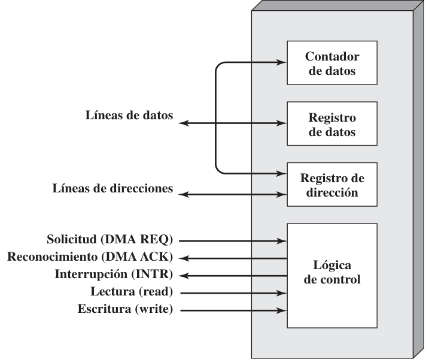

*Fig. 7.11 — Diagrama de bloques típico de un módulo de DMA.* · Stallings, *Organización y arquitectura de computadores*, 7ª ed., p. 252.


*Fig. 7.12 — Puntos de ruptura para el DMA y las interrupciones en un ciclo de instrucción.* · Stallings, *Organización y arquitectura de computadores*, 7ª ed., p. 253.

#### Relacionado
[[10.2.2 Interrupciones vectorizadas y prioridad]] · [[10.4.1 Discos, SSD y latencias]] ·
[[7.4.2 Buses internos y externos]] · [[Interrupciones y entrada-salida]] · [[8.3.1 Bancos de memoria y ancho de banda]] · [[Glosario — Unidad 10]]

## 10.4 Dispositivos y almacenamiento

### 10.4.1 Discos, SSD y latencias

> [!abstract] En una frase
> El tiempo de acceso de un **disco rígido** es **búsqueda** (mover el cabezal, ~9 ms) + **latencia rotacional**
> (media vuelta, ~4,17 ms a 7 200 rpm) + **transferencia** (~0,04 ms por 4 KB) ≈ **13 ms**; un **SSD** no tiene
> partes móviles y baja a **~0,1 ms**.

> [!note] Si la primera vez que ves esto
> El disco es un **tocadiscos**: para leer una canción el brazo tiene que **viajar** hasta el surco (búsqueda) y
> esperar que el disco **gire** hasta el punto (rotación). El SSD es un **pendrive grande**: no hay brazo ni
> vueltas, sólo direcciones.

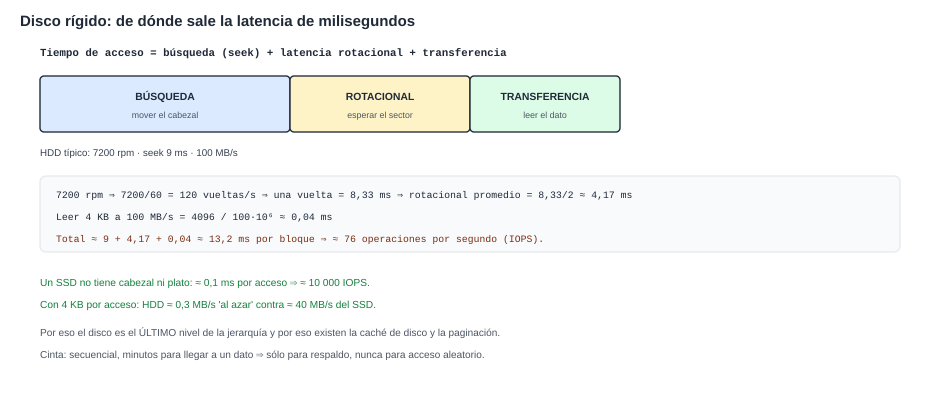

#### Las tres partes del tiempo de acceso
```
T_acceso = t_búsqueda (seek) + t_rotacional + t_transferencia
```

| Componente | Qué es | Valor típico |
|---|---|---|
| **Búsqueda** (*seek*) | mover el cabezal al **cilindro** | **9 ms** (3-15 ms) |
| **Latencia rotacional** | esperar que el **sector** pase bajo el cabezal | **media vuelta**: 4,17 ms a 7 200 rpm |
| **Transferencia** | leer los bytes del sector | depende del **bloque** y de la **tasa** |

**La rotación, en fórmula:** `vueltas/s = rpm / 60` ⇒ a 7 200 rpm: `120 vueltas/s` ⇒ una vuelta = `1/120 s =
8,33 ms` ⇒ **promedio** (media vuelta) = **4,17 ms**.

#### Anatomía del disco (lo que se nombra)
| Término | Qué es |
|---|---|
| **Plato** y **cara** | discos apilados; cada cara tiene un cabezal |
| **Pista** (*track*) | circunferencia de una cara |
| **Cilindro** | la misma pista en **todas** las caras ⇒ el cabezal no se mueve |
| **Sector** | unidad mínima direccionable (**512 B** o **4 KB** en los modernos) |
| **CHS** vs **LBA** | direccionamiento físico (cilindro-cabeza-sector) vs **lineal** |
| **ZBR** | pistas externas con **más** sectores (más rápidas) |

> [!example] Ejemplo resuelto 1 — el clásico del final
> "Disco de **7 200 rpm**, *seek* **9 ms**, tasa **100 MB/s**. Calcule el tiempo de leer **4 KB** y los IOPS."
>
> 1. Rotacional media vuelta: `60/7200 = 8,33 ms` por vuelta ⇒ **4,17 ms**.
> 2. Transferencia: `4096 B / 100·10⁶ B/s = 0,00004096 s ≈` **0,04 ms**.
> 3. Total: `9 + 4,17 + 0,04 ≈` **13,2 ms**.
> 4. IOPS: `1 / 0,0132 s ≈` **76 operaciones/s**.
>
> **Moraleja:** la **transferencia es 0,3 %** del total. El disco **no es lento por mover bytes**, es lento por
> **posicionarse**. Por eso leer 1 MB en 256 bloques de 4 KB cuesta `256 × 13,2 ms ≈ 3,4 s`, mientras que leerlo
> **en un solo bloque contiguo** cuesta `9 + 4,17 + 10 ms ≈` **23 ms**: **150 veces** menos.

> [!example] Ejemplo resuelto 2 — ¿y un SSD?
> "Un SSD tarda **0,1 ms** por acceso aleatorio de 4 KB y transfiere a **500 MB/s**."
>
> 1. IOPS: `1 / 0,1 ms =` **10 000** (≈ **130×** el disco).
> 2. Ancho de banda al azar: `10 000 × 4 KB = 40 MB/s`.
> 3. Secuencial: **500 MB/s** (5× el disco).
> 4. ⇒ el SSD gana **muchísimo** en acceso **aleatorio** (bases de datos, arranque) y **bastante** en secuencial.

#### Comparación de los niveles
| Nivel | Tiempo típico | Tecnología | ¿Volátil? |
|---|---|---|---|
| Registros | **< 1 ns** | biestables | sí |
| Caché L1 | **~1 ns** | SRAM | sí |
| Memoria RAM | **~50-100 ns** | DRAM | sí |
| SSD / Flash | **~0,1 ms** | celda flotante | **no** |
| Disco rígido | **~13 ms** | magnetismo | **no** |
| Cinta | **segundos-minutos** | magnetismo secuencial | **no** |

**Las potencias de 10 que hay que saber decir:** la RAM es **~10⁵-10⁶** veces más lenta que los registros; el
disco es **~10⁵** veces más lento que la RAM. Ese salto es lo que hace **necesaria** la memoria virtual
([[2.6.1 Memoria virtual y paginación]]) y la caché de disco.

#### RAID, en una tabla (se pregunta como "concepto")
| Nivel | Qué hace | Ventaja | Costo |
|---|---|---|---|
| **0** | *striping* (reparte) | velocidad | **sin** tolerancia |
| **1** | *mirroring* (duplica) | tolerancia total | 50 % del espacio |
| **5** | *striping* + **paridad** distribuida | buen equilibrio | tolera **1** falla |
| **10** | espejo + reparto | rápido y seguro | 50 % del espacio |

> [!important] Las tres cosas que se preguntan de memoria
> 1. **Las tres partes** del tiempo de acceso y que **la rotacional es media vuelta**.
> 2. Que el **acceso aleatorio** domina: **trasladarse cuesta más que transferir**.
> 3. Que el SSD elimina **búsqueda y rotación** ⇒ gana sobre todo en **aleatorio**.

> [!warning] Errores típicos
> - Usar **una vuelta completa** (8,33 ms) en vez de **media** (4,17 ms) para la latencia rotacional.
> - Sumar la transferencia como si fuera grande: a 4 KB es **despreciable** frente al *seek*.
> - Confundir **pista** con **cilindro** (el cilindro es la misma pista en todas las caras).
> - Decir que el SSD es "más rápido porque es más moderno": es más rápido **porque no tiene partes móviles**.
> - Olvidar que el **sector** es la unidad mínima: leer 1 byte cuesta el sector entero.
> - Decir que RAID 0 da **tolerancia** a fallas: **no**, da velocidad.

#### Figura del libro

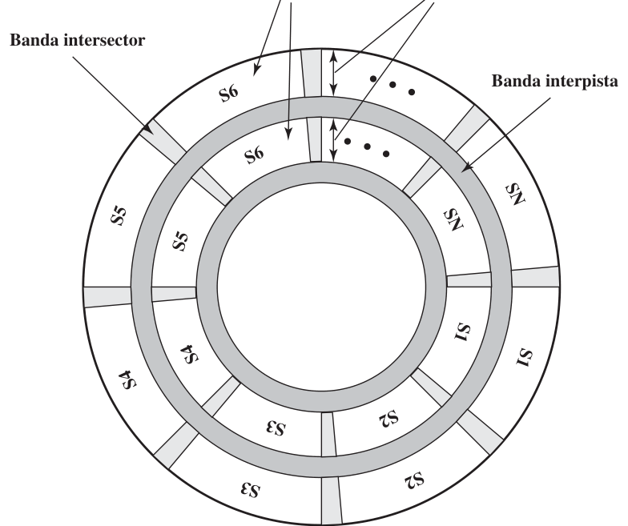

*Fig. 6.2 — Organización de los datos en el disco.* · Stallings, *Organización y arquitectura de computadores*, 7ª ed., p. 200.

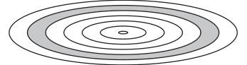

*Fig. 6.6 — Pistas y cilindros.* · Stallings, *Organización y arquitectura de computadores*, 7ª ed., p. 203.

#### Relacionado
[[10.4.2 Interfaces serie y paralelo]] · [[2.6.2 Memoria auxiliar y memoria asociativa]] · [[2.5.1 Jerarquía y localidad]] ·
[[2.6.1 Memoria virtual y paginación]] · [[Jerarquía de memorias]] · [[10.3.1 Controlador, robo de ciclo y transferencia de bloques]] · [[Glosario — Unidad 10]]

### 10.4.2 Interfaces serie y paralelo

> [!abstract] En una frase
> **Paralelo**: todos los bits a la vez por varios cables (rápido en distancias cortas, caro y con **desfasaje**);
> **serie**: un bit por vez (un cable, larga distancia, y hoy **más rápido** porque sube mucho la frecuencia y
> **embebe el reloj** en la propia señal).

> [!note] Si la primera vez que ves esto
> **Paralelo** es una **autopista de 8 carriles**: mucha capacidad, pero si un carril se tapa, todo se traba.
> **Serie** es un **tren de un carril a 300 km/h**: parece más lento, pero llega antes porque no hay que
> sincronizar carriles.

#### El skew

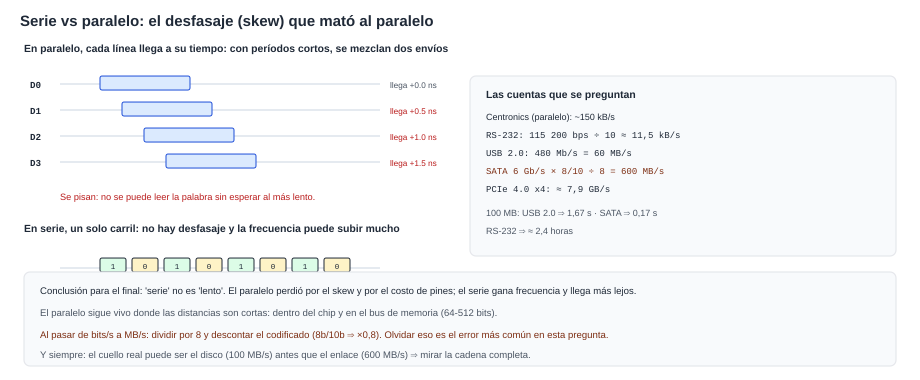

#### Las dos transmisiones
| | **Paralelo** | **Serie** |
|---|---|---|
| Bits a la vez | **8, 16, 32** | **1** |
| Cables | uno por bit (+ control) | uno de datos (+ reloj) |
| Distancia | **corta** (metros) | **larga** (decenas de metros a km con diferencial) |
| Problema | **desfasaje** (*skew*) entre líneas | — |
| Sincronización | reloj **aparte** (o *handshake*) | reloj **embebido** en el dato |
| Costo | alto (muchos pines) | bajo |
| Hoy | retrocede | **domina** (PCIe, SATA, USB) |

##### El desfasaje, que es **el** argumento
A frecuencias altas, las 8 (o 32) líneas de un bus paralelo **no llegan al mismo tiempo**: distinto largo, distinta
capacidad, distinto ruido. Con un período de **1 ns**, un desfasaje de **0,5 ns** ya significa leer **la mitad de
los bits de un envío y la mitad del siguiente**. Por eso el paralelo **no puede subir** mucho la frecuencia.
El serie **no tiene ese problema** (un solo carril) y puede ir a **GHz** con señalización **diferencial** (dos
cables, uno con la señal invertida: el ruido se cancela).

#### Las interfaces que hay que saber nombrar
| Interfaz | Tipo | Velocidad | Notas |
|---|---|---|---|
| **Centronics** (puerto paralelo / LPT) | paralelo, 8 bits | ~150 kB/s | impresoras; `STB`, `ACK`, `BUSY` |
| **RS-232** | serie | 9 600-115 200 bps (≈ 11,5 kB/s) | módem, terminales; ±12 V |
| **USB 2.0** | serie, diferencial | **480 Mb/s** = 60 MB/s | *plug and play*, alimentación |
| **USB 3.2** | serie | 5-20 Gb/s | 2 pares, full dúplex |
| **SATA** | serie | 6 Gb/s ≈ **600 MB/s** | discos y SSD internos |
| **PCIe 3.0 x4** | serie, **carriles** | ≈ **3,9 GB/s** | **NVMe** para SSD |
| **PCIe 4.0 x4** | serie | ≈ **7,9 GB/s** | el estándar actual de SSD |

> [!important] Cómo puede un **serie** vencer a un **paralelo**
> `RS-232` (115 kbps) contra `Centronics` (150 kB/s): **ganaba el paralelo**. Pero la comparación honesta es
> **SATA/PCIe contra el viejo bus paralelo IDE**: IDE (ATA paralelo, 133 MB/s) fue reemplazado por **SATA 600 MB/s**.
> La clave: **frecuencia**. `bits/s = baudios × bits por baudio`, y el serie sube los baudios **mucho** porque
> no tiene desfasaje. `USB 2.0` a 480 Mb/s = **60 MB/s**, más que el puerto paralelo y con **un** cable.

> [!example] Ejemplo resuelto 1 — cuánto tarda un archivo
> "Un archivo de **100 MB**. ¿Cuánto tarda por USB 2.0 (480 Mb/s), SATA (6 Gb/s) y RS-232 (115 200 bps)?"
>
> 1. **USB 2.0:** `480 Mb/s = 60 MB/s` ⇒ `100/60 ≈` **1,67 s** (en la práctica ~2 s por el protocolo).
> 2. **SATA:** `6 Gb/s = 750 MB/s` teóricos ⇒ `100/750 ≈` **0,13 s**; con codificación 8b/10b ⇒ **600 MB/s** ⇒
>    **0,17 s**.
> 3. **RS-232:** `115 200 bps ≈ 11,52 kB/s` ⇒ `100 MB / 11,52 kB/s ≈ 8 680 s ≈` **2,4 horas**.
>
> **Moraleja:** la diferencia entre interfaces es de **cuatro órdenes de magnitud**.

> [!example] Ejemplo resuelto 2 — la cuenta del codificado
> "¿Por qué `SATA 6 Gb/s` rinde **600 MB/s** y no 750 MB/s?"
>
> - La línea transmite **6 Gb/s**, pero con codificación **8b/10b** cada 8 bits útiles ocupan **10** en el cable.
> - `6 Gb/s × 8/10 = 4,8 Gb/s` útiles ⇒ `4,8 / 8 =` **600 MB/s**.
> - Lo mismo pasa en `PCIe 3.0` (128b/130b) y en `USB 3.x`.
> - **Regla:** al pasar de **bits/s** a **MB/s**, dividir por **8** y descontar el **codificado**.

#### Serie vs paralelo: la tabla del final
| Pregunta | Respuesta |
|---|---|
| ¿Cuál fue primero? | ambos casi juntos; el paralelo dominó impresoras y discos |
| ¿Por qué el paralelo perdió? | **desfasaje** y costo de pines al subir la frecuencia |
| ¿Por qué el serie gana? | **frecuencia** alta + **diferencial** + reloj embebido |
| ¿El serie es más lento? | **no**: `PCIe x16` ≈ 32 GB/s |
| ¿Qué pasa con la distancia? | el serie llega **más lejos** |
| ¿Y el paralelo? | sigue vivo **dentro** del chip y en el bus de memoria (distancias cortas) |

> [!warning] Errores típicos
> - "Serial es más lento que paralelo" ⇒ **falso** hoy; comparar **velocidades concretas**.
> - Confundir **bits/s** con **bytes/s** (dividir por 8) y olvidar el **codificado**.
> - Decir que el paralelo desapareció: es el **bus interno** y el de memoria.
> - Mezclar `RS-232` (serie, punto a punto, viejo) con `USB` (serie, diferencial, con protocolo).
> - Olvidar el handshake en el paralelo (`STB`/`ACK`/`BUSY`): sin él los datos se pisan.

#### Figura del libro

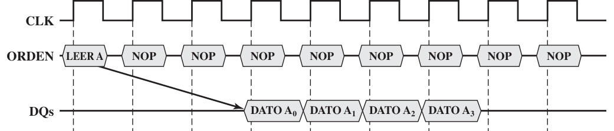

*Fig. 5.13 — Temporización de una lectura de SDRAM (longitud de ráfaga 4,* · Stallings, *Organización y arquitectura de computadores*, 7ª ed., p. 189.

#### Relacionado
[[10.4.1 Discos, SSD y latencias]] · [[10.1.2 Puertos, interfaces y handshake]] · [[7.4.2 Buses internos y externos]] ·
[[3.1.2 Bus único y buffers de 3 estados]] · [[10.3.1 Controlador, robo de ciclo y transferencia de bloques]] · [[Glosario — Unidad 10]]

---

## Al terminar la unidad
- Una pasada rápida: [[00 Síntesis — Unidad 10]].
- Los subtemas por separado: [[00 Unidad 10 — temas y subtemas]].
- Seguir de corrido: [[00 Materia completa (las 10 unidades en un archivo)]].
- Practicar: [[Banco de preguntas del final]] · [[Autoevaluación]] · [[Prácticas resueltas]].
