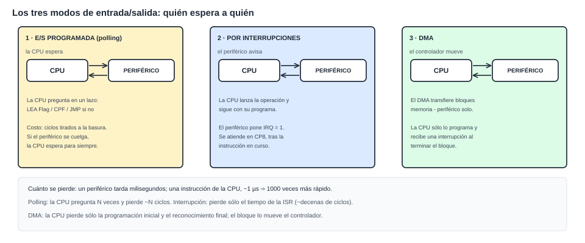
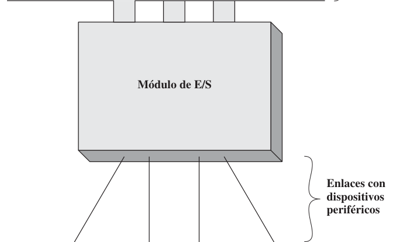

# 10.1.1 Polling y sus límites

> [!abstract] En una frase
> **Polling** (E/S **por consulta** o **programada**) es que la CPU **pregunte en un lazo** si el periférico está
> listo y **espere** ahí mismo. Es lo más barato de construir y lo más caro en tiempo: mientras consulta, la CPU
> **no hace nada útil**.

> [!note] Si la primera vez que ves esto
> Es el **microondas sin timbre**: te quedás parado mirando si la comida está caliente. Podrías estar lavando los
> platos (haciendo otras instrucciones) y volver cuando suene (interrupción). El *polling* funciona, pero te ata.



## Cómo es, en la BLUE
En la BLUE la E/S es **aislada**, por acumulador y **por consulta**: la instrucción `INP` **no termina** hasta que
el periférico pone en 1 la línea **`R`** (*ready*). Ésa es la forma más cruda de polling: **espera dentro de la
instrucción**.

```
     INP  5        ; leer el dispositivo 5 ⇒ la CPU se queda acá hasta que R = 1
     STA  DATO     ; ya lo tengo
```

En un procesador real el polling se escribe **explícitamente**, con tres pasos:

```
esperar:  LEA  FLAG       ; dirección del registro de estado
          CPF             ; ¿bandera de "listo" en 1?
          JMP  esperar    ; si no, volver a preguntar
          INP  5          ; sí ⇒ transferir el dato
```

**Ese lazo de 3 instrucciones es el costo**: cada vuelta gasta **8 pulsos por instrucción** (24 pulsos en la BLUE)
y no produce **ningún** resultado útil.

## Cuánto se pierde (el número que hay que saber)

| Dato | Valor de la cátedra |
|---|---|
| Una instrucción de la BLUE | **8 pulsos** × 125 ns = **1 µs** |
| Un lazo de consulta de 3 instrucciones | **24 pulsos** = **3 µs** |
| Un periférico lento (teclado, disco, impresora) | **milisegundos** |

> [!example] Ejemplo resuelto 1 — cuántas vueltas y cuánto se pierde
> "El periférico tarda **1 ms** en estar listo. El lazo de consulta tarda **3 µs**. ¿Cuánto tiempo gasta la CPU?"
>
> 1. Vueltas: `1 ms / 3 µs = 1 000 µs / 3 µs ≈` **333 vueltas**.
> 2. Tiempo de CPU gastado: `333 × 3 µs ≈ 1 000 µs =` **1 ms** (¡todo el tiempo!).
> 3. Trabajo útil en ese intervalo: **0**.
> 4. Pulsos tirados: `1 ms / 125 ns =` **8 000 pulsos**.
>
> **Conclusión:** durante 1 ms la CPU fue un **reloj caro** que sólo preguntaba "¿ya?". Con interrupciones, ese
> mismo milisegundo se usa para correr el programa.

> [!example] Ejemplo resuelto 2 — dos periféricos
> "Hay un teclado que produce una tecla cada **100 ms** y un disco que entrega un bloque cada **10 ms**. Con
> polling, ¿se puede atender a los dos?"
>
> - Si el lazo consulta **primero el teclado** y el teclado no tiene nada, se pierden **3 µs por vuelta**; el disco
>   hay que consultarlo **también**, así que cada vuelta pasa a **6 µs**.
> - El disco se atiende sí o sí en menos de **10 ms** ⇒ obliga a un lazo de, como máximo, `10 ms / 6 µs ≈ 1 660`
>   vueltas. Se puede, pero **la CPU no hace otra cosa**.
> - Peor: un periférico **raro** (falla, se desconecta) deja `R` en 0 para siempre ⇒ **la CPU queda colgada**.

## Los límites, en limpio

| Problema | Por qué |
|---|---|
| **Desperdicia la CPU** | el 100 % del tiempo de espera se va en preguntar |
| **No escala** | con `n` periféricos, el lazo crece y la atención se hace más lenta |
| **Se cuelga** | si el dispositivo nunca queda listo, no hay salida |
| **No tiene prioridad** | el orden del lazo **es** la prioridad, y es fija |
| **Sincroniza mal** | si el periférico escribe de nuevo antes de que la CPU lea, se **pierde** el dato |

> [!important] Cuándo **sí** conviene el polling
> Cuando el periférico es **predecible y rápido**: leer un sensor cada 1 ms, un ADC que siempre responde, un
> lazo de control de tiempo real. Ahí el polling es **determinista** (sabés exactamente cuándo preguntás) y no
> paga el costo de una interrupción. La regla: **espera corta y conocida ⇒ polling; espera larga o impredecible
> ⇒ interrupción**.

## El contraste que se pregunta en el final

| | **Polling** (E/S programada) | **Interrupciones** |
|---|---|---|
| Quién avisa | **la CPU pregunta** | **el periférico avisa** |
| La CPU mientras espera | **espera** (activa) | **sigue trabajando** |
| Hardware extra | mínimo | líneas `IRQ`, biestable `SI`, máscara, pila |
| Tiempo perdido | proporcional a la espera | sólo la rutina de servicio (≈ decenas de ciclos) |
| Si el periférico falla | **se cuelga** | nunca llega el pedido |
| Determinismo | **alto** | menor (llega cuando llega) |
| En la BLUE | `INP`/`OUT` con la línea `R` | `IRQ·SI·CP8` (lo agrega la cátedra) |

> [!warning] Errores típicos
> - Decir que el polling "no funciona": **funciona**, sólo **desperdicia**.
> - Confundir la **E/S por consulta** (la CPU espera al periférico) con el **polling de identificación** dentro de
>   una rutina de interrupción (la rutina pregunta **cuál** dispositivo interrumpió). Son dos *pollings* distintos.
> - Olvidar que en la BLUE `INP` **ya** es polling: espera la línea `R` adentro de la instrucción.
> - Decir que el polling es siempre peor: en tiempo real **determinista** a veces es mejor.
> - Pensar que el problema es la lentitud del periférico: el problema es que **la CPU lo espera** en vez de seguir.

## Figura del libro



*Fig. 7.1 — Módulo genérico de un módulo E/S.* · Stallings, *Organización y arquitectura de computadores*, 7ª ed., p. 231.

## Relacionado
[[10.1.2 Puertos, interfaces y handshake]] · [[10.2.1 Mecanismo completo]] · [[Interrupciones y entrada-salida]] ·
[[5.5.1 IRQ, SI y CP8]] · [[Las 16 instrucciones de BLUE — ciclo completo pulso por pulso]]
