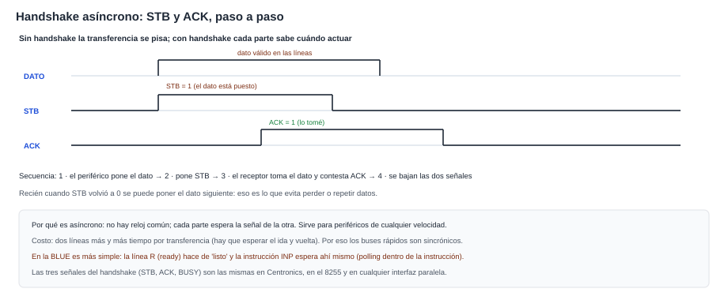
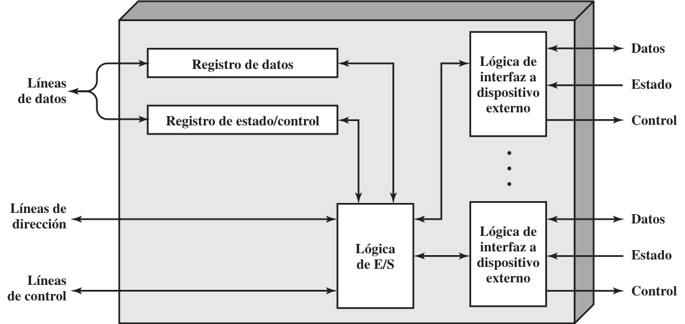
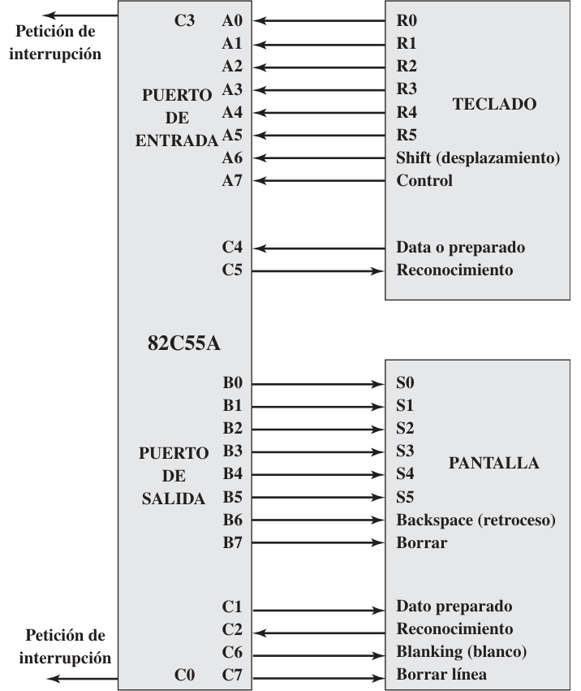

# 10.1.2 Puertos, interfaces y handshake

> [!abstract] En una frase
> Un **puerto** es la "puerta" con dirección por la que la CPU habla con un dispositivo; una **interfaz** es el
> circuito que traduce entre el bus y el dispositivo; y el **handshake** es el protocolo de dos señales
> (**"estoy listo" / "recibido"**) que hace que la transferencia **no se pise**.

> [!note] Si la primera vez que ves esto
> El puerto es el **mostrador**; la interfaz, el **empleado** que entiende el idioma del cliente; y el handshake es
> el "**¿me lo das? — tomá — gracias**" sin el cual uno de los dos suelta el paquete antes de tiempo.

## STB y ACK



## Las tres piezas
| Pieza | Qué es | Dónde está |
|---|---|---|
| **Puerto** | dirección (número) que selecciona un registro del periférico | en el espacio de E/S o en el de memoria |
| **Interfaz** | circuito adaptador: buffers, *latches*, decodificación, líneas de estado | placa / chip (UART, PPI 8255) |
| **Handshake** | par de señales que sincronizan (`STB`/`ACK`, `READY`, `R`) | líneas de control del bus |

## E/S aislada vs E/S mapeada en memoria
| | **Aislada** (puertos) | **Mapeada en memoria** |
|---|---|---|
| Espacio de direcciones | **aparte**, propio de E/S | **compartido** con la memoria |
| Instrucciones | propias: `IN`/`OUT` (x86), `INP`/`OUT` (BLUE) | las comunes `LOAD`/`STORE` |
| Bits de dirección | menos (no compite con la RAM) | los mismos de la memoria |
| Ventaja | el programa **no** puede tratar un puerto como dato | más instrucciones disponibles; más simple de programar |
| Ejemplo | **BLUE**, x86 (en parte) | ARM, MIPS, la BB de un microcontrolador |

**En la BLUE es aislada:** `INP` trae **8 bits** al `AC` y `OUT` manda los **8 bits altos** del `AC`; con
**6 líneas de selección** se direccionan hasta **64 periféricos** (`2⁶ = 64`), y la línea **`R`** indica que el
dispositivo está listo.

## El handshake, paso a paso

```
CPU / interfaz                            PERIFÉRICO
   │  ──── dato ────────────────►           │
   │  ──── STB (strobe) ────────►           │  "ahí va el dato"
   │                                ◄──── ACK │  "lo tomé"
   │  (recién ahora se puede mandar otro)   │
```

| Señal | Quién la pone | Significado |
|---|---|---|
| **`STB`** (*strobe*) o `WR` | la CPU / interfaz | "el dato está en las líneas" |
| **`ACK`** (*acknowledge*) | el periférico | "lo recibí" |
| **`READY`** / `R` / `BUSY` | el periférico | "todavía no; esperá" |
| **`IRQ`** | el periférico | "terminé, atendeme" |

> [!example] Por qué el handshake no es opcional
> Un teclado tarda **~1 ms** en tener la tecla siguiente. Si la interfaz escribe el registro de datos **sin**
> preguntar, pasan dos cosas malas:
> 1. La CPU puede leer **dos veces el mismo** carácter (no sabe si es nuevo).
> 2. Si llega una tecla **mientras** la CPU lee, se **pierde**.
>
> Con handshake: la interfaz pone `READY = 1` **sólo** cuando hay un dato nuevo, y al leerlo lo baja a 0. Así la
> bandera significa exactamente una cosa: **"hay un dato sin leer"**.

## Del lado de la interfaz: qué hay adentro
| Bloque | Función |
|---|---|
| **Decodificador de dirección** | reconoce *su* puerto (comparador con las líneas de dirección) |
| **Registro de datos** (*latch*/buffer) | guarda el dato entre el bus y el dispositivo |
| **Registro de estado** | banderas: *listo*, *error*, *ocupado* |
| **Registro de control** | la CPU le dice **qué hacer** (arrancar, modo, interrupciones) |
| **Buffer de 3 estados** | se conecta al bus **sólo** cuando lo seleccionan |

**Ejemplo real:** el **8255** (*PPI*) tiene 3 puertos de 8 bits y se usa tanto para E/S programada como para
*handshake*; el **8250/16550** (*UART*) es una interfaz **serie** con buffers y su propio handshake.

> [!important] Los **tres registros** que hay que saber nombrar
> Todo periférico decente expone **datos**, **estado** y **control**. El programa típico es:
> 1. escribir en **control** ("arrancá"),
> 2. leer **estado** hasta que diga *listo*,
> 3. transferir por **datos**.
> Ese patrón es el mismo en polling, en interrupciones y en el arranque de un DMA.

> [!warning] Errores típicos
> - Confundir **puerto** (dirección) con **interfaz** (el circuito) y con **periférico** (el dispositivo físico).
> - Decir que la E/S mapeada en memoria "es más rápida": no lo es; es **más cómoda**.
> - Olvidar el **buffer de 3 estados**: sin él, el periférico se conectaría al bus **siempre** y lo rompería.
> - Creer que el handshake es sólo para la E/S serie (también existe en paralelo y en el bus del sistema).
> - Mezclar `STB` (la CPU avisa que **puso** el dato) con `ACK` (el periférico avisa que lo **tomó**).

## Figura del libro



*Fig. 7.3 — Diagrama de bloques de un módulo de E/S.* · Stallings, *Organización y arquitectura de computadores*, 7ª ed., p. 238.



*Fig. 7.10 — Interfaz teclado/pantalla en el 82C55A.* · Stallings, *Organización y arquitectura de computadores*, 7ª ed., p. 250.

## Relacionado
[[10.1.1 Polling y sus límites]] · [[10.2.1 Mecanismo completo]] · [[10.4.2 Interfaces serie y paralelo]] ·
[[3.1.2 Bus único y buffers de 3 estados]] · [[Interrupciones y entrada-salida]] · [[Glosario — Unidad 10]]
