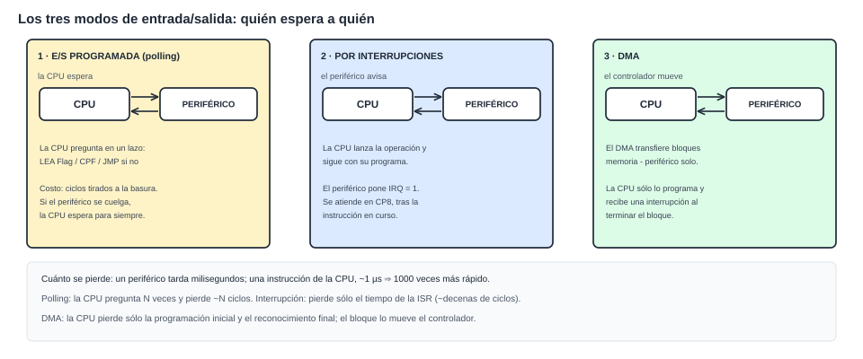
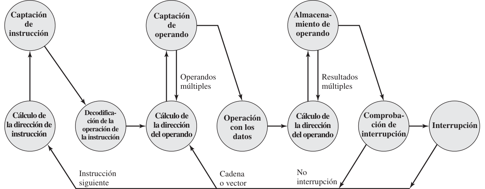

# 10.2.1 Mecanismo completo

> [!abstract] En una frase
> El periférico pone **`IRQ = 1`**; la CPU, **habilitada** (`SI = 1`) y **al final de la instrucción** (`CP8`), **guarda el `PC`**, salta a la **rutina de servicio**, la corre y vuelve con **`RTI`** dejando todo como estaba.

> [!note] Si la primera vez que ves esto
> Es el **marcador en el libro**: dejás el programa marcado en la página exacta, atendés el timbre, y volvés a la misma línea. Sin marcador (sin guardar el `PC`) no hay vuelta.

## Los diez pasos (la respuesta que se espera)

1. **El periférico pide**: pone en 1 su **bandera de dispositivo**; todas se juntan en una **OR** que produce `IRQ`. En la interfaz, esto es **una línea de control** del bus.

2. **La CPU termina la instrucción en curso**: la interrupción se acepta **en `CP8` del estado `E`**, nunca en el medio (si no, se perdería un estado intermedio del registro).

3. **Verifica la habilitación**: `SI = 1` (en el 8086, el flag `IF = 1`). Si `SI = 0`, el pedido queda **pendiente**.

4. **Reconoce el pedido**: genera `ACK`/`INTACK`; en el 8086 es el ciclo `INTA`.

5. **Guarda el contexto**: como mínimo el **`PC`** (que ya apunta a la instrucción siguiente); en máquinas reales también los **flags** y los registros que use la rutina.

6. **Identifica la fuente**: por ***polling* de banderas** (la rutina pregunta una por una) o por **vector** (el dispositivo entrega un número y hay un **salto indirecto**).

7. **Salta a la rutina de servicio** (ISR).

8. **Atiende**: lee o escribe el **registro de datos** del periférico y **baja el pedido** (si no, la interrupción se vuelve a disparar en el acto: *"interrupción fantasma"*).

9. **Restaura el contexto** y ejecuta **`RTI`**, que recupera el `PC` y **vuelve a habilitar** (`SI ← 1`).

10. **El programa sigue** exactamente donde estaba.

## En la máquina de la cátedra (BLUE indexada + interrupciones)

| Elemento | Función |
|---|---|
| **`SI`** | habilita el sistema (1 = habilitado); lo manejan `ION` / `IOF` |
| **`IRQ`** | pedido único = **OR** de las banderas de dispositivo |
| **`I`** | biestable que marca "se está atendiendo" |
| **`EMR`** | carga el **registro máscara** |
| **`SKF X`** | omite la próxima si la bandera `X` está en 0 (sirve para el *polling* de identificación) |
| **`RTI`** | retorno: `PC ← M[0]` y `SI ← 1` |
| **`SP`** | puntero de pila ⇒ permite **anidamiento** |

**El ciclo de interrupción son 8 pulsos** y hace tres cosas: guardar el `PC` en la **posición 0**, poner `PC ← 1` (la rutina arranca ahí), y bajar `SI` para no anidar sin control.

> [!example] Ejemplo resuelto — ¿cuánto cuesta atender una interrupción?
> "Una interrupción cuesta el ciclo de interrupción (**8 pulsos**) más la rutina, que son **20 instrucciones** de 8 pulsos. El periférico tarda **1 ms** en pedir la siguiente. ¿Qué fracción de la CPU se consume?"
>
> 1. Ciclo de interrupción: `8 × 125 ns =` **1 µs**.
> 2. Rutina: `20 × 1 µs =` **20 µs**.
> 3. Total por atención: **21 µs**.
> 4. Fracción: `21 µs / 1 000 µs =` **2,1 %**.
>
> **Comparación:** con *polling*, ese mismo periférico consumía el **100 %**. La interrupción deja **~98 %** de la CPU libre. Ésa es toda la diferencia.

## Interrupción vs subrutina vs excepción

| | **Subrutina** (`CALL`/`SRJ`) | **Interrupción** | **Excepción** |
|---|---|---|---|
| Quién la dispara | **el programa** | **un evento externo** | **el propio programa** (error) |
| Cuándo | en un punto **conocido** | en cualquier momento | al ejecutar cierta instrucción |
| Dirección | fija en la instrucción | la da el vector / la tabla | la da una tabla interna |
| Retorno | `RET` | `RTI` (restaura flags y habilita) | similar a `RTI` |
| Ejemplos | `SRJ`, `CALL` | teclado, disco, timer | división por cero, opcode inválido, fallo de página |

> [!important] Las dos cosas que **siempre** se preguntan
> 1. **¿Cuándo se acepta?** Al **final** de la instrucción (`CP8` del estado `E`), nunca en el medio.
> 2. **¿Qué se guarda?** El **`PC` ya incrementado**; y con pila, todo el contexto para poder **anidar**.

> [!warning] Errores típicos
> - Decir que la interrupción "corta" la instrucción por la mitad.
> - Guardar el `PC` **antes** de incrementarlo (al volver, se **repite** la instrucción).
> - Olvidar **bajar el pedido** en la rutina ⇒ *interrupción fantasma* en bucle infinito.
> - Confundir `RTI` (retorno de interrupción: restaura y **habilita**) con `RET` (subrutina).
> - Decir que la BLUE original tiene interrupciones: **no las tiene**, las agrega la cátedra.

## Figura del libro

*Fig. 3.12 — Diagrama de estados de un ciclo de instrucción, con interrupciones.* · Stallings, *Organización y arquitectura de computadores*, 7ª ed., p. 95.

## Relacionado
[[10.2.2 Interrupciones vectorizadas y prioridad]] · [[10.1.1 Polling y sus límites]] · [[5.5.1 IRQ, SI y CP8]] · [[5.5.2 Máscara, pila y RTI]] · [[Interrupciones y entrada-salida]] · [[Glosario — Unidad 10]]
