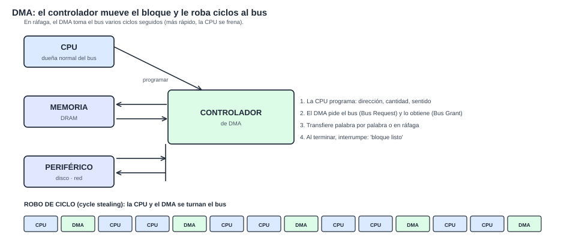

# Tema 10.3 — DMA

> [!abstract] Qué se estudia acá
> **Acceso Directo a Memoria**: un **controlador** mueve bloques enteros entre memoria y periférico **sin que la CPU** toque los datos. La CPU sólo lo **programa** y recibe **una** interrupción al final. Es el tercer modo de E/S y el que usan el disco, la red y el video.

| Subtema | Qué resuelve | Nota |
|---|---|---|
| **10.3.1** Controlador, robo de ciclo y transferencia de bloques | cómo mueve el bloque y cuánto le cuesta a la CPU | [[10.3.1 Controlador, robo de ciclo y transferencia de bloques]] |

> [!important] La idea
> Con **interrupciones** se evita *esperar*, pero **la CPU sigue copiando cada byte**. Con **DMA** también se evita copiar: **un tercero** (el controlador) hace de *maestro del bus* y mueve el bloque. La CPU paga **una** interrupción por bloque en vez de una por byte.

## Relacionado
[[00 Tema 10.2 — índice]] · [[00 Tema 10.4 — índice]] · [[Interrupciones y entrada-salida]] · [[8.3.1 Bancos de memoria y ancho de banda]]
