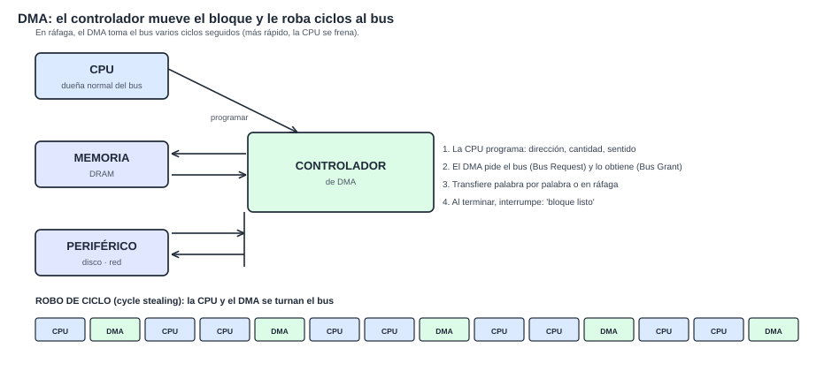
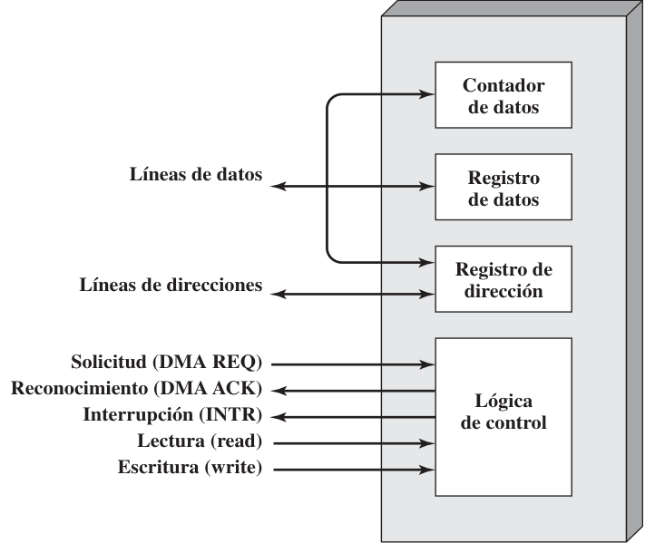

# 10.3.1 Controlador, robo de ciclo y transferencia de bloques

> [!abstract] En una frase
> El **controlador de DMA** es un **maestro más del bus**: la CPU le da **dirección inicial, cantidad y sentido**;
> él **pide el bus**, mueve el bloque **palabra por palabra** (*robo de ciclo*) o **en ráfaga**, y al terminar
> **interrumpe** una sola vez.

> [!note] Si la primera vez que ves esto
> Es el **flete**. Vos (la CPU) no llevás cada caja: le decís al camionero "desde el depósito A al B, 1 MB,
> de ida", y te avisa cuando terminó. Vos seguís trabajando; sólo le cedés la calle de a ratos.

## Los registros del controlador
| Registro | Qué guarda |
|---|---|
| **Dirección de memoria** | dónde empieza (y **se incrementa** solo) |
| **Contador de palabras** | cuántas faltan (y **decrece**; en 0 ⇒ terminó) |
| **Dirección / número de periférico** | con quién habla |
| **Control** | sentido (memoria→periférico o al revés), modo, tamaño |

**Por eso el DMA no puede ser "sin dirección":** el controlador **es un procesador chiquito** que hace un lazo
`leer / escribir / incrementar / decrecer / ¿llegué a cero?`. Lo único que **no** hace es ejecutar instrucciones.

## La secuencia completa
1. **La CPU programa** el controlador (los 4 registros) y le dice "arrancá".
2. **El controlador pide el bus**: `BR` (*Bus Request*).
3. **La CPU termina su ciclo de bus** y **concede**: `BG` (*Bus Grant*). Desde acá, **el maestro es el DMA**.
4. **Transfiere**: en cada ciclo de bus, pone una dirección, lee o escribe el dato, **incrementa** y **decrece**.
5. **Devuelve el bus** (`BG` en 0) y **pide una interrupción**: "bloque listo".
6. **La CPU atiende** la interrupción y sigue.

> [!important] Lo que hay que decir sí o sí
> El DMA **no es magia**: usa **los mismos** ciclos de bus. Lo que ahorra es que **la CPU no ejecuta** las
> instrucciones de copia. El bus se lo **presta** (por eso se habla de *robo de ciclo*).

## Robo de ciclo vs ráfaga
| | **Robo de ciclo** (*cycle stealing*) | **Ráfaga** (*burst*) |
|---|---|---|
| Cómo | el DMA toma **un ciclo** y devuelve el bus; después otro | toma el bus **varios ciclos seguidos** |
| Impacto en la CPU | **se frena un poco** (pierde algunos ciclos) | **se frena** durante el bloque |
| Velocidad del bloque | menor | **máxima** |
| Cuándo | periféricos lentos, sistema con mucho tráfico | bloques grandes, disco, video |

> [!example] Ejemplo resuelto 1 — cuánto se frena la CPU con robo de ciclo
> "El bus tarda **0,5 µs** por ciclo y el DMA roba **1 de cada 4** ciclos. ¿Cuánto se frena la CPU?"
>
> - De cada 4 ciclos, la CPU usa **3** ⇒ rinde `3/4 =` **75 %** de su velocidad normal.
> - En tiempo: si una tarea tardaba `T`, ahora tarda `T × 4/3 ≈ 1,33 T` ⇒ **33 % más lento**.
> - **Y aun así conviene:** copiar esos mismos datos con la CPU costaría `2` instrucciones por palabra
>   (**16 pulsos**), mucho más que los ciclos robados.

> [!example] Ejemplo resuelto 2 — el número que cierra el tema
> "Hay que mover **1 MB** desde el disco. Bus de **64 bits a 200 MHz** (1,6 GB/s). Disco a **100 MB/s**.
> Comparar el DMA contra que la CPU copie, atendiendo una interrupción cada 4 KB."
>
> **a) Con DMA**
> - Tiempo del disco: `1 MB / 100 MB/s =` **10 ms**.
> - Tiempo de bus necesario: `1 MB / 1,6 GB/s ≈` **0,65 ms**.
> - El bus es **15 veces más rápido** que el disco ⇒ la transferencia va **a la par del disco**: **10 ms**,
>   y la CPU **hace su programa** mientras tanto. Al final, **una** interrupción (≈ 21 µs).
>
> **b) Con la CPU copiando (una interrupción cada 4 KB)**
> - Bloques: `1 MB / 4 KB =` **256**.
> - Costo: `256 × 21 µs ≈` **5,4 ms** de CPU gastados **encima** de los 10 ms del disco.
>
> **Conclusión:** el DMA ahorra **~5,4 ms de CPU** (más de la mitad del tiempo total) y, sobre todo, libera al
> procesador **durante** la transferencia.

> [!example] Ejemplo resuelto 3 — ¿el bus alcanza?
> "Bus de **64 bits a 200 MHz** (1,6 GB/s) y disco a **100 MB/s**. ¿Cuánto del bus ocupa el DMA?"
>
> 1. `100 MB/s / 1 600 MB/s =` **6,25 %** del ancho de banda.
> 2. ⇒ el resto queda para la CPU: **no hay conflicto real** con un disco.
> 3. Con **video** o **red de 10 Gb/s** la historia cambia: ahí el DMA **sí** compite en serio.

## Los tres modos de E/S, en una tabla

| | **Polling** | **Interrupciones** | **DMA** |
|---|---|---|---|
| Quién inicia | CPU | CPU (y el periférico avisa) | CPU **programa**; el DMA ejecuta |
| Quién copia el dato | **CPU** | **CPU** | **el controlador** |
| Costo por **byte** | espera | ISR (≈ 20 µs) | ~**nada** |
| Costo por **bloque** | enorme | `nº bloques × ISR` | **1** interrupción |
| Cuándo | periférico rápido y predecible | eventos esporádicos | **bloques grandes** |
| Ejemplo | sensor, ADC | teclado, ratón | disco, red, video |

> [!warning] Errores típicos
> - Decir que el DMA "no usa el bus": **usa los mismos** ciclos; lo que no usa es la **CPU**.
> - Confundir **robo de ciclo** (de a un ciclo) con **ráfaga** (varios seguidos).
> - Olvidar que el DMA **pide permiso** (`BR`/`BG`): no puede escribir la memoria a la fuerza.
> - Creer que el DMA reemplaza a las interrupciones: **las usa** para avisar el final.
> - Decir que el DMA es más rápido porque "trabaja en paralelo" **siempre**: con robo de ciclo compite con la
>   CPU por el mismo bus.
> - Olvidar que necesita **coherencia**: si hay caché, hay que ver quién ve el dato (memoria vs caché).

## Figura del libro

*Fig. 7.11 — Diagrama de bloques típico de un módulo de DMA.* · Stallings, *Organización y arquitectura de computadores*, 7ª ed., p. 252.

*Fig. 7.12 — Puntos de ruptura para el DMA y las interrupciones en un ciclo de instrucción.* · Stallings, *Organización y arquitectura de computadores*, 7ª ed., p. 253.

## Relacionado
[[10.2.2 Interrupciones vectorizadas y prioridad]] · [[10.4.1 Discos, SSD y latencias]] ·
[[7.4.2 Buses internos y externos]] · [[Interrupciones y entrada-salida]] · [[8.3.1 Bancos de memoria y ancho de banda]]
