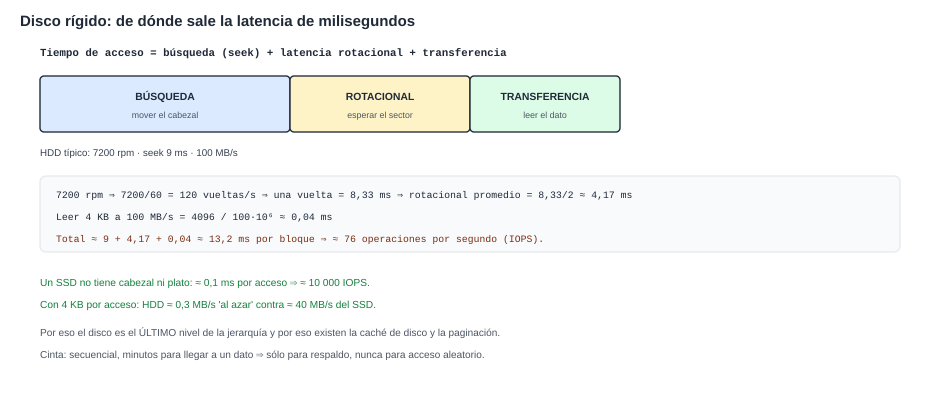

# Tema 10.4 — Dispositivos y almacenamiento

> [!abstract] Qué se estudia acá
> Del lado del **dispositivo**: de dónde salen los **milisegundos** de un disco (búsqueda + rotación +
> transferencia), cuánto cambia un **SSD**, y cómo se conecta todo (**paralelo vs serie**: Centronics, RS-232,
> USB, SATA, PCIe).

| Subtema | Qué resuelve | Nota |
|---|---|---|
| **10.4.1** Discos, SSD y latencias | por qué el disco es el último nivel de la jerarquía | [[10.4.1 Discos, SSD y latencias]] |
| **10.4.2** Interfaces serie y paralelo | cómo viaja el dato hacia/desde el periférico | [[10.4.2 Interfaces serie y paralelo]] |

> [!important] Por qué este tema cierra la materia
> Todo lo anterior (caché, jerarquía, DMA, interrupciones) existe **por culpa de este tema**: porque el
> almacenamiento es **100 000 veces más lento** que la CPU. La latencia del disco **es** la razón de la memoria
> virtual y de la paginación.

## Relacionado
[[00 Tema 10.3 — índice]] · [[2.6.2 Memoria auxiliar y memoria asociativa]] · [[Jerarquía de memorias]] ·
[[2.5.1 Jerarquía y localidad]]
