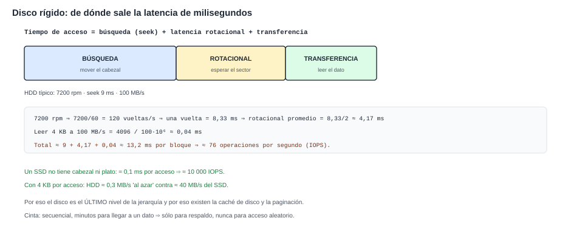

# 10.4.1 Discos, SSD y latencias

> [!abstract] En una frase
> El tiempo de acceso de un **disco rígido** es **búsqueda** (mover el cabezal, ~9 ms) + **latencia rotacional**
> (media vuelta, ~4,17 ms a 7 200 rpm) + **transferencia** (~0,04 ms por 4 KB) ≈ **13 ms**; un **SSD** no tiene
> partes móviles y baja a **~0,1 ms**.

> [!note] Si la primera vez que ves esto
> El disco es un **tocadiscos**: para leer una canción el brazo tiene que **viajar** hasta el surco (búsqueda) y
> esperar que el disco **gire** hasta el punto (rotación). El SSD es un **pendrive grande**: no hay brazo ni
> vueltas, sólo direcciones.



## Las tres partes del tiempo de acceso
```
T_acceso = t_búsqueda (seek) + t_rotacional + t_transferencia
```

| Componente | Qué es | Valor típico |
|---|---|---|
| **Búsqueda** (*seek*) | mover el cabezal al **cilindro** | **9 ms** (3-15 ms) |
| **Latencia rotacional** | esperar que el **sector** pase bajo el cabezal | **media vuelta**: 4,17 ms a 7 200 rpm |
| **Transferencia** | leer los bytes del sector | depende del **bloque** y de la **tasa** |

**La rotación, en fórmula:** `vueltas/s = rpm / 60` ⇒ a 7 200 rpm: `120 vueltas/s` ⇒ una vuelta = `1/120 s =
8,33 ms` ⇒ **promedio** (media vuelta) = **4,17 ms**.

## Anatomía del disco (lo que se nombra)
| Término | Qué es |
|---|---|
| **Plato** y **cara** | discos apilados; cada cara tiene un cabezal |
| **Pista** (*track*) | circunferencia de una cara |
| **Cilindro** | la misma pista en **todas** las caras ⇒ el cabezal no se mueve |
| **Sector** | unidad mínima direccionable (**512 B** o **4 KB** en los modernos) |
| **CHS** vs **LBA** | direccionamiento físico (cilindro-cabeza-sector) vs **lineal** |
| **ZBR** | pistas externas con **más** sectores (más rápidas) |

> [!example] Ejemplo resuelto 1 — el clásico del final
> "Disco de **7 200 rpm**, *seek* **9 ms**, tasa **100 MB/s**. Calcule el tiempo de leer **4 KB** y los IOPS."
>
> 1. Rotacional media vuelta: `60/7200 = 8,33 ms` por vuelta ⇒ **4,17 ms**.
> 2. Transferencia: `4096 B / 100·10⁶ B/s = 0,00004096 s ≈` **0,04 ms**.
> 3. Total: `9 + 4,17 + 0,04 ≈` **13,2 ms**.
> 4. IOPS: `1 / 0,0132 s ≈` **76 operaciones/s**.
>
> **Moraleja:** la **transferencia es 0,3 %** del total. El disco **no es lento por mover bytes**, es lento por
> **posicionarse**. Por eso leer 1 MB en 256 bloques de 4 KB cuesta `256 × 13,2 ms ≈ 3,4 s`, mientras que leerlo
> **en un solo bloque contiguo** cuesta `9 + 4,17 + 10 ms ≈` **23 ms**: **150 veces** menos.

> [!example] Ejemplo resuelto 2 — ¿y un SSD?
> "Un SSD tarda **0,1 ms** por acceso aleatorio de 4 KB y transfiere a **500 MB/s**."
>
> 1. IOPS: `1 / 0,1 ms =` **10 000** (≈ **130×** el disco).
> 2. Ancho de banda al azar: `10 000 × 4 KB = 40 MB/s`.
> 3. Secuencial: **500 MB/s** (5× el disco).
> 4. ⇒ el SSD gana **muchísimo** en acceso **aleatorio** (bases de datos, arranque) y **bastante** en secuencial.

## Comparación de los niveles
| Nivel | Tiempo típico | Tecnología | ¿Volátil? |
|---|---|---|---|
| Registros | **< 1 ns** | biestables | sí |
| Caché L1 | **~1 ns** | SRAM | sí |
| Memoria RAM | **~50-100 ns** | DRAM | sí |
| SSD / Flash | **~0,1 ms** | celda flotante | **no** |
| Disco rígido | **~13 ms** | magnetismo | **no** |
| Cinta | **segundos-minutos** | magnetismo secuencial | **no** |

**Las potencias de 10 que hay que saber decir:** la RAM es **~10⁵-10⁶** veces más lenta que los registros; el
disco es **~10⁵** veces más lento que la RAM. Ese salto es lo que hace **necesaria** la memoria virtual
([[2.6.1 Memoria virtual y paginación]]) y la caché de disco.

## RAID, en una tabla (se pregunta como "concepto")
| Nivel | Qué hace | Ventaja | Costo |
|---|---|---|---|
| **0** | *striping* (reparte) | velocidad | **sin** tolerancia |
| **1** | *mirroring* (duplica) | tolerancia total | 50 % del espacio |
| **5** | *striping* + **paridad** distribuida | buen equilibrio | tolera **1** falla |
| **10** | espejo + reparto | rápido y seguro | 50 % del espacio |

> [!important] Las tres cosas que se preguntan de memoria
> 1. **Las tres partes** del tiempo de acceso y que **la rotacional es media vuelta**.
> 2. Que el **acceso aleatorio** domina: **trasladarse cuesta más que transferir**.
> 3. Que el SSD elimina **búsqueda y rotación** ⇒ gana sobre todo en **aleatorio**.

> [!warning] Errores típicos
> - Usar **una vuelta completa** (8,33 ms) en vez de **media** (4,17 ms) para la latencia rotacional.
> - Sumar la transferencia como si fuera grande: a 4 KB es **despreciable** frente al *seek*.
> - Confundir **pista** con **cilindro** (el cilindro es la misma pista en todas las caras).
> - Decir que el SSD es "más rápido porque es más moderno": es más rápido **porque no tiene partes móviles**.
> - Olvidar que el **sector** es la unidad mínima: leer 1 byte cuesta el sector entero.
> - Decir que RAID 0 da **tolerancia** a fallas: **no**, da velocidad.

## Relacionado
[[10.4.2 Interfaces serie y paralelo]] · [[2.6.2 Memoria auxiliar y memoria asociativa]] · [[2.5.1 Jerarquía y localidad]] ·
[[2.6.1 Memoria virtual y paginación]] · [[Jerarquía de memorias]] · [[10.3.1 Controlador, robo de ciclo y transferencia de bloques]]
