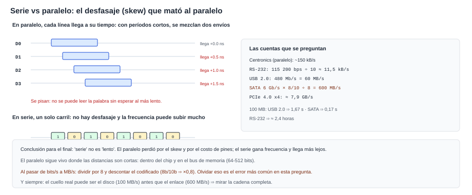
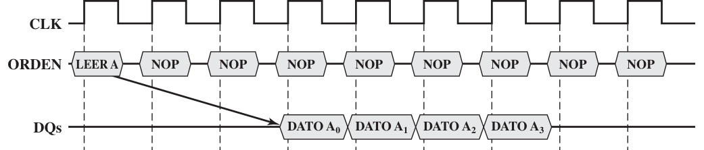

# 10.4.2 Interfaces serie y paralelo

> [!abstract] En una frase
> **Paralelo**: todos los bits a la vez por varios cables (rápido en distancias cortas, caro y con **desfasaje**);
> **serie**: un bit por vez (un cable, larga distancia, y hoy **más rápido** porque sube mucho la frecuencia y
> **embebe el reloj** en la propia señal).

> [!note] Si la primera vez que ves esto
> **Paralelo** es una **autopista de 8 carriles**: mucha capacidad, pero si un carril se tapa, todo se traba.
> **Serie** es un **tren de un carril a 300 km/h**: parece más lento, pero llega antes porque no hay que
> sincronizar carriles.

## El skew

## Las dos transmisiones
| | **Paralelo** | **Serie** |
|---|---|---|
| Bits a la vez | **8, 16, 32** | **1** |
| Cables | uno por bit (+ control) | uno de datos (+ reloj) |
| Distancia | **corta** (metros) | **larga** (decenas de metros a km con diferencial) |
| Problema | **desfasaje** (*skew*) entre líneas | — |
| Sincronización | reloj **aparte** (o *handshake*) | reloj **embebido** en el dato |
| Costo | alto (muchos pines) | bajo |
| Hoy | retrocede | **domina** (PCIe, SATA, USB) |

### El desfasaje, que es **el** argumento
A frecuencias altas, las 8 (o 32) líneas de un bus paralelo **no llegan al mismo tiempo**: distinto largo, distinta
capacidad, distinto ruido. Con un período de **1 ns**, un desfasaje de **0,5 ns** ya significa leer **la mitad de
los bits de un envío y la mitad del siguiente**. Por eso el paralelo **no puede subir** mucho la frecuencia.
El serie **no tiene ese problema** (un solo carril) y puede ir a **GHz** con señalización **diferencial** (dos
cables, uno con la señal invertida: el ruido se cancela).

## Las interfaces que hay que saber nombrar
| Interfaz | Tipo | Velocidad | Notas |
|---|---|---|---|
| **Centronics** (puerto paralelo / LPT) | paralelo, 8 bits | ~150 kB/s | impresoras; `STB`, `ACK`, `BUSY` |
| **RS-232** | serie | 9 600-115 200 bps (≈ 11,5 kB/s) | módem, terminales; ±12 V |
| **USB 2.0** | serie, diferencial | **480 Mb/s** = 60 MB/s | *plug and play*, alimentación |
| **USB 3.2** | serie | 5-20 Gb/s | 2 pares, full dúplex |
| **SATA** | serie | 6 Gb/s ≈ **600 MB/s** | discos y SSD internos |
| **PCIe 3.0 x4** | serie, **carriles** | ≈ **3,9 GB/s** | **NVMe** para SSD |
| **PCIe 4.0 x4** | serie | ≈ **7,9 GB/s** | el estándar actual de SSD |

> [!important] Cómo puede un **serie** vencer a un **paralelo**
> `RS-232` (115 kbps) contra `Centronics` (150 kB/s): **ganaba el paralelo**. Pero la comparación honesta es
> **SATA/PCIe contra el viejo bus paralelo IDE**: IDE (ATA paralelo, 133 MB/s) fue reemplazado por **SATA 600 MB/s**.
> La clave: **frecuencia**. `bits/s = baudios × bits por baudio`, y el serie sube los baudios **mucho** porque
> no tiene desfasaje. `USB 2.0` a 480 Mb/s = **60 MB/s**, más que el puerto paralelo y con **un** cable.

> [!example] Ejemplo resuelto 1 — cuánto tarda un archivo
> "Un archivo de **100 MB**. ¿Cuánto tarda por USB 2.0 (480 Mb/s), SATA (6 Gb/s) y RS-232 (115 200 bps)?"
>
> 1. **USB 2.0:** `480 Mb/s = 60 MB/s` ⇒ `100/60 ≈` **1,67 s** (en la práctica ~2 s por el protocolo).
> 2. **SATA:** `6 Gb/s = 750 MB/s` teóricos ⇒ `100/750 ≈` **0,13 s**; con codificación 8b/10b ⇒ **600 MB/s** ⇒
>    **0,17 s**.
> 3. **RS-232:** `115 200 bps ≈ 11,52 kB/s` ⇒ `100 MB / 11,52 kB/s ≈ 8 680 s ≈` **2,4 horas**.
>
> **Moraleja:** la diferencia entre interfaces es de **cuatro órdenes de magnitud**.

> [!example] Ejemplo resuelto 2 — la cuenta del codificado
> "¿Por qué `SATA 6 Gb/s` rinde **600 MB/s** y no 750 MB/s?"
>
> - La línea transmite **6 Gb/s**, pero con codificación **8b/10b** cada 8 bits útiles ocupan **10** en el cable.
> - `6 Gb/s × 8/10 = 4,8 Gb/s` útiles ⇒ `4,8 / 8 =` **600 MB/s**.
> - Lo mismo pasa en `PCIe 3.0` (128b/130b) y en `USB 3.x`.
> - **Regla:** al pasar de **bits/s** a **MB/s**, dividir por **8** y descontar el **codificado**.

## Serie vs paralelo: la tabla del final
| Pregunta | Respuesta |
|---|---|
| ¿Cuál fue primero? | ambos casi juntos; el paralelo dominó impresoras y discos |
| ¿Por qué el paralelo perdió? | **desfasaje** y costo de pines al subir la frecuencia |
| ¿Por qué el serie gana? | **frecuencia** alta + **diferencial** + reloj embebido |
| ¿El serie es más lento? | **no**: `PCIe x16` ≈ 32 GB/s |
| ¿Qué pasa con la distancia? | el serie llega **más lejos** |
| ¿Y el paralelo? | sigue vivo **dentro** del chip y en el bus de memoria (distancias cortas) |

> [!warning] Errores típicos
> - "Serial es más lento que paralelo" ⇒ **falso** hoy; comparar **velocidades concretas**.
> - Confundir **bits/s** con **bytes/s** (dividir por 8) y olvidar el **codificado**.
> - Decir que el paralelo desapareció: es el **bus interno** y el de memoria.
> - Mezclar `RS-232` (serie, punto a punto, viejo) con `USB` (serie, diferencial, con protocolo).
> - Olvidar el handshake en el paralelo (`STB`/`ACK`/`BUSY`): sin él los datos se pisan.

## Figura del libro

*Fig. 5.13 — Temporización de una lectura de SDRAM (longitud de ráfaga 4,* · Stallings, *Organización y arquitectura de computadores*, 7ª ed., p. 189.

## Relacionado
[[10.4.1 Discos, SSD y latencias]] · [[10.1.2 Puertos, interfaces y handshake]] · [[7.4.2 Buses internos y externos]] ·
[[3.1.2 Bus único y buffers de 3 estados]] · [[10.3.1 Controlador, robo de ciclo y transferencia de bloques]]
