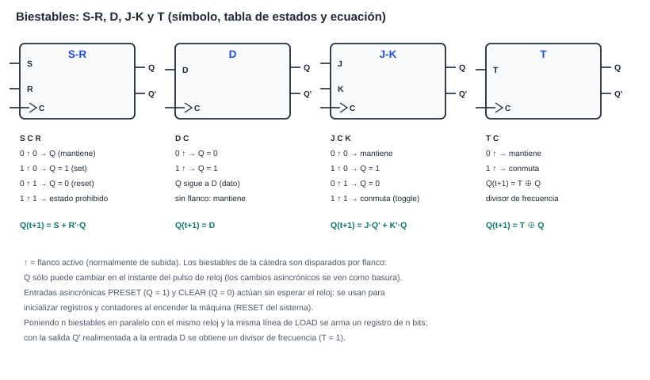
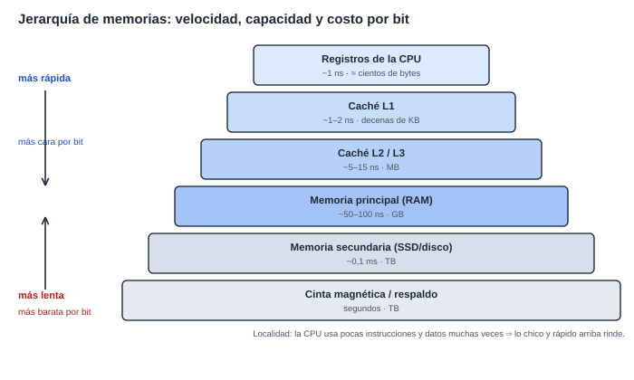

# 00 Síntesis — Unidad 2 (todo en un solo lugar)

> [!abstract] Qué es este archivo
> **Toda la Unidad 2 en una sola nota**: biestables con sus ecuaciones, registros y contadores, la celda y el chip
> de memoria, ROM y no volátiles, jerarquía y caché con el AMAT, memoria virtual y asociativa, y las dos cuentas de
> dimensionamiento. Sirve para **repasar antes del final** y para **imprimir**.
> Detalle completo de cada punto, en los subtemas: [[00 Unidad 2 — temas y subtemas]].

## Contenido
1. [[#1. Los cuatro biestables]] · 2. [[#2. Conversión entre biestables]] · 3. [[#3. Registros]] ·
4. [[#4. Contadores]] · 5. [[#5. La celda y el chip]] · 6. [[#6. ROM y no volátiles]] ·
7. [[#7. Jerarquía y caché]] · 8. [[#8. Memorias complementarias]] · 9. [[#9. Las dos cuentas]] ·
10. [[#10. Recetas de examen]] · 11. [[#11. Errores que cuestan puntos]] · 12. [[#12. Autoevaluación]]

---

## 1. Los cuatro biestables



| Biestable | Tabla de estados | Ecuación característica | Caso especial |
|---|---|---|---|
| **RS (NOR)** | `00` mantiene · `01` reset · `10` set · `11` **prohibido** | `Q⁺ = S + R'·Q` | `S=R=1` prohibido |
| **D** | toma el dato | `Q⁺ = D` | con enable: `Q⁺ = E·D + E'·Q` |
| **JK** | `00` mantiene · `01` reset · `10` set · `11` **toggle** | `Q⁺ = J·Q' + K'·Q` | `J=K=1` ⇒ invierte |
| **T** | `T=0` mantiene · `T=1` invierte | `Q⁺ = T ⊕ Q` | divide el reloj por 2 |

**Versión NAND del RS:** entradas activas en **bajo**; el estado prohibido es `S = R = 0`.

**Tabla de excitación** (para diseñar):

| Transición | J K | D | T | S R |
|---|---|---|---|---|
| 0 → 0 | 0 X | 0 | 0 | 0 X |
| 0 → 1 | 1 X | 1 | 1 | 1 0 |
| 1 → 0 | X 1 | 0 | 1 | 0 1 |
| 1 → 1 | X 0 | 1 | 0 | X 0 |

---

## 2. Conversión entre biestables

**Procedimiento:** tabla de estados del objetivo + tabla de excitación del disponible → minimizar con Karnaugh →
agregar compuertas.

**RS → JK (la que se toma):** `S = J·Q'` y `R = K·Q` ⇒ **2 AND** (+ el inversor de Q que ya se tiene).
Verificación: con `J=K=1` nunca se llega a `S=R=1` (si `Q=0` ⇒ set; si `Q=1` ⇒ reset).

| Conversión | Resultado |
|---|---|
| JK → D | `J = D`, `K = D'` |
| JK → T | `J = K = T` |
| D → T | `D = T⊕Q` |
| RS → D | `S = D`, `R = D'` |

---

## 3. Registros

`n` flip-flops D con **el mismo reloj** (`CLK`) y una señal `LOAD`.

| Tipo | Entrada | Salida | Pulsos/palabra | Uso |
|---|---|---|---|---|
| **PIPO** | paralelo | paralelo | 1 | IR, MAR, acumulador |
| **SISO** | serie | serie | n | retardo, repetidor |
| **SIPO** | serie | paralelo | n | recepción serie |
| **PISO** | paralelo | serie | 1 + n | transmisión serie |

`Q⁺ = LOAD·Di + LOAD'·Q` (cada bit).

---

## 4. Contadores

- **Asíncrono:** T flip-flops encadenados (el reloj de uno es `Q` del anterior). Cuenta `2ⁿ` estados; tiene
  retardo acumulado y glitches (`0111 → 1000`).
- **Síncrono:** mismo `CLK` para todos; `T0 = 1`, `T1 = Q0`, `T2 = Q0·Q1`, `T3 = Q0·Q1·Q2`.
- **Módulo N:** se detecta el estado `N` con una AND y se resetea. BCD (módulo 10): detecta `Q3·Q1` (= 1010).
- **Cuántos flip-flops:** `2ⁿ ≥ N` (módulo 100 ⇒ n = 7).

---

## 5. La celda y el chip

**Celda = 4 bloques:** biestable + selección + `L/E` + **buffer de 3 estados** (0, 1, **Z**).
El buffer es lo que permite que miles de celdas compartan el bus de datos.

| | **SRAM** | **DRAM** |
|---|---|---|
| Celda | 6 transistores (2 inversores) | 1 transistor + capacitor |
| Refresco | no | **sí** (~cada pocos ms) |
| Velocidad | muy alta | alta |
| Densidad y costo | baja / caro | **alta / barato** |
| Se usa en | caché | RAM principal |

Ambas son **volátiles**.

**Chip = matriz + decodificador + L/E + buffers.** RAM 8×3: `A2A1A0` → decodificador 3→8 → una fila de 3 celdas;
bus de datos de 3 bits; 24 celdas en total; `L/E` (0 leer, 1 escribir) y `CS`.

**Expansión:** más **palabras** ⇒ chips en paralelo con `CS` distintos (bits altos al decodificador) · más
**ancho** ⇒ chips en paralelo con el mismo `CS`, cada uno aporta sus bits.

---

## 6. ROM y no volátiles

**ROM = decodificador + `m` compuertas OR**: cada bit de salida es la **suma de mintérminos** de las direcciones
donde vale 1. Es una tabla de verdad hecha hardware; no necesita biestables ⇒ **no volátil**.

| Tipo | Borrado | Veces | Uso |
|---|---|---|---|
| Máscara | no | 1 | alto volumen |
| PROM | no (fusible) | 1 | prototipo viejo |
| EPROM | **UV** | miles | desarrollo |
| EEPROM | eléctrico **byte a byte** | ~1 M | configuración |
| Flash NOR/NAND | eléctrico **por bloques** | ~10-100 mil | firmware / **SSD** |

Celda física: **transistor de compuerta flotante** (carga atrapada = estado).

---

## 7. Jerarquía y caché



**Pirámide:** registros → L1 → L2/L3 → RAM → SSD/disco → cinta. Al bajar: ×10 tamaño, ×10 latencia, ÷10 costo.
**Sostén:** localidad **temporal** y **espacial**.

**Dirección vista por la caché:** `ETIQUETA | ÍNDICE | DESPLAZAMIENTO`, con
`desplazamiento = log₂(línea)`, `índice = log₂(líneas/vías)`, `etiqueta = el resto`.

| Mapeo | Puede ir a | Contra |
|---|---|---|
| Directo | 1 línea | conflictos |
| Totalmente asociativo | cualquiera | comparar todas |
| Asociativo por conjuntos | 1 de n vías | intermedio |

**Escritura:** write-through (caché + RAM) · write-back (+ bit *dirty*) · write-allocate / no-write-allocate.
**Reemplazo:** LRU · FIFO · aleatorio · LFU.
**Fallas:** frío (compulsorio) · conflicto · capacidad.

**AMAT = h + m × P** ⇒ `1 + 0,05 × 100 = ` **6 ns** (vs 100 ns sin caché). Con L2 se anida.

---

## 8. Memorias complementarias

**Memoria virtual:** direcciones **virtuales** → **físicas** por **páginas** (4 KB). Campos: `página | desplazamiento`
→ tabla de páginas → `marco | desplazamiento`. El desplazamiento **no** se traduce. Da aislamiento, más memoria que la
física, reubicación y protección. **TLB** = caché de traducciones.

**Auxiliar:** HDD (5-10 ms), SSD Flash (0,1-0,2 ms), cinta, óptico. Se accede **por bloque**, no por byte.

**Asociativa (CAM):** se busca **por contenido**, todas las posiciones comparan en paralelo. Cara y chica; se usa
en la **TLB**, caché asociativa y routers.

---

## 9. Las dos cuentas

```
bits de dirección = log₂(celdas)          celdas = tamaño total ÷ tamaño de celda
bits de CodOp     = palabra − bits de dirección      instrucciones = 2^CodOp
```

| Caso | Cuenta | Resultado |
|---|---|---|
| 512 MB, celda 4 B | `2²⁹/2² = 2²⁷` | **27 bits** |
| 1 GB, celda 4 B | `2³⁰/2² = 2²⁸` | **28 bits** |
| 1 GB, 4 B, palabra 32 | `32 − 28` | **CodOp 4** (16 instrucciones) |
| 512 MB, 4 B, palabra 32 | `32 − 27` | **CodOp 5** (32 instrucciones) |
| BLUE 4096 × 16 | `12` de dirección | **CodOp 4** (16 opcodes) |

---

## 10. Recetas de examen

> [!important] Los movimientos de cada tipo de ejercicio
> **Biestable:** tabla de estados (con Q) → mapa → ecuación → circuito → verificar una transición.
> **Conversión:** tabla de excitación → mapas → compuertas → verificar el caso `J=K=1`.
> **Celda/RAM:** dibujar los 4 bloques → decodificador → `L/E` → contar celdas y bits.
> **Caché:** partir la dirección en 3 campos → decir acierto/fallo → aplicar `AMAT`.
> **Dimensionar:** tamaño → celdas → `log₂` → restar de la palabra.

| Si te piden… | Qué mostrar sí o sí |
|---|---|
| "ecuación característica" | tabla de 8 filas + mapa + función |
| "convierta RS en JK" | tabla de excitación + `S=JQ'`, `R=KQ` + circuito |
| "dibuje la celda" | biestable, selección, L/E, **3 estados** |
| "caché de X KB con líneas de Y B" | los 3 campos con sus bits |
| "cuántos bits de dirección" | la división por el tamaño de celda |

---

## 11. Errores que cuestan puntos

- Olvidar el **buffer de 3 estados** en la celda.
- Decir que SRAM es **no volátil** (las dos son volátiles).
- Usar la tabla de **estados** en lugar de la de **excitación** al convertir.
- Decir que un contador de 4 bits cuenta hasta 16 (cuenta **0-15**).
- Sumar mal los bits de la caché (etiqueta + índice + desplazamiento = total).
- Usar la tasa de **aciertos** en el AMAT en lugar de la de **fallos**.
- Olvidar dividir por el **tamaño de celda** al calcular bits de dirección.
- Decir que la EPROM se borra eléctricamente (es **UV**).

---

## 12. Autoevaluación (con respuesta)

1. `Q⁺` del JK con `J=1, K=1, Q=0` → *1* (toggle).
2. RS → JK: ¿qué compuertas? → *2 AND: `S=JQ'`, `R=KQ`*.
3. ¿Cuántos flip-flops para un contador módulo 12? → *4* (`2⁴ = 16 ≥ 12`).
4. Celda de DRAM: ¿qué la forma? → *1 transistor + 1 capacitor, con refresco*.
5. RAM 8×3: ¿cuántas celdas y bits de dirección? → *24 celdas, 3 bits*.
6. ROM de 4×4: ¿qué la compone? → *decodificador 2→4 + 4 OR*.
7. Caché 1 ns, 95 % aciertos, penalidad 100 ns → *AMAT = 6 ns*.
8. 1 GB con celdas de 4 B y palabra de 32 bits → *28 bits de dirección, CodOp 4*.
9. Diferencia TLB / caché → *la TLB traduce direcciones; la caché guarda datos*.
10. ¿Qué memoria se direcciona por **contenido**? → *la asociativa (CAM)*.

---

## Errores: detectar y corregir

| Método | Agrega | Detecta | Corrige |
|---|---|---|---|
| **Paridad** | 1 bit | 1 bit (no ve 2) | no |
| **LRC** | 1 byte por bloque | una ráfaga de 1 byte | no |
| **CRC** | 8 / 12 / 16 bits | ráfagas largas | no |
| **Hamming** | `k` bits (`2ᵏ ≥ n+k+1`) | 1 bit (2 con SEC-DED) | **1 bit** (el síndrome da la posición) |

- **LRC**: suma hexadecimal de los datos + complemento a 2 (`01+08+00+00+61+62 = CC` ⇒ `LRC = 34`).
- **CRC**: la trama es un polinomio `D(X)`, se divide por `G(X)` y se manda el resto; en el receptor debe dar **0**.
- **Hamming**: los controles van en las potencias de 2; `P1` cubre 1,3,5,7,9,11 · `P2` cubre 2,3,6,7,10,11 ·
  `P4` cubre 4,5,6,7,12 · `P8` cubre 8 a 12. En memorias con ECC: **72 bits = 64 + 8**.

## Relacionado
[[00 Unidad 2 completa (lectura de corrido)]] · [[00 Unidad 2 — temas y subtemas]] · [[00 Tema 2.1 — índice]] · [[00 Tema 2.3 — índice]] ·
[[00 Tema 2.5 — índice]] · [[00 Tema 2.7 — índice]] · [[00 Síntesis — Unidad 1]] ·
[[00 Tanda 2 — índice]] · [[00 Índice de la materia (las 10 unidades)]]
