# Unidad 2 — Memorias y circuitos secuenciales

> [!abstract] Qué es este archivo
> **La Unidad 2 completa en un solo archivo**: los **20 subtemas** pegados uno detrás de otro,
> con todo su contenido: definiciones, tablas, diagramas, ejemplos resueltos, figuras del libro y errores
> típicos. Son **14.748 palabras** y **7 temas**. Está pensado para **leer de corrido** y para
> **imprimir**: no hace falta abrir ninguna otra nota.
>
> - **Repaso rápido** (una página): [[00 Síntesis — Unidad 2]].
> - **Buscar un punto**: el índice de abajo o el de la unidad, [[00 Unidad 2 — temas y subtemas]].
> - Cada subtema conserva su número (`1.4.1`), así coincide con el índice y con las preguntas del final.
> - **Todo junto, las 10 unidades**: [[00 Materia completa (las 10 unidades en un archivo)]].
>
> *Archivo generado con `tools/unir_unidades.py`: no editarlo a mano, editar el subtema y regenerar.*

## Contenido

**2.1 Biestables y flip-flops**
- [[#2.1.1 Biestable RS (NOR y NAND)]]
- [[#2.1.2 Flip-flops D y T]]
- [[#2.1.3 Flip-flop JK y ecuaciones características]]
- [[#2.1.4 Conversión entre biestables]]

**2.2 Registros y contadores**
- [[#2.2.1 Registros PIPO y SISO]]
- [[#2.2.2 Registros SIPO y PISO]]
- [[#2.2.3 Contadores binarios y módulo N]]

**2.3 La celda y el chip de memoria**
- [[#2.3.1 Celda elemental de memoria]]
- [[#2.3.2 SRAM y DRAM]]
- [[#2.3.3 Matriz, expansión y RAM 8x3]]
- [[#2.3.4 Detección y corrección de errores (paridad, LRC, CRC y Hamming)]]

**2.4 ROM y memorias no volátiles**
- [[#2.4.1 ROM = decodificador + OR]]
- [[#2.4.2 PROM, EPROM, EEPROM y Flash]]

**2.5 Jerarquía y caché**
- [[#2.5.1 Jerarquía y localidad]]
- [[#2.5.2 Caché: mapeos y políticas]]
- [[#2.5.3 AMAT y cálculo de mejora]]

**2.6 Memorias complementarias**
- [[#2.6.1 Memoria virtual y paginación]]
- [[#2.6.2 Memoria auxiliar y memoria asociativa]]

**2.7 Dimensionar memorias**
- [[#2.7.1 Bits de dirección igual a log2 de celdas]]
- [[#2.7.2 CodOp vs campo de dirección]]

---

## 2.1 Biestables y flip-flops

### 2.1.1 Biestable RS (NOR y NAND)

> [!abstract] En una frase
> El biestable **RS** es **dos compuertas cruzadas** (NOR o NAND): con `S` (set) guarda un **1**, con `R` (reset)
> guarda un **0**, y con las dos en reposo **mantiene** lo que tenía. Con `S = R = 1` (en la versión NOR) aparece el
> **estado prohibido**.

> [!note] Si es la primera vez que ves esto
> Todo circuito que estudiaste hasta acá "olvida": si sacás la entrada, la salida desaparece. Este no: la salida
> **vuelve a entrar** como entrada de la otra compuerta (realimentación), y eso lo hace **recordar**. Es un
> interruptor de luz con dos botones, uno para prender y otro para apagar, donde la luz queda como la dejaste.

#### Estructura y tabla de estados


**Versión con NOR** (entradas activas en **alto**):

| S | R | Q⁺ | Estado |
|---|---|---|---|
| 0 | 0 | **Q** | mantiene (memoria) |
| 0 | 1 | **0** | reset |
| 1 | 0 | **1** | set |
| 1 | 1 | **0 / 0** | **prohibido** (las dos salidas en 0) |

**Versión con NAND** (entradas activas en **bajo**, `S'` y `R'`): la tabla es la misma pero **invertida** en las
entradas, y el estado prohibido es `S = R = 0` (las dos salidas en **1**).

#### Ecuación característica (desde el mapa)
Con la tabla de estados y tratando `Q` como variable:

| S \ R | Q=0 | Q=1 |
|---|---|---|
| 0 | 0 | **1** |
| 1 | **1** | **X** (don't care) |

Agrupando: **`Q⁺ = S + R'·Q`**.

> [!tip] Cómo leerla
> "Se pone en 1 si `S = 1`; si no, **se queda** como estaba (`R'·Q`)". Es la definición de memoria: cuando `R` no
> está activo, el valor viejo sobrevive.

#### Por qué el estado prohibido es prohibido
Con `S = R = 1` las dos salidas van a 0, y eso rompe la condición `Q` y `Q'` complementarias. Peor: al **soltar**
las dos entradas a la vez, cuál queda en 1 depende de la velocidad de cada compuerta (**carrera**). Por eso el RS
NOR no admite `S = R = 1`, y de ahí nacen el JK (que lo resuelve) y el D (que lo evita por construcción).

#### Ejemplo de secuencia
`S=1,R=0` → `Q=1` · luego `S=0,R=0` → **sigue** en 1 · luego `S=0,R=1` → `Q=0` · luego `S=0,R=0` → **sigue** en 0.
La salida "recuerda" el último pulso que la tocó.

> [!warning] Errores típicos
> - Invertir la polaridad: en NOR, `S=1` **pone** a 1; en NAND, `S=0` pone a 1 (activo bajo).
> - Decir que con `S=R=0` la salida es 0: en NOR **mantiene**.
> - Olvidar que `Q⁺` depende de `Q`: no es una tabla de verdad combinacional, es una **tabla de estados**.

#### Figura de clase

##### El árbol del que cuelga todo el tema: asíncronos contra sincrónicos.


*Figura de clase — Resumen «Arquitectura final» (Said), p. 6.*

> [!tip] Qué mirar
> La **primera división** del tema, la que se pregunta antes de cualquier tabla: **asíncronos** = el estado cambia con el **nivel** de la entrada (el RS armado con NOR o con NAND); **sincrónicos** = el estado **sólo** cambia en el **flanco** del reloj. Todo lo que sigue en la unidad 2 es la rama de la derecha. Ojo: en el resumen la figura queda cortada en «activados por nivel / por flancos»; las hojas de abajo (RS, D, JK y T) son las que desarrollan 2.1.1 a 2.1.3.

#### Figura del libro

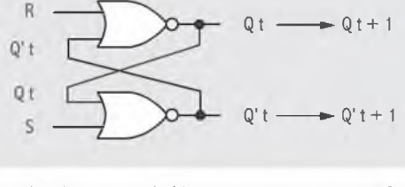

*Fig. 6.27 — Diagrama de lógica con compuertas NOR: biestable RS.* · Quiroga, *Arquitectura de computadoras*, p. 157.

> [!tip] Qué mirar
> Las dos NOR cruzadas se realimentan: `R = 1` pone `Q = 0`, `S = 1` pone `Q = 1`, y con `R = S = 0` el biestable **memoriza**. `R = S = 1` es el estado prohibido (las dos salidas a 0).

#### Relacionado
[[2.1.2 Flip-flops D y T]] · [[2.1.3 Flip-flop JK y ecuaciones características]] · [[2.1.4 Conversión entre biestables]] ·
[[TP8 Biestables RS]] · [[Flip-Flops SR, D, JK y T]] · [[Glosario — Unidad 2]]

### 2.1.2 Flip-flops D y T

> [!abstract] En una frase
> El **D** (data) guarda lo que hay en su entrada: `Q⁺ = D`. El **T** (toggle) cambia de estado cada vez que su
> entrada vale 1: `Q⁺ = T⊕Q`. Los dos nacen del RS, pero **sin** estado prohibido.

> [!note] Si es la primera vez que ves esto
> El **D** es la "caja donde dejás un papel": lo que ponés, queda. Es el ladrillo de los **registros** y de la
> memoria (cada celda es un D). El **T** es el "interruptor de escalera": cada pulso lo cambia de posición; es el
> ladrillo de los **contadores**.

#### D y T, con su tabla

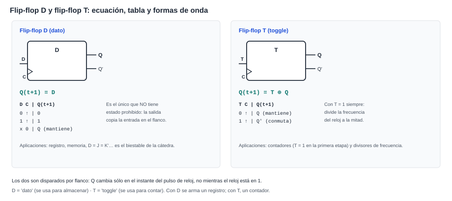

#### Flip-flop D

| D | Q⁺ |
|---|---|
| 0 | 0 |
| 1 | 1 |

**`Q⁺ = D`** — una sola línea, sin mapa.

**Cómo se construye desde el RS:** se conecta `D` a `S` y **`D'` a `R`** (con un inversor). Así nunca llegan los dos
en 1, y el estado prohibido desaparece por construcción.

**Versión con habilitación (enable):** el flip-flop sólo toma el dato cuando `E = 1`; si `E = 0`, mantiene. Es la
base de los registros con señal de carga (`LOAD`).

```
Q⁺ = E·D + E'·Q      (D con enable)
```

**D disparado por flanco:** los reales son *edge-triggered* (toman el dato en el flanco de subida o de bajada del
reloj). Es lo que permite que un registro con 8 flip-flops cargue **todos los bits a la vez**, sin carreras.

#### Flip-flop T

| T | Q⁺ |
|---|---|
| 0 | **Q** (mantiene) |
| 1 | **Q'** (cambia) |

**`Q⁺ = T⊕Q`** — y de ahí sale la tabla:

| T | Q | Q⁺ |
|---|---|---|
| 0 | 0 | 0 |
| 0 | 1 | 1 |
| 1 | 0 | 1 |
| 1 | 1 | 0 |

**Cómo se construye desde el JK:** un JK con `J = K = T`. Con `T = 1` cae en el caso "toggle".

#### Cuándo se usa cada uno

| Flip-flop | Se usa en |
|---|---|
| **D** | registros, memoria (celda RAM), latch de datos, registro de instrucción |
| **T** | contadores, divisores de frecuencia (un T con `T=1` divide el reloj por 2) |
| **JK** | contadores y máquinas de estado (con `J` y `K` distintos) |
| **RS** | el modelo teórico del que salen los otros |

> [!tip] El detalle que se pregunta
> Un **T con T = 1 permanente divide la frecuencia del reloj por 2** (cambia en cada pulso). Encadenando cuatro
> T se obtiene un **contador de 4 bits**: ésa es la estructura de un contador asíncrono.

> [!warning] Errores típicos
> - Decir que el D "recuerda" sin reloj: sin `enable`/flanco, sigue al dato (es un cable con buffer).
> - Escribir `Q⁺ = T + Q` (es **XOR**, no OR: con `T=1,Q=1` da 0).
> - Confundir `Q⁺` con `Q`: `Q⁺` es el estado **después** del pulso.

#### Figura del libro

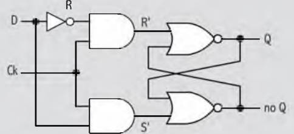

*Fig. 6.34 — Diagrama de lógica de un biestable D sincrónico* · Quiroga, *Arquitectura de computadoras*, p. 159.

#### Ejemplo resuelto
- **D**: aplicando `D = 1` y un flanco ⇒ `Q = 1`; después `D = 0` y otro flanco ⇒ `Q = 0`. Copia la entrada en
  cada flanco: `Q⁺ = D`.
- **T**: con `T = 1`, en cada flanco **alterna**. Partiendo de `Q = 0`, tres pulsos dan `1 → 0 → 1`: `Q⁺ = T ⊕ Q`.
- Con `T = 1` fijo, un flip-flop T **divide la frecuencia por 2**: 8 pulsos de reloj ⇒ 4 pulsos en `Q`. Eso es lo
  que hace un contador (ver [[2.2.3 Contadores binarios y módulo N]]).

#### Relacionado
[[2.1.1 Biestable RS (NOR y NAND)]] · [[2.1.3 Flip-flop JK y ecuaciones características]] ·
[[2.2.3 Contadores binarios y módulo N]] · [[TP9 Biestables D, JK y T]] · [[Flip-Flops SR, D, JK y T]] · [[Glosario — Unidad 2]]

### 2.1.3 Flip-flop JK y ecuaciones características

> [!abstract] En una frase
> El **JK** es el RS que **resolvió** el estado prohibido: con `J = K = 1` no se rompe, **cambia de estado**
> (*toggle*). Su ecuación es `Q⁺ = J·Q' + K'·Q`, y sale del mapa de Karnaugh de su tabla de estados.

> [!note] Si es la primera vez que ves esto
> Al RS no se le podía pedir "las dos cosas a la vez". El JK dice: "si me pedís las dos, **invierto** lo que
> tengo". Con eso se vuelve el biestable más versátil (y el que usan los contadores), y de él se derivan el D y
> el T.

#### J-K completo

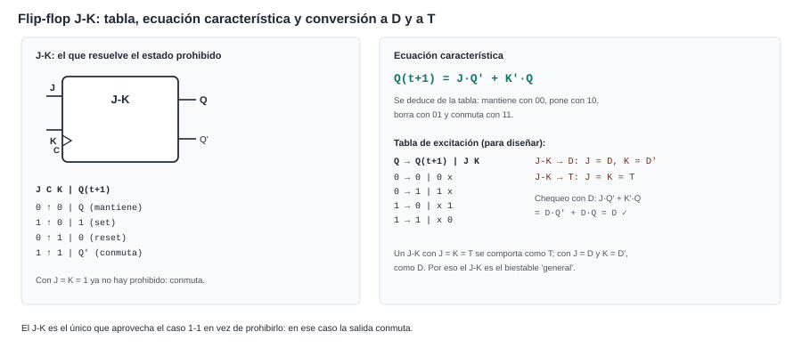

#### Tabla de estados (la que se completa en el TP)

| J | K | Q⁺ | Qué hace |
|---|---|---|---|
| 0 | 0 | **Q** | mantiene |
| 0 | 1 | **0** | reset |
| 1 | 0 | **1** | set |
| 1 | 1 | **Q'** | **toggle** (invierte) |

Y con `Q` como variable, la tabla de 8 filas para el mapa:

| J | K | Q | Q⁺ |
|---|---|---|---|
| 0 | 0 | 0 | 0 |
| 0 | 0 | 1 | 1 |
| 0 | 1 | 0 | 0 |
| 0 | 1 | 1 | 0 |
| 1 | 0 | 0 | 1 |
| 1 | 0 | 1 | 1 |
| 1 | 1 | 0 | 1 |
| 1 | 1 | 1 | 0 |

#### La ecuación, paso a paso
Mapa de `Q⁺` con filas `JK` (00, 01, 11, 10) y columnas `Q` (0, 1):

| JK \ Q | 0 | 1 |
|---|---|---|
| 00 | 0 | **1** |
| 01 | 0 | 0 |
| 11 | **1** | 0 |
| 10 | **1** | **1** |

Dos grupos de 2: `J·Q'` (columna Q=0, filas 11-10) y `K'·Q` (columna Q=1, filas 00-10).

> [!important] `Q⁺ = J·Q' + K'·Q`
> Leída en castellano: "**se pone en 1** si J lo pide (`JQ'`), y **se mantiene en 1** si K no lo borra (`K'Q`)".

#### Las cuatro ecuaciones, juntas (cuadro para memorizar)

| Biestable | Ecuación característica | Caso especial |
|---|---|---|
| **RS** | `Q⁺ = S + R'·Q` | `S = R = 1` prohibido |
| **D** | `Q⁺ = D` | — |
| **JK** | `Q⁺ = J·Q' + K'·Q` | `J = K = 1` ⇒ toggle |
| **T** | `Q⁺ = T ⊕ Q` | `T = 1` ⇒ toggle |

**Relaciones entre ellos:** `D` = JK con `J = D, K = D'` · `T` = JK con `J = K = T` · `JK` = RS con
`S = JQ', R = KQ`.

#### Tabla de excitación (la que se usa para diseñar)
Al revés: dado el cambio que quiero (`Q → Q⁺`), ¿qué entradas necesito?

| Transición | J K | D | T | S R |
|---|---|---|---|---|
| 0 → 0 | 0 **X** | 0 | 0 | 0 X |
| 0 → 1 | 1 **X** | 1 | 1 | 1 0 |
| 1 → 0 | **X** 1 | 0 | 1 | 0 1 |
| 1 → 1 | **X** 0 | 1 | 0 | X 0 |

> [!warning] Errores típicos
> - Usar el mapa de 4 filas (J,K) en vez del de 8: `Q⁺` **depende de Q**, así que Q tiene que estar en el mapa.
> - Escribir `Q⁺ = JQ + K'Q` (falta la negación de Q en el primer término).
> - Confundir la **tabla de estados** (funcionamiento) con la **tabla de excitación** (diseño).

#### Figura del libro

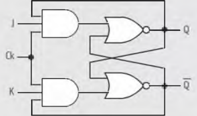

*Fig. 6.30 — Diagrama de lógica de un biestable J-K sincrónico.* · Quiroga, *Arquitectura de computadoras*, p. 158.

#### Ejemplo resuelto
Partiendo de `Q = 0`, con `J = K = 1` (modo *toggle*): pulsos ⇒ `Q = 1 → 0 → 1 → 0`.
- `J = 1, K = 0` ⇒ `Q⁺ = 1` (**set**) sin importar el estado anterior.
- `J = 0, K = 1` ⇒ `Q⁺ = 0` (**reset**).
- `J = K = 0` ⇒ **mantiene**; `J = K = 1` ⇒ **alterna**. Por eso `Q⁺ = J·Q' + K'·Q`.
- Trampa clásica: `J = K = 1` **no** es estado prohibido (eso era el RS); acá es el modo útil para contar.

#### Relacionado
[[2.1.2 Flip-flops D y T]] · [[2.1.4 Conversión entre biestables]] · [[1.3.2 Mapa de Karnaugh de 2, 3 y 4 variables]] ·
[[TP9 Biestables D, JK y T]] · [[Flip-Flops SR, D, JK y T]] · [[Glosario — Unidad 2]]

### 2.1.4 Conversión entre biestables

> [!abstract] En una frase
> Convertir un biestable en otro es **agregar compuertas a sus entradas**: se escribe la **tabla de excitación** del
> biestable que tengo y se arman las funciones de sus entradas con la salida que quiero obtener. El caso estrella es
> **RS → JK**: `S = J·Q'`, `R = K·Q`.

> [!note] Si es la primera vez que ves esto
> Tenés una caja llena de flip-flops RS y necesitás que se comporten como JK. No hace falta tirar la caja: se
> **traduce** la orden. "Quiero cambiar de estado" (JK con `J=K=1`) se convierte en "poné a 1 sólo si estaba en 0, y
> a 0 sólo si estaba en 1". Eso son dos compuertas AND.

#### El procedimiento (5 pasos)
1. Escribir la **tabla de estados** del biestable que quiero obtener (el objetivo).
2. Al lado, escribir la **tabla de excitación** del biestable que tengo (el disponible).
3. Para cada fila, anotar qué entradas necesita el disponible para lograr esa transición (con `X` = no importa).
4. **Minimizar** cada entrada con Karnaugh (o analíticamente).
5. Dibujar: el biestable disponible + las compuertas de la entrada.

#### RS → JK (el que se toma en el examen)

Objetivo: que el RS se comporte como JK.

| J | K | Q | Q⁺ (JK) | Para lograrlo con RS (S,R) |
|---|---|---|---|---|
| 0 | 0 | 0 | 0 | 0 X |
| 0 | 0 | 1 | 1 | X 0 |
| 0 | 1 | 0 | 0 | 0 X |
| 0 | 1 | 1 | 0 | 0 1 |
| 1 | 0 | 0 | 1 | 1 0 |
| 1 | 0 | 1 | 1 | X 0 |
| 1 | 1 | 0 | 1 | 1 0 |
| 1 | 1 | 1 | 0 | 0 1 |

**Mapas:** `S` vale 1 donde `J=1` y `Q=0` ⇒ **`S = J·Q'`**; `R` vale 1 donde `K=1` y `Q=1` ⇒ **`R = K·Q`**.

**Circuito:** un inversor de `Q`, una AND para `S` y una AND para `R`. **Dos compuertas más** y el RS ya es JK.


#### Las otras conversiones (para tener el cuadro completo)

| Conversión | Entradas a calcular | Resultado |
|---|---|---|
| **JK → D** | `J = D`, `K = D'` | un inversor |
| **JK → T** | `J = K = T` | un cable |
| **D → T** | `D = T⊕Q` | un XOR |
| **RS → D** | `S = D`, `R = D'` | un inversor |
| **T → JK** | `T = J·Q' + K·Q` | dos AND y una OR |

> [!tip] Cómo se verifica
> Tomá una fila conflictiva del JK (`J=K=1`) y comprobá que en el RS nunca aparezca `S=R=1`:
> con `Q=0` da `S=1,R=0` (set) y con `Q=1` da `S=0,R=1` (reset). El estado prohibido **no se alcanza nunca**.

> [!warning] Errores típicos
> - Confundir `S = JQ'` con `S = JQ` (si está en 1, poner a 1 otra vez no cambia nada: no sirve).
> - Olvidar el inversor o las AND y decir "es equivalente".
> - Usar la tabla de estados en lugar de la de **excitación**.

#### Ejemplo resuelto
Convertir un **JK en D**: hay que lograr `Q⁺ = D`, y la ecuación del JK es `Q⁺ = J·Q' + K'·Q` ⇒
**`J = D`, `K = D'`**. Verificación: `D = 1` ⇒ `J = 1, K = 0` (set) ⇒ `Q = 1` ✓; `D = 0` ⇒ `J = 0, K = 1`
(reset) ⇒ `Q = 0` ✓.
- **D en T**: `T = D ⊕ Q`. Con `Q = 0` y `D = 1` ⇒ `T = 1` (alterna y queda en 1) ✓.
- **T en D**: `D = T ⊕ Q`.
- Regla general: se escribe la ecuación del que **tengo** igualada a la del que **quiero** y se despejan las
  entradas.

#### Figura del libro

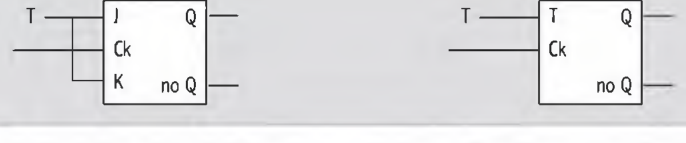

*Fig. 6.31 — Diagrama de bloque de la conversión de un biestable T a J-K (y la tabla de excitación que la justifica).* · Quiroga, *Arquitectura de computadoras*, p. 159.

> [!tip] Qué mirar
> Para convertir se pone lógica a la entrada del biestable que se tiene: `T = J·Q̄ + K·Q`. La tabla de excitación dice qué entrada hay que darle a cada tipo para pasar de `Q` a `Q⁺`.

#### Relacionado
[[2.1.3 Flip-flop JK y ecuaciones características]] · [[2.1.2 Flip-flops D y T]] · [[1.3.2 Mapa de Karnaugh de 2, 3 y 4 variables]] ·
[[TP9 Biestables D, JK y T]] · [[Conversión entre biestables (RS, JK, D, T)]] · [[Glosario — Unidad 2]]

## 2.2 Registros y contadores

### 2.2.1 Registros PIPO y SISO

> [!abstract] En una frase
> Un **registro** son `n` flip-flops D con el **mismo reloj**: el **PIPO** (Parallel In / Parallel Out) carga y
> entrega los `n` bits **a la vez**; el **SISO** (Serial In / Serial Out) los hace **entrar y salir de a uno**,
> desplazándose de flip-flop en flip-flop.

> [!note] Si es la primera vez que ves esto
> Pensá en una **fila de cajones numerados**. En el PIPO abrís todos los cajones al mismo tiempo y guardás una caja
> en cada uno. En el SISO hay un solo lugar por donde entran las cajas: cada pulso de reloj corre todas las cajas un
> cajón a la derecha, y así van saliendo por el otro extremo.

#### PIPO y SISO dibujados

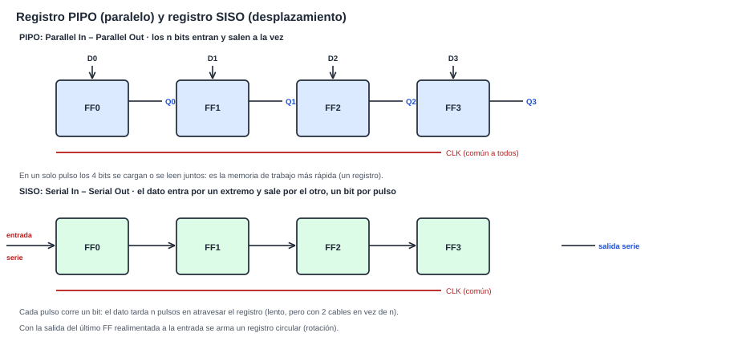

#### PIPO: carga paralela

```
        D3   D2   D1   D0      (entradas de dato)
        │    │    │    │
     ┌──▼─┐┌──▼─┐┌──▼─┐┌──▼─┐
CLK ─┤ FF ├┤ FF ├┤ FF ├┤ FF │
     └──┬─┘└──┬─┘└──┬─┘└──┬─┘
        Q3   Q2   Q1   Q0      (salidas en paralelo)
```

| Señal | Qué hace |
|---|---|
| `CLK` | con cada pulso, **todos** los FF toman su entrada |
| `LOAD` (enable) | si vale 0, el registro **mantiene** lo que tiene |
| `CLR` | borra todo a 0 (asíncrono o sincrónico) |

Cada flip-flop es un **D con enable**: `Q⁺ = LOAD·Di + LOAD'·Q`. Por eso es un registro **de n bits** con una sola
señal de carga.

**Para qué se usa:** es el registro típico de la CPU — el **IR** (registro de instrucción), el **MAR** y el
acumulador reciben el dato completo en **un pulso**. En la BLUE, `CP6: MBR → IR` es exactamente una carga paralela.

#### SISO: desplazamiento

```
      entrada serie ──►┌────┐  ┌────┐  ┌────┐  ┌────┐
                      │ FF │─►│ FF │─►│ FF │─►│ FF │──► salida serie
       CLK ───────────►└────┘  └────┘  └────┘  └────┘
```

- La salida de cada FF va a la **entrada D del siguiente**.
- Cada pulso **desplaza** un bit; en `n` pulsos entra (o sale) una palabra completa.
- Se usa para **comunicación serie** (un solo cable) y para **retardar** una señal `n` pulsos.

| | PIPO | SISO |
|---|---|---|
| Entrada | paralela (n cables) | serie (1 cable) |
| Salida | paralela (n cables) | serie (1 cable) |
| Velocidad | 1 pulso por palabra | n pulsos por palabra |
| Cables | n + 1 | 1 + 1 |

> [!tip] La frase que más se pregunta
> "¿Por qué el registro de instrucción es PIPO?" Porque la instrucción tiene que estar **completa** en un pulso
> para poder decodificarla; el SISO tardaría 16 pulsos en juntar los 16 bits.

> [!warning] Errores típicos
> - Poner relojes distintos en cada flip-flop (un registro tiene **un solo CLK**).
> - Confundir `LOAD` con `CLK`: `LOAD` habilita, `CLK` es el instante.
> - Decir que el SISO "guarda" la palabra completa de entrada: la va **recibiendo** de a un bit.

#### Figura del libro

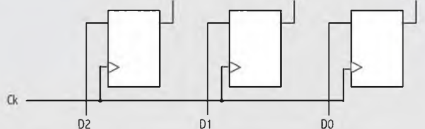

*Fig. 6.35 — Diagrama de bloque de un registro paralelo-paralelo.* · Quiroga, *Arquitectura de computadoras*, p. 160.

#### Ejemplo resuelto
Cargar **`1011`** en un PIPO: en **1 pulso** los cuatro flip-flops toman `D3..D0 = 1,0,1,1` y las salidas quedan
`Q3 Q2 Q1 Q0 = 1011`. Para **sacar** esos bits en serie con un SISO hacen falta **4 pulsos** (uno por bit).
- PIPO: 4 bits en **1** pulso ⇒ es el registro del `IR` o del `MAR` de la CPU.
- SISO: 4 bits en **4** pulsos ⇒ es un retardo o un buffer serie.
- Cuenta que se pregunta: para mover un byte, PIPO tarda **1 ciclo** y SISO **8**.

#### Relacionado
[[2.2.2 Registros SIPO y PISO]] · [[2.2.3 Contadores binarios y módulo N]] · [[2.1.2 Flip-flops D y T]] ·
[[TP10 Registros PIPO y SISO]] · [[Registros]] · [[Glosario — Unidad 2]]

### 2.2.2 Registros SIPO y PISO

> [!abstract] En una frase
> **SIPO** = entra **serie**, sale **paralelo** (recibir una palabra bit a bit y entregarla junta). **PISO** =
> entra **paralelo**, sale **serie** (tomar una palabra de la CPU y transmitirla por un cable).

> [!note] Si es la primera vez que ves esto
> Son los **traductores** entre el mundo de la CPU (todo en paralelo, 8 o 16 cables a la vez) y el mundo de las
> comunicaciones (un solo cable, un bit atrás del otro). Sin ellos no habría puertos serie, USB ni teclados.

#### SIPO y PISO dibujados

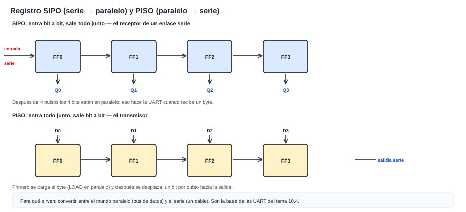

#### SIPO: serie → paralelo

```
entrada serie ──►┌────┐  ┌────┐  ┌────┐  ┌────┐
                 │ FF │─►│ FF │─►│ FF │─►│ FF │
   CLK ─────────►└──┬─┘  └──┬─┘  └──┬─┘  └──┬─┘
                    │       │       │       │
                    Q3      Q2      Q1      Q0   ◄── salida paralela (después de n pulsos)
```

**Secuencia típica:** se recibe `1011` con el bit **menos** significativo primero:
`1` → `1` → `0` → `1`, y después de 4 pulsos las salidas quedan `Q3..Q0 = 1011`.
Se usa con una señal de **habilitación de salida** (o un `LOAD` al final) para que la palabra no cambie mientras se
la está leyendo.

#### PISO: paralelo → serie

```
D3..D0 ──►[ carga paralela ]──►┌────┐  ┌────┐  ┌────┐  ┌────┐──► salida serie
                               │ FF │─►│ FF │─►│ FF │─►│ FF │
                        CLK ──►└────┘  └────┘  └────┘  └────┘
```

- **Paso 1:** `LOAD = 1` → los `n` bits entran a la vez (como un PIPO).
- **Paso 2:** `SHIFT = 1` → cada pulso saca un bit por la derecha y mete 0 (o el bit de entrada).
- En `n` pulsos salió la palabra completa, **primero el bit menos significativo**.

#### Los cuatro registros, en una tabla

| Tipo | Entrada | Salida | Pulsos por palabra | Se usa en |
|---|---|---|---|---|
| **PIPO** | paralelo | paralelo | 1 | IR, MAR, acumulador |
| **SISO** | serie | serie | n | retardo, repetidor serie |
| **SIPO** | serie | paralelo | n | recepción serie (teclado, UART RX) |
| **PISO** | paralelo | serie | 1 + n | transmisión serie (UART TX) |

> [!important] Lo que se pregunta en el oral
> "¿Cómo convierte un registro serie-paralelo?" → **desplazando**: cada pulso mete un bit por la izquierda (o por
> la derecha) y corre los anteriores; después de `n` pulsos la palabra está alineada y se habilita la salida
> paralela. El registro **no** "adivina" el dato: lo **arma** de a un bit.

> [!warning] Errores típicos
> - Olvidar el orden (¿primero el LSB o el MSB?): cambia el valor que se lee.
> - Decir que el SIPO necesita `n` pulsos **y** un pulso más para la salida: la salida paralela está disponible
>   desde el pulso `n` (si hay latch de salida, un pulso más).
> - Mezclar PISO con SIPO al nombrarlos: la primera letra es la **entrada**.

#### Ejemplo resuelto
**SIPO**: entran `1, 1, 0, 1` en 4 pulsos; al cuarto pulso la salida paralela vale **`Q3 Q2 Q1 Q0 = 1101`**
(el primero que entró quedó en el extremo más lejano).
**PISO**: se carga `1101` en paralelo (1 pulso) y sale en serie `1, 1, 0, 1` en 4 pulsos.
- SIPO = **serie → paralelo** (lo que hace un receptor serie: USB, RS-232).
- PISO = **paralelo → serie** (lo que hace un transmisor).
- Los dos juntos son la base de un **UART**.

#### Relacionado
[[2.2.1 Registros PIPO y SISO]] · [[2.2.3 Contadores binarios y módulo N]] · [[TP11 Registros SIPO y PISO]] ·
[[Registros]] · [[Interrupciones y entrada-salida]] · [[Glosario — Unidad 2]]

### 2.2.3 Contadores binarios y módulo N

> [!abstract] En una frase
> Un contador es un **registro que se incrementa en cada pulso**. El **asíncrono** encadena flip-flops T (el reloj
> de cada uno es la salida del anterior); el **síncrono** les da a todos el mismo reloj y decide con compuertas
> cuándo cada uno debe cambiar. El **módulo N** corta la cuenta después de N estados.

> [!note] Si es la primera vez que ves esto
> Es el **cuentakilómetros**: cada vez que la rueda de las unidades pasa de 9 a 0, la de las decenas avanza uno. En
> binario pasa lo mismo: cuando un bit pasa de 1 a 0, **habilita** al siguiente. Eso es exactamente "el reloj de uno
> es la salida del anterior".

#### Contar con flip-flops

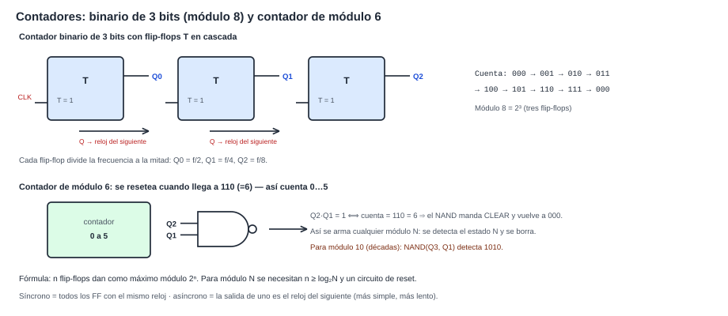

#### Contador asíncrono (de acarreo ondulante) de 4 bits

```
        ┌────┐   ┌────┐   ┌────┐   ┌────┐
CLK ───►│ T0 │──►│ T1 │──►│ T2 │──►│ T3 │
        │    │Q0 │    │Q1 │    │Q2 │    │Q3
        └────┘   └────┘   └────┘   └────┘
```
Cada T tiene `T = 1` (siempre toggle); el reloj del siguiente es `Q` del anterior.

| Pulso | Q3 Q2 Q1 Q0 | Decimal |
|---|---|---|
| 0 | 0000 | 0 |
| 1 | 0001 | 1 |
| 2 | 0010 | 2 |
| 3 | 0011 | 3 |
| … | … | … |
| 15 | 1111 | 15 |
| 16 | 0000 | 0 (vuelve) |

- **Ventaja:** pocas compuertas. **Desventaja:** los bits cambian **en cascada** (retardo acumulado) y aparecen
  **glitches** transitorios en la salida (por ejemplo `0111 → 1000` pasa por estados intermedios).
- Con `n` flip-flops cuenta **2ⁿ estados**: es un contador **módulo 2ⁿ**.

#### Contador síncrono
Todos los flip-flops reciben **el mismo CLK**; las entradas `J`/`K` (o `T`) se calculan para que cada bit cambie
sólo cuando corresponde:

```
T0 = 1
T1 = Q0
T2 = Q0·Q1
T3 = Q0·Q1·Q2
```
Es la misma lógica del acarreo. **Ventaja:** todos los bits cambian juntos (sin glitches, más rápido).
**Desventaja:** más compuertas a medida que crece `n`.

#### Contador módulo N (N no potencia de 2)
Para contar de 0 a `N−1` con `n` flip-flops (donde `2ⁿ > N`), se detecta el estado `N` y se **resetea**:

```
RESET = Q2·Q1·Q0 … (AND de los bits que valen 1 en el estado N)
```
Ejemplo **módulo 10** (BCD, de 0 a 9): con 4 FF se detecta el estado `1010` (= 10) y se fuerza `CLR`, con lo que
la secuencia salta de `1001` a `0000`. **N = 10 → 10 estados.**

| Contador | Secuencia | Detección |
|---|---|---|
| módulo 2ⁿ | 0 … 2ⁿ−1 | natural (desborde) |
| módulo 10 (BCD) | 0 … 9 | `Q3·Q1` (= 1010) |
| módulo 6 | 0 … 5 | `Q2·Q1` (= 110) |

> [!tip] La cuenta que hay que saber justificar
> "¿Cuántos flip-flops para un contador módulo 100?" → `2ⁿ ≥ 100` ⇒ **n = 7** (128 estados, se usan 100 y se
> resetea en 100 = `1100100`).

> [!warning] Errores típicos
> - Decir que un contador de 4 bits cuenta hasta 16: cuenta **0 a 15** (16 estados).
> - Confundir el reset asíncrono (inmediato) con el sincrónico (en el próximo pulso).
> - En el asíncrono, conectar el reloj del siguiente a `Q'` en vez de `Q` y "contar al revés" sin darse cuenta.

#### Figura del libro

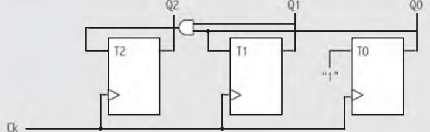

*Fig. 6.36 — Diagrama de bloque de un contador progresivo de 8 eventos con biestables T.* · Quiroga, *Arquitectura de computadoras*, p. 160.

> [!example] Contador módulo 6 con 3 flip-flops
> Cuenta `000 → 001 → 010 → 011 → 100 → 101 → 000`: **6 estados**, se saltea `110` y `111`. El detector de módulo
> es una NAND de las salidas que valen 1 en el estado **6** (`110` ⇒ `Q2·Q1`), que resetea al contador. Con `n`
> flip-flops: `2ⁿ ≥ N` ⇒ para `N = 6`, `n = 3`.

#### Relacionado
[[2.2.1 Registros PIPO y SISO]] · [[2.1.2 Flip-flops D y T]] · [[2.1.3 Flip-flop JK y ecuaciones características]] ·
[[Contadores]] · [[TP9 Biestables D, JK y T]] · [[Glosario — Unidad 2]]

## 2.3 La celda y el chip de memoria

### 2.3.1 Celda elemental de memoria

> [!abstract] En una frase
> Una celda de memoria guarda **un bit** y tiene siempre **cuatro cosas**: un **biestable** (que recuerda), una
> **selección** (que la elige), una señal de **lectura/escritura** (que decide qué hacer) y un **buffer de 3
> estados** (que la conecta al bus sólo cuando es leída).

> [!note] Si es la primera vez que ves esto
> Pensá en un **casillero de un vestuario**: tiene un número (selección), una puerta con cerradura que se abre
> desde afuera (L/E), y adentro un perchero (el biestable). Y hay una ventanilla que sólo se abre cuando alguien
> viene a mirar (el buffer de 3 estados) — así los miles de casilleros no hablan todos por el mismo pasillo a la
> vez.

#### La celda por dentro

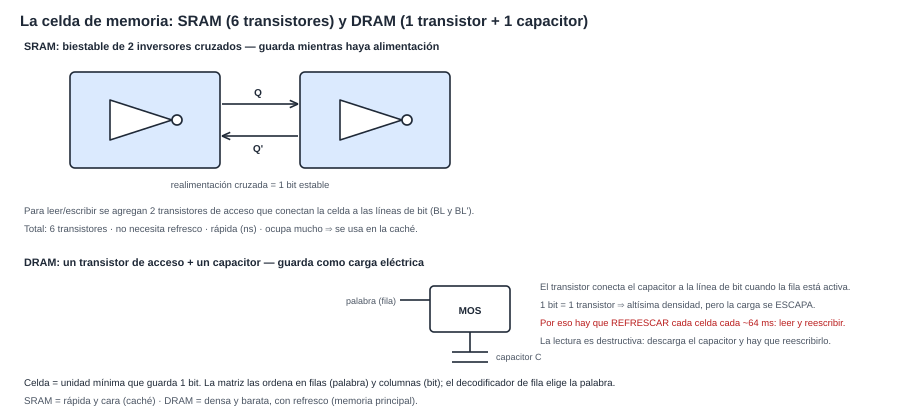

#### Los cuatro bloques

```
              SELECCIÓN (de la dirección)         L/E (del control)
                     │                                 │
               ┌─────▼─────┐                    ┌──────▼──────┐
   D ─────────►│  BIESTABLE │───────────────────►│ 3 ESTADOS   │────► BUS DE DATOS
               └─────┬─────┘   (guarda el bit)   └─────────────┘
                     │
                 MANTIENE
```

| Bloque | Para qué sirve | Qué pasa si falta |
|---|---|---|
| **Biestable** | guardar el bit | no hay memoria, es un cable |
| **Selección** | activar **sólo** la celda direccionada | todas las celdas responderían a la vez |
| **L/E** | leer o escribir según la orden | no se puede distinguir lectura de escritura |
| **3 estados** | conectar al bus sólo cuando se lee | las celdas chocarían contra el bus (cortocircuito lógico) |

#### El buffer de 3 estados (lo que más se pregunta)
Tiene tres estados: **0**, **1** y **alta impedancia (Z)**. Con `EN = 1` copia el valor del biestable al bus; con
`EN = 0` se desconecta (no es 0 ni 1: es un **circuito abierto**).

**Por qué es imprescindible:** la memoria tiene miles de celdas conectadas al **mismo** bus de datos. Sólo la
direccionada debe manejarlo; las demás quedan en `Z`. Sin buffers, dos celdas con valores distintos se pelearían
por el cable.

#### Operación de una celda

| Operación | SEL | L/E | Bus | Qué hace el biestable |
|---|---|---|---|---|
| mantener | 0 | X | Z | conserva el bit |
| **leer** | 1 | 0 (lectura) | sale `Q` | no cambia |
| **escribir** | 1 | 1 (escritura) | entra `D` | toma el valor del bus |

#### De la celda a la palabra
Una **palabra** de `m` bits son `m` celdas que comparten **la misma selección** y **la misma L/E**: se leen y se
escriben **juntas**. Eso es lo que hace que una memoria de 8 palabras × 3 bits tenga **24 celdas** y 8 selecciones
(una por palabra).

> [!warning] Errores típicos
> - Olvidar el buffer de 3 estados (es el bloque que más se valora en la corrección).
> - Decir que la selección "guarda" la dirección: la selección **activa** la celda a partir del decodificador.
> - Confundir `L/E` con el reloj: `L/E` decide la operación; el reloj marca el instante de la escritura.

#### Figura del libro

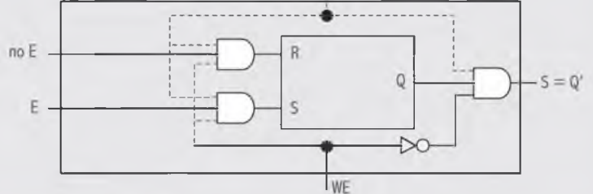

*Fig. 9.4 — Diagrama más detallado de la celda.* · Quiroga, *Arquitectura de computadoras*, p. 238.

#### Ejemplo resuelto
Guardar un **1** y leerlo:
1. La dirección activa `SEL` de esa celda (a través del decodificador).
2. Con `WE = 1` y `D = 1`, el biestable queda en `Q = 1` ⇒ el bit está **escrito**.
3. Para leer hay que poner `WE = 0`: el buffer de 3 estados deja pasar `Q` al bus de datos **sólo si `SEL = 1`**.
   Si `SEL = 0`, la salida queda en **alta impedancia** y el bus sigue libre para otra celda.
- Ésa es la razón del 3.er estado: **miles de celdas comparten un bus** y sólo una habla por vez.

#### Relacionado
[[2.3.2 SRAM y DRAM]] · [[2.3.3 Matriz, expansión y RAM 8x3]] · [[1.4.1 Decodificador]] ·
[[TP13 Componentes internos]] · [[Celda elemental de memoria]] · [[Glosario — Unidad 2]]

### 2.3.2 SRAM y DRAM

> [!abstract] En una frase
> **SRAM** = celda con **6 transistores** (dos inversores realimentados = un biestable): guarda mientras haya
> alimentación, es **rápida y cara**. **DRAM** = celda con **1 transistor y 1 capacitor**: guarda una **carga**, es
> **densa y barata**, pero la carga se pierde y hay que **refrescarla** cada pocos milisegundos.

> [!note] Si es la primera vez que ves esto
> La SRAM es una **pizarra**: escribís y queda, rápido, pero ocupa lugar. La DRAM es un **vaso con agua**: guarda el
> valor como "agua en el vaso", entra muchísima más cantidad en el mismo espacio, pero el agua se **evapora** y hay
> que volver a llenarlo cada tanto. Esa evaporación es el **refresco** (refresh).

#### SRAM contra DRAM, con el refresco

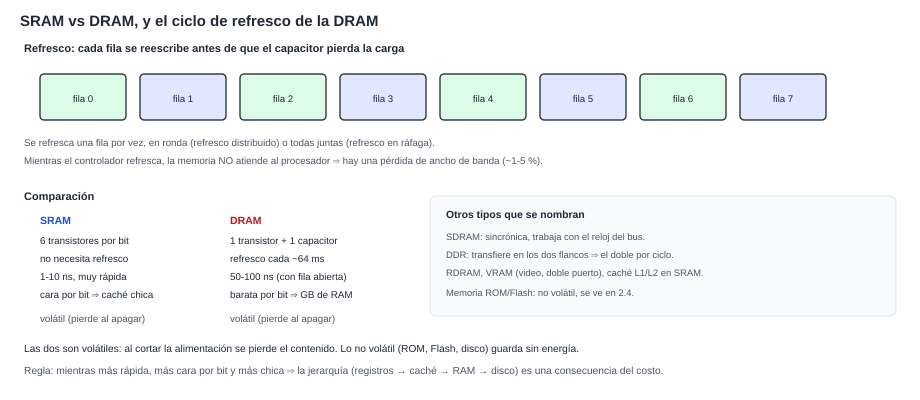

#### Comparación (la tabla que se pide)

| | **SRAM** | **DRAM** |
|---|---|---|
| Celda | 6 transistores (2 inversores + 2 de acceso) | 1 transistor + 1 capacitor |
| Principio | biestable realimentado | carga del capacitor |
| ¿Necesita refresco? | **no** | **sí** (cada ~2-64 ms) |
| Velocidad | muy alta | alta (con latencia y filas) |
| Densidad | baja | **muy alta** |
| Costo por bit | alto | bajo |
| Consumo | bajo (en reposo) | con picos por el refresco |
| Volatilidad | volátil (pierde sin alimentación) | volátil |
| Se usa en | **caché**, registros | **memoria principal (RAM)** |

#### El refresco (por qué existe)
El capacitor se descarga por las corrientes de fuga. Cada celda se lee y se reescribe (**ciclo de refresco**) de
forma periódica y **en filas completas**, no celda por celda. Mientras se refresca, la memoria **no atiende** un
acceso normal: de ahí vienen los "ciclos robados" y parte de la latencia de la DRAM.

#### Por qué la computadora usa las dos
- La **caché** tiene que ser **rapidísima** y es chica ⇒ SRAM.
- La **memoria principal** tiene que ser **grande y barata** ⇒ DRAM.
Esa mezcla es la base de la **jerarquía de memorias** ([[2.5.1 Jerarquía y localidad]]): lo rápido y caro cerca de
la CPU, lo lento y barato lejos.

#### El ejemplo de chip: SRAM 1024 × 1 (Intel 2102)

La SRAM que se usa como ejemplo en la materia es la **2102**: **1024 palabras de 1 bit** (1024 bits en total).

| Dato | Valor | Cuenta |
|---|---|---|
| Capacidad | 1024 × 1 | `2¹⁰` palabras ⇒ **10 bits de dirección** |
| Celda | 1 flip-flop (6 transistores) | no necesita refresco |
| Salida | 1 bit | para armar 8 bits se ponen **8 chips en paralelo**, todos con la misma dirección |
| Tiempo de acceso | del orden de decenas de ns | más rápida que la DRAM, más cara por bit |

#### Tipo de acceso (cómo se clasifican las memorias)

| Tipo de acceso | Qué significa | Ejemplos |
|---|---|---|
| **Aleatorio** (*random*) | cualquier posición tarda **lo mismo** | RAM (SRAM/DRAM), ROM |
| **En serie** o secuencial | el tiempo depende de **dónde esté** la palabra: hay que pasar por las anteriores | cinta magnética |
| **Directo** | salta al bloque y dentro busca en serie | disco, SSD (por bloques) |
| **Asociativo** | se busca **por contenido**, no por dirección | memoria asociativa / CAM |

> [!warning] Lo que se confunde
> "RAM" no significa "memoria" sino **Random Access Memory**: lo que la define es el **acceso aleatorio**, no que sea
> volátil. Una ROM también es de acceso aleatorio; un disco, no.

#### Otras tecnologías que aparecen
| Tecnología | Celda | Rasgo |
|---|---|---|
| **SDRAM / DDR** | DRAM sincrónica | sincronizada con el reloj y con transferencia doble (DDR) |
| **NVRAM** | SRAM + batería | conserva el dato sin alimentación |
| **Flash** | celda flotante | no volátil, escritura por bloques (ver [[2.4.2 PROM, EPROM, EEPROM y Flash]]) |

> [!warning] Errores típicos
> - Decir que la SRAM es no volátil: **las dos son volátiles**.
> - Confundir "refresco" con "recargar la batería": es reescribir el dato.
> - Invertir la densidad: la DRAM guarda **más** bits por mm², no menos.

#### Figura del libro

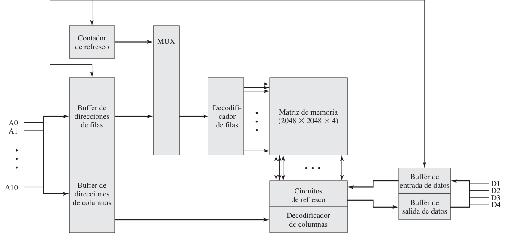

*Fig. 5.3 — DRAM típica de 16 megabits (4M 4).* · Stallings, *Organización y arquitectura de computadores*, 7ª ed., p. 178.

#### Del chip al módulo: DIMM, SODIMM y las DDR

El chip de la figura no se suelda en la placa: se monta en un **módulo** junto con otros chips, y la PC compra
módulos. Lo que se pregunta de esto es el **nombre y la diferencia**, no el número de pines de memoria.

| Tipo | Dónde va | Detalle |
|---|---|---|
| **SIMM** | placas viejas | contactos en una sola cara |
| **DIMM** (*Dual In-line Memory Module*) | **escritorio** | contactos en las dos caras; **168, 184, 240 o 288 pines** según la generación |
| **SODIMM** (*Small Outline DIMM*) | **notebooks** | más corto, misma función |

| Generación | Novedad | Detalle |
|---|---|---|
| **SDRAM** | sincrónica con el reloj del bus | una transferencia por ciclo |
| **DDR, DDR2, DDR3, DDR4, DDR5** | *Double Data Rate*: **dos transferencias por ciclo** | cada generación sube frecuencia y baja tensión; el **orificio (muesca)** del módulo impide poner una generación donde no va |

> [!example] La cuenta que se pregunta
> Un módulo **DDR4-3200** tiene reloj de 1600 MHz y transfiere 2 veces por ciclo ⇒ **3200 MT/s** por pin. Con
> **64 bits** de ancho de bus: `3200 × 10⁶ × 64 / 8 = 25,6 GB/s`. Con un solo canal. Con dos canales
> (dual channel), el doble. Es exactamente la cuenta de [[8.3.1 Bancos de memoria y ancho de banda]].


#### Relacionado
[[2.3.1 Celda elemental de memoria]] · [[2.3.3 Matriz, expansión y RAM 8x3]] · [[2.5.1 Jerarquía y localidad]] ·
[[Celda elemental de memoria]] · [[TP12 Memoria principal]] · [[Glosario — Unidad 2]]

### 2.3.3 Matriz, expansión y RAM 8x3

> [!abstract] En una frase
> Un chip de memoria es una **matriz** de celdas: el **decodificador** convierte la dirección en una **fila**
> activa, y las `m` celdas de esa fila salen juntas por el bus (una **palabra**). Para agrandar se combinan chips en
> **profundidad** (más palabras, con `CS`) o en **ancho** (más bits por palabra).

> [!note] Si es la primera vez que ves esto
> Es un **estacionamiento**: cada fila tiene lugar para un auto por carril (bits) y la dirección dice en qué fila
> estacionar. El decodificador es el que **abre la barrera de una sola fila**; los demás quedan cerrados.

#### La matriz de 8 palabras × 3 bits

```
                 ┌───────────────────────────────┐
   A2 ──┐        │  decodificador 3 → 8          │
   A1 ──┼───────►│  (una salida activa por vez)  │
   A0 ──┘        └───┬───┬───┬───┬───┬───┬───┬───┬┘
                     │   │   │   │   │   │   │   │  (selección de fila)
                  ┌──▼─┐…  cada fila = 3 celdas
                  │FFF │  palabra 0: 3 bits
                  └──┬─┘
                     │ 3
   L/E ──────────────┤ (lectura / escritura para todas las celdas de la fila)
   D2..D0 ◄─────────►│ bus de datos (3 bits, con buffers de 3 estados)
```

| Parte | Detalle |
|---|---|
| **Direcciones** | `log₂(8) = 3` bits (`A2 A1 A0`) |
| **Decodificador** | 3 → 8 (3 inversores + 8 AND de 3) |
| **Celdas** | 8 palabras × 3 bits = **24 celdas** |
| **Datos** | bus de **3** bits (uno por columna) |
| **Control** | `L/E` (0 = leer, 1 = escribir) · `CS`/`EN` (chip select) |

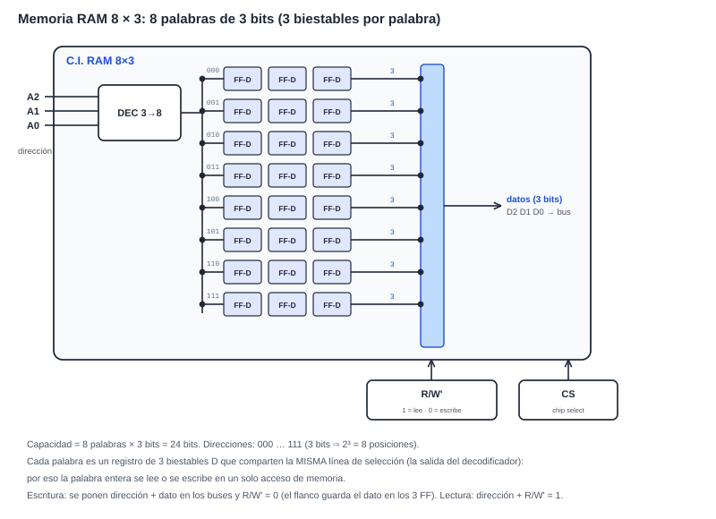

> [!warning] Ojo con el nombre: 8×3 o 3×8
> La misma memoria se nombra de las dos formas según el libro o el profesor: **8 × 3** (8 palabras de 3 bits) o
> **3 × 8** (3 bits por cada una de las 8 posiciones). **Es la misma máquina**: 8 filas y 3 columnas. Si en el final
> te dicen "RAM 3×8", contá 8 posiciones × 3 bits y no te trabes con el orden.

#### Cómo se escribe una palabra (ejemplo: dirección 5, dato 101)
1. `A2A1A0 = 101`; el decodificador activa **sólo** la salida 5.
2. `L/E = 1` (escritura): las 3 celdas de la fila 5 toman el valor del bus (`1`, `0`, `1`).
3. Las otras 7 filas no reciben selección y **no cambian**.

#### Cómo se lee
1. Misma dirección ⇒ se activa la fila 5.
2. `L/E = 0`: los buffers de 3 estados se habilitan y ponen `101` en el bus.
3. Las celdas **no** se modifican (la lectura en SRAM no destruye).

#### Expansión (lo que pide el TP12)
| Quiero… | Cómo se hace | Señales |
|---|---|---|
| **más palabras** (profundidad) | chips en paralelo de datos, **uno habilitado a la vez** | bits altos de dirección al decodificador que maneja los `CS` |
| **palabras más anchas** (ancho) | chips en paralelo de datos, **todos habilitados juntos** | el mismo `CS` para todos; cada chip aporta sus bits |

**Ejemplo:** una memoria de `2^n` palabras × 8 bits con chips de `2^(n-1)` × 4 ⇒ **4 chips**: 2 para duplicar la
profundidad y 2 para completar los 8 bits.

> [!warning] Errores típicos
> - Contar celdas como palabras (8×3 son **24 celdas**, no 8).
> - Olvidar que el decodificador tiene **una sola salida activa**.
> - En la expansión de profundidad, habilitar dos chips a la vez (choque en el bus de datos).

#### Figura del libro

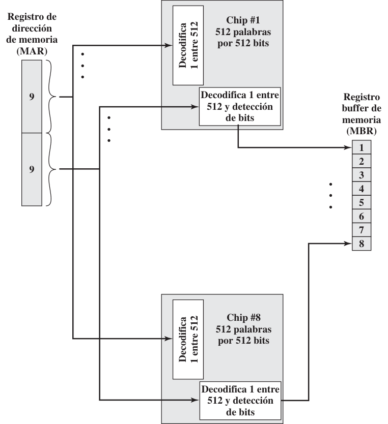

*Fig. 5.5 — Organización de una memoria de 256 KB.* · Stallings, *Organización y arquitectura de computadores*, 7ª ed., p. 181.

> [!example] RAM 8 × 3 (8 palabras de 3 bits)
> Hacen falta **8 celdas por bit** y **3 planos** (uno por bit) ⇒ **24 celdas**, un **decodificador 3 → 8** (3 bits
> de dirección) y **3 buffers** de salida de 3 estados. Para pasar a 16 × 3: dos chips de 8 × 3 y el bit más alto de
> dirección elige el chip (`CS`) con un decodificador 1 → 2.

#### Relacionado
[[2.3.1 Celda elemental de memoria]] · [[2.3.2 SRAM y DRAM]] · [[1.4.1 Decodificador]] ·
[[Memoria RAM 8x3]] · [[TP12 Memoria principal]] · [[Glosario — Unidad 2]]

### 2.3.4 Detección y corrección de errores (paridad, LRC, CRC y Hamming)

> [!abstract] En una frase
> Como una memoria o un cable puede devolver un bit cambiado, se le **agregan bits redundantes**: con **paridad**
> o **LRC** se **detecta** que hubo un error; con **CRC** (polinomio) se detectan casi todas las ráfagas; con
> **Hamming** además se **corrige**, porque el patrón de fallas indica **qué bit** está mal.

> [!note] Si es la primera vez que ves esto
> Es el mismo truco del DNI: además del número hay un **dígito verificador**. No agrega información, pero si te
> equivocás al copiar, el verificador no cierra y te avisa. La paridad es eso: un bit de más que dice "la cuenta
> de unos tiene que dar par".

#### Paridad (detecta 1 bit)

Se agrega **un** bit para que la cantidad de unos del grupo sea par (paridad **par**) o impar (paridad **impar**).

| Dato | Unos | Paridad par | Paridad impar |
|---|---|---|---|
| `1011 0010` | 4 | `P = 0` (queda par) | `P = 1` |
| `1011 0011` | 5 | `P = 1` | `P = 0` |

| Pregunta | Respuesta |
|---|---|
| ¿Detecta 1 bit mal? | sí: el receptor cuenta unos y no le cierra |
| ¿Detecta 2 bits mal? | **no**: dos errores dejan la cuenta igual |
| ¿Corrige? | **no**: no sabe *cuál* de los bits está mal |

#### LRC: paridad por bloque (longitudinal)

Se calcula un byte de paridad **por columna** sobre una trama. Es lo que la cátedra muestra con una trama ASCII:

```
01 + 08 + 00 + 00 + 61 + 62 = CC   (suma hexadecimal de los datos)
complemento a 2 de CC       = 34   ⇒  LRC = 34
```

El receptor **suma los datos + el LRC**: si el resultado no da `00`, hubo error. Detecta **una** ráfaga de hasta
un byte por bloque y se usa en E/S industrial (comunicación entre instrumentos y una PC).

#### CRC: polinomio generador (detecta ráfagas)

La trama se interpreta como un **polinomio** `D(X)`: cada posición de bit es un término. A `D(X)` se lo **divide**
por un **polinomio generador normalizado** `G(X)` y se transmite el **resto**. En el receptor, `D(X)` + el resto
dividido por `G(X)` tiene que dar **resto 0**.

| Generador | Polinomio | Redundancia |
|---|---|---|
| **CRC-8** | `X⁸ + X⁵ + X⁴ + 1` | 8 bits |
| **CRC-12** | `X¹² + X¹¹ + X³ + X² + X + 1` | 12 bits |
| **CRC-16** | `X¹⁶ + X¹⁵ + X² + 1` | 16 bits |

**Cómo se calcula a mano:** `D(X) · X⁸` (o sea, desplazar 8 lugares a la izquierda) y dividir por `G(X)` en
módulo 2 (XOR); el resto son los 8 bits de CRC. Es lo que hacen los ZIP, Ethernet y los discos.

> [!example] El polinomio de un bloque
> Un bloque de 6 bytes son 48 bits ⇒ el polinomio puede llegar a grado 47. Si los bits son
> `0000 0001 0000 1000 …`, el término de mayor peso es `X⁴⁷` y los demás se agregan con los bits en 1:
> `D(X) = X⁴⁰ + X³⁵ + X¹⁴ + X¹³ + X⁸ + X⁶ + X¹`.

#### Hamming: detecta y corrige (el síndrome es la posición)

Los bits de control van en las **potencias de 2** (`1, 2, 4, 8, …`) y cada uno controla las posiciones cuya
representación binaria incluye ese bit.

| Posición | 1 | 2 | 3 | 4 | 5 | 6 | 7 | 8 | 9 | 10 | 11 | 12 |
|---|---|---|---|---|---|---|---|---|---|---|---|---|
| Bit | `P1` | `P2` | `D1` | `P4` | `D2` | `D3` | `D4` | `P8` | `D5` | `D6` | `D7` | `D8` |

| Control | Cubre las posiciones |
|---|---|
| `P1` | 1, 3, 5, 7, 9, 11 |
| `P2` | 2, 3, 6, 7, 10, 11 |
| `P4` | 4, 5, 6, 7, 12 |
| `P8` | 8, 9, 10, 11, 12 |

El receptor recalcula los controles y arma un **síndrome** con ellos: si vale `0` no hubo error; si vale `k`,
**el bit `k` es el que falló** y se lo invierte. Cuesta `k` bits de control para `2ᵏ − 1 − k` de datos: `(12, 8)`,
`(7, 4)` y, en las memorias con ECC, **72 bits por línea = 64 de datos + 8 de control**.

#### Los cuatro, dibujados

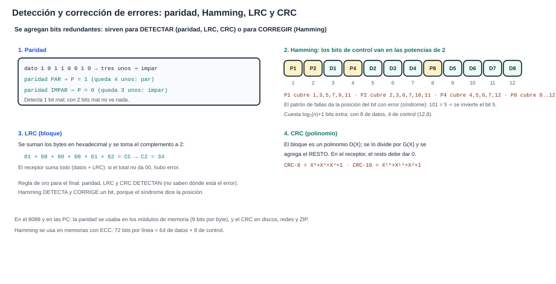

#### Figura del libro

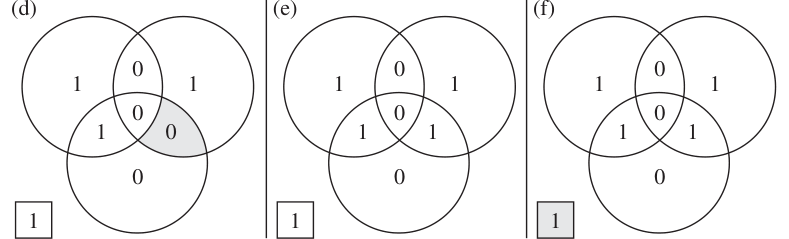

*Fig. 5.11 — Código SEC-DED de Hamming.* · Stallings, *Organización y arquitectura de computadores*, 7ª ed., p. 186.

> [!example] Ejercicio numérico de Hamming (8, 4)
> Datos `1011` ⇒ `D1=1, D2=0, D3=1, D4=1`. Con paridad **par**: `P1` cubre 3, 5, 7 ⇒ `D1, D2, D4` = `1, 0, 1`
> (dos unos) ⇒ `P1 = 1`. `P2` cubre 3, 6, 7 ⇒ `D1, D3, D4` = `1, 1, 1` (tres) ⇒ `P2 = 1`. `P4` cubre 5, 6, 7 ⇒
> `D2, D3, D4` = `0, 1, 1` (dos) ⇒ `P4 = 0`. Se transmite `P1 P2 D1 P4 D2 D3 D4` = **`1 1 1 0 0 1 1`**.

> [!important] Qué se pregunta de verdad
> 1. La diferencia entre **detectar y corregir** (paridad vs Hamming).
> 2. Cuántos bits de control necesita Hamming para `n` datos: el menor `k` con `2ᵏ ≥ n + k + 1`.
> 3. El cálculo del **LRC** con la suma hexadecimal y el complemento a 2.
> 4. Que el **CRC se divide** y en el receptor el resto debe dar **0**.

> [!warning] Ojo con los dos "1 bit"
> La paridad detecta **un** bit mal y **no** corrige. Hamming corrige **un** bit; si fallan **dos**, el síndrome
> apunta a una posición equivocada y "corrige" mal. Por eso existe el **SEC-DED** (*single error correction,
> double error detection*): agrega un bit más para avisar que hubo dos.

#### Relacionado
[[2.3.2 SRAM y DRAM]] · [[2.4.2 PROM, EPROM, EEPROM y Flash]] · [[10.4.1 Discos, SSD y latencias]] ·
[[1.6.1 Códigos ponderados y no ponderados]] · [[Glosario — Unidad 2]]

## 2.4 ROM y memorias no volátiles

### 2.4.1 ROM = decodificador + OR

> [!abstract] En una frase
> Una ROM de `2ⁿ` palabras de `m` bits es **un decodificador de `n` a `2ⁿ`** (que elige la palabra) más **`m`
> compuertas OR** (una por bit de salida), donde cada OR suma **los mintérminos de las direcciones** en las que ese
> bit vale 1.

> [!note] Si es la primera vez que ves esto
> Una ROM **no es un circuito raro**: es una **tabla de verdad guardada**. Le das una dirección y te devuelve el
> dato que tiene anotado para esa dirección. Como cualquier tabla se puede escribir como suma de mintérminos, la
> ROM es exactamente eso hecho hardware: decodificador + OR.

#### ROM = decodificador + OR

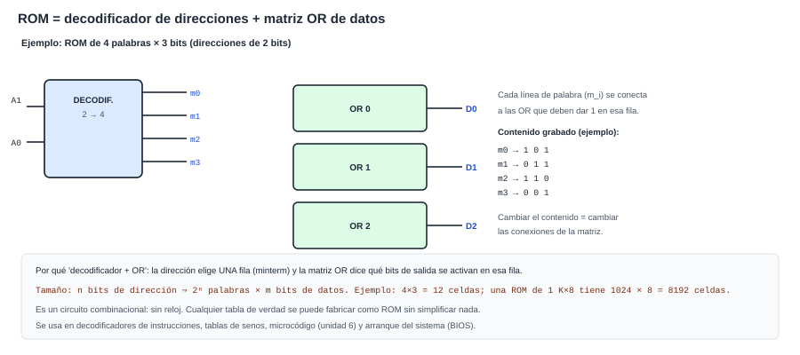

#### Estructura

```
   A1 ──┐                      ┌──── OR ────► D3
   A0 ──┼──►[ decodificador ]──┤──── OR ────► D2
        │        2 → 4         │──── OR ────► D1
        │                     └──── OR ────► D0
    (una sola línea activa = una palabra)
```

**Ejemplo: ROM de 4 × 4** con este contenido:

| Dirección | D3 D2 D1 D0 |
|---|---|
| 0 (00) | 0 1 1 0 |
| 1 (01) | 1 0 0 1 |
| 2 (10) | 1 1 0 0 |
| 3 (11) | 0 1 1 1 |

Cada salida se escribe como suma de los mintérminos donde vale 1:
```
D3 = m1 + m2      D2 = m0 + m2 + m3      D1 = m0 + m3      D0 = m1 + m3
```
Esas cuatro OR **son** la ROM. La "programación" es decidir **qué fusible/unión** queda conectado a cada OR.

#### Por qué la ROM es no volátil
El valor no está en un biestable alimentado: está en la **presencia o ausencia de una conexión** (diodo, fusible,
transistor de compuerta flotante). No hay nada que "se descargue", así que al cortar la luz el dato sigue.

#### Usos
| Uso | Por qué una ROM |
|---|---|
| BIOS / firmware | tiene que estar al encender, antes de cargar nada |
| Microcódigo de la UC | el microprograma del 8088 vive en una ROM de 504×21 |
| Tablas de funciones | seno, logaritmos, decodificación de caracteres |
| Generador de caracteres | la fuente de un display: cada dirección es una fila de píxeles |

> [!tip] Una ROM también es una función lógica
> Cualquier función combinacional de `n` variables se implementa con una ROM de `2ⁿ` palabras de 1 bit: se guarda la
> tabla de verdad. Es la forma más directa (aunque no la más barata) de "hacer una función".

> [!warning] Errores típicos
> - Decir que la ROM "tiene biestables": no los necesita, guarda conexiones.
> - Confundir cantidad de palabras con bits por palabra (4×4 son **16 bits**, no 4).
> - Olvidar que el decodificador activa **una** palabra por vez.

#### Figura del libro

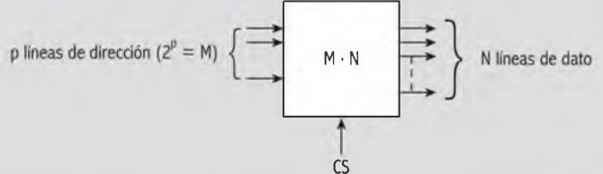

*Fig. 6.23 — Diagrama de bloque de cualquiera de las memorias de sólo lectura.* · Quiroga, *Arquitectura de computadoras*, p. 153.

> [!example] ROM de 4 × 4
> 2 bits de dirección ⇒ decodificador 2 → 4 (4 líneas de palabra) y 4 líneas de datos; la matriz OR tiene
> `4 × 4 = 16` puntos de conexión. Si `M[3] = 1010`, la línea 3 activa los OR de las columnas que deben dar 1.
> **Cambiar el contenido = cambiar la matriz**: por eso la ROM se programa una sola vez.

#### Relacionado
[[2.4.2 PROM, EPROM, EEPROM y Flash]] · [[1.4.1 Decodificador]] · [[1.3.1 Mintérminos y maxtérminos]] ·
[[Memoria ROM y sus tipos]] · [[TP12 Memoria principal]] · [[Glosario — Unidad 2]]

### 2.4.2 PROM, EPROM, EEPROM y Flash

> [!abstract] En una frase
> Son las **variantes programables** de la ROM: **PROM** se graba **una sola vez** (fusibles), **EPROM** se borra
> con **luz ultravioleta**, **EEPROM** se borra **eléctricamente byte por byte** y **Flash** es una EEPROM que se
> borra **por bloques** (es la que usás todos los días).

> [!note] Si esta es la primera vez que ves esto
> La ROM de fábrica no se puede cambiar: si hay un error, se tira el chip. Entonces aparecieron versiones
> "regrabables", de la más incómoda a la más cómoda: sacar el chip y meterlo en un aparato con luz UV (EPROM),
> borrarlo con una señal eléctrica desde el mismo circuito (EEPROM), o hacerlo por bloques y a gran velocidad
> (Flash).

#### De la PROM a la Flash


#### La tabla completa

| Tipo | Se graba | Se borra | Veces | Tiempo de escritura | Uso típico |
|---|---|---|---|---|---|
| **ROM de máscara** | en fábrica (máscara) | no | 1 | — | productos de altísimo volumen |
| **PROM** | una vez, con un programador | no (fusible quemado) | 1 | lento | prototipos viejos |
| **EPROM** | con programador (voltaje alto) | **UV** (~20 min, ventana de cuarzo) | ~miles | lento | desarrollo, años 80-90 |
| **EEPROM** | eléctricamente, **byte a byte** | eléctricamente | ~1 millón | medio | configuración, datos chicos |
| **Flash NOR** | por bloques | por bloques | ~100 mil | medio | firmware (BIOS), código |
| **Flash NAND** | por páginas | por bloques | ~10 mil | rápido | **SSD**, pendrives, tarjetas |

#### Cómo guarda un bit (la idea física)
Todas las regrabables usan un **transistor de compuerta flotante**: la carga atrapada en la compuerta flotante
cambia el umbral del transistor. Con carga = un estado; sin carga = el otro.
- **Programar** = meter carga (voltaje alto).
- **Borrar (Flash/EEPROM)** = sacar la carga; **EPROM** = sacarla con fotones de UV.

El dato **sobrevive** al corte de energía, y eso las hace **no volátiles**; la carga se degrada muy lentamente
(retensión típica: 10-20 años).

#### Consecuencias prácticas (lo que se pregunta)
- **Borrar por bloques** es lo que hace lento escribir en Flash: para cambiar un byte hay que **leer el bloque,
  modificarlo y reescribirlo entero**.
- **Duración limitada**: cada borrado desgasta la celda ⇒ los SSD hacen *wear leveling*.
- **Flash no es RAM**: se lee rápido pero se escribe lento y por bloques; por eso los sistemas la usan para
  almacenar y copian a DRAM para trabajar.

> [!warning] Errores típicos
> - Decir que la EPROM se borra con electricidad (es **UV**; la eléctrica es la EEPROM).
> - Confundir EEPROM con Flash: misma familia, distinta **granularidad** de borrado (byte vs bloque).
> - Decir que son volátiles: **son no volátiles** (por eso guardan el firmware).

#### Ejemplo resuelto
Comparar una **EPROM 2716** (2 K × 8 = **16 Kbit**) con una **flash** del mismo tamaño:
- La EPROM se borra **entera** con **luz ultravioleta** (ventana de cuarzo, ~20 minutos) y se programa con
  `VPP` ≈ **+12,5 V** aplicado en un pin.
- La EEPROM se borra **por byte** (eléctricamente) pero es más cara y más lenta.
- La **flash** se borra **por bloques** (sectores) y se programa por página: es la que se usa en los pen drives
  y en el firmware (BIOS/UEFI), porque combina densidad de EPROM con borrado eléctrico.
- Cuenta típica: 2 K × 8 = 2048 × 8 = **16 384 bits** = 16 Kbit = **2 KB**.

#### Relacionado
[[2.4.1 ROM = decodificador + OR]] · [[2.3.2 SRAM y DRAM]] · [[2.6.2 Memoria auxiliar y memoria asociativa]] ·
[[Memoria ROM y sus tipos]] · [[TP12 Memoria principal]] · [[Glosario — Unidad 2]]

## 2.5 Jerarquía y caché

### 2.5.1 Jerarquía y localidad

> [!abstract] En una frase
> La jerarquía de memorias ordena los niveles por **velocidad, tamaño y costo**: registros → caché (L1/L2/L3) → RAM
> → disco/SSD. Funciona porque los programas tienen **localidad**: usan muchas veces pocas zonas de memoria.

> [!note] Si es la primera vez que ves esto
> Es la **heladera, la alacena y el supermercado**: lo que vas a usar ahora lo tenés a mano (heladera = registros),
> lo de la semana en la alacena (RAM), y lo de todo el mes en el supermercado (disco). Vas al supermercado pocas
> veces porque ya sabés que **casi siempre** usás lo mismo. La computadora hace exactamente eso.

#### La pirámide


| Nivel | Tecnología | Tamaño típico | Latencia | Costo/bit | Quién la administra |
|---|---|---|---|---|---|
| **Registros** | flip-flops | ~decenas de bytes | < 1 ns | altísimo | el **compilador** |
| **L1** | SRAM | 32-64 KB | ~1 ns | muy alto | el hardware (transparente) |
| **L2 / L3** | SRAM | 256 KB – 32 MB | ~5-15 ns | alto | el hardware |
| **RAM** | DRAM | 8-64 GB | ~50-100 ns | medio | el **sistema operativo** |
| **SSD / disco** | Flash / magnético | 256 GB – varios TB | 0,1-10 ms | bajo | SO y usuario |
| **Cinta / nube** | — | ilimitado | segundos-minutos | mínimo | archivo |

**Regla:** al bajar un nivel, el tamaño crece ~×10 y la latencia crece ~×10; el costo por bit baja ~×10.

#### Las dos localidades (por qué la pirámide funciona)
- **Temporal:** si una instrucción o un dato se usó, es probable que se **vuelva a usar** (un lazo que repite el
  mismo contador).
- **Espacial:** si se usó la dirección `X`, es probable que se usen `X+1`, `X+2`… (un arreglo que se recorre en
  orden, instrucciones que se ejecutan en secuencia).

Eso permite traer **bloques completos** (líneas de 32-128 bytes) en cada acceso y aprovecharlos después.

#### Qué gana y qué no
- **No mejora un acceso aislado**: si el dato no está en caché, el acceso es igual de lento (o más, por el
  chequeo).
- **Mejora el promedio**: con buena tasa de aciertos, el sistema se comporta casi como el nivel rápido.
  Eso se formaliza con el **AMAT** ([[2.5.3 AMAT y cálculo de mejora]]).

> [!tip] La pregunta clásica del oral
> "¿Por qué no hacemos toda la memoria con SRAM?" → por **costo y densidad**: con SRAM la memoria sería
> enormemente cara y ocuparía una habitación. La jerarquía da **casi** la velocidad de la SRAM con el **costo** de
> la DRAM.

> [!warning] Errores típicos
> - Decir que la jerarquía hace más rápida **cada** operación.
> - Confundir "volátil" con "lenta": son cosas distintas (la RAM es volátil **y** rápida comparada con el disco).
> - Olvidar que la caché es **transparente**: el programador no la maneja.

#### Figura del libro

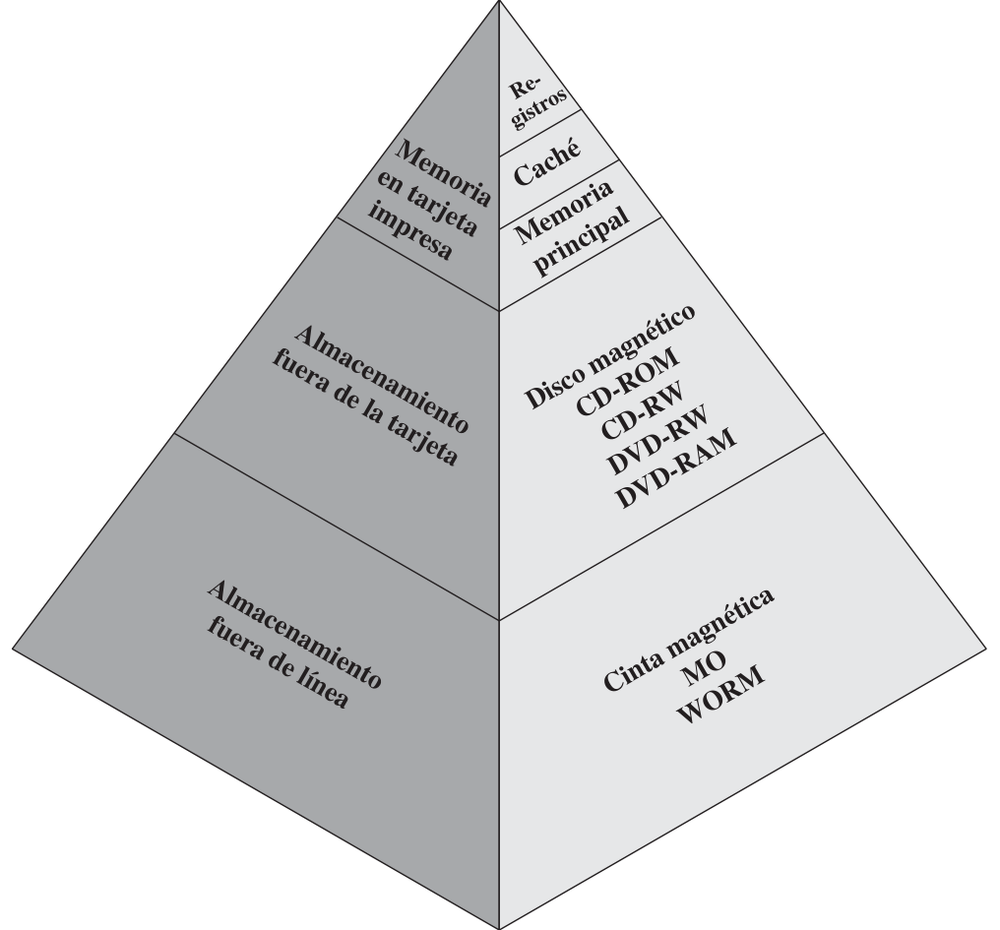

*Fig. 4.1 — Jerarquía de memoria.* · Stallings, *Organización y arquitectura de computadores*, 7ª ed., p. 130.

#### Ejemplo resuelto (localidad)
Un bucle que recorre un arreglo de **1000 enteros** de 4 bytes, uno detrás del otro:
- **Localidad espacial**: al traer el primer entero se trae **toda la línea** de caché (por ejemplo 64 B = 16
  enteros) ⇒ los 15 accesos siguientes **aciertan**.
- **Localidad temporal**: las instrucciones del bucle (`for`, comparación, incremento) se ejecutan **1000 veces**
  ⇒ quedan en caché y se leen del camino rápido.
- Ésa es toda la jerarquía: registros (1 ciclo) → caché (3-10) → memoria (100) → disco (millones).

#### Relacionado
[[2.5.2 Caché: mapeos y políticas]] · [[2.5.3 AMAT y cálculo de mejora]] · [[2.3.2 SRAM y DRAM]] ·
[[Jerarquía de memorias]] · [[TP12 Memoria principal]] · [[Glosario — Unidad 2]]

### 2.5.2 Caché: mapeos y políticas

> [!abstract] En una frase
> La caché es una memoria rápida y chica que guarda **copias de bloques** de la RAM. Para saber si un dato está
> (y dónde), la dirección se parte en **etiqueta / índice / desplazamiento**; el **mapeo** decide en qué línea puede
> ir cada bloque, y las **políticas** deciden qué escribir y qué expulsar.

> [!note] Si la primera vez que ves esto
> Es una **biblioteca con estantes fijos y un catálogo**: los libros (bloques) no pueden ir a cualquier estante. En
> el **mapeo directo** cada libro tiene **un solo** estante posible (rápido de buscar, pero dos libros que caen en
> el mismo estante se pelean). En el **totalmente asociativo** cualquier libro puede ir a cualquier estante (no hay
> peleas, pero hay que **revisar todos**). El **asociativo por conjuntos** es el compromiso: cada libro puede ir a
> un grupo chico de estantes.

#### La dirección, vista por la caché

```
┌───────────────┬──────────────┬────────────────────┐
│   ETIQUETA    │   ÍNDICE     │  DESPLAZAMIENTO    │
│  ¿es mi bloque?│ ¿qué línea? │ ¿qué byte del bloque?│
└───────────────┴──────────────┴────────────────────┘
```

| Campo | Para qué sirve | Se calcula |
|---|---|---|
| **Desplazamiento** | elegir el byte dentro de la línea | `log₂(tamaño de línea)` |
| **Índice** | elegir la línea (o conjunto) | `log₂(cantidad de líneas / vías)` |
| **Etiqueta** | comparar y confirmar el acierto | los bits que sobran |

#### Los tres mapeos


| Mapeo | Cada bloque puede ir a… | Ventaja | Desventaja |
|---|---|---|---|
| **Directo** | **una** línea (índice) | simple, barato, rápido | conflictos: dos bloques con el mismo índice se expulsan |
| **Totalmente asociativo** | **cualquier** línea | sin conflictos | comparar **todas** las etiquetas a la vez (caro) |
| **Asociativo por conjuntos** (n vías) | una de las `n` líneas de su conjunto | buen equilibrio | más lógica que el directo |

**Cálculo típico:** caché de 32 KB, líneas de 32 B ⇒ 1024 líneas.
- Directo: índice = 10 bits, desplazamiento = 5 bits.
- 4 vías: 256 conjuntos ⇒ índice = 8 bits; se comparan **4** etiquetas en paralelo.

#### Políticas de escritura

| Política | Qué hace | Consecuencia |
|---|---|---|
| **write-through** | escribe en caché **y** en RAM a la vez | siempre coherente, más tráfico |
| **write-back** | escribe sólo en caché y marca **dirty**; baja a RAM cuando se expulsa | menos tráfico, necesita bit *dirty* |
| **write-allocate** | al fallar una escritura, trae el bloque a caché | bien con write-back |
| **no-write-allocate** | escribe directo en RAM sin traerlo | típico con write-through |

#### Políticas de reemplazo (cuando hay que sacar uno)
- **LRU** (*Least Recently Used*): el que hace más tiempo no se usa. La mejor, pero cara de implementar.
- **FIFO**: el más viejo. Simple.
- **Aleatorio**: sorprendentemente competitivo.
- **LFU**: el menos usado.

#### Aciertos y fallos
| Tipo de fallo | Qué lo causa | Cómo se combate |
|---|---|---|
| **Frío (compulsorio)** | primera referencia al bloque | no se evita (sólo se amortigua con prefetch) |
| **De conflicto** | dos bloques compiten por la misma línea/conjunto | más vías |
| **De capacidad** | la caché es chica para el conjunto de trabajo | caché más grande |

> [!warning] Errores típicos
> - Sumar mal los bits: la suma **etiqueta + índice + desplazamiento = bits de la dirección**.
> - Confundir *write-back* con *write-allocate* (una es dónde se escribe, la otra si se trae el bloque).
> - Decir que el índice "identifica el bloque": identifica la **línea**; quien identifica el bloque es la etiqueta.

#### Figura del libro

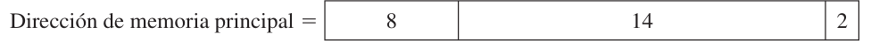

*Fig. 4.8 — Ejemplo de correspondencia directa.* · Stallings, *Organización y arquitectura de computadores*, 7ª ed., p. 141.

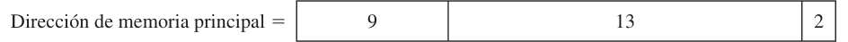

*Fig. 4.12 — Ejemplo de correspondencia asociativa por conjuntos de dos vías.* · Stallings, *Organización y arquitectura de computadores*, 7ª ed., p. 147.

> [!example] Los tres mapeos con la misma dirección
> Caché de 64 líneas de 4 palabras ⇒ desplazamiento = 2 bits. **Directa**: 6 bits de línea, se usa un pedazo de la
> dirección tal cual ⇒ 1 comparación, pero un bloque conflictivo desaloja siempre. **Asociativa total**: no hay
> campo de línea, se compara contra **todas** las etiquetas a la vez. **Por conjuntos de 2 vías**: 5 bits de
> conjunto + 1 de vía ⇒ el compromiso que usan todas las PC.

#### Relacionado
[[2.5.1 Jerarquía y localidad]] · [[2.5.3 AMAT y cálculo de mejora]] · [[2.3.2 SRAM y DRAM]] ·
[[Memoria caché]] · [[TP12 Memoria principal]] · [[Glosario — Unidad 2]]

### 2.5.3 AMAT y cálculo de mejora

> [!abstract] En una frase
> `AMAT = tiempo de acierto + tasa de fallos × penalidad de fallo`. Es el tiempo **promedio** por acceso teniendo
> en cuenta la caché, y es la forma de cuantificar si la jerarquía mejora de verdad.

> [!note] Si la primera vez que ves esto
> Si el 95 % de las veces encontrás lo que buscás en la heladera (1 segundo) y el 5 % restante tenés que ir al
> supermercado (100 segundos), tu tiempo promedio por búsqueda es `1 + 0,05 × 100 = 6 segundos`, no 100. Eso es el
> AMAT: **el promedio**, ponderado por la probabilidad de fallar.

#### AMAT con uno y con dos niveles

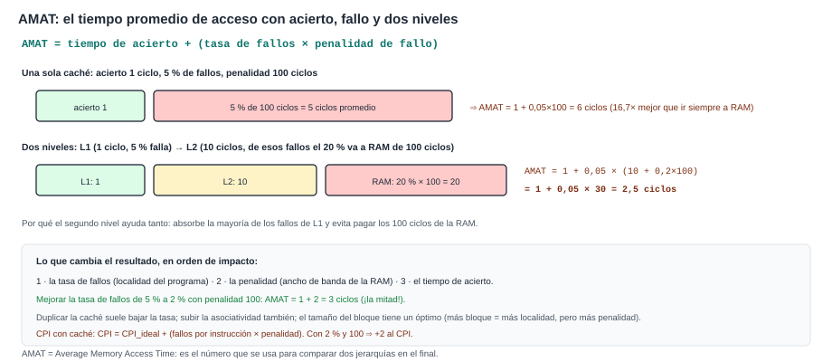

#### La fórmula

```
AMAT = h + m × P
```
| Símbolo | Significado |
|---|---|
| `h` | tiempo de **acierto** (hit time): lo que tarda la caché |
| `m` | **tasa de fallos** (miss rate) = `1 − tasa de aciertos` |
| `P` | **penalidad** del fallo: lo que tarda traer el bloque de RAM |

#### Ejemplo 1 (el clásico)
Caché de 1 ns, tasa de aciertos 95 %, penalidad 100 ns:
`AMAT = 1 + 0,05 × 100 = 1 + 5 = ` **6 ns** por acceso.
Sin caché, todos los accesos tardarían **100 ns** ⇒ se acelera ~**16,7 veces**.

#### Ejemplo 2 (comparar dos cachés)
| Caché | `h` | Aciertos | `P` | AMAT |
|---|---|---|---|---|
| A | 1 ns | 90 % | 100 ns | `1 + 0,1·100 = ` **11 ns** |
| B | 2 ns | 97 % | 100 ns | `2 + 0,03·100 = ` **5 ns** |

**Conclusión:** B es mejor **aunque sea más lenta en el acierto**: lo que manda es `m × P`. Bajar la tasa de
fallos vale mucho más que bajar 1 ns de acierto.

#### Ejemplo 3 (con L1 y L2)
`L1: 1 ns, 90 %` · `L2: 5 ns, 95 % de los fallos de L1 resueltos` · `RAM: 100 ns`.
- Fallo de L1 (10 %) → se consulta L2: 95 % acierta en 5 ns; 5 % de esos (0,5 % del total) va a RAM en 100 ns.
- `AMAT = 1 + 0,10 × [5 + 0,05 × 100] = 1 + 0,10 × 10 = ` **2 ns**.

#### Qué se puede concluir (lo que se pide argumentar)
1. La mejora viene de la **tasa de aciertos**, no del tamaño bruto.
2. Un fallo muy caro (RAM lenta) hace que convenga **cualquier** mejora en la tasa de fallos.
3. Por eso existen **L1 chica y rápida** + **L2/L3 más grandes**: cada nivel filtra los fallos del anterior.
4. La fórmula **no** dice nada de un acceso aislado: es un **promedio** estadístico.

> [!warning] Errores típicos
> - Usar la tasa de **aciertos** en lugar de la de **fallos**: `m = 1 − aciertos`.
> - Mezclar unidades (ns con µs) sin convertir.
> - Comparar cachés mirando sólo el tiempo de acierto.
> - Olvidar que en un sistema con L2 hay que **anidar** los cálculos.

#### Figura del libro

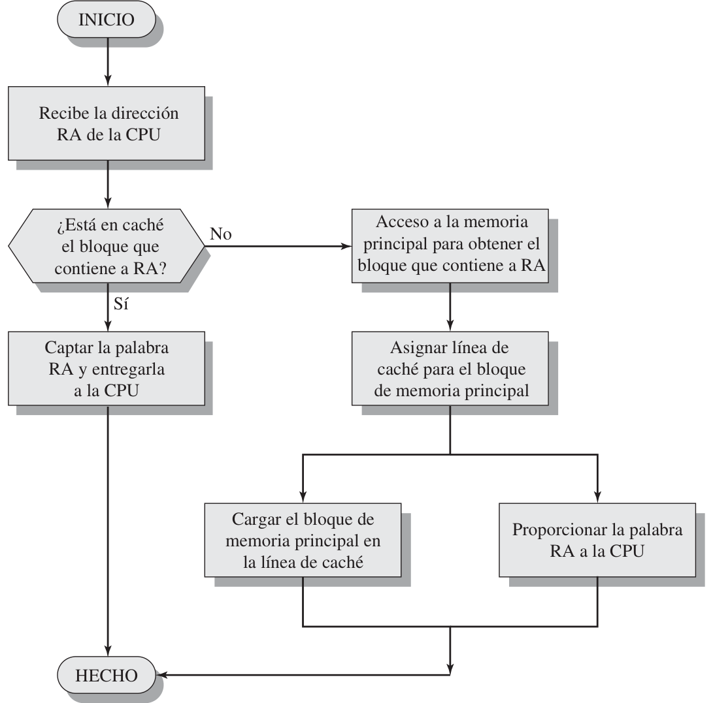

*Fig. 4.5 — Operación de lectura de caché.* · Stallings, *Organización y arquitectura de computadores*, 7ª ed., p. 135.

#### Relacionado
[[2.5.1 Jerarquía y localidad]] · [[2.5.2 Caché: mapeos y políticas]] · [[Memoria caché]] ·
[[Jerarquía de memorias]] · [[TP12 Memoria principal]] · [[Glosario — Unidad 2]]

## 2.6 Memorias complementarias

### 2.6.1 Memoria virtual y paginación

> [!abstract] En una frase
> La memoria virtual es una **ilusión** que da el sistema operativo: cada programa cree tener un espacio de
> direcciones propio y continuo (memoria **virtual**), que el hardware traduce a direcciones **físicas** por
> **páginas** de tamaño fijo, usando la **tabla de páginas** y la **TLB**.

> [!note] Si la primera vez que ves esto
> Imaginá que en la facultad te dan un **número de legajo** (dirección virtual) y no un aula. El legajo es tuyo y
> fijo, pero la facultad puede cambiarte de aula (marco físico) cuando quiere, sin avisarte. La "tabla de páginas"
> es la cartelera que traduce legajo → aula.

#### Virtual a física

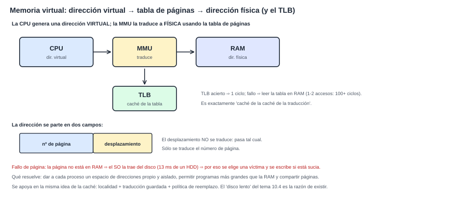

#### De la dirección virtual a la física

```
  dirección virtual (VA)
  ┌─────────────┬──────────────┐
  │  PÁGINA (p) │ DESPLAZ. (d) │
  └──────┬──────┴──────┬───────┘
         │             │
   [tabla de páginas]  │
         │             │
  ┌──────▼─────┬───────▼──────┐
  │ MARCO (f)  │  DESPLAZ. (d)│  = dirección física
  └────────────┴──────────────┘
```

| Concepto | Qué es |
|---|---|
| **Página** | bloque de tamaño fijo del espacio **virtual** (típico 4 KB) |
| **Marco** (frame) | bloque del mismo tamaño en la **RAM física** |
| **Tabla de páginas** | dice en qué marco está cada página (y sus permisos) |
| **TLB** | caché de esa tabla (para no consultarla en cada acceso) |
| **Fallo de página** | la página no está en RAM: hay que traerla del disco (muy caro) |

**El desplazamiento no se traduce:** es el mismo dentro de la página y del marco (eso permite que las páginas sean
de tamaño fijo).

#### Qué resuelve (las cuatro razones)
1. **Aislamiento:** un proceso no puede leer la memoria de otro (cada uno tiene su tabla).
2. **Más memoria que la física:** las páginas que no se usan se dejan en el disco (swap).
3. **Reubicación:** el programa no necesita saber en qué dirección física quedó.
4. **Protección:** la tabla indica lectura/escritura/ejecución por página.

#### La TLB (lo que lo hace rápido)
La tabla de páginas está en memoria: consultarla en **cada** acceso duplicaría el tiempo. La **TLB** es una
memoria **asociativa** chica (32-512 entradas) que guarda las traducciones recientes:
`acierto en TLB ⇒ 1 ciclo` · `fallo ⇒ consultar la tabla (y quizá el disco)`.

#### Comparación con la caché (para no mezclar)
| | Caché | Memoria virtual |
|---|---|---|
| Qué guarda | **copias** de bloques de RAM | **traducciones** y páginas |
| Si falla | se trae el bloque de RAM | se trae la página del **disco** |
| Quién la maneja | el hardware | el **SO** (+ hardware de traducción) |
| Tamaño del bloque | 32-128 B | 4 KB |

> [!warning] Errores típicos
> - Decir que la memoria virtual "es la RAM del disco": es una **dirección**, no un lugar.
> - Traducir también el desplazamiento (no se toca).
> - Confundir fallo de página (disco) con fallo de caché (RAM).

#### Figura del libro

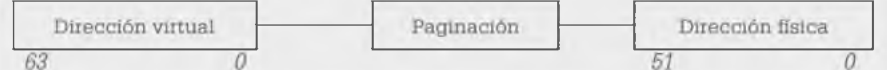

*Fig. 14.1 — Traducción de la dirección virtual.* · Quiroga, *Arquitectura de computadoras*, p. 362.

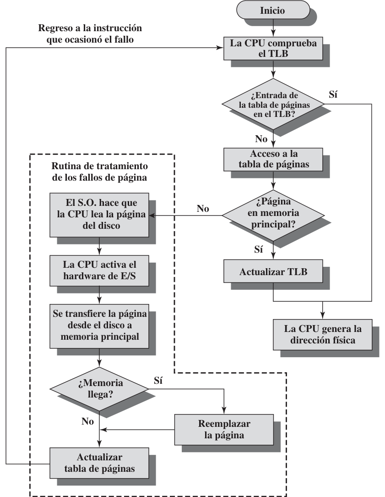

*Fig. 8.18 — Funcionamiento de la paginación y del buffer de traducción* · Stallings, *Organización y arquitectura de computadores*, 7ª ed., p. 303.

#### Ejemplo resuelto (con números)
Dirección **virtual de 32 bits** y páginas de **4 KB**:
- `4 KB = 2¹²` ⇒ los **12 bits bajos** son el **desplazamiento** dentro de la página.
- Los **20 bits altos** son el **número de página virtual (VPN)** ⇒ `2²⁰ = 1 048 576` páginas posibles.
- La **MMU** traduce el VPN al número de marco físico con la tabla de páginas; el desplazamiento **no se toca**.
- Costo: si el marco no está en el `TLB`, la traducción cuesta **1 acceso extra a memoria** por cada acceso.

#### Relacionado
[[2.6.2 Memoria auxiliar y memoria asociativa]] · [[2.5.2 Caché: mapeos y políticas]] · [[2.5.1 Jerarquía y localidad]] ·
[[Memoria virtual y administración de memoria]] · [[Glosario — Unidad 2]]

### 2.6.2 Memoria auxiliar y memoria asociativa

> [!abstract] En una frase
> La **memoria auxiliar** es el último nivel de la jerarquía (disco rígido, SSD, cinta): enorme, barata y **no
> volátil**, pero miles de veces más lenta. La **memoria asociativa** (CAM) no se direcciona por posición sino que
> se **consulta por contenido**: se le pregunta "¿tenés este dato?" y **todas** las posiciones comparan a la vez.

> [!note] Si la primera vez que ves esto
> La auxiliar es el **placard**: guardás todo, pero tardás en encontrar algo. La asociativa es un **buscador**: no
> abrís cajón por cajón, gritás un nombre y todos contestan al mismo tiempo si lo tienen.

#### Buscar por contenido


#### Memoria auxiliar

| Tecnología | Cómo guarda | Latencia | Ventaja | Desventaja |
|---|---|---|---|---|
| **Disco rígido (HDD)** | magnetismo en platos giratorios | 5-10 ms | barato por TB | partes móviles, lento |
| **SSD (Flash)** | celda flotante | 0,1-0,2 ms | rápido, sin partes móviles | desgaste, más caro |
| **Cinta** | magnetismo secuencial | segundos | archivo masivo | acceso secuencial |
| **Óptico (CD/DVD)** | surcos y reflejo | ~100 ms | distribución | baja capacidad |

**Por qué existe:** la RAM es volátil y cara. Todo lo que tiene que sobrevivir al apagado vive acá, y el SO lo
sube a RAM cuando hace falta (paginación, *swap*, archivos mapeados en memoria).

**Diferencia clave con la RAM:** acá se accede **por bloques/sectores** (512 B – 4 KB), no por byte; y el tiempo se
mide en **ms**, no en ns.

#### Memoria asociativa (CAM)

```
   dato buscado ──►┌────┬────┬────┬────┐
                   │ C0 │ C1 │ C2 │ C3 │   todas comparan en paralelo
                   └─┬──┴─┬──┴─┬──┴─┬──┘
                     └────┴────┴────┘
                            │
                    ¿alguna coincide?  ──► acierto + índice
```

| | Memoria **RAM** normal | Memoria **asociativa (CAM)** |
|---|---|---|
| Se accede por | **dirección** (posición) | **contenido** (etiqueta) |
| Comparaciones por acceso | 1 | **todas en paralelo** |
| Costo | bajo | **muy alto** (una comparación por celda) |
| Tamaño | grande | chica |
| Se usa en | memoria principal | **TLB**, caché asociativa, tablas de ruteo |

**Por qué es cara y chica:** cada celda necesita su **comparador** y la lógica de prioridad para devolver el
primer acierto. Se reserva para donde la velocidad de búsqueda es crítica (TLB, routers).

#### Cómo se conectan los dos conceptos
La **TLB** del tema anterior **es** una memoria asociativa: guarda pares `página → marco` y los busca por contenido.
Y la caché totalmente asociativa también necesita comparar etiquetas en paralelo: es el mismo principio.

> [!warning] Errores típicos
> - Decir que la memoria auxiliar "es la virtual" (una es el **nivel físico**, la otra la **ilusión de
>   direcciones**).
> - Confundir acceso por bloque con acceso por byte.
> - Decir que la CAM es grande: es **chica y carísima**.

#### Figura del libro

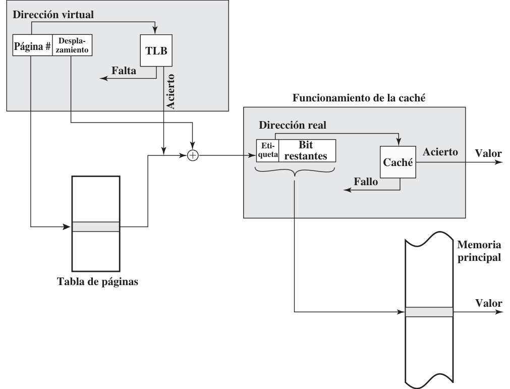

*Fig. 8.19 — Buffer de traducción anticipada y funcionamiento de la caché.* · Stallings, *Organización y arquitectura de computadores*, 7ª ed., p. 304.

#### Ejemplo resuelto
Un `TLB` de **64 entradas** asociativas:
- Busca el VPN en **las 64 entradas a la vez** (memoria asociativa): 1 ciclo.
- Si **acierta** (caso normal, > 90 %): la traducción no cuesta nada extra.
- Si **falla**: hay que ir a la tabla de páginas en memoria (**1 acceso más**, y si está en disco, muchísimo más).
- AMAT con `h = 0,95`, acierto 1 ciclo y fallo 20 ciclos: `1 + 0,05 × 20 = 2` ciclos.

#### Relacionado
[[2.6.1 Memoria virtual y paginación]] · [[2.5.1 Jerarquía y localidad]] · [[2.4.2 PROM, EPROM, EEPROM y Flash]] ·
[[Memoria auxiliar y memoria asociativa]] · [[Jerarquía de memorias]] · [[Glosario — Unidad 2]]

## 2.7 Dimensionar memorias

### 2.7.1 Bits de dirección igual a log2 de celdas

> [!abstract] En una frase
> Si una memoria tiene `N` celdas direccionables, necesita **`log₂(N)` bits de dirección**. Lo que importa es la
> **cantidad de celdas**, no los bytes totales: primero se divide el tamaño por el tamaño de celda.

> [!note] Si la primera vez que ves esto
> Es como numerar los asientos de un estadio: si hay 4096 asientos, necesitás 12 bits para numerarlos
> (`2¹² = 4096`). Si en cambio hay 1 GB de bytes y cada celda guarda 4 bytes, no hay 1 GB de asientos: hay
> **250 millones** (un cuarto), porque cada asiento es más grande.

#### Cuántas líneas hacen falta

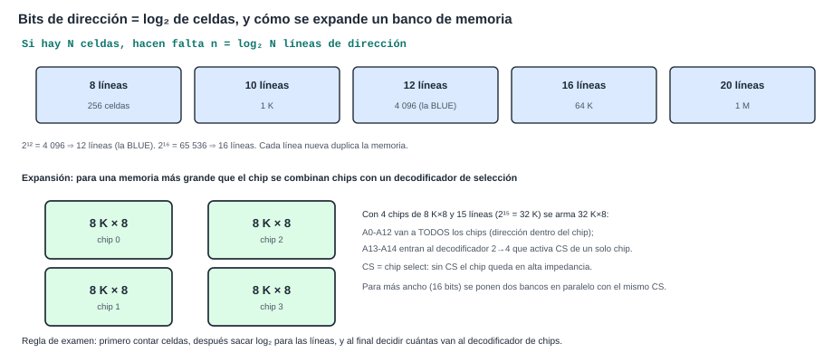

#### La receta de 4 pasos
1. **Convertir el tamaño a bytes** (potencias de 2).
2. **Dividir por el tamaño de celda** ⇒ cantidad de celdas `N`.
3. Calcular `log₂(N)` ⇒ bits de dirección.
4. Verificar: `2^(bits)` tiene que dar `N`.

#### Las potencias de 2 que hay que tener a mano
| | Bytes | Potencia |
|---|---|---|
| 1 KB | 1 024 | 2¹⁰ |
| 1 MB | 1 048 576 | 2²⁰ |
| 1 GB | — | 2³⁰ |
| 1 TB | — | 2⁴⁰ |

#### Ejemplos resueltos
**a) 4 KB con celdas de 1 byte:** `4096 = 2¹²` ⇒ **12 bits**.

**b) 512 MB con celdas de 4 bytes:** `512 MB = 2²⁹` bytes; `2²⁹ / 2² = 2²⁷` celdas ⇒ **27 bits**.

**c) 1 GB con celdas de 4 bytes:** `2³⁰ / 2² = 2²⁸` celdas ⇒ **28 bits**.

**d) 256 KB con celdas de 8 bytes:** `2¹⁸ / 2³ = 2¹⁵` ⇒ **15 bits**.

**e) RAM de 8 palabras:** `log₂ 8 = ` **3 bits** (el caso de la RAM 8×3).

#### Cómo se relaciona con el chip físico
Si la memoria total se arma con **4 chips**, los **2 bits más altos** de la dirección se usan para elegir el chip
(van a un decodificador que maneja los `CS`), y los restantes entran al chip. Por eso:
`bits de dirección = bits de selección de chip + bits internos del chip`.

#### Errores que se pagan caro
- **Dividir mal:** usar MB como 1 000 000 en vez de 2²⁰ (en la materia, **siempre** potencias de 2).
- **Olvidar el tamaño de celda:** decir "1 GB ⇒ 30 bits" cuando la celda es de 4 B (son 28).
- **Sumar en vez de restar** al repartir palabra de instrucción (eso es el tema 2.7.2).
- Confundir **bits de dirección** con **bits de dato**: la dirección dice *cuál*; el dato dice *qué*.

> [!tip] Verificación en 5 segundos
> `2^bits de dirección × tamaño de celda` tiene que dar **exactamente** el tamaño total de la memoria. Si no da, el
> error está en el exponente o en la división.

#### Figura del libro

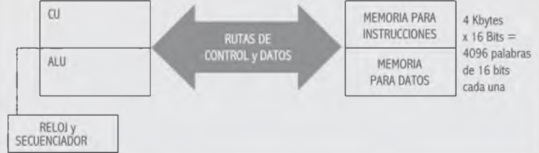

*Fig. 7.7 — Memoria para instrucciones y para datos: 4 Kbytes = 4096 palabras de 16 bits ⇒ 2¹² ⇒ 12 bits de dirección.* · Quiroga, *Arquitectura de computadoras*, p. 175.

> [!warning] El error que más se repite
> Confundir **bits de dirección** con **bits de dato**: una memoria de 4096 × 16 necesita **12** bits de dirección
> (por las 4096 palabras) y tiene **16** bits de dato (por el ancho de la palabra). Si el examen pide "cuántas
> líneas de dirección", la respuesta es `log₂(cantidad de palabras)`, **no** el ancho de la palabra.

#### Relacionado
[[2.7.2 CodOp vs campo de dirección]] · [[2.3.3 Matriz, expansión y RAM 8x3]] ·
[[Espacio de direccionamiento y cálculo de CodOp-Dirección]] · [[TP18 Direccionamiento de memoria]] · [[Glosario — Unidad 2]]

### 2.7.2 CodOp vs campo de dirección

> [!abstract] En una frase
> En una instrucción, la palabra se reparte entre **código de operación** (qué hacer) y **campo de dirección**
> (dónde): `bits de CodOp = bits de la palabra − bits de dirección`. Cuanta más memoria hay que direccionar, **menos
> instrucciones distintas** entran.

> [!note] Si la primera vez que ves esto
> Tenés una palabra de 16 bits y tenés que repartirla como una **pieza de 16 casillas** entre dos usos que compiten:
> "qué hacer" y "dónde". Si la memoria es chica y necesita 12 casillas para la dirección, te quedan **4** para el
> opcode (16 instrucciones). Si la memoria crece y necesita 13, te quedan **3** (8 instrucciones). **Es un
> presupuesto, no un regalo.**

#### El reparto de los bits

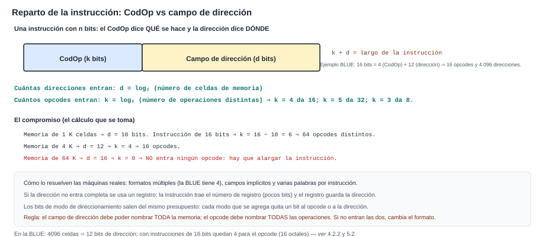

#### La fórmula y el reparto

```
┌───────────────┬────────────────────────────┐
│    CodOp      │   campo de dirección        │
│  (p − d) bits │        d bits               │
└───────────────┴────────────────────────────┘
        palabra de p bits, memoria de 2^d celdas
```

`d = log₂(celdas)` (tema 2.7.1) ⇒ `CodOp = p − d` ⇒ **cantidad de instrucciones = 2^CodOp**.

#### Ejemplos
| Memoria | Celda | `d` | Palabra | `CodOp` | Instrucciones posibles |
|---|---|---|---|---|---|
| 4 K celdas | 1 B | 12 | 16 bits | **4** | 16 |
| 512 MB | 4 B | 27 | 32 bits | **5** | 32 |
| 1 GB | 4 B | 28 | 32 bits | **4** | 16 |
| 64 K celdas | 1 B | 16 | 16 bits | **0** | ✗ (no entra ninguna) |

> [!important] El caso de la BLUE
> La BLUE tiene 4096 celdas de 16 bits ⇒ `d = 12` bits de dirección y la palabra es de 16 ⇒ **`CodOp = 4` bits**,
> es decir **16 opcodes**: exactamente los `00` a `17` en octal (HLT, ADD, XOR, AND, IOR, NOT, LDA, STA, SRJ, JMA,
> JMP, INP, OUT, RAL, CSA, NOP).

#### Qué pasa cuando la memoria crece (el trade-off)
1. **Menos opcodes** (se achica el CodOp) ⇒ menos instrucciones distintas.
2. Para evitarlo se inventan **formatos**: instrucciones de 2 palabras (la segunda aporta más dirección) o
   registros índice que suman a un campo corto. Eso es exactamente lo que hacen la BLUE indexada y el 8086.
3. Otra salida: **palabras más largas** (32 o 64 bits), a costa de más memoria por instrucción.

#### Errores típicos
- Restar mal: `CodOp = 16 − 12 = 4` (no 12).
- Confundir "bits de dirección **por palabra**" con "bits de la palabra".
- Olvidar que `2^CodOp` es la cantidad de **instrucciones distintas**, no de operandos.
- Decir que un campo de 12 bits direcciona 12 celdas: direcciona **4096**.

> [!tip] Cómo se pregunta en el final
> "Si la memoria tiene 512 MB y celdas de 4 bytes, y la palabra es de 32 bits, ¿cuántas instrucciones distintas
> puede tener la máquina?" → `2²⁹/2² = 2²⁷` ⇒ 27 bits de dirección ⇒ `32 − 27 = 5` ⇒ **2⁵ = 32 instrucciones**.

> [!warning] El error que más se repite
> Sumar mal: `opcode + dirección` tiene que dar **exactamente** el ancho de la instrucción (12 bits en la BLUE,
> 12 + 4 = 16). Si la memoria crece, crece el campo de dirección y **se achica** el opcode (o la instrucción se
> alarga): no se pueden los dos a la vez. Y con `2ᵏ` opcodes no "sobran" códigos: cada uno es una instrucción.

#### Figura del libro

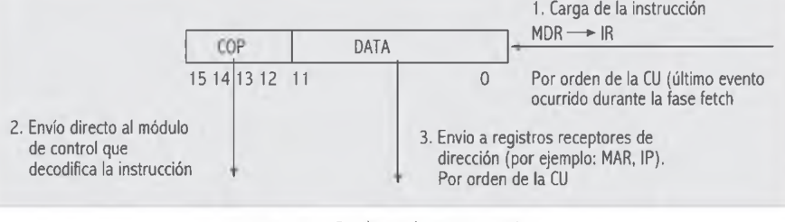

*Fig. 7.9 — Código de instrucción: los 16 bits repartidos en OP y DATA.* · Quiroga, *Arquitectura de computadoras*, p. 177.

> [!tip] Qué mirar
> De los 16 bits, 4 son código de operación y 12 de dirección (o dato). La instrucción entra al IR, se separan los campos y el decodificador de OP decide qué hacer: **más opcodes = menos direcciones**.

#### Relacionado
[[2.7.1 Bits de dirección igual a log2 de celdas]] · [[Formato de la instrucción (4 formatos)]] ·
[[Espacio de direccionamiento y cálculo de CodOp-Dirección]] · [[TP17 Formato básico de instrucciones]] · [[Glosario — Unidad 2]]

---

## Al terminar la unidad
- Una pasada rápida: [[00 Síntesis — Unidad 2]].
- Los subtemas por separado: [[00 Unidad 2 — temas y subtemas]].
- Seguir de corrido: [[00 Materia completa (las 10 unidades en un archivo)]].
- Practicar: [[Banco de preguntas del final]] · [[Autoevaluación]] · [[Prácticas resueltas]].
