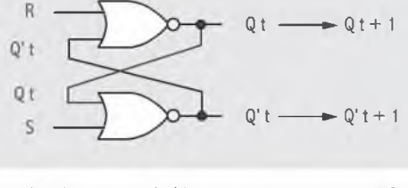

# 2.1.1 Biestable RS (NOR y NAND)

> [!abstract] En una frase
> El biestable **RS** es **dos compuertas cruzadas** (NOR o NAND): con `S` (set) guarda un **1**, con `R` (reset)
> guarda un **0**, y con las dos en reposo **mantiene** lo que tenía. Con `S = R = 1` (en la versión NOR) aparece el
> **estado prohibido**.

> [!note] Si es la primera vez que ves esto
> Todo circuito que estudiaste hasta acá "olvida": si sacás la entrada, la salida desaparece. Este no: la salida
> **vuelve a entrar** como entrada de la otra compuerta (realimentación), y eso lo hace **recordar**. Es un
> interruptor de luz con dos botones, uno para prender y otro para apagar, donde la luz queda como la dejaste.

## Estructura y tabla de estados

**Versión con NOR** (entradas activas en **alto**):

| S | R | Q⁺ | Estado |
|---|---|---|---|
| 0 | 0 | **Q** | mantiene (memoria) |
| 0 | 1 | **0** | reset |
| 1 | 0 | **1** | set |
| 1 | 1 | **0 / 0** | **prohibido** (las dos salidas en 0) |

**Versión con NAND** (entradas activas en **bajo**, `S'` y `R'`): la tabla es la misma pero **invertida** en las
entradas, y el estado prohibido es `S = R = 0` (las dos salidas en **1**).

## Ecuación característica (desde el mapa)
Con la tabla de estados y tratando `Q` como variable:

| S \ R | Q=0 | Q=1 |
|---|---|---|
| 0 | 0 | **1** |
| 1 | **1** | **X** (don't care) |

Agrupando: **`Q⁺ = S + R'·Q`**.

> [!tip] Cómo leerla
> "Se pone en 1 si `S = 1`; si no, **se queda** como estaba (`R'·Q`)". Es la definición de memoria: cuando `R` no
> está activo, el valor viejo sobrevive.

## Por qué el estado prohibido es prohibido
Con `S = R = 1` las dos salidas van a 0, y eso rompe la condición `Q` y `Q'` complementarias. Peor: al **soltar**
las dos entradas a la vez, cuál queda en 1 depende de la velocidad de cada compuerta (**carrera**). Por eso el RS
NOR no admite `S = R = 1`, y de ahí nacen el JK (que lo resuelve) y el D (que lo evita por construcción).

## Ejemplo de secuencia
`S=1,R=0` → `Q=1` · luego `S=0,R=0` → **sigue** en 1 · luego `S=0,R=1` → `Q=0` · luego `S=0,R=0` → **sigue** en 0.
La salida "recuerda" el último pulso que la tocó.

> [!warning] Errores típicos
> - Invertir la polaridad: en NOR, `S=1` **pone** a 1; en NAND, `S=0` pone a 1 (activo bajo).
> - Decir que con `S=R=0` la salida es 0: en NOR **mantiene**.
> - Olvidar que `Q⁺` depende de `Q`: no es una tabla de verdad combinacional, es una **tabla de estados**.

## Figura de clase

### El árbol del que cuelga todo el tema: asíncronos contra sincrónicos.

*Figura de clase — Resumen «Arquitectura final» (Said), p. 6.*

> [!tip] Qué mirar
> La **primera división** del tema, la que se pregunta antes de cualquier tabla: **asíncronos** = el estado cambia con el **nivel** de la entrada (el RS armado con NOR o con NAND); **sincrónicos** = el estado **sólo** cambia en el **flanco** del reloj. Todo lo que sigue en la unidad 2 es la rama de la derecha. Ojo: en el resumen la figura queda cortada en «activados por nivel / por flancos»; las hojas de abajo (RS, D, JK y T) son las que desarrollan 2.1.1 a 2.1.3.

## Figura del libro

*Fig. 6.27 — Diagrama de lógica con compuertas NOR: biestable RS.* · Quiroga, *Arquitectura de computadoras*, p. 157.

> [!tip] Qué mirar
> Las dos NOR cruzadas se realimentan: `R = 1` pone `Q = 0`, `S = 1` pone `Q = 1`, y con `R = S = 0` el biestable **memoriza**. `R = S = 1` es el estado prohibido (las dos salidas a 0).

## Relacionado
[[2.1.2 Flip-flops D y T]] · [[2.1.3 Flip-flop JK y ecuaciones características]] · [[2.1.4 Conversión entre biestables]] ·
[[TP8 Biestables RS]] · [[Flip-Flops SR, D, JK y T]] · [[Glosario — Unidad 2]]
