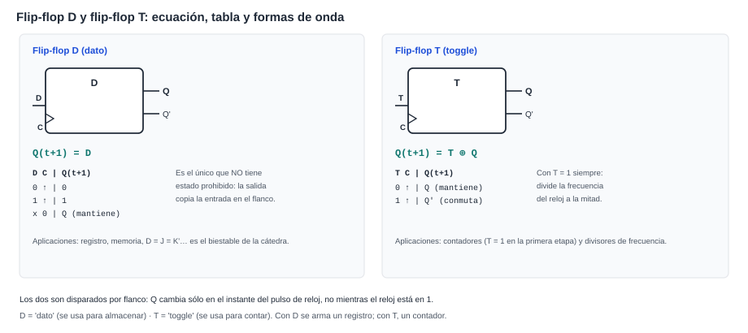
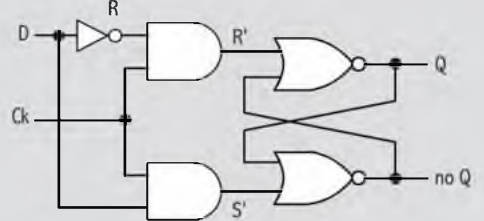

# 2.1.2 Flip-flops D y T

> [!abstract] En una frase
> El **D** (data) guarda lo que hay en su entrada: `Q⁺ = D`. El **T** (toggle) cambia de estado cada vez que su entrada vale 1: `Q⁺ = T⊕Q`. Los dos nacen del RS, pero **sin** estado prohibido.

> [!note] Si es la primera vez que ves esto
> El **D** es la "caja donde dejás un papel": lo que ponés, queda. Es el ladrillo de los **registros** y de la memoria (cada celda es un D). El **T** es el "interruptor de escalera": cada pulso lo cambia de posición; es el ladrillo de los **contadores**.

## D y T, con su tabla



## Flip-flop D

| D | Q⁺ |
|---|---|
| 0 | 0 |
| 1 | 1 |

**`Q⁺ = D`** — una sola línea, sin mapa.

**Cómo se construye desde el RS:** se conecta `D` a `S` y **`D'` a `R`** (con un inversor). Así nunca llegan los dos en 1, y el estado prohibido desaparece por construcción.

**Versión con habilitación (enable):** el flip-flop sólo toma el dato cuando `E = 1`; si `E = 0`, mantiene. Es la base de los registros con señal de carga (`LOAD`).

```
Q⁺ = E·D + E'·Q      (D con enable)
```

**D disparado por flanco:** los reales son *edge-triggered* (toman el dato en el flanco de subida o de bajada del reloj). Es lo que permite que un registro con 8 flip-flops cargue **todos los bits a la vez**, sin carreras.

## Flip-flop T

| T | Q⁺ |
|---|---|
| 0 | **Q** (mantiene) |
| 1 | **Q'** (cambia) |

**`Q⁺ = T⊕Q`** — y de ahí sale la tabla:

| T | Q | Q⁺ |
|---|---|---|
| 0 | 0 | 0 |
| 0 | 1 | 1 |
| 1 | 0 | 1 |
| 1 | 1 | 0 |

**Cómo se construye desde el JK:** un JK con `J = K = T`. Con `T = 1` cae en el caso "toggle".

## Cuándo se usa cada uno

| Flip-flop | Se usa en |
|---|---|
| **D** | registros, memoria (celda RAM), latch de datos, registro de instrucción |
| **T** | contadores, divisores de frecuencia (un T con `T=1` divide el reloj por 2) |
| **JK** | contadores y máquinas de estado (con `J` y `K` distintos) |
| **RS** | el modelo teórico del que salen los otros |

> [!tip] El detalle que se pregunta
> Un **T con T = 1 permanente divide la frecuencia del reloj por 2** (cambia en cada pulso). Encadenando cuatro T se obtiene un **contador de 4 bits**: ésa es la estructura de un contador asíncrono.

> [!warning] Errores típicos
> - Decir que el D "recuerda" sin reloj: sin `enable`/flanco, sigue al dato (es un cable con buffer).
> - Escribir `Q⁺ = T + Q` (es **XOR**, no OR: con `T=1,Q=1` da 0).
> - Confundir `Q⁺` con `Q`: `Q⁺` es el estado **después** del pulso.

## Figura del libro



*Fig. 6.34 — Diagrama de lógica de un biestable D sincrónico* · Quiroga, *Arquitectura de computadoras*, p. 159.

## Ejemplo resuelto

- **D**: aplicando `D = 1` y un flanco ⇒ `Q = 1`; después `D = 0` y otro flanco ⇒ `Q = 0`. Copia la entrada en cada flanco: `Q⁺ = D`.

- **T**: con `T = 1`, en cada flanco **alterna**. Partiendo de `Q = 0`, tres pulsos dan `1 → 0 → 1`: `Q⁺ = T ⊕ Q`.

- Con `T = 1` fijo, un flip-flop T **divide la frecuencia por 2**: 8 pulsos de reloj ⇒ 4 pulsos en `Q`. Eso es lo que hace un contador (ver [[2.2.3 Contadores binarios y módulo N]]).

## Relacionado
[[2.1.1 Biestable RS (NOR y NAND)]] · [[2.1.3 Flip-flop JK y ecuaciones características]] · [[2.2.3 Contadores binarios y módulo N]] · [[TP9 Biestables D, JK y T]] · [[Flip-Flops SR, D, JK y T]] · [[Glosario — Unidad 2]]
