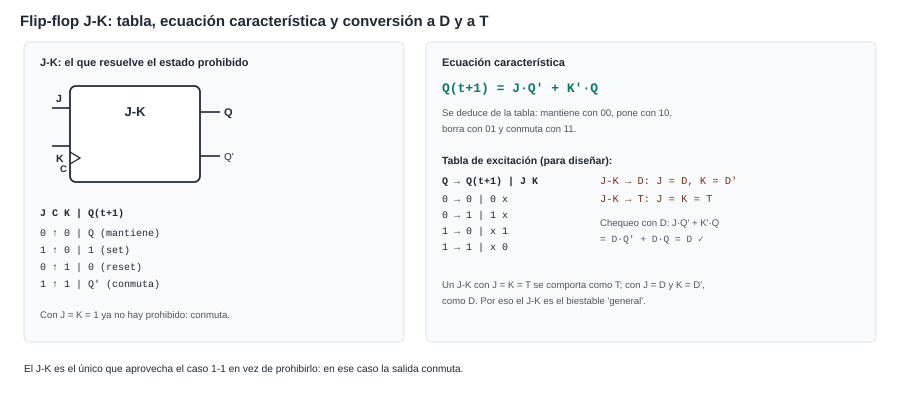
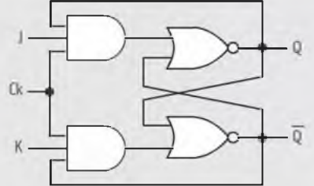

# 2.1.3 Flip-flop JK y ecuaciones características

> [!abstract] En una frase
> El **JK** es el RS que **resolvió** el estado prohibido: con `J = K = 1` no se rompe, **cambia de estado**
> (*toggle*). Su ecuación es `Q⁺ = J·Q' + K'·Q`, y sale del mapa de Karnaugh de su tabla de estados.

> [!note] Si es la primera vez que ves esto
> Al RS no se le podía pedir "las dos cosas a la vez". El JK dice: "si me pedís las dos, **invierto** lo que
> tengo". Con eso se vuelve el biestable más versátil (y el que usan los contadores), y de él se derivan el D y
> el T.

## J-K completo

## Tabla de estados (la que se completa en el TP)

| J | K | Q⁺ | Qué hace |
|---|---|---|---|
| 0 | 0 | **Q** | mantiene |
| 0 | 1 | **0** | reset |
| 1 | 0 | **1** | set |
| 1 | 1 | **Q'** | **toggle** (invierte) |

Y con `Q` como variable, la tabla de 8 filas para el mapa:

| J | K | Q | Q⁺ |
|---|---|---|---|
| 0 | 0 | 0 | 0 |
| 0 | 0 | 1 | 1 |
| 0 | 1 | 0 | 0 |
| 0 | 1 | 1 | 0 |
| 1 | 0 | 0 | 1 |
| 1 | 0 | 1 | 1 |
| 1 | 1 | 0 | 1 |
| 1 | 1 | 1 | 0 |

## La ecuación, paso a paso
Mapa de `Q⁺` con filas `JK` (00, 01, 11, 10) y columnas `Q` (0, 1):

| JK \ Q | 0 | 1 |
|---|---|---|
| 00 | 0 | **1** |
| 01 | 0 | 0 |
| 11 | **1** | 0 |
| 10 | **1** | **1** |

Dos grupos de 2: `J·Q'` (columna Q=0, filas 11-10) y `K'·Q` (columna Q=1, filas 00-10).

> [!important] `Q⁺ = J·Q' + K'·Q`
> Leída en castellano: "**se pone en 1** si J lo pide (`JQ'`), y **se mantiene en 1** si K no lo borra (`K'Q`)".

## Las cuatro ecuaciones, juntas (cuadro para memorizar)

| Biestable | Ecuación característica | Caso especial |
|---|---|---|
| **RS** | `Q⁺ = S + R'·Q` | `S = R = 1` prohibido |
| **D** | `Q⁺ = D` | — |
| **JK** | `Q⁺ = J·Q' + K'·Q` | `J = K = 1` ⇒ toggle |
| **T** | `Q⁺ = T ⊕ Q` | `T = 1` ⇒ toggle |

**Relaciones entre ellos:** `D` = JK con `J = D, K = D'` · `T` = JK con `J = K = T` · `JK` = RS con
`S = JQ', R = KQ`.

## Tabla de excitación (la que se usa para diseñar)
Al revés: dado el cambio que quiero (`Q → Q⁺`), ¿qué entradas necesito?

| Transición | J K | D | T | S R |
|---|---|---|---|---|
| 0 → 0 | 0 **X** | 0 | 0 | 0 X |
| 0 → 1 | 1 **X** | 1 | 1 | 1 0 |
| 1 → 0 | **X** 1 | 0 | 1 | 0 1 |
| 1 → 1 | **X** 0 | 1 | 0 | X 0 |

> [!warning] Errores típicos
> - Usar el mapa de 4 filas (J,K) en vez del de 8: `Q⁺` **depende de Q**, así que Q tiene que estar en el mapa.
> - Escribir `Q⁺ = JQ + K'Q` (falta la negación de Q en el primer término).
> - Confundir la **tabla de estados** (funcionamiento) con la **tabla de excitación** (diseño).

## Figura del libro

*Fig. 6.30 — Diagrama de lógica de un biestable J-K sincrónico.* · Quiroga, *Arquitectura de computadoras*, p. 158.

## Ejemplo resuelto
Partiendo de `Q = 0`, con `J = K = 1` (modo *toggle*): pulsos ⇒ `Q = 1 → 0 → 1 → 0`.
- `J = 1, K = 0` ⇒ `Q⁺ = 1` (**set**) sin importar el estado anterior.
- `J = 0, K = 1` ⇒ `Q⁺ = 0` (**reset**).
- `J = K = 0` ⇒ **mantiene**; `J = K = 1` ⇒ **alterna**. Por eso `Q⁺ = J·Q' + K'·Q`.
- Trampa clásica: `J = K = 1` **no** es estado prohibido (eso era el RS); acá es el modo útil para contar.

## Relacionado
[[2.1.2 Flip-flops D y T]] · [[2.1.4 Conversión entre biestables]] · [[1.3.2 Mapa de Karnaugh de 2, 3 y 4 variables]] ·
[[TP9 Biestables D, JK y T]] · [[Flip-Flops SR, D, JK y T]]
