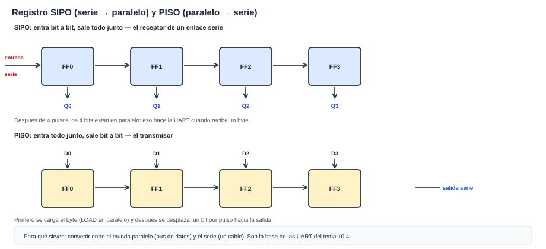

# 2.2.2 Registros SIPO y PISO

> [!abstract] En una frase
> **SIPO** = entra **serie**, sale **paralelo** (recibir una palabra bit a bit y entregarla junta). **PISO** =
> entra **paralelo**, sale **serie** (tomar una palabra de la CPU y transmitirla por un cable).

> [!note] Si es la primera vez que ves esto
> Son los **traductores** entre el mundo de la CPU (todo en paralelo, 8 o 16 cables a la vez) y el mundo de las
> comunicaciones (un solo cable, un bit atrás del otro). Sin ellos no habría puertos serie, USB ni teclados.

## SIPO y PISO dibujados



## SIPO: serie → paralelo

```
entrada serie ──►┌────┐  ┌────┐  ┌────┐  ┌────┐
                 │ FF │─►│ FF │─►│ FF │─►│ FF │
   CLK ─────────►└──┬─┘  └──┬─┘  └──┬─┘  └──┬─┘
                    │       │       │       │
                    Q3      Q2      Q1      Q0   ◄── salida paralela (después de n pulsos)
```

**Secuencia típica:** se recibe `1011` con el bit **menos** significativo primero:
`1` → `1` → `0` → `1`, y después de 4 pulsos las salidas quedan `Q3..Q0 = 1011`.
Se usa con una señal de **habilitación de salida** (o un `LOAD` al final) para que la palabra no cambie mientras se
la está leyendo.

## PISO: paralelo → serie

```
D3..D0 ──►[ carga paralela ]──►┌────┐  ┌────┐  ┌────┐  ┌────┐──► salida serie
                               │ FF │─►│ FF │─►│ FF │─►│ FF │
                        CLK ──►└────┘  └────┘  └────┘  └────┘
```

- **Paso 1:** `LOAD = 1` → los `n` bits entran a la vez (como un PIPO).
- **Paso 2:** `SHIFT = 1` → cada pulso saca un bit por la derecha y mete 0 (o el bit de entrada).
- En `n` pulsos salió la palabra completa, **primero el bit menos significativo**.

## Los cuatro registros, en una tabla

| Tipo | Entrada | Salida | Pulsos por palabra | Se usa en |
|---|---|---|---|---|
| **PIPO** | paralelo | paralelo | 1 | IR, MAR, acumulador |
| **SISO** | serie | serie | n | retardo, repetidor serie |
| **SIPO** | serie | paralelo | n | recepción serie (teclado, UART RX) |
| **PISO** | paralelo | serie | 1 + n | transmisión serie (UART TX) |

> [!important] Lo que se pregunta en el oral
> "¿Cómo convierte un registro serie-paralelo?" → **desplazando**: cada pulso mete un bit por la izquierda (o por
> la derecha) y corre los anteriores; después de `n` pulsos la palabra está alineada y se habilita la salida
> paralela. El registro **no** "adivina" el dato: lo **arma** de a un bit.

> [!warning] Errores típicos
> - Olvidar el orden (¿primero el LSB o el MSB?): cambia el valor que se lee.
> - Decir que el SIPO necesita `n` pulsos **y** un pulso más para la salida: la salida paralela está disponible
>   desde el pulso `n` (si hay latch de salida, un pulso más).
> - Mezclar PISO con SIPO al nombrarlos: la primera letra es la **entrada**.

## Ejemplo resuelto
**SIPO**: entran `1, 1, 0, 1` en 4 pulsos; al cuarto pulso la salida paralela vale **`Q3 Q2 Q1 Q0 = 1101`**
(el primero que entró quedó en el extremo más lejano).
**PISO**: se carga `1101` en paralelo (1 pulso) y sale en serie `1, 1, 0, 1` en 4 pulsos.
- SIPO = **serie → paralelo** (lo que hace un receptor serie: USB, RS-232).
- PISO = **paralelo → serie** (lo que hace un transmisor).
- Los dos juntos son la base de un **UART**.

## Relacionado
[[2.2.1 Registros PIPO y SISO]] · [[2.2.3 Contadores binarios y módulo N]] · [[TP11 Registros SIPO y PISO]] ·
[[Registros]] · [[Interrupciones y entrada-salida]]
