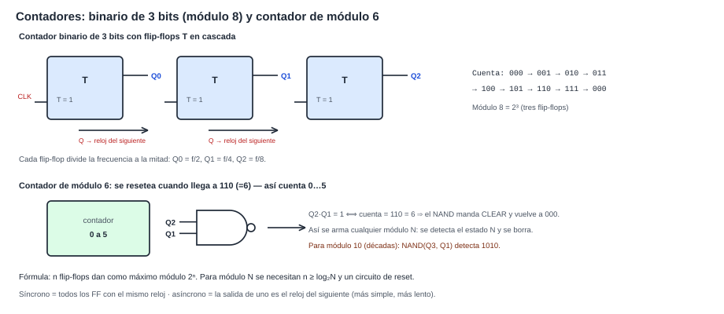
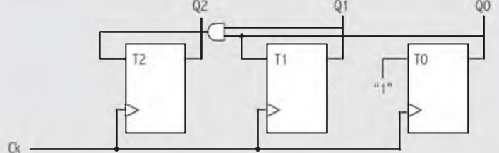

# 2.2.3 Contadores binarios y módulo N

> [!abstract] En una frase
> Un contador es un **registro que se incrementa en cada pulso**. El **asíncrono** encadena flip-flops T (el reloj de cada uno es la salida del anterior); el **síncrono** les da a todos el mismo reloj y decide con compuertas cuándo cada uno debe cambiar. El **módulo N** corta la cuenta después de N estados.

> [!note] Si es la primera vez que ves esto
> Es el **cuentakilómetros**: cada vez que la rueda de las unidades pasa de 9 a 0, la de las decenas avanza uno. En binario pasa lo mismo: cuando un bit pasa de 1 a 0, **habilita** al siguiente. Eso es exactamente "el reloj de uno es la salida del anterior".

## Contar con flip-flops



## Contador asíncrono (de acarreo ondulante) de 4 bits

```
        ┌────┐   ┌────┐   ┌────┐   ┌────┐
CLK ───►│ T0 │──►│ T1 │──►│ T2 │──►│ T3 │
        │    │Q0 │    │Q1 │    │Q2 │    │Q3
        └────┘   └────┘   └────┘   └────┘
```
Cada T tiene `T = 1` (siempre toggle); el reloj del siguiente es `Q` del anterior.

| Pulso | Q3 Q2 Q1 Q0 | Decimal |
|---|---|---|
| 0 | 0000 | 0 |
| 1 | 0001 | 1 |
| 2 | 0010 | 2 |
| 3 | 0011 | 3 |
| … | … | … |
| 15 | 1111 | 15 |
| 16 | 0000 | 0 (vuelve) |

- **Ventaja:** pocas compuertas. **Desventaja:** los bits cambian **en cascada** (retardo acumulado) y aparecen **glitches** transitorios en la salida (por ejemplo `0111 → 1000` pasa por estados intermedios).

- Con `n` flip-flops cuenta **2ⁿ estados**: es un contador **módulo 2ⁿ**.

## Contador síncrono
Todos los flip-flops reciben **el mismo CLK**; las entradas `J`/`K` (o `T`) se calculan para que cada bit cambie sólo cuando corresponde:

```
T0 = 1
T1 = Q0
T2 = Q0·Q1
T3 = Q0·Q1·Q2
```
Es la misma lógica del acarreo. **Ventaja:** todos los bits cambian juntos (sin glitches, más rápido). **Desventaja:** más compuertas a medida que crece `n`.

## Contador módulo N (N no potencia de 2)
Para contar de 0 a `N−1` con `n` flip-flops (donde `2ⁿ > N`), se detecta el estado `N` y se **resetea**:

```
RESET = Q2·Q1·Q0 … (AND de los bits que valen 1 en el estado N)
```
Ejemplo **módulo 10** (BCD, de 0 a 9): con 4 FF se detecta el estado `1010` (= 10) y se fuerza `CLR`, con lo que la secuencia salta de `1001` a `0000`. **N = 10 → 10 estados.**

| Contador | Secuencia | Detección |
|---|---|---|
| módulo 2ⁿ | 0 … 2ⁿ−1 | natural (desborde) |
| módulo 10 (BCD) | 0 … 9 | `Q3·Q1` (= 1010) |
| módulo 6 | 0 … 5 | `Q2·Q1` (= 110) |

> [!tip] La cuenta que hay que saber justificar
> "¿Cuántos flip-flops para un contador módulo 100?" → `2ⁿ ≥ 100` ⇒ **n = 7** (128 estados, se usan 100 y se resetea en 100 = `1100100`).

> [!warning] Errores típicos
> - Decir que un contador de 4 bits cuenta hasta 16: cuenta **0 a 15** (16 estados).
> - Confundir el reset asíncrono (inmediato) con el sincrónico (en el próximo pulso).
> - En el asíncrono, conectar el reloj del siguiente a `Q'` en vez de `Q` y "contar al revés" sin darse cuenta.

## Figura del libro



*Fig. 6.36 — Diagrama de bloque de un contador progresivo de 8 eventos con biestables T.* · Quiroga, *Arquitectura de computadoras*, p. 160.

> [!example] Contador módulo 6 con 3 flip-flops
> Cuenta `000 → 001 → 010 → 011 → 100 → 101 → 000`: **6 estados**, se saltea `110` y `111`. El detector de módulo es una NAND de las salidas que valen 1 en el estado **6** (`110` ⇒ `Q2·Q1`), que resetea al contador. Con `n` flip-flops: `2ⁿ ≥ N` ⇒ para `N = 6`, `n = 3`.

## Relacionado
[[2.2.1 Registros PIPO y SISO]] · [[2.1.2 Flip-flops D y T]] · [[2.1.3 Flip-flop JK y ecuaciones características]] · [[Contadores]] · [[TP9 Biestables D, JK y T]] · [[Glosario — Unidad 2]]
