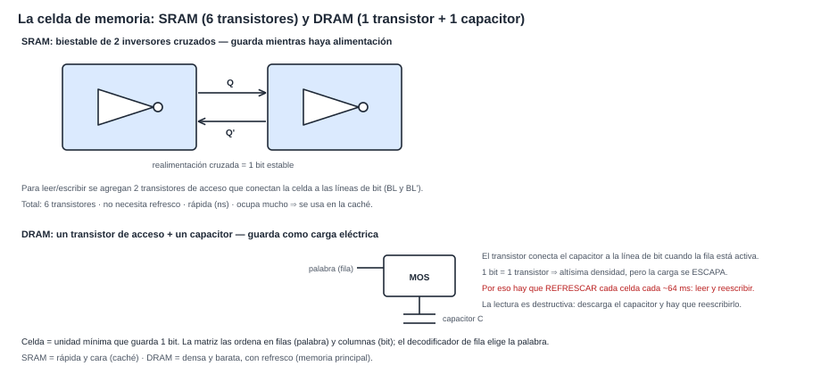

# 2.3.1 Celda elemental de memoria

> [!abstract] En una frase
> Una celda de memoria guarda **un bit** y tiene siempre **cuatro cosas**: un **biestable** (que recuerda), una
> **selección** (que la elige), una señal de **lectura/escritura** (que decide qué hacer) y un **buffer de 3
> estados** (que la conecta al bus sólo cuando es leída).

> [!note] Si es la primera vez que ves esto
> Pensá en un **casillero de un vestuario**: tiene un número (selección), una puerta con cerradura que se abre
> desde afuera (L/E), y adentro un perchero (el biestable). Y hay una ventanilla que sólo se abre cuando alguien
> viene a mirar (el buffer de 3 estados) — así los miles de casilleros no hablan todos por el mismo pasillo a la
> vez.

## La celda por dentro



## Los cuatro bloques

```
              SELECCIÓN (de la dirección)         L/E (del control)
                     │                                 │
               ┌─────▼─────┐                    ┌──────▼──────┐
   D ─────────►│  BIESTABLE │───────────────────►│ 3 ESTADOS   │────► BUS DE DATOS
               └─────┬─────┘   (guarda el bit)   └─────────────┘
                     │
                 MANTIENE
```

| Bloque | Para qué sirve | Qué pasa si falta |
|---|---|---|
| **Biestable** | guardar el bit | no hay memoria, es un cable |
| **Selección** | activar **sólo** la celda direccionada | todas las celdas responderían a la vez |
| **L/E** | leer o escribir según la orden | no se puede distinguir lectura de escritura |
| **3 estados** | conectar al bus sólo cuando se lee | las celdas chocarían contra el bus (cortocircuito lógico) |

## El buffer de 3 estados (lo que más se pregunta)
Tiene tres estados: **0**, **1** y **alta impedancia (Z)**. Con `EN = 1` copia el valor del biestable al bus; con
`EN = 0` se desconecta (no es 0 ni 1: es un **circuito abierto**).

**Por qué es imprescindible:** la memoria tiene miles de celdas conectadas al **mismo** bus de datos. Sólo la
direccionada debe manejarlo; las demás quedan en `Z`. Sin buffers, dos celdas con valores distintos se pelearían
por el cable.

## Operación de una celda

| Operación | SEL | L/E | Bus | Qué hace el biestable |
|---|---|---|---|---|
| mantener | 0 | X | Z | conserva el bit |
| **leer** | 1 | 0 (lectura) | sale `Q` | no cambia |
| **escribir** | 1 | 1 (escritura) | entra `D` | toma el valor del bus |

## De la celda a la palabra
Una **palabra** de `m` bits son `m` celdas que comparten **la misma selección** y **la misma L/E**: se leen y se
escriben **juntas**. Eso es lo que hace que una memoria de 8 palabras × 3 bits tenga **24 celdas** y 8 selecciones
(una por palabra).

> [!warning] Errores típicos
> - Olvidar el buffer de 3 estados (es el bloque que más se valora en la corrección).
> - Decir que la selección "guarda" la dirección: la selección **activa** la celda a partir del decodificador.
> - Confundir `L/E` con el reloj: `L/E` decide la operación; el reloj marca el instante de la escritura.

## Relacionado
[[2.3.2 SRAM y DRAM]] · [[2.3.3 Matriz, expansión y RAM 8x3]] · [[1.4.1 Decodificador]] ·
[[TP13 Componentes internos]] · [[Celda elemental de memoria]]
