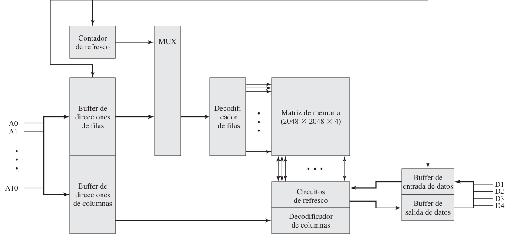

# 2.3.2 SRAM y DRAM

> [!abstract] En una frase
> **SRAM** = celda con **6 transistores** (dos inversores realimentados = un biestable): guarda mientras haya alimentación, es **rápida y cara**. **DRAM** = celda con **1 transistor y 1 capacitor**: guarda una **carga**, es **densa y barata**, pero la carga se pierde y hay que **refrescarla** cada pocos milisegundos.

> [!note] Si es la primera vez que ves esto
> La SRAM es una **pizarra**: escribís y queda, rápido, pero ocupa lugar. La DRAM es un **vaso con agua**: guarda el valor como "agua en el vaso", entra muchísima más cantidad en el mismo espacio, pero el agua se **evapora** y hay que volver a llenarlo cada tanto. Esa evaporación es el **refresco** (refresh).

## SRAM contra DRAM, con el refresco

## Comparación (la tabla que se pide)

| | **SRAM** | **DRAM** |
|---|---|---|
| Celda | 6 transistores (2 inversores + 2 de acceso) | 1 transistor + 1 capacitor |
| Principio | biestable realimentado | carga del capacitor |
| ¿Necesita refresco? | **no** | **sí** (cada ~2-64 ms) |
| Velocidad | muy alta | alta (con latencia y filas) |
| Densidad | baja | **muy alta** |
| Costo por bit | alto | bajo |
| Consumo | bajo (en reposo) | con picos por el refresco |
| Volatilidad | volátil (pierde sin alimentación) | volátil |
| Se usa en | **caché**, registros | **memoria principal (RAM)** |

## El refresco (por qué existe)
El capacitor se descarga por las corrientes de fuga. Cada celda se lee y se reescribe (**ciclo de refresco**) de forma periódica y **en filas completas**, no celda por celda. Mientras se refresca, la memoria **no atiende** un acceso normal: de ahí vienen los "ciclos robados" y parte de la latencia de la DRAM.

## Por qué la computadora usa las dos

- La **caché** tiene que ser **rapidísima** y es chica ⇒ SRAM.

- La **memoria principal** tiene que ser **grande y barata** ⇒ DRAM. Esa mezcla es la base de la **jerarquía de memorias** ([[2.5.1 Jerarquía y localidad]]): lo rápido y caro cerca de la CPU, lo lento y barato lejos.

## El ejemplo de chip: SRAM 1024 × 1 (Intel 2102)

La SRAM que se usa como ejemplo en la materia es la **2102**: **1024 palabras de 1 bit** (1024 bits en total).

| Dato | Valor | Cuenta |
|---|---|---|
| Capacidad | 1024 × 1 | `2¹⁰` palabras ⇒ **10 bits de dirección** |
| Celda | 1 flip-flop (6 transistores) | no necesita refresco |
| Salida | 1 bit | para armar 8 bits se ponen **8 chips en paralelo**, todos con la misma dirección |
| Tiempo de acceso | del orden de decenas de ns | más rápida que la DRAM, más cara por bit |

## Tipo de acceso (cómo se clasifican las memorias)

| Tipo de acceso | Qué significa | Ejemplos |
|---|---|---|
| **Aleatorio** (*random*) | cualquier posición tarda **lo mismo** | RAM (SRAM/DRAM), ROM |
| **En serie** o secuencial | el tiempo depende de **dónde esté** la palabra: hay que pasar por las anteriores | cinta magnética |
| **Directo** | salta al bloque y dentro busca en serie | disco, SSD (por bloques) |
| **Asociativo** | se busca **por contenido**, no por dirección | memoria asociativa / CAM |

> [!warning] Lo que se confunde
> "RAM" no significa "memoria" sino **Random Access Memory**: lo que la define es el **acceso aleatorio**, no que sea volátil. Una ROM también es de acceso aleatorio; un disco, no.

## Otras tecnologías que aparecen

| Tecnología | Celda | Rasgo |
|---|---|---|
| **SDRAM / DDR** | DRAM sincrónica | sincronizada con el reloj y con transferencia doble (DDR) |
| **NVRAM** | SRAM + batería | conserva el dato sin alimentación |
| **Flash** | celda flotante | no volátil, escritura por bloques (ver [[2.4.2 PROM, EPROM, EEPROM y Flash]]) |

> [!warning] Errores típicos
> - Decir que la SRAM es no volátil: **las dos son volátiles**.
> - Confundir "refresco" con "recargar la batería": es reescribir el dato.
> - Invertir la densidad: la DRAM guarda **más** bits por mm², no menos.

## Figura del libro

*Fig. 5.3 — DRAM típica de 16 megabits (4M 4).* · Stallings, *Organización y arquitectura de computadores*, 7ª ed., p. 178.

## Del chip al módulo: DIMM, SODIMM y las DDR

El chip de la figura no se suelda en la placa: se monta en un **módulo** junto con otros chips, y la PC compra módulos. Lo que se pregunta de esto es el **nombre y la diferencia**, no el número de pines de memoria.

| Tipo | Dónde va | Detalle |
|---|---|---|
| **SIMM** | placas viejas | contactos en una sola cara |
| **DIMM** (*Dual In-line Memory Module*) | **escritorio** | contactos en las dos caras; **168, 184, 240 o 288 pines** según la generación |
| **SODIMM** (*Small Outline DIMM*) | **notebooks** | más corto, misma función |

| Generación | Novedad | Detalle |
|---|---|---|
| **SDRAM** | sincrónica con el reloj del bus | una transferencia por ciclo |
| **DDR, DDR2, DDR3, DDR4, DDR5** | *Double Data Rate*: **dos transferencias por ciclo** | cada generación sube frecuencia y baja tensión; el **orificio (muesca)** del módulo impide poner una generación donde no va |

> [!example] La cuenta que se pregunta
> Un módulo **DDR4-3200** tiene reloj de 1600 MHz y transfiere 2 veces por ciclo ⇒ **3200 MT/s** por pin. Con **64 bits** de ancho de bus: `3200 × 10⁶ × 64 / 8 = 25,6 GB/s`. Con un solo canal. Con dos canales (dual channel), el doble. Es exactamente la cuenta de [[8.3.1 Bancos de memoria y ancho de banda]].

## Relacionado
[[2.3.1 Celda elemental de memoria]] · [[2.3.3 Matriz, expansión y RAM 8x3]] · [[2.5.1 Jerarquía y localidad]] · [[Celda elemental de memoria]] · [[TP12 Memoria principal]] · [[Glosario — Unidad 2]]
