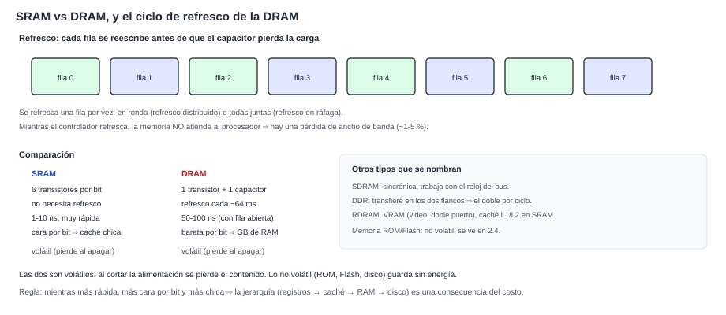

# 2.3.2 SRAM y DRAM

> [!abstract] En una frase
> **SRAM** = celda con **6 transistores** (dos inversores realimentados = un biestable): guarda mientras haya
> alimentación, es **rápida y cara**. **DRAM** = celda con **1 transistor y 1 capacitor**: guarda una **carga**, es
> **densa y barata**, pero la carga se pierde y hay que **refrescarla** cada pocos milisegundos.

> [!note] Si es la primera vez que ves esto
> La SRAM es una **pizarra**: escribís y queda, rápido, pero ocupa lugar. La DRAM es un **vaso con agua**: guarda el
> valor como "agua en el vaso", entra muchísima más cantidad en el mismo espacio, pero el agua se **evapora** y hay
> que volver a llenarlo cada tanto. Esa evaporación es el **refresco** (refresh).

## SRAM contra DRAM, con el refresco

## Comparación (la tabla que se pide)

| | **SRAM** | **DRAM** |
|---|---|---|
| Celda | 6 transistores (2 inversores + 2 de acceso) | 1 transistor + 1 capacitor |
| Principio | biestable realimentado | carga del capacitor |
| ¿Necesita refresco? | **no** | **sí** (cada ~2-64 ms) |
| Velocidad | muy alta | alta (con latencia y filas) |
| Densidad | baja | **muy alta** |
| Costo por bit | alto | bajo |
| Consumo | bajo (en reposo) | con picos por el refresco |
| Volatilidad | volátil (pierde sin alimentación) | volátil |
| Se usa en | **caché**, registros | **memoria principal (RAM)** |

## El refresco (por qué existe)
El capacitor se descarga por las corrientes de fuga. Cada celda se lee y se reescribe (**ciclo de refresco**) de
forma periódica y **en filas completas**, no celda por celda. Mientras se refresca, la memoria **no atiende** un
acceso normal: de ahí vienen los "ciclos robados" y parte de la latencia de la DRAM.

## Por qué la computadora usa las dos
- La **caché** tiene que ser **rapidísima** y es chica ⇒ SRAM.
- La **memoria principal** tiene que ser **grande y barata** ⇒ DRAM.
Esa mezcla es la base de la **jerarquía de memorias** ([[2.5.1 Jerarquía y localidad]]): lo rápido y caro cerca de
la CPU, lo lento y barato lejos.

## Otras tecnologías que aparecen
| Tecnología | Celda | Rasgo |
|---|---|---|
| **SDRAM / DDR** | DRAM sincrónica | sincronizada con el reloj y con transferencia doble (DDR) |
| **NVRAM** | SRAM + batería | conserva el dato sin alimentación |
| **Flash** | celda flotante | no volátil, escritura por bloques (ver [[2.4.2 PROM, EPROM, EEPROM y Flash]]) |

> [!warning] Errores típicos
> - Decir que la SRAM es no volátil: **las dos son volátiles**.
> - Confundir "refresco" con "recargar la batería": es reescribir el dato.
> - Invertir la densidad: la DRAM guarda **más** bits por mm², no menos.

## Figura del libro

*Fig. 5.3 — DRAM típica de 16 megabits (4M 4).* · Stallings, *Organización y arquitectura de computadores*, 7ª ed., p. 178.

## Relacionado
[[2.3.1 Celda elemental de memoria]] · [[2.3.3 Matriz, expansión y RAM 8x3]] · [[2.5.1 Jerarquía y localidad]] ·
[[Celda elemental de memoria]] · [[TP12 Memoria principal]]
