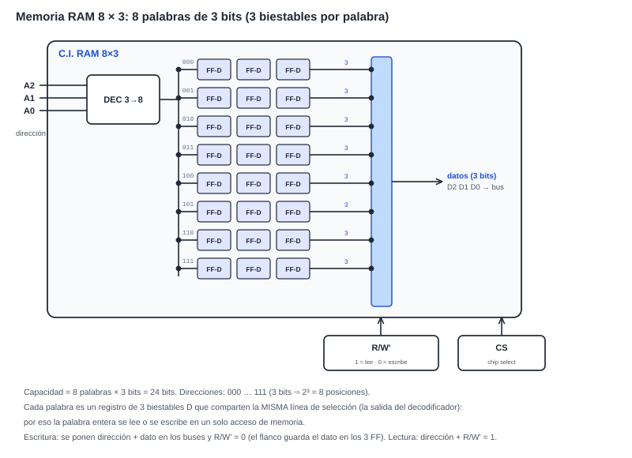
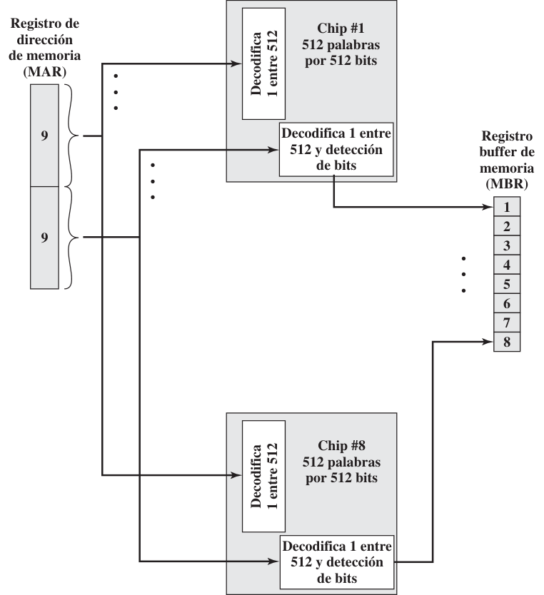

# 2.3.3 Matriz, expansión y RAM 8x3

> [!abstract] En una frase
> Un chip de memoria es una **matriz** de celdas: el **decodificador** convierte la dirección en una **fila**
> activa, y las `m` celdas de esa fila salen juntas por el bus (una **palabra**). Para agrandar se combinan chips en
> **profundidad** (más palabras, con `CS`) o en **ancho** (más bits por palabra).

> [!note] Si es la primera vez que ves esto
> Es un **estacionamiento**: cada fila tiene lugar para un auto por carril (bits) y la dirección dice en qué fila
> estacionar. El decodificador es el que **abre la barrera de una sola fila**; los demás quedan cerrados.

## La matriz de 8 palabras × 3 bits

```
                 ┌───────────────────────────────┐
   A2 ──┐        │  decodificador 3 → 8          │
   A1 ──┼───────►│  (una salida activa por vez)  │
   A0 ──┘        └───┬───┬───┬───┬───┬───┬───┬───┬┘
                     │   │   │   │   │   │   │   │  (selección de fila)
                  ┌──▼─┐…  cada fila = 3 celdas
                  │FFF │  palabra 0: 3 bits
                  └──┬─┘
                     │ 3
   L/E ──────────────┤ (lectura / escritura para todas las celdas de la fila)
   D2..D0 ◄─────────►│ bus de datos (3 bits, con buffers de 3 estados)
```

| Parte | Detalle |
|---|---|
| **Direcciones** | `log₂(8) = 3` bits (`A2 A1 A0`) |
| **Decodificador** | 3 → 8 (3 inversores + 8 AND de 3) |
| **Celdas** | 8 palabras × 3 bits = **24 celdas** |
| **Datos** | bus de **3** bits (uno por columna) |
| **Control** | `L/E` (0 = leer, 1 = escribir) · `CS`/`EN` (chip select) |



## Cómo se escribe una palabra (ejemplo: dirección 5, dato 101)
1. `A2A1A0 = 101`; el decodificador activa **sólo** la salida 5.
2. `L/E = 1` (escritura): las 3 celdas de la fila 5 toman el valor del bus (`1`, `0`, `1`).
3. Las otras 7 filas no reciben selección y **no cambian**.

## Cómo se lee
1. Misma dirección ⇒ se activa la fila 5.
2. `L/E = 0`: los buffers de 3 estados se habilitan y ponen `101` en el bus.
3. Las celdas **no** se modifican (la lectura en SRAM no destruye).

## Expansión (lo que pide el TP12)
| Quiero… | Cómo se hace | Señales |
|---|---|---|
| **más palabras** (profundidad) | chips en paralelo de datos, **uno habilitado a la vez** | bits altos de dirección al decodificador que maneja los `CS` |
| **palabras más anchas** (ancho) | chips en paralelo de datos, **todos habilitados juntos** | el mismo `CS` para todos; cada chip aporta sus bits |

**Ejemplo:** una memoria de `2^n` palabras × 8 bits con chips de `2^(n-1)` × 4 ⇒ **4 chips**: 2 para duplicar la
profundidad y 2 para completar los 8 bits.

> [!warning] Errores típicos
> - Contar celdas como palabras (8×3 son **24 celdas**, no 8).
> - Olvidar que el decodificador tiene **una sola salida activa**.
> - En la expansión de profundidad, habilitar dos chips a la vez (choque en el bus de datos).

## Figura del libro



*Fig. 5.5 — Organización de una memoria de 256 KB.* · Stallings, *Organización y arquitectura de computadores*, 7ª ed., p. 181.

> [!example] RAM 8 × 3 (8 palabras de 3 bits)
> Hacen falta **8 celdas por bit** y **3 planos** (uno por bit) ⇒ **24 celdas**, un **decodificador 3 → 8** (3 bits
> de dirección) y **3 buffers** de salida de 3 estados. Para pasar a 16 × 3: dos chips de 8 × 3 y el bit más alto de
> dirección elige el chip (`CS`) con un decodificador 1 → 2.

## Relacionado
[[2.3.1 Celda elemental de memoria]] · [[2.3.2 SRAM y DRAM]] · [[1.4.1 Decodificador]] ·
[[Memoria RAM 8x3]] · [[TP12 Memoria principal]]
