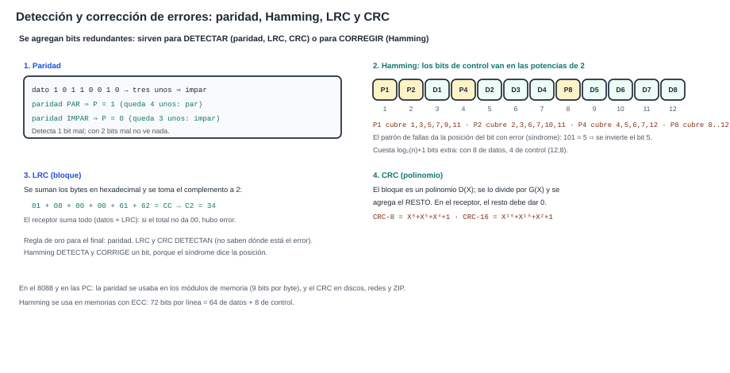
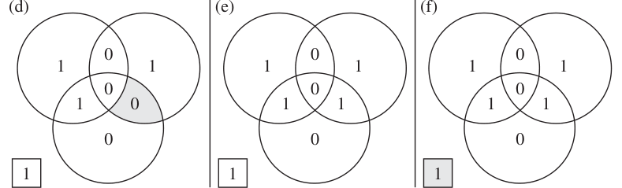

# 2.3.4 Detección y corrección de errores (paridad, LRC, CRC y Hamming)

> [!abstract] En una frase
> Como una memoria o un cable puede devolver un bit cambiado, se le **agregan bits redundantes**: con **paridad**
> o **LRC** se **detecta** que hubo un error; con **CRC** (polinomio) se detectan casi todas las ráfagas; con
> **Hamming** además se **corrige**, porque el patrón de fallas indica **qué bit** está mal.

> [!note] Si es la primera vez que ves esto
> Es el mismo truco del DNI: además del número hay un **dígito verificador**. No agrega información, pero si te
> equivocás al copiar, el verificador no cierra y te avisa. La paridad es eso: un bit de más que dice "la cuenta
> de unos tiene que dar par".

## Paridad (detecta 1 bit)

Se agrega **un** bit para que la cantidad de unos del grupo sea par (paridad **par**) o impar (paridad **impar**).

| Dato | Unos | Paridad par | Paridad impar |
|---|---|---|---|
| `1011 0010` | 4 | `P = 0` (queda par) | `P = 1` |
| `1011 0011` | 5 | `P = 1` | `P = 0` |

| Pregunta | Respuesta |
|---|---|
| ¿Detecta 1 bit mal? | sí: el receptor cuenta unos y no le cierra |
| ¿Detecta 2 bits mal? | **no**: dos errores dejan la cuenta igual |
| ¿Corrige? | **no**: no sabe *cuál* de los bits está mal |

## LRC: paridad por bloque (longitudinal)

Se calcula un byte de paridad **por columna** sobre una trama. Es lo que la cátedra muestra con una trama ASCII:

```
01 + 08 + 00 + 00 + 61 + 62 = CC   (suma hexadecimal de los datos)
complemento a 2 de CC       = 34   ⇒  LRC = 34
```

El receptor **suma los datos + el LRC**: si el resultado no da `00`, hubo error. Detecta **una** ráfaga de hasta
un byte por bloque y se usa en E/S industrial (comunicación entre instrumentos y una PC).

## CRC: polinomio generador (detecta ráfagas)

La trama se interpreta como un **polinomio** `D(X)`: cada posición de bit es un término. A `D(X)` se lo **divide**
por un **polinomio generador normalizado** `G(X)` y se transmite el **resto**. En el receptor, `D(X)` + el resto
dividido por `G(X)` tiene que dar **resto 0**.

| Generador | Polinomio | Redundancia |
|---|---|---|
| **CRC-8** | `X⁸ + X⁵ + X⁴ + 1` | 8 bits |
| **CRC-12** | `X¹² + X¹¹ + X³ + X² + X + 1` | 12 bits |
| **CRC-16** | `X¹⁶ + X¹⁵ + X² + 1` | 16 bits |

**Cómo se calcula a mano:** `D(X) · X⁸` (o sea, desplazar 8 lugares a la izquierda) y dividir por `G(X)` en
módulo 2 (XOR); el resto son los 8 bits de CRC. Es lo que hacen los ZIP, Ethernet y los discos.

> [!example] El polinomio de un bloque
> Un bloque de 6 bytes son 48 bits ⇒ el polinomio puede llegar a grado 47. Si los bits son
> `0000 0001 0000 1000 …`, el término de mayor peso es `X⁴⁷` y los demás se agregan con los bits en 1:
> `D(X) = X⁴⁰ + X³⁵ + X¹⁴ + X¹³ + X⁸ + X⁶ + X¹`.

## Hamming: detecta y corrige (el síndrome es la posición)

Los bits de control van en las **potencias de 2** (`1, 2, 4, 8, …`) y cada uno controla las posiciones cuya
representación binaria incluye ese bit.

| Posición | 1 | 2 | 3 | 4 | 5 | 6 | 7 | 8 | 9 | 10 | 11 | 12 |
|---|---|---|---|---|---|---|---|---|---|---|---|---|
| Bit | `P1` | `P2` | `D1` | `P4` | `D2` | `D3` | `D4` | `P8` | `D5` | `D6` | `D7` | `D8` |

| Control | Cubre las posiciones |
|---|---|
| `P1` | 1, 3, 5, 7, 9, 11 |
| `P2` | 2, 3, 6, 7, 10, 11 |
| `P4` | 4, 5, 6, 7, 12 |
| `P8` | 8, 9, 10, 11, 12 |

El receptor recalcula los controles y arma un **síndrome** con ellos: si vale `0` no hubo error; si vale `k`,
**el bit `k` es el que falló** y se lo invierte. Cuesta `k` bits de control para `2ᵏ − 1 − k` de datos: `(12, 8)`,
`(7, 4)` y, en las memorias con ECC, **72 bits por línea = 64 de datos + 8 de control**.

## Los cuatro, dibujados



## Figura del libro



*Fig. 5.11 — Código SEC-DED de Hamming.* · Stallings, *Organización y arquitectura de computadores*, 7ª ed., p. 186.

> [!example] Ejercicio numérico de Hamming (8, 4)
> Datos `1011` ⇒ `D1=1, D2=0, D3=1, D4=1`. Con paridad **par**: `P1` cubre 3, 5, 7 ⇒ `D1, D2, D4` = `1, 0, 1`
> (dos unos) ⇒ `P1 = 1`. `P2` cubre 3, 6, 7 ⇒ `D1, D3, D4` = `1, 1, 1` (tres) ⇒ `P2 = 1`. `P4` cubre 5, 6, 7 ⇒
> `D2, D3, D4` = `0, 1, 1` (dos) ⇒ `P4 = 0`. Se transmite `P1 P2 D1 P4 D2 D3 D4` = **`1 1 1 0 0 1 1`**.

> [!important] Qué se pregunta de verdad
> 1. La diferencia entre **detectar y corregir** (paridad vs Hamming).
> 2. Cuántos bits de control necesita Hamming para `n` datos: el menor `k` con `2ᵏ ≥ n + k + 1`.
> 3. El cálculo del **LRC** con la suma hexadecimal y el complemento a 2.
> 4. Que el **CRC se divide** y en el receptor el resto debe dar **0**.

> [!warning] Ojo con los dos "1 bit"
> La paridad detecta **un** bit mal y **no** corrige. Hamming corrige **un** bit; si fallan **dos**, el síndrome
> apunta a una posición equivocada y "corrige" mal. Por eso existe el **SEC-DED** (*single error correction,
> double error detection*): agrega un bit más para avisar que hubo dos.

## Relacionado
[[2.3.2 SRAM y DRAM]] · [[2.4.2 PROM, EPROM, EEPROM y Flash]] · [[10.4.1 Discos, SSD y latencias]] ·
[[1.6.1 Códigos ponderados y no ponderados]]
