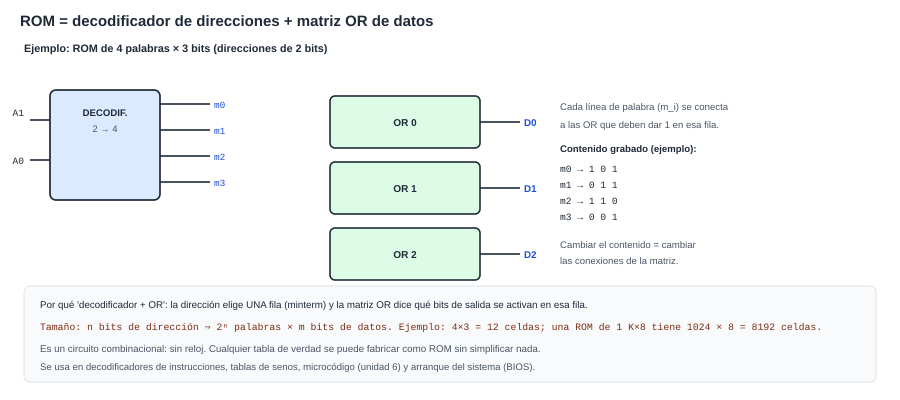
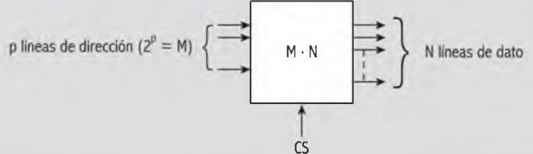

# 2.4.1 ROM = decodificador + OR

> [!abstract] En una frase
> Una ROM de `2ⁿ` palabras de `m` bits es **un decodificador de `n` a `2ⁿ`** (que elige la palabra) más **`m`
> compuertas OR** (una por bit de salida), donde cada OR suma **los mintérminos de las direcciones** en las que ese
> bit vale 1.

> [!note] Si es la primera vez que ves esto
> Una ROM **no es un circuito raro**: es una **tabla de verdad guardada**. Le das una dirección y te devuelve el
> dato que tiene anotado para esa dirección. Como cualquier tabla se puede escribir como suma de mintérminos, la
> ROM es exactamente eso hecho hardware: decodificador + OR.

## ROM = decodificador + OR



## Estructura

```
   A1 ──┐                      ┌──── OR ────► D3
   A0 ──┼──►[ decodificador ]──┤──── OR ────► D2
        │        2 → 4         │──── OR ────► D1
        │                     └──── OR ────► D0
    (una sola línea activa = una palabra)
```

**Ejemplo: ROM de 4 × 4** con este contenido:

| Dirección | D3 D2 D1 D0 |
|---|---|
| 0 (00) | 0 1 1 0 |
| 1 (01) | 1 0 0 1 |
| 2 (10) | 1 1 0 0 |
| 3 (11) | 0 1 1 1 |

Cada salida se escribe como suma de los mintérminos donde vale 1:
```
D3 = m1 + m2      D2 = m0 + m2 + m3      D1 = m0 + m3      D0 = m1 + m3
```
Esas cuatro OR **son** la ROM. La "programación" es decidir **qué fusible/unión** queda conectado a cada OR.

## Por qué la ROM es no volátil
El valor no está en un biestable alimentado: está en la **presencia o ausencia de una conexión** (diodo, fusible,
transistor de compuerta flotante). No hay nada que "se descargue", así que al cortar la luz el dato sigue.

## Usos
| Uso | Por qué una ROM |
|---|---|
| BIOS / firmware | tiene que estar al encender, antes de cargar nada |
| Microcódigo de la UC | el microprograma del 8088 vive en una ROM de 504×21 |
| Tablas de funciones | seno, logaritmos, decodificación de caracteres |
| Generador de caracteres | la fuente de un display: cada dirección es una fila de píxeles |

> [!tip] Una ROM también es una función lógica
> Cualquier función combinacional de `n` variables se implementa con una ROM de `2ⁿ` palabras de 1 bit: se guarda la
> tabla de verdad. Es la forma más directa (aunque no la más barata) de "hacer una función".

> [!warning] Errores típicos
> - Decir que la ROM "tiene biestables": no los necesita, guarda conexiones.
> - Confundir cantidad de palabras con bits por palabra (4×4 son **16 bits**, no 4).
> - Olvidar que el decodificador activa **una** palabra por vez.

## Figura del libro



*Fig. 6.23 — Diagrama de bloque de cualquiera de las memorias de sólo lectura.* · Quiroga, *Arquitectura de computadoras*, p. 153.

## Relacionado
[[2.4.2 PROM, EPROM, EEPROM y Flash]] · [[1.4.1 Decodificador]] · [[1.3.1 Mintérminos y maxtérminos]] ·
[[Memoria ROM y sus tipos]] · [[TP12 Memoria principal]]
