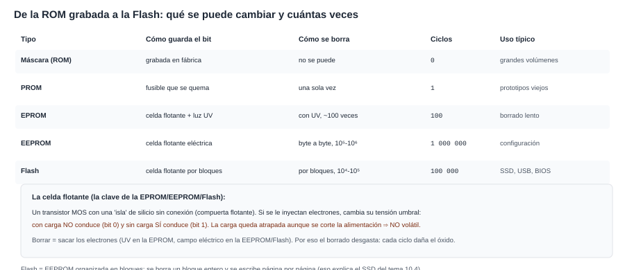

# 2.4.2 PROM, EPROM, EEPROM y Flash

> [!abstract] En una frase
> Son las **variantes programables** de la ROM: **PROM** se graba **una sola vez** (fusibles), **EPROM** se borra
> con **luz ultravioleta**, **EEPROM** se borra **eléctricamente byte por byte** y **Flash** es una EEPROM que se
> borra **por bloques** (es la que usás todos los días).

> [!note] Si esta es la primera vez que ves esto
> La ROM de fábrica no se puede cambiar: si hay un error, se tira el chip. Entonces aparecieron versiones
> "regrabables", de la más incómoda a la más cómoda: sacar el chip y meterlo en un aparato con luz UV (EPROM),
> borrarlo con una señal eléctrica desde el mismo circuito (EEPROM), o hacerlo por bloques y a gran velocidad
> (Flash).

## De la PROM a la Flash

## La tabla completa

| Tipo | Se graba | Se borra | Veces | Tiempo de escritura | Uso típico |
|---|---|---|---|---|---|
| **ROM de máscara** | en fábrica (máscara) | no | 1 | — | productos de altísimo volumen |
| **PROM** | una vez, con un programador | no (fusible quemado) | 1 | lento | prototipos viejos |
| **EPROM** | con programador (voltaje alto) | **UV** (~20 min, ventana de cuarzo) | ~miles | lento | desarrollo, años 80-90 |
| **EEPROM** | eléctricamente, **byte a byte** | eléctricamente | ~1 millón | medio | configuración, datos chicos |
| **Flash NOR** | por bloques | por bloques | ~100 mil | medio | firmware (BIOS), código |
| **Flash NAND** | por páginas | por bloques | ~10 mil | rápido | **SSD**, pendrives, tarjetas |

## Cómo guarda un bit (la idea física)
Todas las regrabables usan un **transistor de compuerta flotante**: la carga atrapada en la compuerta flotante
cambia el umbral del transistor. Con carga = un estado; sin carga = el otro.
- **Programar** = meter carga (voltaje alto).
- **Borrar (Flash/EEPROM)** = sacar la carga; **EPROM** = sacarla con fotones de UV.

El dato **sobrevive** al corte de energía, y eso las hace **no volátiles**; la carga se degrada muy lentamente
(retensión típica: 10-20 años).

## Consecuencias prácticas (lo que se pregunta)
- **Borrar por bloques** es lo que hace lento escribir en Flash: para cambiar un byte hay que **leer el bloque,
  modificarlo y reescribirlo entero**.
- **Duración limitada**: cada borrado desgasta la celda ⇒ los SSD hacen *wear leveling*.
- **Flash no es RAM**: se lee rápido pero se escribe lento y por bloques; por eso los sistemas la usan para
  almacenar y copian a DRAM para trabajar.

> [!warning] Errores típicos
> - Decir que la EPROM se borra con electricidad (es **UV**; la eléctrica es la EEPROM).
> - Confundir EEPROM con Flash: misma familia, distinta **granularidad** de borrado (byte vs bloque).
> - Decir que son volátiles: **son no volátiles** (por eso guardan el firmware).

## Ejemplo resuelto
Comparar una **EPROM 2716** (2 K × 8 = **16 Kbit**) con una **flash** del mismo tamaño:
- La EPROM se borra **entera** con **luz ultravioleta** (ventana de cuarzo, ~20 minutos) y se programa con
  `VPP` ≈ **+12,5 V** aplicado en un pin.
- La EEPROM se borra **por byte** (eléctricamente) pero es más cara y más lenta.
- La **flash** se borra **por bloques** (sectores) y se programa por página: es la que se usa en los pen drives
  y en el firmware (BIOS/UEFI), porque combina densidad de EPROM con borrado eléctrico.
- Cuenta típica: 2 K × 8 = 2048 × 8 = **16 384 bits** = 16 Kbit = **2 KB**.

## Relacionado
[[2.4.1 ROM = decodificador + OR]] · [[2.3.2 SRAM y DRAM]] · [[2.6.2 Memoria auxiliar y memoria asociativa]] ·
[[Memoria ROM y sus tipos]] · [[TP12 Memoria principal]] · [[Glosario — Unidad 2]]
