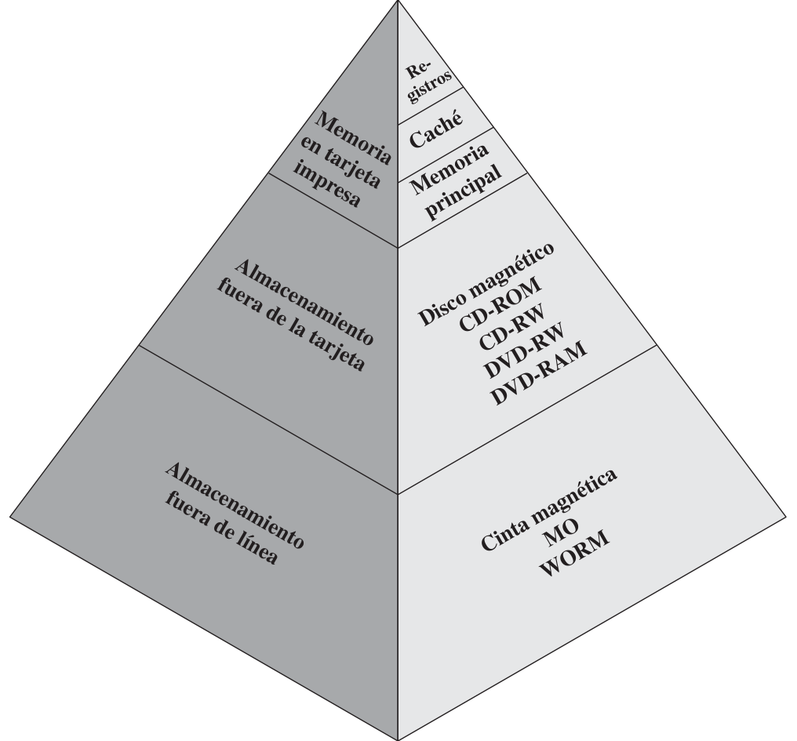

# 2.5.1 Jerarquía y localidad

> [!abstract] En una frase
> La jerarquía de memorias ordena los niveles por **velocidad, tamaño y costo**: registros → caché (L1/L2/L3) → RAM
> → disco/SSD. Funciona porque los programas tienen **localidad**: usan muchas veces pocas zonas de memoria.

> [!note] Si es la primera vez que ves esto
> Es la **heladera, la alacena y el supermercado**: lo que vas a usar ahora lo tenés a mano (heladera = registros),
> lo de la semana en la alacena (RAM), y lo de todo el mes en el supermercado (disco). Vas al supermercado pocas
> veces porque ya sabés que **casi siempre** usás lo mismo. La computadora hace exactamente eso.

## La pirámide

| Nivel | Tecnología | Tamaño típico | Latencia | Costo/bit | Quién la administra |
|---|---|---|---|---|---|
| **Registros** | flip-flops | ~decenas de bytes | < 1 ns | altísimo | el **compilador** |
| **L1** | SRAM | 32-64 KB | ~1 ns | muy alto | el hardware (transparente) |
| **L2 / L3** | SRAM | 256 KB – 32 MB | ~5-15 ns | alto | el hardware |
| **RAM** | DRAM | 8-64 GB | ~50-100 ns | medio | el **sistema operativo** |
| **SSD / disco** | Flash / magnético | 256 GB – varios TB | 0,1-10 ms | bajo | SO y usuario |
| **Cinta / nube** | — | ilimitado | segundos-minutos | mínimo | archivo |

**Regla:** al bajar un nivel, el tamaño crece ~×10 y la latencia crece ~×10; el costo por bit baja ~×10.

## Las dos localidades (por qué la pirámide funciona)
- **Temporal:** si una instrucción o un dato se usó, es probable que se **vuelva a usar** (un lazo que repite el
  mismo contador).
- **Espacial:** si se usó la dirección `X`, es probable que se usen `X+1`, `X+2`… (un arreglo que se recorre en
  orden, instrucciones que se ejecutan en secuencia).

Eso permite traer **bloques completos** (líneas de 32-128 bytes) en cada acceso y aprovecharlos después.

## Qué gana y qué no
- **No mejora un acceso aislado**: si el dato no está en caché, el acceso es igual de lento (o más, por el
  chequeo).
- **Mejora el promedio**: con buena tasa de aciertos, el sistema se comporta casi como el nivel rápido.
  Eso se formaliza con el **AMAT** ([[2.5.3 AMAT y cálculo de mejora]]).

> [!tip] La pregunta clásica del oral
> "¿Por qué no hacemos toda la memoria con SRAM?" → por **costo y densidad**: con SRAM la memoria sería
> enormemente cara y ocuparía una habitación. La jerarquía da **casi** la velocidad de la SRAM con el **costo** de
> la DRAM.

> [!warning] Errores típicos
> - Decir que la jerarquía hace más rápida **cada** operación.
> - Confundir "volátil" con "lenta": son cosas distintas (la RAM es volátil **y** rápida comparada con el disco).
> - Olvidar que la caché es **transparente**: el programador no la maneja.

## Figura del libro

*Fig. 4.1 — Jerarquía de memoria.* · Stallings, *Organización y arquitectura de computadores*, 7ª ed., p. 130.

## Ejemplo resuelto (localidad)
Un bucle que recorre un arreglo de **1000 enteros** de 4 bytes, uno detrás del otro:
- **Localidad espacial**: al traer el primer entero se trae **toda la línea** de caché (por ejemplo 64 B = 16
  enteros) ⇒ los 15 accesos siguientes **aciertan**.
- **Localidad temporal**: las instrucciones del bucle (`for`, comparación, incremento) se ejecutan **1000 veces**
  ⇒ quedan en caché y se leen del camino rápido.
- Ésa es toda la jerarquía: registros (1 ciclo) → caché (3-10) → memoria (100) → disco (millones).

## Relacionado
[[2.5.2 Caché: mapeos y políticas]] · [[2.5.3 AMAT y cálculo de mejora]] · [[2.3.2 SRAM y DRAM]] ·
[[Jerarquía de memorias]] · [[TP12 Memoria principal]]
